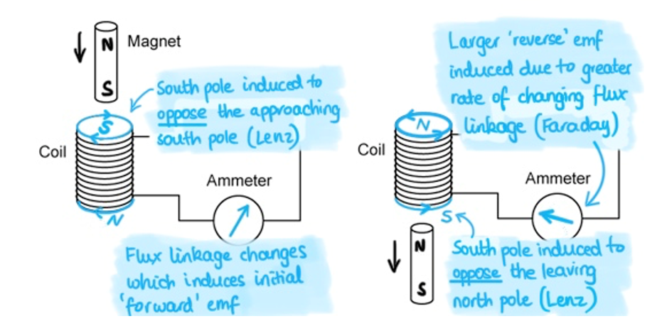
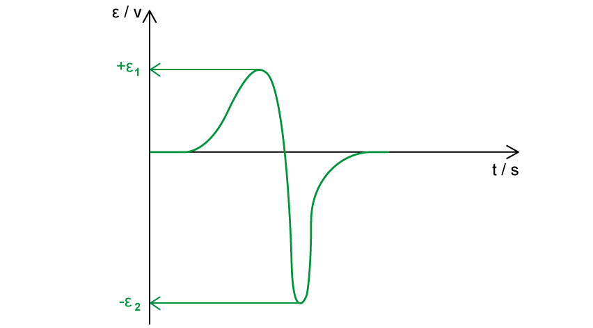
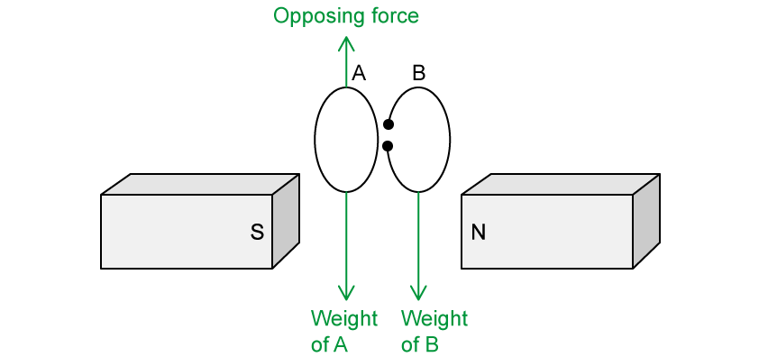
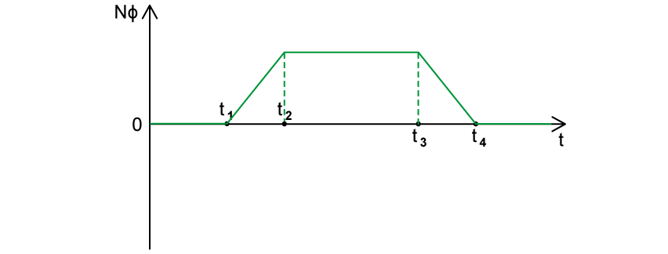
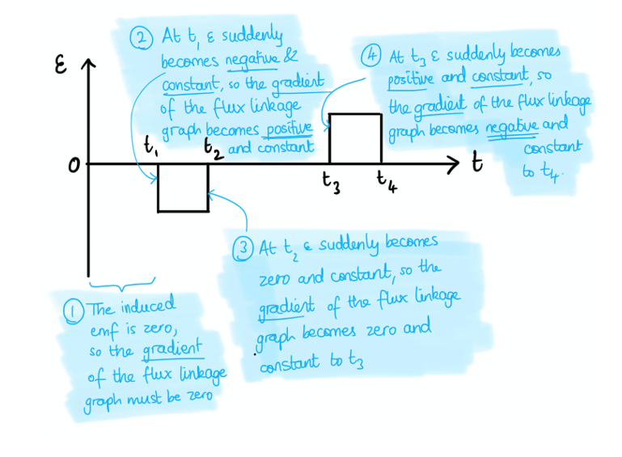

# Mark Schemes — Electromagnetic Induction
**20. Magnetic Fields** · Cambridge (CIE) A-LEVEL physics (9702)

## Structured Questions (8 questions)

### Q1
(i) Define magnetic flux:

- Magnetic flux is the product of magnetic flux density and cross-sectional area; **[1 mark]**
- The direction of the magnetic flux is normal to the plane of the cross-sectional area; **[1 mark]** **OR**** **
- Magnetic flux = magnetic flux density × area × sin *θ* **[1 mark]**
- Where *θ *is the angle between the direction of the flux and the plane of the area; **[1 mark]** ** **

(ii) State Faraday’s law of electromagnetic induction:

- Faraday's law states that the induced e.m.f is proportional to the rate; **[1 mark]**
- Of change of magnetic flux linkage; **[1 mark]**

**[Total: 4 marks]**

- *Use the **revision notes** to learn the definitions*
Calculate the average electromotive force (e.m.f.) induced in coil C:

List the known quantities:

- Number of turns in coil C, $N$ = 96
- Magnetic flux, $ϕ$ = 6.8 × 10−6 × $I$
- Current in the solenoid, $I$ = 3.5 A
- Time interval, $t$ = 2.4 ms = 2.4 × 10−3 s

Recall the equation for Faraday's Law:

- $ε=N\frac{\Deltaϕ}{\Deltat}$

Consider the phrase "the current is reversed":

- This means the current is first reduced to zero and then increased to the same value in the opposite direction
- So, the flux linkage must be considered twice

Substitute the known quantities into the equation for Faraday's Law:

- $\\epsilon = 96 \times \frac{( 6.8 \times 10^{- 6} ) \times 3.5 \times 2}{2.4 \times 10^{- 3} }$ **[1 mark]**

Calculate the e.m.f, $ε$:

- $\\epsilon = 1.904 \mathrm{V} = 1.9 \mathrm{V} ( 2 s. f. )$ **[1 mark]**

**[Total: 2 marks]**

- *Look out for "the **current is reversed**" this tells you to **multiply** flux linkage **by 2*
Describe qualitatively the e.m.f. that is now induced in coil C:

- The e.m.f now induced in coil C is alternating / sinusoidal; **[1 mark]**
- It has the same frequency as the sinusoidal alternating supply; **[1 mark]**

**[Total: 2 marks]**

### Q2
The correct table is as follows:

| **Quantity** | **Symbol** | **SI unit** | ** ** |
|---|---|---|---|
| magnetic flux | *ϕ* | **Wb / Weber** | **[1 mark] ** |
| magnetic flux linkage | **Final answer:** ** ****NΦ** | Wb | **[1 mark]** |
| electromotive force | **Final answer:** **ε** | **V / Volt**** ** | **[1 mark] ** |
| **Final answer:** **magnetic flux density** | *B* | **T / Tesla**** ** | **[1 mark] ** |

**[Total: 4 marks]**
The correct diagrams are as follows:

(i) If the magnet is held at rest in the coil:

- No deflection shown (arrow still pointing upwards); **[1 mark]**

(ii) If the magnet is moved back out of the coil more quickly than it entered:

- Deflection shown; **[1 mark]**
- To the <u>left</u>; **[1 mark]**
- <u>Greater</u> than the deflection shown in Fig. 1.1b; **[1 mark]**

**[Total: 4 marks]**

> *The deflection on the voltmeter is a **measure **of the magnitude of the **induced e.m.f.*

> *When the magnet is held **at rest** inside a coil, there is no **change in **magnetic flux linkage, therefore there is no induced e.m.f. or current (and no deflection on the voltmeter).*

> *If the magnet reverses from the coil, there **is** a change in magnetic flux linkage in the **opposite** direction to that initially observed in **Fig. 1.1b** – therefore the deflection on the voltmeter is in the opposite direction as the current is in the opposite direction.*

> *Notice the question says the magnet is removed **faster** than it entered, therefore, the **rate of change** of magnetic flux linkage is greater which means a larger induced e.m.f. and current (and larger deflection), as required by Faraday’s law.*
Using the graph and Faraday's law...

- Faraday's law: induced e.m.f. is proportional to the rate of change of magnetic flux linkage

(i) There is a reading on the voltmeter because:

- The movement of the magnet causes a change in flux linkage; **[1 mark]**

(ii) The reading varies in magnitude because:

- The (magnetic) flux density (produced by the magnet) is not constant / uniform; **[1 mark]**
- (As the magnet moves towards/away from the coil) the rate of change of flux varies; **[1 mark]**

(iii) The reading has both positive and negative values because:

- The magnet changes its direction; **[1 mark]**
- This causes the induced e.m.f. / current to change direction; **[1 mark]**

**[Total: 5 marks]**
Calculate the change in magnetic flux linkage:

List the known quantities:

- Induced e.m.f., *ε* = 1.5 mV = 1.5 × 10–3 V
- Time interval, *t* = 2.0 s

Use Faraday's law and rearrange:

- $\\epsilon = \frac{\Delta ( N \\Phi )}{\Delta t} \Leftrightarrow \Delta ( N \\Phi ) = \\epsilon \Delta t$ **[1 mark]**
- $\Delta ( N \\Phi ) = ( 1.5 \times 10^{- 3} ) \times 2.0$ **[1 mark]**
- $\Delta ( N \\Phi )$ = 3.0 × 10–3 Wb (turns) **[1 mark]**

**[Total: 3 marks]**

> *Both Wb (Weber) and Wb turns are valid units of magnetic flux linkage, but since 'turns' is more of a multiplier rather than a unit, it's not strictly necessary.*

### Q3
Recall Faraday’s Law and Lenz’s Law:

- Faraday’s Law states that the induced emf is <u>proportional</u> to the <u>rate</u> of change of magnetic flux linkage **AND**
- Lenz’s law states that the induced emf is set up in such a way that it <u>opposes</u> the change causing it; **[1 mark] **

Comment on the correct application of Faraday’s law:

- The student has correctly indicated an induced emf in the coil; **[1 mark]**

  - This is shown by the ammeter deflection
- The induced emf creates a south pole at the top of the coil / north pole at the bottom of the coil as the magnet approaches it; **[1 mark]**

Comment on the correct application of Lenz’s law:

- The student has correctly indicated a reversal of emf as <u>indicated by a reversed current on the ammeter</u>; **[1 mark]**

Comment on the corrections required using Faraday’s Law:

- The emf induced in the opposite direction should be greater than the initial induced emf **OR**
- The student's reversed deflection on the ammeter should be larger than the initial deflection; **[1 mark]**

Comment on the corrections required using Lenz’s Law:

- (As the magnet passes the centre of the coil) the induced emf should create a <u>south pole</u> at the bottom of the coil / a north pole at the top of the coil as the magnet falls through **OR**
- The direction of current round the coil should reverse once the magnet has passed through (in order to oppose the motion); **[1 mark]**

**[Total: 6 marks]**

> *Contexts in which you apply Faraday’s Law and Lenz’s Law tend to have a lot of subtleties and are regularly examined, so make sure you carefully consider what happens at each stage of the magnet’s descent. *

> *A corrected diagram is shown below, with some explaining annotations.*

> *A general exam tip – do quote the laws themselves, especially if the question asks for explicit reference to them. In a lot of cases, this will be creditworthy.*
A graph that would score 3 marks should look like:

Correct general shape shown:

- Both positive and negative emf indicated (either positive then negative or negative then positive); **[1 mark]**

Magnitude of positive and negative emf correctly shown:

- The magnitude of the (initial) positive emf is less than the magnitude of the (final) negative emf **OR**
- (If the initial emf is assumed to be negative) The magnitude of the (initial) negative emf is less than the magnitude of the (final) positive emf; **[1 mark]**

Positive and negative area between the line and the x-axis compare correctly:

- The (initial) positive area between the x axis and the curve should be wider than the (final) negative area, which is narrower but longer **OR**
- (If the initial emf is assumed to be negative) The (initial) negative area between the x axis and the curve should be wider than the (final) positive area, which is narrower but longer; **[1 mark]**

**[Total: 3 marks]**** **

> *It’s really important that you can show the final emf is not only in the opposite direction, but also its magnitude is **greater** than the initial emf because the magnet is **accelerating** as it falls – since, by Faraday’s law, the rate of change of flux linkage is greater.*

> *Notice that this implies another important property of the graph, in that the positive area is wider than the narrower negative area. The **magnitude** of both positive and negative areas must be equal (the change in flux as the magnet enters and exits is the same). As the time period where the magnet is leaving the coil is shorter (it is accelerating in free fall), this part of the graph must be taller to compensate.*
State the magnitude of the induced emf in the coil:

- At the midway point, the magnitude of the induced emf in the coil is zero (V);** [1 mark]**

Explain the value of the induced emf:

- At the midway point, the rate of change of flux linkage is zero; **[1 mark]**
- This is because the change in flux linkage <u>into</u> the coil is (momentarily) equal to the change in flux linkage <u>out of</u> the coil; **[1 mark]**

**[Total: 3 marks]**

### Q4
(i) Magnetic flux is defined as:

- The product of (magnetic) flux density *B* and area *A*; **[1 mark]**
- Where the area is perpendicular to the (magnetic) field; **[1 mark] ** **OR**
- Magnetic flux:  $Φ=BA$; **[1 mark]**
- Where *B* = magnetic flux density and A = cross-sectional area (through the coil); **[1 mark]**

(ii) The equation for magnetic flux when B and A are not perpendicular is:

- $Φ=BA\mathrm{cos}θ$; **[1 mark]**

**[Total: 3 marks]**
Calculate the magnetic flux passing through the coil:

List the known quantities:

- Cross-sectional area, *A* = 0.1 m2
- Magnetic flux density, *B* = 80 mT = 80 × 10−3 T

Calculate the magnetic flux and state the unit:

- Magnetic flux:  $Φ=BA$
- $\\Phi = ( 80 \times 10^{- 3} ) \times 0.1$** [1 mark]**
- $Φ=8\times10^{-3}$** [1 mark]** Wb** [1 mark]**

**[Total: 3 marks]**
(i) Magnetic flux linkage is defined as:

- The product of the magnetic flux and the number of turns on a coil $( N \\Phi )$ **OR** the product of magnetic flux density, area, and the number of turns on a coil $( B A N )$; **[1 mark]**

(ii) Calculate the change in magnetic flux linkage:

List the known quantities:

- Magnetic flux, $Φ$ = 8 × 10−3 Wb (from **(b)**)
- Number of turns, N = 500

Calculate the change in magnetic flux linkage:

- Flux linkage:  $NΦ=BAN$
- Change in flux linkage:  $\Delta ( N \\Phi ) = 500 \times ( 8 \times 10^{- 3} ) - 0$ **[1 mark]**
- $\Delta ( N \\Phi )$ = 4 Wb (turns) **[1 mark]**

**[Total: 3 marks]**
Calculate the average magnitude of the induced e.m.f. in the coil during the rotation:

List the known quantities:

- Change in flux linkage, $\Delta ( N \\Phi )$ = 4 Wb
- Time interval, $\Deltat$ = 300 ms = 300 × 10−3 s

Use Faraday's law to calculate the induced e.m.f.

- Faraday's law:  $\\epsilon = \frac{\Delta ( N \\Phi )}{\Delta t}$ **[1 mark]**
- Induced e.m.f.  $ε=\frac{4}{300\times10^{-3}}$ **[1 mark]**
- Induced e.m.f.  $ε$ = 13.3 ≈ 13 V **[1 mark]**

**[Total: 3 marks]**

### Q5
(i) Faraday's law of electromagnetic induction states:

- The (magnitude of the) induced e.m.f. is (directly) proportional to the rate; **[1 mark]**
- of change of magnetic flux linkage; **[1 mark]** ** **

(ii) Faraday's law is defined by the equation

- $\\epsilon = \frac{\Delta ( N \\Phi )}{\Delta t}$ **[1 mark]**
- Where $ε$ = induced e.m.f., $\Delta ( N \\Phi )$ = change in magnetic flux linkage and $\Deltat$ = time interval of change; **[1 mark]**

**[Total: 4 marks]**

> *It’s crucial that you remember an emf is only induced if there is a **change** in magnetic flux linkage. *

> *How quickly this quantity changes (i.e., the **rate **of change of magnetic flux linkage) determines the magnitude of the induced emf. *
The correct sentence is:

- The **direction** of an induced emf; **[1 mark]**
- is always set up in a way such that it **opposes**; **[1 mark]**
- the change in magnetic flux **linkage** that causes it; **[1 mark]**

**[Total: 3 marks] **

> *Stating Lenz’s law in words comes up quite often in examinations, make sure you can describe it in terms of the **direction** of the induced emf*

> *The induced emf is always set up in such a way that the effect is to try and **stop**, or **oppose**, whatever is inducing it. This is a consequence of **conservation of energy** (i.e., electromagnetic energy cannot be created for free!).   *
The equation including Lenz's law is:

- $\\epsilon = - \frac{\Delta ( N \\Phi )}{\Delta t}$
- Minus sign included; **[1 mark]**

**[Total: 1 mark]**

> *Lenz’s law says the **direction** of the induced emf is set up to oppose the change causing it, which is encapsulated by the negative sign in the equation.*

> *This is similar to vectors, for example, if vector **a** and vector **b** are related by **a** = – **b**, this means they point in opposite directions. In this sense, the vectors ‘**oppose**’ each other, just like the induced emf **ε** opposes the changing flux linkage. *
An e.m.f. may be induced in the coil by:

**Final answer:** **Any ****two**** from:**

- Moving the coil towards / away from the solenoid; **[1 mark]**
- Rotating the coil; **[1 mark]**
- Varying the current in the solenoid; **[1 mark]**
- Placing an iron core into the solenoid; **[1 mark]**

**[Total: 2 marks]**

### Q6
The definition of magnetic flux linkage is:

- The product of magnetic flux; **[1 mark]**
- and the number of turns of a coil; **[1 mark]**

**[Total: 2 marks]**

> *Make sure you are clear on the terminology used in this topic. *

> *Magnetic flux density**, *$B$*, is a measure of the strength of a magnetic field at a point (force per unit current, per unit length), with units of Tesla, T.*

> *Magnetic flux**, *$Φ$*, is a measure of the total amount of field passing through a single defined area (*$Φ=BA$*), with units of Weber, Wb.*

> *Magnetic flux linkage**, *$NΦ$*, is a measure of the total field interacting with the coil system (product of magnetic flux and number of turns), with units of Weber, Wb.*
Determine the magnetic flux linkage inside the coil at time *t *= 0.30 s:

List the known quantities:

- Side length of coil, *L *= 10 cm = 0.1 m
- Number of turns in coil, *N *= 5

Calculate the area of the coil:

- Cross-sectional area, *A* = *L*2 = 0.12 = 0.01 m2

Use the graph to obtain a value for magnetic flux density, *B*:

- At *t* = 0.3 s, *B *= 200 mT = 200 × 10−3 T

Use the equation for magnetic flux linkage:

- $ΦN=BAN$ **[1 mark]**
- $\\Phi N = ( 200 \times 10^{- 3} ) \times 0.01 \times 5$ **[1 mark]**
- $ΦN=0.01\mathrm{Wb}$ **[1 mark]**

**[Total: 3 marks]**
(i) The graph shows that the e.m.f. induced across the terminals between *t *= 0 and *t *= 0.30 s is constant because:

- It is a straight line / has a constant gradient; **[1 mark]**

(ii) The magnitude of the e.m.f. is:

List the known quantities:

- Magnetic flux linkage, *NΦ* = 0.01 Wb
- Time, *t *= 0.30 s

Use Faraday's Law:

- The induced e.m.f. = rate of change of flux linkage;** [1 mark]**
- So, e.m.f. = $\frac{NΦ}{t}$
- e.m.f. = $\frac{0.01}{0.3}=0.033V$ **[1 mark]**

**[Total: 3 marks]**
The effect on the coil of connecting the terminals together during the change of magnetic flux density shown in Fig. 1.2 is:

- The induced e.m.f. causes current flow in the coil;** [1 mark]**

**Final answer:** **Any one ****pair ****from:**

- Current in the magnetic field causes the forces to act on the coil; **[1 mark]**
- The opposite sides of the coil are forced inwards: **[1 mark]**

**Final answer:** **OR **

- Current causes the dissipation of energy in the resistance of the coil; **[1 mark]**
- The temperature of the coil rises; **[1 mark]**

**[Total: 3 marks]**

### Q7
The magnetic flux is:

- Greater in the larger solenoid **OR** lower in the smaller solenoid; **[1 mark]**

**[Total: 1 mark]**

> *The magnetic flux of a solenoid is given by *$Φ=BA$*, so for a given magnetic flux density *$B$*, the solenoid with the larger area *$A$* will have the greater magnetic flux.*
The magnetic flux linkage is:

- Greater in the larger solenoid **OR** lower in the smaller solenoid; **[1 mark]**

**[Total: 1 mark]**

> *Magnetic flux linkage is given by *$NΦ=NBA$

> *For the larger solenoid: *$N \\Phi = 800 \times ( 7.8 \times 10^{- 3} ) \times B = 6.24 B$

> *For the smaller solenoid: *$N \\Phi = 2000 \times ( 1.2 \times 10^{- 3} ) \times B = 2.4 B$
Lenz's Law of electromagnetic induction is:

- The <u>direction</u> of the induced e.m.f.; **[1 mark]**
- That produces the effects that oppose the <u>change</u> causing it; **[1 mark]**

**[Total: 2 marks]**
A force is needed to remove the smaller solenoid because:

- In the smaller solenoid, the change in flux linkage induces an e.m.f. in it; **[1 mark]**
- The induced current in the smaller solenoid causes a field around it; **[1 mark]**
- The two fields interact to create an attractive force; **[1 mark]**

**[Total: 3 marks]**

### Q8
Apply Faraday’s law:

- Faraday’s law states that in a conductor, an emf is induced proportional to the rate of change of flux (linkage)
- As A and B descend, the flux linkage through both of them changes so an emf is induced in them both; **[1 mark]**
- Because A is a complete ring, the emf in it drives a current; **[1 mark]**

Apply Lenz’s law:

- Len’s law states that the induced emf is set up in a direction so as to oppose the change that caused it
- The emf is induced <u>in the same direction</u> in both A and B **AND** there is an <u>upward force on A</u> due to the induced current inside it; **[1 mark]**

Describe the motion of A and B:

- Both A and B <u>accelerate</u> (downward); **[1 mark]**

**Final answer:** **Any ****one**** from:**

- But A accelerates at a slower rate / the acceleration of A is less than B; **[1 mark]**
- The resultant force on A is smaller than B; **[1 mark]**
- Forces correctly labelled on a sketch as shown below (implying a smaller resultant force on A); **[1 mark]**

**[Total: 5 marks]**** **

> *Any question involving a metal conductor in motion through a magnetic field should immediately trigger a reminder to you to state and apply both Faraday’s law and Lenz’s law. *

> *The crucial thing you should remember is that an emf is **always** induced if flux linkage changes, but a current is only driven to flow by that emf if the conductor is part of a **complete circuit. **This question interrogates that very fact: only one ring contains a flowing current, which then results in an upward force on it (the magnetic fields interact), opposing its weight force.*
Sketch the flux linkage-time graph:

- Zero flux linkage between *t* = 0 and *t *= $t_{1}$; **[1 mark]**
- A <u>straight line</u> with <u>positive gradient</u> showing increasing flux linkage between $t_{1}$ and $t_{2}$ ; **[1 mark]**
- A <u>straight line</u> with <u>zero gradient</u> showing constant flux linkage between $t_{2}$ and $t_{3}$ ; **[1 mark]**
- A <u>straight line</u> with <u>negative gradient</u> showing decreasing flux linkage between $t_{3}$ and $t_{4}$ ; **[1 mark]**
- The gradient between *t*1 and *t*2 should be the same magnitude as that between $t_{3}$ and $t_{4}$ ; **[1 mark]**

**[Total: 5 marks]**

> *Linking the gradient of a flux linkage-time graph to the induced emf is very common in exams.*

- *Faraday’s law states the induced emf is the rate of change of flux linkage (i.e. the gradient of a flux linkage graph)*
- *Lenz' law states that the emf opposes the change inducing it*
- *This means the gradient of a flux linkage-time graph represents the **negative** magnitude of induced emf *

> *So, if emf is constant and **negative **then the gradient of the flux linkage graph is constant and **positive**.*

> *Some questions require you to determine the shape of the induced emf from a flux linkage graph (using the gradient). Others, like this one, give you the induced emf graph and require you to work ‘backwards’ to figure out the shape of the flux linkage-time graph. This is more tricky.*

> *Fig. 1.2 is illustrated again below with some helpful annotations to explain each step in producing the flux linkage-time graph.*

Relate the induced emf to changing flux linkage through the coil:

- The <u>change in flux linkage</u> between times $t_{2}$ and $t_{3}$ is zero; **[1 mark]**
- ‘Cutting magnetic field lines’ is not a reliable way to explain induced emf / Faraday’s law does not describe cutting of magnetic field lines; **[1 mark]**

**[Total: 2 marks]*** *

> *Field lines are being 'cut' by the coil from *$t_{2}$* to *$t_{3}$*, but there is a **constant** value of magnetic flux through **N** turns, therefore the rate of **change** of flux linkage is zero and the induced emf is zero.*
