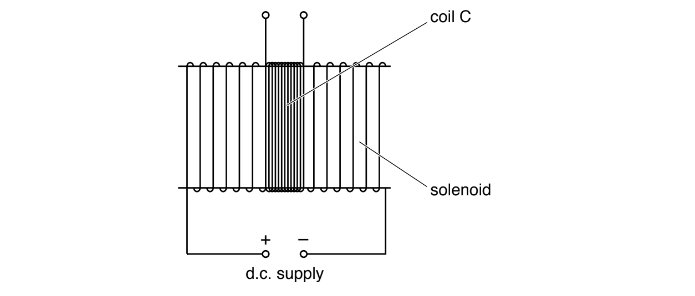
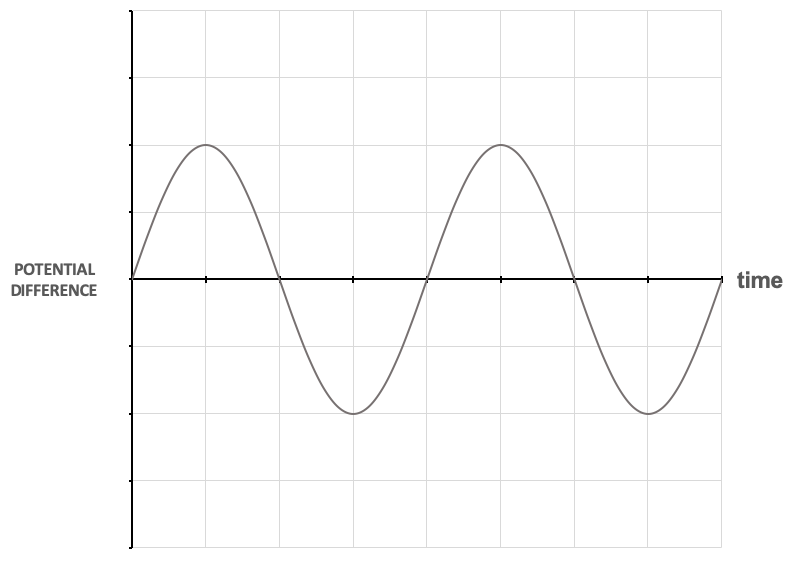
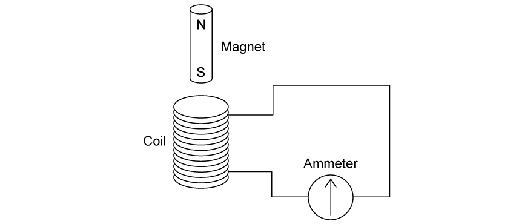
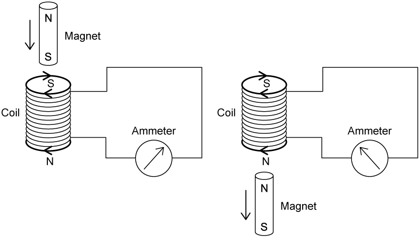
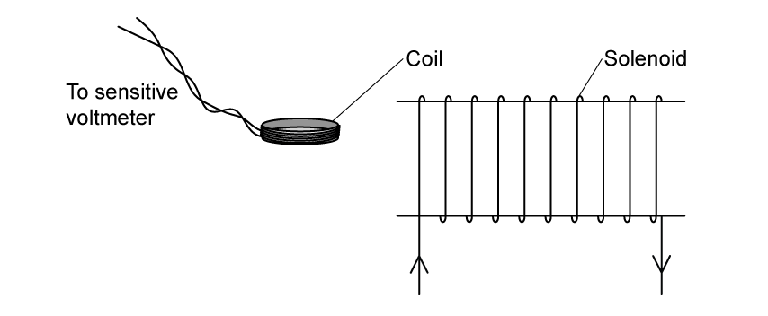
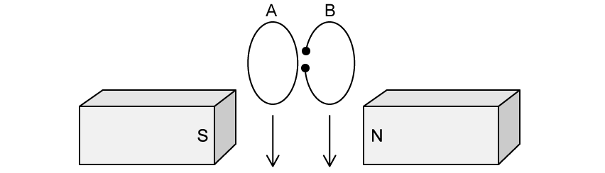

# Exam Questions — Electromagnetic Induction
**20. Magnetic Fields** · Cambridge (CIE) A-LEVEL physics (9702)
> Source: [https://www.savemyexams.com/a-level/physics/cie/25/topic-questions/](https://www.savemyexams.com/a-level/physics/cie/25/topic-questions/) · 8 questions across 1 sets

## Structured Questions (8 questions)

### Q1 — medium — 8 marks

**Q1** [4 marks]

(i) Define magnetic flux.

[2]

(ii) State Faraday’s law of electromagnetic induction.

[2]

*Source: Specimen 2022 Paper 4 Q7A*

**Q1** [2 marks]

A solenoid has a coil C of wire wound tightly about its centre, as shown in Fig. 7.1.

**Fig. 7.1**

The coil C has 96 turns.

The uniform magnetic flux *Φ*, in Wb, in the solenoid is given by the expression

*Φ* = 6.8 × 10–6 × *I*

where *I* is the current, in A, in the solenoid.

Calculate the average electromotive force (e.m.f.) induced in coil C when a current of 3.5 A is reversed in the solenoid in a time of 2.4 ms.

e.m.f. = ................................... V

*Source: Specimen 2022 Paper 4 Q7B*

**Q1** [2 marks]

**Extract:**

A solenoid has a coil C of wire wound tightly about its centre, as shown in Fig. 7.1. The coil C has 96 turns. The uniform magnetic flux Φ, in Wb, in the solenoid is given by the expression Φ = 6.8 × 10^–6^ × I where I is the current, in A, in the solenoid.

The d.c. supply in Fig. 7.1 is now replaced with a sinusoidal alternating supply.

Describe qualitatively the e.m.f. that is now induced in coil C.

*Source: Specimen 2022 Paper 4 Q7C*

### Q2 — easy — 16 marks

**Q2** [4 marks]

Table 1.1 shows the standard international (SI) units of the main quantities involved in electromagnetic induction.

**Table 1.1**

| **Quantity** | **Symbol** | **SI unit** |
|---|---|---|
| magnetic flux | *ϕ* |   |
| magnetic flux linkage |   | Wb |
| electromotive force |   |   |
|   | *B* |   |

Complete Table 1.1 by filling in the missing quantities, symbols and SI units.

**Q2** [4 marks]

A coil is connected to a voltmeter, which is centred at zero as shown in Fig. 1.1a.

**Fig. 1.1a**

When the magnet is lowered into the coil, the needle on the voltmeter deflects to the right as shown in Fig. 1.1b.

**Fig. 1.1b**

On Fig. 1.1c, sketch the expected observations of the voltmeter needle when

(i)  the magnet is held at rest in the coil

[1]

(ii) the magnet is removed from the coil faster than it entered

**Fig. 1.1c**

[3]

**Q2** [5 marks]

**Extract:**

A coil is connected to a voltmeter, which is centred at zero as shown in Fig. 1.1a. When the magnet is lowered into the coil, the needle on the voltmeter deflects to the right as shown in Fig. 1.1b.

The magnet is moved towards and away from the coil at a steady rate.

Fig. 1.2 shows the variation of time with the reading of potential difference on the voltmeter.

**Fig. 1.2**

Use Fig. 1.2 and Faraday’s law to explain why

(i) there is a reading on the voltmeter,

[1]

(ii) this reading varies in magnitude,

[2]

(iii) the reading has both positive and negative values.

[2]

**Q2** [3 marks]

As the magnet is moved away from the coil, the voltmeter shows a value of 1.5 mV for 2.0 s.

Calculate the change in magnetic flux linkage as the magnet is moved away from the coil.

### Q3 — hard — 12 marks

**Q3** [6 marks]

A coil is connected to a zero-centred ammeter, as shown in Fig. 1.1. A student drops a magnet so that it falls vertically and completely through the coil.

**Fig. 1.1**

The student uses a combination of Faraday’s Law and Lenz’s law to explain what happens on the ammeter as the magnet descends. Fig. 1.2 shows a diagram they draw to illustrate their explanation.

**Fig. 1.2**

With reference to Faraday’s Law and Lenz’s Law, evaluate the student’s explanation as illustrated in Fig. 1.2.

**Q3** [3 marks]

**Extract:**

A coil is connected to a zero-centred ammeter, as shown in Fig. 1.1. A student drops a magnet so that it falls vertically and completely through the coil.

Use the axes on Fig. 1.3 to sketch a graph of the induced emf $ε$ against time *t *as the magnet falls completely through the coil. You are not required to include values on either axis.

**Fig. 1.3**

**Q3** [3 marks]

**Extract:**

A coil is connected to a zero-centred ammeter, as shown in Fig. 1.1. A student drops a magnet so that it falls vertically and completely through the coil.

State and explain the magnitude of the induced emf when the magnet is exactly midway through its descent in the coil.

### Q4 — easy — 12 marks

**Q4** [3 marks]

(i) Define magnetic flux.

[2]

(ii) Write the equation for magnetic flux when the magnetic flux density is **not** perpendicular to the area.

[1]

**Q4** [3 marks]

A circular coil with an area of 0.1 m2 and 500 turns is placed with its plane perpendicular to a horizontal magnetic field of uniform flux density 80 mT as shown in Fig. 1.1.

**Fig. 1.1**

Calculate the magnetic flux passing through the coil. Give a unit with your answer.

**Q4** [3 marks]

**Extract:**

A circular coil with an area of 0.1 m^2^ and 500 turns is placed with its plane perpendicular to a horizontal magnetic field of uniform flux density 80 mT as shown in Fig. 1.1.

Calculate the magnetic flux passing through the coil. Give a unit with your answer.

Magnetic flux: Φ = B A = (80 × 10^−3) × 0.1 = 8 × 10^−3 Wb

The coil experiences a change in magnetic flux linkage when it is rotated through 90° about a vertical axis (indicated in Fig. 1.1).

(i) Define magnetic flux linkage

[1]

(ii) Calculate the change in magnetic flux linkage produced by the rotation of the coil.

[2]

**Q4** [3 marks]

**Extract:**

The coil experiences a change in magnetic flux linkage when it is rotated through 90° about a vertical axis (indicated in Fig. 1.1).
(ii) Calculate the change in magnetic flux linkage produced by the rotation of the coil.
Change in flux linkage: \$\$\Delta \left(N \Phi\right) = 500 \times \left(8 \times 10^{- 3}\right) - 0\$\$; \$\$\Delta \left(N \Phi\right)\$\$ = 4 Wb (turns)

The coil rotates through 90° in a time of 300 ms.

Calculate the average magnitude of the induced e.m.f. in the coil during the rotation.

### Q5 — easy — 10 marks

**Q5** [4 marks]

State Faraday's Law

(i) in words

[2]

(ii) as an equation, defining all the quantities.

[2]

**Q5** [3 marks]

Lenz’s law is sometimes combined with Faraday’s law in order to explain electromagnetic effects.

Use the words below to complete the description of Lenz's law

| **attracts ** | **opposes** | **density** |
|---|---|---|
| **direction** | **linkage** | **magnitude** |

The _________ of an induced emf is always set up in a way such that it  ________ the change in magnetic flux ___________ that causes it.

**Q5** [1 mark]

**Extract:**

(ii) Faraday's law is defined by the equation \$\$\epsilon = \frac{\Delta \left(N \Phi\right)}{\Delta t}\$\$ Where \$\$\epsilon\$\$ = induced e.m.f., \$\$\Delta \left(N \Phi\right)\$\$ = change in magnetic flux linkage and \$\$\Delta t\$\$ = time interval of change

Rewrite the equation you wrote in **(a)(ii)** to include Lenz's law.

**Q5** [2 marks]

A small coil of wire connected to a sensitive voltmeter is placed near one end of a solenoid (in which an electrical current is flowing) as shown in Fig. 1.1.

**Fig. 1.1**

State **two **different ways in which an e.m.f. may be induced in the coil.

### Q6 — medium — 11 marks

**Q6** [2 marks]

Define magnetic flux linkage.

**Q6** [3 marks]

A square coil of wire of side length 10 cm consists of 5 insulated turns. The coil is stationary in a uniform magnetic field. The plane of the coil is perpendicular to the magnetic field, as shown in Fig. 1.1.

**Fig. 1.1**

The flux density *B *of the magnetic field varies with time *t *as shown in Fig. 1.2.

**Fig. 1.2**

Determine the magnetic flux linkage inside the coil at time *t *= 0.30 s. Give a unit with your answer.

magnetic flux linkage = ............................... unit ................

**Q6** [3 marks]

**Extract:**

A square coil of wire of side length 10 cm consists of 5 insulated turns. The coil is stationary in a uniform magnetic field. The plane of the coil is perpendicular to the magnetic field, as shown in Fig. 1.1. The flux density B of the magnetic field varies with time t as shown in Fig. 1.2. Determine the magnetic flux linkage inside the coil at time t = 0.30 s. Give a unit with your answer.

From the mark scheme: At t = 0.3 s, B = 200 mT = 200 × 10^−3 T; Cross-sectional area A = 0.01 m^2; Number of turns N = 5; ΦN = BAN = (200 × 10^−3) × 0.01 × 5 = 0.01 Wb

(i) State how the graph in Fig. 1.2 shows that the e.m.f. induced across the terminals between *t *= 0 and *t *= 0.30 s is constant.

[1]

(ii) Calculate the magnitude of the e.m.f.

[2]

**Q6** [3 marks]

**Extract:**

A square coil of wire of side length 10 cm consists of 5 insulated turns. The coil is stationary in a uniform magnetic field. The plane of the coil is perpendicular to the magnetic field, as shown in Fig. 1.1. The flux density B of the magnetic field varies with time t as shown in Fig. 1.2. Determine the magnetic flux linkage inside the coil at time t = 0.30 s.

The procedure in **(b) **is repeated, but this time the terminals of the coil are connected together.

State and explain the effect on the coil of connecting the terminals together during the change of magnetic flux density shown in Fig. 1.2.

### Q7 — medium — 7 marks

**Q7** [1 mark]

A small solenoid of area of cross-section 1.2 × 10−3 m2 is placed inside a larger solenoid of area of cross-section 7.8 × 10−3 m2, as shown in FIg. 1.1

**Fig. 1.1**

The larger solenoid has 800 turns and is attached to a d.c. power supply to create a magnetic field.

The smaller solenoid has 2000 turns.

Compare the magnetic flux in the two solenoids.

**Q7** [1 mark]

**Extract:**

A small solenoid of area of cross-section 1.2 × 10^−3^ m^2^ is placed inside a larger solenoid of area of cross-section 7.8 × 10^−3^ m^2^, as shown in FIg. 1.1. The larger solenoid has 800 turns and is attached to a d.c. power supply to create a magnetic field. The smaller solenoid has 2000 turns.

Compare the magnetic flux linkage in the two solenoids.

**Q7** [2 marks]

State Lenz's Law of electromagnetic induction.

**Q7** [3 marks]

**Extract:**

A small solenoid of area of cross-section 1.2 × 10^−3^ m^2^ is placed inside a larger solenoid of area of cross-section 7.8 × 10^−3^ m^2^, as shown in Fig. 1.1. The larger solenoid has 800 turns and is attached to a d.c. power supply to create a magnetic field. The smaller solenoid has 2000 turns.

The terminals of the smaller solenoid are connected together. The smaller solenoid is then removed from the inside of the larger solenoid.

With reference to magnetic fields, explain why a force is needed to remove the smaller solenoid.

### Q8 — hard — 12 marks

**Q8** [5 marks]

As part of an introductory lesson on electromagnetic induction, a physics teacher plans a series of experiments for her students to carry out.** **

In experiment 1, two metal rings A and B are dropped from the same height between two magnets, as shown in Fig. 1.1. They are identical, apart from a small slit cut in B as shown.

**Fig. 1.1**

The teacher asks her students to observe the motion of the two metal rings as they fall between the magnets.

Describe and explain the motion of A and B as they fall between the magnets.

You may wish to include sketches in your answer.

**Q8** [5 marks]

The physics teacher displays a sketch of the variation of induced emf $ε$ in a coil with time. This is shown in Fig. 1.2.

**Fig. 1.2**

The students are asked to use the properties of the graph shown in Fig. 1.2 to determine how it might be reproduced.

On Fig. 1.3, sketch the variation with time $t$ of the magnetic flux linkage $NΦ$* *through the coil from time $t=0$ to $t=t_{4}$.

**Fig. 1.3**

**Q8** [2 marks]

**Extract:**

The physics teacher displays a sketch of the variation of induced emf ε in a coil with time. This is shown in Fig. 1.2.

The physics teacher reveals that the graph shown in Fig. 1.2 was produced by a coil moving at a constant speed into and out of a uniform magnetic field. They draw a sketch of this motion in three stages, as shown in Fig. 1.4:

**Fig. 1.4**

A student disagrees, saying that while the coil is moving across the magnetic field between times $t_{2}$ and $t_{3}$, as shown in Fig. 1.4, magnetic field lines are being cut, so there must be an induced emf in the coil.

Suggest how the teacher should explain what happens within the coil between times $t_{2}$ and $t_{3}$ to improve the student’s understanding.
