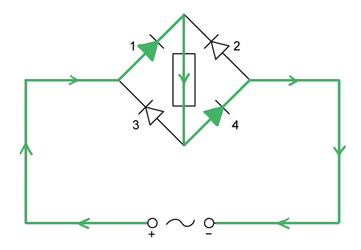
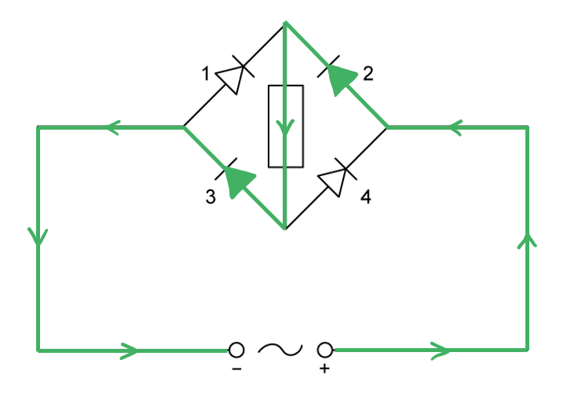
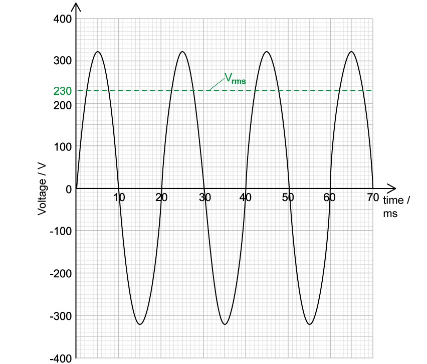
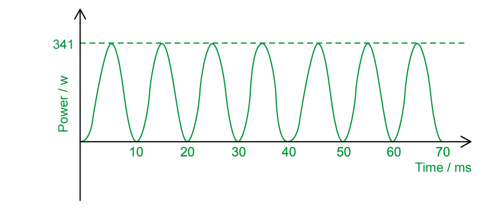
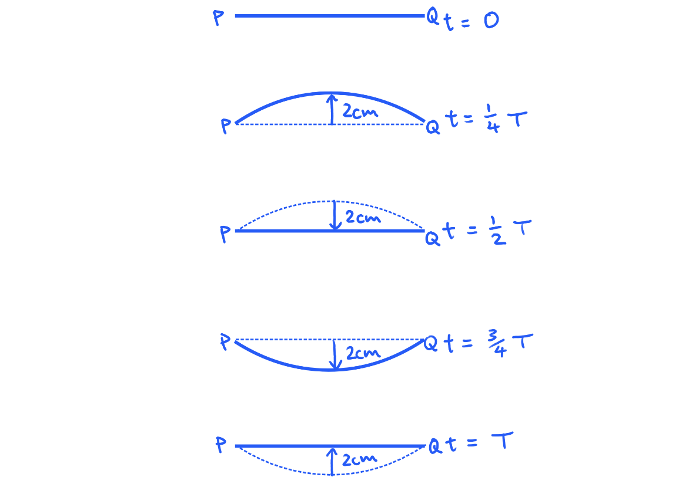
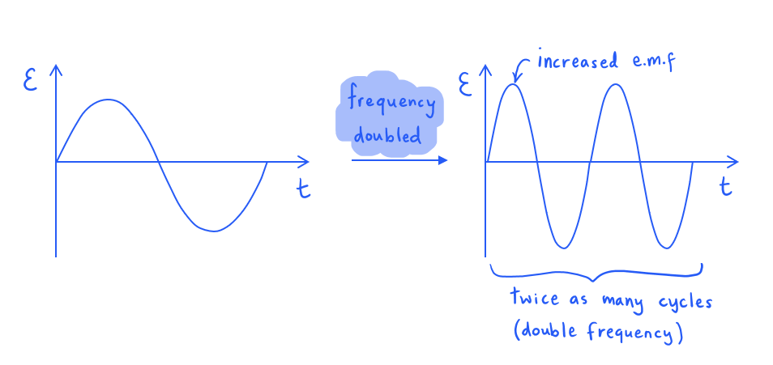
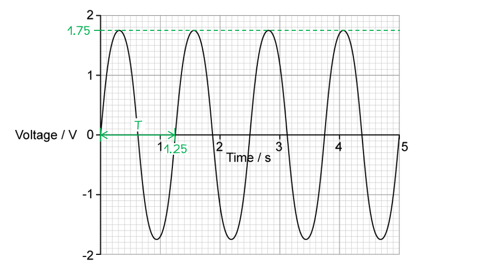
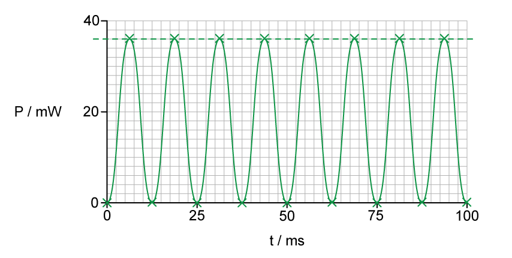
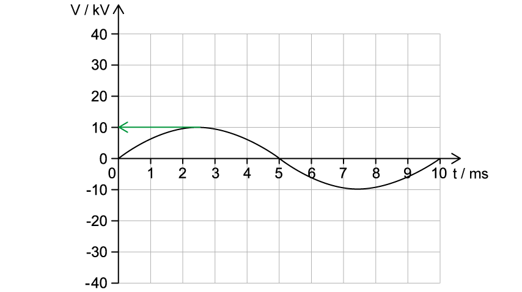
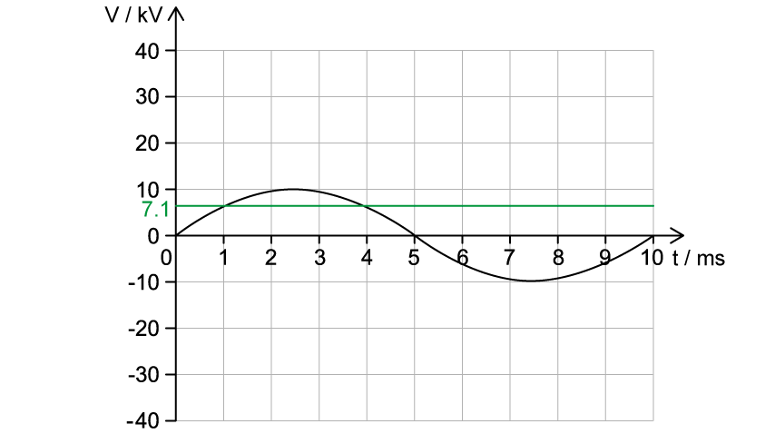

# Mark Schemes — Characteristics of Alternating Currents
**21. Alternating Currents** · Cambridge (CIE) A-LEVEL physics (9702)

## Structured Questions (8 questions)

### Q1
(i) Rectification is defined as:

- The process of converting alternating current (a.c) into direct current (d.c); **[1 mark]**

(ii) Smoothing is defined as:

- The <u>reduction</u> in the variation of the output current (or voltage); **[1 mark]**

**[Total: 2 marks]**
The variation of output voltage with time for...

(i) Half-wave rectification:

- All peaks at the same height; **[1 mark]**
- Only <u>half</u> a wavelength in the positive direction and zero the rest of the time; **[1 mark]**

(ii) Full-wave rectification:

- All peaks at the same height; **[1 mark]**
- All wavelengths in the positive direction; **[1 mark]**

**[Total: 4 marks]**
The 'ripples' in the graph can be reduced by:

- A capacitor with greater capacitance; **[1 mark]**
- A (load) resistor with a larger resistance; **[1 mark]**

**[Total: 2 marks]**

> *This mark scheme requires **two** answers for full marks. Although this is not necessarily stated in the question, it is indicated by the number of marks. A good exam technique is to check the number of marks in the question and make sure you have in your mark scheme to justify them!*
The pathways of the current are...

(i) On Fig. 1.3b:

- Current passes through diodes 1 and 4 only; **[1 mark]**

(ii) On Fig. 1.3c:

- Current passes through diodes 2 and 3 only; **[1 mark]**

**[Total: 2 marks]**

> *This can be a little confusing at first, but it is not using any more knowledge than you're aware of already.*

> *The important thing to remember is that a diode only allows current to flow in **one **direction. Therefore, the current takes a different path through different diodes depending on which terminal is positive.*

### Q2
Determine the peak voltage, $V_{0}$  from graph:

- $V_{0}$ = 320 V

Calculate the rms voltage, $V_{rms}$ :

- The rms voltage is the equivalent dc voltage that would give the same power
- $V_{rms}=\frac{v_{0}}{\sqrt{2}}=\frac{320}{\sqrt{2}}$= 226.27 = 230 V (2 s.f.) **[1 mark]**

An example of a graph that would score 1 mark:

- Horizontal line at 230 V; **[1 mark]**** **

**[Total: 2 marks]**
An example of a graph that would score 4 marks:

- Sine squared graph with maximum value at *P* = $\frac{V^{2}}{R}=\frac{320^{2}}{300}$ = 341 W; **[1 mark]**
- Power at 0 every 10 ms; **[1 mark]**
- At least 3 uniform, positive peaks seen **AND** correctly labelled power on y-axis and time on x-axis; **[1 mark]**** **

**[Total: 3 marks]**** **

> *Although the value of the power will fluctuate with the alternating voltage supply, because the power is proportional to the voltage **squared** it will always be a **positive **value.*

> *This means the negative peaks in Fig. 1.1 become positive, and the graph features a positive peak every 10 ms instead alternating positive and negative peaks every 10 ms.*
Y-gain:

- Adjust the y-gain / y-sensitivity to be $\frac{640}{8}$ = 80 V div–1 (per division); **[1 mark]**
- The full peak-to-peak voltage of 640 V spans the screen

Time-base setting:

- Adjust / change time base; **[1 mark]**
- Each cycle is 20 ms therefore 4 cycles is 80 ms (20 × 4)
- The setting is $\frac{80}{10}$ = 8.0 ms div–1 (per division); **[1 mark]**** **

**[Total: 3 marks]**** **
The rms voltage across the heating element will be less than 230 V because:

- There is a potential difference / voltage across the cable; **[1 mark]**
- The (rms) voltage across the oven is 230 V / the mains <u>minus</u> the voltage across the cable; **[1 mark]** **OR**
- The resistance of the cable lowers the current in the circuit; **[1 mark]**
- The voltage across the oven is lower because of *V = IR */ Ohm’s law; **[1 mark]** **OR**
- The resistance of the cable is in series with the heating element; **[1 mark]**
- The voltage splits in ratio across these resistances; **[1 mark]**** **

**[Total: 2 marks]**

> *It is easy to get into the habit of ignoring the resistance of wires, but in reality wires have a small resistance. Just like adding a resistor to a circuit would reduce the potential difference across the oven, a wire with resistance does the same.*

### Q3
(i) Explain why the wire oscillates:

- The wire has a magnetic field; **[1 mark]**
- The wire's magnetic field interacts with the uniform magnetic field; **[1 mark]**
- The current flowing through the wire alternates; **[1 mark]**
- The magnetic field around the wire also alternates; **[1 mark]**
- The force on the wire alternates <u>direction</u>; **[1 mark]**

(ii) Show that the maximum force is around 40 mN:

List the known quantities:

- Uniform field flux density, *B*  = 220 mT = 0.220 T
- Length of wire in field, *L*  = 55 mm = 0.055 m
- rms current, *I**rms*  = 2.4 A

Determine the peak current, *I*0 :

- $I_{rms}=\frac{I_{0}}{\sqrt{2}}$
- $I_{0}=2.4\times\sqrt{2}=3.39A$ **[1 mark]**

Calculate the maximum force:

- Maximum force occurs at peak current
- $F_{max}=BI_{0}L=0.220\times3.39\times0.055$
- $F_{max}=0.041N=41\mathrm{mN}$ **[1 mark]**
- This is roughly 40 mN

**[Total: 7 marks]**
Write an expression for current:

List the known quantities:

- Displacement from equilibrium, *x*  = 2.0 cm = 0.020 m
- Average speed, *v*  = 0.16 m s−1
- Peak current, *I*0  = 3.4 A (from (a))

Find the period *T  *of oscillations:

- In one period, the wire moves 2.0 cm 4 times (up, back down, down, back up)
- Distance moved, *d*  = 8.0 cm = 0.080 m
- $T=\frac{d}{v}=\frac{0.080}{0.16}=0.50s$ **[1 mark]**

Convert this to angular frequency:

- $ω=\frac{2π}{T}=\frac{2π}{0.50}=4π\mathrm{rad}s^{-1}$ **[1 mark]**

Write an expression for current:

- `I space equals space I subscript 0 sin open parentheses omega t close parentheses`
- `I space equals space 3.4 sin open parentheses 4 straight pi t close parentheses` **[1 mark]**

**[Total: 3 marks]**

> *You would also gain the marks if you chose to write your angular frequency as 13 rad s**−1** .*

> *When considering the distance moved by the wire, drawing a diagram may help:*

> *Over one full oscillation, the wire has moved 8.0 cm in total at the average speed of 0.16 m s**−1**.*
State the direction of the wire's oscillations:

- The wire oscillates up and down / vertically; **[1 mark]**

Explain why:

- <u>Fleming's left hand rule</u> shows this; **[1 mark]**

Explain why the oscillations are not symmetrical:

- The resultant force on the wire when moving upwards is less than the resultant force on the wire when acting downwards; **[1 mark]**
- Because the wire's weight acts downwards **OR** the resultant force downwards is 40 mN plus weight **OR** the resultant force upwards is 40 mN minus weight; **[1 mark]**

**[Total: 4 marks]**

### Q4
(i) Peak voltage is defined as:

- The maximum value of the alternating voltage; **[1 mark]**

(ii) Root mean square voltage is defined as:

**EITHER**

- The value of steady / constant voltage; **[1 mark]**
- That produces same power (in a resistor) as the alternating voltage; **[1 mark]**

**OR**

- If the alternating voltage is squared and averaged; **[1 mark]**
- The r.m.s. value is the square root of this averaged value; **[1 mark]**

**[Total: 3 marks]**
List the known quantities:

- Alternating voltage: `V space equals space 150 space sin space open parentheses 200 straight pi t close parentheses`

(i) Determine the peak voltage:

- Alternating voltage:  $V=V_{0}\mathrm{sin}ωt$
- Hence, peak voltage, $V_{0}$ = 150 V** [1 mark]**

(ii) Determine the r.m.s. voltage:

- r.m.s. voltage:  $V_{rms}=\frac{V_{0}}{\sqrt{2}}$
- r.m.s. voltage:  $V_{rms}=\frac{150}{\sqrt{2}}$ = 106 V** [1 mark]**

(iii) Determine the frequency:

- From $V=V_{0}\mathrm{sin}ωt$:  $ω=200π$
- Frequency:  $ω=2πf\Rightarrowf=\frac{ω}{2π}$
- Frequency:  $f=\frac{200π}{2π}$ = 100 Hz** [1 mark]**

**[Total: 3 marks]**
List the known quantities:

- Peak voltage, $V_{0}$ = 150 V (from **(b)**)
- r.m.s. voltage, $V_{rms}$ = 106 V (from **(b)**)
- Resistance, R = 100 Ω

(i) Calculate the peak and r.m.s. current in the resistor:

- Peak current:  $V_{0}=I_{0}R\RightarrowI_{0}=\frac{V_{0}}{R}$
- Peak current:  $I_{0}=\frac{150}{100}$ = 1.5 A **[1 mark]**
- r.m.s. current:  $I_{rms}=\frac{I_{0}}{\sqrt{2}}$
- r.m.s. current:  $I_{rms}=\frac{1.5}{\sqrt{2}}$ = 1.06 A **[1 mark]**

(ii) Calculate the mean power dissipated in the resistor

- Mean power:  `open angle brackets P close angle brackets space equals space V subscript r m s end subscript I subscript r m s end subscript`
- Mean power:  `open angle brackets P close angle brackets space equals space 106 cross times 1.06` **[1 mark]**
- Mean power:  `open angle brackets P close angle brackets space equals space 112 space straight W` **[1 mark]**

(iii) Calculate the peak power dissipated in the resistor:

- Peak power:  `P subscript 0 space equals space 2 cross times open angle brackets P close angle brackets`
- Peak power:  $P_{0}=2\times112$ **[1 mark]**
- Peak power:  $P_{0}=224W$ **[1 mark]**

**[Total: 6 marks]**
If the frequency of the generator is increased:

- The output voltage will <u>increase</u>; **[1 mark]**

**[Total: 1 mark]**

> *If the frequency of the generator is increased, this means the coil is spinning **faster**. This means the coil will take a shorter time to complete one cycle.*

> *Since the emf generated is the **rate of change **of flux linkage, the **change** in flux linkage will increase. Therefore, the emf increases.*

### Q5
Use the graph to determine an equation for *V *in terms of *t*:

- From the graph:  time period, *T *= 1.25 s **AND**
- From the graph:  peak voltage,* V**0* = 1.75 V **[1 mark]**

Calculate the angular frequency, *ω*:

- Angular frequency:  $ω=\frac{2π}{T}$
- Angular frequency:  $ω=\frac{2π}{1.25}=\frac{8π}{5}$ (5.03 rad s−1) **[1 mark]**

Use the sinusoidal representation for voltage:

- Alternating voltage:  $V=V_{0}\mathrm{sin}ωt$
- Alternating voltage:  `V space equals space 1.75 space sin space open parentheses fraction numerator 8 straight pi over denominator 5 end fraction t close parentheses`  **or ** `V space equals space 1.75 space sin space open parentheses 5.03 t close parentheses` **[1 mark]**

**[Total: 3 marks]**
(i) Determine the root-mean-square voltage:

- Peak voltage, $V_{0}$ = 1.75 V (from part a)
- Root-mean-square voltage:  $V_{rms}=\frac{V_{0}}{\sqrt{2}}$
- Root-mean-square voltage:  $V_{rms}=\frac{1.75}{\sqrt{2}}$ = 1.24 V **[1 mark]**

(ii) Determine the mean voltage:

- Mean voltage = 0 V **[1 mark]**

**[Total: 2 marks]**

> *The mean voltage here is zero, but it might not always be*

> *If the wave completes a full cycle (i.e. a 360° time period), then the areas above and below the horizontal axis will cancel out, giving a mean voltage of zero*

> *However, if the wave does not complete a full cycle, then the mean voltage is the sum of the positive and negative areas under the sine curve*
Calculate the mean power dissipated in the resistor:

List the known quantities:

- Peak voltage, *V**0* = 1.75 V (from part a)
- Resistance of resistor, *R *= 25 Ω

Use the equation for peak power, *P**0*:

- Peak power:  $P_{0}=\frac{V_{0}^{2}}{R}=\frac{1.75^{2}}{25}$
- Peak power:  $P_{0}=0.1225W$ **[1 mark]**

Use the equation for mean power, *P*:

- Mean power:  $P=\frac{P_{0}}{2}=\frac{0.1225}{2}$
- Mean power:  $P$ = 0.061 W (61 mW) **[1 mark]**

**[Total: 2 marks]**

### Q6
Calculate the mean power dissipated by the resistor:

List the known quantities:

- Root-mean-square voltage, *V*rms* *= 5.1 V
- Resistance, *R *= 1430 Ω

Use the equation for mean power:

- `P subscript m e a n end subscript space equals space open parentheses V subscript r. m. s end subscript close parentheses squared over R` **[1 mark]**
- $P_{mean}=\frac{5.1^{2}}{1430}$
- $P_{mean}=0.018W$
- $P_{mean}=18\mathrm{mW}$ **[1 mark]**

**[Total: 2 marks]**
The curve to show how the power* *dissipated varies with time *t:*

List the known quantities:

- Mean power, *P**mean* = 18 mW (from part a)
- Frequency of wave, *f* = 40 Hz (from part a)

Calculate the peak power:

- $P_{peak}=2\timesP_{mean}$
- $P_{peak}=2\times18$
- $P_{peak}=36\mathrm{mW}$** [1 mark]**

Calculate the time period of the wave, *T*:

- $T=\frac{1}{f}=\frac{1}{40}$
- $T=0.025s=25\mathrm{ms}$

A curve that would score 3 marks should look like this:

- Peaks are drawn at peak power 36 mW; **[1 mark]**
- The peaks have a sinuosidal shape with the wave sitting on the *t *axis;** [1 mark]**
- Eight cycles of the repeating pattern are shown, with *P *= 0 at 12.5, 25, 37.5, 50, 62.5, 75, 87.5, 100 ms; **[1 mark]**

**[Total: 4 marks]**
(i) The effect on the air surrounding the crystal:

- The alternating voltage causes the crystal to vibrate; **[1 mark]**
- The vibrations of the crystal cause the air to vibrate; **[1 mark]**

(ii) If the crystal were to be used in an ultrasound transducer:

- The <u>frequency</u> (of the vibrations) must be increased; **[1 mark]**
- A frequency of 40 Hz is too low for ultrasound **OR **ultrasound frequencies are in the kHz / MHz range;** [1 mark]**

**[Total: 4 marks]**

### Q7
The root-mean-square (r.m.s.) value of an alternating current is:

- The (values of the) direct / steady current; **[1 mark]**
- That dissipates heat / thermal energy at the <u>same rate</u> (in a resistor) **OR** that produces the <u>same</u> power dissipation / heating effect (in a resistor); **[1 mark]**

**[Total: 2 marks]**
The sinusoidal alternating current equation has the form:

- $I=I_{0}\mathrm{sin}ωt$

(i) Determine the peak current:

- Peak current:  $I_{0}$ = 15 A **[1 mark]**

(ii) Determine the r.m.s. current:

- r.m.s. current:  $I_{rms}=\frac{I_{0}}{\sqrt{2}}$
- r.m.s. current:  $I_{rms}=\frac{15}{\sqrt{2}}$ = 10.6 A **[1 mark]**

(iii) Determine the frequency:

- Angular frequency:  $ω$ = 60 rad s−1
- Frequency:  $ω=2πf\Rightarrowf=\frac{ω}{2π}$
- Frequency:  $f=\frac{60}{2π}$ = 9.5 Hz **[1 mark]**

**[Total: 3 marks]**
Calculate the minimum resistance of R:

List the known quantities:

- Maximum mean power, $P$ = 1 kW = 1000 W
- r.m.s. current, $I_{rms}$ = 10.6 A (from part b)

Use the equation for mean power and r.m.s. current:

- Mean power dissipated:  `P space equals space open parentheses I subscript r m s end subscript close parentheses squared R space space space space space rightwards double arrow space space space space space R space equals space P over open parentheses I subscript r m s end subscript close parentheses squared` **[1 mark]**
- Minimum resistance:  $R=\frac{1000}{10.6^{2}}$ = 8.9 Ω **[1 mark]**

**[Total: 2 marks]**

### Q8
Determine the maximum output voltage of the generator:

- Peak voltage:  $V_{0}$ = 10 kV **[1 mark]**

**[Total: 1 mark]**
Calculate the root mean squared voltage:

List the known quantities:

- Peak voltage, $V_{0}$ = 10 kV = 10 × 103 V (from **(a)**)

Use the r.m.s. voltage equation:

- r.m.s. voltage:  $V_{rms}=\frac{V_{0}}{\sqrt{2}}$
- $V_{rms}=\frac{10\times10^{3}}{\sqrt{2}}$ **[1 mark]**
- *V*rms = 7071 = 7.1 kV **[1 mark]**

**[Total: 2 marks] **
Calculate the root mean squared current:

List the known quantities:

- Average power output, *P* = 35 kW = 35 × 103 W
- r.m.s. voltage,* *$V_{rms}$* *= 7.1 × 103 V (from **(b)**)

Use the equation for mean power:

- Mean power:  $P_{mean}=I_{rms}V_{rms}\RightarrowI_{rms}=\frac{P_{mean}}{V_{rms}}$ **[1 mark]**
- $I_{rms}=\frac{35\times10^{3}}{7.1\times10^{3}}$ **[1 mark]**
- $I_{rms}$ = 4.93 = 4.9 A **[1 mark]**

**[Total: 3 marks]**
Draw a line on the graph in Fig. 1.1b to show the *V*rms:

- Line draw at 7.1 kV (by eye); **[1 mark]**
- *V*-axis labelled; **[1 mark]**

**[Total: 2 marks]**

> *Remember to always draw straight lines with a ruler or straight edge, messy sketches are unlikely to get you full marks in your exam! *
