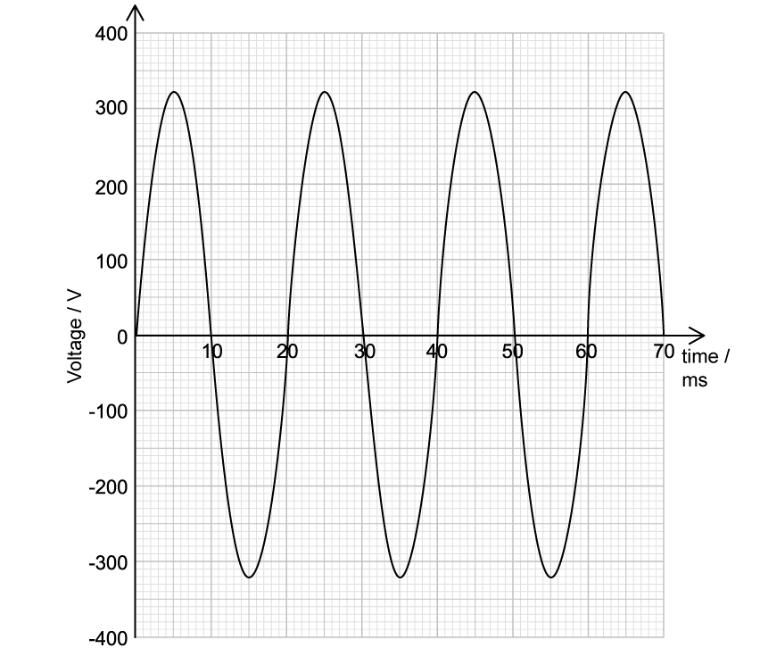
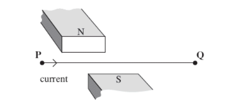
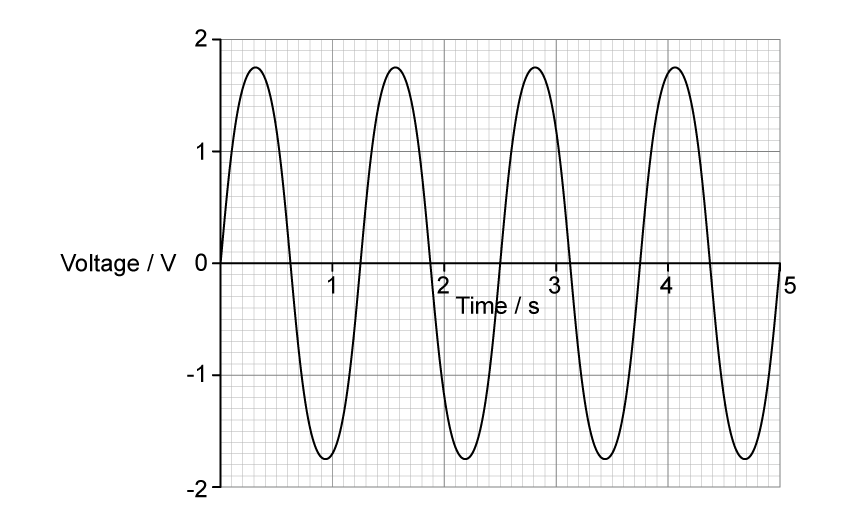
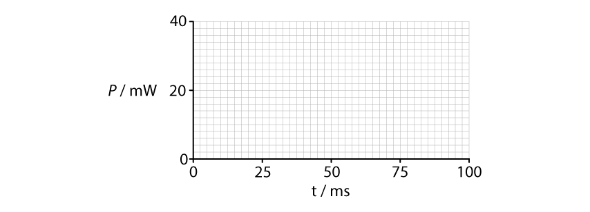
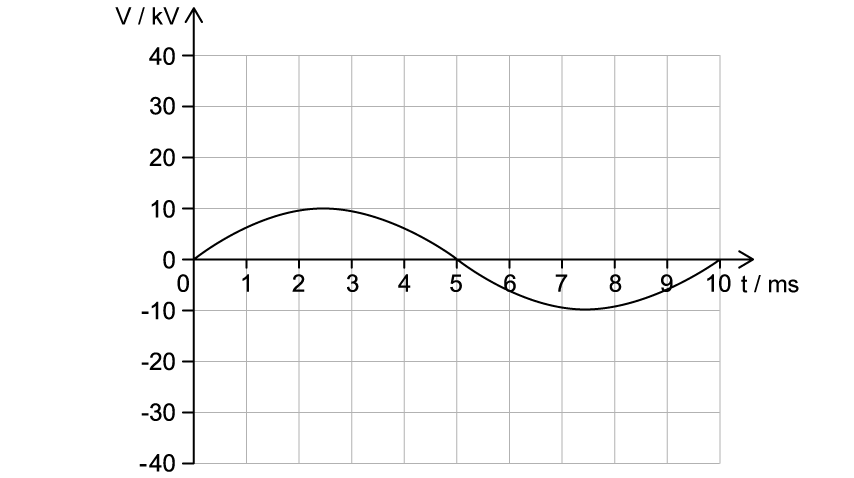

# Exam Questions — Characteristics of Alternating Currents
**21. Alternating Currents** · Cambridge (CIE) A-LEVEL physics (9702)
> Source: [https://www.savemyexams.com/a-level/physics/cie/25/topic-questions/](https://www.savemyexams.com/a-level/physics/cie/25/topic-questions/) · 8 questions across 1 sets

## Structured Questions (8 questions)

### Q1 — easy — 10 marks

**Q1** [2 marks]

In rectification, a smoothing capacitor is often necessary.

State the meaning of

(i) rectification,

[1]

(ii) smoothing.

[1]

**Q1** [4 marks]

Fig. 1.1a shows the output voltage from an alternating current supply.

**Fig. 1.1a**

Sketch the variation of output voltage with time during

(i) half-wave rectification on Fig. 1.1b

**Fig. 1.1b**

[2]

(ii) full-wave rectification on Fig. 1.1c

**Fig. 1.1c**

[2]

**Q1** [2 marks]

A capacitor is placed in parallel with a resistive load to smooth the rectified voltage. The graph of the smoothed output voltage against time gives a 'ripple' shape as shown in Fig. 1.2.

**Fig. 1.2**

State how the 'ripples' in the graph can be reduced.

**Q1** [2 marks]

Fig. 1.3a shows a diode bridge circuit. It is designed to allow current to flow in certain pathways depending on the input direct of the current.

**Fig. 1.3a**

Draw the path of the current

(i) on Fig. 1.3b

**Fig. 1.3b**

[1]

(ii) on Fig. 1.3c

**Fig. 1.3c**

[1]

### Q2 — hard — 10 marks

**Q2** [2 marks]

Fig. 1.1** **below shows the graph of the voltage against time for a mains supply in the UK.

**Fig. 1.1**

Using Fig. 1.1, draw a line to show the dc voltage that gives the same power as produced by the alternating waveform in the mains supply.

**Q2** [3 marks]

**Extract:**

Fig. 1.1 below shows the graph of the voltage against time for a mains supply in the UK.

Determine the peak voltage, V0 from graph: V0 = 320 V. The rms voltage = V0/√2 = 320/√2 = 230 V. The voltage waveform has a peak every 10 ms (alternating positive and negative peaks).

Sketch a graph which shows how the power supplied by this voltage to a resistor with resistance of 300 Ω varies with time.

Label the vertical axis as power and mark on both axes any significant values.

**Q2** [3 marks]

**Extract:**

Fig. 1.1 below shows the graph of the voltage against time for a mains supply in the UK.
Determine the peak voltage, V0 from graph: V0 = 320 V

The signal in Fig. 1.1 is connected to an oscilloscope. The screen's grid has a height of 8 squares and a width of 10 squares.

Describe how you would use the oscilloscope to display the alternating waveform in Fig. 1.1 so that four complete cycles are visible and occupy the full height of the screen.

**Q2** [2 marks]

**Extract:**

Fig. 1.1 below shows the graph of the voltage against time for a mains supply in the UK. Using Fig. 1.1, draw a line to show the dc voltage that gives the same power as produced by the alternating waveform in the mains supply.
The rms voltage is the equivalent dc voltage that would give the same power. V_rms = V_0/√2 = 320/√2 = 226.27 = 230 V (2 s.f.)

An electric oven is connected to the mains supply from part (a), using a cable with a non-negligible resistance. The cable connects the heating element in the oven to the mains supply.

Explain why the rms voltage across the heating element in the oven will be less than the rms voltage calculated in part (a).

### Q3 — hard — 14 marks

**Q3** [7 marks]

Fig. 1.1 below shows a horizontal wire, held in tension between fixed points at P and Q. A short section of the wire is positioned between the pole pieces of a permanent magnet, which applies a uniform horizontal magnetic field at right angles to the wire. Wires connected to a circuit at P and Q allow an alternating current to be passed through the wire.

**Fig. 1.1**

(i) Explain why the wire oscillates.

[5]

(ii) The permanent magnet produces a uniform magnetic field of flux density 220 mT over a 55 mm length of the wire. Show that the maximum force on the wire is about 40 mN when there is an alternating current of rms value 2.4 A in it.

[2]

**Q3** [3 marks]

**Extract:**

Fig. 1.1 below shows a horizontal wire, held in tension between fixed points at P and Q. A short section of the wire is positioned between the pole pieces of a permanent magnet, which applies a uniform horizontal magnetic field at right angles to the wire. Wires connected to a circuit at P and Q allow an alternating current to be passed through the wire.

(ii) The permanent magnet produces a uniform magnetic field of flux density 220 mT over a 55 mm length of the wire. Show that the maximum force on the wire is about 40 mN when there is an alternating current of rms value 2.4 A in it.

Determine the peak current, I0: I_rms = I0/√2, I0 = 2.4 × √2 = 3.39 A

When modelling the motion of the wire between P and Q, a student says the wire at the midpoint of P and Q is displaced 2.0 cm from equilibrium as it oscillated, and it moves with an average speed of 0.16 m s−1.

Write an expression for the current supplied to the wire at time *t *. You may leave a factor of π in your expression.

**Q3** [4 marks]

**Extract:**

Fig. 1.1 below shows a horizontal wire, held in tension between fixed points at P and Q. A short section of the wire is positioned between the pole pieces of a permanent magnet, which applies a uniform horizontal magnetic field at right angles to the wire. Wires connected to a circuit at P and Q allow an alternating current to be passed through the wire.

(ii) The permanent magnet produces a uniform magnetic field of flux density 220 mT over a 55 mm length of the wire. Show that the maximum force on the wire is about 40 mN when there is an alternating current of rms value 2.4 A in it.

In reality, the oscillations of the wire are not symmetrical. Explain why.

### Q4 — easy — 13 marks

**Q4** [3 marks]

For an alternating voltage, state what is meant by

(i) the peak voltage,

[1]

(ii) the root mean square voltage.

[2]

**Q4** [3 marks]

A generator produces an alternating voltage which can be described by the equation

$V = 150 \sin ( 200 \mathrm{\pi } t )$

where *V* is measured in volts and *t* is in seconds.

For this alternating voltage, determine

(i) the peak voltage,

[1]

(ii) the r.m.s. voltage,

[1]

(iii) the frequency.

[1]

**Q4** [6 marks]

**Extract:**

A generator produces an alternating voltage which can be described by the equation V = 150 sin(200πt) where V is measured in volts and t is in seconds. The peak voltage V₀ = 150 V and the r.m.s. voltage Vrms = 150/√2 = 106 V.

The alternating voltage is supplied across a 100 Ω resistor.

Calculate

(i) the peak current and hence the r.m.s. current in the resistor,

[2]

(ii) the mean power dissipated in the resistor,

[2]

(iii) the peak power dissipated in the resistor.

[2]

**Q4** [1 mark]

**Extract:**

A generator produces an alternating voltage which can be described by the equation V = 150 sin(200πt) where V is measured in volts and t is in seconds.

State the effect on the output voltage if the frequency of the generator is increased.

### Q5 — medium — 7 marks

**Q5** [3 marks]

The output voltage *V *of an a.c. power supply varies sinusoidally with time *t *as shown in Fig. 1.1.

**Fig. 1.1**

Using Fig. 1.1, determine the equation for *V* in terms of *t*, where *V* is in volts and *t* is in seconds.

**Q5** [2 marks]

**Extract:**

The output voltage V of an a.c. power supply varies sinusoidally with time t as shown in Fig. 1.1. From the graph: time period, T = 1.25 s AND peak voltage, V0 = 1.75 V

Using Fig. 1.1, determine

(i) the root-mean-square voltage $V_{rms}$

[1]

(ii) the mean voltage `< V >`

[1]

**Q5** [2 marks]

**Extract:**

From the graph: peak voltage, V0 = 1.75 V

The supply is connected to a 25 Ω resistor.

Calculate the mean power dissipated in the resistor.

### Q6 — hard — 10 marks

**Q6** [2 marks]

A sinusoidal alternating voltage has a root-mean-square voltage of 5.1 V and a frequency of 40 Hz.

The alternating voltage is applied across a resistor of resistance 1430 Ω.

Calculate the mean power dissipated by the resistor in mW.

**Q6** [4 marks]

**Extract:**

A sinusoidal alternating voltage has a root-mean-square voltage of 5.1 V and a frequency of 40 Hz. The alternating voltage is applied across a resistor of resistance 1430 Ω. Calculate the mean power dissipated by the resistor in mW.
Mean power dissipated = 18 mW; frequency = 40 Hz

On Fig. 1.1, draw a smooth curve to show how the power *P* dissipated in the resistor varies with time *t* between *t* = 0 and *t* = 100 ms.

Assume that *P* = 0 when *t* = 0.

**Fig. 1.1**

**Q6** [4 marks]

**Extract:**

A sinusoidal alternating voltage has a root-mean-square voltage of 5.1 V and a frequency of 40 Hz. The alternating voltage is applied across a resistor of resistance 1430 Ω.

The alternating voltage in **(a) **is applied to a piezoelectric crystal in air.

State and explain

(i) the effect this has on the air surrounding the crystal

[2]

(ii) which quantity must change if the crystal were to be used in an ultrasound transducer.

[2]

### Q7 — medium — 7 marks

**Q7** [2 marks]

Explain, by referring to the heating effect, what is meant by the root-mean-square (r.m.s.) value of an alternating current.

**Q7** [3 marks]

An alternating current supply is connected in series with a resistor *R*.

The value of the current $I$, in amps, varies with time $t$, in seconds, according to

$I=15\mathrm{sin}60t$

For the current through the resistor, determine

(i) the peak current

[1]

(ii) the r.m.s. current

[1]

(iii) the frequency.

[1]

**Q7** [2 marks]

**Extract:**

An alternating current supply is connected in series with a resistor R. The value of the current I, in amps, varies with time t, in seconds, according to I = 15 sin 60 t. The r.m.s. current: I_rms = 15/√2 = 10.6 A

To prevent overheating, the mean power dissipated in resistor R must not exceed 1.0 kW.

Calculate the minimum resistance of R.

### Q8 — easy — 8 marks

**Q8** [1 mark]

Fig. 1.1a shows an alternating current generator with a rectangular coil rotating at a constant frequency in a uniform magnetic field.

**Fig. 1.1a**

The graph in Fig. 1.1b shows how the output voltage *V* from the generator varies with time *t*.

**Fig. 1.1b**

Using Fig. 1.1b, state the peak output voltage $V_{0}$ of the generator.

**Q8** [2 marks]

**Extract:**

Peak voltage, V0 = 10 kV

Calculate the root mean squared voltage $V_{rms}$.

**Q8** [3 marks]

**Extract:**

Calculate the root mean squared voltage:
- r.m.s. voltage: V_rms = V_0/√2
- V_rms = (10 × 10^3)/√2
- V_rms = 7071 = 7.1 kV

The mean power output of the generator is 35 kW.

Calculate the root mean squared current $I_{rms}$.

**Q8** [2 marks]

**Extract:**

The graph in Fig. 1.1b shows how the output voltage V from the generator varies with time t.

V_rms = 7071 = 7.1 kV

Draw a line on the graph in Fig. 1.1b to show the *V*rms.
