# Mark Schemes — Rectification & Smoothing
**21. Alternating Currents** · Cambridge (CIE) A-LEVEL physics (9702)

## Structured Questions (6 questions)

### Q1
An example of a diagram gaining two marks:

- The top of the input connects from the top corner of the diode bridge **AND t**he right corner of the diode bridge connects to the bottom of the resistor; **[1 mark]**
- The bottom of the input connects to the bottom corner of the diode bridge **AND** the left corner of the diode bridge connects to the top of the resistor; **[1 mark]**

**[Total: 2 marks]**
To draw 2.5 periods of the rectified wave:

List the known quantities:

- Root-mean-square voltage, *V**rms*  = 14.1 V
- Frequency, *f*  = 40 Hz

Determine the period:

- $T=\frac{1}{f}=\frac{1}{40}=25\mathrm{ms}$

Determine the peak voltage, *V*0 :

- $V_{rms}=\frac{V_{0}}{\sqrt{2}}$
- $V_{0}=14.1\times\sqrt{2}=19.9V$

A graph gaining 3 marks looks like:

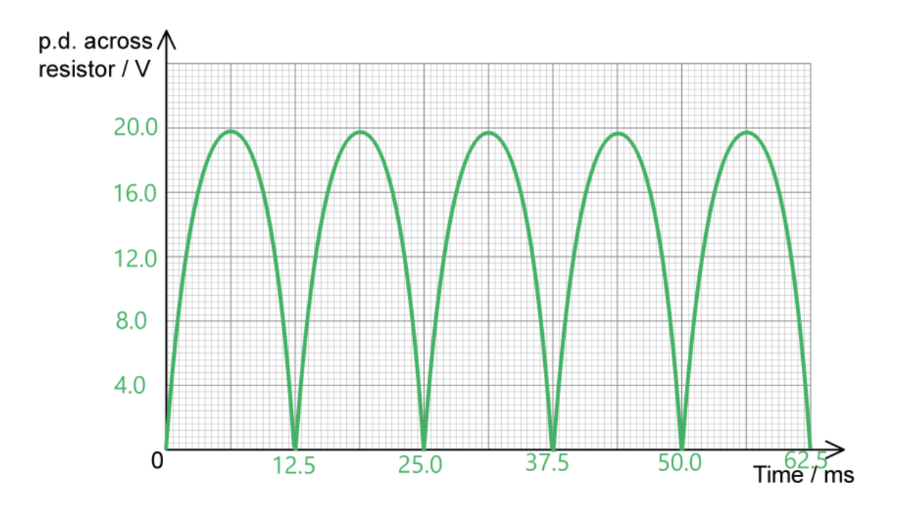

- Peaks reach 19.9 V (± one small square) **AND **are more than half the height of the graph paper; **[1 mark]**
- Correct shape for a full-wave rectified alternating potential difference; **[1 mark]**
- Five peaks filling the x axis **AND** labelled as being 12.5 ms across each; **[1 mark]**

**[Total: 3 marks]**

> *For 2.5 periods to fill the graph paper, there are 10 squares so each period must take up 4 squares horizontally, with the last 0.5 of a period taking 2 squares.*
Comparing the effects of each capacitor configuration on the output signal:

- The single capacitor <u>smooths</u> the peaks in the output voltage; **[1 mark]**
- The two capacitors <u>smooth</u> the peaks <u>less than</u> the single capacitor; **[1 mark]**
- (Therefore) there are larger fluctuations / ripples in the output voltage with the two capacitors; **[1 mark]**

Explain the difference:

- Because capacitors in series have a <u>lower capacitance</u>; **[1 mark]**
- (Therefore) the time constant is smaller; **[1 mark]**

**[Total: 5 marks]**

> *Recall that capacitors in series have a combined capacitance according to the following equation:*

$\frac{1}{C_{tot}}=\frac{1}{C_{1}}+\frac{1}{C_{2}}$

> *This means total capacitance is less than the individual capacitance of either capacitor, i.e. adding capacitors in series reduces total capacitance. This means the time constant is smaller, so the capacitor system discharges faster and the output voltage dips more in between input peaks. *

### Q2
The expected voltage output with time is as follows:

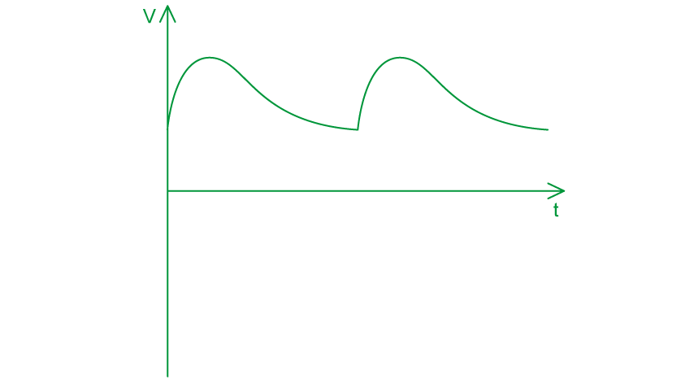

- Graph shows half-wave rectification (power supplied every half cycle, same positive peak values); **[1 mark]**
- Graph shows smoothing (same peak value at start of discharge, same shape in each curve); **[1 mark]**

**[Total: 2 marks]**

> *You should be able to identify parts of the circuit to determine the level of rectification and if the output will undergo smoothing*

- *The circuit only includes **one diode** so this will produce **half-wave rectification*
- *The circuit contains a **capacitor**, so the output will show **smoothing** of the peaks*

> *This graph and the reasoning behind it are key in this topic. Make sure you understand both!*
The expected voltage output with time is as follows:

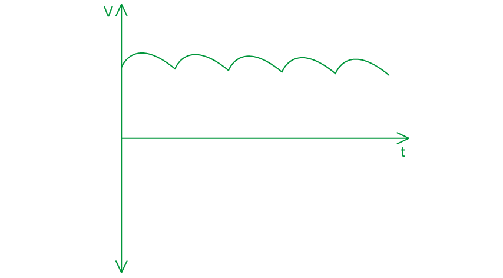

- Graph shows full-wave rectification (more peaks, same positive peak values); **[1 mark]**
- Graph shows smoothing (same peak value at start of discharge, same shape in each curve); **[1 mark]**
- Curve shows a greater degree of smoothing (slightly more flattened) than in (a); **[1 mark]**

**[Total: 3 marks]**

> *Recall that a fully rectified and smoothed wave looks similar to the flat slope of a d.c. current graph.*

> *In this circuit, you should be able to determine:*

- *The circuit contains a** bridge rectifier**, so the output will produce **full-wave rectification*
- *The circuit contains a **capacitor**, so the output will show **smoothing **of the peaks*
(i) The connections to the load resistor are:

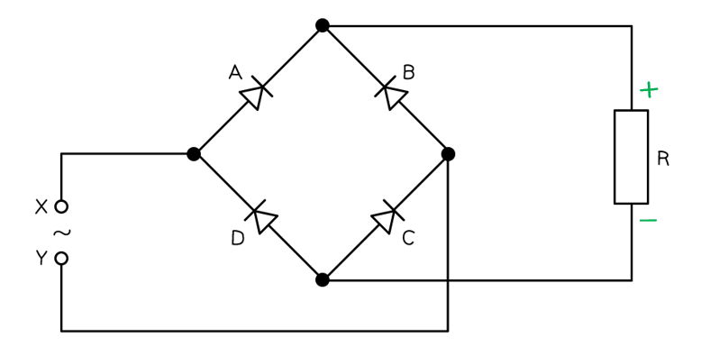

- Positive (+) on top **AND** negative (−) on bottom; **[1 mark]**

(ii) The diodes which are conducting when terminal X is negative are:

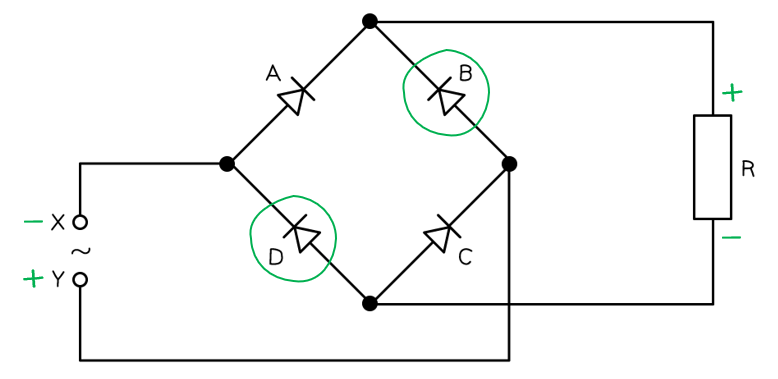

- Diodes B and D; **[1 mark]**

**[Total: 2 marks]**

> *Bridge rectifier problems are most easily solved by tracing the path with your finger*

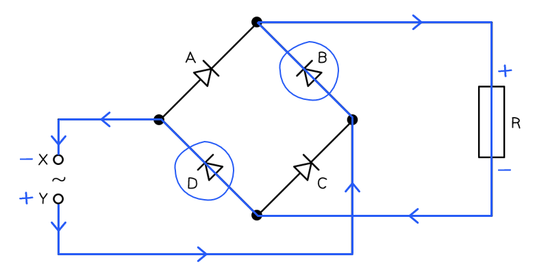

> *The key points to remember are:*

- *Current only goes through diodes according to the arrow - they show forward bias*
- *Conventional current is always depicted as moving from positive to negative*
- *Alternating current (AC) constantly changes direction *
Determine the correct capacitor to use for smoothing the output:

List the known quantities:

- Resistance, *R* = 3.6 k Ω = 3600 Ω
- Time interval between adjacent peaks, *t* = 40 ms = 40 × 10−3 s (from the graph)
- Capacitor 1, *C**1* = 360 nF = 360 × 10−9 F
- Capacitor 2, *C**2* = 60 µF = 60 × 10−6 F

Calculate the time constants for both capacitors:

- Time constant:  $T=RC$
- Capacitor 1:  $T_{1}=3600\times(360\times10^{-9})=1.3\times10^{-3}s$
- Capacitor 2:  $T_{2}=3600\times(60\times10^{-6})=0.216s$

Compare the time constants of the capacitors with the time between peaks:

- The time constant of capacitor 1, *T**1* = 1.3 × 10−3 s, is <u>less than</u> the time interval, *t* = 40 × 10−3 s; **[1 mark]**
- So, the output will <u>not</u> be smoothed significantly:

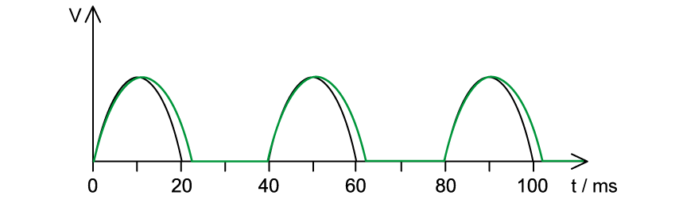

- The time constant of capacitor 2, *T**2* = 0.216 s, is much <u>greater than</u> the time interval, *t* = 40 × 10−3 s; **[1 mark]**
- So, the output will be smoothed significantly:

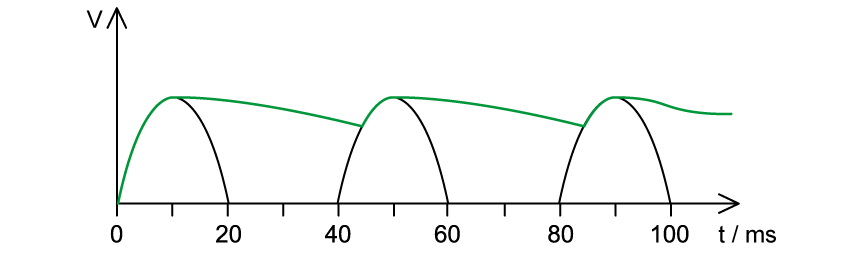

State the most appropriate capacitor to smooth the output correctly:

- The <u>60 µF</u> capacitor; **[1 mark]**

**[Total: 3 marks]**

### Q3
(i) Determine the root-mean-square (r.m.s.) value of the supply potential difference before rectification:

Draw lines on the graph to obtain a value for the peak voltage, $V_{0}$:

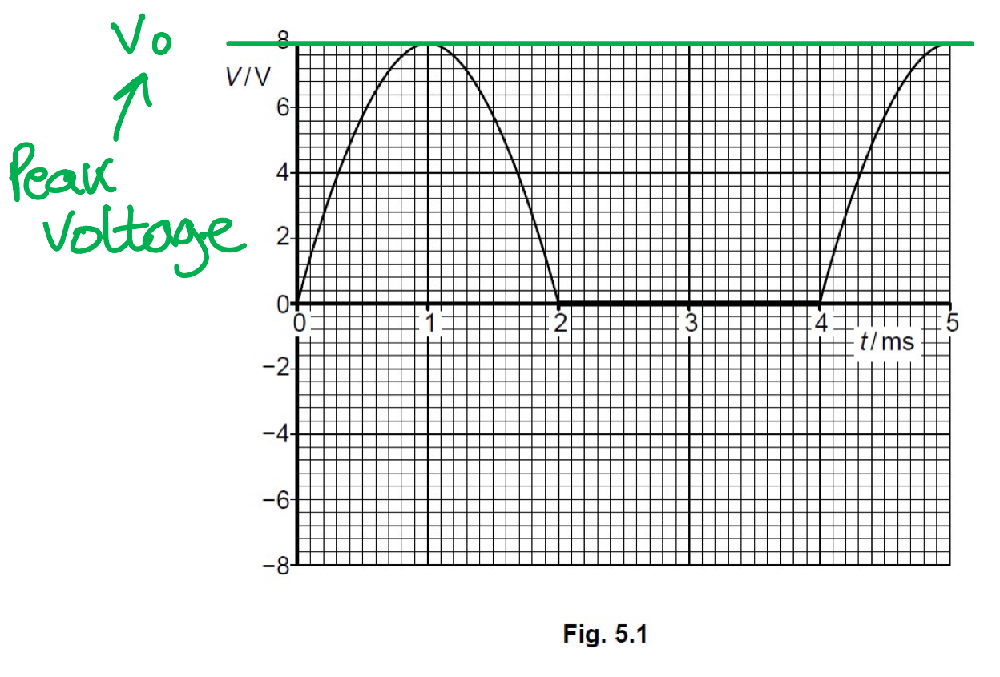

- Peak voltage, $V_{0}$ = 8.0 V

Recall the expression for $V_{r.m.s}$ and $V_{0}$:

- $V_{r.m.s}=\frac{V_{0}}{\sqrt{2}}$ **[1 mark]**

Substitute the peak voltage into the equation and calculate $V_{r.m.s}$:

- $V_{r.m.s}=\frac{8}{\sqrt{2}}$
- $V_{r. m. s} = 5.66 \mathrm{V} = 5.7 \mathrm{V} ( 2 s. f. )$ **[1 mark]**

(ii) State the type of rectification shown in Fig. 5.1:

- This is half-wave rectification; **[1 mark]**

**[Total: 3 marks]**
(i) A graph that would score 3 marks:

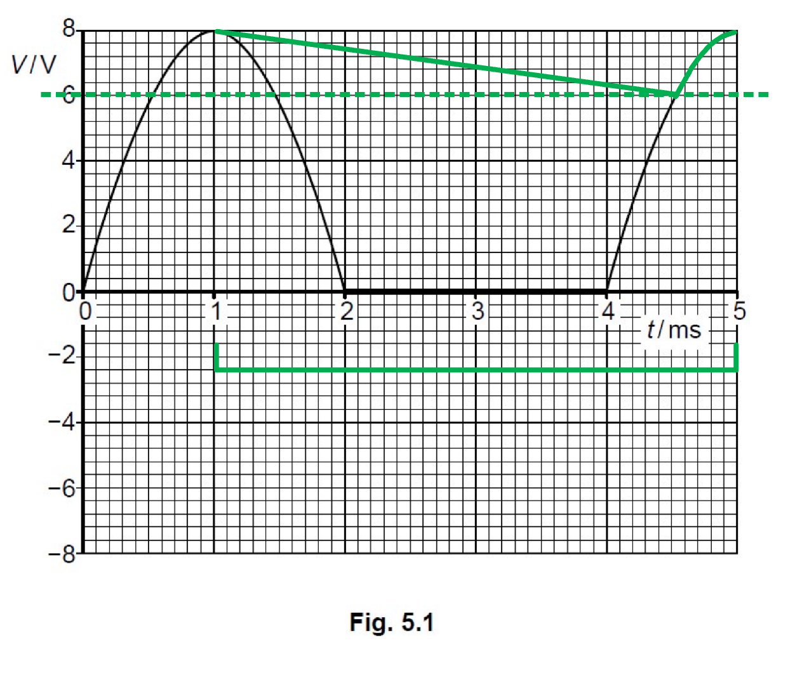

- The minimum potential difference is 8.0 − 2.0 = 6.0 V; **[1 mark]**
- Straight line drawn from peak $V_{0}$ at t = 1.0 ms to minimum (non-zero) value where it meets the printed line after 4.0 ms; **[1 mark]**
- The printed curve is followed to its peak at 5.0 ms; **[1 mark]**

(ii) Determine the time, in s, for which the capacitor is discharging between times *t* = 1.0 ms and *t* = 5.0 ms:

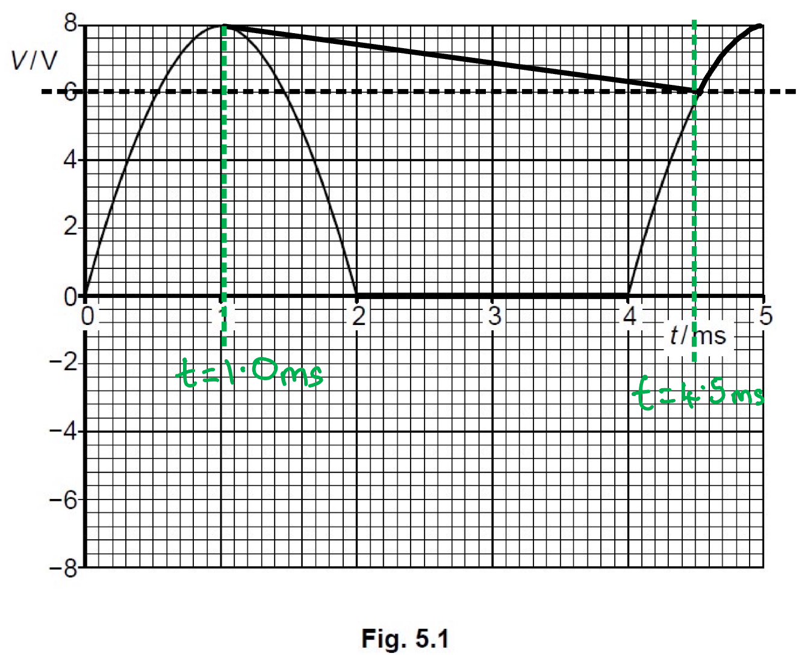

- From the graph:

  - The capacitor begins discharging at *t *= 1.0 ms
  - The capacitor stops discharging at *t *= 4.5 ms

- Δ*t *= 4.5 − 1.0 = 3.5 ms = 3.5 × 10−3 s **[1 mark]**

(iii) Use your answers in **(b)(i)** and **(b)(ii)** to calculate the resistance *R:*

List the known quantities:

- Output voltage, $V$ = 6.0 V
- Peak voltage, $V_{0}$ = 8.0 V
- Time to discharge, $t$ = 3.5 × 10−3 s
- Capacitance of the capacitor, $C$ = 85 μF = 85 × 10−6 F

Use the capacitor discharge equation in terms of voltage:

- $V=V_{0}e^{-\frac{t}{RC}}$ **[1 mark]**
- $\frac{V}{V_{0}}=e^{-\frac{t}{RC}}$
- $\ln ( \frac{V}{V} _{0} ) = - \frac{t}{R C}$
- `R = (- t)/(C ln ( V / V _ 0 ))`

Substitute the known quantities into the equation:

- $R = \frac{- ( 3.5 \times 10^{- 3} )}{( 85 \times 10^{- 6} ) \ln ( \frac{6}{8} )}$ **[1 mark]**
- `R = 143 capital omega = 140 capital omega ( 2 s. f. )` **[1 mark]**

**[Total: 6 marks]**

- *A **smoothing capacitor** connected in **parallel** with the load resistor creates a **smooth output voltage** *$V_{out}$* against time*
- *The graph looks like this:*

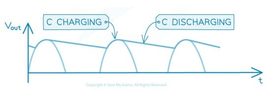

### Q4
Rectification is defined as:

- The process of converting alternating current (a.c) into direct current (d.c); **[1 mark]**

**[Total: 1 mark]**
(i) The output of half-wave rectification is as follows:

- Peaks at the same height; **[1 mark]**
- Output alternates between peaks in the positive direction and zero output; **[1 mark]**

(ii) The output of full-wave rectification is as follows:

- Peaks at the same height; **[1 mark]**
- <u>All</u> peaks in the positive direction; **[1 mark]**

**[Total: 4 marks]**
The 'ripples' in the graph can be reduced by using:

- A capacitor with greater capacitance; **[1 mark]**
- A (load) resistor with a larger resistance; **[1 mark]**

**[Total: 2 marks]**

> *This mark scheme requires **two** answers for full marks. Although this is not necessarily stated in the question, it is indicated by the number of marks. A good exam technique is to check the number of marks in the question and make sure you have that many separate points in your answer to gain them!*
(i) When A is positive:

- Diodes 1 and 4 conduct; **[1 mark]**

(ii) When B is positive

- Diodes 2 and 3 conduct; **[1 mark]**

**[Total: 2 marks]**

> *This can be a little tricky to work out but it is not using any more knowledge than you're aware of already. The important thing to remember is that a diode only allows current to flow in **one **direction. Therefore, the current takes a different path through different diodes depending on whether A or B is positive. *

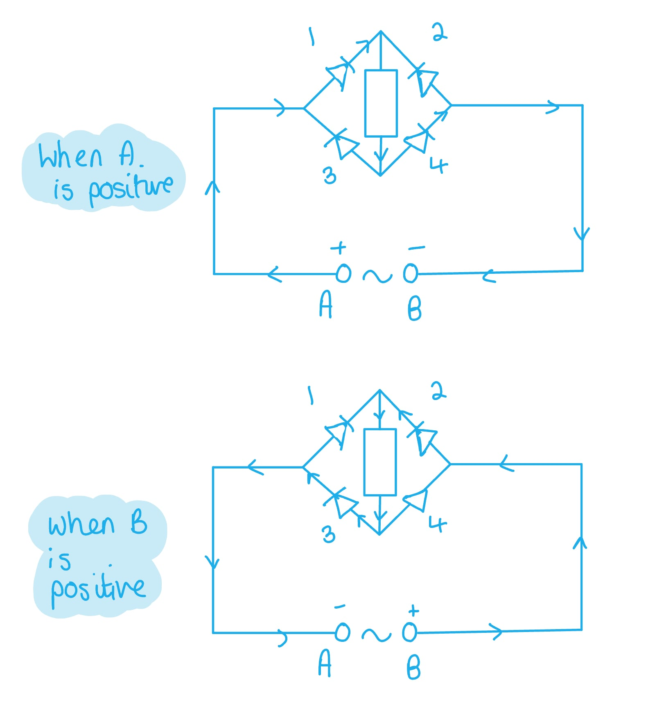

### Q5
The correct circuit diagram is as follows:

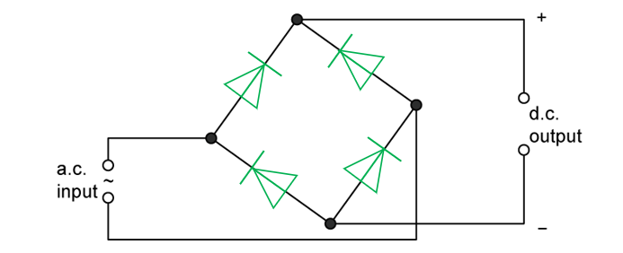

- All four diodes are added correctly to give an output; **[1 mark]**
- All diodes pointing in the correct direction to give the correct polarity; **[1 mark]**

**[Total: 2 marks]**
The correct circuit diagram is as follows:

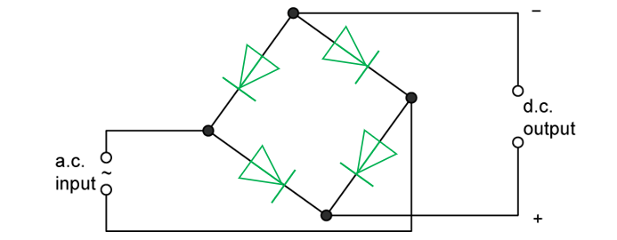

- All four diodes are added correctly to give an output; **[1 mark]**
- All diodes pointing in the correct direction to give the correct polarity; **[1 mark]**

**[Total: 2 marks]**
(i) Smoothing is defined as:

- The reduction in the variation of the output voltage / current; **[1 mark]**

(ii) The capacitor is connected as follows:

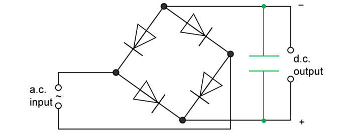

- Correct symbol, connected in parallel with d.c. output; **[1 mark]**

**[Total: 2 marks]**
The capacitor is charged from:

- Time $t_{1}$ to time $t_{2}$; **[1 mark]**

**[Total: 1 mark]**

### Q6
(i) Rectification is the:

- Conversion from a.c. to d.c.; **[1 mark]**

(ii) The circuit in Fig. 1.1 produces:

- Full-wave rectification; **[1 mark]**

**[Total: 2 marks]**
(i) A correctly labelled diagram showing the polarity of the output terminals A and B that should earn 1 mark would look like this:

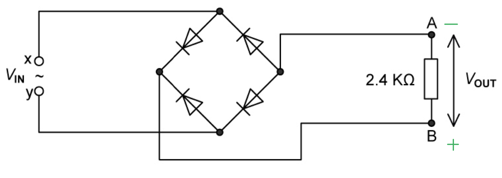

- A labelled − **and **B labelled +; **[1 mark]**

(ii) A correctly labelled axis on Fig. 1.2 that would score 3 marks should look like this:

List the known quantities from the equation:

- Max *V*OUT = 3.0 V
- Angular frequency,* ω* = 20π

Use the angular frequency equation to calculate the time period of the a.c.:

- $T=\frac{2π}{ω}$
- $T=\frac{2π}{20π}=\frac{1}{10}$
- $T=0.1s$ **[1 mark]**

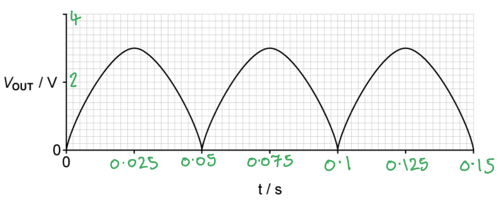

- *V*OUT scale labelled 2 and 4 on the tick marks; **[1 mark]**
- *t* scale labelled 0.025, 0.05, 0.075. 0.1, 0.125 and 0.15 on the tick marks; **[1 mark]**

**[Total: 4 marks]**

> *The graph shows the **rectified wavelength**. To work out one wavelength** trace** it with your **hand** as if it hasn't been rectified, *

> *the wave will go up, down and then back to where it came from*

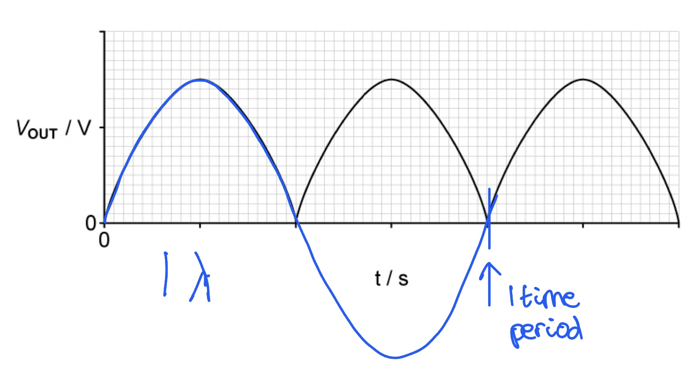
(i) A capacitor correctly drawn onto the circuit is as follows:

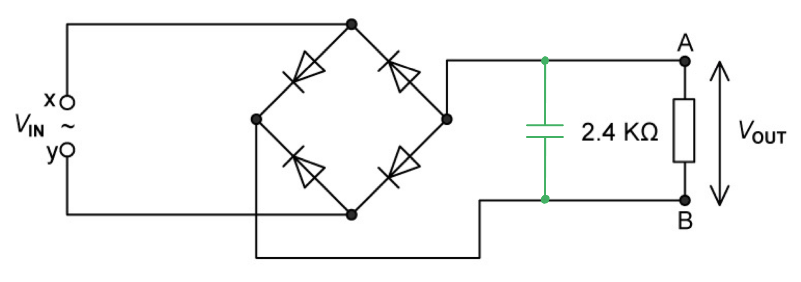

- Correct symbol used for capacitor, and the capacitor is connected in parallel with the 2.4 kΩ resistor; **[1 mark]**

(ii) The graph of the smooth output voltage that should score 2 marks would look like this:

Calculate 15% of the peak voltage:

- 3 × 0.15 = 0.45
- So, the peak voltage falls by 0.45 V to 2.55 V

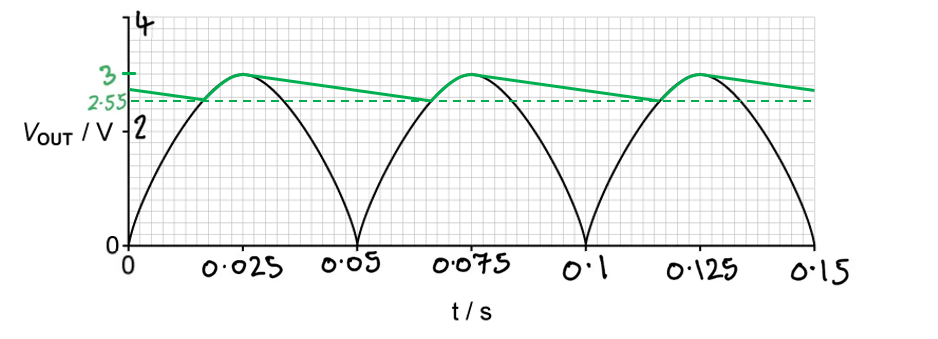

- Straight line sections (between the peak voltage and reduced voltage) have a negative gradient **AND **are drawn as shown; **[1 mark]**
- The lines between adjacent curves show a drop in p.d. of 0.45 V / just over 2 small squares;** [1 mark]**

**[Total: 3 marks]**
