# Exam Questions — Rectification & Smoothing
**21. Alternating Currents** · Cambridge (CIE) A-LEVEL physics (9702)
> Source: [https://www.savemyexams.com/a-level/physics/cie/25/topic-questions/](https://www.savemyexams.com/a-level/physics/cie/25/topic-questions/) · 6 questions across 1 sets

## Structured Questions (6 questions)

### Q1 — hard — 10 marks

**Q1** [2 marks]

Complete the circuit diagram in Fig. 1.1 such that it shows a full-wave rectifier where the bottom of the load resistor is positive and the top is negative.

**Fig. 1.1**

**Q1** [3 marks]

The root-mean-square input potential difference to the full-wave rectifier is 14.1 V.

The frequency of the input potential difference is 40 Hz.

On Fig. 1.2, draw a graph of the potential difference across the load resistor for 2.5 periods, choosing a sensible scale for the y axis.

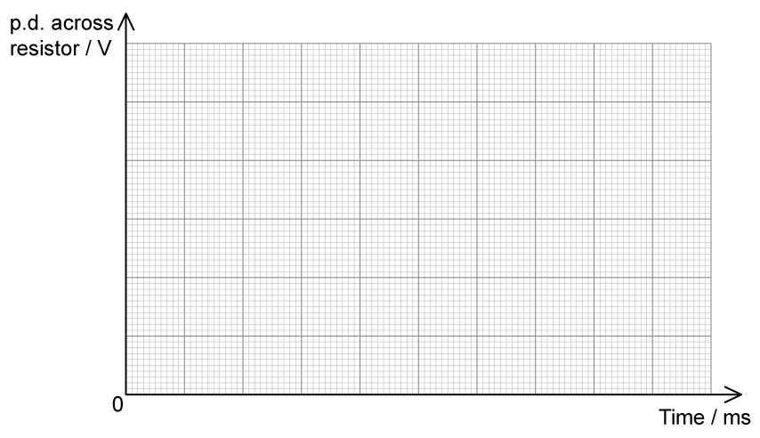

**Fig. 1.2**

**Q1** [5 marks]

**Extract:**

The root-mean-square input potential difference to the full-wave rectifier is 14.1 V. The frequency of the input potential difference is 40 Hz. On Fig. 1.2, draw a graph of the potential difference across the load resistor for 2.5 periods, choosing a sensible scale for the y axis.

The circuit in Fig. 1.1 is then modified by two students. One student adds a single capacitor, as shown in Fig. 1.3. The other adds two capacitors in series, as shown in Fig. 1.4.

** **

**Fig. 1.3**

**Fig. 1.4**

Compare the effects of each modification on the graph you drew on Fig. 1.2, when both circuits are completed to form full-wave rectifiers. Explain any differences.

### Q2 — medium — 10 marks

**Q2** [2 marks]

An investigation into rectification used the circuit shown in Fig. 1.1.

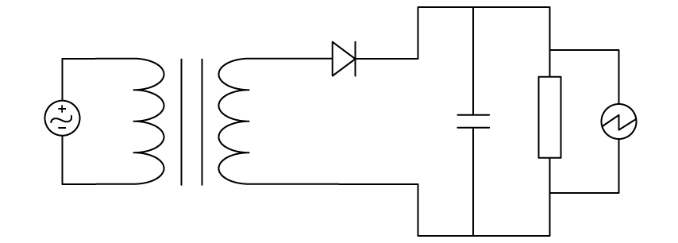

**Fig. 1.1**

Sketch the expected variation of the output voltage with time for the circuit in Fig. 1.1.

**Q2** [3 marks]

**Extract:**

An investigation into rectification used the circuit shown in Fig. 1.1.

Sketch the expected variation of the output voltage with time for the circuit in Fig. 1.1.

Mark scheme: Graph shows half-wave rectification (power supplied every half cycle, same positive peak values); Graph shows smoothing (same peak value at start of discharge, same shape in each curve). The circuit only includes one diode so this will produce half-wave rectification. The circuit contains a capacitor, so the output will show smoothing of the peaks.

A modification is made to the circuit to include a bridge rectifier, as shown in Fig. 1.2.

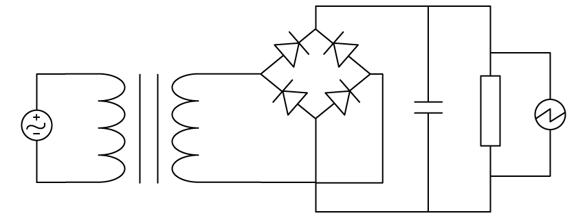

**Fig. 1.2**

Sketch the expected variation of the output voltage with time for the circuit in Fig. 1.2.

**Q2** [2 marks]

A bridge rectifier consists of four ideal diodes, A, B, C and D, connected to an ac generator between the terminals X and Y, as shown in Fig. 1.3.

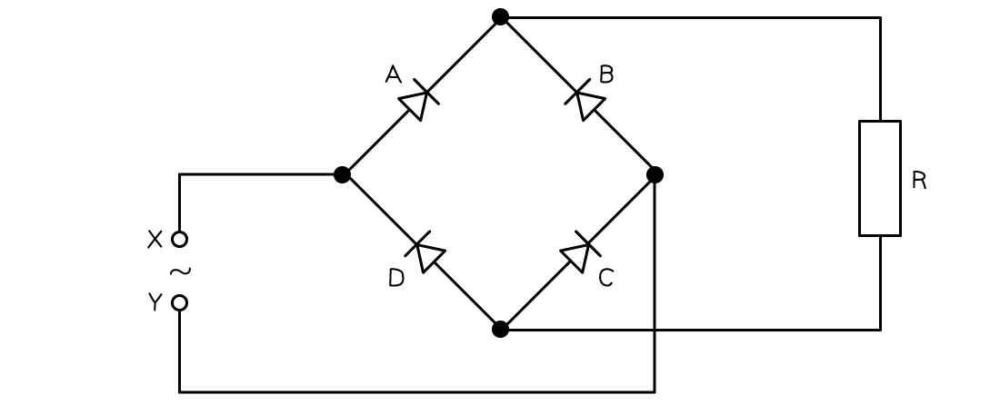

**Fig. 1.3**

On Fig. 1.3

(i) label the positive (+) and negative (−) connections to the load resistor R

[1]

(ii) circle the diodes which are conducting when the polarity of terminal X is negative.

[1]

**Q2** [3 marks]

The graph in Fig. 1.4 shows the output of an ac generator after undergoing half-wave rectification.

**Fig. 1.4.**

The load resistor has a resistance of 3.6 kΩ. Capacitors of capacitance 360 nF and 60 µF are available.

Determine which of the capacitors would be the most appropriate to smooth the output in Fig. 1.4.

### Q3 — medium — 9 marks

**Q3** [3 marks]

A sinusoidal alternating potential difference (p.d.) from a supply is rectified using a single diode. The variation with time *t* of the rectified potential difference *V* is shown in Fig. 5.1.

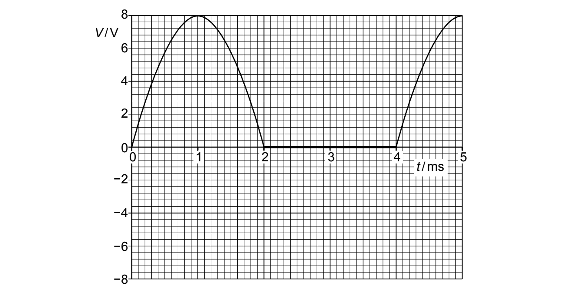

**Fig. 5.1**

(i) Determine the root-mean-square (r.m.s.) value of the supply potential difference before rectification.

r.m.s. potential difference = .................................. V [2]

(ii) State the type of rectification shown in Fig. 5.1.

[1]

*Source: Specimen 2022 Paper 4 Q5A*

**Q3** [6 marks]

**Extract:**

A sinusoidal alternating potential difference (p.d.) from a supply is rectified using a single diode. The variation with time t of the rectified potential difference V is shown in Fig. 5.1. Peak voltage, V0 = 8.0 V.

The alternating potential difference is rectified and smoothed using the circuit in Fig. 5.2.

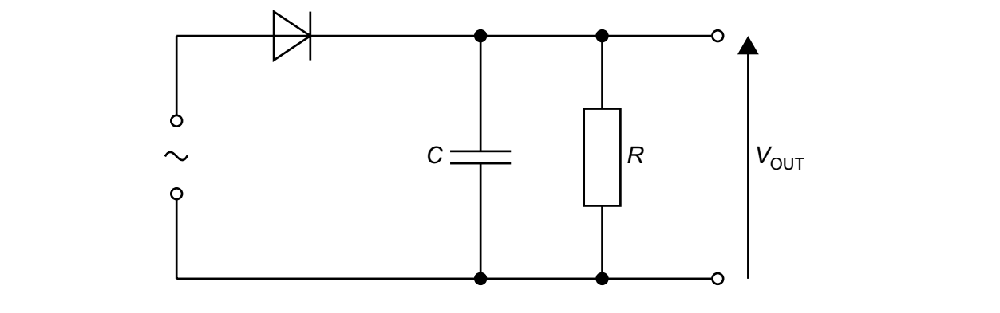

**Fig. 5.2**

The capacitor has capacitance *C* of 85 μF and the resistor has resistance *R*.

The effect of the capacitor and the resistor is to produce a smoothed output potential difference *V*OUT. The difference between maximum and minimum values of *V*OUT is 2.0 V.

(i) On Fig. 5.1, draw a line to show *V*OUT between times *t* = 1.0 ms and *t* = 5.0 ms.

[3]

(ii) Determine the time, in s, for which the capacitor is discharging between times *t* = 1.0 ms and *t* = 5.0 ms.

time = .................................... s [1]

(iii) Use your answers in **(b)(i)** and **(b)(ii)** to calculate the resistance *R*.

*R* = ........................................ Ω [2]

*Source: Specimen 2022 Paper 4 Q5B*

### Q4 — easy — 9 marks

**Q4** [1 mark]

State the meaning of rectification.

**Q4** [4 marks]

The graph in Fig. 1.1 shows the voltage output from an alternating current supply.

**Fig. 1.1**

Sketch the variation with time *t* of the output voltage when the following are applied:

(i) Half-wave rectification

[2]

(ii) Full-wave rectification

[2]

**Q4** [2 marks]

In rectification, a smoothing capacitor is often necessary. The resulting graph of the output current against time gives a 'ripple' shape, as shown in Fig. 1.2.

**Fig. 1.2**

State how the 'ripples' in the graph can be reduced.

**Q4** [2 marks]

The circuit in Fig. 1.3 shows a diode bridge rectifier connected to an alternating power supply.

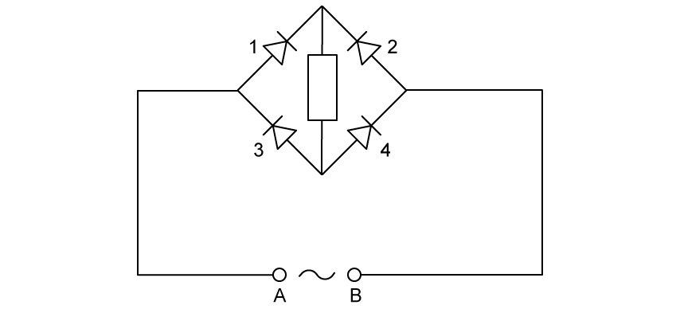

**Fig. 1.3**

State the diodes that will conduct when

(i) A is positive

[1]

(ii) B is positive.

[1]

### Q5 — easy — 7 marks

**Q5** [2 marks]

Alternating current (a.c.) is converted into direct current (d.c.) using a full-wave rectification circuit. Fig. 1.1. shows part of this circuit.

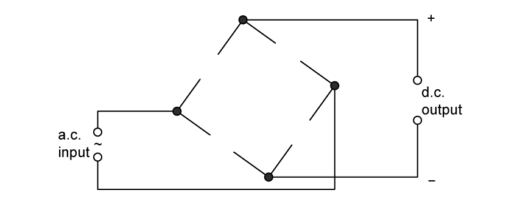

**Fig. 1.1**

On Fig. 1.1, draw the missing diode symbols that would produce the polarity across the d.c. output as shown on the diagram.

**Q5** [2 marks]

**Extract:**

Alternating current (a.c.) is converted into direct current (d.c.) using a full-wave rectification circuit.

The polarity of the d.c. output is reversed, as shown in Fig. 1.2.

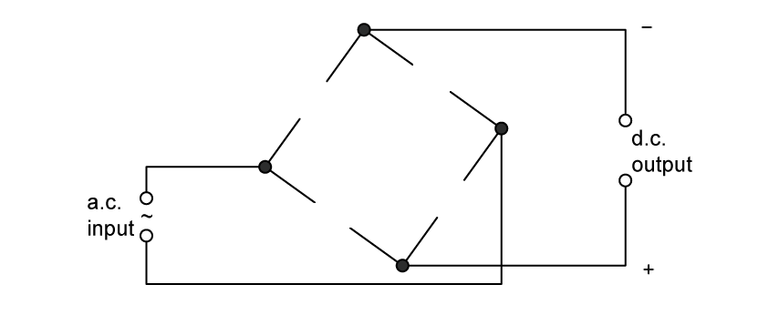

**Fig. 1.2**

On Fig. 1.2, draw the missing diode symbols that would produce the polarity across the d.c. output as shown on the diagram.

**Q5** [2 marks]

**Extract:**

The polarity of the d.c. output is reversed, as shown in Fig. 1.2. On Fig. 1.2, draw the missing diode symbols that would produce the polarity across the d.c. output as shown on the diagram.

(i) State what is meant by smoothing.

[1]

(ii) On Fig. 1.2, draw the symbol for a capacitor connected to provide smoothing of the potential difference across the d.c. output.

[1]

**Q5** [1 mark]

Fig. 1.3 shows the variation with time *t* of the smoothed potential difference *V* across the d.c. output.

**Fig. 1.3**

Using Fig. 1.3, state the interval of time during which the capacitor is being charged.

### Q6 — medium — 9 marks

**Q6** [2 marks]

Fig. 1.1 shows four diodes and a load resistor of resistance, 2.4 kΩ, connected in a circuit that is used to produce rectification of an alternating voltage.

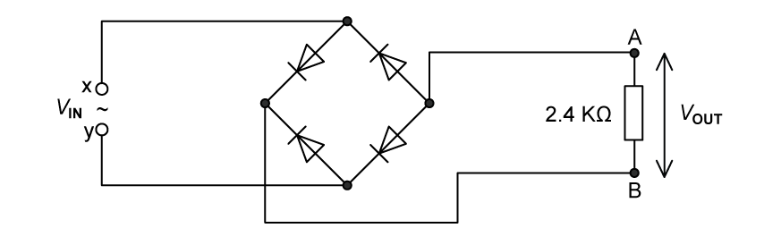

**Fig. 1.1**

(i) State what is meant by rectification.

[1]

(ii) State the type of rectification produced by the circuit in Fig. 1.1

[1]

**Q6** [4 marks]

**Extract:**

Fig. 1.1 shows four diodes and a load resistor of resistance, 2.4 kΩ, connected in a circuit that is used to produce rectification of an alternating voltage. Fig. 1.1

A sinusoidal alternating voltage *V**IN* is applied across the input terminals X and Y. The variation of time *t *of *V**IN* is given by the equation

`V subscript I N end subscript space equals space 3.0 space sin space open parentheses 20 pi space t close parentheses`

where *V*IN is in volts and *t *is in seconds.

(i) Label the output terminals A and B, on Fig. 1.1, with the appropriate symbols to indicate the polarity of the output voltage *V*OUT.

[1]

(ii) The magnitude of the output voltage *V*OUT varies with *t *as shown in Fig. 1.2

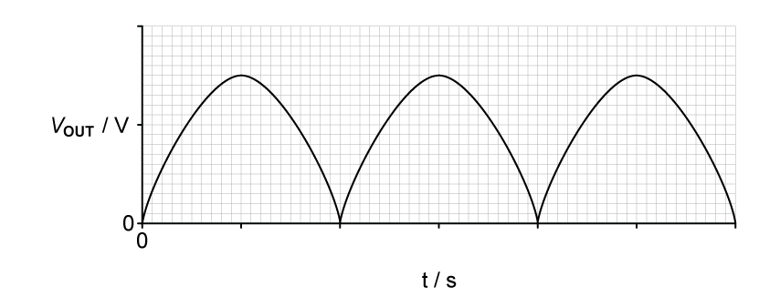

**Fig. 1.2**

Label both the axis with the correct scales on Fig. 1.2. Use the space below for any working that you need.

[3]

**Q6** [3 marks]

**Extract:**

Fig. 1.1 shows four diodes and a load resistor of resistance, 2.4 kΩ, connected in a circuit that is used to produce rectification of an alternating voltage. Fig. 1.1

A sinusoidal alternating voltage V_IN is applied across the input terminals X and Y. The variation of time t of V_IN is given by the equation V_IN = 3.0 sin(20πt) where V_IN is in volts and t is in seconds. The magnitude of the output voltage V_OUT varies with t as shown in Fig. 1.2. Max V_OUT = 3.0 V; Angular frequency ω = 20π; Time period T = 2π/ω = 0.1 s. The t scale is labelled 0.025, 0.05, 0.075, 0.1, 0.125 and 0.15 on the tick marks and V_OUT scale labelled 2 and 4 on the tick marks.

The output voltage in **(b) **is smoothed by adding a capacitor to the circuit in Fig. 1.1.

The difference between the maximum and minimum values of the smoothed output voltage is 15% of the peak voltage.

(i) On Fig. 1.1, draw the circuit symbol for a capacitor showing the capacitor correctly connected into the circuit.

[1]

(ii) On Fig. 1.2, sketch the variation with *t *of the smoothed output voltage.

[2]
