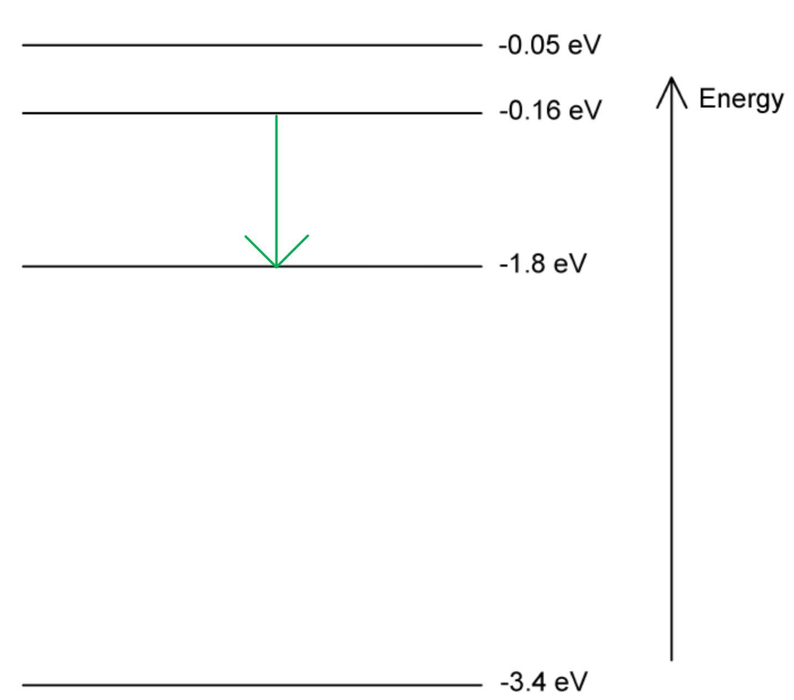

# Mark Schemes — Energy & Momentum of a Photon
**22. Quantum Physics** · Cambridge (CIE) A-LEVEL physics (9702)

## Structured Questions (7 questions)

### Q1
The phenomena were:

**Final answer:** **Any ****two**** from:**

- Diffraction (of EM radiation); **[1 mark]**
- Interference (of EM radiation); **[1 mark]**
- Refraction (of EM radiation); **[1 mark]**
- Polarisation (of EM radiation); **[1 mark]**

**[Total: 2 marks]**

> *These are all behaviours that we only see from waves. If you said reflection, particles can also show this behaviour by bouncing off a surface, so this phenomenon doesn't suggest that EM radiation is a wave. *
An experiment demonstrating the particle-like properties of electromagnetic radiation:

- The photoelectric effect **OR** atomic line spectra; **[1 mark]**

**[Total: 1 mark]**
A photon is:

- a discrete quantity / packet / quantum of electromagnetic energy; **[1 mark]**

**[Total: 1 mark]**
To find the photon energy:

List the known quantities:

- Frequency, *f*  = 8.6 × 1020 Hz
- Planck constant, *h*  = 6.63 × 10−34 J s (from the data page)

Recall the equation for photon energy, *E* :

- $E=hf$

Substitute the known quantities:

- $E = ( 6.63 \times 10^{- 34} ) \times ( 8.6 \times 10^{20} )$ **[1 mark]**
- $E=5.7\times10^{-13}J$ **[1 mark]**

**[Total: 2 marks]**

### Q2
To calculate the kinetic energy in eV:

List the known quantities:

- Electron mass, *m**e*  = 9.11 × 10−31 kg
- Speed of electron, *v*  = 1.5 × 106 m s−1
- Elementary charge, *e*  = 1.60 × 10−19 C

Calculate the kinetic energy, *E**k* , in joules:

- $E_{k}=\frac{1}{2}m_{e}v^{2}$
- $E_{k} = 1 \frac{1}{2} \times 9.11 \times 10^{- 31} \times ( 1.5 \times 10^{6} )^{2}$ **[1 mark]**
- $E_{k}=1.02\times10^{-18}J$

Convert this to eV:

- $1 \mathrm{J} = ( \frac{1}{1.60 \times 10^{- 19} } ) \text{eV}$
- $E_{k}=1.02\times10^{-18}J=\frac{1.02\times10^{-18}}{1.60\times10^{-19}}\mathrm{eV}$ **[1 mark]**
- $E_{k}=6.4\mathrm{eV}$ **[1 mark]**

**[Total: 3 marks]**

> *It can be easy to become confused when converting between eV and J. Just remember, you can only either divide or multiply by a factor of 1.60 × 10**−19**.*

> *Going from J to eV, your value should increase a lot (so divide by the very small number, 1.60 × 10**−19**).*

> *Going from eV to J, your value should decrease a lot (so multiply by the very small number, 1.60 × 10**−19**).*
To find the final kinetic energy in joules:

List the known quantities:

- Initial kinetic energy, *E**k,i*  = 6.4 eV (from part (a))
- Potential difference across filament and anode, *V*  = 15 V
- Elementary charge, *e*  = 1.60 × 10−19 C

Determine the work done, *W * by the uniform electric field:

- $W=qV$

  - where *q*  is the charge on the particle and *V*  is the potential across the uniform field
- $W=e\times15V=15\mathrm{eV}$ **[1 mark]**

Determine the final kinetic energy, *E**k,f * in eV:

- $E_{k,f}=E_{k,i}+W$
- $E_{k,f}=6.4+15=21.4\mathrm{eV}$ **[1 mark]**

Convert this energy to joules:

- $1\mathrm{eV}=1.60\times10^{-19}J$
- $E_{k , f} = 21.4 \text{eV} = 21.4 \times ( 1.60 \times 10^{- 19} ) \mathrm{J}$
- $E_{k,f}=3.4\times10^{-18}J$ **[1 mark]**

**[Total: 3 marks]**
To find the momentum of the electron:

List the known quantities:

- Kinetic energy, *E**k*  = 3.4 × 10−18 J (from part (b))
- Electron mass, *m**e*  = 9.11 × 10−31 kg

Rearrange the equation for kinetic energy to make speed the subject:

- $E_{k}=\frac{1}{2}m_{e}v^{2}$
- $v=\sqrt{\frac{2E_{k}}{m_{e}}}$

Substitute the known quantities:

- $v = \sqrt{ \frac{2 \times ( 3.4 \times 10^{- 18} )}{9.11 \times 10^{- 31} } }$ **[1 mark]**
- $v=2.73\times10^{6}ms^{-1}$

Calculate momentum, *p *:

- $p = m v = ( 9.11 \times 10^{- 31} ) \times ( 2.73 \times 10^{6} )$
- $p=2.49\times10^{-24}\mathrm{kg}ms^{-1}=2.5\times10^{-24}\mathrm{kg}ms^{-1}$ **[1 mark]**

**[Total: 2 marks]**
To find the number of photons needed:

List the known quantities:

- Momentum of electron, *p**e*  = 2.49 × 10−24 kg m s−1
- Photon frequency, *f*  = 3.62 × 1014 Hz
- Speed of light, *c*  = 3.00 × 108 m s−1
- Planck constant, *h*  = 6.63 × 10−34 J s

Determine the energy of one photon:

- $E = h f = ( 6.63 \times 10^{- 34} ) \times ( 3.62 \times 10^{14} )$ **[1 mark]**
- $E=2.40\times10^{-19}J$

Determine the momentum of one photon, *p *:

- $p=\frac{E}{c}=\frac{2.4\times10^{-19}}{3.00\times10^{8}}$ **[1 mark]**
- $p=8.0\times10^{-28}\mathrm{kg}ms^{-1}$ **[1 mark]**

Find the number *n  *of photons needed to match the electron's momentum:

- $n=\frac{2.49\times10^{-24}}{8.0\times10^{-28}}=3112.5=3100$ **[1 mark]**

**[Total: 4 marks]**

### Q3
To find the frequency:

List the known quantities:

- Wavelength, *λ*  = 500 nm = 500 × 10−9 m
- Speed of light in free space, *c*  = 3.00 × 108 m s−1 (from the data page)

Using the wave speed equation to calculate:

- $v=fλ\rightarrowf=\frac{v}{λ}$
- $f=\frac{3.00\times10^{8}}{500\times10^{-9}}$ **[1 mark]**
- $f=6.0\times10^{14}\mathrm{Hz}$ **[1 mark]**

**[Total: 2 marks]**
To find photon energy:

List the known quantities:

- Frequency, *f*  = 6.0 × 1014 Hz
- Planck constant, *h*  = 6.63 × 10−34 J s (from data page)

Use the photon energy equation:

- $E = h f = ( 6.63 \times 10^{- 34} ) \times ( 6.0 \times 10^{14} )$ **[1 mark]**
- $E=3.98\times10^{-19}J=4.0\times10^{-19}J$ **[1 mark]**

**[Total: 2 marks]**
To convert the energy to eV:

List the known quantities:

- Energy, *E*  = 4.0 × 10−19 J (from part (b))
- Elementary charge, *e*  = 1.60 × 10−19 C (from data page)

Convert the energy units:

- $1\mathrm{eV}=1.60\times10^{-19}J$
- $E=\frac{4.0\times10^{-19}}{1.60\times10^{-19}}$ **[1 mark]**
- $E=2.5\mathrm{eV}$ **[1 mark]**

**[Total: 2 marks]**
To calculate photon momentum:

List the known quantities:

- Photon energy, *E*  = 4.0 × 10−19 J (from part (b))
- Speed of light, *c*  = 3.00 × 108 m s−1 (from data page)

Recall the equation for photon momentum, *p* :

- $p=\frac{E}{c}=\frac{4.0\times10^{-19}}{3.00\times10^{8}}$ **[1 mark]**
- $p=1.3\times10^{-27}\mathrm{kg}ms^{-1}$ **[1 mark]**

**[Total: 2 marks]**

### Q4
Consider the mass of a photon, *m*:

- The mass of a photon *m *= 0
- So, *E**2* = (*pc)**2 *
- and *E *= *pc ***[1 mark]**

Substitute the equation for photon energy in terms of wavelength:

- $E=\frac{hc}{λ}$
- $pc=\frac{hc}{λ}$ **[1 mark]**
- So, $p=\frac{h}{λ}$

**[Total: 2 marks]**
List the known quantities:

- Wavelength of photon, *λ* = 400 nm = 400 × 10−9 m
- Planck's constant, *h *= 6.63 × 10−34 J s
- Mass of an electron, *m**e* = 9.11 × 10−31 kg

Calculate the momentum of the photon, *p*:

- $p=\frac{h}{λ}$
- $p=\frac{6.63\times10^{-34}}{400\times10^{-9}}$
- $p=1.66\times10^{-27}$ kg m s−1 **[1 mark]**

Calculate the velocity of the electron, *v**e*:

- Momentum, *p *= *mv*
- So, $v_{e}=\frac{p}{m_{e}}$
- $v_{e}=\frac{1.66\times10^{-27}}{9.11\times10^{-31}}$
- $v_{e}=1822$ m s−1 **[1 mark]**

**[Total: 2 marks]**
List the known quantities:

- Wavelength of photon, *λ* = 400 nm = 400 × 10−9 m
- Planck's constant, *h *= 6.63 × 10−34 J s
- Mass of an electron, *m**e* = 9.11 × 10−31 kg
- Velocity of electron, *v**e* = 1822 m s−1 (From part b)
- Speed of light in free space, *c *= 3.00 × 108 m s−1

Calculate the kinetic energy of the electron, *E**e*:

- $E_{e}=\frac{1}{2}m_{e}v_{e}^{2}$
- $E_{e} = 1 \frac{1}{2} \times ( 9.11 \times 10^{- 31} ) \times 1822^{2}$
- $E_{e}=1.51\times10^{-24}$ J **[1 mark]**

Calculate the photon energy, *E**p*:

- $E_{p}=\frac{hc}{λ}$
- $E_{p} = \frac{( 6.63 \times 10^{- 34} ) \times ( 3.00 \times 10^{8 )}{( 400 \times 10^{-9} } )}$
- $E_{p}=4.97\times10^{-19}$ J **[1 mark]**

Determine the ratio of photon energy to electron energy, $\frac{E_{p}}{E_{e}}$:

- $\frac{E_{p}}{E_{e}}=\frac{4.97\times10^{-19}}{1.51\times10^{-24}}$
- $\frac{E_{p}}{E_{e}}=329139$** [1 mark]**

**[Total: 3 marks]**

> *The ratio of photon energy to electron energy means **photon energy ÷ electron energy**.*

### Q5
List the known quantities:

- Number of photons, *n *= 5.00 × 1027
- Frequency of each photon, *f *= 3.95 × 1014 Hz
- Planck's constant, *h *= 6.63 × 10−34 J s
- Speed of light in free-space, *c *= 3.00 × 108 m s−1

Obtain an equation in terms of the momentum of *n *photons:

- $p=n\frac{hf}{c}$ **[1 mark]**

Substitute the known quantities into the equation to calculate the momentum of *n *photons:

- $p = ( 5.00 \times 10^{27 ) \times \frac{( 6.63 \times 10^{-34} } ) \times ( 3.95 \times 10^{14} )}{( 3.00 \times 10^{8} )}$
- $p=4.365$ kg m s−1

**AND**

- This is equivalent to the backwards momentum of the laser; **[1 mark]**

**[Total: 2 marks]**

> $p=\frac{hf}{c}$* is the equation for the momentum of **one** photon, multiply it by the number of photons to get the total momentum. Momentum is conserved, so the forward momentum of the photons is equal to the backwards momentum of the recoiling laser. This is a closed system, as the laser is free to move.*
Recall the equation from part a) and the units normally used:

- $p=n\frac{hf}{c}$
- $kgms^{-1}=\frac{Js\timesHz}{ms^{-1}}$ **[1 mark]**

Substitute for SI base units as J and Hz:

- $k g m s^{- 1} = \frac{( k g m^{2} s^{- 2} ) s \times ( s^{- 1} )}{m s^{- 1} }$
- $kgms^{-1}=\frac{kgm^{2}s^{-2}}{ms^{-1}}$
- $kgms^{-1}=\frac{kgm}{s}=kgms^{-1}$ **[1 mark]**

**[Total: 2 marks]**

> *It is really important you learn the SI base units and how to test an equation for homogeneity. If you forget these in your exam, however, you can always fall back on standard equations like:*

$\mathrm{work}=\mathrm{force}\times\mathrm{distance}$

$\mathrm{force}=\mathrm{mass}\times\mathrm{acceleration}$

> *And use these to find the SI base units of force and energy.*
List the known quantities:

- Planck's constant, *h *= 6.63 × 10−34 J s
- Frequency of laser photons, *f *= 3.95 × 1014 Hz

Calculate the energy of one photon, *E*:

- Recall: $E=hf$
- $E = ( 6.63 \times 10^{- 34} ) \times ( 3.95 \times 10^{14} )$
- $E=2.62\times10^{-19}$ J** [1 mark]**

Convert the energy in J to energy in eV:

- *E  *in eV = $\frac{2.62\times10^{-19}}{1.6\times10^{-19}}$
- *E  *in eV = 1.64 eV **[1 mark]**

A correctly drawn diagram that would score 1 mark should look like this:

- Arrow drawn vertically from −0.16 eV line to −1.8 eV line; **[1 mark]**

**[Total: 3 marks]**

> *It is important to remember that one electron transition releases one photon. *

### Q6
To calculate the energy of a single photon:

List the known quantities:

- Wavelength, *λ*  = 2.50 × 10−12 m

From the formulae page:

- Speed of light, *c*  = 3.00 × 108 m s−1
- Planck constant, *h*  = 6.63 × 10−34 J s

Recall the equation for photon energy:

- $E=\frac{hc}{λ}$

Substitute the known quantities:

- $E = \frac{( 6.63 \times 10^{- 34} ) \times ( 3.00 \times 10^{8 )}{2.50 \times 10^{-12} } }$ **[1 mark]**
- $E=7.96\times10^{-14}J$ **[1 mark]**

**[Total: 2 marks]**
To find the momentum of a single photon:

List the known quantities:

- Energy of a single photon, *E*  = 7.96 × 10−14 J

From the formulae page:

- Speed of light, *c*  = 3.00 × 108 m s−1

Recall the equation for photon momentum, *p *:

- $p=\frac{E}{c}$

Substitute known quantities:

- $p=\frac{7.96\times10^{-14}}{3.00\times10^{8}}$ **[1 mark]**
- $p=2.65\times10^{-22}\mathrm{kg}ms^{-1}$ **[1 mark]**

**[Total: 2 marks]**
(i) To find the total momentum of radiation each second per laser:

List the known quantities:

- Number of photons per pulse = 7.5 × 1025
- Momentum of one photon, *p* = 2.65 × 10−22 kg m s−1

Calculate the momentum of photons every second, *p**sec *:

- $p_{s e c} = ( 2.65 \times 10^{- 22} ) \times ( 7.5 \times 10^{25} )$
- $p_{sec}=19900\mathrm{kg}ms^{-1}$ **[1 mark]**

(ii) To find the force applied to the spaceship:

List the known quantities:

- Momentum of photons from one laser each second, *p**sec** * = 19 900 kg m s−1
- Number of lasers = 4

Recall the equation relating force, *F* , time, *t* , and change in momentum, Δ*p* :

- $F=\frac{Δp}{Δt}$

Determine the change in momentum of the photons:

- Each second, the photons from one laser change momentum from 19 900 kg m s−1 to 0 kg m s−1

  - This is because they are absorbed by the sails on the spaceship

Determine total force per second:

- From one laser, $F=\frac{19900}{1.0}=19900N$ **[1 mark]**
- From four lasers, $F_{tot}=4\times19900=79600=80000N$ **[1 mark]**

**[Total: 3 marks]**

> *The key to this question is recalling that **force** is the rate of** change of momentum**. As 19 900 kg m s**−1** of momentum is lost **every** **second** by the photons, the rate of change of momentum is simply 19 900 N. You must show your understanding of this logic in your answer.*
To find speed after an hour:

List the known quantities:

- Mass of spaceship, *m*  = 4.9 × 106 kg
- Force applied by lasers, *F**tot*  = 79 600 N

Use Newton's second law:

- $F_{tot}=ma$
- $a=\frac{79600}{4.9\times10^{6}}=1.62\times10^{-2}ms^{-2}$ **[1 mark]**

Recall and rearrange the equation for uniform acceleration:

- $v=u+at$
- $a=\frac{v-u}{t}$

  - where *v*  is final speed and *u*  is initial speed
- Initial speed is zero
- $v=at$

Find the speed after an hour:

- 1 hour = 3600 s
- $v = ( 1.62 \times 10^{- 2} ) \times 3600$ **[1 mark]**
- $v=58ms^{-1}$ **[1 mark]**

**[Total: 3 marks]**

### Q7
To convert the energy to joules:

List the known quantities:

- Photon energy = 1.78 eV

From the formulae page:

- Elementary charge, *e*  = 1.60 × 10−19 C

Convert the energy:

- 1 eV = 1.60 × 10−19 J
- 1.78 eV = 1.78 × (1.60 × 10−19) J
- 1.78 eV = 2.848 × 10−19 = 2.85 × 10−19 J **[1 mark]**

**[Total: 1 mark]**
To calculate photon wavelength:

List the known quantities:

- Photon energy, *E*  = 2.848 × 10−19 J (from (a))

From the formulae page:

- Speed of light, *c * = 3.00 × 108 m s−1
- Planck's constant, *h*  = 6.63 × 10−34 J s

Recall the equation relating photon wavelength *λ* and energy:

- $E=\frac{hc}{λ}$

Rearrange for *λ*  and substitute the known quantities:

- $\\lambda = \frac{h c}{E} = \frac{( 6.63 \times 10^{- 34} ) \times ( 3.00 \times 10^{8 )}{2.848 \times 10^{-19} } }$ **[1 mark]**
- $λ=6.98\times10^{-7}m$ **[1 mark]**

**[Total: 2 marks]**

> *If you're required to use an answer from a previous subpart, it's better to use the **unrounded** value to avoid rounding errors in your next answer to be on the safe side (although in this case, using 2.85 × 10**–19** will still give the same answer). *
To find the energy transferred every hour:

List the known quantities:

- Number of photons emitted per second, *N*  = 3.80 × 1018
- Photon energy, *E*  = 2.848 × 10−19 J (from (a))

Calculate the energy transferred per second, *E**sec** *:

- $E_{s e c} = N \times E = ( 3.80 \times 10^{18 ) \times ( 2.848 \times 10^{-19} } )$
- $E_{sec}=1.08224J$ **[1 mark]**

Calculate the energy transferred every hour, *E**hour *:

- Find the number of seconds in an hour
- 1 hour = 60 × 60 = 3600 s
- $E_{hour}=3600\times1.08224=3896.064J=3900J$ **[1 mark]**

**[Total: 2 marks]**
The find the total momentum of 5 photons:

List the known quantities:

- Energy of one photon, *E*  = 2.848 × 10−19 J (from (a))
- Number of photons = 5

From the formulae page:

- Speed of light, *c*  = 3.00 × 108 m s−1

Recall the equation for photon momentum:

- $p=\frac{E}{c}$

Calculate the momentum of 5 photons, *p**tot *:

- $p_{tot}=5\times\frac{2.848\times10^{-19}}{3.00\times10^{8}}$ **[1 mark]**
- $p_{tot}=4.75\times10^{-27}\mathrm{kg}ms^{-1}$ **[1 mark]**

**[Total: 2 marks]**
