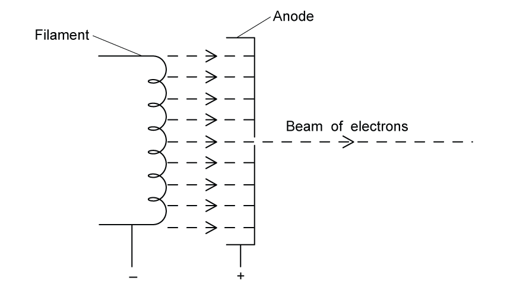

# Exam Questions — Energy & Momentum of a Photon
**22. Quantum Physics** · Cambridge (CIE) A-LEVEL physics (9702)
> Source: [https://www.savemyexams.com/a-level/physics/cie/25/topic-questions/](https://www.savemyexams.com/a-level/physics/cie/25/topic-questions/) · 7 questions across 1 sets

## Structured Questions (7 questions)

### Q1 — easy — 6 marks

**Q1** [2 marks]

State two observed phenomena which led scientists to believe that electromagnetic radiation was a wave.

**Q1** [1 mark]

Give an example of an experiment showing that electromagnetic radiation can exhibit particle properties.

**Q1** [1 mark]

Define the term 'photon'.

**Q1** [2 marks]

Electromagnetic radiation is emitted from a radioactive source. The radiation has a frequency of 8.6 × 1020 Hz.

Calculate the energy of an individual photon from this source.

### Q2 — medium — 12 marks

**Q2** [3 marks]

A heated filament and anode are placed in a vacuum, as shown in Fig 1.1. The anode has a gap through which electrons can pass.

**Fig 1.1**

A potential difference of 15 V is applied across the filament and anode.

An electron is then emitted from the heated filament with a speed of 1.5 × 106 m s−1.

Calculate its initial kinetic energy in electronvolts.

**Q2** [3 marks]

**Extract:**

A heated filament and anode are placed in a vacuum, as shown in Fig 1.1. The anode has a gap through which electrons can pass. A potential difference of 15 V is applied across the filament and anode. An electron is then emitted from the heated filament with a speed of 1.5 × 10^6 m s^−1. Calculate its initial kinetic energy in electronvolts.
E_k = 6.4 eV

Calculate the electron's final kinetic energy in joules, as it exits the gap in the anode.

**Q2** [2 marks]

**Extract:**

Calculate the electron's final kinetic energy in joules, as it exits the gap in the anode.
E_{k,f} = 3.4 × 10^{−18} J

Calculate the momentum of this electron after it has passed through the hole in the anode.

**Q2** [4 marks]

**Extract:**

p = mv = (9.11 × 10^−31) × (2.73 × 10^6)
p = 2.49 × 10^−24 kg m s^−1 = 2.5 × 10^−24 kg m s^−1

Calculate the number of 3.62 × 1014 Hz photons required to have an equivalent total momentum to the electron. Give your answer to two significant figures.

### Q3 — easy — 8 marks

**Q3** [2 marks]

A photon is emitted from a laser with a wavelength of 500 nm.

Calculate the frequency of this photon.

**Q3** [2 marks]

**Extract:**

A photon is emitted from a laser with a wavelength of 500 nm. Calculate the frequency of this photon. f = 6.0 × 10^14 Hz

Calculate the energy of the photon.

Give your answer in joules.

**Q3** [2 marks]

**Extract:**

E = 3.98 × 10^−19 J = 4.0 × 10^−19 J

Give the photon energy calculated in part (b) in units of electron volts.

**Q3** [2 marks]

**Extract:**

Calculate the energy of the photon. Give your answer in joules. E = h f = (6.63 × 10^−34) × (6.0 × 10^14); E = 3.98 × 10^−19 J = 4.0 × 10^−19 J

Calculate the momentum of the photon.

Give your answer with units of kg m s−1.

### Q4 — hard — 7 marks

**Q4** [2 marks]

Photon energy and photon momentum are related by the equation:

*E**2* = (*pc)**2* + (*mc**2*)2

Derive from this equation the equation $p=\frac{h}{λ}$ for calculating the momentum of a photon.

**Q4** [2 marks]

A photon has a wavelength of 400 nm.

Calculate the velocity of an electron with the same momentum.

**Q4** [3 marks]

**Extract:**

A photon has a wavelength of 400 nm. Calculate the velocity of an electron with the same momentum.
Wavelength of photon, λ = 400 nm = 400 × 10^−9 m; Planck's constant, h = 6.63 × 10^−34 J s; Mass of an electron, me = 9.11 × 10^−31 kg; velocity of the electron, ve = 1822 m s^−1

Determine the ratio of photon energy to electron kinetic energy.

### Q5 — hard — 7 marks

**Q5** [2 marks]

A laser sitting at rest on wheels that are free to move produces 5.00 × 1027 photons. Each photon has a frequency 3.95 × 1014 Hz.

Calculate the magnitude of the momentum in producing these photons on the laser.

**Q5** [2 marks]

**Extract:**

Obtain an equation in terms of the momentum of n photons:
- p = n (hf/c)

Where n = number of photons, f = frequency, h = Planck's constant, c = speed of light in free-space.

Show that the equation used for part a) is homogeneous.

**Q5** [3 marks]

**Extract:**

A laser sitting at rest on wheels that are free to move produces 5.00 × 10^27 photons. Each photon has a frequency 3.95 × 10^14 Hz.

Lasers produce photons of light through a process called stimulated emission. The energy of a photon produced by the laser is equal to the energy difference between the electrons in an excited state and the level below. Fig. 1.1 shows the energy levels of the electrons inside the laser from parts a) and b).

**Fig. 1.1**

Sketch on Fig. 1.1 the energy level transition of the electrons in the laser.

### Q6 — medium — 10 marks

**Q6** [2 marks]

Scientists are designing a prototype spaceship, with a mass of 4.9 × 106 kg.

Once it has left the solar system, it will come to rest relative to Earth. It will then be accelerated by 4 very powerful lasers, which will be aimed at 4 large sails on the spaceship.

Each laser emits photons with a wavelength of 2.50 × 10−12 m.

Calculate the energy of a single photon.

**Q6** [2 marks]

**Extract:**

Scientists are designing a prototype spaceship, with a mass of 4.9 × 10^6 kg. Once it has left the solar system, it will come to rest relative to Earth. It will then be accelerated by 4 very powerful lasers, which will be aimed at 4 large sails on the spaceship. Each laser emits photons with a wavelength of 2.50 × 10^−12 m. Calculate the energy of a single photon. E = 7.96 × 10^−14 J

Calculate the momentum of a single photon.

**Q6** [3 marks]

**Extract:**

Scientists are designing a prototype spaceship, with a mass of 4.9 × 10^6 kg. Once it has left the solar system, it will come to rest relative to Earth. It will then be accelerated by 4 very powerful lasers, which will be aimed at 4 large sails on the spaceship. Each laser emits photons with a wavelength of 2.50 × 10^−12 m.
Momentum of a single photon, p = 2.65 × 10^−22 kg m s^−1

Each laser emits 7.5 × 1025 photons per second.

(i)

Calculate the total momentum of the photons emitted each second from a single laser.

[1]

(ii)

All photons are absorbed by the sails. Calculate the force applied to the spaceship by all of the lasers.

[2]

**Q6** [3 marks]

**Extract:**

Scientists are designing a prototype spaceship, with a mass of 4.9 × 10^6 kg.

Each laser emits 7.5 × 10^25 photons per second.
From four lasers, F_tot = 4 × 19 900 = 79600 = 80 000 N (total force applied by the lasers)

Calculate the speed of this spaceship after an hour of receiving this electromagnetic radiation.

### Q7 — medium — 7 marks

**Q7** [1 mark]

A photon has an energy of 1.78 eV.

Convert this energy into joules.

**Q7** [2 marks]

**Extract:**

A photon has an energy of 1.78 eV. Convert this energy into joules. 1 eV = 1.60 × 10^−19 J; 1.78 eV = 2.848 × 10^−19 = 2.85 × 10^−19 J

Calculate the wavelength of this photon.

**Q7** [2 marks]

**Extract:**

A photon has an energy of 1.78 eV.
1.78 eV = 2.848 × 10^−19 = 2.85 × 10^−19 J

3.80 × 1018 of these photons are emitted from a laser every second.

Calculate the energy transferred by the laser every hour.

**Q7** [2 marks]

**Extract:**

A photon has an energy of 1.78 eV. Convert this energy into joules. 1.78 eV = 2.848 × 10^−19 = 2.85 × 10^−19 J

Calculate the total momentum of 5 of these photons.
