# Mark Schemes — Photoelectric Effect
**22. Quantum Physics** · Cambridge (CIE) A-LEVEL physics (9702)

## Structured Questions (8 questions)

### Q1
A graph that would score 2 marks should look like:

Graph shows a straight line with the same gradient:

- The gradient of the line represents Planck’s constant, *h*
- Therefore the gradient of the line should remain the same magnitude; **[1 mark]**

Graph shows a greater threshold frequency:

- The work function is proportional to the threshold frequency $f_{0}$
- Hence, a greater work function means the threshold frequency increases (indicated on the graph as $f_{0}'$)  **[1 mark]**

**[Total: 2 marks]**

> *Remember the photoelectric equation states that the photon energy **E** = **hf** = **ϕ** + **KE­ **max**.** To calculate the work function, the term **KE **max** can be set to zero, because effectively you only wish to consider electrons which have been given **just enough energy **transferred from the incident photons so that they reach the metal surface. This will occur at precisely the threshold frequency **f**0** – the frequency of light for which the minimum energy to reach the metal surface is transferred. *

> *In other words, at threshold frequency, photoelectrons have no remaining energy to use in kinetic motion: so, if **KE­ **max** = 0:*

> *hf**0** = **ϕ*

> *This is a neat result that demonstrates the work function **ϕ  **of a metal is proportional to the threshold frequency **f**0**  of incident photons.*
Explain the significance of a maximum photocurrent detected:

- Maximum photocurrent means <u>all emitted photoelectrons</u> are collected at plate A; **[1 mark]**

Link the maximum photocurrent to the potential of plate A:

- If all emitted photoelectrons are collected, plate A must be at a higher potential than plate B / plate A must be positively charged; **[1 mark]**

State the direction of the electric field between the plates:

- Hence, the direction of the electric field is from plate A to plate B; **[1 mark]**

**[Total: 3 marks]**

> *Electric field lines show the direction that a positive test charges accelerate, from high to low potential. *

> *When the photoelectrons are released to the surface of the metal, the only way you can ensure maximum photocurrent is to attract them to a positively charged region – in this case, plate A.*

> *If the field were pointing the other way, a photocurrent may still be detected but not at a **maximum**. Some photoelectrons may be emitted with too little kinetic energy to overcome the opposing electric field.*

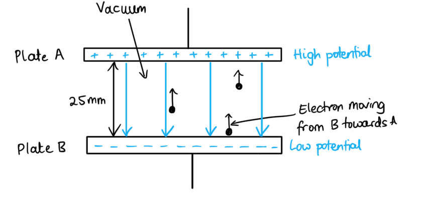
List the known quantities:

- Wavelength, *λ *= 255 nm = 255 × 10–9 m
- Distance between the plates, *d* = 25 mm = 25 × 10–3 m
- Electric field strength, *E* = 140 N C–1
- Work function,*ϕ* = 2.2 eV = 2.2 × (1.6 × 10–19) = 3.5 × 10–19 J

From the data sheet:

- Speed of light in a vacuum, *c = *3 × 108 m s–1
- Planck’s constant, *h* = 6.63 × 10–34 J s
- Magnitude of the charge of electron, *e* = 1.6 × 10–19 C
- Electron rest mass, $m_{e}$ = 9.11 × 10–31 kg

Calculate the energy available from incident light:

- *hf* = *h* × $\frac{c}{λ}$ = (6.63 × 10–34) × `open parentheses fraction numerator 3 cross times 10 to the power of 8 over denominator 255 cross times 10 to the power of negative 9 end exponent end fraction close parentheses` = 7.8 × 10–19 J **[1 mark]**

Calculate the maximum kinetic energy of photoelectrons released to the surface:

- *hf = ϕ* + $KE_{max}$ so $KE_{max}$ = *hf* – *ϕ*
- $KE_{max}$= (7.8 × 10–19) – (3.5 × 10–19) = 4.3 × 10–19 J **[1 mark]**

Calculate the potential difference between the plates, *V*:

- The uniform electric field strength between parallel plates *E =*$\frac{V}{d}$
- The potential difference *V* = *E × d = *140 × (25 × 10­-3) = 3.5 V **[1 mark]**

Calculate the kinetic energy transferred due to the potential difference between the plates:

- The potential difference between the plates, *V* = $\frac{W}{e}$
- The work done on the photoelectrons contributes to their KE, so *W* = *KE* = *e × V*
- *KE* = (1.6 × 10­–19) × 3.5 = 5.6 × 10–19 J **[1 mark]**

Calculate the total maximum kinetic energy of photoelectrons reaching plate **A**:

- Total maximum $KE_{total}$  = $KE_{max}$ from incident photons + *KE* transferred from the potential difference
- Total maximum $KE_{total}$ = (4.3 × 10–19) + (5.6 × 10­–19) = 9.9 × 10–19 J **[1 mark]**

Calculate the maximum speed of photoelectrons:

- $KE_{total}$ = $\frac{1}{2}$*m*`open parentheses v subscript m a x end subscript close parentheses squared`
- 9.9 × 10–19  = $\frac{1}{2}$ × (9.11 × 10–31) × `open parentheses v subscript m a x end subscript close parentheses squared`
- 19.8 × 10–19 = (9.11 × 10–31) × `open parentheses v subscript m a x end subscript close parentheses squared`
- `open parentheses v subscript m a x end subscript close parentheses squared` = 2.17 × 1012
- $v_{max}$= $\sqrt{2.17\times10^{12}}$ = 1.474 × 106 m s–1 = 1.5 × 106 m s–1 (2 s. f.) **[1 mark]**

**[Total: 6 marks]**** **

> *For the final mark, it doesn’t matter whether you substitute the values in before rearranging (as done in this mark scheme) or rearrange for  *$v_{max}$*before substituting, as long as you get the correct final answer.*
Suggest the experimental change:

- The terminals of the power supply should be reversed / make plate A negatively charged and plate B positively charged / reverse the direction of the electric field; **[1 mark]**

Explain the effect of the experimental change on the size of the photocurrent:

- This reversal would mean the photoelectrons would <u>do work against the electric field</u> between the plates / electrons would need to <u>do work to cross the potential difference</u> between the plates; **[1 mark]**
- This would reduce the photocurrent because only photoelectrons with sufficient energy would be able to reach plate A / could cross the potential difference; **[1 mark]**

**[Total: 3 marks]**

> *If the direction of the electric field is reversed (by reversing the terminals of the power supply) then there will be a force opposing the motion of every photoelectron emitted from the surface of plate B. Therefore, electrons would need to do work **against **this force; only the most energetic photoelectrons (those nearest the surface of the metal!) would be able to cross the space between the plates. The overall effect would thus be a reduction in the photocurrent.*

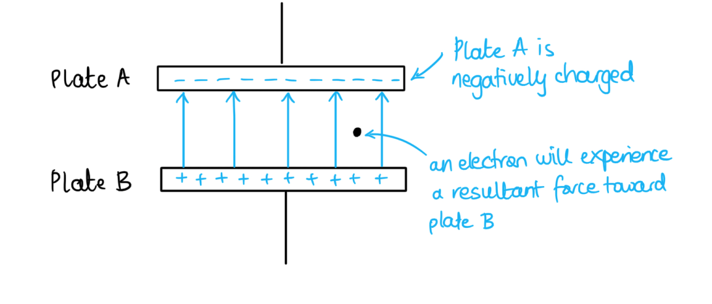

### Q2
To find the work function:

From data page:

- Speed of light in free space, *c = *3.00 × 108 m s–1
- Planck constant, *h* = 6.63 × 10–34 J s

Use Fig. 1.1 to find the wavelength when $KE_{max}$= 0:

- Photoelectrons are only released to the surface if light is incident at the threshold frequency (or threshold wavelength, $λ_{0}$ )
- $λ_{0}$= 590 nm when the $KE_{max}$= 0 from Fig. 1.1; **[1 mark]**

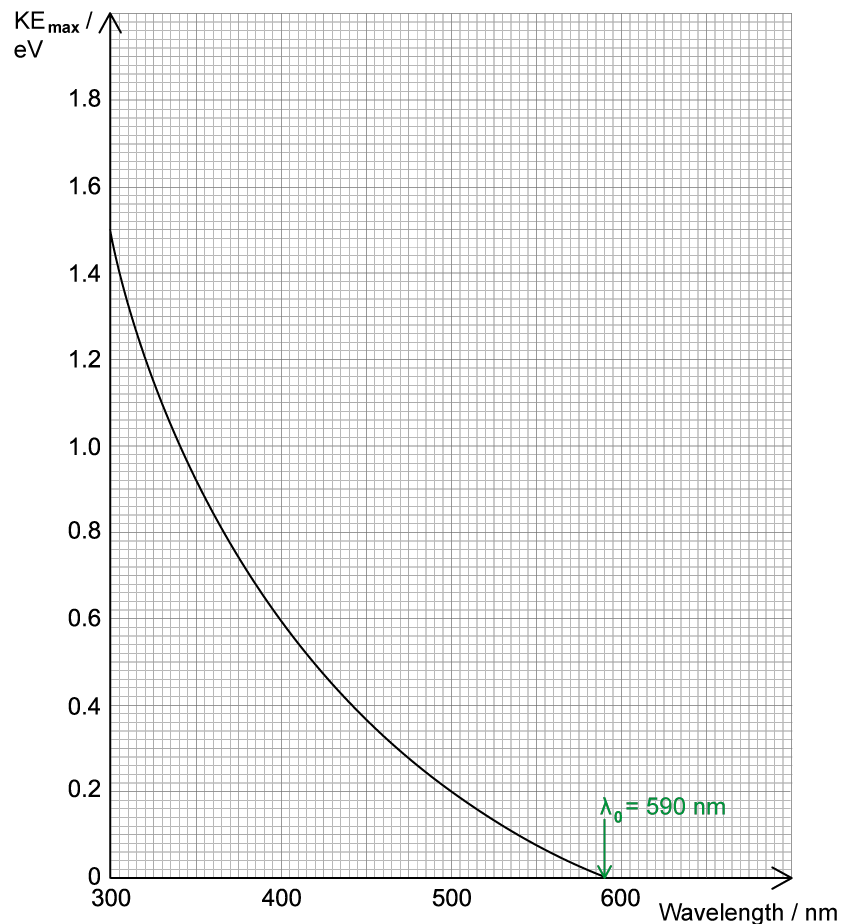

Calculate the work function using the threshold wavelength, $λ_{0}$ :

- *hf* = *ϕ* + $KE_{max}$
- When $KE_{max}$= 0, the work function *ϕ *= *h*$f_{0}$
- *ϕ *= *h*$f_{0}$ = *h × *$\frac{c}{λ_{0}}$ = (6.63 × 10–34) × `open parentheses fraction numerator 3 cross times 10 to the power of 8 over denominator 590 cross times 10 to the power of negative 9 end exponent end fraction close parentheses` = 3.4 × 10–19 J **[1 mark]**

Calculate the work function in electronvolts, *ϕ*:

- 1 eV = 1.6 × 10–19 J
- *ϕ* =(3.4 × 10–19) ÷ (1.6 × 10–19) = 2.1 eV **[1 mark]**

**[Total: 3 marks]**
Rearrange the photoelectricity equation to make $KE_{max}$ the subject:

- The photoelectricity equation states *hf* = *ϕ* + $KE_{max}$
- Since Fig. 1.1 puts $KE_{max}$ on the y-axis, the photoelectricity equation should be rearranged to $KE_{max}$= *hf* – *ϕ ***[1 mark]**

Write the photoelectricity equation in terms of wavelength:

- In terms of wavelength, this is $KE_{max}$ = $\frac{hc}{λ}$– *ϕ ***[1 mark]**

Discuss the validity of the student’s statement by explaining the relationship between $KE_{max}$ and λ:

- The student’s statement is invalid / not valid; **[1 mark]**

- Inverse proportionality means $KE_{max}$× λ = constant <u>which is not the case here</u>

**Final answer:** **OR**

- The work function *ϕ* is a term which cannot be ignored in the relationship; **[1 mark]**

**[Total: 4 marks]**

> *The equation for the energy of the incident photons is **E** = **hf** = *$\frac{hc}{λ}$* , which means photons with a shorter wavelength have more energy to give to the electrons in the metal. This is why the graph in **Figure 1** shows electrons have more kinetic energy when the incident light has a shorter wavelength.*

> *An inversely proportional relationship on a graph does not cross any axes, so this cannot be inverse proportionality. Explaining this with the equation, however, is what gains the marks. *
Use Fig. 1.1 to determine $KE_{max}$  of photoelectrons emitted for the incident light:

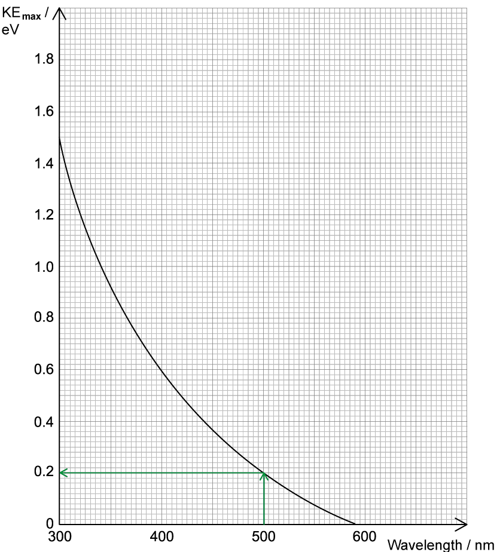

- If the wavelength of incident light is 500 nm then the $KE_{max}$ of photoelectrons is 0.2 eV; **[1 mark]**

Convert the ­ from eV to J:

- $KE_{max}$= 0.2 eV = 0.2 × 1.6 × 10–19 = 3.2 × 10–20 J **[1 mark]**

Calculate the velocity of the emitted photoelectrons:

- $KE_{max}$= $\frac{1}{2}$*m *`open parentheses v subscript m a x end subscript close parentheses squared`
- 3.2 × 10–20= $\frac{1}{2}$ × (9.11 × 10–31) × `open parentheses v subscript m a x end subscript close parentheses squared`
- 6.4 × 10–20 = (9.11 × 10–31) ×`open parentheses v subscript m a x end subscript close parentheses squared`
- `open parentheses v subscript m a x end subscript close parentheses squared` = 7.03 × 1010
- $v_{max}$= $\sqrt{7.03\times10^{10}}$ = 2.7 × 105 m s–1 **[1 mark]**

Calculate the de Broglie wavelength of the emitted photoelectrons:

- $λ=\frac{h}{mv}$
- $λ$= `fraction numerator 6.63 cross times 10 to the power of negative 34 end exponent over denominator open parentheses 9.11 cross times 10 to the power of negative 31 end exponent close parentheses cross times open parentheses 2.7 cross times 10 to the power of 5 close parentheses end fraction` = 2.7 × 10–9 m **[1 mark]**

**[Total: 4 marks]**

> *If you are unsure where to start with these types of questions, write out the equation for the quantity you are trying to find. Then, think 'what do I need to know to calculate this?'. The only unknown in the de Broglie equation in this case is velocity, which we can find from kinetic energy and so on.*
State how to reduce the minimum de Broglie wavelength:

- The <u>maximum </u>velocity / momentum of photoelectrons must be <u>increased</u>; **[1 mark]**

Link an increase in maximum velocity to an increase in $KE_{max}$:

- An increase in maximum velocity is achieved by an increase in $KE_{max}$; **[1 mark]**

  - This is shown by the equation $KE_{max}$ = $\frac{1}{2}$*m* `open parentheses v subscript m a x end subscript close parentheses squared`

Suggest experimental changes to increase the $KE_{max}$ of emitted photoelectrons:

- $KE_{max}$of emitted photoelectrons can be increased by using a metal with a smaller work function energy <u>for the same incident light source</u>; **[1 mark]**
- $KE_{max}$of emitted photoelectrons can also be increased by increasing the frequency/decreasing the wavelength of the light source, <u>for the same metal surface</u>; **[1 mark]**

**[Total: 4 marks]**** **

> *Recall the de Broglie equation is:*

$λ=\frac{h}{mv}$

> *To reduce λ, increase mass or velocity. Mass can't be changed here so velocity must be altered.*

> *Remember to be specific as to what you would need to change about the light source. Avoid saying ‘increase the energy of the light source’ because you cannot do that directly, this can only be achieved through changing the frequency or wavelength (since they are related by **E** = **hf** =*$\frac{hc}{λ}$* )*

### Q3
A photon is:

- A quantum / packet of energy; **[1 mark]**
- Of electromagnetic / EM radiation; **[1 mark]**

**[Total: 2 marks]**
(i) The name of the phenomenon is:

- The photoelectric effect; **[1 mark]**

(ii) Four conclusions that can be drawn from the graph:

**Final answer:** **Any ****one ****from the following pairs:**

- There is a frequency / threshold frequency below which no electrons are emitted **OR**
- The threshold frequency = 1.6 × 1014 Hz; **[1 mark]**

- The gradient of the line is the Planck constant (*h*) **OR**
- The gradient of the line = 6.7 × 10−34 J s; **[1 mark]**

**Final answer:** **Both ****of the following points:**

- The work function of the metal is calculated to be 1.06 × 10−19 J; **[1 mark]**
- *E*MAX increases linearly with increasing frequency; **[1 mark]**

**[Total: 5 marks]**

> *In part (ii) you must use the **data** on the graph to obtain **quantitative conclusions**. This means you may need to **complete calculations** based on values from the graph. *

> *The work function is calculated as follows:*

$KE_{max}=hf-Φ$

> *at the threshold frequency KE = 0*

`capital phi space equals space h f space equals space open parentheses 6.63 space cross times space 10 to the power of negative 34 end exponent close parentheses space cross times space open parentheses 1.6 space cross times space 10 to the power of 14 close parentheses`

> *Read the question carefully, KE is the **KE **of the **photoelectrons** (electrons) emitted from the** surface** of the **metal*
(i) When the same metal is used but the intensity of the radiation is halved the graph would:

- Look the same / the line would be unchanged; **[1 mark]**
- Because the photons have the same energy / intensity is independent of photon energy; **[1 mark]**

(ii) When a different metal is used and the intensity of the radiation is the same the graph would:

- Have the same gradient but a different intercept (on the x-axis); **[1 mark]**
- Because the threshold frequency would be different;** [1 mark]**

**[Total: 4 marks]**

### Q4
Work function is defined as:

- The <u>minimum</u> energy required; **[1 mark]**
- To release a (photo)electron from the surface of a metal; **[1 mark]**

**[Total: 2 marks]**

> *You can also say 'the energy required to release a photoelectron from the surface of a metal with **zero kinetic energy**'. This is the same as saying 'minimum' in the above answer.*
List the known quantities:

- Energy (in eV) = 2.28 eV

From the data page:

- Elementary charge, *e* = 1.60 × 10–19 C

Convert 2.28 eV to Joules:

- 1 eV = 1.60 × 10–19 J
- 2.28 eV = 2.28 × (1.60 × 10–19) = 3.648 × 10–19 J = 3.65 × 10–19 J (3 s.f.) **[1 mark]**

**[Total: 1 mark]**
The threshold frequency of a metal is:

- The <u>minimum</u> frequency of (incident) light; **[1 mark]**
- Required to remove a (photo)electron from the <u>surface</u> of a metal; **[1 mark]**

**[Total: 2 marks]**

> *Pay really close attention to the two marks awarded in this definition: remember that the threshold frequency refers to the frequency of **incoming** light, which must be at a minimum value, sufficient to release an electron from the metal surface. *

> *So, in a way, it is a property of both incoming light **and** of particular metals. Different metal surfaces have different threshold frequencies.*
Calculate the threshold frequency of sodium:

List the known quantities:

- Work function *ϕ *= 2.28 eV = 3.65 × 10–19 J (Part (b))

From the data sheet:

- Planck constant: *h* = 6.63 × 10–34 J s

State the equation to calculate the threshold frequency:

- The photoelectric equation:  `h f space equals space ϕ space plus space E subscript k open parentheses m a x close parentheses end subscript`
- At the threshold frequency, `E subscript k open parentheses m a x close parentheses end subscript space equals space 0` so the photoelectric equation becomes $hf_{0}=ϕ$ **[1 mark]**

Calculate the threshold frequency:

- Threshold frequency:  $f_{0}=\frac{ϕ}{h}=\frac{3.65\times10^{-19}}{6.63\times10^{-34}}$**[1 mark]**
- Threshold frequency:  $f_{0}$ = 5.51 × 1014 Hz **[1 mark]**

**[Total: 3 marks]*** *

> *Since incident light on the surface of the metal is only **just** at the threshold frequency, which is the minimum frequency required to release an electron to the metal surface, it has no energy left over from the photon to transfer to kinetic energy. *

> *Therefore, in the photoelectric equation, we can say that *`E subscript k open parentheses m a x close parentheses end subscript`*= 0. Therefore, the threshold frequency is given by the equation:**  *

> *h*$f_{0}$* = ϕ*

### Q5
Describe **two** phenomena associated with the photoelectric effect that cannot be explained using a wave theory of light:

**Final answer:** **Any ****two ****from:**

- Electrons are not ejected from the metal plate below the threshold frequency; **[1 mark]**
- The <u>maximum</u> energy of the ejected electrons depends on the frequency of the light incident on the metal plate; **[1 mark]**
- The <u>maximum</u> energy of the ejected electrons does not depend on the intensity of the light incident on the metal plate; **[1 mark]**
- The emission of the electrons from the metal plate is instantaneous; **[1 mark]**

**[Total: 2 marks]**
(i) Identify the symbol λo:

**Final answer:** **Any ****one ****from:**

- λo is the threshold wavelength (of the incident light); **[1 mark]**
- λo is the wavelength corresponding to the threshold frequency (of the incident light); **[1 mark]**
- λo is the maximum wavelength of the emission of the electrons from the metal plate;  **[1 mark]**

(ii) Use Fig. 8.1 to determine the magnitude of λo:

Draw lines on the graph to extend the given line to the x-axis:

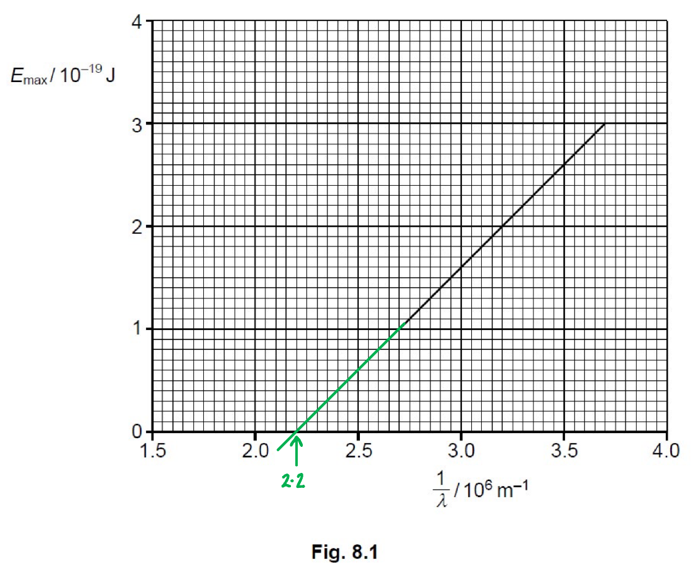

- The line intercepts the x-axis at 2.2 × 106 m−1
- So, $\frac{1}{λ_{0}}$ = 2.2 × 106 m−1
- Hence, $λ_{0}$ = 4.5 × 10−7 m **[1 mark]**

(iii) Use the gradient of Fig. 8.1 to determine a value for the Planck constant h. Show your working.

From the data booklet:

- Speed of light in free space, $c$ = 3.00 × 108 m s−1

Match the equation for $E_{max}$* *to the standard equation of a straight line:

- `E subscript m a x end subscript equals h c open parentheses 1 over lambda minus 1 over lambda subscript o close parentheses
space space space space y space equals space m space space space space x space space plus space c`
- $E_{max}$ is the $y$-axis and $\frac{1}{λ}$ the $x$-axis
- Hence, the gradient of the straight line, $m$ is $hc$** [1 mark]**

Draw lines on the graph to obtain a gradient triangle:

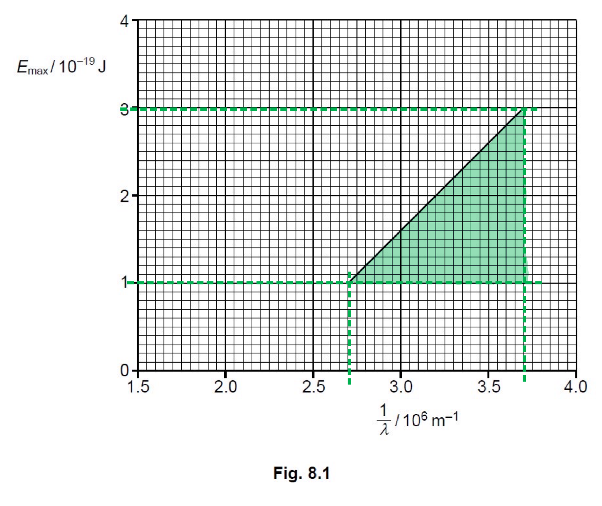

- Point 1: (3.7 × 106, 3 × 10−19)
- Point 2: (2.7 × 106, 1 × 10−19)

Calculate the gradient of the line, $m$:

- `m space equals space fraction numerator increment y over denominator increment x end fraction space equals space fraction numerator y subscript 2 space minus space y subscript 1 over denominator x subscript 2 space minus space x subscript 1 end fraction space equals space fraction numerator open parentheses 1 space cross times space 10 to the power of negative 19 end exponent close parentheses space minus space open parentheses 3 space cross times space 10 to the power of negative 19 end exponent close parentheses over denominator open parentheses 2.7 space cross times space 10 to the power of 6 close parentheses space minus space open parentheses 3.7 space cross times space 10 to the power of 6 close parentheses end fraction`
- $m=2\times10^{-25}$ **[1 mark]**

Rearrange to make Planck's constant $h$ the subject and substitute for $c$into the expression for the gradient, $m$:

- $m=hc$
- $h=\frac{m}{c}$
- `h space equals space fraction numerator open parentheses 2 space cross times space 10 to the power of negative 25 end exponent close parentheses over denominator open parentheses 3 space cross times space 10 to the power of 8 close parentheses end fraction`
- `h space equals space 6.66 space cross times space 10 to the power of negative 34 end exponent space straight J space straight s space equals space 6.7 space cross times space 10 to the power of negative 34 end exponent space straight J space straight s space open parentheses 2 space s. f. close parentheses` **[1 mark]**

**[Total: 5 marks]**

- *Check "**Graphical representation of the work function**" in the revision notes to help with part (ii)*
- *The trick in part (iii) is recognising that the equation has been given for a **reason**, and should be matched to the **equation of a straight line*
On Fig. 8.1, draw a line to show the variation with $\frac{1}{λ}$ of *E*max for the oxidized surface:

Consider the meaning of "work function energy is increased":

- This means that the $x$-intercept has increased
- Hence, $\frac{1}{λ_{0}}$ has increased

A graph that would score 2 marks should look like this:

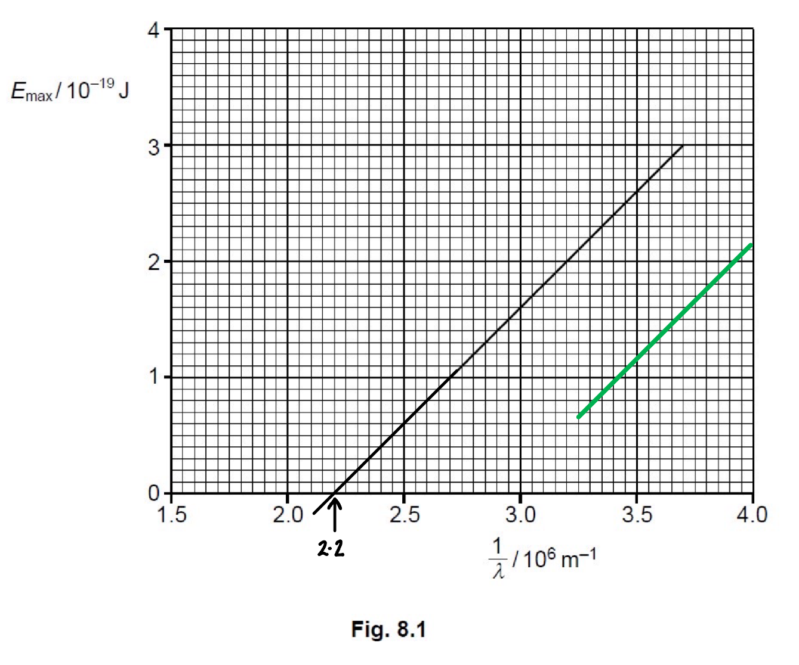

- The line has the same gradient as the given line; **[1 mark]**
- The line is straight, drawn with a ruler, with a positive gradient and when extrapolated intercepts the $x$-axis at a value greater than 2.2 × 106 m−1 **[1 mark]**

**[Total: 2 marks]**

### Q6
The work function energy of a metal is:

- The (incident) photon energy required to remove the electron;** [1 mark]**

**Final answer:** **Any ****one ****from:**

- The minimum energy needed to remove the electron; **[1 mark]**
- The energy needed to remove the electron from the surface; **[1 mark]**
- The energy needed to remove the electron (from the surface) with zero kinetic energy;** [1 mark]**

**[Total: 2 marks]**
Determine the number of photons incident on the surface per unit time:

List the known quantities:

- Frequency of radiation, *f *=  8.5 × 1014 Hz
- Power of radiation, *P *= 9.45 mW = 9.45 × 10−3 W

Use the equation for photon energy:

- $E=hf$** [1 mark]**
- `E space equals space open parentheses 6.63 space cross times space 10 to the power of negative 34 end exponent close parentheses space cross times space open parentheses 8.5 space cross times space 10 to the power of 14 close parentheses`
- $E=5.64\times10^{-19}J$

Obtain an expression and calculate the number of photons per unit time:

- number of photons per unit time = $\frac{power}{energy}$
- number of photons per unit time = $\frac{9.45\times10^{-3}}{5.64\times10^{-19}}$
- number of photons per unit time = $1.68\times10^{16}s^{-1}$ **[1 mark] **

**[Total: 2 marks]**

> *Understanding how to obtain the **formula** for **number per unit time** is tricky. *

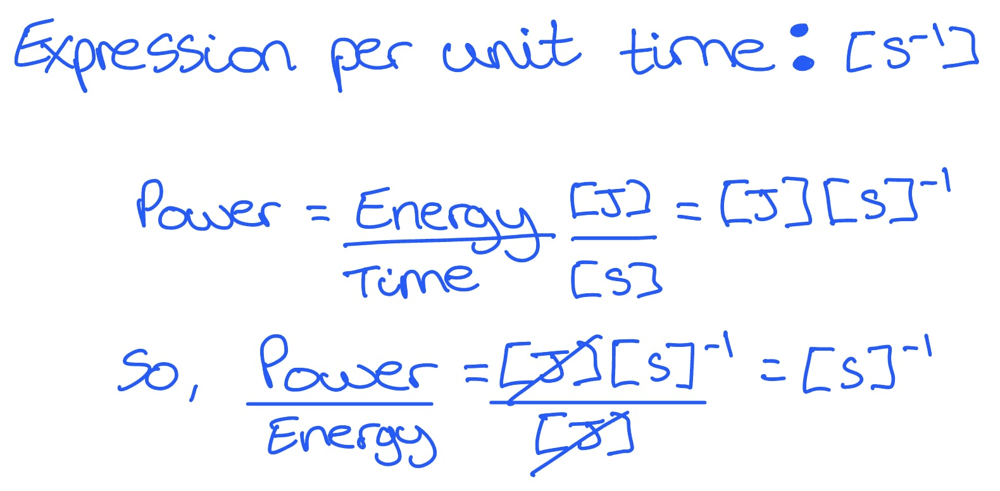
Calculate the work function energy *Φ *of the metal:

List the known quantities:

- Photon energy, $hf$= 5.64 × 10−19 J (from **(b)**)
- Maximum kinetic energy of the emitted photoelectrons, *E**max* = 2.1 × 10–19 J (from **(b)**)

Use the photoelectric equation:

- $hf=Φ+E_{max}$ **[1 mark]**
- $Φ=hf-E_{max}$
- `capital phi space equals space open parentheses 5.64 space cross times space 10 to the power of negative 19 end exponent close parentheses space minus space open parentheses 2.1 space cross times space 10 to the power of negative 19 end exponent close parentheses`
- $Φ=3.54\times10^{-19}J$** [1 mark]**

**[Total: 2 marks]**
If the frequency of the radiation decreases...

(i) The effect on the maximum energy of the photoelectron will be:

- The lower the photon energy (for the same work function); **[1 mark]**
- Then the maximum kinetic energy will decrease; **[1 mark]**

(ii) The rate of emission of photoelectrons will:

- (The lower the photon energy with the same power will) increase the number of photons per unit time; **[1 mark]**

> *In part (i) use the **photoelectric equation** to determine how the different quantities change:*

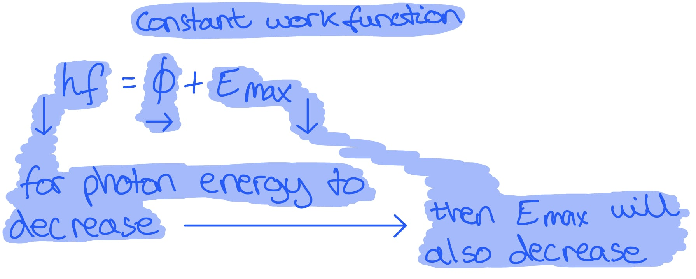

> *In part (ii) use the **equation for number per unit time** to also determine how the different quantities change:*

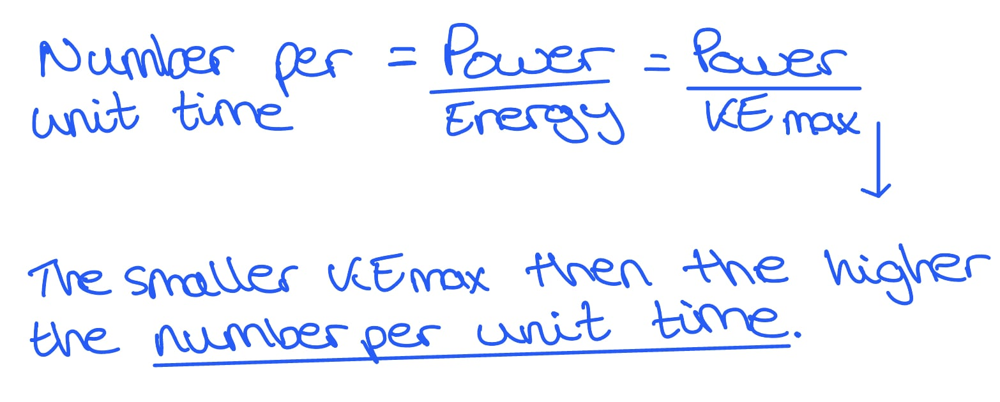

### Q7
When photons are incident on the metal photocathode:

- (Photo)electrons are emitted / released; **[1 mark]**

**[Total: 1 mark]**
Wave theory predicts that:

- All waves transfer energy regardless of wavelength; **[1 mark]**
- Over time, enough energy should accumulate / build up to emit electrons; **[1 mark]**

**[Total: 2 marks]**

> *You must be able to explain why wave theory cannot explain the photoelectric effect, as well as why photon theory can - in this case, photoelectron emission is not observed at long wavelengths as each photon must have enough energy to transfer sufficient energy to release an electron from the metal's surface - and this energy corresponds to a certain frequency (**E** = **hf**) which must be greater than the metal's threshold frequency.*
(i) Work function is defined as:

- The <u>minimum</u> energy required to emit an electron from the surface of a metal; **[1 mark]**
- With zero / no kinetic energy; **[1 mark]**

(ii) Threshold frequency is defined as:

- The <u>minimum</u> frequency of an incident photon; **[1 mark]**
- Required to liberate / remove / eject an electron from the surface of a metal; **[1 mark]**

**[Total: 4 marks]**
List the known quantities:

- Work function, *Φ* = *E**min* = 2.4 eV
- Energy of incident radiation, *E* = 10.2 eV

From the data page:

- Planck constant, *h* = 6.63 × 10−34 J s
- Elementary charge, *e* = 1.60 × 10−19 C

(i) Calculate the threshold frequency:

- Photon energy:  $E=hf\Rightarrowf=\frac{E}{h}$

- Work function: * E**min* = 2.4 eV = 2.4 × (1.60 × 10−19) = 3.84 × 10−19 J **[1 mark]**

- Threshold frequency:  $f_{0}=\frac{E_{min}}{h}=\frac{3.84\times10^{-19}}{6.63\times10^{-34}}$
- Threshold frequency:  $f_{0}$ = 5.8 × 1014 Hz **[1 mark]**

(ii) Calculate the maximum kinetic energy:

- Photoelectric equation:  $E_{max}=hf-ϕ$
- Maximum electron KE:  $E_{max}$ = 10.2 − 2.4 = 7.8 eV **[1 mark]**
- Maximum electron KE:  $E_{max}$ = 7.8 × (1.60 × 10−19) = 1.25 × 10−18 J **[1 mark]**

**[Total: 4 marks]**

### Q8
A photon is:

- A discrete quantity / packet / quantum; **[1 mark]**
- Of electromagnetic energy; **[1 mark]**

**[Total: 2 marks]**

> *It is important to remember that the equation **E** = **hf**  is **only** relevant for the energy of photons.*
(i) The meaning of the term* hf* is:

- The energy of a single photon;** [1 mark]**

(ii) The meaning of the term* ϕ* is:

- The minimum energy required to release a photoelectron from the surface of a metal; **[1 mark]**

(iii) The meaning of the term $\frac{1}{2}mv^{2}_{max}$ is:

- The maximum kinetic energy of a photoelectron emitted from the metal surface; **[1 mark]**

**[Total: 3 marks]**

> *Note this question asks you to ‘explain’ the meaning of each term. You have to explain what **ϕ** means; if the question asked to ‘identify’ each term, you could just say that** ϕ** is the work function. Explaining what it means goes one step further: it is the minimum energy required to release a photoelectron from the surface of a metal.*
Describe the features of the photon that explain the photoelectric effect:

**An****y ****three**** from: **

- Light is made of photons, each carrying an energy *E* = *hf*; **[1 mark]**
- Photons are absorbed by electrons in a 1:1 ratio; **[1 mark]**
- Photoelectrons are released <u>immediately</u> from the metal surface; **[1 mark]**
- If the electron gains sufficient energy / energy exceeding the work function (from the photon); **[1 mark]**

**[Total: 3 marks]**

> *The photoelectric effect hinges on whether photons of light carry sufficient energy to release photoelectrons (or simply, electrons) from a metal surface. This is summarised in the sketch below: *

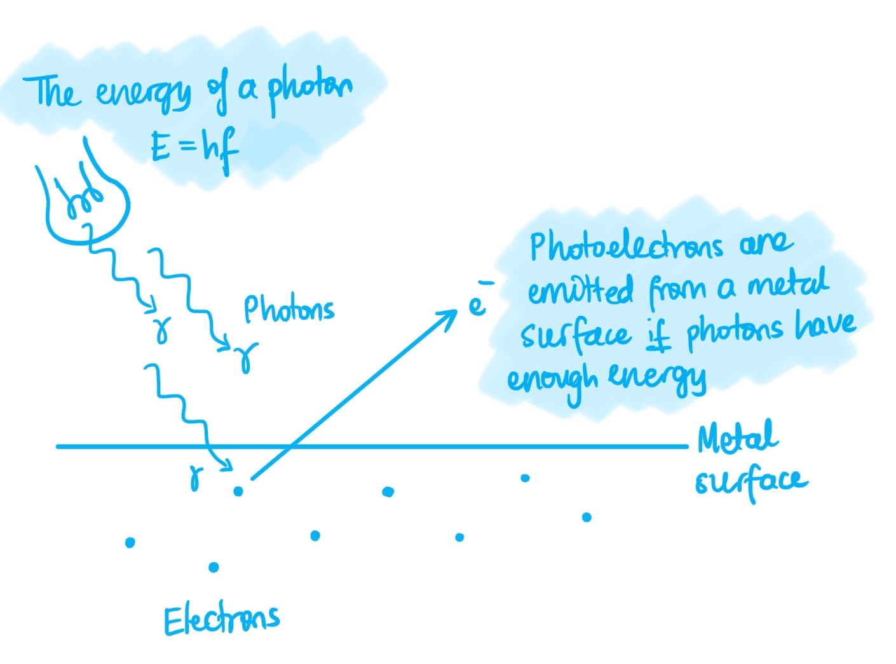
(i) A graph that would score 2 marks:

- Straight line drawn with a positive gradient; **[1 mark]**
- The line intercepts the frequency axis / does not pass through the origin / zero; **[1 mark]**

(ii) The quantity represented by the gradient of the graph is

- Planck's constant / h; **[1 mark]**

**[Total: 3 marks]**

> *Note that you do not have to sketch the part of the line underneath the frequency axis, although you would not be penalised if you do. It is worth remembering that the theoretical intercept on the negative *$E_{K(max)}$* axis represents the work function **ϕ**.*

> *See the revision note on this topic for a comparison of the photoelectric equation and straight line equation.*
