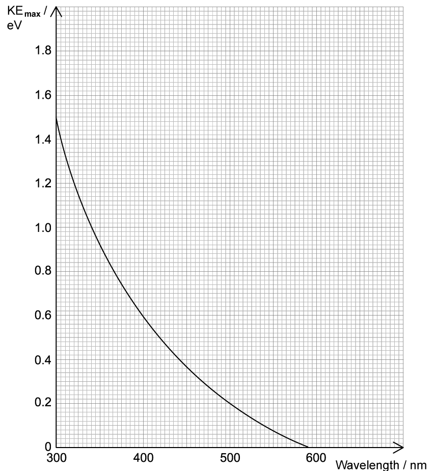
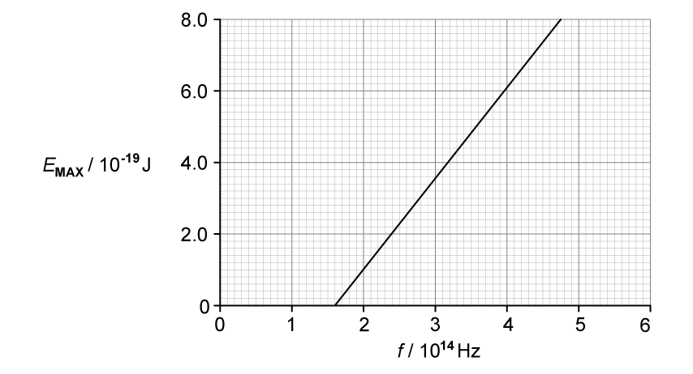
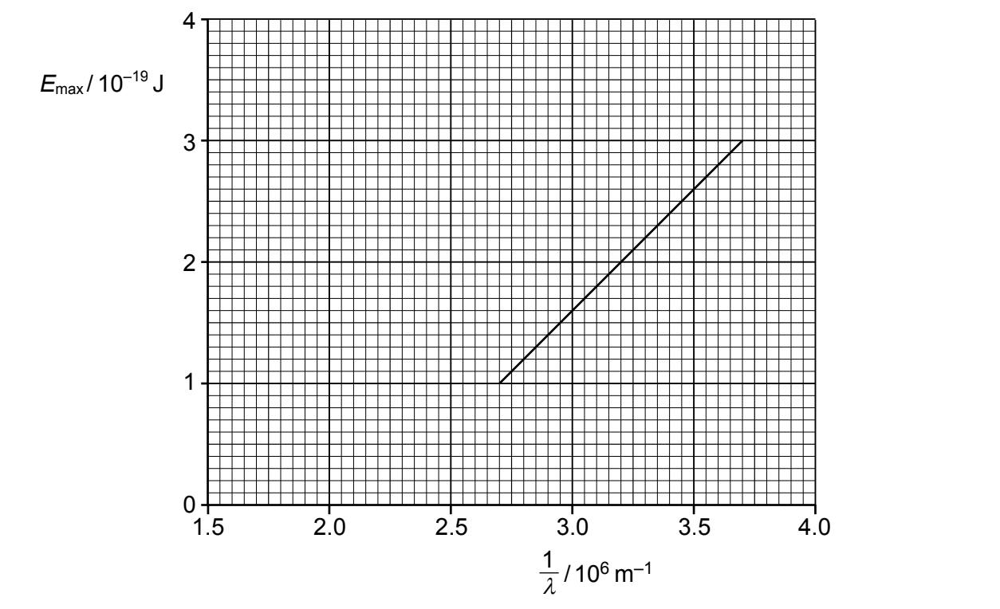

# Exam Questions — Photoelectric Effect
**22. Quantum Physics** · Cambridge (CIE) A-LEVEL physics (9702)
> Source: [https://www.savemyexams.com/a-level/physics/cie/25/topic-questions/](https://www.savemyexams.com/a-level/physics/cie/25/topic-questions/) · 8 questions across 1 sets

## Structured Questions (8 questions)

### Q1 — hard — 14 marks

**Q1** [2 marks]

When electromagnetic radiation of frequency *f* is incident on a particular metal surface, photoelectrons are emitted.

Fig. 1.1 shows how the maximum kinetic energy $KE_{max}$  of these electrons varies with frequency *f.*

**Fig. 1.1**

Sketch on Fig. 1.1 the shape of the graph that would be obtained if the experiment is repeated using metal with a greater work function.

**Q1** [3 marks]

A certain metal with a work function of 2.2 eV is selected to create two parallel plates. These are connected in a circuit to a sensitive ammeter and a power source, such that a uniform electric field of 140 N C–1 exists between them. Fig. 1.2 shows the two plates, labelled A and B, separated by 25 mm in a vacuum.

Electromagnetic radiation of wavelength 255 nm is incident on plate B, such that photoelectrons are emitted from B and move towards A. The ammeter detects a photocurrent in the circuit.

**Fig. 1.2**

State the direction of the electric field between the plates, given the photocurrent is at a maximum.

Explain your answer.

**Q1** [6 marks]

**Extract:**

A certain metal with a work function of 2.2 eV is selected to create two parallel plates. These are connected in a circuit to a sensitive ammeter and a power source, such that a uniform electric field of 140 N C^–1^ exists between them. Fig. 1.2 shows the two plates, labelled A and B, separated by 25 mm in a vacuum. Electromagnetic radiation of wavelength 255 nm is incident on plate B, such that photoelectrons are emitted from B and move towards A. The ammeter detects a photocurrent in the circuit.

Show that the maximum possible speed of the photoelectrons as they reach plate A is approximately 1.5 × 106 m s–1.

**Q1** [3 marks]

**Extract:**

A certain metal with a work function of 2.2 eV is selected to create two parallel plates. These are connected in a circuit to a sensitive ammeter and a power source, such that a uniform electric field of 140 N C^–1^ exists between them. Fig. 1.2 shows the two plates, labelled A and B, separated by 25 mm in a vacuum. Electromagnetic radiation of wavelength 255 nm is incident on plate B, such that photoelectrons are emitted from B and move towards A. The ammeter detects a photocurrent in the circuit.

Suggest and explain an experimental change to the circuit, part of which is shown in Fig. 1.2, that would reduce the photocurrent measured.

### Q2 — hard — 15 marks

**Q2** [3 marks]

The maximum kinetic energy, $KE_{max}$  of photoelectrons varies with the wavelength of incident light on a metal surface. This is shown in Fig. 1.1 below:

**Fig. 1.1**

Use Fig. 1.1 to show that the work function of the metal is 2.1 eV.

**Q2** [4 marks]

**Extract:**

The maximum kinetic energy, KE_max of photoelectrons varies with the wavelength of incident light on a metal surface. This is shown in Fig. 1.1 below: Fig. 1.1

A student uses the shape of the curve in Fig. 1.1 to state that maximum kinetic energy is inversely proportional to the incident wavelength.

By referring to the photoelectricity equation, discuss the validity of this statement.

**Q2** [4 marks]

**Extract:**

The maximum kinetic energy, \$\$K E_{m a x}\$\$ of photoelectrons varies with the wavelength of incident light on a metal surface. This is shown in Fig. 1.1 below: [graph of KEmax / eV against Wavelength / nm, showing a decreasing curve from about 1.5 eV at 300 nm to 0 eV at about 590 nm; at 500 nm the KEmax is about 0.2 eV]

Calculate the de Broglie wavelength of photoelectrons emitted from the metal surface for incident light of wavelength 500 nm.

**Q2** [4 marks]

**Extract:**

The maximum kinetic energy, KE_max of photoelectrons varies with the wavelength of incident light on a metal surface. This is shown in Fig. 1.1 below.

Discuss the experimental changes that would reduce the minimum de Broglie wavelength of the emitted photoelectrons.

### Q3 — medium — 11 marks

**Q3** [2 marks]

State what is meant by a photon.

**Q3** [5 marks]

Electromagnetic radiation of a varying frequency *f* and constant intensity *I* is used to illuminate a metal surface. At certain frequencies, electrons are emitted from the surface of the metal.

(i)

State the name of this phenomenon.

[1]

(ii)

The variation with *f* of the maximum kinetic energy *E*MAX of the emitted electrons is shown in Fig. 1.1.

**Fig. 1.1**

Describe **four **conclusions that can be drawn from the graph in Fig. 1.1. The conclusions may be qualitative or quantitative.

[1]

**Q3** [4 marks]

**Extract:**

Electromagnetic radiation of a varying frequency f and constant intensity I is used to illuminate a metal surface. At certain frequencies, electrons are emitted from the surface of the metal. The variation with f of the maximum kinetic energy EMAX of the emitted electrons is shown in Fig. 1.1. (Fig. 1.1 shows a straight line graph of EMAX against frequency f, with threshold frequency = 1.6 × 10^14 Hz and gradient = the Planck constant.)

The experiment in **(b) **is carried out twice more. Each time one change is made to the method used.

State, and explain, how the graph obtained would compare with Fig. 1.1. when:

(i)

the same metal is used, but with electromagnetic radiation of intensity $\frac{I}{2}$

[2]

(ii)

a different metal is used, but the intensity *I *of the radiation is the same.

[2]

### Q4 — easy — 8 marks

**Q4** [2 marks]

The work function of sodium is 2.28 eV.

State what is meant by work function.

**Q4** [1 mark]

The electronvolt is a unit of energy.

Show that 2.28 eV is equivalent to 3.65 × 10–19 J.

**Q4** [2 marks]

State what is meant by the threshold frequency of a metal.

**Q4** [3 marks]

**Extract:**

The work function of sodium is 2.28 eV.

Show that 2.28 eV is equivalent to 3.65 × 10^–19^ J.

Calculate the threshold frequency of sodium.

### Q5 — medium — 9 marks

**Q5** [2 marks]

Describe **two** phenomena associated with the photoelectric effect that cannot be explained using a wave theory of light.

1 ....................................................................................................................

2 ....................................................................................................................

*Source: Specimen 2022 Paper 4 Q8A*

**Q5** [5 marks]

The maximum energy *E*max of electrons emitted from a metal surface when illuminated by light of wavelength λ is given by the expression

`E subscript m a x end subscript equals h c open parentheses 1 over lambda minus 1 over lambda subscript 0 close parentheses`

where *h* is the Planck constant and *c* is the speed of light.

(i)

Identify the symbol $λ_{0}$.

[1]

(ii)

The variation with $\frac{1}{λ}$ of *E*max for the metal surface is shown in Fig. 8.1.

**Fig. 8.1**

Use Fig. 8.1 to determine the magnitude of λo.

λo = ....................................... m [1]

(iii)

Use the gradient of Fig. 8.1 to determine a value for the Planck constant h. Show your working.

*h* = ................................. J s [3]

*Source: Specimen 2022 Paper 4 Q8B*

**Q5** [2 marks]

**Extract:**

The maximum energy E~max~ of electrons emitted from a metal surface when illuminated by light of wavelength λ is given by the expression E_{max} = hc(1/λ - 1/λ_0) where h is the Planck constant and c is the speed of light. λ_0 is the threshold wavelength. The variation with 1/λ of E~max~ for the metal surface is shown in Fig. 8.1. The line intercepts the x-axis at 2.2 × 10^6 m^−1, so 1/λ_0 = 2.2 × 10^6 m^−1.

The metal surface in **(b)** becomes oxidised.

Photoelectric emission is still observed but the work function energy is increased.

On Fig. 8.1, draw a line to show the variation with $\frac{1}{λ}$ of *E*max for the oxidized surface.

*Source: Specimen 2022 Paper 4 Q8C*

### Q6 — medium — 9 marks

**Q6** [2 marks]

State what is meant by the work function energy of a metal.

**Q6** [2 marks]

Ultraviolet radiation of frequency 8.5 × 1014 Hz is incident, in a vacuum, on a metal surface. The power of the radiation incident on the surface is 9.45 mW. Photoelectrons are emitted with a maximum kinetic energy of 2.1 × 10–19 J.  Determine the number of photons incident on the surface per unit time.

number per unit time = ...................................... s−1

**Q6** [2 marks]

**Extract:**

Ultraviolet radiation of frequency 8.5 × 10^14 Hz is incident, in a vacuum, on a metal surface. The power of the radiation incident on the surface is 9.45 mW. Photoelectrons are emitted with a maximum kinetic energy of 2.1 × 10^–19 J.
E = hf = (6.63 × 10^−34) × (8.5 × 10^14) = 5.64 × 10^−19 J

Calculate the work function energy *Φ *of the metal.

*Φ* = ....................................... J

**Q6** [3 marks]

**Extract:**

Ultraviolet radiation of frequency 8.5 × 10^14 Hz is incident, in a vacuum, on a metal surface. The power of the radiation incident on the surface is 9.45 mW. Photoelectrons are emitted with a maximum kinetic energy of 2.1 × 10^–19 J.

The frequency of the radiation incident on the surface in **(b) **is decreased while the power remains constant

State and explain the effect of this change on:

(i)

the maximum kinetic energy of the photoelectron

[2]

(ii)

the rate of emission of the photoelectron.

[1]

### Q7 — easy — 11 marks

**Q7** [1 mark]

Photons are emitted from an ultraviolet (UV) lamp and are incident on a metal photocathode.

Outline what happens at the metal photocathode when the photons are incident on its surface.

**Q7** [2 marks]

**Extract:**

Photons are emitted from an ultraviolet (UV) lamp and are incident on a metal photocathode.

No photoelectron emission is observed from the metal surface when the incident light is below a certain frequency.

Outline why the wave theory for light cannot explain this observation.

**Q7** [4 marks]

The work function of the metal in the photocathode is 2.4 eV.

Outline what is meant by

(i)

work function

[2]

(ii)

threshold frequency

[2]

**Q7** [4 marks]

**Extract:**

The work function of the metal in the photocathode is 2.4 eV.

The energy of the incident UV photons is 10.2 eV.

Calculate:

(i)

The threshold frequency of the metal.

[2]

(ii)

The maximum kinetic energy, in J, of the emitted electrons.

[2]

### Q8 — easy — 11 marks

**Q8** [2 marks]

In an experiment to investigate the photoelectric effect, a beam of photons is incident on the surface of a metal.

State what is meant by the term photon.

**Q8** [3 marks]

The photoelectric equation is given by:

$hf=ϕ+\frac{1}{2}mv^{2}_{max}$

Explain the meaning of each term in the photoelectric equation:

(i)

$hf$

[1]

(ii)

$ϕ$

[1]

(iii)

$\frac{1}{2}mv^{2}_{max}$

[1]

**Q8** [3 marks]

Outline how the photon model of light is used to explain the photoelectric effect.

**Q8** [3 marks]

**Extract:**

The photoelectric equation is given by:

\$\$h f = \phi + \frac{1}{2} m \left(v^{2}\right)_{m a x}\$\$

(i)

Sketch a graph of $E_{K(max)}$  against $f$ on the axes provided.

[2]

(ii)

State the quantity represented by the gradient of the graph.

[1]
