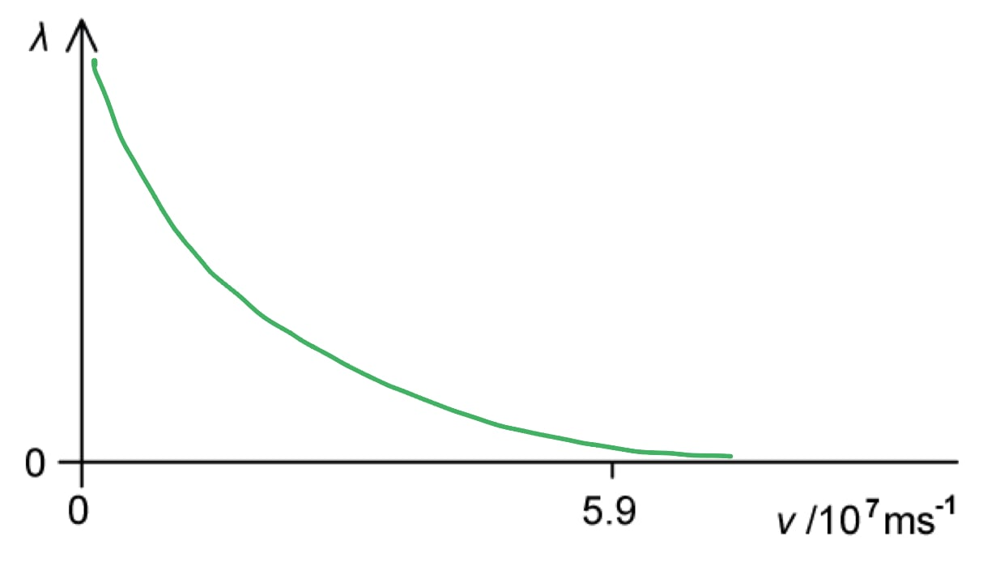
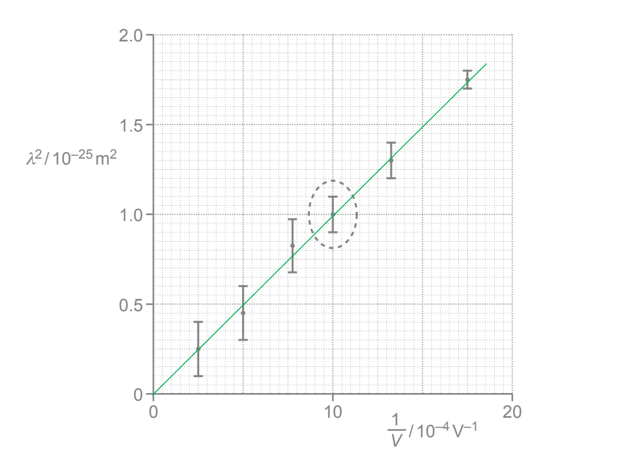
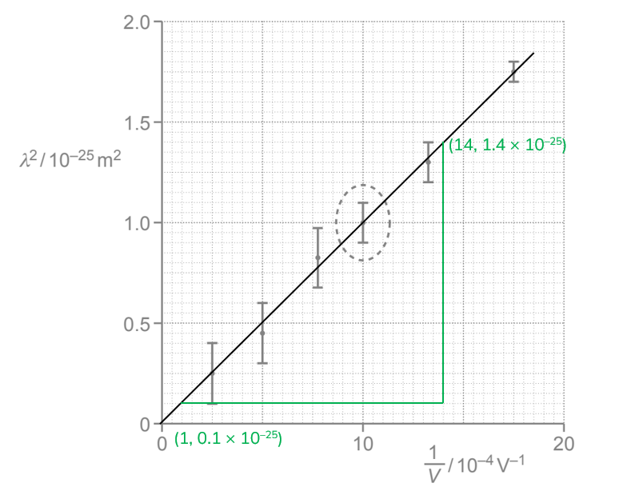
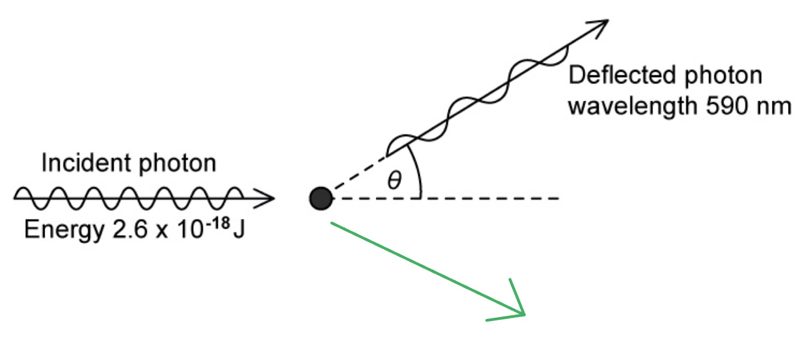

# Mark Schemes — Wave-Particle Duality
**22. Quantum Physics** · Cambridge (CIE) A-LEVEL physics (9702)

## Structured Questions (8 questions)

### Q1
(i) One piece of evidence for the wave nature of matter is:

- Electron diffraction; **[1 mark]**

(ii) One piece of evidence for the particulate nature of electromagnetic radiation is:

- Photoelectric effect; **[1 mark]**

**[Total: 2 marks]**
Calculate the de Broglie wavelength *λ *of an alpha-particle moving at a speed of 5.9 × 107 m s−1.

List the known quantities:

- An α-particle contains two protons and two neutrons, so has 4 nucleons
- Mass of α-particle, *m* = 4u = 4 × (1.66 × 10−27) = 6.64 × 10−27 kg
- Speed of α-particle, *v *= 5.9 × 107 m s−1
- Planck's constant, *h *= 6.63 × 10−34 J s

Calculate the momentum of the alpha particle:

- *p *= *mv*
- *p *= (6.64 × 10−27) × (5.9 × 107)
- *p *= 3.92 × 10−19 N s **[1 mark]**

Use the de Broglie equation:

- $λ=\frac{h}{p}$** [1 mark]**
- $λ=\frac{6.63\times10^{-34}}{3.92\times10^{-19}}$
- $λ=1.69\times10^{-15}m$ **[1 mark]**

**[Total: 3 marks]**
A sketch of the variation with *v *of *λ *that would score 2 marks should look like this:

- The line drawn has a negative gradient throughout; **[1 mark]**
- The curve does not touch either axes with *λ *≠ 0 for *v *= 5.9 × 107 m s−1; **[1 mark]**

**[Total: 2 marks]**

> *Use **equations** you** know** to figure out their **graphical relationship.*

> *For the de Broglie equation: *$λ\uparrow=\frac{h}{mv\downarrow}$

- *When *$v\rightarrow0$
- *Then *$λ\rightarrow\infty$

> *Hence, the curve cannot touch the **λ **or **v **axis.*

### Q2
The experimental evidence which suggests electrons have wave properties is:

- Electron <u>diffraction</u>; **[1 mark] **

**Final answer:** **[Total: 1 mark]**** **

> *Remember that diffraction is a property that **all** waves have: waves spread out when they pass through a gap or go around a barrier. When electrons were demonstrated to do the exact same thing (passing through the very small gaps between atomic layers of a crystal), this was huge news in physics.*
From the formulae page:

- De Broglie wavelength, *λ *= $\frac{h}{p}$

Describe the relationship between wavelength *λ *and momentum *p*:

- Wavelength is <u>inversely proportional</u> to momentum;** [1 mark] **

**[Total: 1 mark]**
List the known quantities:

- Velocity *v* = 2.5 × 107 m s–1

From the data and formulae pages:

- Planck’s constant, *h* = 6.63 × 10–34 J s
- Rest mass of electron,$m_{e}$ = 9.11 × 10–31 kg

Recall the de Broglie equation and substitute the known values:

- *λ* = $\frac{h}{p}=\frac{h}{mv}$ = `begin mathsize 14px style fraction numerator 6.63 cross times 10 to the power of negative 34 end exponent over denominator open parentheses 9.11 cross times 10 to the power of negative 31 end exponent close parentheses cross times open parentheses 2.5 cross times 10 to the power of 7 close parentheses end fraction end style` **[1 mark] **

Calculate the final answer:

- *λ *= 2.9 × 10–11 (m) **[1 mark]**** **

**[Total: 2 marks]**
(i) Describe the pattern observed:

- The electrons form a pattern of bright (and dark) <u>concentric rings</u>; **[1 mark] **

(ii) State why the bulb must be evacuated:

- To ensure electrons do not <u>collide</u> with air particles / so the diffraction pattern is not <u>distorted</u> due to electron collisions; **[1 mark]**

**[Total: 2 marks]**

> *Concentric rings** is a really important piece of terminology when describing electron diffraction. *

> *The rings formed wrap around each other and get progressively bigger in radius, with the exact radii depending on the **de Broglie wavelength. *

### Q3
The formula for the de Broglie wavelength *λ *of a moving particle is:

**Final answer:** **Any ****one ****pair from:**

- $λ=\frac{h}{p}$** [1 mark]**

Where

- *h *is the Planck constant **AND ***p *is the momentum (of the particle); **[1 mark]**

**OR**

- $λ=\frac{h}{mv}$ **[1 mark]**

Where:

- *m* is the mass of the particle **AND ***v *is the velocity of the particle; **[1 mark]**

**[Total: 2 marks]**
(i) The phenomenon shown by the electrons at the crystal is called:

- Electron diffraction;** [1 mark]**

(ii) This phenomena shows that:

- Moving electrons behave like waves; **[1 mark]**

(iii) The thin crystal causes the phenomenon in **(b)(i) **because:

**Final answer:** **Any ****one ****from:**

- The spacing between the atoms ≈ the wavelength of the electron; **[1 mark]**
- The diameter of the atom ≈ the wavelength of the electron; **[1 mark]**

**[Total: 3 marks]**
The change that has been made to the potential difference to create the pattern shown is:

- The wavelength has increased **OR **the electron had a lower momentum; **[1 mark]**
- So the accelerating p.d. was decreased; **[1 mark]**

**[Total: 2 marks]**

> *Decreasing the **p.d. decreases** the **energy** of the electrons incident on the screen*

$λ\uparrow=\frac{h}{\sqrt{2mE\downarrow}}$

> *Hence, the **wavelength increases**.*

> *The **pattern** observed on the screen is **different**, so the **fringe spacing** is **different**. *

> $λ=\frac{ax}{D}$* and *$\frac{λ\uparrowD}{a}=x\uparrow$

> *From **Young's Double slit equation** the fringe spacing, **x** increases**. Hence, the **rings** on the screen are **further apart**. *

### Q4
State the proportionality between wavelength and velocity:

- The de Broglie equation suggests that the wavelength *λ *is <u>inversely proportional</u> to the electron velocity *v*; **[1 mark]**
- If the wavelength is inversely proportional to velocity, then *λv = *constant, or $λ_{1}v_{1}$= $λ_{2}v_{2}$

Calculate the constant of proportionality:

- From the first row of Table 1.1, *λv = *(4.9 × 10–11) × (1.4 × 104 × 103) = 6.9 × 10–4
- From the second row of Table 1.1, *λv = *(2.8 × 10–11) × (2.5 × 104 × 103) = 7.0 × 10–4
- From the third row of Table 1.1, *λv = *(2.1 × 10–11) × (3.5 × 104 × 103) = 7.4 × 10–4
- All values correctly calculated; **[1 mark]**

Conclusion:

- The results support the de Broglie equation because the constant of proportionality between pairs of values for *λ* and *v*  is approximately equal (to 1 significant figure); **[1 mark]**

**[Total: 3 marks]**

> *Demonstrating whether results from a table (or graph) are consistent with an equation are a common hard question in A-level Physics that is a similar method every time.*

- *If two variables are **proportional** to each other e.g. **a ∝  b** , then the fraction  *$\frac{a}{b}$* = constant*
- *You must then find the value of *$\frac{a}{b}$* for each value in the table, or graph, and see if the values are approximately equal (even just to 1 decimal place) *

- *If two variables are **inversely proportional** to each other e.g. **a ∝ *$\frac{1}{b}$* **, then **ab **= constant*
- *You must then find the value of **ab **for each value in the table, or graph, and see if the values are approximately equal (even just to 1 decimal place)*
From the data page:

- Planck’s constant *h* = 6.63 × 10–34 J s
- Electron rest mass, *m* = 9.11 × 10–31 kg

**Method 1: Calculate the mean constant of proportionality from part (a)**

- From part (a), *λv = *constant
- The mean constant from the data is `fraction numerator open parentheses 6.9 plus 7.0 plus 7.4 close parentheses cross times 10 to the power of negative 4 end exponent over denominator 3 end fraction`= 7.1 × 10–4 **[1 mark]**

Use the mean constant *λv  *to calculate a value for Planck’s constant:

- Using de Broglie’s equation, *h = m × λv*
- *h = *(9.11 × 10–31) × (7.1 × 10–4) = 6.47 × 10–34J s (3 s .f) **[1 mark]**

Calculate the percentage difference to the accepted value for Planck’s constant:

- The accepted value for Planck’s constant is 6.63 × 10–34 J s
- The percentage difference Δ% = `fraction numerator open parentheses 6.63 minus 6.47 close parentheses cross times 10 to the power of negative 34 end exponent over denominator 6.63 cross times 10 to the power of negative 34 end exponent end fraction`× 100 = 2% **[1 mark]**

Comment on the accuracy of the experiment:

- The percentage difference between the value of *h *suggested by the experiment and the accepted value is <u>small</u> **AND **so the experimental results are <u>accurate</u>; **[1 mark]**

**OR**

**Method 2: Calculate Planck’s constant for each pair of values of *****λ *****and *****v***

- Using de Broglie’s equation, *h = m × λv*
- The constant from the pair of values in the first row of Table 1.1, *λv *= 6.9 × 10–4

  - *h = *(9.11 × 10–31) × (6.9 × 10–4) = 6.29 × 10–34 (J s)
- The constant from the pair of values in the second row of Table 1.1, *λv *= 7.0 × 10–4

  - *h = *(9.11 × 10–31) × (7.0 × 10–4) = 6.38 × 10–34 (J s)
- The constant from the pair of values in the third row of Table 1.1, *λv *= 7.4 × 10–4 so

  - *h = *(9.11 × 10–31) × (7.4 × 10–4) = 6.74 × 10–34 (J s)
- All values correctly calculated; **[1 mark]**

Calculate the mean value of Planck’s constant from the data:

- The mean value of Planck’s constant is `fraction numerator open parentheses 6.29 plus 6.38 plus 6.74 close parentheses cross times 10 to the power of negative 34 end exponent over denominator 3 end fraction`= 6.47 × 10–34 (J s) **[1 mark]**

Calculate the percentage difference to the accepted value for Planck’s constant:

- The accepted value for Planck’s constant is 6.63 × 10–34 J s
- The percentage difference Δ% =`fraction numerator open parentheses 6.63 minus 6.47 close parentheses cross times 10 to the power of negative 34 end exponent over denominator 6.63 cross times 10 to the power of negative 34 end exponent end fraction` × 100 = 2% **[1 mark]**

Comment on the accuracy of the experiment:

- The percentage difference between the value of *h *suggested by the experiment and the accepted value is <u>small</u> **AND **so the experimental results are <u>accurate</u>; **[1 mark]**

**[Total: 4 marks]**

> *Experimental accuracy is a measure of how** close** measurements are to the ‘true’ or ‘accepted’ value of a quantity. Anything less than 5% percentage difference between an accepted value and one deduced from experimental results – for A Level at least! – can be considered as reasonably accurate.*
Consider energy transfers for the electron:

- The energy transferred (or work done) *W* on a particle with charge *q* as it moves across a potential difference *V *is given by *W* = *qV*
- For an electron, *q* = *e* so the energy transferred by a potential difference is given by *eV*
- The energy is transferred is to the electron’s kinetic energy, $E_{k}=\frac{1}{2}mv^{2}$
- Therefore, $eV=\frac{1}{2}mv^{2}$ **[1 mark]**

Substitute the de Broglie wavelength:

- de Broglie wavelength *λ* = $\frac{h}{mv}$, therefore *v* = $\frac{h}{λm}$
- Therefore, *eV  = *$\frac{1}{2}$*m*`open parentheses fraction numerator h over denominator lambda m end fraction close parentheses squared`*= *$\frac{1}{2}$*m*`open parentheses fraction numerator h squared over denominator lambda squared m squared end fraction close parentheses`* *= $\frac{h^{2}}{2mλ^{2}}$ **[1 mark]**

Deduce the proportionality between *λ *and *V*:

- *eV * = $\frac{h^{2}}{2mλ^{2}}$
- *λ*2 = $\frac{h^{2}}{2meV}$
- *λ =  h *$\sqrt{\frac{1}{2meV}}$* *therefore *λ *∝ $\frac{1}{\sqrt{V}}$ **[1 mark]**** **

**[Total: 3 marks]**

### Q5
To outline the de Broglie wavelength, state that:

- All particles have a wave / wavelength associated with them; **[1 mark]**

The relationship between particles and waves is:

- The (de Broglie) wavelength is <u>inversely proportional</u> to the momentum (of the particle); **[1 mark] ****OR**
- $λ=\frac{h}{p}$ where *h* is Planck's constant and *p* is the momentum (of the particle); **[1 mark]**

**[Total: 2 marks]**

> *Examiners frequently like to ask about the de Broglie hypothesis. Note all the required aspects to this answer; specifying that there is a wavelength **associated** with **all** particles, and **stating the de Broglie equation** that quantifies this wavelength, **defining all symbols** appropriately. *
The experiment showed:

- Electron diffraction;** ****[1 mark]**

State the evidence this shows about electrons:

- (This is evidence that) electrons behave like a <u>wave</u>;** ****[1 mark]**** **

**[Total: 2 marks]**
If the speed of the electrons decreases, then the radius of the concentric rings:

- Increases; **[1 mark]**

**[Total: 1 mark]**

> *Remember, velocity is inversely proportional to the de Broglie wavelength *`open parentheses lambda space equals space fraction numerator h over denominator m v end fraction close parentheses`

> *Therefore, if the speed decreases, the de Broglie wavelength increases and becomes more comparable to the size of the gaps between atomic layers in the graphite*

> *As a result, a greater degree of diffraction occurs, and the rings spread out further (i.e. the radius gets larger)*

> *For extremely fast–moving electrons, the de Broglie wavelength is considerably smaller than the size of the gap between atomic layers in a crystal. This means they diffract much less, and the radius of the observed concentric rings decreases.*
Calculate the de Broglie wavelength:

List the known quantities:

- Electron speed, *v* = 3.18 × 107 m s–1

From the data page:

- Rest mass of electron, *m*e = 9.11 × 10–31 kg
- Planck constant, *h* = 6.63 × 10–34 J s

Recall the de Broglie equation:

- de Broglie wavelength:  $λ=\frac{h}{p}=\frac{h}{m_{e}v}$
- `lambda space equals space fraction numerator 6.63 cross times 10 to the power of negative 34 end exponent over denominator open parentheses 9.11 cross times 10 to the power of negative 31 end exponent close parentheses open parentheses 3.18 cross times 10 to the power of 7 close parentheses end fraction`** [1 mark]**
- $λ$ = 2.29 × 10–11 m **[1 mark]**

**[Total: 2 marks]**

### Q6
To determine the S.I. base units for *h*:

- The units of *h* are usually stated as J s
- A Joule is defined as the energy required to exert a force of 1 N over 1 m, J → Nm
- Therefore the units of *h* can be given as N m s
- A Newton is defined as the force required to give a mass of 1 kg an acceleration of 1 m s−2, N → kg m s−2
- Therefore the units of *h* can be given as kg m s−2 m s **[1 mark]**
- Therefore, base unit = kg m2 s−1 **[1 mark]**

**[Total: 2 marks]**

> *The key with dimensional analysis questions is to think about the definitions of the different non-base units, or related equations. Linking joules and newton metres can be done with the equation work done = force × distance, for example.*
To show that the de Broglie wavelength $λ$ is given by the expression $λ^{2}=\frac{h^{2}}{2mq}\times\frac{1}{V}$:

Recall the de Broglie equation and square it:

- $λ=\frac{h}{mv}$ where *v* is the velocity of the particle
- $λ^{2}=\frac{h^{2}}{m^{2}v^{2}}$ **[1 mark]**

Recall that the particles are accelerated to a velocity *v*  by a potential:

- Kinetic energy, $E_{k}=\frac{1}{2}mv^{2}$
- Electrical potential energy, $E_{P}=qV$

  - Energy is transferred from the electrical potential energy store to the kinetic energy store
- $\frac{1}{2}mv^{2}=qV$ **[1 mark]**

Rearrange this equation to give an expression for *v*2 :

- $v^{2}=\frac{2qV}{m}$

Substitute this into the squared de Broglie equation:

- `lambda squared space equals space fraction numerator h squared over denominator m squared open parentheses fraction numerator 2 q V over denominator m end fraction close parentheses end fraction`

**AND**

- $λ^{2}=\frac{h^{2}}{2mqV}$ (this is the required equation) **[1 mark]**

**[Total: 3 marks]**

> *Any time you see a 'show that' question like this, you are going to be assessed on how you present your algebra as well as whether you can reach the required expression. Don't skip steps! You can even annotate your working with what you are doing at each step, e.g. 'cancelling out the mass term in the denominator'. *
(i) To calculate the percentage uncertainty in $λ$ for the data point circled on the grid:

Calculate the percentage uncertainty in $λ^{2}$:

- The error bar indicates that the range and uncertainty is half the range (the middle to the top)
- There are two small squares, each of value 0.05, therefore the uncertainty is ±0.1
- `percent sign thin space u n c e r t a i n t y space equals space fraction numerator u n c e r t a i n t y over denominator m e a s u r e d space v a l u e space open parentheses f r o m space t h e space g r a p h close parentheses end fraction space cross times space 100`
- `percent sign thin space u n c e r t a i n t y space i n space lambda squared space equals space fraction numerator 0.1 over denominator 1 end fraction space cross times space 100 space equals space 10 space percent sign` **[1 mark]**

Calculate the percentage uncertainty in $λ$:

- Uncertainty in `lambda squared space equals space 10 space percent sign`
- $λ^{2}=λ\timesλ$
- So, the uncertainty in $λ$ has been multiplied by 2 to get the uncertainty in $λ^{2}$
- So find uncertainty in $λ$, divide the uncertainty by 2 giving a percentage uncertainty of 5% **[1 mark]**

** **

(ii) A line of best fit drawn through the data points would look like:

- Straight line of best fit which passes through all error bars; **[1 mark]**

**Final answer:** ** ****[Total: 3 marks]**

> *When drawing a line of best fit on a graph with error bars, your line must pass through every single error bar as a priority. Then, it must pass as close to the measured data points as possible.*
To use the best fit straight line to show that the mass *m* of the particle is about 10−26 kg:

List the known values:

- Plank constant, *h* = 6.63 × 10−34 J s (from the data page)
- Elementary charge, *e* = 1.60 × 10−19 C (from the data page)

Find the gradient of the graph:

- `g r a d i e n t equals fraction numerator straight capital delta y over denominator straight capital delta x end fraction equals fraction numerator open parentheses 1.4 cross times 10 to the power of negative 25 end exponent close parentheses minus open parentheses 0.1 cross times 10 to the power of negative 25 end exponent close parentheses over denominator open parentheses 14 cross times 10 to the power of negative 4 end exponent close parentheses minus open parentheses 1 cross times 10 to the power of negative 4 end exponent close parentheses end fraction equals 1.0 cross times 10 to the power of negative 22 end exponent` **[1 mark]**

Find an expression for the gradient:

- A straight line follows the equation `y space equals space m x space open parentheses plus c close parentheses` where *m* represents gradient
- From the expression,  $λ^{2}=\frac{h^{2}}{2mq}\times\frac{1}{V}$ the gradient is $\frac{h^{2}}{2mq}$**[1 mark]**

Substitute in known values:

- $gradient=\frac{h^{2}}{2mq}$
- Charge, *q* = 2 × 1.6 × 10−19 = 3.2 × 10−19 C
- `1.0 cross times 10 to the power of negative 22 end exponent equals fraction numerator open parentheses 6.63 cross times 10 to the power of negative 34 end exponent close parentheses squared over denominator 2 cross times m cross times open parentheses 3.2 cross times 10 to the power of negative 19 end exponent close parentheses end fraction`**[1 mark]**

Rearrange and calculate mass, $m$:

- `m equals fraction numerator open parentheses 6.63 cross times 10 to the power of negative 34 end exponent close parentheses squared over denominator 2 cross times open parentheses 1.0 cross times 10 to the power of negative 22 end exponent close parentheses cross times open parentheses 3.2 cross times 10 to the power of negative 19 end exponent close parentheses end fraction equals 6.9 cross times 10 to the power of negative 27 end exponent space kg` **[1 mark]**

**[Total: 4 marks]**

### Q7
The de Broglie wavelength is:

- The wavelength associated with a moving particle; **[1 mark]**

**[Total: 1 mark]**
(i) A diagram that indicates a possible initial direction of motion of the electron after the photon has been deflected that would score 1 mark should look like this:

- The arrow drawn should be below the axis and pointing to the right;** [1 mark]**

(ii) Calculate the energy of the deflected photon:

List the known quantities:

- Planck constant, *h *= 6.63 × 10−34 J s
- Speed of light in free space, *c *= 3.00 × 108 m s−1
- Wavelength of deflected photon, *λ *= 590 nm = 590 × 10−9 m

Use the equation for calculating photon energy, *E*:

- $E=\frac{hc}{λ}$
- `E space equals space fraction numerator open parentheses 6.63 space cross times space 10 to the power of negative 34 end exponent close parentheses space cross times space open parentheses 3.00 space cross times space 10 to the power of 8 close parentheses over denominator open parentheses 590 space cross times space 10 to the power of negative 9 end exponent close parentheses end fraction` **[1 mark]**
- $E=3.37\times10^{-19}J$ **[1 mark]**

**[Total: 3 marks]**

> *Consider the conservation of momentum to figure out the direction of motion of the electron. When resolved:*

> *horizontal component of photon momentum = horizontal component of electron momentum** *
Calculate the speed of the electron after the photon has been deflected:

List the known quantities:

- Energy of incident photon = 2.6 × 10−18 J (From part (a))
- Energy of deflected photon = 3.37 × 10−19 (From part (b))
- Rest mass of an electron, *m**e* = 9.11 × 10−31 kg

Calculate the energy of the electron, *E*:

- Energy is conserved, so *E *= energy of incident photon − energy of deflected photon
- *E *= (2.6 × 10−18) − (3.37 × 10−19)
- *E *= 2.26 × 10−18 J **[1 mark]**

Use the kinetic energy equation to calculate the speed of the electron, *v*:

- Electron has kinetic energy only after deflection
- So, $E=KE=\frac{1}{2}m_{e}v^{2}$
- $v=\sqrt{\frac{2KE}{m_{e}}}$ **[1 mark]**
- `v space equals space square root of fraction numerator 2 space cross times space open parentheses 2.26 space cross times space 10 to the power of negative 18 end exponent close parentheses over denominator open parentheses 9.11 space cross times space 10 to the power of negative 31 end exponent close parentheses end fraction end root`
- $v=2.23\times10^{6}ms^{-1}$ **[1 mark]**

**[Total: 3 marks]**
The magnitude of the final momentum of the electron is not equal to the change in magnitude of the momentum of the photon because:

- Momentum is a vector quantity; **[1 mark]**

**Final answer:** **Any ****one ****from:**

- So the momentum must be considered in two directions; **[1 mark]**
- The direction of the electron changes, so magnitude alone cannot be considered; **[1 mark]**

**[Total: 2 marks]**

> *Read this question carefully! It is asking about the **magnitude **of the momentum. *

### Q8
From the data page:

- Planck’s constant, *h* = 6.63 × 10–34J s

(i) Identify each symbol in the de–Broglie equation:

- *λ* = wavelength;

**AND**

- *h* = Planck’s constant;

**AND**

- *p* = momentum; **[1 mark]**

(ii) State the SI unit for each symbol:

- [*λ*] = metres /** **m;

**AND**

- [*h*] = joule seconds / J s;

**AND**

- [*p*] = kilogram metres per second / kg m s–1 ; **[1 mark]**

**[Total: 2 marks]**

> *Remember that the value and units for Planck’s constant, 6.63 × 10**–34** J s, are given on the data page.*
The electrons diffract because:

- Electrons have a (de Broglie) wavelength; **[1 mark] **
- Which matches the gap width between atoms (of the polycrystalline material); **[1 mark] **

**[Total: 2 marks]**
To calculate the momentum required:

List the known quantities:

- Diameter of proton, *d* = 0.84 × 10­­–15 m

From the data page:

- Planck constant, *h* = 6.63 × 10–34 J s
- Rest mass of electron, $m_{e}$ = 9.11 × 10–31 kg

Identify the de Broglie wavelength required:

- Maximum diffraction of a wave around a barrier occurs when the wavelength is similar to the size of the barrier
- Therefore, the de Broglie wavelength of the electrons needs to equal the diameter *d* = 0.84 × 10­­–15 m **[1 mark]**

Substitute known values into the de Broglie equation:

- *λ* = $\frac{h}{p}$
- $0.84\times10^{-15}=\frac{6.63\times10^{-34}}{p}$ **[1 mark] **

Rearrange and solve for momentum*, p*:

- $p=\frac{6.63\times10^{-34}}{0.84\times10^{-15}}=7.9\times10^{-19}\mathrm{kg}ms^{-1}$** [1 mark] **

**[Total: 3 marks]**
(i) To find required speed:

List the known quantities:

- Required momentum, *p*  = 7.9 × 10−19 kg m s−1

From the data page:

- Rest mass of electron, *m**e*  = 9.11 × 10−31 kg
- Speed of light in free space, *c*  = 3.00 × 108 m s−1

Calculate speed using the momentum equation:

- $p=mv$
- $v=\frac{p}{m}=\frac{7.9\times10^{-19}}{9.11\times10^{-31}}$ **[1 mark]**
- $v=8.7\times10^{11}ms^{-1}$ **[1 mark]**

(ii) Explain why this is not possible:

- This speed is greater than the speed of light; **[1 mark]**

**[Total: 3 marks]**

> *Nothing can travel faster than the speed of light, so the electrons cannot travel fast enough to achieve a wavelength small enough to diffract around a proton.*
