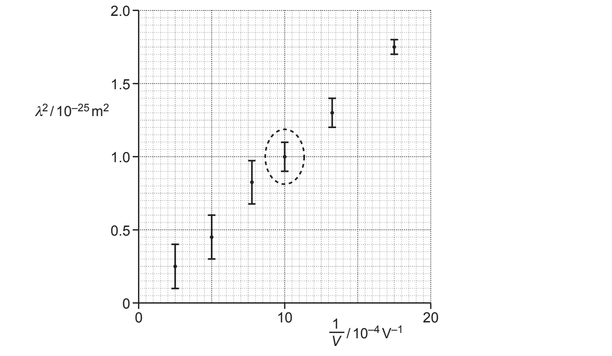

# Exam Questions — Wave-Particle Duality
**22. Quantum Physics** · Cambridge (CIE) A-LEVEL physics (9702)
> Source: [https://www.savemyexams.com/a-level/physics/cie/25/topic-questions/](https://www.savemyexams.com/a-level/physics/cie/25/topic-questions/) · 8 questions across 1 sets

## Structured Questions (8 questions)

### Q1 — medium — 7 marks

**Q1** [2 marks]

State **one **piece of experimental evidence for:

(i)

the wave nature of matter

[1]

(ii)

the particulate nature of electromagnetic radiation.

[1]

**Q1** [3 marks]

Calculate the de Broglie wavelength *λ *of an alpha-particle moving at a speed of 5.9 × 107 m s−1.

*λ *= ............................................ m

**Q1** [2 marks]

**Extract:**

Calculate the de Broglie wavelength λ of an alpha-particle moving at a speed of 5.9 × 10^7 m s^−1.

The speed *v *of the alpha-particles in **(b)(i) **is gradually reduced to zero.

On Fig. 1.1, sketch the variation with *v *of *λ.*

* *

**Fig 1.1**

### Q2 — easy — 6 marks

**Q2** [1 mark]

Once the wave–particle duality of light had been confirmed by experiment, Louis de Broglie proposed that if light could sometimes behave as a wave, and other times a particle, then perhaps all other things have this wave–particle duality.

He suggested that electrons – which are considered to be particles – could also behave like waves do. This was confirmed experimentally in 1926.

State the experimental evidence which suggests electrons have wave properties.

**Q2** [1 mark]

Louis de Broglie not only proposed a wave–particle duality for all matter, he also wrote an equation to show the precise relationship between the momentum of a particle *p* and its associated wavelength, *λ*.

Describe **in words** how wavelength *λ *is related to momentum *p*.

**Q2** [2 marks]

**Extract:**

Louis de Broglie not only proposed a wave–particle duality for all matter, he also wrote an equation to show the precise relationship between the momentum of a particle p and its associated wavelength, λ. De Broglie wavelength, λ = h/p

Calculate the de Broglie wavelength of an electron which moves at a velocity of  2.5 × 107 m s–1.

**Q2** [2 marks]

A simplified diagram of an electron gun and bulb is shown in Fig 1.1** **below:

**Fig 1.1**

The electrons are produced from a very hot filament, and are directed toward a thin graphite film, all of which are set up inside an evacuated glass bulb.

A very characteristic pattern is formed at the back of the bulb, which demonstrates electrons have been diffracted.

(i)

Describe the pattern observed at the back of the bulb

(ii)

State why the bulb must be evacuated

### Q3 — medium — 7 marks

**Q3** [2 marks]

State the formula for the de Broglie wavelength *λ *of a moving particle.

State the meaning of any other symbol used.

**Q3** [3 marks]

Electrons accelerate through a potential difference, pass through a thin crystal and are then incident on a fluorescent screen.

The pattern in Fig. 1.1 is observed on the fluorescent screen.

**Fig. 1.1 **not to scale

(i) State the name of the phenomenon shown by the electrons at the crystal.

[1]

(ii) State what this phenomenon shows about the nature of electrons.

[1]

(iii) Suggest why the thin crystal causes the phenomenon in **(b)(i)**.

[1]

**Q3** [2 marks]

**Extract:**

Electrons accelerate through a potential difference, pass through a thin crystal and are then incident on a fluorescent screen. The pattern in Fig. 1.1 is observed on the fluorescent screen.

The potential difference used to accelerate the electron is changed.

The new pattern observed on the screen is shown in Fig. 1.2.

**Fig 1.2**

State and explain the change that has been made to the potential difference to create the pattern shown in Fig. 1.2.

### Q4 — hard — 10 marks

**Q4** [3 marks]

An experiment to investigate how the de Broglie wavelength *λ *of an electron varies with its velocity *v * is carried out. The results from this experiment are shown in Table 1.1.

| ***v***** / 10****4**** km s****–1** | ***λ***** / 10****–11**** m** |
|---|---|
| 1.4 | 4.9 |
| 2.5 | 2.8 |
| 3.5 | 2.1 |

**Table 1.1**

Discuss whether the data in Table 1.1 is consistent with the de Broglie equation:

$λ=\frac{h}{mv}$

**Q4** [4 marks]

**Extract:**

An experiment to investigate how the de Broglie wavelength λ of an electron varies with its velocity v is carried out. The results from this experiment are shown in Table 1.1.

Table 1.1
v / 10^4 km s^–1 | λ / 10^–11 m
1.4 | 4.9
2.5 | 2.8
3.5 | 2.1

The de Broglie equation: λ = h/(mv)

From the first row of Table 1.1, λv = (4.9 × 10^–11) × (1.4 × 10^4 × 10^3) = 6.9 × 10^–4
From the second row of Table 1.1, λv = (2.8 × 10^–11) × (2.5 × 10^4 × 10^3) = 7.0 × 10^–4
From the third row of Table 1.1, λv = (2.1 × 10^–11) × (3.5 × 10^4 × 10^3) = 7.4 × 10^–4

Using the data in Table 1.1 and the accepted value for Planck’s constant, comment on the accuracy of the results.

**Q4** [3 marks]

**Extract:**

An experiment to investigate how the de Broglie wavelength λ of an electron varies with its velocity v is carried out.

Discuss whether the data in Table 1.1 is consistent with the de Broglie equation: λ = h/(mv)

The experiment required electrons to travel at very high speeds. To achieve this, they were first accelerated through a very high voltage, *V*.

Show that the de Broglie wavelength *λ * of these electrons is related to the accelerating voltage *V*  by the expression:

*                     λ *∝ $\frac{1}{\sqrt{V}}$

### Q5 — easy — 7 marks

**Q5** [2 marks]

After the wave-particle duality of light had been confirmed by experiment, Louis de Broglie hypothesised the existence of matter waves.

Outline the meaning of the 'de Broglie wavelength'.

**Q5** [2 marks]

**Extract:**

After the wave-particle duality of light had been confirmed by experiment, Louis de Broglie hypothesised the existence of matter waves.

The de Broglie hypothesis was later confirmed experimentally. High-speed electrons were fired at a metal target and were found to scatter in a particular pattern.

State the phenomenon observed** **in this experiment** **and state the evidence this provides about the nature of moving electrons.

**Q5** [1 mark]

In a similar experiment, electrons fired at a thin graphite sheet are found to produce a pattern of concentric circles when they strike a fluorescent screen, as shown in Fig 1.1.

**Fig 1.1**

Outline how the radius of the concentric rings would change if the speed of the electrons **decreases**.

**Q5** [2 marks]

Calculate the de Broglie wavelength of an electron travelling at a speed of 3.18 × 107 m s–1.

### Q6 — hard — 12 marks

**Q6** [2 marks]

The Planck constant *h* is an important fundamental constant in quantum physics.

Determine the S.I. base units for *h*.

*Source: 2020 Nov H556/02 Q19A*

**Q6** [3 marks]

A researcher is investigating the de Broglie wavelength of charged particles. The charged particles are accelerated through a potential difference *V*.  The de Broglie wavelength *λ* of these particles is then determined by the researcher. Each particle has mass *m* and charge *q*.

Show that the de Broglie wavelength λ is given by the expression:

$λ^{2}=\frac{h^{2}}{2mq}\times\frac{1}{V}$

*Source: 2020 Nov H556/02 Q19B*

**Q6** [3 marks]

**Extract:**

A researcher is investigating the de Broglie wavelength of charged particles. The charged particles are accelerated through a potential difference V. The de Broglie wavelength λ of these particles is then determined by the researcher. Each particle has mass m and charge q.

Show that the de Broglie wavelength λ is given by the expression: λ² = h²/(2mq) × 1/V

The researcher plots data points on a graph of *λ*2 against $\frac{1}{V}$, as shown in Fig. 1.1.

**Fig. 1.1**

(i)

Calculate the percentage uncertainty in *λ* for the data point circled on the grid.

(2)

(ii)

Draw a straight line of best fit through the data points.

(1)

**Q6** [4 marks]

**Extract:**

A researcher is investigating the de Broglie wavelength of charged particles. The charged particles are accelerated through a potential difference V. The de Broglie wavelength λ of these particles is then determined by the researcher. Each particle has mass m and charge q.

Show that the de Broglie wavelength λ is given by the expression: λ² = h²/(2mq) × 1/V

The researcher plots data points on a graph of λ² against 1/V, as shown in Fig. 1.1. The graph shows λ²/10^−25 m² on the y-axis against 1/V /10^−4 V^−1 on the x-axis, with a straight line of best fit passing through points approximately (1, 0.1 × 10^−25) and (14, 1.4 × 10^−25).

The charge *q* on the particle is 2*e*, where *e * is the elementary charge. Use your best fit line from part (c) to show that the mass *m* of the particle is about 10−26 kg.

### Q7 — medium — 9 marks

**Q7** [1 mark]

Explain what is meant by the de Broglie wavelength.

**Q7** [3 marks]

A gamma-ray photon of energy 2.6 × 10−18 J is incident on an isolated stationary electron, as illustrated in Fig. 1.1.

**Fig. 1.1**

** **

The photon is deflected elastically by the electron through angle *θ*. The deflected photon has a wavelength of 590 nm.

(i)

On Fig. 1.1, draw an arrow to indicate a possible initial direction of motion of the electron after the photon has been deflected

[1]

(ii)

Calculate the energy of the deflected photon.

photon energy = ........................................ J [2]

**Q7** [3 marks]

**Extract:**

A gamma-ray photon of energy 2.6 × 10^−18^ J is incident on an isolated stationary electron, as illustrated in Fig. 1.1. The photon is deflected elastically by the electron through angle θ. The deflected photon has a wavelength of 590 nm.

(ii) Calculate the energy of the deflected photon: E = hc/λ = 3.37 × 10^−19 J

Calculate the speed of the electron after the photon has been deflected.

speed = ........................................... m s−1

**Q7** [2 marks]

**Extract:**

A gamma-ray photon of energy 2.6 × 10^−18 J is incident on an isolated stationary electron, as illustrated in Fig. 1.1. The photon is deflected elastically by the electron through angle θ. The deflected photon has a wavelength of 590 nm.

Explain why the magnitude of the final momentum of the electron is not equal to the change in magnitude of the momentum of the photon.

### Q8 — easy — 10 marks

**Q8** [2 marks]

The wave–particle duality of matter has far reaching implications.

The de Broglie equation, which quantifies wave–particle duality, is given by the equation:

$λ=\frac{h}{p}$

(i)     Identify the quantity represented by each symbol in the de–Broglie equation

[1]

(ii)    State the SI unit for each symbol

[1]

**Q8** [2 marks]

In an electron diffraction tube, high speed electrons are incident on a thin slice of polycrystalline material. Fig 1.1 shows the pattern of bright concentric rings that is formed on the fluorescent screen at the back of the tube:

**Fig 1.1**

Explain why the electrons diffract.

**Q8** [3 marks]

**Extract:**

The de Broglie equation, which quantifies wave–particle duality, is given by the equation: λ = h/p

A student wonders if high energy electrons could be used to investigate the nature of protons which have an estimated diameter of 0.84 × 10–15 m.

Calculate the momentum of the electrons that would be suitable for this investigation.

**Q8** [3 marks]

**Extract:**

A student wonders if high energy electrons could be used to investigate the nature of protons which have an estimated diameter of 0.84 × 10^–15^ m. Calculate the momentum of the electrons that would be suitable for this investigation.
p = 6.63 × 10^−34 / 0.84 × 10^−15 = 7.9 × 10^−19 kg m s^−1

Using your answer from part (c):

(i)

Calculate the theoretical speed required of these electrons.

[2]

(ii)

Therefore, explain why it is not possible for electrons to be used to study protons in detail.

[1]
