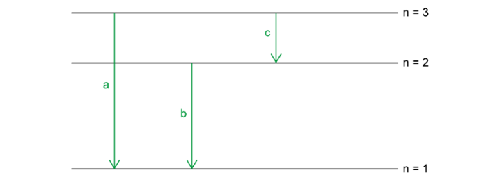
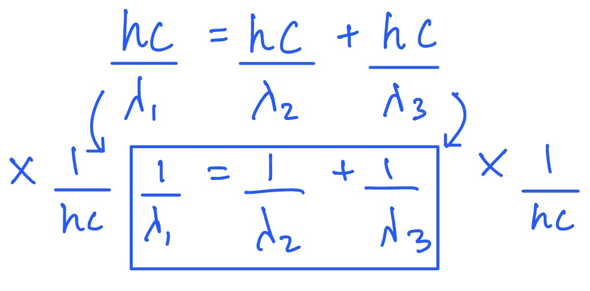
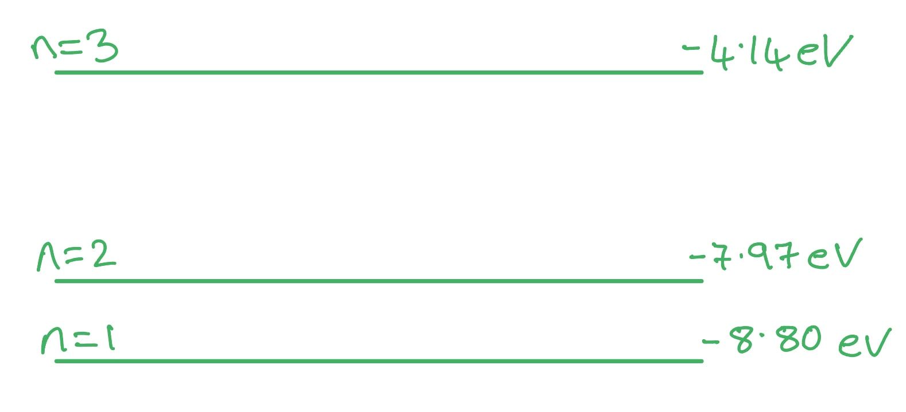
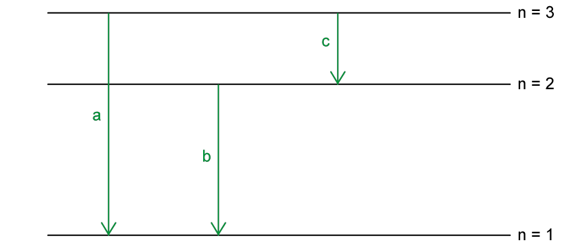
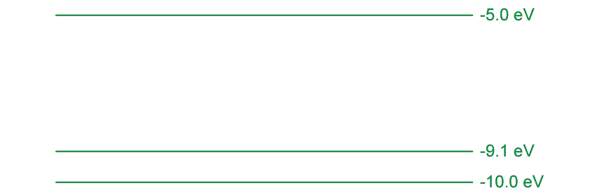
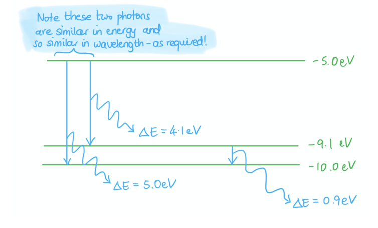
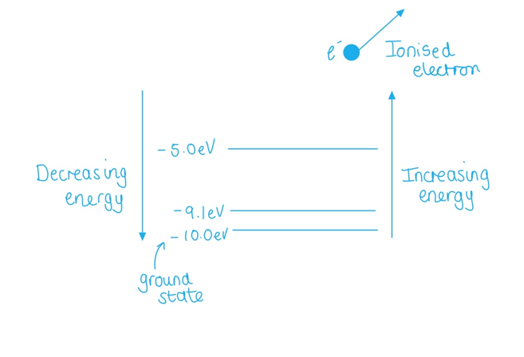
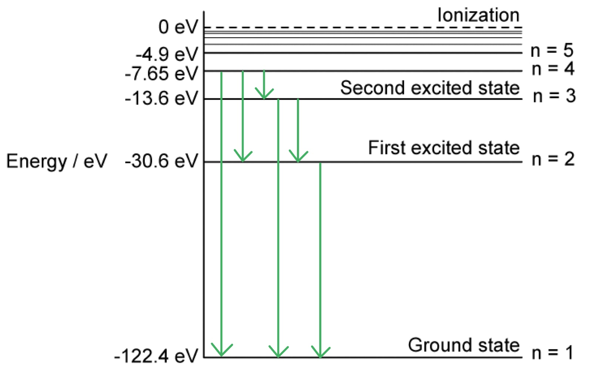

# Mark Schemes — Energy Levels in Atoms & Line Spectra
**22. Quantum Physics** · Cambridge (CIE) A-LEVEL physics (9702)

## Structured Questions (8 questions)

### Q1
A diagram to show that the equation that relates *λ*1, *λ*2, and *λ*3 that would score 2 marks should look like this:

- Three energy levels shown with a smaller gap size between the first two levels; **[1 mark]**
- The three energy levels are labelled according to the three photons of decreasing energy / wavelength; **[1 mark]**

Consider the energy level diagram and how it relates to spectral lines of different wavelengths:

- The energy level diagram shows three energy transitions that result in photons of different energy (and hence wavelength)
- The energy of transition (a) is the largest and the energy of transition (c) is the smallest
- Therefore (a) corresponds to spectral line of wavelength *λ*1; **[1 mark]**
- (b) corresponds to a spectral line of wavelength *λ**2 * **AND **(c) corresponds to a spectral line of wavelength *λ**3*; **[1 mark]**

Use the photoelectric equation to link the photon energies and the spectral lines:

- From the energy level diagram: Energy released in transition (a) = energy released in transition (b) + energy released in transition (c)
- This can be written as: $E_{1}=E_{2}+E_{3}=\frac{hc}{λ_{1}}=\frac{hc}{λ_{2}}+\frac{hc}{λ_{3}}$ and therefore $\frac{1}{λ_{1}}=\frac{1}{λ_{2}}+\frac{1}{λ_{3}}$; **[1 mark]**

**[Total: 5 marks]**

> *The **final step** in the rearrangement of the equation is:*

Sketch a diagram of the possible energy levels for the atomic line spectra shown in Fig 1.1:

List the known quantities:

- Ground state energy of the atom = −8.80 eV
- Speed of light in free space, *c* = 3.00 × 108 m s−1
- Planck constant, *h *= 6.63 × 10−34 J s
- Shortest wavelength photon emitted, *λ**a* = 267 nm = 267 × 10−9 m
- Middle wavelength photon emitted,  *λ**b* = 325 nm = 325 × 10−9 m
- Longest wavelength photon emitted, *λ**c* = 1500 nm = 1500 × 10−9 m

Use the photoelectric equation to calculate the energy of *λ**c*:

- $E=hf=\frac{hc}{λ}$
- `E subscript c space equals space fraction numerator open parentheses 6.63 space cross times space 10 to the power of negative 34 end exponent close parentheses space cross times space open parentheses 3 space cross times space 10 to the power of 8 close parentheses over denominator 1500 space cross times space 10 to the power of negative 9 end exponent end fraction space equals space 1.33 space cross times space 10 to the power of negative 19 end exponent space straight J`
- In eV, this is $\frac{1.33\times10^{-19}}{1.6\times10^{-19}}=0.83\mathrm{eV}$ **[1 mark]**

Calculate the first energy level, n = 2:

- Ground state energy level n = 1, *E *= −8.8 eV
- First energy level = ground state + energy emitted in transition for *λ**c*
- First energy level = −8.8 + 0.83 = −7.97 eV **[1 mark]**

Calculate the energy of *λ**b*:

- `E subscript b space equals space fraction numerator open parentheses 6.63 space cross times space 10 to the power of negative 34 end exponent close parentheses space cross times space open parentheses 3 space cross times space 10 to the power of 8 close parentheses over denominator 325 space cross times space 10 to the power of negative 9 end exponent end fraction space equals space 6.12 space cross times space 10 to the power of negative 19 end exponent space straight J`
- In eV, this is $\frac{6.12\times10^{-19}}{1.6\times10^{-19}}=3.83\mathrm{eV}$ **[1 mark]**

Calculate the second energy level, n = 3:

- Second energy level = first energy level + energy emitted in transition for *λ**b*
- Second energy level = −7.97 + 3.83 = −4.14 eV **[1 mark]**

Calculate the energy of *λ**a*:

- `E subscript a space equals space fraction numerator open parentheses 6.63 space cross times space 10 to the power of negative 34 end exponent close parentheses space cross times space open parentheses 3 space cross times space 10 to the power of 8 close parentheses over denominator 267 space cross times space 10 to the power of negative 9 end exponent end fraction space equals space 7.46 space cross times space 10 to the power of negative 19 end exponent space straight J`
- In eV, this is $\frac{7.46\times10^{-19}}{1.6\times10^{-19}}=4.66\mathrm{eV}$ **[1 mark]**

Check your calculations at the end by calculating the value of the transition from n = 1 to n = 3:

- Ground state energy + energy of *λ**a* = energy level at n = 3 = −8.8 + 4.66 = −4.14 eV
- This is equal to the two transition energies *λ**b* + *λ**c* = 3.83 + 0.83 = 4.66 eV

A diagram of the possible energy levels that would score 1 mark should look like this:

- Energy levels are shown with the correct gap sizes and positions; **[1 mark]**

**[Total: 6 marks]**

### Q2
A diagram that would score 2 marks should look like:

- Three energy levels shown with correct gap sizes; **[1 mark]**
- Three energy transitions labelled corresponding to three photons of decreasing energy (frequency); **[1 mark]**

Explanation of the energy level diagram and how it relates to spectral lines:

- The energy of transition (a) is the largest and the energy of transition (c) is the smallest
- Therefore (a) corresponds to a spectral line of frequency $f_{1}$ (the highest frequency); **[1 mark]**
- (b) corresponds to a spectral line of frequency $f_{2}$ **AND** (c) corresponds to a spectral line of frequency $f_{3}$ **[1 mark]**

Link photon energies to the spectral lines:

- The released energy in transition (a) must be equal to the released energy in (b) + the released energy in (c)
- This can be written as $hf_{1}=hf_{2}+hf_{3}$ **AND **therefore  $f_{1}=f_{2}+f_{3}$ **[1 mark]**

**[Total: 5 marks]**
List the known quantities:

- Ground state energy of the atom = –10.0 eV

From the data page:

- Elementary charge, *e*  = 1.60 × 10–19 C
- Planck constant, *h*  = 6.63 × 10–34 J s
- Speed of light in free space, *c*  = 3.00 × 108 m s–1

An energy level diagram that would score 6 marks should look like:

- Correct gap sizes and positions; **[1 mark]**

Calculate the energy of the photon corresponding to the 1400 nm line:

- For the line at 1400 nm, this corresponds to an emitted photon wavelength of 1400 × 10–9 m
- The energy of this photon *E* = *hf* = *h × *$\frac{c}{λ}$*= *(6.63 × 10–34) × `open parentheses fraction numerator 3 cross times 10 to the power of 8 over denominator 1400 cross times 10 to the power of negative 9 end exponent end fraction close parentheses` = 1.42 × 10–19 J
- In electronvolts, this energy is $\frac{1.42\times10^{-19}}{1.6\times10^{-19}}$= 0.9 eV **[1 mark]**

Calculate the energy of the photon corresponding to the 300 nm line:

- For the line at 300 nm, this corresponds to an emitted photon wavelength of 300 × 10–9 m

- The energy of this photon *E* = *hf* = *h × *$\frac{c}{λ}$*= *(6.63 × 10–34) × `open parentheses fraction numerator 3 cross times 10 to the power of 8 over denominator 300 cross times 10 to the power of negative 9 end exponent end fraction close parentheses` = 6.63 × 10–19 J
- In electronvolts, this energy is $\frac{6.63\times10^{-19}}{1.6\times10^{-19}}$ = 4.1 eV **[1 mark]**

Calculate the energy of the photon corresponding to the 250 nm line:

- For the line at 250 nm, this corresponds to an emitted photon wavelength of 250 × 10–9 m

- The energy of this photon *E* = *hf* = *h × *$\frac{c}{λ}$*= *(6.63 × 10–34) × `open parentheses fraction numerator 3 cross times 10 to the power of 8 over denominator 250 cross times 10 to the power of negative 9 end exponent end fraction close parentheses` = 7.96 × 10–19 J
- In electronvolts, this energy is $\frac{7.96\times10^{-19}}{1.6\times10^{-19}}$= 5.0 eV **[1 mark]**

Calculate the energy levels:

- Since the ground state energy of the atom is –10.0 eV, then the largest energy photon is emitted by a transition between the biggest energy gap
- The largest energy photon is 5.0 eV, corresponding to the line at 250 nm

  - This means there is an energy level at (–10.0 + 5.0) = –5.0 eV **[1 mark]**
- From Fig. 1.1, there is another line close to 250 nm at 300 nm

  - This corresponds to a photon with energy 4.1 eV
- Therefore, there is an energy level creating a gap similar in size to that between –10.0 eV and –5.0 eV, with a gap of 4.1 eV

  - Therefore, there is an energy level at (–5.0 – 4.1) = –9.1 eV **[1 mark]**

**[Total: 6 marks]*** *

> *A general tip for all exam questions is to minimise rounding before your final answer. This is especially important here, as the ground state energy level is only given to 1 decimal place, but the energy calculations require multiple steps. *

> *It’s also worthwhile to do a sense-check when figuring out energy levels: here, you should sketch the photons corresponding to each energy gap to ensure that everything checks out as expected:*

> *You may have drawn a separate energy level for each line on the emission spectrum. However, you must spot that this is the **complete** spectrum. If there were 3 energy levels above the ground state, we would see 6 lines on the spectrum to account for all the transitions between all the energy levels. Don't forget that de-excitation transitions occur between **all **energy levels. *
Link 0 eV to ionisation:

- If an electron exists at an energy level 0 eV, this means the atom has become ionised; **[1 mark]**

Explain the process of ionisation:

- Enough <u>energy has been transferred</u> to the electron such that it is able to escape the atom; **[1 mark]**
- And it is no longer bounded by the (electrostatic force from the) nucleus; **[1 mark]**

**[Total: 3 marks]**

> *Since the electron levels get smaller (more negative) as they reach the ground state, they are increasing (less negative) as they get further away from the ground state. This is until they reach 0 eV, at which point they are at such a high level that they are no longer bound by the atom, and are ionised.*

### Q3
X-ray photon emission:

- An <u>outer electron</u> / electron in a <u>higher energy state</u> replaces the missing electron (which has been absorbed by the nucleus); **[1 mark]**
- This transition to a <u>lower energy state</u> releases an X-ray photon **OR** the electron <u>de-excites</u> and energy is released in the form of an X-ray photon; **[1 mark]**

Characteristic X-ray photon:

- The X-ray photon is characteristic because its energy is <u>equal to the difference in energy levels</u> (of the transiting electron); **[1 mark]**

**[Total: 3 marks]**

> *Notice the very specific language around higher and lower energy and energy states, and the understanding that a photon is emitted whenever an electron moves from a higher to lower energy state/level. Remember to be really clear about the fact that the photon energy is exactly equal to the difference in energy levels.*
List the known quantities:

- X-ray photon wavelength, *λ* = 1 × 10-10 m

From data page:

- Planck constant, *h* = 6.63 × 10–34 J s
- Speed of light in free space, *c* = 3.00 × 108 m s–1
- Rest mass of an electron, *m = *9*.*11 × 10–31 kg

Calculate the frequency of a typical X-ray photon:

- Wave speed, *c = fλ*
- 3 × 108 = *f* × (1 × 10–10)
- *f = *3 × 1018 Hz **[1 mark]**

Calculate the energy of a typical X-ray photon:

- *E = hf*
- *E* = (6.63 × 10–34) × 3 × 1018 = 1.99 × 10–15 J **[1 mark]**

Calculate the speed of the Auger electron:

- If the energy of the photon is absorbed as kinetic energy of the Auger electron, then *E = hf = *$\frac{1}{2}$*mv*2
- 1.99 × 10–15 = 0.5 × (9.11 × 10–31) × *v*2
- *v  = *$\sqrt{\frac{2\times1.99\times10^{-15}}{9.11\times10^{-31}}}$*=* 6*.*6 × 107 m s–1 **[1 mark]**

Speed as a fraction of *c*:

- $\frac{6.6\times10^{7}}{3\times10^{8}}$ × 100 = 22% the speed of light; **[1 mark]**

Assumption:

- This calculation assumes that all the energy from the X-ray photon is absorbed by the electron

**OR**

- There is a 1:1 interaction between photons and electrons; **[1 mark]**

**[Total: 5 marks]**
State the meaning of the *λ *term:

- *λ *represents the <u>de Broglie</u> wavelength of the electrons; **[1 mark]**

Describe the proportionality to the diffraction angle:

- If the de Broglie wavelength increases / decreases, <u>then sin </u><u>*θ *</u><u>increases / decreases</u> and therefore the diffraction angle *θ *increases / decreases; **[1 mark]**

Describe how the diffraction pattern is affected by varying *λ*:

- If the diffraction angle *θ  *increases then the concentric rings get further apart / the diffraction pattern spreads out

**OR**

- If the diffraction angle *θ *decreases then the concentric rings get closer together / the diffraction pattern narrows; **[1 mark]**

**[Total: 3 marks]**

> *It’s a really common mistake to say that “**θ **is proportional to **λ” **in the equation sin **θ **= 1.22*$\frac{λ}{d}$* . This is not mathematically true: be careful to note that **sin **θ  **is proportional to **λ**. In other words, a graph of sin **θ **against **λ **would be a straight line through the origin, but a graph of **θ **against **λ **would not be. However, as sin **θ  **increases, **θ  **increases** **(up to 90°).*

> *Avoid saying just ‘wavelength’ and be specific about the ‘de Broglie wavelength’.*

### Q4
From data page:

- Speed of light in free space, *c *= 3.00 × 108 m s–1
- The Planck constant, *h* =6.63 × 10–34 J s

Frequency calculation from n = 3 → n = 1:

- Δ*E* = *E**3** − E**1*
- `E space equals space open parentheses negative 2.4 space cross times space 10 to the power of negative 19 end exponent close parentheses space minus space open parentheses negative 22 space cross times space 10 to the power of negative 19 end exponent close parentheses` **[1 mark]**
- $E=2.0\times10^{-18}J$** [1 mark]**

**[Total: 2 marks]**
Draw the three correct transitions from *n*  = 3:

- n = 3 → n = 2 **[1 mark]**
- n = 3 → n = 1 **[1 mark]**
- n = 2 → n = 1 **[1 mark]**

**[Total: 3 marks]**
From data page:

- Speed of light in free space, *c * = 3.00 × 108 m s–1
- The Planck constant = 6.63 × 10–34 J s

Change in energy:

- Smallest energy transition is from n = 3 to n = 2
- $\DeltaE$ = $E_{3}-E_{2}$  = (–2.4 × 10–19) – (–5.4 × 10–19) = 3.0 × 10–19 J **[1 mark]**

Wavelength calculation:

- Δ*E* = *hf *= $\frac{hc}{λ}$ **[1 mark]**
- $λ$= $\frac{hc}{\DeltaE}$ = `fraction numerator open parentheses 6.63 cross times 10 to the power of negative 34 end exponent close parentheses cross times open parentheses 3.00 cross times 10 to the power of 8 close parentheses over denominator 3.0 cross times 10 to the power of negative 19 end exponent end fraction` **[1 mark]**
- $λ$= 6.6 × 10–7 m **[1 mark]**** **

**[Total: 4 marks]**

> *This topic required confident use of **E**  = **hf ** for photon energy. Revisit this if you need more practice.*
Explain why a photon needs an exact amount of energy to excite an atom:

**Final answer:** **Any ****two**** from:**

- Energy** **is needed for an electron to move to a higher energy level; **[1 mark]**
- The photon’s energy must be (exactly) equal to the difference between the energy levels; **[1 mark]**
- All of the photon’s energy is absorbed in a one-to-one interaction; **[1 mark]**** **

**[Total: 2 marks]**

### Q5
Calculate the wavelength of radiation emitted when an electron falls from level *n* = 4 to the ground state in the hypothetical atom:

List the known quantities:

- Speed of light in free space, *c* = 3.00 × 108 m s−1
- Planck constant, *h *= 6.63 × 10−34 J s
- Electron energy at *n *= 4, *E**4* = −7.65 eV
- Electron energy at *n *= 1, *E**1* = −122.4 eV

Calculate the change in energy in J:

- $\DeltaE=E_{4}-E_{1}$
- `increment E space equals space minus 7.65 space minus space open parentheses negative 122.4 close parentheses space equals space 114.75 space eV`
- `increment E space equals space 114. space 75 space cross times space open parentheses 1.602 space cross times space 10 to the power of negative 19 end exponent close parentheses space equals space 1.84 space cross times space 10 to the power of negative 17 end exponent space straight J` **[1 mark]**

Use Planck's equation to calculate the frequency of the emitted photon:

- $\DeltaE=hf$
- $f=\frac{\DeltaE}{h}=\frac{1.84\times10^{-17}}{6.63\times10^{-34}}$
- $f=2.78\times10^{16}\mathrm{Hz}$ **[1 mark]**

Use the wave equation to calculate the wavelength of the radiation emitted during the change of state:

- $c=fλ$
- $λ=\frac{c}{f}=\frac{3\times10^{8}}{2.78\times10^{16}}$ **[1 mark]**
- $λ=1.08\times10^{-8}m$** [1 mark]**

**[Total: 4 marks]**
Arrows on the diagram that would score 4 marks to show the transitions responsible for the photons should look like this:

**Final answer:** **One mark**** awarded for showing ****all**** the transitions from each energy level:**

- From *n *= 4:

  - *n *= 4 → *n *= 1
  - *n *= 4 →  *n *= 3
  - *n* = 4 →  *n *= 2 **[1 mark]**
- From *n *= 3:

  - *n *= 3 → *n *= 2
  - *n *= 3 →  *n *= 1 **[1 mark]**
- From *n *= 2:

  - *n *= 2 → *n *= 1 **[1 mark]**

**[Total: 3 marks]**

> *Remember, the **total energy** of the transition from **n **= 4 to **n **= 1 equals the **sum** of all the transitions in between. *
Calculate the wavelength of the photon with the smallest energy:

List the known quantities:

- Speed of light in free space, *c* = 3.00 × 108 m s−1
- Planck constant, *h *= 6.63 × 10−34 J
- Energy at *n *= 4, *E**4* = −7.65 eV
- Energy at *n *= 3, *E**3* = −13.6 eV

Calculate the smallest change in energy in J from *n *= 4 to *n *= 3:

- $\DeltaE=E_{4}-E_{3}$
- `increment E space equals space open parentheses negative 7.65 close parentheses space minus space open parentheses negative 13.6 close parentheses space equals space 5.95 space eV`
- `increment E space equals space 5.95 space cross times space open parentheses 1.602 space cross times space 10 to the power of negative 19 end exponent close parentheses space equals space 9.53 space cross times space 10 to the power of negative 19 end exponent space straight J` **[1 mark]**

Use the photoelectric equation to calculate the wavelength of the photon:

- $\DeltaE=hf=\frac{hc}{λ}$
- `lambda space equals space fraction numerator h c over denominator increment E end fraction space equals space fraction numerator open parentheses 6.63 space cross times space 10 to the power of negative 34 end exponent close parentheses space cross times space open parentheses 3.00 space cross times space 10 to the power of 8 close parentheses over denominator open parentheses 9.53 space cross times space 10 to the power of negative 19 end exponent close parentheses end fraction`** [1 mark]**
- `lambda space equals space 2.087 space cross times space 10 to the power of negative 7 end exponent space straight m space equals space 2.09 space cross times space 10 to the power of negative 7 end exponent space straight m space open parentheses 3 space straight s. straight f. close parentheses` **[1 mark]**

**[Total: 3 marks]**
The photon must have an exact amount of energy for a particular transition because:

**Final answer:** **Any ****two ****from:**

- Energy is needed for an electron to move to a higher level; **[1 mark]**
- For a transition / excitation / change of energy levels, an exact amount of energy is required; **[1 mark]**
- The photon's energy must be equal to the difference between the energy levels; **[1 mark]**
- All of the photon's energy is absorbed (in a on-to-one interaction);** [1 mark]**

**[Total: 2 marks]**

### Q6
The spectrum is not continuous because:

- Only certain wavelengths are emitted (by the element); **[1 mark]**
- Corresponding to certain (energy level) transitions of the element; **[1 mark]**

**[Total: 2 marks]**
The spectrum formed is:

- An <u>absorption spectrum</u>; **[1 mark]**

**[Total: 1 mark]**
The spectrum formed is not continuous because:

- Certain wavelengths / frequencies are missing from the (continuous) spectrum; **[1 mark]**
- These are absorbed by the unknown gas; **[1 mark]**

**[Total: 2 marks]**
To identify the unknown gas:

- Each element has a characteristic absorption spectrum / absorbs characteristic wavelengths; **[1 mark]**
- Compare the unknown absorption spectrum to the absorption spectra for different elements; **[1 mark]**

**[Total: 2 marks]**

### Q7
To find the transition producing the required frequency:

List the known quantities:

- Frequency, *f*  = 2.93 × 1015 Hz

From data page:

- The Planck constant = 6.63 × 10–34 J s

** **Calculate the energy of a photon with this frequency:

- $\DeltaE$= $hf$
- $\DeltaE$ = (6.63 × 10–34)  × (2.93 × 1015) = 1.94 × 10–18 J **[1 mark] **

Identify the transition which matches this energy:

- The transition is therefore *n* = 3 to the ground state

**   ****OR**

- The transition is therefore $E_{3}\rightarrowE_{1}$ **[1 mark]**** **

**[Total: 2 marks]**
Identify the smallest energy change

- A has the smallest Δ*E* = (−0.14 × 10–18) − (−0.24 × 10–18) = 0.10 × 10–18 J
- Lower energy = lower frequency / longer wavelength
- Infrared is A (n = 4 to n = 3) **[1 mark]**

Identify the largest energy change

- C has the largest Δ*E* = (−0.54 × 10–18) − (−2.18× 10–18) = 1.64 × 10–18 J
- Higher energy = higher frequency / shorter wavelength
- Ultraviolet is C (n = 2 to n = 1) **[1 mark]**

Use the process of elimination:

- B has an energy difference of Δ*E* = (−0.24 × 10–18) − (−0.54 × 10–18) = 0.30 × 10–18 J
- Visible is B (n = 3 to n = 2) **[1 mark] **

**[Total: 3 marks]**

> *You do not need to know any wavelengths of the electromagnetic regions here, just that UV is higher energy than visible light, which is higher energy than infrared radiation.*
Ionisation is:

- When an electron gains enough energy to be completely removed from the atom; **[1 mark]**

**[Total: 1 mark]**
The energy required to ionise a ground state electron from hydrogen is:

- 2.18 × 10−18 J; **[1 mark]**

**[Total: 1 mark]**

> *Remember to use the diagram given earlier in the question to help you answer this. The ionisation level of an atom is defined as having an energy value of 0 J, so the energy difference is 0 J minus the energy of the ground state, which is −2.18 × 10**−18** J.*

### Q8
Identify the transition that produces a photon with frequency of 3.3 × 1016 Hz:

List the known quantities:

- Frequency of photon, *f* = 3.3 × 1016 Hz
- Planck constant, *h *= 6.63 × 10−34 J s

Use the photoelectric equation to calculate the energy change:

- $\DeltaE=hf$
- `increment E space equals space open parentheses 6.63 space cross times space 10 to the power of negative 34 end exponent close parentheses space cross times space open parentheses 3.3 space cross times space 10 to the power of 16 close parentheses`
- $\DeltaE=2.19\times10^{-17}J$ **[1 mark]**

Consider the transitions between the energy states:

- `increment E space equals space open parentheses negative 0.98 space cross times space 10 to the power of negative 17 end exponent close parentheses space minus space open parentheses negative 3.17 space cross times space 10 to the power of negative 17 end exponent close parentheses space equals space 2.19 space cross times space 10 to the power of negative 17 end exponent space straight J`
- $\DeltaE=E_{2}-E_{1}$ **[1 mark]**

**   OR**

- So, the transition is from *n *= 2 to the ground state;** [1 mark]**

**[Total: 2 marks]**

> *Use **trial and error** through all the combinations to find the correct **energy transition**. *
Identify the transitions in Fig. 1.2 which produce a photon in the following regions of the electromagnetic spectrum:

Consider the smallest energy change in transition X:

- `increment E subscript X space equals space open parentheses negative 0.22 space cross times space 10 to the power of negative 17 end exponent close parentheses space minus space open parentheses negative 0.45 space cross times space 10 to the power of negative 17 end exponent close parentheses space equals space 0.23 space cross times space 10 to the power of negative 17 end exponent space straight J`
- Lower energy = lower frequency and a longer wavelength
- Infrared radiation has the longest wavelength

Consider the largest energy change in transition Z:

- `increment E subscript Z space equals space open parentheses negative 0.98 space cross times space 10 to the power of negative 17 end exponent close parentheses space minus space open parentheses negative 3.17 space cross times space 10 to the power of negative 17 end exponent close parentheses space equals space 2.19 space cross times space 10 to the power of negative 17 end exponent space straight J`
- Higher energy = higher frequency and a shorter wavelength
- Ultraviolet radiation has the shortest wavelength

Use the process of elimination to identify the energy change in Y:

- This must be visible light

(i) Ultraviolet radiation is represented by:

- Transition Z; **[1 mark]**

(ii) Visible light is represented by:

- Transition Y; **[1 mark]**

(iii) Infrared radiation is represented by:

- Transition X; **[1 mark]**

**[Total: 3 marks]**
The emitted photons in part **(b) **have certain discrete frequencies because:

- (Electromagnetic radiation is emitted when) an electron moves from one fixed energy level to a lower fixed energy level; **[1 mark]**
- The (emitted) photon is given a discrete / specific amount of energy; **[1 mark]**
- The photon energy is directly proportional to the frequency / $\DeltaE=hf$, therefore the emitted photons have discrete frequencies;** [1 mark]**

**[Total: 3 marks]**
Calculate the kinetic energy of the ionised electron:

List the known quantities:

- Frequency of photon, *f *= 5.2 × 1016 Hz
- Planck constant, *h *= 6.63 × 10−34 J s

Use Fig. 1.1 in **(a) **to identify the ionisation energy of the hypothetical atom:

- $E_{i}=3.17\times10^{-17}J$ **[1 mark]**

Use the photoelectric equation to calculate the energy absorbed from the photon:

- $E_{p}=hf$
- `E subscript p space equals space open parentheses 6.63 space cross times space 10 to the power of negative 34 end exponent close parentheses space cross times space open parentheses 5.2 space cross times space 10 to the power of 16 close parentheses`
- $E_{p}=3.44\times10^{-17}J$ **[1 mark]**

Calculate the kinetic energy of the electron:

- $KE=E_{p}-E_{i}$
- `K E space equals space open parentheses 3.44 space cross times space 10 to the power of negative 17 end exponent close parentheses space minus space open parentheses 3.17 space cross times space 10 to the power of negative 17 end exponent close parentheses`
- $KE=2.7\times10^{-18}J$ **[1 mark]**

**[Total: 3 marks]**

> *Remember that the **energy** in this interaction is **conserved**.*

> *Energy before absorption = Energy after absorption*

> *Energy absorbed from photon = electron Ionisation energy + KE of electron*

> *The electron ionisation energy = energy required to change energy level*

> *KE of electron is the energy the electron moves with*
