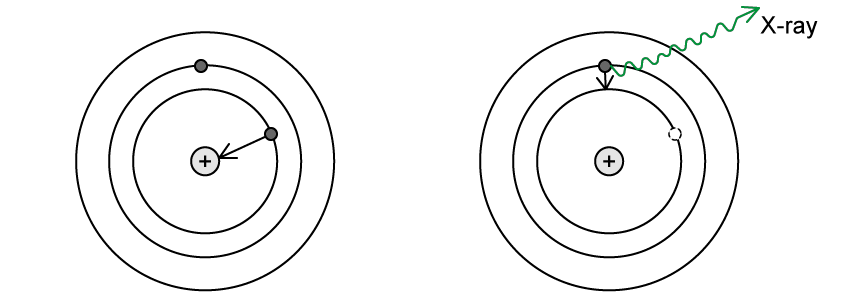

# Exam Questions — Energy Levels in Atoms & Line Spectra
**22. Quantum Physics** · Cambridge (CIE) A-LEVEL physics (9702)
> Source: [https://www.savemyexams.com/a-level/physics/cie/25/topic-questions/](https://www.savemyexams.com/a-level/physics/cie/25/topic-questions/) · 8 questions across 1 sets

## Structured Questions (8 questions)

### Q1 — medium — 11 marks

**Q1** [5 marks]

Transitions between three energy levels in a particular atom give rise to three spectral lines.

In decreasing magnitudes, these are related to the wavelengths, *λ*1, *λ*2, and *λ*3,

Use a diagram to show that the equation that relates *λ*1, *λ*2, and *λ*3 is:

$\frac{1}{λ_{1}}=\frac{1}{λ_{2}}+\frac{1}{λ_{3}}$

**Q1** [6 marks]

An atom has a ground state energy of −8.80 eV. The complete line emission spectra for this atom is shown in Fig. 1.1.

**Fig. 1.1**

Sketch a diagram of the possible energy levels for the atomic line spectra shown in Fig 1.1. Label each energy level with the value of its energy.

### Q2 — hard — 14 marks

**Q2** [5 marks]

Transitions between three energy levels in a particular atom give rise to three spectral lines. In decreasing magnitudes, these are $f_{1}$, $f_{2}$ and $f_{3}$.

Show that the equation which relates $f_{1}$, $f_{2}$ and $f_{3}$ is:

$f_{1}=f_{2}+f_{3}$

Sketch a suitable diagram to illustrate your answer.

**Q2** [6 marks]

Fig. 1.1 shows the complete line emission spectrum for another particular atom.

**Fig. 1.1**

This atom has a ground state energy of  –10.0 eV.

Sketch a diagram of the possible energy levels for the atomic line spectrum shown in Fig. 1.1.

Label each energy level with the value of its energy.

**Q2** [3 marks]

Explain the significance of an electron at an energy level of 0 eV.

### Q3 — hard — 11 marks

**Q3** [3 marks]

Unstable nuclei can decay in a variety of ways.

Electron capture is one such process, during which the nucleus ‘captures’ an orbiting inner-shell electron. The resulting nucleus has one less proton and one more neutron. Sometimes this process is accompanied by the emission of a characteristic X-ray photon, as illustrated in Fig. 1.1.

**Fig. 1.1**

Explain why an X-ray photon is produced in this process and suggest why it is called ‘characteristic’.

**Q3** [5 marks]

**Extract:**

Electron capture is one such process, during which the nucleus 'captures' an orbiting inner-shell electron. The resulting nucleus has one less proton and one more neutron. Sometimes this process is accompanied by the emission of a characteristic X-ray photon, as illustrated in Fig. 1.1.

The Auger Effect is a process that sometimes accompanies that illustrated in Fig. 1.1. This process involves the emission of an electron – called an Auger electron – from the atom when a core electron is removed, leaving a vacancy. This is illustrated in Fig. 1.2.

**Fig. 1.2**

This emission occurs if sufficient X-ray energy is transferred to outer shell electrons during the process.

Show that the speed of a typical Auger electron is around 22% of the speed of light, stating any assumptions you make in your calculation.

(Typical X-ray wavelength is ~ 10–10 m).

**Q3** [3 marks]

Auger electrons tend to have very high energies. At such high energies, their wave-like nature can be used to investigate the structure of crystalline solids.

When a beam of high-energy electrons is sent through a regularly spaced array of crystal atoms, they form a diffraction pattern of concentric bright and dark rings on a fluorescent screen, as shown in Fig. 1.3.

**Fig. 1.3**

It can be shown that the angle of electron-diffraction *θ*  is related to the diameter of an atomic nucleus *d*  by the equation

sin *θ  *= 1.22$\frac{λ}{d}$

Suggest what the term *λ *in the equation represents and describe how the observed diffraction pattern will vary in response to it.

### Q4 — easy — 11 marks

**Q4** [2 marks]

Fig 1.1 shows some of the energy levels of the hydrogen atom.

Calculate the energy of radiation emitted when an electron falls from level *n* = 3 to the ground state in the hydrogen atom.

**Q4** [3 marks]

**Extract:**

Fig 1.1 shows some of the energy levels of the hydrogen atom. energy / 10^-19 J: 0 (n = ∞), -2.4 (n = 3), -5.4 (n = 2), -22 (n = 1 ground state)

When electrons in a sample of hydrogen atoms relax from *n*  = 3, multiple frequencies of photons are emitted.

Sketch arrows on Fig 1.1 to show the transitions responsible for these photons.

**Q4** [4 marks]

**Extract:**

Fig 1.1 shows some of the energy levels of the hydrogen atom.
Calculate the energy of radiation emitted when an electron falls from level n = 3 to the ground state in the hydrogen atom. E = (–2.4 × 10^–19) – (–22 × 10^–19)
When electrons in a sample of hydrogen atoms relax from n = 3, multiple frequencies of photons are emitted.

Calculate the wavelength of the photon with the smallest energy. Give your answer to an appropriate number of significant figures.

**Q4** [2 marks]

One way to excite a hydrogen atom is by the absorption of a photon.

Explain why, for a particular transition, the photon must have an exact amount of energy.

### Q5 — medium — 12 marks

**Q5** [4 marks]

The energy levels of a hypothetical atom are shown in Fig. 1.1.

**Fig. 1.1**

Calculate the wavelength of radiation emitted when an electron falls from level *n* = 4 to the ground state in the hypothetical atom.

**Q5** [3 marks]

**Extract:**

The energy levels of a hypothetical atom are shown in Fig. 1.1. Fig. 1.1 shows energy levels: Ionization at 0 eV, n = 5 at -4.9 eV, n = 4 at -7.65 eV, n = 3 (Second excited state) at -13.6 eV, n = 2 (First excited state) at -30.6 eV, n = 1 (Ground state) at -122.4 eV.

When an electron of energy 1.84 × 10−17 J collides with the hypothetical atom, photons of six different energies are emitted.

Sketch arrows on Fig. 1.1 to show the transitions responsible for these photons.

**Q5** [3 marks]

**Extract:**

The energy levels of a hypothetical atom are shown in Fig. 1.1.

Fig. 1.1

Calculate the wavelength of the photon with the smallest energy. Give your answer to an appropriate number of significant figures.

**Q5** [2 marks]

One way to excite an atom is by the absorption of a photon.

Explain why, for a particular transition, the photon must have an exact amount of energy.

### Q6 — easy — 7 marks

**Q6** [2 marks]

A continuous spectrum contains all wavelengths of light in a range.

Each element has a characteristic emission spectrum. Explain why this emission spectrum is not continuous.

**Q6** [1 mark]

White light is passed through a low density sample of unknown gas.

State the type of spectrum formed.

**Q6** [2 marks]

**Extract:**

White light is passed through a low density sample of unknown gas.
State the type of spectrum formed.
The spectrum formed is: An absorption spectrum

Explain why the spectrum from part (b) is not continuous.

**Q6** [2 marks]

**Extract:**

White light is passed through a low density sample of unknown gas. State the type of spectrum formed. The spectrum formed is: An absorption spectrum.

The spectrum obtained in part (b) can be used to identify the unknown gas.

Explain how.

### Q7 — easy — 7 marks

**Q7** [2 marks]

The lowest energy levels of a hydrogen atom are represented in Fig 1.1.** **The diagram is **not **to scale.

**Fig 1.1**

Use** **Fig 1.1** **to identify the transition which produces a photon with frequency of 2.93 × 1015 Hz.

**Q7** [3 marks]

An excited hydrogen atom can emit photons of certain discrete frequencies in various regions of the electromagnetic spectrum. Three possible transitions are shown in Fig 1.2.

**Fig 1.2**

Identify the transitions in Fig 1.2 which produce a photon in the following region of the electromagnetic spectrum:

- Visible
- Ultraviolet
- Infrared

**Q7** [1 mark]

State the meaning of the term 'ionisation'.

**Q7** [1 mark]

**Extract:**

C has the largest Δ*E* = (−0.54 × 10^–18^) − (−2.18× 10^–18^) = 1.64 × 10^–18^ J

State the minimum amount of energy required to ionise an electron from the ground level of hydrogen.

### Q8 — medium — 11 marks

**Q8** [2 marks]

The lowest energy levels of a hypothetical atom are represented in Fig. 1.1.

**Fig 1.1**

** **

Identify the transition that produces a photon with frequency of 3.3 × 1016 Hz.

**Q8** [3 marks]

An excited atom can emit photons of certain discrete frequencies in various regions of the electromagnetic spectrum. Three possible transitions are shown in Fig. 1.2.

**Fig. 1.2**

Identify the transitions in Fig. 1.2 which produce a photon in the following regions of the electromagnetic spectrum:

(i)

Ultraviolet

[1]

(ii)

Visible

[1]

(iii)

Infrared

[1]

**Q8** [3 marks]

**Extract:**

An excited atom can emit photons of certain discrete frequencies in various regions of the electromagnetic spectrum. Three possible transitions are shown in Fig. 1.2.

Identify the transitions in Fig. 1.2 which produce a photon in the following regions of the electromagnetic spectrum:
(i) Ultraviolet
(ii) Visible
(iii) Infrared

Explain why the emitted photons in part **(b) **have certain discrete frequencies.

**Q8** [3 marks]

**Extract:**

The lowest energy levels of a hypothetical atom are represented in Fig. 1.1. Fig 1.1 [energy levels diagram]. The ground state energy is -3.17 × 10^-17 J (ionisation energy = 3.17 × 10^-17 J).

An electron in the hypothetical atom is ionised by a photon of light with frequency 5.2 × 1016 Hz.

Calculate the kinetic energy of the ionised electron.

kinetic energy .................................... J
