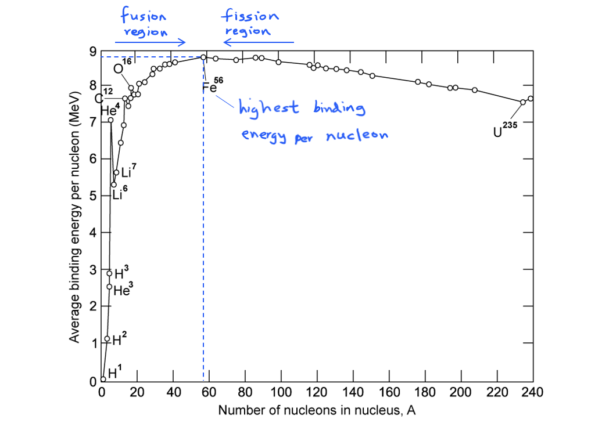
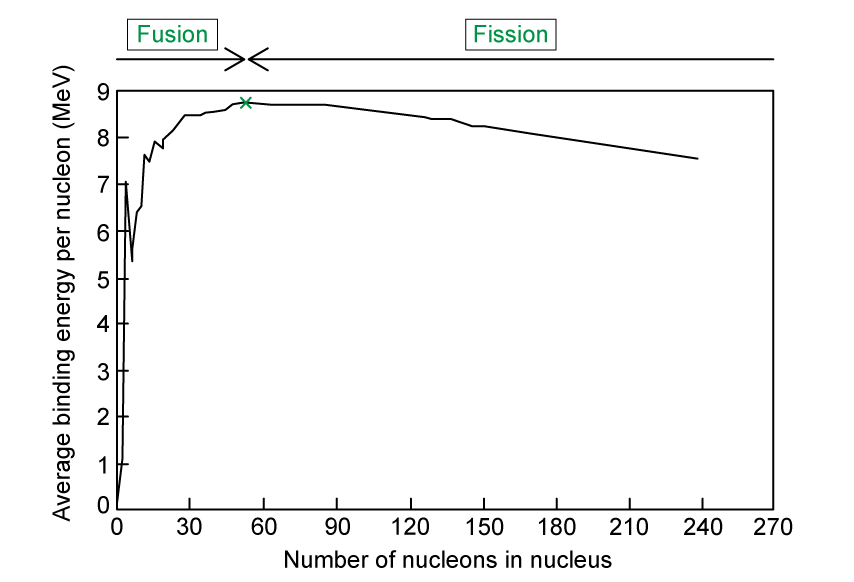
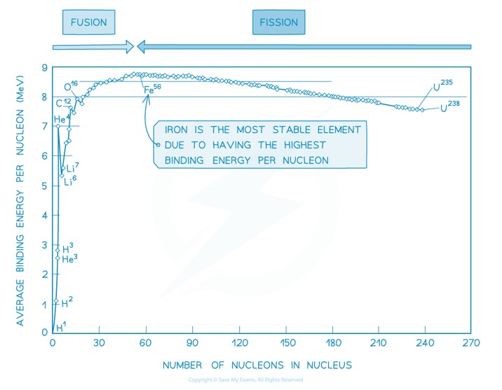
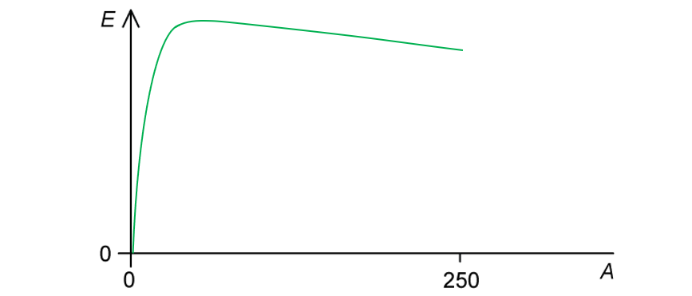

# Mark Schemes — Mass Defect & Nuclear Binding Energy
**23. Nuclear Physics** · Cambridge (CIE) A-LEVEL physics (9702)

## Structured Questions (8 questions)

### Q1
(i) Binding energy is defined as:

- The energy needed / required to <u>separate the nucleons</u> of a nucleus **OR **the energy released when a <u>nucleus is formed</u> from its nucleons; **[1 mark]**

(ii) Mass defect is defined as:

- The <u>difference</u> between the <u>mass</u> of a nucleus, and the <u>sum of the masses</u> of the nucleons; **[1 mark]**

**[Total: 2 marks]**

> *Remember that a nucleus's binding energy is required to **combine** the individual protons and neutrons into the nucleus. As a result, some of the mass of the protons and neutrons is sacrificed and converted into energy (using **E** = **mc**2**). This loss of mass is the mass defect.*

> *However, when defining binding energy and mass defect in the exam, use the keywords and stick to the definitions outlined above to ensure you get the marks. It is ok to say 'neutrons and protons' instead of nucleons, but you need to be specific: for example, saying 'constituent parts' isn't enough to get you the marks.*
(i) The meaning of the terms is:

- $Z$ = proton number / number of protons **AND** $m_{p}$ = proton rest mass **OR**
- $Zm_{p}$ = total mass of the protons in the nucleus; **[1 mark]**
- $N$ = number of neutrons **AND** $m_{n}$ = neutron rest mass **OR**
- $Nm_{n}$ = total mass of the neutrons in the nucleus; **[1 mark]**

(ii) Calculate the mass defect of oxygen−16:

List the known quantities:

- Nuclear rest mass of oxygen−16 `( O _ 8 ^ 16 )` = 15.994914 u
- Proton rest mass,* m**p** *= 1.007276 u
- Neutron rest mass,* m**n** *= 1.008665 u

Determine the numbers of protons and neutrons in oxygen−16

- From `O _ 8 ^ 16`:
- Number of protons, $Z$ = 8 **AND**
- Number of protons, $N$ = 16 − 8 = 8 **[1 mark]**

Substitute the known values into the equation:

- $\Deltam=Zm_{p}+Nm_{n}-m_{total}$
- $\Delta m = ( 8 \times 1.007276 \mathrm{u} ) + ( 8 \times 1.008665 \mathrm{u} ) - 15.994914 \mathrm{u}$ **[1 mark]**
- $\Deltam=0.132614u$ **[1 mark]**

**[Total: 5 marks]**

> *The equation *$Δm=Zm_{p}+Nm_{n}-m_{total}$* is **not** in the data booklet, but you do need to know how to calculate Δ**m**.*

> *You may prefer to memorise the equation, but the best approach is to remember that the mass defect is the **sum of the individual rest masses**, minus the **total rest mass of the nucleus** in question.*
Show that the total binding energy of a nucleus of oxygen−16 is about 2 × 10−11 J:

List the known quantities:

- Mass defect of oxygen−16, Δ*m* = 0.132614 u (from **(b)**)
- Speed of light, *c* = 3.00 × 108 m s−1
- Atomic mass unit, *u* = 1.66 × 10−27 kg

Substitute the known values into the mass-energy equivalence equation to calculate Δ*E*:

- Mass-energy equivalence $\DeltaE=\Deltamc^{2}$
- Mass defect (in kg):  $\Deltam$ = (0.132614) × (1.66 × 10−27) **[1 mark]**
- Binding energy:  $\DeltaE$ = (0.132614) × (1.66 × 10−27) × (3.00 × 108)2 = 1.981 × 10−11 J **[1 mark]**

**[Total: 2 marks]**

> *In this topic, you are working with lots of decimal places and lots of scientific notation. This has the potential for calculation errors to creep in, especially under the pressure of the exam.*

> *It is best practice to double-check every number you input into your calculator so that you can catch any such errors as you are working. Due diligence like this will save you time and ensures you don't make any silly mistakes.*
The binding energy per nucleon, in MeV, of oxygen-16 is:

List the known quantities:

- Binding energy of oxygen−16, $\DeltaE$ = 1.981 × 10−11 J (from **(c)**)
- Number of nucleons in oxygen−16 = 16
- 1 eV = 1.60 × 10−19 J

Determine the binding energy per nucleon:

- Binding energy per nucleon = $\frac{\mathrm{Binding} \mathrm{energy}}{\mathrm{Number} \mathrm{of} \mathrm{nucleons}}$
- Binding energy per nucleon = $\frac{( 1.981 \times 10^{- 11} )}{16}$ **[1 mark]**
- Binding energy per nucleon = $1.238\times10^{-12}J$ **[1 mark]**

Convert the energy into MeV:

- Binding energy per nucleon = $\frac{1.238\times10^{-12}}{1.60\times10^{-19}}$ **[1 mark]**
- Binding energy per nucleon = 7 737 500 = 7.74 MeV **[1 mark]**

**[Total: 4 marks]**

> *The binding energy per nucleon is the **total** binding energy **divided** by the nucleon number. In this case, since the nucleon number is 16, the binding energy per nucleon is found by **dividing** the total binding energy by 16.*

### Q2
(i) Mass defect is defined as:

- The difference between the mass of the nucleus and the sum of the masses of its nucleons if separated completely; **[1 mark]**

(ii) Binding energy of a nucleus is defined as:

**Final answer:** **Any ****pair ****from:**

- The (minimum) energy required / work done to separate the nucleons (in a nucleus); **[1 mark]**
- To infinity; **[1 mark] ** **OR**
- The energy released when nucleons come together (to form a nucleus); **[1 mark]**
- From infinity; **[1 mark]**

**[Total: 3 marks]**
(i) Fusion is defined as:

- When two nuclei combine to form a (single) nucleus; **[1 mark]**

(ii)** **Determine the energy released when 3.00 mol of deuterium reacts:

List the known quantities:

- Mass of hydrogen-1, $m_{1}$ = 1.0078 *u*
- Mass of hydrogen-2, $m_{2}$ = 2.0135 *u*
- Mass of hydrogen-3, $m_{3}$ = 3.0160 *u*
- Atomic mass unit, *u* = 1.66 × 10−27 kg
- Speed of light, $c$ = 3.00 × 108 m s–1
- Avogadro constant, $N_{A}$ = 6.02 × 1023 mol–1

Determine the mass defect:

- Mass defect:  $\Delta m = 2 m_{2} - ( m_{3} + m_{1} )$
- $\Deltam$ = [(2 × 2.0135) – (3.0160 + 1.0078)] *u*
- $\Deltam$ = 0.0032 u **[1 mark]**

Use mass-energy equivalence to determine the energy released:

- Mass-energy equivalence:  $\DeltaE=\Deltamc^{2}$ **[1 mark]**
- $\DeltaE$ = 0.0032 × (1.66 × 10–27) × (3.00 × 108)2
- $\DeltaE$ = 4.78 × 10–13 J **[1 mark]**

Determine the energy released when 3.00 mol of deuterium reacts:

- 3.00 mol of deuterium forms 1.50 mol of hydrogen-3 **[1 mark]**
- Therefore, the number of hydrogen-3 nuclei = 1.50 mol × $N_{A}$
- Total energy = 1.50 × (6.02 × 1023) × (4.78 × 10–13)
- Total energy = 4.32 × 1011 J **[1 mark]**

**[Total: 6 marks]**
(i) The most stable element is:

- Iron / Fe-56; **[1 mark]**
- (Because) it has the highest binding energy per nucleon; **[1 mark]**

(ii) The graph can be used to predict whether a nucleus will undergo fusion or fission because:

- Fusion occurs at *A* values (nucleon number) below the peak / lighter than Fe-56; **[1 mark]**
- Fission occurs at *A* values above the peak / heavier than Fe-56; **[1 mark]**

**[Total: 4 marks]**

> *You could also score the marks by clearly annotating the graph*

> *Remember:*

- *Fusion is the joining of two nuclei (into one larger one)*
- *Hence the reactants will have a higher binding energy per nucleon than the resulting nuclei*
- *This can only happen at small values of **A*

- *Fission is the splitting of a nucleus (into two smaller ones)*
- *Hence the reactant will have a lower binding energy per nucleon than its daughter nuclei*
- *This can only happen at large values of **A*
More energy is released per nucleon from fusion because:

- Energy is released when a nucleus forms with a higher binding energy (per nucleon); **[1 mark]**
- (When energy is released from fusion) the increase in binding energy (per nucleon) is greater than the increase in binding energy (per nucleon) from fission; **[1 mark]**
- (The graph shows this) at small values of *A* (fusion region), the <u>gradient</u> is much steeper compared to the gradient at large values of *A* (fission region); **[1 mark]**

**[Total: 3 marks]**

> *The energy released is the binding energy released caused by the **difference in mass** between the reactant and the products of the reaction.*

> *Since the energy released** E **∝ Δ**m** (the mass difference), it is the **difference in binding energy** between the reactant and products that determines the amount of energy released.*

### Q3
The correct labels are as follows:

**One**** mark for each correct label:**

- Fusion labelled on the left hand side of the graph; **[1 mark]**
- Fission labelled on the right hand side of the graph; **[1 mark]**
- Iron located with an X on the highest dot; **[1 mark]**

**[Total: 3 marks]**

> *The binding energy per nucleon is the total binding energy of a nucleus divided by the number of nucleons. This is an important quantity because it tells us about the** stability **of the nucleus.*

> *The greater the binding energy per nucleon, the greater the stability of the nucleus because more energy is required to remove a nucleon from the nucleus.*

> *The most important feature that you need to remember about the graph is that iron has the **highest binding energy per nucleon**, which makes it the most **stable** element. *
(i) Fusion occurs for nuclides with low nucleon numbers because:

- Attractive strong nuclear forces between nucleons dominate; **[1 mark]**
- Over repulsive electrostatic forces between protons; **[1 mark]**

(ii) Fission occurs for nuclides with high nucleon numbers because:

- Repulsive electrostatic forces between protons (begin to) dominate; **[1 mark]**
- These forces (tend to) break apart the nucleus; **[1 mark]**

**[Total: 4 marks]**

> *Nuclei with low nucleon numbers tend to have a lower binding energy per nucleon, hence, they are generally less stable.*

> *This means the lightest elements have weaker electrostatic forces and are the most likely to undergo **fusion**.*

> *For nuclei with high nucleon numbers, the general binding energy per nucleon is high and gradually decreases with increasing nucleon number.*

> *This means the heaviest elements are the most unstable and likely to undergo **fission**.*
The correct sentences are as follows:

**One**** mark for each correct sentence:**

- In fusion, the mass of the nucleus that is created is slightly **less **than the total mass of the original nuclei and the daughter nucleus is **more** stable; **[1 mark]**
- In fission, an unstable nucleus is converted into more stable nuclei with a **smaller **total mass; **[1 mark]**
- In both cases, this difference in mass, the mass defect, is equal to the binding energy that is released.
- **Fusion** releases much more energy per kg than **fission****;** **[1 mark]**
- The greater the increase in binding energy, the **more** energy is released; **[1 mark]**

**[Total: 4 marks]**
The graph can be used to find the binding energy per nucleon by drawing arrows as follows:

(i) Platinum−190:

- (From graph) the binding energy per nucleon for Platinum−190 is 8.0 MeV **[1 mark]**

(ii) Silicon−28:

- (From graph) the binding energy per nucleon for Silicon−28 is 8.0 MeV **[1 mark]**

(iii) Tellurium−120:

- (From graph) the binding energy per nucleon for Tellirium−120 is 8.5 MeV **[1 mark]**

**[Total: 3 marks]**

> *It is fairly straightforward to read the binding energy per nucleon from this graph for any given nucleon number as long as you understand what the axes are showing.*

> *However,  you do need to be familiar with some of the features of this graph:*

- *Iron (Fe) has the **greatest** binding energy per nucleon making it the most **stable** element*
- *Hydrogen, H, has a binding energy per nucleon of zero because it only has one nucleon (it does not need to bind to anything else)*
- *The curve rises sharply for nuclides with low nucleon numbers, A*
- *The curve drops gently for nuclides with high nucleon numbers, A*
- *Helium (He), Carbon (C), and Oxygen (O), do not fit the general trend of the graph*

### Q4
Complete the equation `U _ 92 ^ 235 + n _ 0 ^ 1 -> with _ on top Mo _ 42 ^ 95 + La _ 57 ^ 139 + 2 n _ 0 ^ 1 + ................ + energy`:

Balance the nucleon numbers in the equation:

- 235 + 1 = 95 + 139 + 2 + A
- A = 236 − 95 − 139 − 2 = 0

Balance the proton numbers in the equation:

- 92 + 0 = 42 + 57 + 0 + Z
- Z = 92 − 42 − 57 = −7

The missing term in the equation in nuclide notation is:

- `7 e _ - 1 ^ 0`** [1 mark]**

**[Total: 1 mark]**
(i) Show that the energy equivalent to 1.00 u is 934 MeV:

List the known quantities:

- Mass, $m$ = 1.00 u = 1.661 × 10−27 kg
- Speed of light in free space, $c$ = 3.00 × 108 m s−1

Use the mass-energy equivalence equation to calculate the energy, $E$ in J:

- $E=mc^{2}$ **[1 mark]**
- $E = ( 1.661 \times 10^{- 27} ) \times ( 3 \times 10^{8 )^{2} = 1.495 \times 10^{-10} } \mathrm{J}$ **[1 mark]**

Convert the energy from J to MeV:

- $E=\frac{1.495\times10^{-10}}{1.6\times10^{-13}}=934\mathrm{MeV}$ **[1 mark]**

(ii) Calculate the binding energy per nucleon, in MeV, of lanthanum-139 $( La_{57}^{139} )$:

List the known quantities:

- Nucleon number = 139
- Number of protons = 57
- Number of neutrons = 139 − 57 = 82
- Rest mass of a neutron, $m_{n}$ = 1.00863u
- Rest mass of a proton, $m_{p}$ = 1.00728u
- Mass of `space presubscript 57 presuperscript 139 La` = 138.955u

Calculate the mass defect, $\Deltam$ of `La presubscript 57 presuperscript 139`:

- $\Deltam=82m_{n}+57m_{p}-massofnuclide$
- $\Delta m = ( 82 \times 1.00863 ) u + ( 57 \times 1.00728 ) u - 138.955 u$
- $\Deltam=1.16762u$ **[1 mark]**

Calculate the binding energy per nucleon:

- Binding energy = 1.16762 × 934 MeV = 1090 MeV **[1 mark]**
- Binding energy per nucleon = $\frac{bindingenergy}{nucleonnumber}$
- Binding energy per nucleon = $\frac{1.16762\times934}{139}=7.84\mathrm{MeV}$ **[1 mark]**

**[Total: 6 marks]**

- *Memorise** the conversions between:*

  - *J and eV*
  - *u and kg*
- *Read** the **question carefully** to apply the correct conversions*
State and explain whether the binding energy per nucleon of uranium-235 (`U _ 92 ^ 235`) is greater, equal to or less than the binding energy per nucleon of lanthanum-139 (`La presubscript 57 presuperscript 139`):

State:

- The binding energy per nucleon of `U _ 92 ^ 235` is less; **[1 mark]**

Explanation:

- Uranium-235 has a larger nucleon number than lanthanum-139
- So, the binding energy is split between more nucleons; **[1 mark]**

**[Total: 2 marks]**

- *Remember the **binding energy per nucleon graph**, **Uranium** is the** most unstable nuclei**, so its binding energy per nucleon is the lowest for elements that undergo fission:*

### Q5
The atomic mass unit is defined as:

- A twelfth / $\frac{1}{12}$ of the mass; **[1 mark]**
- Of a (neutral) atom of carbon-12; **[1 mark]**

**[Total: 2 marks]**

> *This is the precise definition of the atomic mass unit - make sure you learn it in terms of how it relates to carbon-12. It is equal to 1.66 × 10**−27** kg, which is roughly equal to a proton or neutron, hence, this is what you will need to use in calculation questions.*
Calculate the mass of a nucleus of uranium−238:

List the known quantities:

- Mass number of uranium−238 = 238
- Atomic mass unit, u = 1.661 × 10−27 kg

Determine the mass of uranium−238 in kg:

- Mass of uranium−238 = 238 u = (1.661 × 10−27) × 238 **[1 mark]**
- Mass of uranium−238 = 3.95318 × 10−25 kg **[1 mark]**
- Mass of uranium−238 = 3.95 × 10−25 kg (3 s.f.) **[1 mark]**

**[Total: 3 marks]**

> *Exam questions commonly ask you to "estimate" the mass of a nuclide, but don't let this throw you off, as this is simply referring to the fact that the atomic mass unit is **approximately** equal to its total mass in a.m.u.*
(i)* E* represents the:

- Energy **AND **(measured in) joules / J; **[1 mark]**

(ii) *m* represents the:

- Mass **AND **(measured in) kilograms / kg; **[1 mark]**

(iii) *c* represents the:

- Speed of light **AND **(measured in) metres per second / m s−1; **[1 mark]**

**[Total: 3 marks]**
Calculate the energy released by a nucleus of uranium-238

List the known quantities:

- Mass of uranium−238 nucleus, Δ*m* = 3.95 × 10−25 kg (from **(b)**)
- Speed of light, *c* = 3.00 × 108 m s−1

Substitute the known values into the equation:

- Mass-energy equivalence:  $\DeltaE=\Deltamc^{2}$
- $\Delta E = ( 3.95 \times 10^{- 25} ) \times ( 3.00 \times 10^{8} )^{2}$ **[1 mark]**
- $\DeltaE$ = 3.56 × 10−8 J (3 s.f.) **[1 mark]**

**[Total: 2 marks]**

### Q6
Estimate the total mass of original fuel required per year:

List the known quantities:

- Binding energy per nucleon of U-235 = 7.60 MeV / nucleon
- Binding energy per nucleon of Xe-139 = 8.39 MeV / nucleon
- Binding energy per nucleon of Sr-95 = 8.74 MeV / nucleon
- Power output, *P*out = 1500 MW
- Efficiency = 27% = 0.27
- Molar mass of U-235 = 0.235 kg mol–1
- Avogadro’s constant, *N**A** *= 6.02 × 1023 mol–1 (from the data page)
- 1 eV = 1.60 × 10–19 J
- Time, *t* = 1 year = (60 × 60 × 24 × 365) = 3.15 × 107 s

Calculate the total energy released by the fission reaction:

- Energy released = difference in binding energy of the products and reactants
- Binding energy of the reactants (U-235) = 7.60 × 235 = 1786 MeV
- Binding energy of the products (Sr-95 + Xe-139) = (8.74 × 95) + (8.39 × 139) = 1996.5 MeV
- Energy released per fission = 1996.5 – 1786 = 210.5 MeV **[1 mark]**

Calculate the supplied energy per year:

- Efficiency = $\frac{usefulenergyoutput}{totalenergyinput}$
- The energy output in a year = $P_{out}t$ = (1500 × 106) × (3.15 × 107) = 4.73 × 1016 J
- Therefore, the energy supplied in a year = $\frac{4.73\times10^{16}}{0.27}$ = 1.75 × 1017 J **[1 mark]**

Calculate the number of uranium−235 nuclei in 1 kg of fuel:

- Amount (moles) of U-235:  $n=\frac{mass}{molarmass}=\frac{N}{N_{A}}$
- Number of U-235 nuclei per kg:  *N* = $( 6.02 \times 10^{23} ) \times \frac{1 kg}{0.235}$ = 2.56 × 1024 **[1 mark]**

Calculate the energy released per kilogram of fuel:

- In every kg of fuel, 2% contains the energy released from U-235 fission
- So, energy released per kg of U-235 = 0.02 × energy released per fission (in J) × *N*
- Energy released per kg of U-235 = 0.02 × (210.5 × 106)(1.60 × 10–19) × (2.56 × 1024) = 1.72 × 1012 J **[1 mark]**

Estimate the mass of original fuel required per year:

- Mass required per year = $\frac{energysuppliedperyear}{energyreleasedperkg}=\frac{1.75\times10^{17}}{1.72\times10^{12}}=1.02\times10^{5}\mathrm{kg}$** [1 mark]**

**[Total: 5 marks]**

> *Often the data given at the start of a question provides a hint as to the approach you should take.*

> *In the question above, the molar mass of uranium–235 is given: this should act as a hint that you will likely need to the Avogadro’s constant to calculate a mass and/or number of particles.  *

> *The power is given in units of **watts** which is the energy per **second**. This is how you know you need to multiply this value by 60 × 60 × 24 × 365 to get the amount of energy per **year**.*
Determine the number of fission reactions per day in the nuclear reactor:

List the known quantities:

- Efficiency of the reactor = 27% = 0.27
- Power output, *P*out = 1500 MW = 1500 × 106 J s−1
- Time, *t* = 1 day = (60 × 60 × 24) = 86 400 s
- Energy released per fission of U-235 = 210.5 MeV (from part a)
- 1 eV = 1.60 × 10−19 J

Calculate the energy supplied per day to achieve the power output:

- Efficiency = $\frac{usefulenergyoutput}{totalenergyinput}$
- The energy output in a day = $P_{out}t$ = (1500 × 106) × 86 400 = 1.296 × 1014 J
- Therefore, the energy supplied by fission per day = $\frac{1.296\times10^{14}}{0.27}$ = 4.8 × 1014 J **[1 mark]**

Calculate the number of fission reactions generating this energy in a day:

- Number of fission reactions = $\frac{energysuppliedperday}{energyreleasedperfission}\,$
- Number of fission reactions per day = $\frac{4.8 \times 10^{14}{( 210.5 \times 10^{6} ) \times ( 1.60 \times 10^{-19} } )} = 1.4 \times 10^{25}$** [1 mark]**

**[Total: 2 marks]**
Fusion of nuclei heavier than iron-56 cannot provide energy because:

- Fusion produces nuclei with larger nucleon / mass numbers; **[1 mark]**
- Above iron-56, binding energy per nucleon decreases; **[1 mark]**

It would not be a viable energy resource because:

**Final answer:** **Any ****one**** from:**

- This means less energy is released than is used; **[1 mark]**
- Overall energy is absorbed, not released; **[1 mark]**
- The reaction is endothermic; **[1 mark]**

**[Total: 3 marks]**** **

> *For a fission / fusion process to release energy, the product must be closer to Fe-56 on the binding energy per nucleon graph than the reactants are.*

### Q7
Calculate the energy released during this fission process:

- Fission reaction:  $\mathrm{U} pre_{ } pre^{235} + \mathrm{n} pre_{ } pre^{1} \rightarrow \mathrm{U} pre_{ } pre^{236} \rightarrow \text{Ba} pre_{ } pre^{141} + \text{Kr} pre_{ } pre^{92}$

- Binding energy per nucleon of U-235 (or U-236), Ba-141 and Kr-92 correctly read from the graph; **[1 mark]**

  - Binding energy per nucleon (U-235/U-236) = 7.0 MeV
  - Binding energy per nucleon (Ba-141) = 7.8 MeV
  - Binding energy per nucleon (Kr-92) = 8.2 MeV

Calculate the binding energy of the products and reactants:

- Binding energy = binding energy per nucleon × nucleon number
- Binding energy of reacting nuclei (U-235 **or** U-236) = (7.0 × 235) = 1645 MeV (or 1652 MeV if U-236 used)
- Binding energy of product nuclei (Ba-141 + Kr-92) = (7.8 × 141) + (8.2 × 92) = 1854.2 MeV

Calculate the difference in energy between products and reactants:

- Energy released in one fission = binding energy of product nuclei – binding energy of reacting nuclei
- Energy released in one fission = (1854.2 – 1645) MeV **[1 mark]**
- Energy released in one fission = 209 MeV (or 202 MeV if U-236 used) **[1 mark]**

**[Total: 3 marks]**

> *Remember that the binding energy = binding energy per nucleon × nucleon number (or mass number)!*

> *Due to the resolution of the graph, you wouldn't be expected to be able to decipher the exact difference between the binding energy per nucleon of U-235 or U-236, so 7.0 MeV / nucleon would be acceptable for both*
Identify the other fission products:

- The other fission products in this process are <u>three</u> neutrons; **[1 mark]**
- This is because neutrons are produced in fission

  - The total mass number of the reactants is 236 (Uranium)
  - The total mass number of the products is 141 (Barium) + 92 (Krypton) = 233
  - The missing number of neutrons is 236 – 233 = 3

Justify why they can be discounted:

- The neutrons can be discounted from the calculation of energy released because they are <u>free</u> nucleons / they are <u>not bound</u> to any nucleus; **[1 mark]**

**[Total: 2 marks]**
Show that approximately 32 gamma-ray photons are released in this process:

List the known quantities:

- Mass of `U presubscript 92 presuperscript 235 space`= 235.0439u
- Mass of `Te presubscript 52 presuperscript 138` = 137.9603u
- Mass of `Zr presubscript 40 presuperscript 98` = 97.9197u
- Mass of `n presubscript 0 presuperscript 1` = 1.0087u
- Wavelength of $γ$ photons emitted = 2.5 × 10–12 m
- % of energy released as kinetic energy of `Te presubscript 52 presuperscript 138` and `Zr presubscript 40 presuperscript 98` = 90%
- Atomic mass unit: 1 u = 931.5 MeV c–2
- 1 eV = 1.60 × 10–19 J
- Planck’s constant, *h* = 6.63 × 10−34 J s (from data page)
- Speed of light, *c* = 3.00 × 108 m s–1 (from data page)

Calculate the mass defect between the reactants and the products:

- Mass of reactants = 235.0439 + 1.0087 = 236.0526 u
- Mass of products = 137.9603 + 97.9197 = 235.88 u
- Mass defect:  Δ*m* = 236.0526 – 235.88 = 0.1726 u **[1 mark]**

Calculate the total energy released as gamma photons:

- The energy released in the fission process is the energy equivalent of the mass difference
- Total energy released:  Δ*E* = Δ*mc*2
- Total energy released:  Δ*E* = 0.1726 × 931.5 MeV c–2 × c2
- Total energy released:  Δ*E* = 0.1726 × (931.5 × 106) × (1.6 × 10–19) = 2.57 × 10–11 J **[1 mark]**
- If 90% of the energy is the kinetic energy of the daughter nuclei, then the remaining 10% is in the form of gamma photons
- Energy released as photons:  Δ*E* = 0.10 × (2.57 × 10–11) = 2.57 × 10–12 J **[1 mark]**

Calculate the frequency of the photons:

- Energy of one photon:  $E=hf=\frac{hc}{λ}$
- Energy of one photon:  $E = \frac{( 6.63 \times 10^{- 34} ) ( 3.00 \times 10^{8 )}{2.5 \times 10^{-12} } }$ = 7.956 × 10–14 J **[1 mark]**

Calculate the total number of photons:

- Number of photons = $\frac{energyreleasedasphotons}{energyofonephoton}$
- Number of photons = $\frac{2.57\times10^{-12}}{7.956\times10^{-14}}$ = 32.3 ≈ 32** [1 mark]**

**[Total: 5 marks]**

> *Note that this draws on photon energy from the quantum physics topic. To convert the mass difference in atomic units into energy, convert into MeV, then eV, then J  *

> *1 u →  931.5 MeV → 931.5 × 10**6** eV → 931.5 × 10**6** × (1.6 × 10**–19**) J*
Show that Zr-98 is emitted with a speed about 1.4 times larger than Te-138:

List the known quantities:

- Mass of Zr-98, $m_{Zr}$ = 97.9197u
- Mass of Te-138, $m_{Te}$ = 137.9603u
- Initial velocity of nuclei = 0
- Final velocity of Zr-98 = $v_{Zr}$
- Final velocity of Te-138 = $v_{Te}$

Apply conservation of momentum to the two nuclei:

- Momentum: $p=mv$
- By conservation of momentum, the two nuclei move away in opposite directions
- So, $m_{Zr}v_{Zr}-m_{Te}v_{Te}=0\Rightarrowm_{Zr}v_{Zr}=m_{Te}v_{Te}$ **[1 mark]**

Calculate the ratio of speeds using the ratio of masses:

- Ratio of speed:  $\frac{v_{Zr}}{v_{Te}}=\frac{m_{Te}}{m_{Zr}}=\frac{137.9603u}{97.9197u}$ = 1.41 ≈ 1.4 **[1 mark]**
- Therefore, $v_{Zr}\approx1.4v_{Te}$

**[Total: 2 marks]**

> *The negative sign shows that the particles move in opposite directions, but you are being asked about their speed, i.e. comparing the **magnitudes** of these velocities.*

### Q8
(i) Nuclear fission is defined as:

- When a (single) large nucleus divides to form (smaller) nuclei; **[1 mark]**

(ii) The variation of nucleon number with the binding energy per nucleon is as follows:

- Curve starts at / close to the origin and forms a single peak; **[1 mark]**
- Peak drawn to left of centre, with a steep line on LHS and shallow line on RHS; **[1 mark]**

(iii) Nuclear fission reactions result in the release of energy because:

**Final answer:** **Any ****two**** from:**

- The products of fission have a higher binding energy (per nucleon) than reactants; **[1 mark]**
- Large nuclei which have lower binding energy per nucleon release energy when broken apart; **[1 mark]**
- Nuclei (that undergo fission) have high *A* values **OR** are found on the very right side of the curve; **[1 mark]**

** ****[Total: 5 marks]**
(i) The value of $x$ is:

- `n _ 0 ^ 1 + U _ 92 ^ 235 -> Sr _ 38 ^ 90 + Xe _ 54 ^ 143 + x n _ 0 ^ 1`
- Number of nucleons on LHS:  1 + 235 = 236
- Number of nucleons on RHS:  90 + 143 + $x$ = 233 + $x$
- Hence, $x$ = 236 − 233 = 3 **[1 mark]** ** **

(ii)** **Calculate the energy change that takes place in this reaction.

List the known quantities:

- Binding energy per nucleon of U-235, $E_{U}$ = 7.59 MeV
- Binding energy per nucleon of Sr-90, $E_{S}$ = 8.70 MeV
- Binding energy per nucleon of Xe-143, $E_{X}$ = 8.20 MeV

The amount of energy released during the fission reaction:

- Energy released:  $\Delta E = ( 90 E_{S} + 143 E_{X} ) - 235 E_{U}$
- Energy released:  $\DeltaE$ = (90 × 8.70) + (143 × 8.20) − (235 × 7.59) **[1 mark]**
- Energy released: * *$\DeltaE$* = *172 MeV **[1 mark]**

**[Total: 3 marks]**
(i) The nuclear equation for this reaction is:

- $\mathrm{H} pre^{2} + \mathrm{H} pre^{1} \rightarrow \text{He} pre^{3}$ **[1 mark]**

(ii) The binding energy per nucleon of hydrogen-1 is zero because:

- Hydrogen-1 is a single proton, so it is not bound to any other nucleons / it cannot release energy (by separation); **[1 mark]**

(iii)** **Calculate the energy released in this reaction:

List the known quantities:

- Binding energy per nucleon of hydrogen-2, $E_{H}$ = 0.864 MeV
- Binding energy per nucleon of helium-3, $E_{He}$ = 2.235 MeV

The amount of energy released during the fission reaction:

- Energy released:  $\DeltaE=3E_{He}-2E_{H}$
- Energy released:  $\DeltaE$ = (3 × 2.235) − (2 × 0.864) **[1 mark]**
- Energy released: * *$\DeltaE$* = *5.0 MeV **[1 mark]**

**[Total: 4 marks]**
Determine the energy per kg for the fission and fusion reactions:

List the known quantities:

- Mass of 2H = 2.013553 *u*
- Mass of 235U = 235.0439 *u*
- Atomic mass unit, *u* = 1.66 × 10–27 kg
- Energy available from fusion of 2H = 3.6 × 10−12 J
- Energy available from fission of 235U = 172 MeV (from **(b)**)

Calculate the energy available per 1 kg of hydrogen-2:

- Mass of <u>two</u> 2H nuclei = 2 × 2.013553 u
- Number of 2H nuclei in 1 kg = $\frac{1 kg}{2 \times 2.013553 \times ( 1.66 \times 10^{- 27} )}$ = 1.496 × 1026 **[1 mark]**
- Energy per kg = (1.496 × 1026) × (3.6 × 10−12) = 5.39 × 1014 J **[1 mark]**

Calculate the energy available per 1 kg of uranium-235:

- Mass of <u>one</u> 235U nucleus = 235.0439 u
- Number of 235U nuclei in 1 kg = $\frac{1 kg}{235.0439 \times ( 1.66 \times 10^{- 27} )}$ = 2.562 × 1024
- Convert energy to J:  172 MeV = (172 × 106) × (1.6 × 10−19)
- Energy per kg = (2.562 × 1024) × (172 × 106) × (1.6 × 10−19) = 7.05 × 1013 J **[1 mark]**

Compare the two values for energy released per kg:

- Ratio:  $\frac{energyperkgfromfusion}{energyperkgfromfission}=\frac{5.39\times10^{14}}{7.05\times10^{13}}$ = 7.65 ≈ 8 **[1 mark]**
- Hence, hydrogen fusion provides about 8 times more energy per kg than uranium fission

**[Total: 4 marks]**
