# Exam Questions — Mass Defect & Nuclear Binding Energy
**23. Nuclear Physics** · Cambridge (CIE) A-LEVEL physics (9702)
> Source: [https://www.savemyexams.com/a-level/physics/cie/25/topic-questions/](https://www.savemyexams.com/a-level/physics/cie/25/topic-questions/) · 8 questions across 1 sets

## Structured Questions (8 questions)

### Q1 — easy — 13 marks

**Q1** [2 marks]

State the meaning of the terms

(i) binding energy,

[1]

(ii) mass defect.

[1]

**Q1** [5 marks]

The nuclear rest mass $m_{total}$ of oxygen−16 `( O _ 8 ^ 16 )` is 15.994914 u.

The following equation describes the relationship between mass defect $\Deltam$* *and the mass of the constituents of a nucleus

$Δm=Zm_{p}+Nm_{n}-m_{total}$

(i) State the meaning of the terms $Zm_{p}$ and $Nm_{n}$.

[2]

(ii) Calculate the mass defect of oxygen−16.

$m_{p}$ = 1.007276 u

$m_{n}$ = 1.008665 u

[3]

**Q1** [2 marks]

**Extract:**

Calculate the mass defect of oxygen−16: Δm = (8 × 1.007276 u) + (8 × 1.008665 u) − 15.994914 u = 0.132614 u

Use the mass defect from **(b)** to show that the total binding energy of a nucleus of oxygen−16 is about 2 × 10−11 J.

**Q1** [4 marks]

**Extract:**

Use the mass defect from (b) to show that the total binding energy of a nucleus of oxygen−16 is about 2 × 10^−11 J.
Binding energy: ΔE = 1.981 × 10^−11 J

Determine the binding energy per nucleon, in MeV, of oxygen−16.

### Q2 — medium — 16 marks

**Q2** [3 marks]

Define the terms

(i) mass defect

[1]

(ii) binding energy of a nucleus.

[2]

**Q2** [6 marks]

If deuterium `( H _ 1 ^ 2 )` nuclei undergo fusion, a possible reaction is

`H _ 1 ^ 2 + H _ 1 ^ 2 -> H _ 1 ^ 3 + H _ 1 ^ 1`

The masses of the nuclei involved in the reaction are given in Table 1.1.

**Table 1.1**

|   | **mass / u** |
|---|---|
| `H _ 1 ^ 1` | 1.0078 |
| `H _ 1 ^ 2` | 2.0135 |
| `H _ 1 ^ 3` | 3.0160 |

(i) Explain what is meant by nuclear fusion.

[1]

(ii) Determine the energy released, in J, when 3.00 mol of deuterium undergoes this fusion reaction.

[5]

**Q2** [4 marks]

Fig. 1.2 shows the variation of nucleon number with the binding energy per nucleon of a nucleus.

**Fig. 1.2**

With reference to Fig. 1.2, state and explain

(i) which of the elements shown is the most stable

[2]

(ii) how the graph can be used to predict whether a nucleus will undergo fusion or fission.

[2]

**Q2** [3 marks]

**Extract:**

Fig. 1.2 shows the variation of nucleon number with the binding energy per nucleon of a nucleus. Fig. 1.2

Fission and fusion reactions release different amounts of energy.

Explain why the energy released per nucleon from fusion is greater than that from fission. State the feature of the graph in Fig. 1.2 that shows this.

### Q3 — easy — 14 marks

**Q3** [3 marks]

Fig. 1.1 shows the binding energy per nucleon for a number of nuclei.

**Fig. 1.1**

On Fig. 1.1, mark

- the region in which fusion occurs
- the region in which fission occurs
- an X to show the location of iron-56 $( Fe_{26}^{56} )$

**Q3** [4 marks]

In terms of the forces acting within the nucleus, explain why:

(i) fusion occurs for nuclides with low nucleon numbers.

[2]

(ii) fission occurs for nuclides with high nucleon numbers.

[2]

**Q3** [4 marks]

In both fission and fusion, there is a mass defect between the original nuclei and the daughter nuclei.

Complete the sentences by circling the correct word.

In fusion, the mass of the nucleus that is created is slightly **more / less **than the total mass of the original nuclei and the daughter nucleus is **more / less** stable.

In fission, an unstable nucleus is converted into more stable nuclei with a **larger / smaller** total mass. In both cases, this difference in mass, the mass defect, is equal to the binding energy that is released.

**Fission / Fusion **releases much more energy per kg than **fission / fusion**. The greater the increase in binding energy, the **more / less** energy is released.

**Q3** [3 marks]

The graph in Fig. 1.2 shows the binding energy per nucleon in MeV plotted against nucleon number, A.

**Fig. 1.2**

Use Fig. 1.2 to find the binding energy per nucleon of the following nuclei:

(i) platinum−190.

[1]

(ii) silicon−28.

[1]

(iii) tellurium−120.

[1]

### Q4 — medium — 9 marks

**Q4** [1 mark]

Data for a nucleus and some particles are given in Table 9.1.

**Table 9.1**

| **nucleus or particle** | **mass / u** |
|---|---|
| `La presubscript 57 presuperscript 139` | 138.955 |
| `n _ 0 ^ 1` | 1.00863 |
| `p _ 1 ^ 1` | 1.00728 |
| `e presubscript negative 1 end presubscript presuperscript 0` | 5.49 × 10–4 |

One nuclear reaction that can take place in a nuclear reactor may be represented, in part, by the equation shown below.

Complete the equation.

`U _ 92 ^ 235 + n _ 0 ^ 1 -> with _ on top Mo _ 42 ^ 95 + La _ 57 ^ 139 + 2 n _ 0 ^ 1 + ................ + energy`

*Source: Specimen 2022 Paper 4 Q9A*

**Q4** [6 marks]

**Extract:**

Data for a nucleus and some particles are given in Table 9.1.

Table 9.1
nucleus or particle | mass / u
139/57 La | 138.955
1/0 n (neutron) | 1.00863
1/1 p (proton) | 1.00728
0/-1 e (electron) | 5.49 × 10^–4

(i) Show that the energy equivalent to 1.00 u is 934 MeV.

[3]

(ii) Calculate the binding energy per nucleon, in MeV, of lanthanum-139 ( `La presubscript 57 presuperscript 139`).

binding energy per nucleon = ..................................... MeV [3]

*Source: Specimen 2022 Paper 4 Q9B*

**Q4** [2 marks]

State and explain whether the binding energy per nucleon of uranium-235 ( $U_{92}^{235}$ ) is greater, equal to or less than the binding energy per nucleon of lanthanum-139 ( $La_{57}^{139}$ ).

*Source: Specimen 2022 Paper 4 Q9C*

### Q5 — easy — 10 marks

**Q5** [2 marks]

Define *atomic mass unit*.

**Q5** [3 marks]

The unified atomic mass unit *u* is roughly equal to 1.66 × 10−27 kg which is the mass of one nucleon.

Calculate the mass, in kg, of a nucleus of uranium−238. Give your answer to 3 significant figures.

**Q5** [3 marks]

Einstein's Theory of Relativity showed that mass could be converted into energy, and energy into mass. This is summarised by the following equation

$\DeltaE=\Deltamc^{2}$

Define the terms in the equation and give the units

(i) *E*

[1]

(ii) *m*

[1]

(iii) *c*

[1]

**Q5** [2 marks]

**Extract:**

The unified atomic mass unit u is roughly equal to 1.66 × 10^−27 kg which is the mass of one nucleon. Calculate the mass, in kg, of a nucleus of uranium−238. Mass of uranium−238 = 3.95 × 10^−25 kg (3 s.f.)
Einstein's Theory of Relativity showed that mass could be converted into energy, and energy into mass. This is summarised by the following equation ΔE = Δmc² where E represents Energy (joules/J), m represents Mass (kilograms/kg), c represents Speed of light (m s^−1).

Calculate the energy released, in J, if all of the mass in the nucleus of uranium−238 were converted into energy.

### Q6 — hard — 10 marks

**Q6** [5 marks]

When a uranium–235 nucleus undergoes fission, one possible reaction is:

`U _ 92 ^ 235 + n _ 0 ^ 1 -> Xe _ 54 ^ 139 + Sr _ 38 ^ 95 + 2 n _ 0 ^ 1 + energy`

The binding energy per nucleon *E* is given in Table 1.1 below:

**Table 1.1**

| **nuclide** | ***E***** / MeV** |
|---|---|
| `Sr presubscript 38 presuperscript 95` | 8.74 |
| `Xe presubscript 54 presuperscript 139` | 8.39 |
| `U _ 92 ^ 235` | 7.60 |

A nuclear reactor, operating at 27% efficiency, outputs 1500 MW. It uses enriched fuel containing 2% uranium–235 and 98% uranium–238.

Estimate the total mass of original fuel required per year in the nuclear reactor (assume the molar mass of uranium-235 is 0.235 kg/mol).

**Q6** [2 marks]

**Extract:**

A nuclear reactor, operating at 27% efficiency, outputs 1500 MW. It uses enriched fuel containing 2% uranium–235 and 98% uranium–238.

When a uranium–235 nucleus undergoes fission, one possible reaction is: U-235 + n → Xe-139 + Sr-95 + 2n + energy. Energy released per fission = 210.5 MeV.

Calculate the number of fission reactions per day in the nuclear reactor (assuming continuous production of power).

**Q6** [3 marks]

Hypothetically, nuclei larger than iron-56 can undergo fusion with enough energy.

Explain why, even with enough energy, this could not be used as an energy resource.

### Q7 — hard — 12 marks

**Q7** [3 marks]

During a particular fission process, a uranium-235 nucleus absorbs a slow-moving neutron to form uranium-236. This initiates the fission reaction, creating a krypton-92 nucleus and a barium-141 nucleus, among other fission products.

Fig. 1.1 shows the relationship between the binding energy per nucleon and the mass number for various nuclides.

**Fig. 1.1**

Using Fig. 1.1, calculate the energy released during this fission process.

**Q7** [2 marks]

**Extract:**

During a particular fission process, a uranium-235 nucleus absorbs a slow-moving neutron to form uranium-236. This initiates the fission reaction, creating a krypton-92 nucleus and a barium-141 nucleus, among other fission products. Using Fig. 1.1, calculate the energy released during this fission process.

Identify the other fission products in this process and justify why they can be discounted from the calculation in part (a).

**Q7** [5 marks]

A different fission process occurs. Fission of uranium-235 is triggered again by the absorption of a slow-moving neutron. Gamma-ray photons of wavelength 2.5 × 10–12 m are released. The process is described by the equation below:

`U _ 92 ^ 235 + n _ 0 ^ 1 -> Te _ 52 ^ 138 + Zr _ 40 ^ 98 + gamma`

In this process, 90% of the energy released is carried away as kinetic energy of the two daughter nuclei.

Show that approximately 32 gamma-ray photons are released in this process.

Mass of `U _ 92 ^ 235` = 235.0439u

Mass of `Te presubscript 52 presuperscript 138` = 137.9603u

Mass of `Zr presubscript 40 presuperscript 98` = 97.9197u

Mass of `n _ 0 ^ 1` = 1.0087u

You may use the fact that 1 u is the equivalent of 931.5 MeV c–2.

**Q7** [2 marks]

**Extract:**

A different fission process occurs. Fission of uranium-235 is triggered again by the absorption of a slow-moving neutron. Gamma-ray photons of wavelength 2.5 × 10^–12^ m are released. The process is described by the equation below: \$\$\_{92}^{235}U + \_{0}^{1}n \rightarrow \_{52}^{138}Te + \_{40}^{98}Zr + \gamma\$\$ In this process, 90% of the energy released is carried away as kinetic energy of the two daughter nuclei. Mass of \$\$\_{52}^{138}Te\$\$ = 137.9603u; Mass of \$\$\_{40}^{98}Zr\$\$ = 97.9197u

Assuming the uranium nucleus is initially at rest, show that the `Zr presubscript 40 presuperscript 98` nucleus is emitted with a speed about 1.4 times larger than the `Te presubscript 52 presuperscript 138` nucleus.

### Q8 — medium — 16 marks

**Q8** [5 marks]

(i) State what is meant by nuclear fission.

[1]

(ii) On Fig. 1.1 below, sketch a line to show the variation with nucleon number *A* of the binding energy per nucleon *E* of a nucleus.

**Fig. 1.1**

[2]

(iii) Explain, with reference to Fig. 1.1, why nuclear fission reactions result in the release of energy.

[2]

**Q8** [3 marks]

A nuclear fission reaction occurs that has the following equation

`n _ 0 ^ 1 + U _ 92 ^ 235 -> Sr _ 38 ^ 90 + Xe _ 54 ^ 143 + x n _ 0 ^ 1`

(i) Determine, for this nuclear reaction, the value of $x$.

[1]

(ii) Data for the binding energy per nucleon of some nuclei are given in Table 1.2.

Use the data to calculate the energy, in MeV, released in this reaction.

**Table 1.2**

|   | **binding energy per nucleon / MeV** |
|---|---|
| `U _ 92 ^ 235` | 7.59 |
| `Sr presubscript 38 presuperscript 90` | 8.70 |
| `Xe presubscript 54 presuperscript 143` | 8.20 |

[2]

**Q8** [4 marks]

Under the right conditions, a hydrogen-2 $\mathrm{H} pre^{2}$ nucleus can fuse with a hydrogen-1 $\mathrm{H} pre^{1}$ to make a helium-3 `He presuperscript 3` nucleus. The values of binding energy per nucleon for these nuclei are shown in Table 1.3.

**Table 1.3**

| **Nuclei** | **binding energy per nucleon / MeV** |
|---|---|
| $\mathrm{H} pre^{2}$ | 0.864 |
| `He presuperscript 3` | 2.235 |

(i) Write down the nuclear equation for this reaction.

[1]

(ii) Explain why the binding energy per nucleon of hydrogen-1 is zero.

[1]

(iii) Using the data in Table 1.3, calculate the energy released in this reaction.

[2]

**Q8** [4 marks]

**Extract:**

Energy released: ΔE = (90 × 8.70) + (143 × 8.20) − (235 × 7.59) = 172 MeV (energy released in the fission reaction of uranium-235)

When two hydrogen-2 nuclei fuse into a helium-4 nucleus, 3.6 × 10−12 J of energy is released. This reaction is shown below

$\mathrm{H} pre^{2} + \mathrm{H} pre^{2} \rightarrow \text{He} pre^{4}$

Show that the fusion of 1 kg of two hydrogen-2 nuclei releases about 8 times more energy per kg than the fission of 1 kg of uranium-235.

The masses of hydrogen-2 and uranium-235 are shown in Table 1.4.

**Table 1.4**

|   | **mass / u** |
|---|---|
| `H _ 1 ^ 2` | 2.013553 |
| `U _ 92 ^ 235` | 235.0439 |
