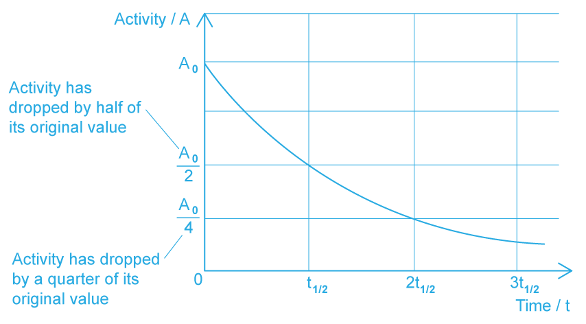
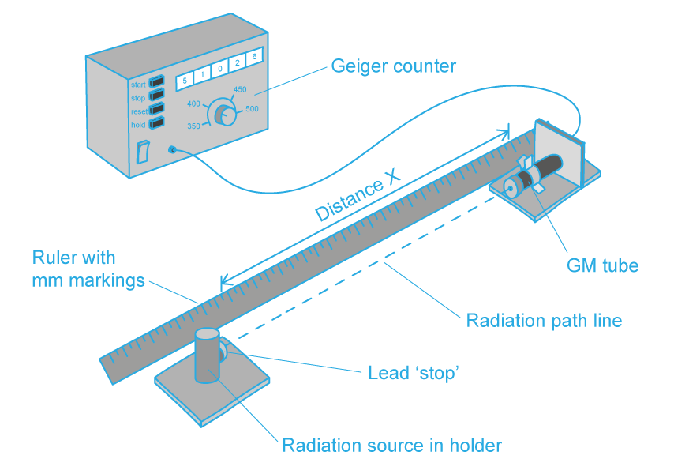
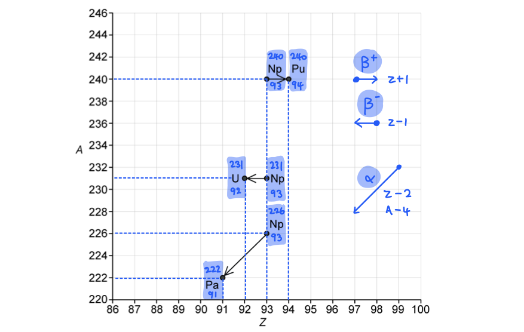
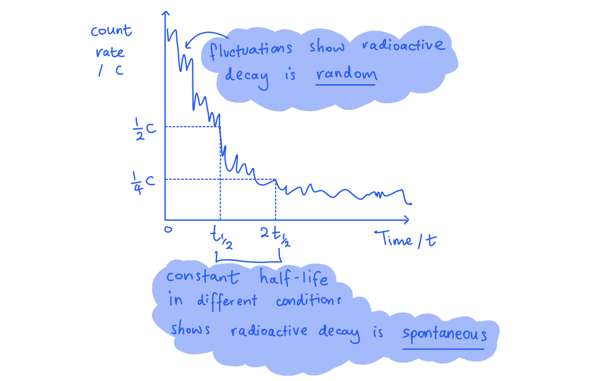
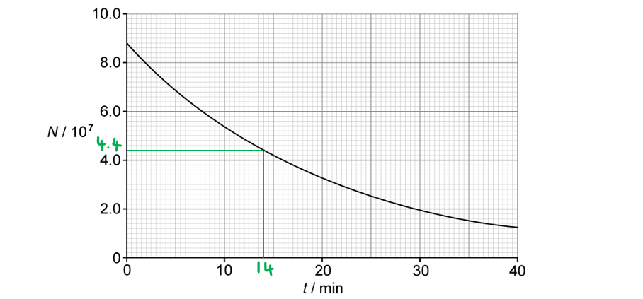
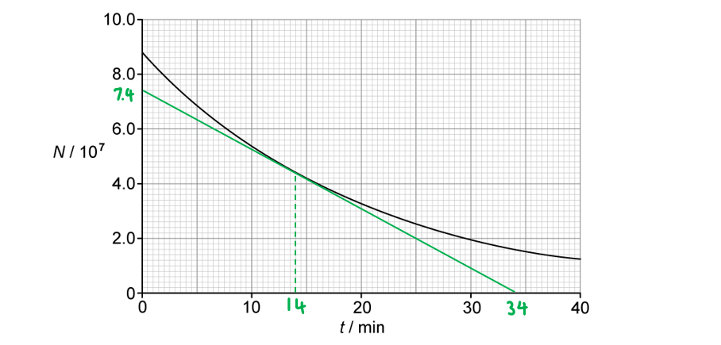
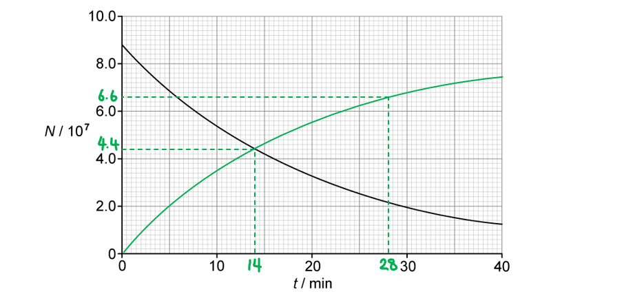
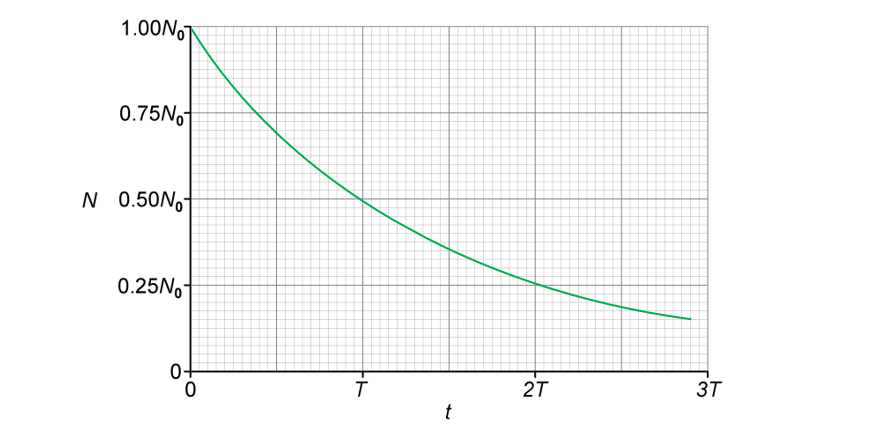
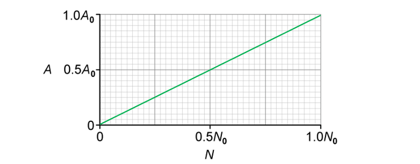

# Mark Schemes — Radioactive Decay
**23. Nuclear Physics** · Cambridge (CIE) A-LEVEL physics (9702)

## Structured Questions (8 questions)

### Q1
The half-life of radium-228 is:

- The time taken for the number of atoms / nuclei / activity of radium-228; **[1 mark]**
- To be reduced to one-half (of its initial value); **[1 mark]**

**OR**

- In 5.75 years, the number of atoms / nuclei / activity of radium-228; **[1 mark]**
- Will be reduced to one-half of its current value; **[1 mark]**

**[Total: 2 marks]**
Calculate the decay constant of radium-228:

List the known quantities:

- Half-life of radium-228, $t_{1/2}$ = 5.75 years

Convert half-life into seconds:

- Half-life:  $t_{1/2}$ = 5.75 × (60 × 60 × 24 × 365) = 1.81 × 108 s **[1 mark]**

Determine the decay constant:

- Decay constant:  $λ=\frac{\mathrm{ln}2}{t_{1/2}}$
- $λ=\frac{\mathrm{ln}2}{1.81\times10^{8}}$ = 3.83 × 10−9 s−1 **[1 mark]**

**[Total: 2 marks]**
List the known quantities:

- Decay constant of radium-228, *λ* = 3.83 × 10−9 s−1 (from **(b)**)
- Activity in 1.0 kg of water, *A* = 20 mBq = 0.020 Bq
- Avogadro's constant, *N**A* = 6.02 × 1023 mol−1
- Mass of water in 1.0 mol, *m* = 18 g = 0.018 kg

(i) The number of radium-228 atoms in 1.0 kg of the contaminated water is:

- Activity:  $A=λN$
- Number of atoms in 1.0 kg of water:  $N=\frac{A}{λ}=\frac{0.020}{3.83\times10^{-9}}$ **[1 mark]**
- Number of atoms in 1.0 kg of water:  N = 5.22 × 106 **[1 mark]**

(ii) The ratio of molecules of water to the number of radium-228 atoms is:

- Number of water molecules in 1.0 kg = $\frac{N_{A}}{m}=\frac{6.02\times10^{23}}{0.018}$ = 3.34 × 1025 **[1 mark]**
- Ratio = `fraction numerator number space of space molecules space of space water space in space 1.0 space kg space of space water over denominator number space of space Ra presuperscript 228 space atoms space in space 1.0 space kg space of space water end fraction`
- Ratio = $\frac{3.34\times10^{25}}{5.22\times10^{6}}$ = 6.4 × 1018 **[1 mark]**

**[Total: 4 marks]**
Calculate the time for the activity to be reduced to the safe limit:

List the known quantities:

- Target activity, *A* = 18.5 mBq kg−1
- Initial activity, *A**0* = 20 mBq kg−1
- Decay constant of radium-228, *λ* = 3.83 × 10−9 s−1 (from **(b)**)

Use the exponential decay equation for activity to determine the time:

- Exponential decay:  $A=A_{0}e^{-λt}$ **[1 mark]**
- `A over A subscript 0 space equals space e to the power of negative lambda t end exponent space space space space space rightwards double arrow space space space space space ln space open parentheses A over A subscript 0 close parentheses space equals space minus lambda t space space space space space rightwards double arrow space space space space space t space equals space minus fraction numerator ln space open parentheses A over A subscript 0 close parentheses over denominator lambda end fraction`
- Time (in s):  `t space equals space minus fraction numerator ln space open parentheses fraction numerator 18.5 over denominator 20 end fraction close parentheses over denominator 3.83 cross times 10 to the power of negative 9 end exponent end fraction` = 2.04 × 107 s **[1 mark]**
- Time (in days):  $t=\frac{2.04\times10^{7}}{60\times60\times24}$ = 236 days **[1 mark]**

**[Total: 3 marks]**

### Q2
The definition of half−life is:

- The time taken for the number of nuclei / the activity (of the source); **[1 mark]**
- To decay / reduce by half; **[1 mark]**

**[Total: 2 marks]**

> *The time it takes for the activity of the sample to decrease from 100% to 50% is the half-life. It is the same length of time as it would take to decrease from 50% activity to 25% activity. The half-life is constant for a particular isotope.*

> *The diagram shows how the activity of a radioactive sample changes over time. Each time the original activity halves, another half-life has passed.*

> *The diagram shows how the activity of a radioactive sample changes over time. Each time the original activity halves, another half-life has passed.*
(i) The independent variable is:

- Time; **[1 mark]**

(ii) The dependent variable is:

- Activity of the sample; **[1 mark]**

(iii) The control variables are:

- Size of sample; **[1 mark]**
- Distance from the detector to the sample; **[1 mark]**
- Same material for the sample; **[1 mark]**

**[Total: 5 marks]**
The correct purpose of each piece of apparatus is as follows:

- **1 mark for each correct line drawn**

**[Total: 4 marks]**

> *The set up for the experiment is shown below:*

Determine the half−life of the sample:

- (From the graph) initial activity:  $A_{0}$ = 16 × 104 Bq** [1 mark]**
- Half the initial activity = $\frac{1}{2}A_{0}$ = 8 × 104 Bq **[1 mark]**
- (From the graph)  half-life:  $t_{1/2}$ = 6 hours **[1 mark]**

**[Total: 3 marks]**

> *The definition of half-life can help you remember how to approach questions involving graphs:*

> *The time taken for half the undecayed nuclei to decay or the activity of a source to decay by half*

### Q3
(i) Radioactive decay is defined as:

- The emission of a radioactive particle (alpha, beta or gamma); **[1 mark]**
- From a <u>nucleus</u>; **[1 mark]**

(ii) A spontaneous process is defined as:

- A decay which is unaffected by environmental changes; **[1 mark]**
- Such as temperature / pressure / chemical conditions; **[1 mark]**

(iii) A random process is defined as:

- The constant probability that a nucleus will decay (per unit time); **[1 mark]**
- (Because) it cannot be predicted which particular nucleus will decay next; **[1 mark]**

**[Total: 6 marks]**
(i) The graph demonstrates the random nature of radioactive decay because:

- There are fluctuations in the curve **OR** the curve is not smooth; **[1 mark]**

(ii) The graph demonstrates the spontaneous nature of radioactive decay because:

- The decay curve is the same regardless of external conditions; **[1 mark]**

**[Total: 2 marks]**

> *It is not possible to determine exactly when radioactive nuclei will decay. It could be in the next minute, or it might not be for another 10 000 years or more!*

> *All we can do is look at the general **pattern** across a large number of radioactive nuclei which provides us with the half−life. The decay of an individual nucleus is **not** dependent on the others in the sample.*

> *The fluctuations in count rate, as shown on the graph, indicate that sometimes slightly more nuclei will decay in a period of time and sometimes slightly fewer!*
(i) Isotopes of an element are:

- Nuclei which have the same proton number / atomic number / number of protons; **[1 mark]**
- But a different neutron number / number of neutrons; **[1 mark]**

Possible isotopes of neptunium:

- `Np presubscript 93 presuperscript 239`, `Np presubscript 93 presuperscript 219`, `Np presubscript 93 presuperscript 244` (all three circled); **[1 mark]**

(ii) Half-life is defined as:

- The time it takes for the initial activity (of a source) / number of nuclei (in a source); **[1 mark]**
- To reduce to one-half of its initial value; **[1 mark]**

The correct expression is:

- `open parentheses lambda space equals close parentheses space fraction numerator 0.693 over denominator 49 cross times 60 end fraction` **[1 mark]**

**[Total: 6 marks]**

> *For part (i), make sure to look carefully at each option - the two incorrect options *`Np presubscript 94 presuperscript 231`* and *`Np presubscript 90 presuperscript 231`* have atomic (proton) numbers of 94 and 90 which means they would be completely **different elements*

> *For part (ii), you needed to realise that the probability per second of decay of a nucleus is the definition of **decay constant **and that you need to multiply the **half-life by 60** to convert it into seconds*
The correct nuclear decay equations are:

- `Np presubscript 93 presuperscript 240 space rightwards arrow space Pu presubscript 94 presuperscript 240 space plus space straight beta presubscript negative 1 end presubscript presuperscript 0 space plus space top enclose nu`; **[1 mark]**
- `Np presubscript 93 presuperscript 231 space rightwards arrow space straight U presubscript 92 presuperscript 231 space space plus space straight beta presubscript plus 1 end presubscript presuperscript 0 space plus space nu`; **[1 mark]**
- `Np presubscript 93 presuperscript 226 space rightwards arrow space Pa presubscript 91 presuperscript 222 space plus space straight alpha presubscript 2 presuperscript 4`; **[1 mark]**

**[Total: 3 marks]**

> *Taking some time to annotate the graph can help to avoid silly errors - make sure you understand that **beta-minus** decay will result in a nuclide with one extra proton, and **beta-plus** decay will result in a nuclide with one less proton.*

> *Alpha decay is easily recognisable as it results in a decrease in **both** proton and nucleon number*

### Q4
List the known quantities:

- Half-life of `R presubscript 37 presuperscript 87 b`, $t_{\frac{1}{2}}$= 4.90 × 1010 years
- Current mass of `R presubscript 37 presuperscript 87 b`, *m* = 1.2 mg = 1.2 × 10–3 g
- Time since the formation of the moon, *t* = 4.47 × 109 years** **

Calculate the decay constant  of the rubidium using the expression from the formula page:

- $λ=\frac{0.693}{t_{\frac{1}{2}}}=\frac{0.693}{4.90\times10^{10}}$ = 1.41 × 10–11 year–1 **[1 mark] **

Use the decay equation from the formula page to calculate the mass *m* of `R presubscript 37 presuperscript 87 b` present in the rock sample 4.47 × 109 years ago:

- $x=x_{0}e^{-λt}$ so *m* =$m_{0}e^{-λt}$ (because mass *m* is proportional to number of nuclei $x$)
- (1.20 × 10–3) = `m subscript 0 e to the power of negative open parentheses 1.41 cross times 10 to the power of negative 11 end exponent close parentheses cross times open parentheses 4.47 cross times 10 to the power of 9 close parentheses end exponent` = 0.939 ×$m_{0}$
- $m_{0}$*= *$\frac{1.2\times10^{-3}}{0.939}$*=* 1.28 × 10–3 g ~ 1.3 mg **[1 mark]**** **

**[Total: 2 marks]**

> *All quantities such as number of radioactive nuclei, activity and mass of radioactive material decay exponentially and follow the equation *$x=x_{0}e^{-λt}$*. This is given on your formula page in your exam, but you must understand the quantities that **x** can represent.*
List the known quantities:

- Mass of `R presubscript 37 presuperscript 87 b`, *m* = 1.2 mg = 1.2 × 10–6 kg
- Decay constant of `R presubscript 37 presuperscript 87 b`, $λ$= 1.41 × 10–11year–1 (from part a)

From data page:

- Unified atomic mass unit, *u* = 1.66 × 10–27 kg

Calculate the number of nuclei, *N* , in 1.2 mg of  `R presubscript 37 presuperscript 87 b` :

- $N=\frac{\mathrm{mass}}{\mathrm{mass} \mathrm{of} \mathrm{one} \mathrm{nucleus}}=\frac{\mathrm{mass}}{87u}$
- *N* =`begin mathsize 16px style fraction numerator 1.2 cross times 10 to the power of negative 6 end exponent over denominator 87 cross times open parentheses 1.66 cross times 10 to the power of negative 27 end exponent close parentheses end fraction end style` = 8.3 × 1018 **[1 mark]**** **

Calculate the decay constant in seconds:

- $λ$=  $\frac{1.41\times10^{-11}}{365\times24\times60\times60}$ = 4.5 × 10–19 s–1 **[1 mark]**** **

Calculate the activity of  `R presubscript 37 presuperscript 87 b` using the decay constant and the number of nuclei:

- *A* = *λN*
- *A *= (4.5 × 10–19) × (8.3 × 1018) = 3.7 Bq **[1 mark] **

**[Total: 3 marks]**

> *Though this question asks you to calculate the activity, you need to spot the tricky unit conversions throughout the question to gain full credit:*

- *For the first mark, calculating the number of nuclei using the atomic mass unit requires the mass of the sample to be converted to kilograms (watch out too for the mass number 87, which means there are 87 nucleons in rubidium each contributing a unified atomic mass unit)*
- *If you are ever in doubt regarding a unit conversion, think 'should this value get larger or smaller?' –  there will be fewer decays per second than per year so the decay constant should decrease in size when converting from per year to per second*
Explain why the concentration of carbon-14 is greater in living wood:

- Carbon-14 is constantly absorbed / replaced in living wood; **[1 mark]**
- (In dead wood, it is not replaced, but) carbon-14 undergoes radioactive decay over time **AND** carbon-12 is <u>stable</u>; **[1 mark]**

List the known quantities:

- Half-life of carbon-14, $t_{\frac{1}{2}}$= 1.8 × 1011 s
- Initial ratio of carbon-14 to carbon-12 (in living wood) = 1/(3 × 1010)
- Final ratio of carbon-14 to carbon-12 (in the ancient wood) = 1/(8 × 1010)

Calculate the decay constant of carbon-14:

- $λ=\frac{\mathrm{ln}2}{t_{\frac{1}{2}}}=\frac{\mathrm{ln}2}{1.8\times10^{11}}$ = 3.9 × 10–12 s–1

Calculate the elapsed time using the decay equation:

- $x=x_{0}e^{-λt}$ where $x$  represents the ratio of C-14
- `begin mathsize 16px style fraction numerator 1 over denominator 8 cross times 10 to the power of 10 end fraction equals fraction numerator 1 over denominator 3 cross times 10 to the power of 10 end fraction e to the power of negative open parentheses 3.9 cross times 10 to the power of negative 12 end exponent close parentheses t end exponent end style` **[1 mark]**
- Multiply both sides by 3 × 1010 to obtain 0.375 = `e to the power of negative open parentheses 3.9 cross times 10 to the power of negative 12 end exponent close parentheses t end exponent`
- ln 0.375 = – (3.9 × 10–12) × t
- t = 2.5 × 1011 s = 7900 years **[1 mark] **

**[Total: 4 marks]**

### Q5
(i)** **The student could demonstrate the spontaneous nature of radioactive decay by:

- Repeating the experiment in different (environmental) conditions e.g. temperature, pressure, humidity, chemicals; **[1 mark]**
- To show that the rate of decay / activity does not change; **[1 mark]**

**OR**** max ****one mark ****for:**

- (Spontaneous decay means) the rate of decay / activity (of a nucleus) is not affected by environmental / external factors; **[1 mark]**

(ii) The student could demonstrate the random nature of radioactive decay by:

- Plotting a graph of count rate against time (using a data logger / computer software); **[1 mark]**
- To show the presence of fluctuations **OR** that the (decay) curve is not smooth; **[1 mark]**

**OR**** max ****one mark ****for:**

- (Random decay means) the time of decay (of a nucleus) cannot be predicted **OR** a nucleus has a constant probability (of decaying) in a given time; **[1 mark]**

**[Total: 4 marks]**

> *You could also draw a diagram or example decay curve to help illustrate your answer:*

The correct equation for the decay is:

- `Tc presubscript 43 presuperscript 101 space rightwards arrow space Ru presubscript bold 44 presuperscript bold 101 space plus space straight beta presubscript bold minus bold 1 end presubscript presuperscript bold 0 space plus space scriptbase bold nu with bold bar on top end scriptbase presubscript bold 0 presuperscript bold 0 subscript bold e`
- Ruthenium:  A = 101, Z = 44; **[1 mark]**
- Beta-minus:  A = 0, Z = −1; **[1 mark]**
- Antineutrino: A = 0, Z = 0; **[1 mark]**

**[Total: 3 marks]**
(i) Determine the activity of the sample of technetium-101 at 14.0 minutes:

**EITHER**

- (From graph) *N* at 14 minutes = 4.4 × 107 **[1 mark]**
- (From graph) *t*  = 14 minutes is the half-life; **[1 mark]**
- Activity:  $A=λN\RightarrowA=\frac{N\mathrm{ln}2}{t_{1/2}}$ **[1 mark]**
- Activity:  `A space equals space fraction numerator open parentheses 4.4 cross times 10 to the power of 7 close parentheses cross times ln space 2 over denominator 14 cross times 60 end fraction` = 3.6 × 104 Bq **[1 mark]**

**OR**

- Tangent drawn at *t* = 14 minutes; **[1 mark]**
- Activity = gradient of tangent; **[1 mark]**
- Activity = `fraction numerator open parentheses 7.4 space minus space 0 close parentheses cross times 10 to the power of 7 over denominator open parentheses 34 space minus space 0 close parentheses cross times 60 end fraction` **[1 mark]**
- Activity = 3.6 × 104 Bq **[1 mark]**

(ii) Calculate the decay constant *λ* of technetium-101:

- $λ=\frac{\mathrm{ln}2}{t_{1/2}}=\frac{\mathrm{ln}2}{14\times60}$ **[1 mark]**
- *λ* = 8.2 × 10–4 s–1 **[1 mark]**

(iii) The variation with *t* of the number of ruthenium nuclei in the sample is as follows:

- Upwards curve of decreasing gradient starting from (0, 0); **[1 mark]**
- Passes through (14, 4.4) and (28, 6.6); **[1 mark]**

**[Total: 8 marks]**
(i) Calculate the total amount of energy given to beta particles:

- (From graph)* N* at 10 min = 5.4 × 107 and *N* at 30 min = 2.0 × 107
- Total number of beta particles emitted = (5.4 − 2.0) × 107 = 3.4 × 107 **[1 mark]**
- Energy of a beta particle (in J) = 487 keV = (487 × 103) × (1.6 × 10−19) J
- Total energy released = (487 × 103) × (1.6 × 10−19) × (3.4 × 107) **[1 mark]**
- Total energy released = 2.6 × 10−6 J **[1 mark]**

(ii) The total amount of energy released is greater because:

- Some Ru nuclei will have kinetic energy **OR** gamma photons are also emitted; **[1 mark]**

**[Total: 4 marks]**

### Q6
Radioactive decay is defined as:

- The spontaneous emission of (ionising) radiation; **[1 mark]**
- From an unstable nucleus; **[1 mark]**

**[Total: 2 marks]**
(i) The variation with *t* of the number *N* of nuclei of the isotope present in the sample is as follows:

- Curve drawn with decreasing negative gradient passing through (0, 1.00*N*0); **[1 mark]**
- Curve passes through (*T*, 0.5*N*0); **[1 mark]**
- Curve passes through (2*T*, 0.25*N*0) **AND** (3*T*, 0.125*N*0); **[1 mark]**

(ii) The name of the quantity represented by the gradient is:

- The negative of the activity (of the sample); **[1 mark]**

**[Total: 4 marks]**
(i) The variation with *N* of the activity *A* between *N* = 0 and *N* = *N*0 is as follows:

- Line drawn through origin with positive gradient; **[1 mark]**
- Straight line drawn passing through (1.0*N*0, 1.0*A*0); **[1 mark]**

(ii) The name of the quantity represented by the gradient is:

- The decay constant; **[1 mark]**

**[Total: 3 marks]**
Calculate the fraction of undecayed nuclei *N *remaining* *relative to *N**0* at time *t* = 1.25*T*.

List the known quantities:

- Half-life = *T*
- Time, *t* = 1.25*T*

Use the exponential decay equation:

- Decay constant:  $λ=\frac{\mathrm{ln}2}{T}$
- Exponential decay:  $N=N_{0}e^{-λt}\Rightarrow\frac{N}{N_{0}}=e^{-λt}$
- $\frac{N}{N_{0}}=e^{-\frac{\mathrm{ln}2}{T}\times1.25T}=e^{-1.25\times\mathrm{ln}2}$ **[1 mark]**
- $\frac{N}{N_{0}}$ = 0.42 **[1 mark]**

**[Total: 2 marks]**

### Q7
Recall the proton and mass number of alpha and beta particles:

- An alpha particle has 2 protons and 4 neutrons / `alpha presubscript 2 presuperscript 4` **AND** A beta particle is an electron / `beta presubscript negative 1 end presubscript presuperscript 0` **[1 mark] **

Calculate the new proton and mass number after 8 alpha decays, labelling this unknown isotope as Y:

- 8 alpha decays means the proton number will decrease by 8 × 2 = 16 and the mass number will decrease by 8 × 4 = 32
- `U presubscript 92 presuperscript 238 space rightwards arrow space Y presubscript 76 presuperscript 206 space plus 8 space alpha presubscript 2 presuperscript 4`** [1 mark]**

Calculate the change in proton number from isotope Y to lead-206:

- `Y presubscript 76 presuperscript 206` to `P presubscript 82 presuperscript 206 b` means the proton number must increase by 6
- `Y presubscript 76 presuperscript 206 space rightwards arrow space P presubscript 82 presuperscript 206 b space plus space 6 beta presubscript negative 1 end presubscript presuperscript 0`** [1 mark]**
- This means 6 beta particles are emitted: X = 6 **[1 mark]**

**[Total: 4 marks] **

> *Notice that tackling this question hinges on knowing the proton and mass number of an alpha particle and a beta particle, even though stating this wasn’t explicitly asked in the question. *

> *Knowing the basic properties of radioactive decay – e.g. type, nature, penetration depth, etc. – is really crucial and you should be on the lookout to apply them in different contexts.*
Write an expression for the initial number of uranium-238 nuclei:

- Initial number of uranium-238 nuclei = number of decayed nuclei + number of uranium-238 nuclei remaining
- $N_{0}=N_{Pb}+N_{U}$** ****[1 mark] **

Rearrange this expression for the number of lead-206 nuclei and divide both sides by $N_{U}$ to get an expression for the ratio required:

- $N_{Pb}=N_{0}-N_{U}$
- $\frac{N_{Pb}}{N_{U}}=\frac{N_{0}}{N_{U}}-\frac{N_{U}}{N_{U}}$  **[1 mark]**

Substitute the expression for $N_{U}$ and simplify the expression:

- $\frac{N_{Pb}}{N_{U}}=\frac{N_{0}}{N_{0}e^{-λt}}-1$ **[1 mark]**
- $\frac{N_{Pb}}{N_{U}}=\frac{1}{e^{-λt}}-1=e^{λt}-1$ **[1 mark]**

**[Total: 4 marks]**

> *Make sure you are comfortable interpreting the ‘exponential decay’ equation as the number of nuclei remaining in a sample. That way, you can always form an expression for the **initial number** of nuclei, in terms of a sum of the number of decayed nuclei and the number of nuclei remaining.*
Write an expression for the activity of each nuclide in terms of the number of half-lives completed:

- `A subscript X equals A subscript 0 open parentheses 1 half close parentheses to the power of N`  and `A subscript Y equals A subscript 0 open parentheses 1 half close parentheses to the power of N` where *N* is the number of half-lives
- The amount of time elapsed, *t, *can be written as some multiple *N * of half-lives: $t=N\timest_{1/2}$

- Number of half-lives:* *$N=\frac{t}{t_{\frac{1}{2}}}$ **[1 mark]**

Write an expression for the activity of each nuclide in terms of the time elapsed:

- `A subscript X equals A subscript 0 open parentheses 1 half close parentheses to the power of 48 over 16 end exponent` **AND** `A subscript Y equals A subscript 0 open parentheses 1 half close parentheses to the power of 48 over 8 end exponent` **[1 mark]**

Write an expression for the total activity *A  *of the mixture:

- $A=A_{X}+A_{Y}$
- `A equals A subscript 0 open parentheses 1 half close parentheses to the power of 48 over 16 end exponent plus A subscript 0 open parentheses 1 half close parentheses to the power of 48 over 8 end exponent`

Simplify the expression fully:

- `A equals A subscript 0 open square brackets open parentheses 1 half close parentheses cubed plus open parentheses 1 half close parentheses to the power of 6 close square brackets``= \left(\frac{1}{8} + \frac{1}{64}\right) = \frac{9}{64} A_{0}` **[1 mark]**

**[Total: 3 marks]**

> *You may have simply determined the number of half-lives of each isotope in 48 years by dividing 48 years by 8 and then 16, and halving each **A**0 **the appropriate number of times before combining. This method is equally correct, but you must clearly show and explain your reasoning with each step.*

### Q8
(i) The nuclear decay equation for the polonium isotope is:

- `Po presubscript 84 presuperscript 213 space rightwards arrow space Pb presubscript 82 presuperscript 209 space plus space alpha presubscript 2 presuperscript 4` **[1 mark]**

(ii) The nuclear decay equation for the lead isotope is:

- `Pb presubscript 82 presuperscript 209 space rightwards arrow space Bi presubscript 83 presuperscript 209`** [1 mark] **`plus straight e presubscript negative 1 end presubscript presuperscript 0 space plus space scriptbase nu with bar on top end scriptbase presubscript 0 presuperscript 0` **[1 mark]**

**[Total: 3 marks]**
(i) Decay constant is defined as:

**EITHER**

- The probability of decay (of a nucleus) / the fraction of the number of nuclei in a sample that decay; **[1 mark]**
- Per unit time; **[1 mark]**

**OR**

- `lambda space equals space minus open parentheses fraction numerator d N over denominator d t end fraction close parentheses 1 over N`; **[1 mark]**
- Where `negative open parentheses fraction numerator d N over denominator d t end fraction close parentheses` is the rate of decay of nuclei and *N* is the number of nuclei in the sample; **[1 mark]**

(ii) Calculate the decay constant of lead-209:

List the known quantities:

- Half-life of lead-209, *t*1/2 = 3.3 hours = 3.3 × 60 × 60 = 11 880 s **[1 mark]**

Calculate the decay constant, *λ*:

- Decay constant:  $λ=\frac{0.693}{t_{1/2}}$
- $λ=\frac{0.693}{11880}$ **[1 mark]**
- $λ=5.83\times10^{-5}=5.8\times10^{-5}s^{-1}$ (2 s.f.) **[1 mark]**

**[Total: 5 marks]**
Calculate the initial activity of the sample of polonium-213:

List the known quantities:

- Activity after 7 hours, *A* = 12 kBq = 12 × 103 Bq
- Time, *t* = 7 hours = 7 × 60 × 60 = 25 200 s
- Decay constant of lead-209, $λ=5.83\times10^{-5}s^{-1}$(from **(b)**)

Calculate the initial activity using the exponential decay equation:

- Exponential decay:  $A=A_{0}e^{-λt}\RightarrowA_{0}=\frac{A}{e^{-λt}}$
- `A subscript 0 space equals space fraction numerator 12 cross times 10 cubed space over denominator e to the power of negative open parentheses 5.83 cross times 10 to the power of negative 5 end exponent close parentheses cross times open parentheses 25 space 200 close parentheses end exponent end fraction` **[1 mark]**
- $A_{0}=5.21\times10^{4}=5.2\times10^{4}\mathrm{Bq}$ (2 s.f.) **[1 mark]**

**[Total: 2 marks]**
(i) State the relationship between *A*, *N* and *λ*:

- $A=λN$ **[1 mark]**

(ii) Determine the number of lead-209 nuclei in this sample

List the known quantities:

- Initial activity, $A_{0}=5.21\times10^{4}\mathrm{Bq}$ (from **(c)**)
- Decay constant, $λ=5.83\times10^{-5}s^{-1}$ (from **(b)**)

Calculate the initial number of lead nuclei:

- Rearrange:  $A_{0}=λN_{0}\RightarrowN_{0}=\frac{A_{0}}{λ}$
- $N_{0}=\frac{5.21\times10^{4}}{5.83\times10^{-5}}$ **[1 mark]**
- $N_{0}=8.94\times10^{8}=8.9\times10^{8}$ (2 s.f.) **[1 mark]**

**[Total: 3 marks]**

> *Units are extremely important throughout this question!*

> *When using the equation *$x=x_{0}e^{-λt}$*, it doesn't matter which unit of time you use for **λ **and **t** as long they have the **same units** (e.g. s**–1** and s or hr**–1** and hr)*

> *However, for the equation *$A=λN$*, **A** is in Bq, or s**–1**, therefore **λ **must be in **s**–1*
