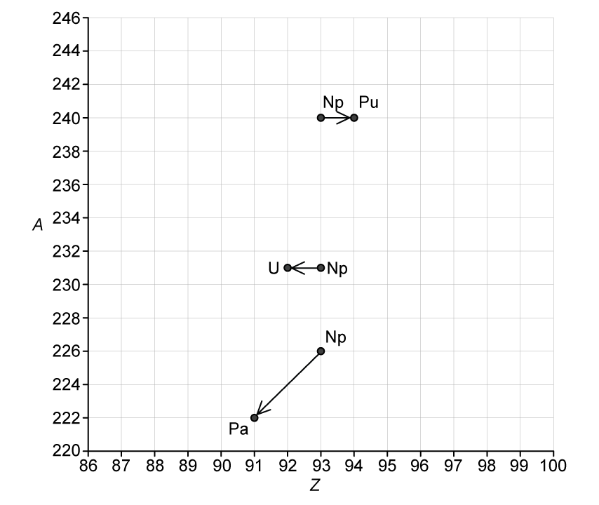
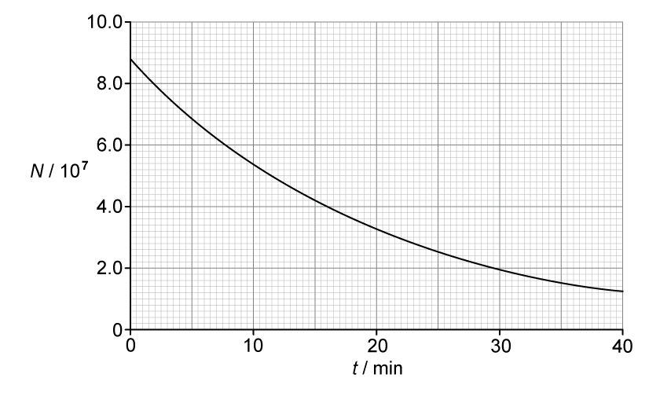
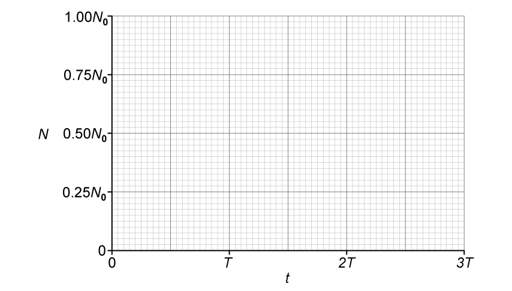
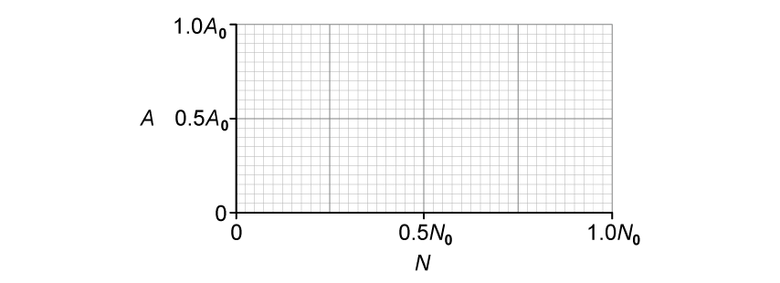

# Exam Questions — Radioactive Decay
**23. Nuclear Physics** · Cambridge (CIE) A-LEVEL physics (9702)
> Source: [https://www.savemyexams.com/a-level/physics/cie/25/topic-questions/](https://www.savemyexams.com/a-level/physics/cie/25/topic-questions/) · 8 questions across 1 sets

## Structured Questions (8 questions)

### Q1 — medium — 11 marks

**Q1** [2 marks]

A source of water is found to be contaminated with the radioactive isotope radium-228 $( Ra_{88}^{228} )$.

This isotope of radium has a half-life of 5.75 years.

Explain the meaning of half-life in this context.

**Q1** [2 marks]

**Extract:**

A source of water is found to be contaminated with the radioactive isotope radium-228 (228/88 Ra). This isotope of radium has a half-life of 5.75 years.

Calculate the decay constant, in s–1, of radium-228.

**Q1** [4 marks]

**Extract:**

Calculate the decay constant, in s^–1^, of radium-228.
Half-life of radium-228, t_1/2 = 5.75 years
Decay constant: λ = ln 2 / t_1/2 = ln 2 / (1.81 × 10^8) = 3.83 × 10^−9 s^−1

A sample is taken of the contaminated water. The activity of radium-228 in a sample of 1.0 kg of water is found to be 20 mBq.

The mass of water in 1.0 mol is 18 g.

Calculate

(i) the number of radium-228 atoms in 1.0 kg of the contaminated water

[2]

(ii) the ratio

`(number of molecules of water in 1.0 kg of water)/(number of Ra ^ 228 atoms in 1.0 kg of water)`

[2]

**Q1** [3 marks]

**Extract:**

Calculate the decay constant, in s^–1^, of radium-228. Decay constant: λ = ln2/(1.81 × 10^8) = 3.83 × 10^−9 s^−1

The activity of radium-228 in a sample of 1.0 kg of water is found to be 20 mBq.

The maximum safe limit for the activity of radium-228 in water has been set as 18.5 mBq kg−1.

Calculate the time, in days, for the activity of the contaminated water to be reduced to the safe limit.

### Q2 — easy — 14 marks

**Q2** [2 marks]

Define half−life.

**Q2** [5 marks]

A student investigates the half−life of technetium with time. This list shows the variables in the experiment.

| time | size of sample | distance from the detector to the sample | same material for the sample | activity of the sample |
|---|---|---|---|---|

Using variables from the list, state

(i) the independent variable

[1]

(ii) the dependent variable

[1]

(iii) the control variables for the experiment

[3]

**Q2** [4 marks]

**Extract:**

A student investigates the half−life of technetium with time.

The experiment uses a variety of apparatus.

Draw lines on Table 1.1 below to match the apparatus with its correct use.

**Table 1.1**

**Q2** [3 marks]

Fig. 1.1 shows the graph that the student obtains from their results.

**Fig. 1.1**

Using Fig. 1.1, determine the half−life of the sample.

### Q3 — easy — 17 marks

**Q3** [6 marks]

Radioactive decay is often described as a spontaneous and random process.

State what is meant by

(i) radioactive decay

[2]

(ii) a spontaneous process

[2]

(iii) a random process

[2]

**Q3** [2 marks]

The graph in Fig. 1.1 shows the count rate of a radioactive substance measured by a Geiger-Müller tube.

**Fig. 1.1**

State the feature of Fig. 1.1 which provides evidence for

(i) the random nature of radioactive decay

[1]

(ii) the spontaneous nature of radioactive decay

[1]

**Q3** [6 marks]

The element neptunium has at least 24 isotopes. One of the isotopes is neptunium-231 $( Np_{93}^{231} )$, which has a half-life of 49 minutes.

(i) State what is meant by *isotopes* and circle the possible isotopes of neptunium

| $Np_{93}^{239}$ | $Np_{94}^{231}$ | $Np_{93}^{219}$ | $Np_{90}^{231}$ | $Np_{93}^{244}$ |
|---|---|---|---|---|

[3]

(ii) Define *half-life* and circle the correct expression for calculating the probability per second of decay of a nucleus of neptunium-231.

| $\frac{49}{0.693}$ | $\frac{0.693}{49}$ | $\frac{0.693}{49\times60}$ | $\frac{49\times60}{0.693}$ |
|---|---|---|---|

[3]

**Q3** [3 marks]

Fig. 1.2 shows a diagram in which nucleon number *A* is plotted against proton number *Z*.

The diagram shows the position of three isotopes of neptunium and their respective decay products.

**Fig. 1.2**

Use Fig. 1.2 to complete the following nuclear decay equations

`Np _... ^... -> Pu _... ^... + .....................`

`Np _... ^... -> U _... ^... + .....................`

`Np _... ^... -> Pa _... ^... + .....................`

### Q4 — hard — 9 marks

**Q4** [2 marks]

Rubidium (Rb) was found in samples of moon rock which were retrieved from the Apollo missions. The isotope $R_{37}^{87} b$ is known to have a half-life of 4.90 × 1010years.

One of the moon rock samples contains 1.2 mg of $R_{37}^{87} b$.

Show that the mass of $R_{37}^{87} b$ that the rock sample contained when the moon was formed 4.47 ×109 years ago was about 1.3 mg.

**Q4** [3 marks]

**Extract:**

Rubidium (Rb) was found in samples of moon rock which were retrieved from the Apollo missions. The isotope Rb-87 is known to have a half-life of 4.90 × 10^10 years. One of the moon rock samples contains 1.2 mg of Rb-87.

Decay constant of Rb-87, λ = 0.693/t½ = 0.693/(4.90 × 10^10) = 1.41 × 10^–11 year^–1

Calculate the activity of 1.2 mg of $R_{37}^{87} b$.

**Q4** [4 marks]

Radioactive carbon dating is a method for determining the age of samples containing organic material. This is a commonly used method for terrestrial objects.

Pieces of ancient wood found in a fireplace at an archaeological site can be dated by measuring the activity of carbon-14. A sample contains one carbon-14 atom per 8.0 × 1010 carbon-12 atoms. In living wood, the concentration of carbon-14 atoms is greater at one carbon-14 atom per 3.0 × 1010 carbon-12 atoms.

The half-life of carbon-14 is 1.8 × 1011 s.

Explain why the concentration of carbon-14 is greater in living wood and calculate the age, in years, of the sample taken from the archaeological site.

### Q5 — medium — 19 marks

**Q5** [4 marks]

A student sets up a radioactive source and a Geiger counter to investigate how the count rate of the source varies with time.

State and explain how the student could demonstrate

(i) the spontaneous nature of radioactive decay,

[2]

(ii) the random nature of radioactive decay.

[2]

**Q5** [3 marks]

Technetium-101 $( Tc_{43}^{101} )$ decays by beta-minus emission to form a stable isotope of Ruthenium $( Ru )$.

Complete the equation for this decay.

`Tc _ 43 ^ 101 -> Ru _...... ^...... + beta _...... ^...... + ......`

**Q5** [8 marks]

**Extract:**

Technetium-101 (₄₃¹⁰¹Tc) decays by beta-minus emission to form a stable isotope of Ruthenium (Ru).

The variation with time *t* of the number* N* of technetium-101 nuclei in a sample of radioactive material is shown in Fig. 1.1.

**Fig. 1.1**

(i) Use Fig. 1.1 to determine the activity, in Bq, of the sample of technetium-101 at time *t* = 14.0 minutes.

[4]

(ii) Use your answer in **(c)(i)** to calculate the decay constant λ of technetium-101.

[2]

(iii) On Fig. 1.1, sketch a line to show the variation with *t* of the number of ruthenium nuclei in the sample.

[2]

**Q5** [4 marks]

**Extract:**

Technetium-101 decays by beta-minus emission to form a stable isotope of Ruthenium (Ru).

The variation with time t of the number N of technetium-101 nuclei in a sample of radioactive material is shown in Fig. 1.1.

Each decay releases a beta particle with energy 487 keV.

(i) Calculate, in J, the total amount of energy given to beta particles that are emitted between time *t* = 10 min and time *t* = 30 min.

[3]

(ii) Suggest why the total amount of energy released by the decay process between time *t* = 10 min and time *t* = 30 min is actually greater than your answer in **(d)(i)**.

[1]

### Q6 — medium — 11 marks

**Q6** [2 marks]

State what is meant by radioactive decay.

**Q6** [4 marks]

A radioactive sample consists of an isotope with a half-life *T* that decays to form a stable product. Only the isotope and the stable product are present in the sample.

At time *t* = 0, the sample has an activity of *A**0* and contains *N**0* nuclei of the isotope.

(i) On Fig. 1.1, sketch the variation with *t *of the number *N *of nuclei of the isotope present in the sample from time *t* = 0 to time *t* = 3*T*.

**Fig. 1.1**

[3]

(ii) State the name of the quantity represented by the gradient of the graph in Fig. 1.1.

[1]

**Q6** [3 marks]

**Extract:**

A radioactive sample consists of an isotope with a half-life *T* that decays to form a stable product. Only the isotope and the stable product are present in the sample. 

At time *t* = 0, the sample has an activity of *A*~*0*~ and contains *N*~*0*~ nuclei of the isotope.

(i) On Fig. 1.2, sketch the variation with *N* of the activity *A* of the sample for values of *N* between *N* = 0 and *N* = *N**0*.

**Fig. 1.2**

[2]

(ii) State the name of the quantity represented by the gradient in Fig. 1.2.

[1]

**Q6** [2 marks]

**Extract:**

A radioactive sample consists of an isotope with a half-life *T* that decays to form a stable product. Only the isotope and the stable product are present in the sample. At time *t* = 0, the sample has an activity of *A*~*0*~ and contains *N*~*0*~ nuclei of the isotope.

Calculate the fraction of undecayed nuclei *N *remaining* *relative to *N**0* at time *t* = 1.25*T*.

### Q7 — hard — 11 marks

**Q7** [4 marks]

The radioisotope uranium-238 `( U _ 92 ^ 238 )` decays through a decay chain to the radioisotope lead-206 $( Pb_{82}^{206} )$, which is stable.

During the decay chain, 8 alpha particles are emitted, and X beta particles are emitted.

Calculate the value of X.

**Q7** [4 marks]

The half-life of uranium-238 is so long in comparison to any of the isotopes in its decay chain that we can assume the number of lead-206 nuclei, $N_{Pb}$ at any time is equal to the number of uranium-238 that have decayed.

The number of uranium-238 nuclei $N_{U}$ at time *t* is given by the equation:

$N_{U}=N_{0}e^{-λt}$

where $N_{0}$ is the number of uranium-238 nuclei at *t = *0.

Show that the ratio $\frac{N_{Pb}}{N_{U}}$ is given by:

$\frac{N_{Pb}}{N_{U}}=e^{λt}-1$

**Q7** [3 marks]

Enriched uranium fuel is a mixture of the fissionable uranium-235 with the more naturally abundant uranium-238. Mixtures of radioactive nuclides such as this are very common in the nuclear power industry.

Two samples of radioactive nuclides **X** and **Y** each have an activity of $A_{0}$ at *t* = 0. They are subsequently mixed together. The half-lives of **X **and **Y** are 16 and 8 years, respectively.

Show that the total activity of the mixture at time *t *= 48 years is equal to $\frac{9}{64}A_{0}$.

### Q8 — easy — 13 marks

**Q8** [3 marks]

An isotope of polonium-213 ($Po_{84}^{213}$) first decays into an isotope of lead-209 ($Pb_{82}^{209}$) and then decays into the stable isotope of bismuth (Bi).

Fig. 1.1 shows two arrows on a neutron number *N* against proton number* Z *chart to illustrate these two decays.

**Fig. 1.1**

Use Fig. 1.1 to complete the nuclear decay equations for

(i) the polonium isotope

$Po_{84}^{213} \rightarrow Pb_{82}^{209} + .....................$

[1]

(ii) the lead isotope

`Pb _ 82 ^ 209 -> Bi _ 83 ^..... + e _ - 1 ^ 0 + .....................`

[2]

**Q8** [5 marks]

A pure sample of polonium-213 is produced in a research laboratory.

The half-life of $Po_{84}^{213}$ is very small compared with the half-life of $Pb_{82}^{209}$. After a very short time, the ionising radiation detected from the sample is mainly from the beta-minus decay of the lead-209 nuclei.

The half-life of $Pb_{82}^{209}$ is 3.3 hours.

(i) State what is meant by the *decay constant *of a radioactive isotope.

[2]

(ii) Calculate the decay constant, in s−1, of lead-209.

[3]

**Q8** [2 marks]

**Extract:**

The half-life of \$\$\_{82}^{209}Pb\$\$ is very small compared with the half-life of \$\$\_{84}^{213}Po\$\$... After a very short time, the ionising radiation detected from the sample is mainly from the beta-minus decay of the lead-209 nuclei. The half-life of \$\$\_{82}^{209}Pb\$\$ is 3.3 hours.

Calculate the decay constant of lead-209: Decay constant of lead-209, \$\$\lambda = 5 . 83 \times 10^{- 5} s^{- 1}\$\$

The activity of the sample of $Pb_{82}^{209}$ after 7.0 hours is 12 kBq.

Calculate the initial activity of the sample of polonium-213.

**Q8** [3 marks]

**Extract:**

The half-life of lead-209 is 3.3 hours. Calculate the decay constant of lead-209: λ = 5.83 × 10^-5 s^-1 (2 s.f.)

The activity of the sample of lead-209 after 7.0 hours is 12 kBq. Calculate the initial activity of the sample: A0 = 5.21 × 10^4 = 5.2 × 10^4 Bq (2 s.f.)

(i) State the relation between the activity A of a sample of a radioactive isotope containing N atoms and the decay constant λ of the isotope.

[1]

(ii) Determine the number of lead-209 nuclei in the sample initially.

[2]
