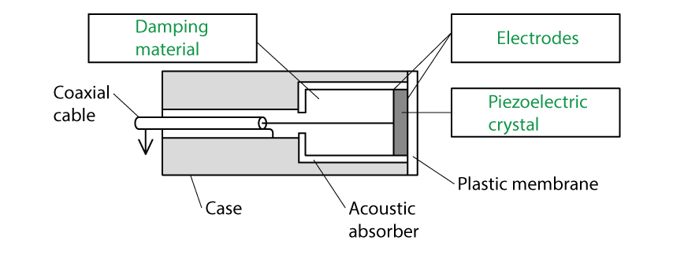
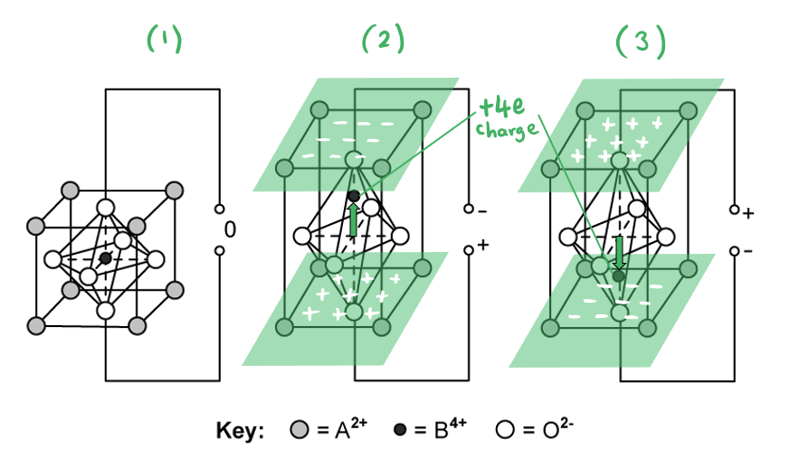
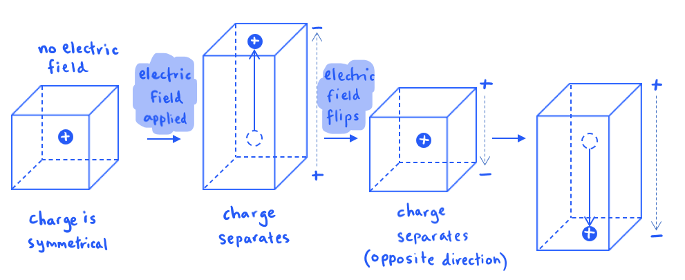
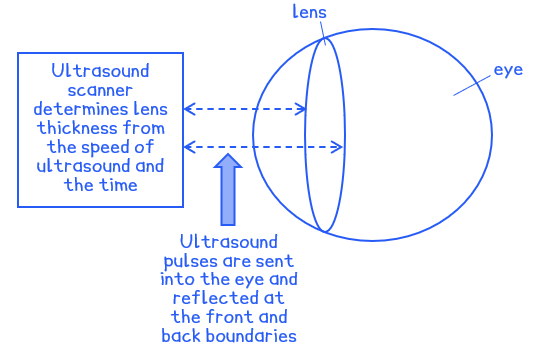
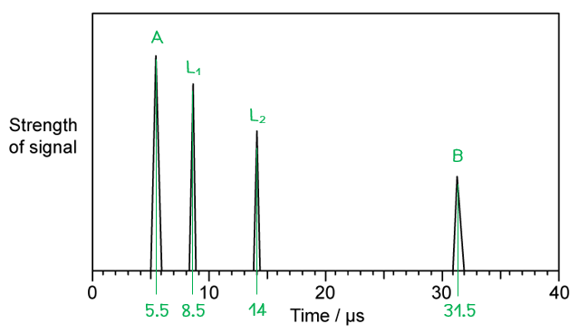
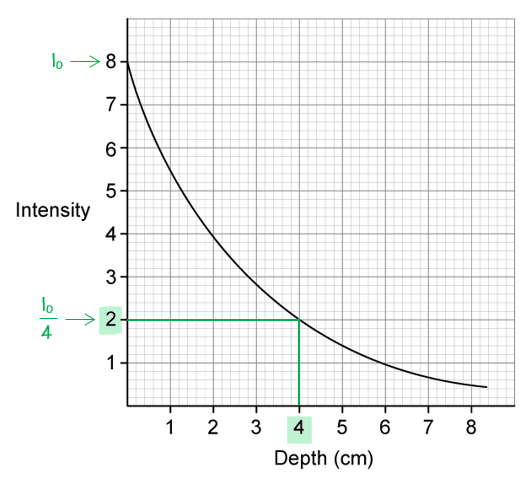

# Mark Schemes — Production & Use of Ultrasound
**24. Medical Physics** · Cambridge (CIE) A-LEVEL physics (9702)

## Structured Questions (8 questions)

### Q1
The correct labels are as follows:

From top left to bottom right:

- Damping / backing material; **[1 mark]**
- Electrodes; **[1 mark]**
- Piezoelectric crystal; **[1 mark]**

**[Total: 3 marks]**
The purpose of the piezoelectric crystal is:

- To produce ultrasound waves from vibrations / resonance when an alternating p.d. is applied across it; **[1 mark]**

The purpose of the electrodes are:

- To apply an alternating p.d. across the (piezoelectric) crystal; **[1 mark]**

The purpose of the damping material is:

- To damp the oscillations **OR** to stop the crystal from vibrating too much; **[1 mark]**

**[Total: 3 marks]**
(i) Ultrasound can provide information about the:

- Depth of a boundary; **[1 mark]**
- Nature of a boundary; **[1 mark]**

(ii) The properties of the ultrasound signal are:

- The <u>time</u> delay / time between transmission and receipt (of the pulse) gives information about the depth (of the boundary); **[1 mark]**
- The <u>intensity</u> of the reflection gives information about the nature (of the boundary); **[1 mark]**

**[Total: 4 marks]**
(i) When a gas lighter ignites a flame using a small spark:

- Vibrational energy is transferred to electrical energy (to ignite the spark); **[1 mark]**

(ii) When a motion sensor uses ultrasound waves to signal an automatic door to open:

- Electrical energy transfers to vibrational energy (to generate ultrasound waves in a piezoelectric crystal); **[1 mark]**

(iii) When an inkjet printer ejects ink from nozzles onto a sheet of paper

- Electrical energy transfers to vibrational energy (to deform a piezoelectric crystal to eject ink); **[1 mark]**

(iv) When a hearing aid receives sound:

- Vibrational energy (from sound waves) is transferred to electrical energy (in a microphone); **[1 mark]**
- (And then) the signal is amplified by transferring electrical energy to vibrational energy (in a speaker); **[1 mark]**

**[Total: 5 marks]**

### Q2
Calculate the wavelength of ultrasound waves of frequency 7 MHz in a quartz crystal:

List the known quantities:

- Speed of sound in quartz, *v* = 5700 m s−1
- Frequency of ultrasound, *f* = 7 MHz = 7 × 106 Hz

Rearrange the wave speed equation for wavelength

- Wave equation:  $v=fλ\Rightarrowλ=\frac{v}{f}$
- $λ=\frac{5700}{7\times10^{6}}$ **[1 mark]**
- $λ$ = 8.1 × 10−4 m = 0.81 mm **[1 mark]**

**[Total: 2 marks]**
Calculate the thickness of the transducer:

List the known quantities:

- Wavelength = 0.81 mm (from part a)

Calculate the thickness:

- Thickness = $\frac{0.81}{2}$ = 0.4 mm **[1 mark]**

**[Total: 1 mark]**
(i) The wave effect that limits the resolution of an ultrasound image is:

- Diffraction; **[1 mark]**

(ii) High-frequency ultrasound waves must be used in medical scanning:

- To <u>resolve</u> fine details (of internal structures); **[1 mark]**
- Shorter wavelength reduces (the unwanted effects of) diffraction; **[1 mark]**

**[Total: 3 marks]**
Estimate the smallest size of the tissue that would be observable:

List the known quantities:

- Speed of sound in tissue, *v* = 1540 m s−1
- Frequency of ultrasound, *f* = 7 MHz = 7 × 106 Hz

Rearrange the wave speed equation for wavelength

- Wave equation:  $v=fλ\Rightarrowλ=\frac{v}{f}$
- $λ=\frac{1540}{7\times10^{6}}$ **[1 mark]**
- $λ$ = 2.2 × 10−4 m = 0.22 mm **[1 mark]**
- Therefore, the smallest size of tissue that could be resolved is 0.22 mm

**[Total: 2 marks]**

> *The smallest detail that can be resolved is known as the **resolution **of the sensor.*

### Q3
(i) How ultrasound pulses are used to obtain diagnostic information:

- Ultrasound pulses are reflected (from boundaries between different densities of medium); **[1 mark]**
- The time between the transmission and detection (of the reflected pulse) indicates the <u>depth</u> (of the boundary); **[1 mark]**
- The intensity (of the reflected pulse) indicates the <u>nature</u> of the boundary; **[1 mark]**

(ii) Specific acoustic impedance is defined as:

- The product of the density (of the medium) and the speed; **[1 mark]**
- Of sound in the medium; **[1 mark]**

(iii) State the approximate value of the intensity reflection coefficient at the boundary between the two media when:

*Z*1 is almost equal to *Z*2:

- α ≈ 0; **[1 mark]**

*Z*1 is very different from *Z*2:

- α ≈ 1; **[1 mark]**

**[Total: 7 marks]**

### Q4
(i) Calculate the percentage of energy from the ultrasonic transducer that is reflected:

- Acoustic impedance:  $Z=ρc$
- Acoustic impedance of soft tissue:  $Z_{st}=1065\times1530=1.629\times10^{6}\mathrm{kg}m^{-2}s^{-1}$
- Acoustic impedance of cyst:  $Z_{c}=1020\times1570=1.601\times10^{6}\mathrm{kg}m^{-2}s^{-1}$
- Acoustic impedance of tumour:  $Z_{t}=990\times1565=1.549\times10^{6}\mathrm{kg}m^{-2}s^{-1}$ **1 mark for all Z values correct**

Use the intensity reflection coefficient equation:

- Intensity reflection coefficient:  `I _ R / I _ 0 = ( Z _ 1 - Z _ 2 ) ^2 / ( Z _ 1 + Z _ 2 ) ^2`
- Cyst:  `I _ R / I _ 0 = ( 1.629 x 10 ^ 6 - 1.601 x 10 ^ 6 ) ^2 / ( 1.629 x 10 ^ 6 + 1.601 x 10 ^ 6 ) ^2 = 7.5 x 10 ^ - 5` **[1 mark]**
- Tumour:  `I _ R / I _ 0 = ( 1.629 x 10 ^ 6 - 1.549 x 10 ^ 6 ) ^2 / ( 1.629 x 10 ^ 6 + 1.549 x 10 ^ 6 ) ^2 = 6.3 x 10 ^ - 4` **[1 mark]**

Compare the ratios to the ratio given in the question to identify the medium:

- The intensity reflection coefficient given, $7.54\times10^{-5}$, is closer to the value for a cyst than a tumour **[1 mark]**
- Therefore, the unknown medium is a cyst

(ii) Determine the length of the cyst:

List the known quantities:

- Time detected from front of cyst = 27.5 µs
- Time detected from rear of cyst = 43.2 µs
- Speed of ultrasound in cyst, *c* = 1570 m s−1

Calculate the length of the cyst:

- The difference in times is due to the longer signal passing through the cyst, then reflecting
- Length of cyst:  $d=\frac{1}{2}c\Deltat$
- $d = 1 \frac{1}{2} \times 1570 \times ( 43.2 - 27.5 ) \times 10^{- 6}$ **[1 mark]**
- $d=0.01232m=1.2\mathrm{cm}$ **[1 mark]**

**[Total: 6 marks]**

> *The time difference accounts for the time spent while the pulse travels through the cyst, and then back through it as it is reflected. Therefore, during half of this time, the pulse travels the length of the cyst, so we can simply find this length using the speed of the pulse and the time taken.*
Calculate the X-ray energy incident on the cyst each second:

List the known quantities:

- Attenuation constant of soft tissue, $μ$* *= 0.85 cm–1
- Initial intensity of the beam, $I_{0}$ = 4.6 × 103 W m–2
- Length of the cyst, $d$ = 0.012 m = 1.2 cm (from **(a)**)
- Distance travelled through the tissue, $x$ = 2.1 cm

Calculate the intensity of the X-ray beam at the cyst:

- Intensity of a beam in tissue:  $I=I_{0}e^{-μx}$
- $I = ( 4.6 \times 10^{3} ) e^{- ( 0.85 \times 2.1 )} = 771.9 \mathrm{W} \mathrm{m}^{- 2}$ **[1 mark]**

Determine the cross-sectional area of the front surface of the cyst:

- Cross-sectional area of the cyst:  $A = \mathrm{\pi } r^{2} = \mathrm{\pi } \times ( \frac{0.012}{2} )^{2}$ = 1.13 × 10–4 m2 **AND**
- Assumption: the front surface is circular; **[1 mark]**

Calculate the power and energy incident on the cyst:

- Intensity of a wave:  $I=\frac{P}{A}\RightarrowP=IA$
- Incident power:  $P = 771.9 \times ( 1.13 \times 10^{- 4} ) = 0.087 \mathrm{W}$
- Energy transferred each second:  $E=Pt=0.087J$ **[1 mark]**

**[Total: 3 marks]**

> *You are not explicitly told the shape of the cyst. With the information, you must **assume** that its width is the same as its length. The fact that the question asks for assumptions is a big hint for this.*
(i) Determine the attenuation coefficient of the cyst:

List the known quantities:

- Attenuation coefficient of soft tissue, $μ$* *= 0.85 cm–1
- Initial intensity of the beam, $I_{0}$ = 4.6 × 103 W m–2
- Length of the cyst, $d$ = 0.012 m = 1.2 cm (from **(a)**)
- Distance between the tissue and cyst = 2.1 cm
- Total distance = 4.8 cm

Use the attenuation equation:

- X-ray attenuation:  $I=I_{0}e^{-μx}$
- Final intensity of beam X:  $I_{X} = ( 4.6 \times 10^{3} ) e^{- 0.85 \times 4.8}$
- Final intensity of beam Y:  $I_{Y} = ( 4.6 \times 10^{3} ) [ ( e^{- 0.85 \times 2.1} ) ( e^{- 1.2 \\mu } ) ( e^{- 0.85 \times ( 4.8 - 1.2 - 2.1 )} ) ]$ **[1 mark]**

Substitute into the ratio given in the question:

- Ratio of the emergent intensities:  $\frac{I_{Y}}{I_{X}}=0.94$
- Substitute:  $\frac{( 4.6 \times 10^{3} ) [ ( e^{- 0.85 \times 2.1} ) ( e^{- 1.2 \\mu } ) ( e^{- 0.85 \times ( 4.8 - 1.2 - 2.1 )} ) ]}{( 4.6 \times 10^{3} ) e^{- 0.85 \times 4.8} } = 0.94$ **[1 mark]**
- Simplify:  $e^{0.85 ( 4.8 - 2.1 - 1.5 ) - 1.2 \\mu } = 0.94 \Leftrightarrow e^{1.02 - 1.2 \\mu } = 0.94$
- Take natural logs:  $1.02-1.2μ=\mathrm{ln}0.94\Rightarrowμ=\frac{1.02-\mathrm{ln}0.94}{1.2}$
- Attenuation coefficient of cyst:  $μ$ = 0.90 cm–1 **[1 mark]**

(ii) Describe and explain the quality of the images from the two scans:

For the X-ray image...

- The <u>attenuation coefficients</u> (of the cyst and the surrounding tissue) are too similar / have approximately the same value **AND**
- (Hence) no / poor contrast would be obtained between the cyst and surrounding tissue / cyst would not be distinguishable from the surrounding tissue; **[1 mark]**

For the ultrasound image...

- The <u>acoustic impedances</u> (of the cyst and the surrounding tissue) are similar / have approximately the same value **AND**
- (Hence) there will be little reflection so the cyst (boundary) would be poorly imaged; **[1 mark]**

**[Total: 5 marks]**

> *The expression for the attenuation of beam Y may look intimidating, but all it is saying is that the beam is attenuated by 2.1 cm of tissue, 1.2 cm of cyst and 1.5 cm (4.8 cm − 1.2 cm − 2.1 cm) of more tissue.*

> *We can combine as many attenuations as we like simply by multiplying by another exponential factor. Just make sure to use the appropriate coefficient for each difference material.*

### Q5
(i) When an alternating potential difference (p.d.) is applied to a PZT transducer:

**Final answer:** **Any ****four**** from:**

- The positive / negative charges are attracted to the negative / positive terminal **OR** charges in the lattice (of the PZT crystal) separate; **[1 mark]**
- The movement of the central positive charge (along the central axis) causes the PZT crystal to deform / change shape / expand and contract; **[1 mark]**
- When the p.d. changes direction, the central positive charge moves in the opposite direction, causing the crystal to deform (in the opposite direction); **[1 mark]**
- The repeated crystal deformations lead to oscillations **OR** demonstrate on diagram e.g. `( 1 ) -> with e x p a n d i n g on top ( 2 ) -> with c o n t r a c t i n g on top ( 1 ) -> with e x p a n d i n g on top ( 3 ) -> with c o n t r a c t i n g on top ( 1 )` **[1 mark]**
- The alternating p.d. causes the crystal to oscillate at the same frequency (as the applied field); **[1 mark]**
- The oscillations are transferred to the surrounding air molecules to produce ultrasound (if frequency >20 000 Hz); **[1 mark]** 

(ii) Maximum energy transfer occurs when:

- The frequency of the applied (alternating) p.d. is equal to the <u>natural frequency</u> of the PZT crystal / transducer; **[1 mark]**
- This causes resonance to occur; **[1 mark]**

**[Total: 6 marks]**

> *The diagram might look daunting at first, but the key part to notice is the **movement of the central ion** which has a net charge of +4e*

> *A simplified view is shown below:*

(i) An A-scan can be used to measure the thickness of a patient's eye lens by:

- Pulses of ultrasound are sent into the eye; **[1 mark]**
- The front and back of the lens reflect the pulses (which are displayed on an oscilloscope); **[1 mark]**
- The thickness of the lens is determined from the speed of ultrasound (in the medium) and the time; **[1 mark]**

(ii) A B-scan is better for imaging damaged tissue that surrounds the eye because:

- A-scans are one-directional, they can only be used to take measurements of the eye; **[1 mark]**
- B-scans produce 2 or 3-dimensional images, so they can be used to investigate the structures in / around the eye; **[1 mark]**

**[Total: 5 marks]**

> *The paths of the ultrasound pulses are as follows:*

Calculate the thickness of the eye lens:

List the known quantities:

- Speed of ultrasound in the eye, $c_{eye}$ = 1520 m s–1
- Speed of ultrasound in the lens, $c_{lens}$ = 1670 m s–1

(i) Calculate the thickness of the lens:

- (From Fig. 1.3) the wave enters the lens at **L****1** when *t* = 8.5 μs
- (From Fig. 1.3) the wave leaves the lens at  **L****2** when *t* = 14 μs
- Time taken:  Δ*t *= 14 – 8.5 = 5.5 μs

Calculate the thickness of the lens:

- Lens thickness = $\frac{1}{2}c_{lens}\Deltat$ **[1 mark]**
- Lens thickness = $1 \frac{1}{2} \times 1670 \times ( 5.5 \times 10^{- 6} )$
- Lens thickness = 4.59 × 10–3 m = 4.6 mm **[1 mark]**

(ii) Calculate the thickness of the eye :

- (From Fig. 1.3) the wave enters the eye at A when *t* = 5.5 μs
- (From Fig. 1.3) the wave meets the back of the eye at B when *t* = 31.5 μs
- Time taken from **A** to **L****1**:  Δ*t*A* *= 8.5 – 5.5 = 3.0 μs
- Time taken from **L****2** to **B**:  Δ*t*B* *= 31.5 – 14 = 17.5 μs

Calculate the distances before and after the lens:

- Distance **A** → **L****1** = $\frac{1}{2}c_{eye}\Deltat_{A}$
- Distance **A** → **L****1** = $1 \frac{1}{2} \times 1520 \times ( 3.0 \times 10^{- 6} ) = 2.28 \times 10^{- 3} \mathrm{m}$ **[1 mark]**
- Distance **L****2** → **B** = $\frac{1}{2}c_{eye}\Deltat_{B}$
- Distance **L****2** → **B** = $1 \frac{1}{2} \times 1520 \times ( 17.5 \times 10^{- 6} ) = 1.33 \times 10^{- 2} \mathrm{m}$ **[1 mark]**

Calculate the thickness of the eye:

- Eye thickness = distance (**A** → **L****1**) + lens thickness + distance (**L****2** → **B**)
- Eye thickness = 0.23 + 0.46 + 1.33 = 2.02 cm **[1 mark]**

**[Total: 5 marks]**

> *Take some time to decipher the graph to make sure you understand it before diving into the calculations*

> *At each boundary between media, some of the energy of the ultrasound pulse is **reflected** back to the transducer and the rest is **transmitted. **The reflected pulses are what give rise to the spikes we see on the graph*

- *The first spike represents the ultrasound entering the cornea at boundary **A*
- *The next two spikes represent the boundaries **L**1** and **L**2**, which are the front and rear surfaces of the eye lens*
- *The final spike is where contact is made with the retina at boundary **B**, i.e. the back of the eye*
Calculate the ratio of the intensity of the reflections from A and B:

List the known quantities:

- Acoustic impedance of the eye, $Z_{e}$ = 1.52 × 106 kg m–2 s–1
- Acoustic impedance of the lens, $Z_{l}$ = 1.84 × 106 kg m–2 s–1
- Acoustic impedance of the surrounding tissue, $Z_{t}$ = 1.69 × 106 kg m–2 s–1

Calculate the intensity reflection coefficient at each boundary:

- Intensity reflection coefficient:  `I _ R / I _ 0 = ( Z _ 1 - Z _ 2 ) ^2 / ( Z _ 1 + Z _ 2 ) ^2`
- Eye-lens boundary:  `I _ R / I _ 0 = ( 1.84 x 10 ^ 6 - 1.52 x 10 ^ 6 ) ^2 / ( 1.84 x 10 ^ 6 + 1.52 x 10 ^ 6 ) ^2 = 9.1 x 10 ^ - 3` **[1 mark]**
- Eye-tissue boundary:  `I _ R / I _ 0 = ( 1.69 x 10 ^ 6 - 1.52 x 10 ^ 6 ) ^2 / ( 1.69 x 10 ^ 6 + 1.52 x 10 ^ 6 ) ^2 = 2.8 x 10 ^ - 3` **[1 mark]**

Determine the total energy lost by reflection between A and B:

- At each boundary, only a small fraction of energy is reflected
- Hence, transmitted energy at B = (0.9909 × 0.9909 × 0.9972) = 0.9791, so 0.021 of that is reflected
- It is reasonable to make the approximation 0.9791 ≈ 1.0
- So the same amount of energy is reflected at both A and B; **[1 mark]**

Determine the energy lost by attenuation:

- The decrease in intensity must be due to the attenuation of the signal only
- Total distance travelled = 2 × eye thickness = 4 cm

- (From the graph) when depth = 4 cm, the intensity is reduced from 8 to 2, or $I_{0}\rightarrow\frac{I_{0}}{4}$
- Therefore, $\frac{I_{A}}{I_{B}}=4$ **[1 mark]**

**[Total: 4 marks]**

> *At first, this question looks more complicated than it really is. When you realise that all the energy loss results from attenuation, rather than reflection, it simplifies the question greatly*

> *Remember that attenuation happens in both directions. It is reasonable to assume that attenuation occurs at the same rate in all tissues, so you don't need to determine attenuation in the lens and eye separately*

### Q6
(i) Ultrasound can produce an image of an unborn foetus by:

**Final answer:** **Any ****four ****from:**

- Moving a transducer across the surface of the skin; **[1 mark]**
- While the transducer emits (short) pulses of ultrasound waves; **[1 mark]**
- (Ultrasound) waves are reflected at boundaries where acoustic impedance changes; **[1 mark]**
- The time (delay) for the pulse to return is measured; **[1 mark]**
- Time delay gives information about the depth / position of the boundary; **[1 mark]**
- The intensity of the reflection gives information about the nature of the boundary; **[1 mark]**

(ii) A coupling gel is needed because:

**Final answer:** **Any ****two**** from:**

- The acoustic impedance of air is very different to skin **OR** gel is used between the probe and the skin to exclude air; **[1 mark]**
- Gel has an acoustic impedance equal / similar to the skin / soft tissue; **[1 mark]**
- This enables maximum transmission / greatly increases transmission into the body **OR** this minimises reflection / greatly reduces reflection at the body boundary; **[1 mark]**

**[Total: 6 marks]**
(i) Attenuation of an ultrasound wave is:

- The loss of intensity / amplitude / power (of the wave); **[1 mark]**

(ii) Determine the medium that the ultrasound passed through:

List the known quantities:

- Intensity, $I=0.75I_{0}$
- Medium thickness, $x$ = 0.094 m = 9.4 cm

Determine the linear attenuation coefficient:

- Attenuation of ultrasound:  $I=I_{0}e^{-μx}$ **[1 mark]**
- $0.75I_{0}=I_{0}e^{-9.4μ}\Rightarrow0.75=e^{-9.4μ}$ **[1 mark]**
- $\ln ( 0.75 ) = - 9.4 \\mu \Leftrightarrow \\mu = - \frac{\ln ( 0.75 )}{9.4}$
- μ = 0.0306 = 0.03 cm–1 **[1 mark]**

Conclusion:

- The medium is <u>blood</u>; **[1 mark]**

**[Total: 5 marks]**

### Q7
Specific acoustic impedance is defined as:

**EITHER**

- The product of the density (of medium) and speed (of ultrasound); **[1 mark]**
- In the medium; **[1 mark]**

**OR**

- $Z=ρc$* ***[1 mark]**
- Where *ρ* is the density (of the medium) and *c* is the speed (of the ultrasound) in the medium; **[1 mark]**

**[Total: 2 marks]**

> *If you're stating an equation for a definition, make sure you state what **each** **variable** means to get full marks.*
Calculate the acoustic impedance of:

(i) Air:

- $Z=ρc$
- $Z_{air}=1.29\times330$
- $Z_{air}=426\mathrm{kg}m^{-2}s^{-1}$ **[1 mark]**

(ii) Soft tissue:

- $Z=ρc$
- $Z_{tissue}=1060\times1540$
- $Z_{tissue}=1.63\times10^{6}\mathrm{kg}m^{-2}s^{-1}$ **[1 mark]**

(iii) Bone:

- $Z=ρc$
- $Z_{bone}=1600\times4000$
- $Z_{bone}=6.4\times10^{6}\mathrm{kg}m^{-2}s^{-1}$ **[1 mark]**

**[Total: 3 marks]**

> *Always state the appropriate unit for your final answer if the question does include it already. *

> *Here, the units are [kg] [m**–3**] × [m] [s**–1**] = [kg] [m**–2**] [s**–1**]. You **must** be familiar with the law of indices in A-level physics.*
The equation can be used to predict the reflection or transmission of ultrasound by:

- Calculating the difference between the values of Z / acoustic impedance (of the two materials); **[1 mark]**
- If the values of Z are similar, then $α\approx0$, which corresponds to complete transmission **OR** little / no reflection; **[1 mark]**
- If the values of Z are very different, then $α\approx1$, which corresponds to little / no transmission **OR** large / complete reflection; **[1 mark]**

**[Total: 3 marks]**
Impedance matching is:

- When a coupling gel is used that has the same / matching acoustic impedance as the skin / body; **[1 mark]**
- Which reduces / removes reflection at the skin; **[1 mark]**

**[Total: 2 marks]**

### Q8
(i) The transducer produces a short pulse of ultrasound by:

**Final answer:** **Any ****four**** from:**

- Connecting the <u>electrodes</u> to an alternating / high frequency emf / voltage / p.d.; **[1 mark]**
- The frequency of the alternating p.d. is equal to the resonant frequency of the crystal (which is above 20 kHz); **[1 mark]**
- (Hence) the <u>crystal</u> expands and contracts / vibrates at the same frequency as the alternating p.d.; **[1 mark]**
- The vibration produces ultrasound / pressure waves in the crystal / plastic membrane; **[1 mark]**
- The <u>backing material</u> damps the oscillations of the crystal / stops the vibration of crystal; **[1 mark]**

(ii) Short pulses of ultrasound are produced by:

- Short applications of <u>alternating</u> p.d. (which stop the crystal oscillating); **[1 mark]**

Short pulses are essential because:

- The transmission must stop so that the reflected pulse can be received **OR** to ensure the transmitted and reflected pulses do not interfere; **[1 mark]**

(iii) Received signals are detected by:

- The probe acts as a receiver and a transmitter, so the received signal causes the crystal to <u>vibrate</u>; **[1 mark]**
- The vibration of the crystal induces an alternating p.d. (which is detected); **[1 mark]**

**[Total: 8 marks]**
List the known quantities:

- Acoustic impedance of air, $Z_{a}$ = 4.29 × 102 kg m–2 s–1
- Acoustic impedance of coupling gel, $Z_{g}$ = 1.48 × 106 kg m–2 s–1
- Acoustic impedance of skin, $Z_{s}$ = 1.65 × 106 kg m–2 s–1

(i) Calculate the % transmitted into the skin for the air−skin boundary:

- Intensity reflection equation:  `I _ R / I _ 0 = ( Z _ 1 - Z _ 2 ) ^2 / ( Z _ 1 + Z _ 2 ) ^2`
- `I _ R / I _ 0 = ( Z _ s - Z _ a ) ^2 / ( Z _ s + Z _ a ) ^2 = ( 1.65 x 10 ^ 6 - 4.29 x 10 ^2 ) ^2 / ( 1.65 x 10 ^ 6 + 4.29 x 10 ^2 ) ^2`
- Fraction reflected:  $\frac{I_{R}}{I_{0}}$ = 0.99896 **[1 mark]**
- % transmitted = (1 − 0.99896) × 100% = 0.1% **[1 mark]**

(ii) Calculate the % transmitted into the skin for the gel−skin boundary:

- `I _ R / I _ 0 = ( Z _ s - Z _ g ) ^2 / ( Z _ s + Z _ g ) ^2 = ( 1.65 x 10 ^ 6 - 1.48 x 10 ^ 6 ) ^2 / ( 1.65 x 10 ^ 6 + 1.48 x 10 ^ 6 ) ^2`
- Fraction reflected:  $\frac{I_{R}}{I_{0}}$ = 2.9499 × 10–3 **[1 mark]**
- % transmitted = (1 − 2.9499 × 10–3) × 100% = 99.7% **[1 mark]**

**[Total: 4 marks]**

> *Since the equation has the difference in acoustic impedance **squared**, it doesn't actually matter which boundary you use as **Z**1** and **Z**2** , as *$( Z_{2} - Z_{1} )^{2} = ( Z_{1} - Z_{2} )^{2}$*. Therefore, focus on making sure you've put in the correct numbers into your calculator and **squared** them too, as this is easy to forget!*
