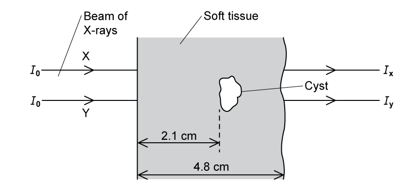
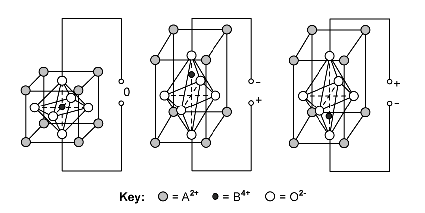
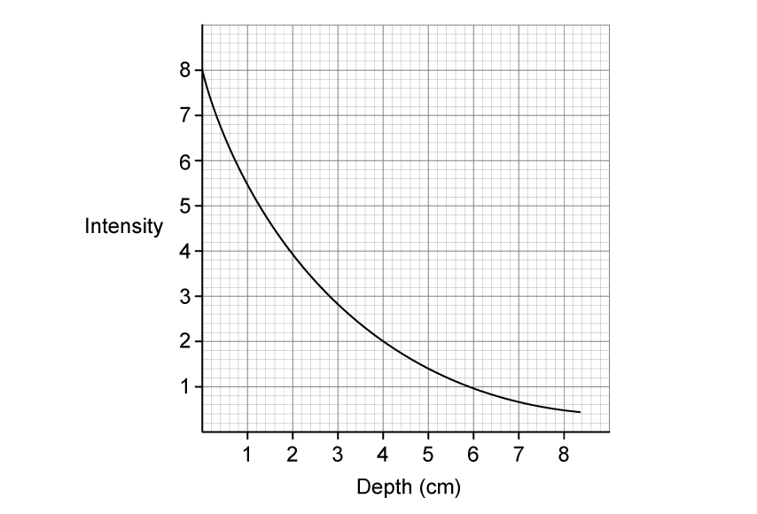
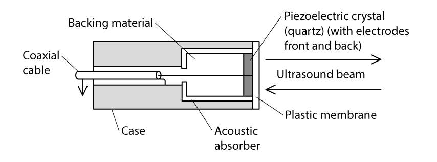

# Exam Questions — Production & Use of Ultrasound
**24. Medical Physics** · Cambridge (CIE) A-LEVEL physics (9702)
> Source: [https://www.savemyexams.com/a-level/physics/cie/25/topic-questions/](https://www.savemyexams.com/a-level/physics/cie/25/topic-questions/) · 8 questions across 1 sets

## Structured Questions (8 questions)

### Q1 — easy — 15 marks

**Q1** [3 marks]

Fig. 1.1 shows an incomplete diagram of a piezoelectric transducer.

**Fig. 1.1**

Complete the three missing labels on the diagram in Fig. 1.1.

**Q1** [3 marks]

**Extract:**

Fig. 1.1 shows an incomplete diagram of a piezoelectric transducer. Complete the three missing labels on the diagram in Fig. 1.1. The correct labels are: Damping / backing material; Electrodes; Piezoelectric crystal.

State the purpose of the components in **(a)** in relation to the generation of ultrasound waves.

**Q1** [4 marks]

State

(i) **two** main pieces of information about internal body structures that ultrasound can provide.

[2]

(ii) the properties of the ultrasound signal that provide these pieces of information.

[2]

**Q1** [5 marks]

Piezoelectric crystals have many applications other than in ultrasound scanners.

Describe the piezoelectric effect in terms of the energy transfers taking place when:

(i) a gas lighter ignites a flame using a small spark,

[1]

(ii) a motion sensor uses ultrasound waves to signal an automatic door to open,

[1]

(iii) an inkjet printer ejects ink from nozzles onto a sheet of paper,

[1]

(iv) a hearing aid receives and amplifies sound into a person's ear.

[2]

### Q2 — easy — 8 marks

**Q2** [2 marks]

Quartz crystals are commonly used in ultrasound transducers.

The speed of sound in quartz is 5700 m s−1.

Calculate the wavelength of ultrasound waves of frequency 7 MHz in a quartz crystal.

**Q2** [1 mark]

**Extract:**

The speed of sound in quartz is 5700 m s^−1^. Calculate the wavelength of ultrasound waves of frequency 7 MHz in a quartz crystal. λ = 5700/(7 × 10^6) = 8.1 × 10^−4 m = 0.81 mm

To use a quartz crystal in an ultrasound transducer, its thickness must be at least half the wavelength of the incoming waves.

Calculate the thickness of the transducer.

**Q2** [3 marks]

In medical ultrasound scanning, a transducer generates high-frequency ultrasound waves and directs them into the body.

The transducer doubles as a detector as different percentages of ultrasound are reflected by the boundaries of internal tissues and return to the transducer. This enables an image of internal structures to be built up.

(i) State the wave effect that limits the resolution of an ultrasound image.

[1]

(ii) Explain why high-frequency ultrasound waves must be used in medical scanning.

[2]

**Q2** [2 marks]

The approximate speed of sound in human tissue is about 1540 m s−1.

Ultrasound waves of frequency 7 MHz are used in an abdominal scan.

Estimate the smallest size of the tissue that would be observable on the ultrasound image.

### Q3 — medium — 7 marks

**Q3** [7 marks]

(i) Explain how ultrasound pulses are used to obtain diagnostic information about internal body structures in medical diagnosis.

[3]

(ii) Define specific acoustic impedance.

[2]

(iii) Two media have specific acoustic impedances *Z*1 and *Z*2.

State the approximate value of the intensity reflection coefficient at the boundary between the two media when:

•    *Z*1 is almost equal to *Z*2

intensity reflection coefficient = ................................

•    *Z*1 is very different from *Z*2.

intensity reflection coefficient = ................................

[2]

*Source: Specimen 2022 Paper 4 Q10B*

### Q4 — hard — 14 marks

**Q4** [6 marks]

An ultrasound investigation was used to identify a small volume of an unknown substance in a patient. It is suspected that this substance is either a cyst or a tumour.

During the ultrasound investigation, an ultrasound pulse of frequency 5 MHz is passed through soft tissue and then into the small volume of the unknown substance.

The ratio of the reflected intensity to the incident intensity for the ultrasound pulse reflected at the boundary was found to be 7.54 × 10−5.

Table 1.1 shows some information about the density and speed of ultrasound in soft tissue, cysts and tumours.

**Table 1.1**

| **material** | **density / kg m****−3** | **ultrasound velocity / m s****−1** |
|---|---|---|
| soft tissue | 1065 | 1530 |
| cyst | 1020 | 1570 |
| tumour | 990 | 1565 |

(i) Use the information in Table 1.1 to show that the unknown medium is a cyst.

[4]

(ii) A pulse of ultrasound reflected from the front surface of the cyst was detected 27.5 µs later and a pulse from the rear surface was detected 43.2 µs later.

Determine the length of the cyst, in cm, to two significant figures.

[2]

**Q4** [3 marks]

**Extract:**

(ii) A pulse of ultrasound reflected from the front surface of the cyst was detected 27.5 µs later and a pulse from the rear surface was detected 43.2 µs later. Determine the length of the cyst, in cm, to two significant figures. [Answer: Speed of ultrasound in cyst, c = 1570 m s^−1; Length of cyst: d = ½ c Δt = ½ × 1570 × (43.2 − 27.5) × 10^−6 = 0.01232 m = 1.2 cm]

Fig. 1.1 shows a beam of X-rays of energy 20 keV incident normally on some soft tissue which contains the cyst.

The cyst is located 2.1 cm from the surface of the soft tissue.

**Fig. 1.1 **(not to scale)

The attenuation constant of the soft tissue is 0.85 cm–1 for X-rays. The incident intensity of the beam is 4.6 × 103 W m–2.

You may assume that the attenuating behaviour of X-rays in matter is the same as that of ultrasound in matter.

The X-ray beam is switched on for a time *t*.

Determine the energy of the X-ray beam incident on the front surface of the cyst each second. State any assumptions you make.

**Q4** [5 marks]

**Extract:**

(a)(ii) A pulse of ultrasound reflected from the front surface of the cyst was detected 27.5 µs later and a pulse from the rear surface was detected 43.2 µs later. Determine the length of the cyst, in cm. Length of cyst: d = 0.01232 m = 1.2 cm.

(b) Fig. 1.1 shows a beam of X-rays of energy 20 keV incident normally on some soft tissue which contains the cyst. The cyst is located 2.1 cm from the surface of the soft tissue. The attenuation constant of the soft tissue is 0.85 cm^–1 for X-rays. The incident intensity of the beam is 4.6 × 10^3 W m^–2. You may assume that the attenuating behaviour of X-rays in matter is the same as that of ultrasound in matter.

The ratio of the intensities of the emergent X-ray beams X and Y is determined to be

$\frac{I_{Y}}{I_{X}}=0.94$

(i) Determine the attenuation coefficient of the cyst.

[3]

(ii) Describe the quality of the images that would be obtained from the ultrasound and the X-ray scans of the cyst, explaining your answers.

[2]

### Q5 — hard — 20 marks

**Q5** [6 marks]

Most modern ultrasound transducers are made from the piezoelectric material lead zirconate titanate (PZT).

Fig. 1.1 shows the effect on the structure of a crystal of PZT when an alternating potential difference is applied across it.

**Fig. 1.1**

(i) Describe what happens at a molecular level when an alternating potential difference is applied across a PZT transducer to generate ultrasound.

You may draw on Fig. 1.1 to help with your answer.

[4]

(ii) Describe the conditions that will enable maximum energy conversion into ultrasound to occur.

[2]

**Q5** [5 marks]

An eye can be imaged using either an A-scan or a B-scan ultrasound. Fig. 1.2 shows the position of a piezoelectric transducer being used during an A-scan of an eye.

**Fig. 1.2**

(i) Explain how an A-scan could be used to measure the thickness of a patient’s eye lens. You may draw on Fig. 1.2 to help with your answer.

[3]

(ii) Explain why a B-scan would be better than an A-scan for imaging damaged tissue that surrounds the eye.

[2]

**Q5** [5 marks]

Fig. 1.3 shows an ultrasound A-scan trace from the scan of an eye.

**Fig. 1.3**

The speed of ultrasound in the eye is 1520 m s–1 and the speed of ultrasound in the lens is 1670 m s–1.

Use Fig. 1.3 to calculate the thickness of

(i) the lens, in mm,

[2]

(ii) the eye, in cm.

[3]

**Q5** [4 marks]

**Extract:**

Fig. 1.3 shows an ultrasound A-scan trace from the scan of an eye. The speed of ultrasound in the eye is 1520 m s^–1^ and the speed of ultrasound in the lens is 1670 m s^–1^.

Calculate the thickness of the eye: Eye thickness = distance (A → L1) + lens thickness + distance (L2 → B) = 0.23 + 0.46 + 1.33 = 2.02 cm

The first spike represents the ultrasound entering the cornea at boundary A. The final spike is where contact is made with the retina at boundary B, i.e. the back of the eye.

The graph in Fig. 1.4 shows the attenuation of the intensity of ultrasound at a frequency of 3 MHz with depth.

**Fig. 1.4**

When carrying out the scan, a gel is applied between the transducer and eye to enable 100% transmission of the ultrasound into the eye.

Use the information in Table 1.1 and the graph in Fig. 1.4 to calculate the ratio of the intensity of the reflections from A and B, by the time the pulses come back to the receiver.

**Table 1.1**

|   | **acoustic impedance / kg m****–2**** s****–1** |
|---|---|
| eye | 1.52 × 106 |
| eye lens | 1.84 × 106 |
| surrounding tissue | 1.69 × 106 |

### Q6 — medium — 11 marks

**Q6** [6 marks]

Ultrasound is thought to be more suitable than X-rays for scanning an unborn foetus.

(i) Describe how ultrasound imaging can be used to produce an image of an unborn foetus.

[4]

(ii) When obtaining the ultrasound image of an unborn foetus, a coupling gel is used.

Explain why a coupling gel is needed and state the property of the gel that ensures a good quality image.

[2]

**Q6** [5 marks]

Some values of linear attenuation coefficient of different media are shown in Table 1.1

**Table 1.1**

| **medium** | **attenuation coefficient / cm****−1** |
|---|---|
| soft tissue | 0.23 |
| blood | 0.03 |
| fat | 0.48 |

(i) State what is meant by the attenuation of an ultrasound wave.

[1]

(ii) A parallel beam of ultrasound passes through a medium.

The incident intensity $I_{0}$ is reduced to 0.75 $I_{0}$ on passing through a thickness of 0.094 m of the medium.

Use Table 1.1 to determine the medium that the ultrasound passed through.

[4]

### Q7 — easy — 10 marks

**Q7** [2 marks]

State what is meant by the specific acoustic impedance of a medium.

**Q7** [3 marks]

Table 1.1 shows the density and speed of ultrasound in soft tissue, air and bone.

**Table 1.1**

|   | **density / kg m****−3** | **speed of ultrasound / m s****−1** |
|---|---|---|
| air | 1.29 | 330 |
| soft tissue | 1060 | 1540 |
| bone | 1600 | 4000 |

Using the data in Table 1.1, calculate the acoustic impedance of

(i) air

[1]

(ii) soft tissue

[1]

(iii) bone.

[1]

**Q7** [3 marks]

The intensity reflection coefficient $α$ for two media is given by

$\\alpha = \frac{( Z_{1} - Z_{2} )^{2}}{( Z_{1} + Z_{2} )^{2}}$

Where $Z_{1}$ and $Z_{2}$ are the specific acoustic impedances of the two media.

Explain how this equation can be used to predict the amount of reflection or transmission of ultrasound waves at the boundary between two materials.

**Q7** [2 marks]

State what is meant by **impedance matching** and explain how it may be achieved.

### Q8 — medium — 12 marks

**Q8** [8 marks]

Fig. 1.1 shows a diagram of a piezoelectric transducer.

**Fig. 1.1**

With reference to Fig. 1.1:

(i) Describe the process by which the transducer produces a pulse of ultrasound.

[4]

(ii) Explain how short pulses of ultrasound are produced and state why they are essential.

[2]

(iii) Explain how the received signals are detected.

[2]

**Q8** [4 marks]

Ultrasound is incident on a boundary between two materials. Some of the ultrasound is reflected at the boundary and the rest is transmitted across the boundary.

The acoustic impedance of air is 4.29 × 102 kg m–2 s–1

The acoustic impedance of coupling gel is 1.48 × 106 kg m–2 s–1

The acoustic impedance of skin is 1.65 × 106 kg m–2 s–1

Calculate the percentage of the ultrasound which would be transmitted into the skin when incident on

(i) an air−skin boundary,

[2]

(ii) a gel−skin boundary.

[2]
