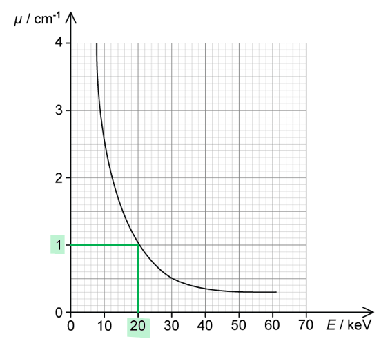

# Mark Schemes — Production & Use of X-rays
**24. Medical Physics** · Cambridge (CIE) A-LEVEL physics (9702)

## Structured Questions (8 questions)

### Q1
(i) Calculate the percentage of energy from the ultrasonic transducer that is reflected:

- Acoustic impedance:  $Z=ρc$
- Acoustic impedance of soft tissue:  $Z_{st}=1065\times1530=1.629\times10^{6}\mathrm{kg}m^{-2}s^{-1}$
- Acoustic impedance of cyst:  $Z_{c}=1020\times1570=1.601\times10^{6}\mathrm{kg}m^{-2}s^{-1}$
- Acoustic impedance of tumour:  $Z_{t}=990\times1565=1.549\times10^{6}\mathrm{kg}m^{-2}s^{-1}$ **1 mark for all Z values correct**

Use the intensity reflection coefficient equation:

- Intensity reflection coefficient:  `I subscript R over I subscript 0 space equals space open parentheses Z subscript 1 space minus space Z subscript 2 close parentheses squared over open parentheses Z subscript 1 space plus space Z subscript 2 close parentheses squared`
- Cyst:  `I subscript R over I subscript 0 space equals space open parentheses 1.629 cross times 10 to the power of 6 space minus space 1.601 cross times 10 to the power of 6 close parentheses squared over open parentheses 1.629 cross times 10 to the power of 6 space plus space 1.601 cross times 10 to the power of 6 close parentheses squared space equals space 7.5 cross times 10 to the power of negative 5 end exponent` **[1 mark]**
- Tumour:  `I subscript R over I subscript 0 space equals space open parentheses 1.629 cross times 10 to the power of 6 space minus space 1.549 cross times 10 to the power of 6 close parentheses squared over open parentheses 1.629 cross times 10 to the power of 6 space plus space 1.549 cross times 10 to the power of 6 close parentheses squared space equals space 6.3 cross times 10 to the power of negative 4 end exponent` **[1 mark]**

Compare the ratios to the ratio given in the question to identify the medium:

- `I subscript R over I subscript 0 space equals space 7.54 space cross times space 10 to the power of negative 5 end exponent space equals space 7.5 space cross times space 10 to the power of negative 5 end exponent space open parentheses 2 space straight s. straight f. close parentheses` **[1 mark]**
- Therefore, the unknown medium is a cyst

(ii) Determine the length of the cyst:

List the known quantities:

- Time detected from front of cyst = 27.5 µs
- Time detected from rear of cyst = 43.2 µs
- Speed of ultrasound in cyst, *c* = 1570 m s−1

Calculate the length of the cyst:

- Distance travelled by ultrasound:  $d=\frac{1}{2}c\Deltat$
- `d space equals space 1 half cross times 1570 cross times open parentheses 43.2 minus 27.5 close parentheses cross times 10 to the power of negative 6 end exponent` **[1 mark]**
- $d=0.01232m=1.2\mathrm{cm}$ **[1 mark]**

**[Total: 6 marks]**
Calculate the X-ray energy incident on the cyst each second:

List the known quantities:

- Attenuation constant of soft tissue, $μ$* *= 0.85 cm–1
- Initial intensity of the beam, $I_{0}$ = 4.6 × 103 W m–2
- Length of the cyst, $d$ = 0.012 m = 1.2 cm (from **(a)**)
- Distance travelled through the tissue, $x$ = 2.1 cm

Calculate the intensity of the X-ray beam at the cyst:

- Intensity of a beam in tissue:  $I=I_{0}e^{-μx}$
- `I space equals space open parentheses 4.6 space cross times space 10 cubed close parentheses e to the power of negative open parentheses 0.85 space cross times space 2.1 close parentheses end exponent space equals space 771.9 space straight W space straight m to the power of negative 2 end exponent` **[1 mark]**

Determine the cross-sectional area of the front surface of the cyst:

- Cross-sectional area of the cyst:  `A space equals space straight pi r squared space equals space straight pi cross times open parentheses fraction numerator 0.012 over denominator 2 end fraction close parentheses squared` = 1.13 × 10–4 m2 **AND**
- Assumption: the front surface is circular; **[1 mark]**

Calculate the power and energy incident on the cyst:

- Intensity of a wave:  $I=\frac{P}{A}\RightarrowP=IA$
- Incident power:  `P space equals space 771.9 space cross times space open parentheses 1.13 space cross times space 10 to the power of negative 4 end exponent close parentheses space equals space 0.087 space straight W`
- Energy transferred each second:  $E=Pt=0.087J$ **[1 mark]**

**[Total: 3 marks]**
(i) Determine the attenuation coefficient of the cyst:

List the known quantities:

- Attenuation coefficient of soft tissue, $μ$* *= 0.85 cm–1
- Initial intensity of the beam, $I_{0}$ = 4.6 × 103 W m–2
- Length of the cyst, $d$ = 0.012 m = 1.2 cm (from **(a)**)
- Distance between the tissue and cyst = 2.1 cm
- Total distance = 4.8 cm

Use the attenuation equation:

- X-ray attenuation:  $I=I_{0}e^{-μx}$
- Final intensity of beam X:  `I subscript straight X space equals space open parentheses 4.6 cross times 10 cubed close parentheses space e to the power of negative 0.85 cross times 4.8 end exponent`
- Final intensity of beam Y:  `I subscript straight Y space equals space open parentheses 4.6 cross times 10 cubed close parentheses space open square brackets open parentheses e to the power of negative 0.85 cross times 2.1 end exponent close parentheses open parentheses e to the power of negative 1.2 mu end exponent close parentheses open parentheses e to the power of negative 0.85 cross times open parentheses 4.8 minus 1.2 minus 2.1 close parentheses end exponent close parentheses close square brackets` **[1 mark]**

Substitute into the ratio given in the question:

- Ratio of the emergent intensities:  $\frac{I_{Y}}{I_{X}}=0.94$
- Substitute:  `fraction numerator open parentheses 4.6 cross times 10 cubed close parentheses space open square brackets open parentheses e to the power of negative 0.85 cross times 2.1 end exponent close parentheses open parentheses e to the power of negative 1.2 mu end exponent close parentheses open parentheses e to the power of negative 0.85 cross times open parentheses 4.8 minus 1.2 minus 2.1 close parentheses end exponent close parentheses close square brackets over denominator open parentheses 4.6 cross times 10 cubed close parentheses space e to the power of negative 0.85 cross times 4.8 end exponent end fraction space equals space 0.94` **[1 mark]**
- Simplify:  `e to the power of 0.85 open parentheses 4.8 minus 2.1 minus 1.5 close parentheses minus 1.2 mu end exponent space equals space 0.94 space space space space space rightwards double arrow space space space space space e to the power of 1.02 minus 1.2 mu end exponent space equals space 0.94`
- Takes natural logs:  $1.02-1.2μ=\mathrm{ln}0.94\Rightarrowμ=\frac{1.02-\mathrm{ln}0.94}{1.2}$
- Attenuation coefficient of cyst:  $μ$ = 0.90 cm–1 **[1 mark]**

(ii) Compare the quality of the images that would be obtained from the ultrasound and the X-ray scans:

For the X-ray image...

- The attenuation coefficients (of the cyst and the surrounding tissue) are too similar / have approximately the same value **AND**
- (Hence) no / poor contrast would be obtained between the cyst and surrounding tissue / cyst would not be distinguishable from the surrounding tissue; **[1 mark]**

For the ultrasound image...

- The acoustic impedances (of the cyst and the surrounding tissue) are similar / have approximately the same value **AND**
- (Hence) there will be a high % of transmission of the ultrasound / low % of reflection (so) cyst would be difficult to distinguish from the surrounding tissue / poor contrast between cyst and tissue; **[1 mark]**

**[Total: 5 marks]**
A different technique that could be used to image the cyst is:

- A CT scan **OR** PET scan; **[1 mark]**

An advantage of CT or PET over ultrasound is:

**Final answer:** **Max ****one**** from:**

- A CT / PET scan will give a detailed 3-dimensional image (of the cyst); **[1 mark]**
- A CT / PET scan gives better contrast; **[1 mark]**
- A PET scan can determine metabolic activity; **[1 mark]**

A disadvantage of CT or PET over ultrasound is:

**Final answer:** **Max ****one**** from:**

- Both CT / PET scans pose a danger (to the patient) due to high radiation exposure; **[1 mark]**
- Ultrasound can determine the same information i.e. location / size / shape / composition (solid or fluid-filled) just as well as CT / PET with zero radiation risk; **[1 mark]**

**[Total: 3 marks]**

> *Make sure to use specific and detailed language such as 'better contrast' or 'metabolic activity'*

> *Saying 'more detail' or 'clearer image' is too vague and will not be awarded a mark*

### Q2
(i) X-rays are produced by:

- Accelerating electrons (through a high p.d.); **[1 mark]**
- Electrons are incident on a metal target; **[1 mark]**
- (When electrons hit the target) X-rays are produced as the electrons decelerate; **[1 mark]**

(ii) One advantage and disadvantage of using CT scanning is:

One advantage is:

**Final answer:** **Any ****one**** from:**

- (CT scans produces) more detailed (3D) image which is better for diagnosis; **[1 mark]**
- (CT scans) can distinguish between different structures with similar attenuation coefficients as X-ray scans just detect a 'shadow'; **[1 mark]**

One disadvantage is:

**Final answer:** **Any ****one**** from:**

- Patients are exposed to a higher dose of ionising radiation which could cause cancer / damage cells; **[1 mark]**
- Usually requires contrast media which can have negative / adverse side effects; **[1 mark]**

**[Total: 5 marks]**
The image produced during CT scanning differs from the image produced by X-ray imaging by:

**Final answer:** **Max ****four**** from:**

- An X-ray image is flat / 2D; **[1 mark]**
- CT scan takes many images of a section / slice at different angles; **[1 mark]**
- The images are combined to build up an image of a section / slice through the body; **[1 mark]**
- The process is repeated for different sections / slices; **[1 mark]**
- These images are combined together to build a 3D image; **[1 mark]**

**[Total: 4 marks]**

### Q3
(i) State what is meant by contrast in an X-ray image:

- Contrast means a <u>difference</u> in the amount of blackening in the image; **[1 mark]**

(ii) Calculate the ratio $\frac{\mathrm{intensity} \mathrm{of} \mathrm{radiation} \mathrm{transmitted} \mathrm{through} \mathrm{the} \mathrm{bone}}{\mathrm{intensity} \mathrm{of} \mathrm{radiation} \mathrm{transmitted} \mathrm{through} \mathrm{the} \mathrm{muscle}}$:

- $I=I_{0}e^{-μx}$ **[1 mark]**
- $I_{b}=I_{0}e^{-2.9\times1.5}$
- $I_{m}=I_{0}e^{-0.95\times4}$
- `I subscript b over I subscript m space equals space fraction numerator I subscript 0 space e to the power of negative 2.9 space cross times space 1.5 end exponent over denominator I subscript 0 space e to the power of negative 0.95 space cross times space 4 end exponent end fraction space equals space fraction numerator space e to the power of negative 2.9 space cross times space 1.5 end exponent over denominator e to the power of negative 0.95 space cross times space 4 end exponent end fraction space equals space 0.577 space equals space 0.58 space open parentheses 2 s. f. close parentheses`** [1 mark]**

**[Total: 3 marks]**

### Q4
The charged particles that are accelerated by the applied p.d are:

- Electrons; **[1 mark]**

**[Total: 1 mark]**
(i) Component A is:

- An evacuated (glass) tube; **[1 mark]**
- (Its purpose is) to prevent electrons from colliding with particles on the way to the metal target; **[1 mark]**

(ii) Component B is:

- An anode / (metal) target; **[1 mark]**
- (Its purpose is) to produce X-rays when accelerated electrons hit the anode / target; **[1 mark]**

(iii) Component C is:

- A cathode / (heated) filament; **[1 mark]**
- (Its purpose is) to release electrons from the surface of the cathode by thermionic emission; **[1 mark]**

(iv) Component D is:

- A low voltage supply; **[1 mark]**
- (Its purpose is) to heat the filament; **[1 mark]**

(v) Component E is:

- A high voltage supply; **[1 mark]**
- (Its purpose is) to create a large potential difference between the cathode and the anode; **[1 mark]**

**[Total: 10 marks]**
X-rays are produced when:

- Electrons are decelerated / stopped on impact (by the metal target); **[1 mark]**
- The (kinetic) energy lost by electrons emitted as (X-ray) photons; **[1 mark]**

**[Total: 2 marks]**
(i) The maximum energy of the X-rays is:

- Energy gained by electron = energy of photon
- (Hence) maximum photon energy = 75 keV **[1 mark]**

(ii) Calculate the minimum wavelength of photons in the X-ray beam:

List the known quantities:

- Planck constant, *h* = 6.63 × 10–34 J s
- Charge on the electron, *e* = 1.60 × 10–19 C
- Speed of light, *c* = 3.00 × 108 m s–1

Calculate the minimum wavelength using the photon energy equation:

- Energy of a photon:  $E=\frac{hc}{λ}$ **[1 mark]**
- $eV=\frac{hc}{λ}\Rightarrowλ=\frac{hc}{eV}$
- `lambda space equals space fraction numerator open parentheses 6.63 cross times 10 to the power of negative 34 end exponent close parentheses space cross times space open parentheses 3 cross times 10 to the power of 8 close parentheses over denominator open parentheses 1.6 cross times 10 to the power of negative 19 end exponent close parentheses space cross times space open parentheses 75 cross times 10 cubed close parentheses end fraction` **[1 mark]**
- $λ$ = 1.66 × 10–11 m **[1 mark]**

**[Total: 4 marks]**

> *Work done on a charge, **W** =** QV **where **Q** is the charge and **V** the potential difference. Since the charge of an electron is **e** this means that **W** = **E** (energy transferred) = **eV**.*

### Q5
For a broken arm, x-ray imaging is the most appropriate because:

**Final answer:** **Any ****two**** from:**

- X-ray imaging provides a good contrast between bone and the surrounding tissue; **[1 mark]**
- X-ray creates a sharp / high resolution image (compared to ultrasound); **[1 mark]**
- X-rays pass straight through soft tissue, whereas ultrasound does not; **[1 mark]**

For a fetal scan, ultrasound imaging is the most appropriate because:

**Final answer:** **Any**** two**** from:**

- Ultrasound is safer / non-ionising (for the mother and child); **[1 mark]**
- Ultrasound can detect changes in tissue type; **[1 mark]**
- Ultrasound transmission / detection allows imaging in real-time; **[1 mark]**

**[Total: 4 marks]**
(i) Calculate the intensities of the emergent X-rays:

List the known quantities:

- Attenuation coefficient in bone, $μ_{b}$ = 2.90 cm−1
- Thickness of bone, $x_{b}$ = 2.0 cm
- Attenuation coefficient in muscle, $μ_{m}$ = 0.95 cm−1
- Thickness of muscle, $x_{m}$ = 5.0 cm

Determine the intensity of X-rays transmitted through muscle alone:

- Attenuation of X-rays:  $I=I_{0}e^{-μx}$ **[1 mark]**
- Intensity transmitted through muscle alone:  $I_{m}=I_{0}e^{-μ_{m}x_{m}}$
- $I_{m}=I_{0}e^{-0.95\times5.0}=8.7\times10^{-3}I_{0}$ **[1 mark]**

Determine the intensity of X-rays transmitted through muscle and bone:

- Intensity transmitted through bone:  $I_{b}=I_{0}e^{-μ_{b}x_{b}}$
- Intensity transmitted through muscle and bone:  `I subscript b m end subscript space equals space I subscript 0 space open parentheses e to the power of negative mu subscript b x subscript b end exponent close parentheses cross times open parentheses e to the power of negative mu subscript m increment x end exponent close parentheses`
- Where $\Deltax=x_{m}-x_{b}$ = 5.0 − 2.0 = 3.0 cm
- `I subscript b m end subscript space equals space I subscript 0 space open parentheses e to the power of negative 2.90 cross times 2.0 end exponent close parentheses cross times open parentheses e to the power of negative 0.95 cross times 3.0 end exponent close parentheses` **[1 mark]**
- $I_{bm}=1.8\times10^{-4}I_{0}$ **[1 mark]**

(ii) The contrast between bone and muscle is much greater than between fat and muscle because:

**Final answer:** **Any ****two**** from:**

- Contrast depends on the <u>difference</u> in attenuation; **[1 mark]**
- The difference between µ of muscle and fat is small (hence poor contrast); **[1 mark]**
- The difference between µ of bone and soft tissue / fat is large (hence good contrast); **[1 mark]**

**[Total: 6 marks]**

> *Remember in part (i) when the X-rays travel through the muscle and bone, it is travelling through 2.0 cm of bone but only 5.0 – 2.0 = **3.0 cm** of muscle.*

### Q6
The linear absorption coefficient is:

- $I=I_{0}e^{-μx}$ **[1 mark]**
- Where $I_{0}$ is the intensity of the incident beam, $I$ is the intensity of the transmitted beam and $x$ = distance travelled through the material; **[1 mark]**

**[Total: 2 marks]**

> *Make sure not just to state the equation, but explain each of the variables for full marks. You must be detailed in some equations e.g. just writing ‘**I **is the intensity’ will not get you the mark, because **two** beams are involved, so you must state the intensity of which one this is referring to.*
The sharpness of an X-ray image describes:

- How well defined the edges of a structure / boundary are; **[1 mark]**

The contrast of an X-ray image describes:

- The difference in (the degree of) blackening between structures; **[1 mark]**

**[Total: 2 marks]**
Loss of sharpness happens due to:

**Final answer:** **Any ****two**** from:**

- Scattering of photons in tissue; **[1 mark]**
- Not using a parallel beam / collimator / lead grid; **[1 mark]**
- A large blurring effect / penumbra on shadow; **[1 mark]**
- Using a beam / an anode which is too wide; **[1 mark]**
- Not using a sensor / CCD with high enough resolution / small enough pixels; **[1 mark]**

**[Total: 2 marks]**
(i) Hardness of an X-ray beam is:

- Its ability to penetrate (a material); **[1 mark]**
- The greater the hardness, the greater the penetration; **[1 mark]**

(ii) Hardness can be controlled by:

- Changing the anode voltage / electron energy; **[1 mark]**
- The higher the anode voltage / electron energy, the greater the penetration / hardness; **[1 mark]**

**[Total: 4 marks]**

### Q7
(i) Ionising radiation is:

- Radiation that can cause ionisation of atoms / cells (or of any other material it passes through); **[1 mark]**
- That is highly energetic so can cause damage to DNA / cause cell mutation; **[1 mark]**

(ii) The scans that use ionising radiation are:

| **Type of scan** |   |
|---|---|
| X-ray Imaging | **Final answer:** **✓** |
| Ultrasound |   |
| PET scan | **Final answer:** **✓** |
| CT scan | **Final answer:** **✓** |

- Any two correct; **[1 mark]**
- All three correct; **[1 mark]**

**[Total: 4 marks]**
Attenuation is defined as:

- The loss of intensity / power / energy (of X-rays); **[1 mark]**

**[Total: 1 mark]**
(i) Contrast is defined as:

- The difference in the degree of blackening (of regions of the image); **[1 mark]**

(ii) The image would have poor contrast because:

- The values of μ (of blood and muscle) are (very) similar; **[1 mark]**
- So they absorb a similar amount of X-rays (for the same thickness) (hence poor contrast); **[1 mark]**

**[Total: 3 marks]**
The differences between CT scanning and X-ray imaging are:

- An X-ray image is a single ‘shadow’ image / 2-D image (of the whole structure); **[1 mark]**
- A CT image is made up of many X-rays images of a (thin) slice (through a structure); **[1 mark]**
- At different angles / combined to make a 3-D image; **[1 mark]**

**[Total: 3 marks]**

### Q8
The energy that would produce the best contrast is:

- 50 keV; **[1 mark]**

This is because:

- Contrast depends on the difference in attenuation; **[1 mark]**
- The difference between *µ* of bone and muscle is greatest with 50 keV X-rays (hence best contrast); **[1 mark]**

**[Total: 3 marks]**
(i) Show that bone absorbs X-rays about eight times more strongly than muscle:

Determine the average values of Z

| **substance** | **main elements** | **Final answer:** **average ****Z** |
|---|---|---|
| muscle | `straight H presubscript 1`,  `straight C presubscript 6`,  `straight O presubscript 8` | **Final answer:** **5** |
| bone | `straight H presubscript 1`,  `straight C presubscript 6`,  `straight O presubscript 8`,  `straight P presubscript 15`,  `Ca presubscript 20` | **Final answer:** **10** |
| contrast media | `straight I presubscript 53`,  `Ba presubscript 56` | **Final answer:** **55** |

- Average values of *Z* calculated; **[1 mark]**

Determine the ratio of the average values of *Z*:

- Ratio:  $\frac{Z_{bone}}{Z_{muscle}}\approx\frac{10}{5}\approx2$ **[1 mark]**

Use the relationship between µ and Z

- Attenuation coefficient:   $μ\proptoZ^{3}$
- Therefore $\frac{μ_{bone}}{μ_{muscle}}=2^{3}=8$ **[1 mark]**

(ii) Contrast media are made from elements with high values of *Z* because:

- A contrast medium is a substance which absorbs X-rays strongly; **[1 mark]**
- As X-rays pass through a medium, they interact with electrons and/or nuclei (of atoms); **[1 mark]**
- Hence, substances with higher numbers of nuclei / electrons will interact with X-rays more, making them more absorbing; **[1 mark]**

**[Total: 6 marks]**
X-rays with energies less than 20 keV are usually filtered out of the beam because:

- (At energies less than 20 keV) there is more attenuation **OR** (at energies greater than 20 keV) there is less attenuation; **[1 mark]**
- The lower energy photons will be mostly absorbed (by muscles); **[1 mark]**
- Hence these (low energy) photons will not contribute to the imaging process; **[1 mark]**
- Only the higher energy photons will leave the body and be detected by the sensor; **[1 mark]**

**[Total: 4 marks]**

> *It's important to realise that almost **all **of the low-energy X-rays would be attenuated inside the body, therefore, these X-rays would*

- *Never even reach the sensor*
- *Unnecessarily expose the patient to a higher dose of harmful radiation*
Calculate the ratio of intensities to compare the attenuation produced by 1 cm of bone and 1 cm of muscle:

List the known quantities:

- Thickness of muscle/bone, $x$ = 1 cm

Determine µ for muscle and bone at 20 keV:

- (From graph) when *E* = 20 keV, $μ_{muscle}$ = 1.0 cm−1 **[1 mark]**
- Since $μ\proptoZ^{3}$ and $\frac{μ_{bone}}{μ_{muscle}}\approx8$ (from **(b)**)
- Therefore $μ_{bone}=8\times1.0=8.0\mathrm{cm}^{-1}$ **[1 mark]**

Use the attenuation equation to determine the ratio of intensities:

- X-ray attenuation:  $I=I_{0}e^{-μx}$
- Ratio of intensities:  $\frac{I_{b}}{I_{m}}=\frac{e^{-μx}}{e^{-μx}}$
- Ratio of intensities: $\frac{I_{b}}{I_{m}}=\frac{e^{-8.0\times1}}{e^{-1.0\times1}}=9.1\times10^{-4}$ **[1 mark]**

**[Total: 3 marks]**
