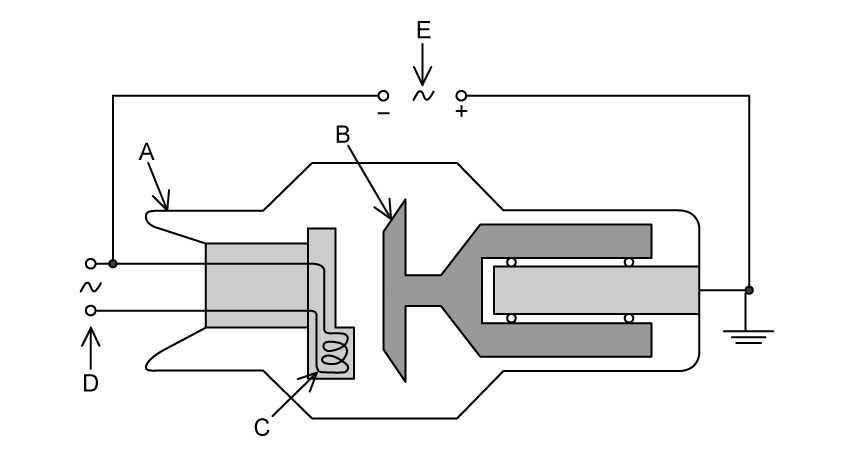
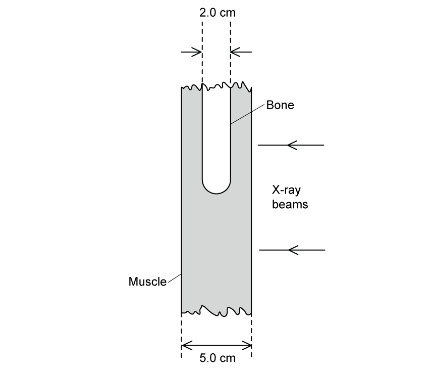
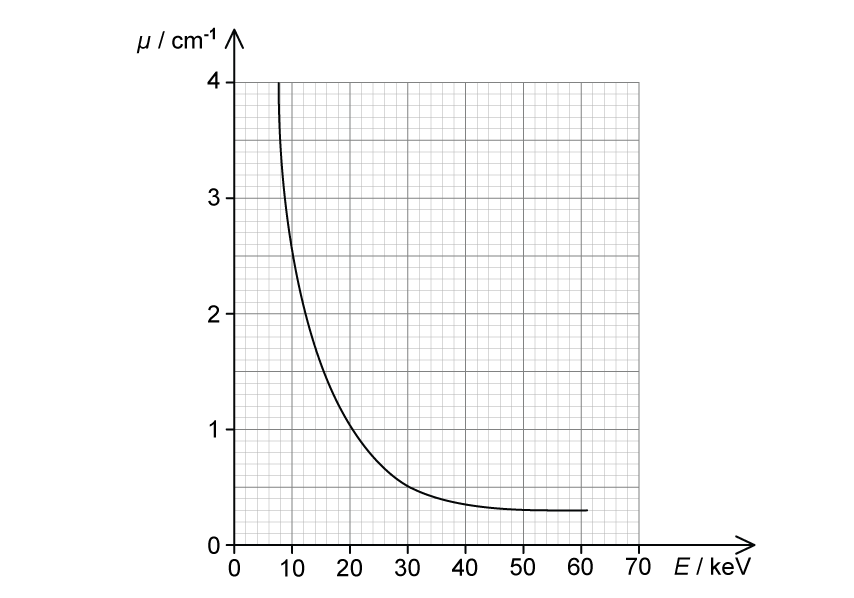

# Exam Questions — Production & Use of X-rays
**24. Medical Physics** · Cambridge (CIE) A-LEVEL physics (9702)
> Source: [https://www.savemyexams.com/a-level/physics/cie/25/topic-questions/](https://www.savemyexams.com/a-level/physics/cie/25/topic-questions/) · 8 questions across 1 sets

## Structured Questions (8 questions)

### Q1 — hard — 17 marks

**Q1** [6 marks]

An ultrasound investigation was used to identify a small volume of an unknown substance in a patient. It is suspected that this substance is either a cyst or a tumour.

During the ultrasound investigation, an ultrasound pulse of frequency 5 MHz is passed through soft tissue and then into the small volume of the unknown substance.

The ratio of the reflected intensity to the incident intensity for the ultrasound pulse reflected at the boundary was found to be 7.54 × 10−5.

Table 1.1 shows some information about the density and speed of ultrasound in soft tissue, cysts and tumours.

**Table 1.1**

| **material** | **density / kg m****−3** | **ultrasound velocity / m s****−1** |
|---|---|---|
| soft tissue | 1065 | 1530 |
| cyst | 1020 | 1570 |
| tumour | 990 | 1565 |

(i) Use the information in Table 1.1 to show that the unknown medium is a cyst.

[4]

(ii) A pulse of ultrasound reflected from the front surface of the cyst was detected 27.5 µs later and a pulse from the rear surface was detected 43.2 µs later.

Determine the length of the cyst, in cm.

[2]

**Q1** [3 marks]

**Extract:**

A pulse of ultrasound reflected from the front surface of the cyst was detected 27.5 µs later and a pulse from the rear surface was detected 43.2 µs later. Determine the length of the cyst, in cm.

Calculate the length of the cyst: d = 1/2 × 1570 × (43.2 − 27.5) × 10^−6 = 0.01232 m = 1.2 cm

Fig. 1.1 shows a beam of X-rays of energy 20 keV incident normally on some soft tissue which contains the cyst.

The cyst is located 2.1 cm from the surface of the soft tissue.

**Fig. 1.1 **(not to scale)

The attenuation constant of the soft tissue is 0.85 cm–1. The incident intensity of the beam is 4.6 × 103 W m–2.

The X-ray beam is switched on for a time *t*.

Determine the energy of the X-ray beam incident on the front surface of the cyst each second. State any assumptions you make.

**Q1** [5 marks]

**Extract:**

An ultrasound investigation was used to identify a small volume of an unknown substance in a patient. It is suspected that this substance is either a cyst or a tumour.

Table 1.1 shows some information about the density and speed of ultrasound in soft tissue, cysts and tumours: soft tissue density 1065 kg m^-3, ultrasound velocity 1530 m s^-1; cyst density 1020 kg m^-3, ultrasound velocity 1570 m s^-1; tumour density 990 kg m^-3, ultrasound velocity 1565 m s^-1.

The length of the cyst was determined to be d = 0.01232 m = 1.2 cm.

A beam of X-rays of energy 20 keV incident normally on some soft tissue which contains the cyst. The cyst is located 2.1 cm from the surface of the soft tissue. The attenuation constant of the soft tissue is 0.85 cm^-1. The incident intensity of the beam is 4.6 × 10^3 W m^-2.

The ratio of the intensities of the emergent X-ray beams X and Y is determined to be

$\frac{I_{Y}}{I_{X}}=0.94$

(i) Determine the attenuation coefficient of the cyst.

[3]

(ii) Compare the quality of the images that would be obtained from the ultrasound and the X-ray scans of the cyst.

[2]

**Q1** [3 marks]

**Extract:**

An ultrasound investigation was used to identify a small volume of an unknown substance in a patient. It is suspected that this substance is either a cyst or a tumour. During the ultrasound investigation, an ultrasound pulse of frequency 5 MHz is passed through soft tissue and then into the small volume of the unknown substance.

Suggest a different imaging technique that could be used to image the cyst. Explain **one** advantage and **one** disadvantage of using this technique over ultrasound.

### Q2 — medium — 9 marks

**Q2** [5 marks]

(i) Explain how X-rays are produced for use in medical diagnosis

[3]

(ii) Discuss **one** advantage and **one** disadvantage of using CT scanning over X-ray imaging.

[2]

**Q2** [4 marks]

An X-ray image is taken of the skull of a patient. Another patient has a CT scan taken of their entire head.

Describe how the image produced during CT scanning differs from the image produced by X-ray imaging.

### Q3 — medium — 3 marks

**Q3** [3 marks]

(i) State what is meant by contrast in an X-ray image.

[1]

(ii) A parallel beam of X-ray radiation is incident, separately, on samples of bone and of muscle.

Data for the thickness *x* of the samples of bone and of muscle, together with the linear attenuation coefficients *μ* of the radiation in bone and in muscle, are given in Table 10.1.

**Table 10.1**

|   | ***x***** / cm** | ***μ***** / cm****–1** |
|---|---|---|
| bone | 1.5 | 2.9 |
| muscle | 4.0 | 0.95 |

Calculate the ratio

$\frac{\mathrm{intensity} \mathrm{of} \mathrm{radiation} \mathrm{transmitted} \mathrm{through} \mathrm{the} \mathrm{bone}}{\mathrm{intensity} \mathrm{of} \mathrm{radiation} \mathrm{transmitted} \mathrm{through} \mathrm{the} \mathrm{muscle}}$.

ratio = ........................................ [2]

*Source: Specimen 2022 Paper 4 Q10A*

### Q4 — easy — 17 marks

**Q4** [1 mark]

In an X-ray tube, charged particles are accelerated towards a metal target by an applied potential difference.

State the name of the charged particles that are accelerated by the applied potential difference.

**Q4** [10 marks]

Fig. 1.1 shows a simplified diagram of an X-ray tube.

**Fig. 1.1**

State the name and purpose of

(i) Component A

[2]

(ii) Component B

[2]

(iii) Component C

[2]

(iv) Component D

[2]

(v) Component E

[2]

**Q4** [2 marks]

**Extract:**

In an X-ray tube, charged particles are accelerated towards a metal target by an applied potential difference.

Explain how X-rays are produced at the metal target.

**Q4** [4 marks]

The accelerating potential difference between the cathode and the anode of an X-ray tube is 75 kV.

(i) State the maximum energy, in eV, of the photons produced in the X-ray tube.

[1]

(ii) Calculate the minimum wavelength of photons in the X-ray beam.

[3]

### Q5 — medium — 10 marks

**Q5** [4 marks]

Two patients arrive at a hospital. One patient is a child with a broken arm, the other is a pregnant woman coming in for a check-up for her unborn foetus.

Over the course of the diagnosis and treatment of the child’s broken arm, several images of the arm are required.

Similarly, to check the progress of a woman’s pregnancy, several images of the foetus are required.

For each scenario, suggest the most appropriate imaging technique to use and give **two** reasons for the choice.

**Q5** [6 marks]

An X-ray image showing the cross-section of the bone and muscle is shown in Fig. 1.1.

**Fig. 1.1**

Parallel X-ray beams of intensity $I_{0}$ are incident on the muscle and bone as shown. The emergent beam after passing through muscle alone has an intensity of $I_{m}$ and an intensity of $I_{bm}$ after passing through the bone and the muscle.

(i) Determine, in terms of $I_{0}$, the intensities $I_{m}$ and $I_{bm}$ of the emergent X-rays.

The linear attenuation coefficient of bone is 2.90 cm−1

The linear attenuation coefficient of muscle of 0.95 cm−1.

[4]

(ii) Suggest why, on an X-ray plate, the contrast between bone and muscle is much greater than the contrast between fat and muscle.

The linear attenuation coefficient of fat is 0.90 cm−1.

[2]

### Q6 — easy — 10 marks

**Q6** [2 marks]

A parallel beam of X-rays is incident on a medium with a linear absorption coefficient *μ*.

State what is meant by the linear absorption coefficient.

**Q6** [2 marks]

Describe the difference between sharpness and contrast in X-ray imaging.

**Q6** [2 marks]

State** two** causes of the loss of sharpness of an X-ray image.

**Q6** [4 marks]

State

(i) what is meant by the hardness of an X-ray beam

[2]

(ii) how the hardness of the X-ray beam is controlled.

[2]

### Q7 — easy — 11 marks

**Q7** [4 marks]

(i) Explain what is meant by ionising radiation and why it can be harmful.

[2]

(ii) Place ticks (**✓**) next to the scans in Table 1.1 which use ionising radiation.

**Table 1.1**

| **Type of scan** |   |
|---|---|
| X-ray Imaging |   |
| Ultrasound |   |
| PET scan |   |
| CT scan |   |

[2]

**Q7** [1 mark]

The attenuation of a parallel beam of X-ray radiation is given by the expression

$\frac{I}{I_{0}}=e^{-μx}$

State the meaning of the term attenuation.

**Q7** [3 marks]

Table 1.1 shows the linear absorption coefficient *μ* for an X-ray beam in blood and in muscle.

**Table 1.1**

|   | *μ* / cm−1 |
|---|---|
| blood | 0.23 |
| muscle | 0.22 |

(i) State what is meant by the contrast of an X-ray.

[1]

(ii) Using the data in Table 1.1, explain why an X-ray image of blood vessels in muscle would have poor contrast.

[2]

**Q7** [3 marks]

Describe the differences between CT scanning and X-ray imaging.

### Q8 — hard — 16 marks

**Q8** [3 marks]

The data in Table 1.1 shows how the attenuation coefficient *μ* depends on the energy of the X-rays in bone and muscle.

**Table 1.1**

| maximum X-ray energy / keV | $μ_{bone}$ / cm−1 | $μ_{muscle}$ / cm−1 |
|---|---|---|
| 50 | 3.32 | 0.54 |
| 100 | 0.60 | 0.21 |
| 250 | 0.32 | 0.16 |
| 4000 | 0.087 | 0.049 |

Using the data in Table 1.1, state and explain which X-ray energy would produce an image of a bone next to a muscle with the best contrast.

**Q8** [6 marks]

For X-ray energies around 30 keV and below, the attenuation coefficient *μ* is approximately proportional to the cube of the proton number *Z* of the absorbing material.

The proton numbers of muscle, bone and some contract media are shown in Table 1.2

**Table 1.2**

| **substance** | **main elements** | ** ** |
|---|---|---|
| muscle | `straight H presubscript 1`,  `straight C presubscript 6`,  `straight O presubscript 8` |   |
| bone | `straight H presubscript 1`,  `straight C presubscript 6`,  `straight O presubscript 8`,  `straight P presubscript 15`,  `Ca presubscript 20` |   |
| contrast media | `straight I presubscript 53`,  `Ba presubscript 56` |   |

Using the information in Table 1.2

(i) Show that bone absorbs X-rays about eight times more strongly than muscle.

[3]

(ii) Explain why contrast media are made from elements with high values of atomic number *Z*.

[3]

**Q8** [4 marks]

The graph in Fig. 1.1 shows how the attenuation coefficient *μ* of muscle varies with photon energy *E*.

**Fig. 1.1**

Using Fig. 1.1, explain why X-rays with energies less than 20 keV are usually filtered out of the beam.

**Q8** [3 marks]

**Extract:**

For X-ray energies around 30 keV and below, the attenuation coefficient μ is approximately proportional to the cube of the proton number Z of the absorbing material. Using the information in Table 1.2: (i) Show that bone absorbs X-rays about eight times more strongly than muscle. [Mark scheme: Average Z of muscle = 5, bone = 10; ratio Z_bone/Z_muscle ≈ 10/5 ≈ 2; since μ ∝ Z³, μ_bone/μ_muscle = 2³ = 8.]

The graph in Fig. 1.1 shows how the attenuation coefficient μ of muscle varies with photon energy E. (From graph, when E = 20 keV, μ_muscle = 1.0 cm⁻¹.)

An X-ray beam of energy 20 keV and intensity $I_{0}$ is incident on a sample of muscle and bone as shown in Fig. 1.2. The emergent beam intensities from the muscle and bone are $I_{m}$ and $I_{b}$ respectively.

**Fig. 1.2**

Using the graph in Fig. 1.1, calculate the ratio of intensities to compare the attenuation produced by 1 cm of bone and 1 cm of muscle.
