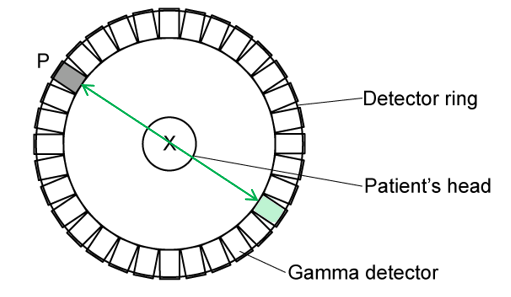
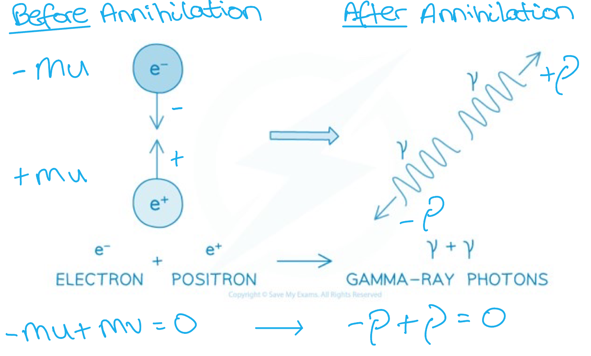
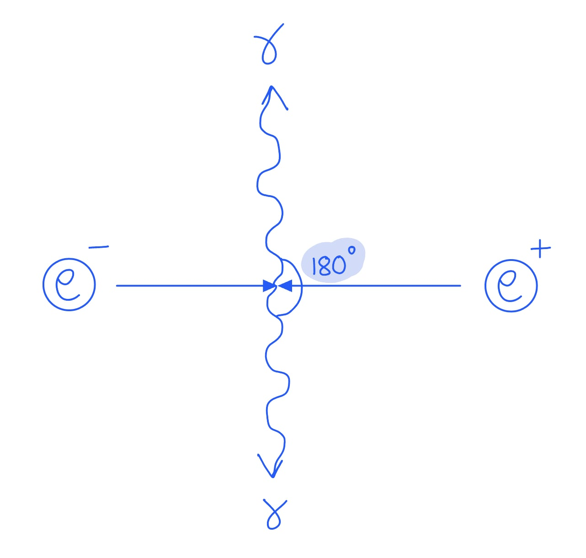
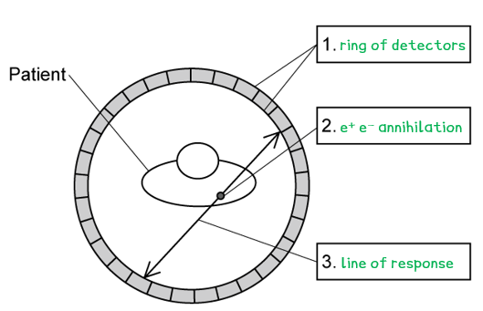

# Mark Schemes — PET Scanning
**24. Medical Physics** · Cambridge (CIE) A-LEVEL physics (9702)

## Structured Questions (9 questions)

### Q1
The correctly completed table is as follows:

| **particle** | **mass / kg** | **charge / C** |
|---|---|---|
| electron | 9.11 × 10−31 | **Final answer:** **−1.60 × 10****−19** |
| positron | **Final answer:** **9.11 × 10****−31** | (+)1.60 × 10−19 |
| gamma photon | **Final answer:** **0** | **Final answer:** **0** |

- **One mark for each correct row**

**[Total: 3 marks]**
Show that each gamma photon produced has an energy of 512 keV:

List the known quantities:

- Mass of an electron = mass of a positron, *m* = 9.11 × 10−31 kg
- Speed of light, *c* = 3.00 × 108 m s−1
- 1 eV = 1.60 × 10−19 J

Annihilation of an electron and a positron results in two gamma photons travelling in opposite directions. Therefore, the energy of one photon is equal to the rest mass energy of a single electron **[1 mark]**

Convert the rest mass of an electron into rest energy:

- Mass-energy equivalence:  $E = m c^{2}$
- $E$ = (9.11 × 10−31) × (3.00 × 108)2
- $E$ = 8.199 × 10−14 J **[1 mark]**

Convert the energy in J to keV:

- $E = \frac{8.199\times10^{-14}}{1.60\times10^{-19}}$ = 512 438 eV = 512 keV **[1 mark]**

**[Total: 3 marks]**

> *You could also convert 512 keV into SI units to show it is equal to the rest mass of an electron*

> *E** = 512 keV → (512 × 10**3**) × (1.60 × 10**−19**) = 8.2 × 10**−14** J*

> `m = \frac{E}{c^{2}} = \frac{8 . 2 \times 10^{- 14}}{\left(3 . 00 \times 10^{8}\right)^{2}}`* = 9.11 × 10**−31** kg*

> *The value for the rest mass of an electron and the speed of light are given on your data sheet, so you don't need to memorise these!*
Calculate the momentum of one of the gamma photons produced:

List the known quantities:

- Energy of each photon, *E* = 8.2 × 10−14 J (from **(b)**)
- Speed of light, *c* = 3.00 × 108 m s−1

Use the equation for photon momentum:

- Photon momentum: $p=\frac{E}{c}$ **[1 mark]**
- $p=\frac{8.2\times10^{-14}}{3.00\times10^{8}}$
- $p$ = 2.7 × 10−22 N s **[1 mark]**

**[Total: 2 marks]**
(i) The other point on the detector that will be triggered is:

- Point exactly opposite P marked or shaded; **[1 mark]**

(ii) Two gamma rays must be produced from electron-positron annihilation because:

- Momentum must be conserved; **[1 mark]**
- (Hence) two gamma rays are produced with equal and opposite momentum; **[1 mark]**

**[Total: 3 marks]**

### Q2
(i) A tracer is:

- A substance containing radioactive nuclei that are introduced into the body / absorbed by the tissue being studied; **[1 mark]**

(ii) Annihilation is:

- When a particle collides with its antiparticle so that mass is converted into energy; **[1 mark]**

**[Total: 2 marks]**
(i) The names of the particles involved in annihilation are:

- Electron(s) and positron(s); **[1 mark]**

(ii) Calculate the total energy released in one annihilation event:

List the known quantities:

- Mass of an electron/positron, $m_{e}$ = 9.11 × 10−31 kg
- Speed of light, *c* = 3.00 × 108 m s−1
- Planck's constant, *h* = 6.63 × 10−34 J s

Use mass-energy equivalence to determine the total energy:

- Mass-energy equivalence:  $E=mc^{2}$
- Total energy:  $E=2m_{e}c^{2}$ **[1 mark]**
- Total energy:  $E$ = 2 × (9.11 × 10−31) × (3.00 × 108)2 = 1.64 × 10−13 J **[1 mark]**

(iii) Calculate the wavelength of each gamma photon released:

- Photon energy:  $E=\frac{hc}{λ}$
- Photon wavelength:  $\\lambda = \frac{2 h c}{E} = \frac{2 \times ( 6.63 \times 10^{- 34} ) \times ( 3.00 \times 10^{8 )}{1.64 \times 10^{-13} } }$ **[1 mark]**
- Photon wavelength:  $λ$ = 2.43 × 10−12 m **[1 mark]**

**[Total: 5 marks]**
The gamma photons are emitted:

- In opposite directions; **[1 mark]**

Because:

**Final answer:** **Max ****one**** from:**

- The total momentum (before and after interaction) is zero; **[1 mark]**
- Total momentum must be conserved (in the interaction); **[1 mark]**
- The momentum of the photons must be equal and opposite; **[1 mark]**

**[Total: 2 marks]**
The gamma photons produce an image because:

**Final answer:** **Any ****three**** from:**

- Gamma photons are detected (outside the body / by detectors); **[1 mark]**
- Gamma photons arrive (at the detector) at different times; **[1 mark]**
- The location of production (of the gamma photons) is detected / determined; **[1 mark]**
- An image of the tracer concentration in tissue is produced; **[1 mark]**

**[Total: 3 marks]**

### Q3
(i) Comparison of the images and the information obtained from PET and ultrasound:

*From a PET scan:*

**Final answer:** **Any ****three**** from:**

- Able to detect real-time metabolic changes / cellular activity; **[1 mark]**
- Tissue which requires more energy takes up / absorbs more of the tracer e.g. cancerous tissue; **[1 mark]**
- Able to detect activity / abnormalities in brain / heart / organ function; **[1 mark]**
- Can provide quick and detailed information regarding cancer malignancy and tumour spreading; **[1 mark]**

*From an ultrasound scan:*

**Final answer:** **Any ****three**** from:**

- Able to image the size, position and real-time movement of a foetus / soft tissues / organs; **[1 mark]**
- Cannot penetrate bone, hence cannot image broken bones / examine brain tissue; **[1 mark]**
- Cannot pass through air spaces / lungs; **[1 mark]**
- Cannot distinguish between tissues with very different (acoustic) impedances e.g. benign and malignant solid masses; **[1 mark]**

(ii) Comparison of patient safety in PET and ultrasound scans:

*Safety in PET scanning:*

**Final answer:** **Any ****two**** from:**

- Non-invasive procedure; **[1 mark]**
- (However) requires the injection of a (weakly) radioactive nuclide; **[1 mark]**
- The radiation exposure to patients is moderate to high; **[1 mark]**
- Can only be used when the benefits of scan outweigh the risks of radiation; **[1 mark]**

*Safety in ultrasound scanning:*

**Final answer:** **Any ****two**** from:**

- Non-invasive procedure; **[1 mark]**
- No exposure to ionising radiation / tracer; **[1 mark]**
- No need for injection of contrast dye or tracer; **[1 mark]**
- The only scanning technique that is 100% safe for imaging a foetus; **[1 mark]**

**[Total: 10 marks]**
Compare the two radionuclides for use in a PET scan:

**Final answer:** **Any ****three**** from:**

- Rb-82 emits higher proportion of β+ which means it will cause more annihilation events (compared to I-124); **[1 mark]**
- I-124 emits higher proportion of gamma (by decay) which could interfere with the detection of gamma photons from annihilation events; **[1 mark]**
- Half-life of 4.18 days means I-124 will remain radioactive in the body for longer hence more likely to damage cells / increase radiation dose for patient (and others they are in contact with); **[1 mark]**
- Half-life of 75 sec means Rb-82 may decay too quickly for certain types of diagnosis to be undertaken; **[1 mark]**

Write a sensible conclusion based on the above points:

- Rb-82 is the better isotope because it has a short half-life, so it produces a high activity for a short period but does not remain in the body for long; **[1 mark]** **OR**
- I-124 may be the better isotope depending on the organ / tissue being studied / better if a longer scan is required / computer software should be able to identify if gamma is from decay or annihilation event; **[1 mark]**

**[Total: 4 marks]**

> *Remember that gamma rays are not only just produced through annihilation, but also from radioactive substances decaying by emitting gamma rays. This means that when 0.22 of the I-124 decays with beta plus, 0.78 decays by gamma radiation. This is a lot more than the Rb-82 which only has 0.5 of its decay by gamma.*

### Q4
(i) A tracer is:

- A substance introduced into the body; **[1 mark]**
- That is absorbed by tissues that are being studied; **[1 mark]**

(ii) The particles that are emitted from the body and detected by the detectors during PET scanning are:

- Gamma photons; **[1 mark]**

**[Total: 3 marks]**
Gamma photons are created from positrons as:

- The positrons emitted from the tracer in the body interact with electrons in the body tissue; **[1 mark]**
- The positron is an antiparticle of the electron; **[1 mark]**
- So, pair annihilation takes place between the positron and the electron / the matter turns into energy; **[1 mark]**

**[Total: 3 marks]**
Two gamma photons are needed to create one positron because:

- (The positron and the electron have the) same mass and travel in opposite directions, so their combined momentum before annihilation is zero; **[1 mark]**
- Hence, two gamma photons must be produced travelling in opposite directions (to conserve momentum after annihilation); **[1 mark]**

**[Total: 2 marks]**

- *The concept of** conservation of momentum** before and after annihilation is** tricky**:*

### Q5
Deduce whether the annihilation and the creation of electron-positron pairs can occur:

List the known quantities:

- Maximum kinetic energy of β+ from Fl-18 = 0.63 MeV
- Maximum kinetic energy of β+ from O-15 = 1.73 MeV
- Rest mass of an electron, *m**e* = 9.11 × 10−31 kg
- Speed of light, *c* = 3.00 × 108 m s−1

Calculate the rest mass-energy of an electron-positron pair:

- Minimum possible photon energy:  $E_{min}=2m_{e}c^{2}$
- $E_{m i n} = 2 \times ( 9.11 \times 10^{- 31} ) \times ( 3.00 \times 10^{8 )^{2} = 1.64 \times 10^{-13} } \mathrm{J}$
- Convert to MeV:  $E_{min}=\frac{1.64\times10^{-13}}{1.60\times10^{-19}}=1.02\mathrm{MeV}$ **[1 mark]**

Calculate the minimum possible energy of the annihilation photons:

- Min energy of one photon = $\frac{1}{2}\times1.02=0.51\mathrm{MeV}$
- (When O-15 / F-18 decay they) both emit a positron which annihilates with a nearby electron to produce two photons each with a minimum energy of 0.51 MeV; **[1 mark]**

Calculate the maximum possible energy of the annihilation photons from fluorine-18 decay:

- Maximum possible photon energy:  $E_{max}=2m_{e}c^{2}+KE_{max}$
- Max energy available:  $E_{max}=1.02+0.63=1.65\mathrm{MeV}$
- Max energy of one photon = $\frac{1}{2}\times1.65=0.83\mathrm{MeV}$
- 0.83 MeV < 1.02 MeV (therefore) photon (from Fl-18) does <u>not</u> have enough energy to create an electron-positron pair; **[1 mark]**

Calculate the maximum possible energy of the annihilation photons from oxygen-15 decay:

- Max energy available:  $E_{max}=1.02+1.73=2.75\mathrm{MeV}$
- Max energy of one photon = $\frac{1}{2}\times2.75=1.38\mathrm{MeV}$
- 1.38 MeV > 1.02 MeV (therefore) photon (from O-15) has enough energy to create an electron-positron pair; **[1 mark]**

**[Total: 4 marks]**
(i) Explain the observations of energy and momentum in detected gamma photons:

**Observation 1:** The majority of gamma photons have an energy of 511 keV and travel at exactly 180° to each other because...

- The majority of positrons dissipate all of their kinetic energy (before annihilation); **[1 mark]**
- By interacting with matter / atoms in the tissue of the patient; **[1 mark]**

**Observation 2: **With Fl-18, a very small proportion of the gamma photons have energies greater than 511 keV and do not travel at exactly 180° to each other because...

**Final answer:** **Any ****two**** from:**

- Emitted positrons (from fluorine-18) have non-zero kinetic energy (up to 0.63 MeV); **[1 mark]**
- Some of the positrons / electrons may not come to a complete rest (before annihilation); **[1 mark]**
- (Hence) the annihilation photons may have different energies / momenta; **[1 mark]**
- In order to conserve momentum, the photons may have different components of velocity (hence they would not move in exactly opposite directions); **[1 mark]**

**Observation 3:** With O-15, a slightly larger proportion of the gamma photons have energies greater than 511 keV and do not travel at exactly 180° to each other because...

- Emitted positrons (from oxygen-15) can have <u>higher kinetic energies</u> than the positrons from fluorine-18; **[1 mark]**
- Hence, expected that a slightly larger proportion of these positrons would not come to a complete rest **OR** more positrons are expected to have non-zero energy / momentum when they annihilate; **[1 mark]**

(ii) If the majority of photons possessed energies greater than 511 keV:

**Final answer:** **Any ****two**** from:**

- Many (photon pairs) would not travel in exactly opposite directions; **[1 mark]**
- This could make it harder to locate the exact position of the annihilation event; **[1 mark]**
- This could affect the overall image quality / resolution; **[1 mark]**

**[Total: 8 marks]**

> *You don't need to know the exact mechanisms by which positrons (or electrons) dissipate energy, you just need to be aware that they **lose energy** when they **interact with matter** as you have seen in various topics, such as in the photoelectric effect and the production of X-rays*
Determine the number of photons produced during a PET scan using fluorine-18:

List the known quantities:

- Half-life, *t*1/2 = 109.8 min
- % of decays that occur by β+ emission = 97%
- Initial activity, *A*0 = 450 MBq = 450 × 106 Bq
- Time, *t* = 30 min

Determine the decay constant of fluorine-18:

- Decay constant:  $λ=\frac{\mathrm{ln}2}{t_{1/2}}$
- $λ=\frac{\mathrm{ln}2}{t_{1/2}}=\frac{\mathrm{ln}2}{109.8\times60}=1.052\times10^{-4}s^{-1}$ **[1 mark]**

Determine the initial number of fluorine-18 nuclei in the tracer:

- Activity:  $A=λN\RightarrowN=\frac{A}{λ}$
- Initial number of nuclei:  $N_{0}=\frac{A_{0}}{λ}=\frac{450\times10^{6}}{1.052\times10^{-4}}=4.277\times10^{12}$ **[1 mark]**

Determine the number of nuclei remaining after 30 minutes:

- Radioactive decay:  $N=N_{0}e^{-λt}\RightarrowN=N_{0}e^{-\frac{t\mathrm{ln}2}{t_{1/2}}}$
- Remaining number of nuclei:  $N = ( 4.277 \times 10^{12 ) \times e^{-} \frac{30 \times \ln 2}{109.8}} = 3.539 \times 10^{12}$
- Number of positrons emitted = $0.97 ( N_{0} - N ) = 0.97 ( 4.277 \times 10^{12} - 3.539 \times 10^{12} ) = 7.158 \times 10^{11}$**[1 mark]**

Determine the number of photons emitted:

- Each positron-electron annihilation corresponds to the production of two photons
- Therefore, number of photons = 2 × number of positrons emitted
- Number of photons produced: $\DeltaN$ = 2 × (7.158 × 1011)
- Number of photons produced = 1.43 × 1012 **[1 mark]**

**[Total: 4 marks]**

> *Make sure to multiply the number of nuclei remaining by 0.97! This is because 97% of the decays of fluorine-18 are beta-plus, or positron, decay and positrons are the only type of decay we are interested in *
Determine the initial activity of oxygen-15 required:

List the known quantities:

- Half life of O-15, *t*1/2 = 122 s
- Number of photons = 1.68 × 1012 (from **(c)**)
- Number of positrons emitted, *N* = 8.4 × 1011
- % of decays that occur by β+ emission = 100%
- Time, *t* = 6 min = 6 × 60 = 360 s

Determine the decay constant of oxygen-15:

- Decay constant:  $λ=\frac{\mathrm{ln}2}{t_{1/2}}$
- $λ=\frac{\mathrm{ln}2}{t_{1/2}}=\frac{\mathrm{ln}2}{122}=5.682\times10^{-3}s^{-1}$ **[1 mark]**

Determine the initial number of oxygen-15 nuclei in the tracer:

- Radioactive decay:  $N=N_{0}e^{-λt}\RightarrowN_{0}=\frac{N}{e^{^{-λt}}}$
- Initial number of nuclei:  $N_{0} = \frac{8.4 \times 10^{11}{e^{- ( 5.682 \times 10^{-3} } ) \times 360} }$
- Initial number of nuclei:  $N_{0}=6.50\times10^{12}$ **[1 mark]**

Determine the initial activity of oxygen-15 required:

- Activity:  $A=λN$
- $A_{0} = \\lambda N_{0} = ( 5.682 \times 10^{- 3} ) \times ( 6.50 \times 10^{12} )$
- $A_{0}=3.7\times10^{10}\mathrm{Bq}=37\mathrm{GBq}$ **[1 mark]**

**[Total: 3 marks]**

### Q6
(i) The principles of PET are:

**Final answer:** **Any ****four**** from:**

- A positron / beta-plus emitting tracer / source is used; **[1 mark]**
- The positrons annihilate with electrons (inside the patient); **[1 mark]**
- Positron-electron annihilation produces two gamma photons; **[1 mark]**
- The gamma photons travel in opposite directions; **[1 mark]**
- The patient is surrounded by a ring of gamma detectors; **[1 mark]**
- A 3-D image is created (by the computer connected to the detectors); **[1 mark]**

(ii) PET scans are able to locate tumours or areas of increased activity within the brain because:

- The pair of photons are produced at the same time and travel to (diametrically) opposite detectors; **[1 mark]**
- The arrival times of the photons / delay time indicates the location (of tumour or areas of increased activity); **[1 mark]**

**[Total: 6 marks]**
(i) The annihilation occurs close to the point where the positron is emitted because:

- Positrons annihilate with electrons, which are in all atoms (in the patient); **[1 mark]**
- Therefore, the positron will not travel far before encountering an electron; **[1 mark]**

(ii) The annihilation results in two gamma photons of equal energy moving in opposite directions because:

- Before the annihilation, the total momentum is zero
- (Therefore) for momentum to be conserved, the total momentum of the photons must equal zero; **[1 mark]**
- (Hence) if they have equal momenta, they must have equal photon energies; **[1 mark]**

**[Total: 4 marks]**

> *Remember that the momentum of a photon is *$p=\frac{E}{c}$*, therefore, the momentum **p** is directly proportional to energy **E**.*
(i) The complete nuclear decay equations are:

- `Rb _ 37 ^ 82 -> Kr _ 36 ^ 82 + beta _ + 1 ^ 0 + nu _ 0 ^ 0` **[1 mark]**
- `I _ 53 ^ 131 -> Xe _ 54 ^ 131 + beta _ - 1 ^ 0 + nu -bar _ 0 ^ 0` **[1 mark]**
- `F _ 9 ^ 18 -> O _ 8 ^ 18 + beta _ + 1 ^ 0 + nu _ 0 ^ 0` **[1 mark]**

(ii) The tracer that would **not** be suitable for use in a PET scanner is:

- Iodine-131 **AND** because it is a beta-minus emitter; **[1 mark]**
- Therefore, it would not annihilate with electrons in the patient's body; **[1 mark]**

**[Total: 5 marks]**

> *Remember that beta-minus particles are **electrons** whilst beta-plus particles are **positrons**. The tracer needs to emit positrons for them to annihilate with the electrons in the body.*
List the known quantities:

- Mass of a proton/antiproton, $m_{p}$ = 1.67 × 10−27 kg
- Speed of light, *c* = 3.00 × 108 m s−1
- Planck's constant, *h* = 6.63 × 10−34 J s

(i) Use mass-energy equivalence to determine the total energy:

- Mass-energy equivalence:  $E=mc^{2}$
- Total energy:  $E=2m_{p}c^{2}$ **[1 mark]**
- Total energy:  $E$ = 2 × (1.67 × 10−27) × (3.00 × 108)2 = 3.0 × 10−10 J **[1 mark]**

(ii) Calculate the wavelength of each gamma photon released:

- Photon energy:  $E=\frac{hc}{λ}$
- Photon wavelength:  $\\lambda = \frac{2 h c}{E} = \frac{2 \times ( 6.63 \times 10^{- 34} ) \times ( 3.00 \times 10^{8 )}{3.0 \times 10^{-10} } }$ **[1 mark]**
- Photon wavelength:  $λ$ = 1.32 × 10−15 m **[1 mark]**

**[Total: 4 marks]**

### Q7
The correct sentence is:

- A positron is emitted by the radiotracer that interacts with an electron in the **surrounding tissue**; **[1 mark]**
- Producing two γ-rays that move apart at **180°** to each other; **[1 mark]**

**[Total: 2 marks]**

> *Momentum must be conserved in the interaction. Therefore, the gamma photons are emitted in opposite directions during annihilation.*

(i) The complete nuclear decay equation for fluorine-18 is:

- `F _ 9 ^ 18 -> O _ 8 ^ 18` **[1 mark] **`+ beta _ + 1 ^ 0` **[1 mark] **$+ν$** [1 mark]**

(ii) The tracer is tagged onto glucose molecules because:

- Glucose is readily absorbed (by tissues); **[1 mark]**

**[Total: 4 marks]**

> *Remember that beta-minus particles are **electrons** whilst beta-plus particles are **positrons**. The tracer needs to emit positrons for them to annihilate with the electrons in the body.*
The correct labels are as follows:

- **One mark for each correct label**

**[Total: 3 marks]**
The correct sentences are:

- The gamma photons produced by the **electron-positron annihilation** travel out of the body to opposite sides of the **detector**; **[1 mark]**
- A powerful computer uses the signals from the **detector** to trace the **line of response** along which the **annihilation** occurred; **[1 mark]**
- The difference in **arrival time** between the two gamma rays is used to calculate the exact location the **annihilation** occurred; **[1 mark]**
- The relative number of gamma photons coming from each point enables the computer to determine the **tracer concentration** in each tissue in the patient; **[1 mark]**

**[Total: 4 marks]**

### Q8
Determine the activity of the dose of fluorine-18 that the radiologist should prepare at 5 a.m.:

List the known quantities:

- Half-life, *t*1/2 = 110 min
- Time, *t *= 7 hours = 7 × 60 = 420 min
- Optimum activity, *A* = 10 mCi
- 1 mCi = 3.7 × 107 Bq

Determine the initial activity of the dose of F-18:

- Exponential decay:  $A=A_{0}e^{-λt}\RightarrowA_{0}=\frac{A}{e^{-λt}}$
- Decay constant:  $λ=\frac{\mathrm{ln}2}{t_{1/2}}$
- $A_{0}=\frac{A}{e^{-\frac{t\mathrm{ln}2}{t_{1/2}}}}=\frac{10}{e^{-\frac{420\times\mathrm{ln}2}{110}}}$ **[1 mark]**
- $A_{0}=141.05\mathrm{mCi}$ **[1 mark]**

Convert the initial activity to GBq:

- $A_{0} = 141 \times ( 3.7 \times 10^{7} ) = 5.219 \times 10^{9} \text{Bq}$
- $A_{0}=5.2\mathrm{GBq}$ **[1 mark]**

**[Total: 3 marks]**

> *The Curie (Ci) was the original unit used to express the decay rate (activity) of a sample of radioactive material. Since 1 Ci is equal to 37 GBq (giga-becquerels), it is a more convenient unit to use, particularly in medical physics where decay rates of common radionuclides are of the order MBq and GBq*
Determine the time at which the sample of F-18 FDG may be injected into the patient:

List the known quantities:

- Initial activity (at 11 a.m.), $A_{0}$ = 15.3 mCi
- Maximum activity, $A$ = 14 mCi
- Decay constant, $λ$ = 6.3 × 10−3 min−1

Determine the time taken to reach the required activity level:

- Exponential decay:  $A=A_{0}e^{-λt}\Rightarrow\frac{A}{A_{0}}=e^{-λt}$
- $\frac{A}{A} _{0} = e^{- \\lambda t} \Leftrightarrow \ln ( \frac{A}{A} _{0} ) = - \\lambda t$
- `t = - 1 / lambda ln ( A / A _ 0 ) <-> t = (ln ( A _ 0 / A ))/(lambda)`
- $t = \frac{\ln ( \frac{15.3}{14} ) }{6.3 \times 10^{- 3}} = 14.09 \min$ **[1 mark]**
- Earliest time the sample can be injected: 11:15 a.m. **[1 mark]**

**[Total: 2 marks]**

> *Technically the earliest time would be 11 am + 14.09 minutes which would be 11:14 am and 5.4 seconds! However, since we wouldn't want a time that precise, a sensible time of 11:15 am is required for the final answer.*
List the known quantities:

- Activity of F-18 at injection, *A*0 = 14 mCi = 14 × (3.7 × 107) Bq
- Decay constant, *λ* = 6.3 × 10–3 min–1 or 1.05 × 10–4 s–1
- Molar mass of F-18, *M*r = 0.018 kg mol–1
- Avogadro's constant, *N*A = 6.02 × 1023 mol–1

(i) Determine the initial number of F-18 nuclei in the injected sample:

- Activity:  $A=λN\RightarrowN_{0}=\frac{A_{0}}{λ}$
- Initial number of nuclei:  $N_{0} = \frac{14 \times ( 3.7 \times 10^{7 )}{1.05 \times 10^{-4} } }$
- Initial number of nuclei:  $N_{0}=4.93\times10^{12}$ **[1 mark]**

Use the equation relating mass, moles and molar mass:

- Moles of a substance:  $n=\frac{N}{N_{A}}$
- Mass of a substance:  $m=n\timesM_{r}\Rightarrowm=\frac{N_{0}}{N_{A}}\timesM_{r}$
- Mass of F-18:  $m=\frac{4.93\times10^{12}}{6.02\times10^{23}}\times0.018=1.47\times10^{-13}\mathrm{kg}$ **[1 mark]**
- Mass of F-18 FDG:  $\frac{1.47\times10^{-13}}{0.099}=1.5\times10^{-12}\mathrm{kg}$ **[1 mark]**

(ii) The fraction of F-18 FDG remaining in the patient's body after 6 hours:

- Exponential decay:  $N=N_{0}e^{-λt}\Rightarrow\frac{N}{N_{0}}=e^{-λt}$
- Fraction of F-18 remaining:  $\frac{N}{N} _{0} = e^{- ( 6.03 \times 10^{- 3} ) \times 6 \times 60}$
- Fraction of F-18 remaining:  $\frac{N}{N_{0}}=0.11$ **[1 mark]**
- Fraction of F-18 FDG remaining:  $\frac{N}{N_{0}}=e^{-λt}=0.11$ (i.e. approximately 11% remains) **[1 mark]**

(iii) The actual fraction would likely be lower than 0.11 because:

- The patient would flush out / excrete the F-18 FDG through bodily functions / biological means; **[1 mark]**

**[Total: 6 marks]**
(i) The major differences between a CT scan and a PET scan are:

**Final answer:** **Any ****two**** pairs from:**

**The materials used:**

- In a CT scan: a contrast dye is injected into the patient and X-rays are passed through the body; **[1 mark]**
- In a PET scan: a radioactive tracer / positron-emitting substance is injected into the patient; **[1 mark]**

**The methods of detecting radiation:**

- In a CT scan: the patient is surrounded by (an array of) X-ray detectors which analyse the intensity of X-rays after passing through the patient; **[1 mark]**
- In a PET scan: the patient is surrounded by (a ring of) gamma detectors which analyse the difference in time of arrival of the two gamma photons created by the annihilation of a positron (from the tracer) and electron (from the patient); **[1 mark]**

**The images they produce / information they provide:**

- CT scans produce: a detailed three-dimensional image made up of many images / slices of a region at different angles (so it can be rotated), can be used for hard tissues (bones) and soft tissues (heart, brain etc); **[1 mark]**
- PET scans produce: real-time (three-dimensional) images of metabolic / cellular activity in a region of the body, particularly useful for detecting tumours and diagnosing neurological conditions; **[1 mark]**

**The amount of radiation present in the patient after the scan:**

- In a CT scan: no radiation remains in the body; **[1 mark]**
- In a PET scan: a small amount of radiation remains in the body for a short time; **[1 mark]**

(ii) The benefits and risks of using a PET-CT scanner are:

Benefits:

**Final answer:** **Any ****one**** from:**

- Together the scans provide more accurate diagnoses than the two scans performed separately; **[1 mark]**
- One scan can fill in the gaps that the other scan might not pick up e.g. cell / metabolic activity from PET not seen on CT; **[1 mark]**
- Both scans can be performed at the same time, limiting the time spent in hospital / scanners; **[1 mark]**

Risks:

**Final answer:** **Any ****one**** from:**

- Both use ionising radiation which can damage the patient's cells, so using both carries double the exposure and risk; **[1 mark]**
- Both require injections of substances which may cause adverse side effects; **[1 mark]**

**[Total: 6 marks]**

### Q9
A tracer is:

- A substance containing radioactive nuclei that are introduced into the body (before the PET scan); **[1 mark]**
- And are <u>absorbed</u> by the tissues (being studied); **[1 mark]**

**[Total: 2 marks]**
(i) The particles that are emitted from the tracer are:

- Positrons; **[1 mark]**

(ii) The particles that are emitted from the body and detected by the detectors during PET scanning are:

- Gamma photons; **[1 mark]**

**[Total: 2 marks]**
Annihilation is:

- When a particle collides with its (corresponding) antiparticle so all its mass is converted into energy; **[1 mark]**
- (In PET scanning) a positron meets an electron and emits a pair of gamma photons; **[1 mark]**

**[Total: 2 marks]**
The quantities conserved in an annihilation event are:

- Mass-energy; **[1 mark]**
- Momentum; **[1 mark]**

**[Total: 2 marks]**
