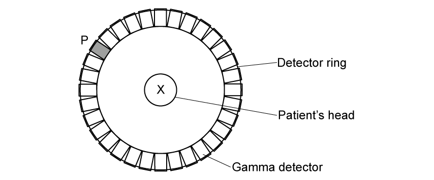
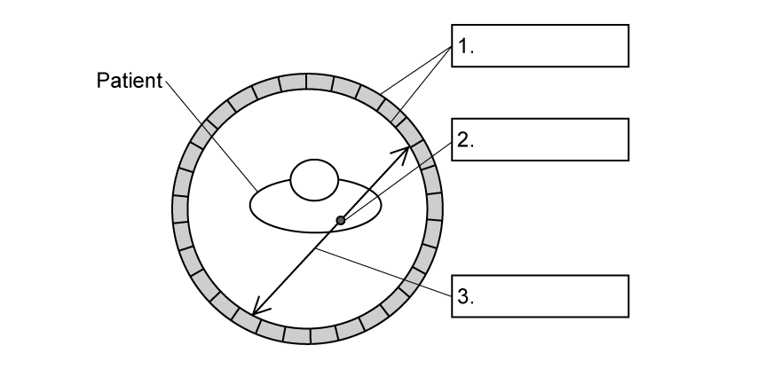

# Exam Questions — PET Scanning
**24. Medical Physics** · Cambridge (CIE) A-LEVEL physics (9702)
> Source: [https://www.savemyexams.com/a-level/physics/cie/25/topic-questions/](https://www.savemyexams.com/a-level/physics/cie/25/topic-questions/) · 9 questions across 1 sets

## Structured Questions (9 questions)

### Q1 — easy — 11 marks

**Q1** [3 marks]

Fill in the missing information in Table 1.1 about the properties of the particles involved in PET scanning.

**Table 1.1**

| **particle** | **mass / kg** | **charge / C** |
|---|---|---|
| electron | 9.11 × 10−31 |   |
| positron |   | 1.60 × 10−19 |
| gamma photon |   |   |

**Q1** [3 marks]

When fluorine-18 decays, it emits a positron which only travels a very short distance before interacting with an electron, resulting in annihilation. As a result, gamma photons are produced.

Show that each gamma photon produced has an energy of 512 keV.

**Q1** [2 marks]

**Extract:**

When fluorine-18 decays, it emits a positron which only travels a very short distance before interacting with an electron, resulting in annihilation. As a result, gamma photons are produced. Show that each gamma photon produced has an energy of 512 keV. (512 keV = 8.2 × 10^−14 J)

Calculate the momentum, in N s, of one of the gamma photons produced in this annihilation.

**Q1** [3 marks]

Fig. 1.1 shows a cross-sectional view of a patient’s head inside a ring of gamma detectors during a PET scan.

**Fig. 1.1**

A positron and an electron meet and annihilate at position X. Assume they have negligible kinetic energy when they meet.

Gamma photons are produced in this annihilation and are detected. The arrival of one gamma photon at detector P triggers a signal.

(i) On Fig. 1.1, identify the other point on the detector that will be triggered by this annihilation.

[1]

(ii) State and explain the conservation law which explains why P and the point you identified in** (b)(i)** will be triggered.

[2]

### Q2 — medium — 12 marks

**Q2** [2 marks]

Positron emission tomography (PET scanning) obtains diagnostic information from a person. The information is used to form an image.

PET scanning uses a tracer and involves annihilation.

Explain what is meant by

(i) a tracer,

[1]

(ii) annihilation.

[1]

**Q2** [5 marks]

**Extract:**

Positron emission tomography (PET scanning) obtains diagnostic information from a person. The information is used to form an image. PET scanning uses a tracer and involves annihilation.

For the annihilation process

(i) State the names of the particles involved.

[1]

(ii) Calculate the total energy released in one annihilation event.

[2]

(iii) Calculate the wavelength of each gamma photon released.

[2]

**Q2** [2 marks]

**Extract:**

PET scanning uses a tracer and involves annihilation. Annihilation is when a particle collides with its antiparticle so that mass is converted into energy. The particles involved are electron(s) and positron(s). Each annihilation event releases gamma photons.

State and explain the direction, relative to each other, in which the gamma photons are emitted.

**Q2** [3 marks]

**Extract:**

Positron emission tomography (PET scanning) obtains diagnostic information from a person. The information is used to form an image. PET scanning uses a tracer and involves annihilation.

Explain how the gamma photons are used to produce an image.

### Q3 — hard — 14 marks

**Q3** [10 marks]

Positron Emission Tomography (PET) and ultrasound scans are both used in medical diagnosis.

Compare the effectiveness of these scans in terms of

(i) the images and the information that can be obtained,

[6]

(ii) patient safety.

[4]

**Q3** [4 marks]

Table 1.1 gives the properties of two radionuclides.

**Table 1.1**

|   | **Rubidium 82** | **Iodine 124** |
|---|---|---|
| half-life | 75 sec | 4.18 days |
| fraction of β+ emitted | 0.95 | 0.22 |
| radiation emitted | β+, γ | β+, γ |

By considering the information in Table 1.1, suggest which of these nuclides is more suitable for use as a tracer in a PET scan.

### Q4 — medium — 8 marks

**Q4** [3 marks]

Positron emission tomography (PET scanning) makes use of a tracer containing a radioactive material that decays by positron emission.

(i) State what is meant by a tracer.

[2]

(ii) State the name of the particles that are emitted from the body and detected by the detectors during PET scanning.

[1]

*Source: Specimen 2022 Paper 4 Q11A*

**Q4** [3 marks]

**Extract:**

(ii) State the name of the particles that are emitted from the body and detected by the detectors during PET scanning. The particles that are emitted from the body and detected by the detectors during PET scanning are: Gamma photons.

Explain how the particles in **(a)(ii)** are created from positrons.

*Source: Specimen 2022 Paper 4 Q11B*

**Q4** [2 marks]

**Extract:**

State the name of the particles that are emitted from the body and detected by the detectors during PET scanning.
The particles that are emitted from the body and detected by the detectors during PET scanning are: Gamma photons;

Positrons can be artificially created by a process in the laboratory that is the reverse of the process in **(b)**. This process creates both a positron and an electron moving at the same speed in opposite directions.

Suggest why two of the particles in **(a)(ii)** are needed to create one positron.

*Source: Specimen 2022 Paper 4 Q11C*

### Q5 — hard — 19 marks

**Q5** [4 marks]

Table 1.1 shows some information about two radionuclides commonly used in PET scanning.

**Table 1.1**

|   | **Fluorine 18** | **Oxygen 15** |
|---|---|---|
| half-life | 109.8 min | 122 s |
| maximum positron energy / MeV | 0.63 | 1.73 |
| % of decays that occur by β+ | 97% | 100% |

Under certain conditions, a gamma photon may be converted into an electron and a positron.

Deduce, with suitable calculations, if the decay of one or both radionuclides in Table 1.1 can result in both the annihilation and the creation of electron-positron pairs.

**Q5** [8 marks]

**Extract:**

Table 1.1 shows some information about two radionuclides commonly used in PET scanning. Table 1.1: Fluorine 18 / Oxygen 15. half-life: 109.8 min / 122 s. maximum positron energy / MeV: 0.63 / 1.73. % of decays that occur by β^+^: 97% / 100%.

In practice, it is observed that the majority of gamma photons emitted have an energy of 511 keV and travel at exactly 180° to each other, regardless of the initial energy of the positron.

When fluorine-18 is used as a tracer, a very small proportion of the gamma photons have energies greater than 511 keV and do not travel at exactly 180° to each other.

When oxygen-15 is used as a tracer, a slightly larger proportion of the gamma photons have energies greater than 511 keV and do not travel at exactly 180° to each other.

(i) Explain these observations.

[6]

(ii) Suggest a potential issue in the detection of the gamma rays if the majority of photons possessed energies greater than 511 keV.

[2]

**Q5** [4 marks]

**Extract:**

Table 1.1 shows some information about two radionuclides commonly used in PET scanning. For Fluorine 18: half-life = 109.8 min; maximum positron energy = 0.63 MeV; % of decays that occur by β+ = 97%. For Oxygen 15: half-life = 122 s; maximum positron energy = 1.73 MeV; % of decays that occur by β+ = 100%.

A tracer contains radioactive fluorine-18 and has an initial activity of 450 MBq. A typical PET scan using fluorine-18 takes 30 minutes.

Determine the number of photons produced during a PET scan using fluorine-18. Assume that all photons produced in annihilation events are detected by the detector.

**Q5** [3 marks]

**Extract:**

Table 1.1 shows some information about two radionuclides commonly used in PET scanning. Table 1.1: Fluorine 18 half-life 109.8 min, Oxygen 15 half-life 122 s; maximum positron energy / MeV: Fluorine 18 = 0.63, Oxygen 15 = 1.73; % of decays that occur by β+: Fluorine 18 = 97%, Oxygen 15 = 100%.

A tracer contains radioactive fluorine-18 and has an initial activity of 450 MBq. A typical PET scan using fluorine-18 takes 30 minutes. Determine the number of photons produced during a PET scan using fluorine-18. Assume that all photons produced in annihilation events are detected by the detector. (Number of photons produced = 1.43 × 10^12; number of positrons emitted = 7.158 × 10^11)

A typical PET scan using oxygen-15 takes 6 minutes.

Determine the initial activity of oxygen-15 required to produce the same number of photons as the scan using fluorine-18.

### Q6 — medium — 19 marks

**Q6** [6 marks]

Positron emission tomography (PET) is useful in medical diagnosis. PET can be used to locate tumours or areas of increased activity within the brain.

(i) Describe the principles of PET.

[4]

(ii) Explain how PET scans are able to locate tumours or areas of increased activity within the brain.

[2]

**Q6** [4 marks]

The decay of the nuclei in the tracer material results in the emission of a positron. Two of the detectors, directly opposite to each other, are triggered as they each receive a gamma photon from the annihilation of the positron.

Suggest why the annihilation

(i) occurs close to the point where the positron is emitted,

[2]

(ii) results in two gamma-ray photons of equal energy moving in opposite directions.

[2]

**Q6** [5 marks]

**Extract:**

Positron emission tomography (PET) is useful in medical diagnosis. PET can be used to locate tumours or areas of increased activity within the brain.
The principles of PET: A positron / beta-plus emitting tracer / source is used; The positrons annihilate with electrons (inside the patient); Positron-electron annihilation produces two gamma photons.

Three tracer isotopes, rubidium-82, fluorine-18 and iodine-131, are being considered for use in a PET scanner. The incomplete nuclear decay equations are shown below.

`Rb _ 37 ^ 82 -> Kr _ 36 ^ 82 + . _... ^... ... + . _... ^... ...`

`I _ 53 ^ 131 -> Xe _ 54 ^ 131 + . _... ^... ... + . _... ^... ...`

`F _ 9 ^ 18 -> O _ 8 ^ 18 + . _... ^... ... + . _... ^... ...`

(i) Complete the nuclear decay equations for rubidium-82, iodine-131 and fluorine-18.

[3]

(ii) State and explain which tracer would **not** be suitable for use in a PET scanner.

[2]

**Q6** [4 marks]

It is suggested that a scanner could be designed to detect photons produced from the annihilation of a proton and an antiproton.

Calculate:

(i) the energy released in the proton–antiproton annihilation.

[2]

(ii) the wavelength of the γ-ray photons produced in the annihilation.

[2]

### Q7 — easy — 13 marks

**Q7** [2 marks]

Complete the following sentence about PET scanning

A positron is emitted by the radiotracer that interacts with an electron in the **detector / surrounding tissue** producing two γ-rays that move apart at **90° / 180°** to each other.

**Q7** [4 marks]

The tracer commonly used in PET scanning is the isotope fluorine-18 `( F _ 9 ^ 18 )`, which is a β+ emitter.

The isotope is tagged onto glucose molecules before injecting it into the patient.

(i) Write an equation for the decay of fluorine-18 `( F _ 9 ^ 18 )` into oxygen (symbol $O$).

[3]

(ii) Glucose is a type of sugar found in many types of food. Suggest why the tracer is tagged onto glucose molecules.

[1]

**Q7** [3 marks]

Fig. 1.1 shows a diagram of the components used in a PET scanner.

**Fig. 1.1**

Fill in the three missing labels on Fig. 1.1.

**Q7** [4 marks]

Complete the following sentences to explain how gamma photons are used to produce an image of the tissue being studied. You may use a word more than once.

The gamma photons produced by the ................................. travel out of the body to opposite sides of the .................................

A powerful computer uses the signals from the ................................. to trace the ................................. along which the ................................. occurred

The difference in ................................. between the two gamma rays is used to calculate the exact location the ................................. occurred

The relative number of gamma photons coming from each point enables the computer to determine the ................................. in each tissue in the patient

### Q8 — hard — 17 marks

**Q8** [3 marks]

Fluorodeoxyglucose (FDG) is a radiopharmaceutical used for PET scans. It contains radioactive fluorine-18 (F-18), which decays by positron emission with a half-life of 110 minutes.

In preparation for a scan scheduled for 12:00 p.m., a radiologist prepares a sample of F-18 FDG at 5 a.m. earlier in the day. For this scan, the radiologist determines the optimum activity of fluorine-18 would be 10 mCi when the scan starts at 12:00 p.m.

Determine the activity, in GBq, of the dose of fluorine-18 that the radiologist should prepare at 5 a.m.

1 mCi = 3.7 × 107 Bq

**Q8** [2 marks]

**Extract:**

Fluorodeoxyglucose (FDG) is a radiopharmaceutical used for PET scans. It contains radioactive fluorine-18 (F-18), which decays by positron emission with a half-life of 110 minutes.

In preparation for a scan scheduled for 12:00 p.m., a radiologist prepares a sample of F-18 FDG at 5 a.m. earlier in the day. For this scan, the radiologist determines the optimum activity of fluorine-18 would be 10 mCi when the scan starts at 12:00 p.m.

1 mCi = 3.7 × 10^7^ Bq

The patient is scheduled to come in an hour earlier, at 11:00 a.m. to receive their injection of F-18 FDG.

At this facility, the maximum activity limit of F-18 FDG that can be injected into patients is set at 14 mCi.

The radiologist forgets to factor this into their calculations when preparing the dose of F-18 FDG and discovers that it has an activity of 15.3 mCi at 11:00 a.m. when the patient arrives.

Determine the earliest time, to the nearest minute, at which the sample of F-18 FDG may be injected into the patient.

**Q8** [6 marks]

**Extract:**

Fluorodeoxyglucose (FDG) is a radiopharmaceutical used for PET scans. It contains radioactive fluorine-18 (F-18), which decays by positron emission with a half-life of 110 minutes.
1 mCi = 3.7 × 10^7 Bq
At this facility, the maximum activity limit of F-18 FDG that can be injected into patients is set at 14 mCi.
Decay constant, λ = 6.3 × 10^−3 min^−1

About 9.9% of the mass of F-18 FDG is fluorine-18. The molar mass of fluorine-18 is 0.018 kg mol–1.

(i) Calculate the initial mass, in kg, of F-18 FDG given to the patient at the time of injection.

[3]

(ii) Determine the fraction of F-18 FDG remaining in the patient's body 6 hours after the initial injection.

[2]

(iii) Suggest why the actual fraction would likely be lower than the value you calculated in **(c)(ii)**.

[1]

**Q8** [6 marks]

Both computed tomography (CT) scans and positron emission tomography (PET) scans can produce detailed pictures of the organs and tissues inside the body. Both techniques share many similarities and differences.

In recent years, it has become much more common for doctors to use a PET-CT scan which is a machine able to perform both scans simultaneously. This way, doctors can combine the images from both scans to create an enhanced picture of the tissue or organ being studied.

(i) Describe the major differences between a CT scan and a PET scan.

[4]

(ii) Discuss the benefits and risks of using a PET-CT scanner instead of using either scan separately in medical diagnosis.

[2]

### Q9 — easy — 8 marks

**Q9** [2 marks]

State what is meant by the term *tracer* in relation to PET scanning.

**Q9** [2 marks]

State the name of the particles that are emitted

(i) by the tracer,

[1]

(ii) from the body and detected by the detectors during PET scanning.

[1]

**Q9** [2 marks]

Explain what is meant by *annihilation* in the context of PET scanning.

**Q9** [2 marks]

State the **two** quantities which must be conserved in an annihilation event.
