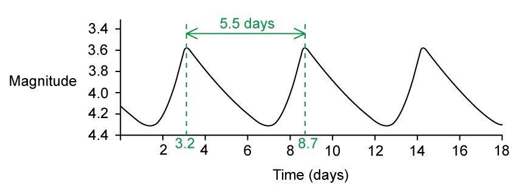
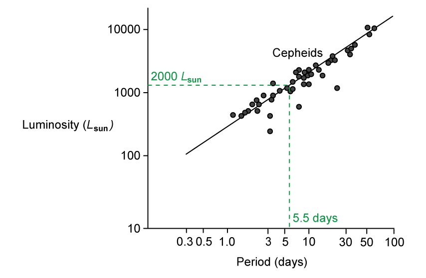

# Mark Schemes — Standard Candles
**25. Astronomy & Cosmology** · Cambridge (CIE) A-LEVEL physics (9702)

## Structured Questions (7 questions)

### Q1
Calculate the distance of Vega from the Earth:

List the known quantities:

- Luminosity of Vega = 40 *L*Sun
- Luminosity of the Sun, *L*Sun = 3.85 × 1026 W
- Radiant flux intensity on Earth, *F* = 21.3 nW m−2 = 2.13 × 10−8 W m−2

Calculate the luminosity of Vega in W:

- *L *= 40 × (3.85 × 1026) = 1.54 × 1028 W **[1 mark]**

Rearrange the inverse square law of flux equation for the distance, *d*:

- Inverse square law of flux:  $F=\frac{L}{4πd^{2}}$ **[1 mark]**
- Rearrange:  $d=\sqrt{\frac{L}{4πF}}$
- Substitute:  `d space equals space square root of fraction numerator 1.54 space cross times space 10 to the power of 28 over denominator 4 pi space cross times space open parentheses 2.13 space cross times space 10 to the power of negative 8 end exponent close parentheses end fraction end root` **[1 mark]**
- Distance to Vega:  $d=2.40\times10^{17}m$ **[1 mark]**

**[Total: 4 marks]**

> *Make sure you find the actual luminosity of Vega in W first and don't just use the relative luminosity compared to the Sun. *
Determine the best method to use to measure the distance to Vega:

List the known quantities:

- 1 light year = 9.46 × 1015 m
- Distance of Vega from the Earth, *d *= 2.40 × 1017 m

Convert the distance to ly:

- Distance:  $d=\frac{2.40\times10^{17}}{9.46\times10^{15}}$ = 25.4 ly **[1 mark]**
- Distance: * d *= 2.54 × 101 ly (in standard form)

From the cosmic distance ladder, the best method to measure distance is:

- Parallax;** [1 mark]**

This is because:

- Vega is too far away (from Earth) to use radar (ranging) **OR** too close to Earth to use the H-R diagram method; **[1 mark]**

**[Total: 3 marks]**

> *Don't get confused when converting from m to ly. Divide the distance in m to get a smaller value in ly. Converting the distance into ly makes it easier to identify the location of an object on the cosmic distance ladder. *
The best method to use to prove that Andromeda is a separate galaxy outside of the Milky Way is:

- Cepheid variables / period-luminosity relation; **[1 mark]**

This is because:

**Final answer:** **Any ****three**** from:**

- Distances to nearby stars (in the Milky Way) are less than 105 light-years away; **[1 mark]**
- Distances to galaxies are more than 105 light-years away; **[1 mark]**
- (Andromeda) is too close to Earth to use Hubble's law method; **[1 mark]**
- (Andromeda) is too far from Earth to use the H-R diagram / parallax method; **[1 mark]**
- Type 1a supernovae are rare events / cannot be reliably predicted; **[1 mark]**

**[Total: 4 marks]**

> *Whilst you are not explicitly required to know exact astronomical distances, having a rough idea about the scale of distances in our galaxy, and the rest of the Universe, will deepen your understanding of astronomy. For example,*

- *The distance to our **closest star** (Alpha Centauri) ≈ 4 light-years (4 × 10**0** ly)*
- *The size of the **Milky Way **≈ 100 000 light-years (1 × 10**5** ly)*
- *The distance to our **closest galaxy** (Andromeda) ≈ 2.5 million light-years (2.5 × 10**6** ly)*
- *The size of our **local group** (or 'neighbourhood') of galaxies ≈ 10 million light-years (1 × 10**7** ly)*
- *The distance to our **closest cluster** of galaxies (Virgo cluster) ≈ 65 million light-years (6.5 × 10**7** ly)*
- *The **furthest **known galaxy (HD1) ≈ 13.5 billion light-years (1.35 × 10**10** ly)*
- *The size of the **observable Universe** ≈ 93 billion light-years (9.3 × 10**10** ly)*

### Q2
The factors that affect radiant flux intensity from a star are:

- The luminosity of the star; **[1 mark]**
- The distance (from the centre) of the star (to the observer / Earth); **[1 mark]**

**[Total: 2 marks]**
The common feature of Cepheid variables and type 1a supernovae is

- They are objects of known luminosity; **[1 mark]**

**[Total: 1 mark]**
Determine the luminosity of Eta Aquilae:

List the known quantities:

- Distance to Eta Aquilae, *d* = 1.3 × 1019 m
- Radiant flux intensity, *F* = 4.7 × 10−10 W m−2

Calculate the luminosity using the inverse square law:

- Inverse square law of flux:  $F=\frac{L}{4πd^{2}}$ **[1 mark]**
- Rearrange:  $L=4πd^{2}F$
- `L space equals space 4 straight pi open parentheses 1.3 cross times 10 to the power of 19 close parentheses squared cross times open parentheses 4.7 cross times 10 to the power of negative 10 end exponent close parentheses` **[1 mark]**
- $L=1.0\times10^{30}W$ **[1 mark]**

**[Total: 3 marks]**
Determine how much greater the power output of Eta Aquilae is than the power output of the Sun:

List the known quantities:

- Luminosity of Eta Aquilae, $L_{Eta}$ = 1.0 × 1030 W (from part c)
- Luminosity of the Sun, $L_{Sun}$ = 3.8 × 1026 W

Calculate the ratio of the luminosities:

- $\frac{L_{Eta}}{L_{Sun}}=\frac{1.0\times10^{30}}{3.8\times10^{26}}$
- $\frac{L_{Eta}}{L_{Sun}}=2632=2600$ (2 s.f.)
- $L_{Eta}=2600\timesL_{Sun}$ **[1 mark]**

**[Total: 1 mark]**

### Q3
A standard candle is:

- A (stellar) object of known luminosity; **[1 mark]**

**[Total: 1 mark]**
A standard candle can be used to measure astronomical distances by:

**EITHER**

- Measuring the standard candle's flux / brightness / intensity on Earth; **[1 mark]**
- Using the inverse square law (of flux) to calculate distance; **[1 mark]**

**OR**

- Using $F=\frac{L}{4πd^{2}}$; **[1 mark]**
- Where *F* = flux / brightness / intensity (of standard candle), *L* = luminosity, *d* = distance (to standard candle); **[1 mark]**

**[Total: 2 marks]**
Show that the distance of the galaxy from the Earth is about 8 × 1024 m:

List the known quantities:

- Radiant flux on Earth, *F* = 2.59 × 10–15 W m–2
- Luminosity, *L* = 2.0 × 1036 W

Calculate the distance to the galaxy using the inverse square law:

- Inverse square law of flux:  $F=\frac{L}{4πd^{2}}$ **[1 mark]**
- $d=\sqrt{\frac{L}{4πF}}$
- `d equals square root of fraction numerator 2.0 cross times 10 to the power of 36 over denominator 4 straight pi cross times open parentheses 2.59 cross times 10 to the power of negative 15 end exponent close parentheses end fraction end root equals 7.84 cross times 10 to the power of 24 space straight m` **[1 mark]**

**[Total: 2 marks]**
(i) Determine the distance to the standard candle in light years:

List the known quantities:

- Distance to standard candle, *d* = 7.84 × 1024 m (from part c)
- 1 light year = 9.46 × 1015 m

Convert the distance to ly:

- $d=\frac{7.84\times10^{24}}{9.46\times10^{15}}$ **[1 mark]**
- *d *= 8.3 × 108 ly **[1 mark]**

(ii) The object is a:

- Type 1a supernovae;** [1 mark]**

**[Total: 3 marks]**

> *You do not need to learn the distances and methods in each section of the cosmic distance ladder, but you could be expected to interpret it.*

> *Try not to get confused when converting from m to ly. Divide the distance in m to get a smaller value in ly. *

### Q4
The luminosity of a star is:

- The total power of radiation emitted (by the star); **[1 mark]**

**[Total: 1 mark]**
Type 1a supernovae are used to measure distances to the most distant galaxies because:

- Their high luminosities (1036 W) mean they are extremely bright; **[1 mark]**
- The radiant flux intensity (on Earth) will be detectable / bright enough to measure (even at very large distances); **[1 mark]**

**[Total: 2 marks]**
Estimate the distance of the galaxy from the Earth:

List the known quantities:

- Radiant flux intensity, F = 9.0 × 10−18 W m−2
- Luminosity, L = 1.6 × 1036 W

Calculate the distance to the galaxy using the inverse square law:

- Inverse square law of flux:  $F=\frac{L}{4πd^{2}}$ **[1 mark]**
- Rearrange:  $d=\sqrt{\frac{L}{4πF}}$
- `d space equals space square root of fraction numerator 1.6 cross times 10 to the power of 36 over denominator 4 straight pi cross times open parentheses 9.0 cross times 10 to the power of negative 18 end exponent close parentheses end fraction end root` **[1 mark]**
- $d=1.19\times10^{26}m$ **[1 mark]**

**[Total: 3 marks]**
Estimate how long ago, in years, the type 1a supernova exploded:

List the known quantities:

- Distance to supernova, *d* = 1.19 × 1026 m
- Distance travelled by light per year = 9.46 × 1015 m

Determine the time of the explosion:

- When the supernova exploded, photons began to travel to Earth at a rate of 9.46 × 1015 m per year
- Therefore, time since explosion = $\frac{totaldistancetravelledbylight}{distancetravelledbylightperyear}$
- Time since explosion = $\frac{1.19\times10^{26}}{9.46\times10^{15}}$ **[1 mark]**
- Time since explosion = 1.26 × 1010 years (12.6 billion years) **[1 mark]**

**[Total: 2 marks]**

### Q5
A type 1a supernova is a type of standard candle, which means:

- It is an (astronomical) object of <u>known luminosity</u>; **[1 mark]**

**[Total: 1 mark]**

> *Make sure to use the correct terminology, in this case, only "luminosity" is accepted, terms such as "brightness" would not be given the mark*
List the known quantities:

- Distance from Earth, $d$ = 10 billion light-years = 10 × 109 ly
- Peak luminosity of supernova, $L$ = 2.4 × 1036 W
- Peak power (measured by JWST), $P$ = 5.3 × 10−16 W
- 1 ly = 9.46 × 1015 m

(i) Calculate the peak radiant flux intensity at the JWST:

Convert the distance from light-years to metres:

- Distance:  $d$ = (10 × 109) × (9.46 × 1015) = 9.46 × 1025 m **[1 mark]**

Use the inverse square law of flux to calculate the peak intensity:

- Inverse square law of flux:  $F=\frac{L}{4πd^{2}}$ **[1 mark]**
- Substitute:  `F space equals space fraction numerator 2.4 cross times 10 to the power of 36 over denominator 4 straight pi open parentheses 9.46 cross times 10 to the power of 25 close parentheses squared end fraction`
- Peak radiant flux intensity:  $F$ = 2.13 × 10−17 W m−2 **[1 mark]**

(ii) Show that the collecting area of the JWST is 25 m2:

- Intensity equation:  $F=\frac{P}{A}\RightarrowA=\frac{P}{F}$
- Substitute:  $A=\frac{5.3\times10^{-16}}{2.13\times10^{-17}}$ **[1 mark]**
- Collecting area: $A$ = 24.9 = 25 m2 **[1 mark]**

**[Total: 5 marks]**

> *Think carefully about the units you need to use with each equation. Remember to convert the distance from light-years to metres before substituting into the inverse square law. *
Calculate the average power output of supernova Encore:

List the known quantities:

- Total energy released by supernova, $E$ = 1044 J
- Time interval, $t$ = 100 days = (100 × 24 × 3600) = 8.64 × 106 s

Determine the average power output of the explosion:

- Power equation:  $P=\frac{E}{t}$
- Substitute:   $P=\frac{10^{44}}{8.64\times10^{6}}$ **[1 mark]**
- Average power output:  $P=1.16\times10^{37}W$** [1 mark]**

**[Total: 2 marks]**

> *Remember that power = *$\frac{energy}{time}$* and W = J s**−1**. So you need to convert the time into seconds.*

> *Remember each stage:*

- *24 hours in 1 day*
- *60 minutes in 1 hour*
- *60 seconds in 1 minute*

### Q6
Determine the radiant flux intensity at the top of the Earth's atmosphere:

List the known quantities:

- Radius of Sun, *r* = 6.96 × 108 m
- Surface temperature of Sun, *T *= 5790 K
- Distance from Sun to Earth, *d *= 1.50 × 1011 m
- Stefan-Boltzmann constant, σ = 5.67 × 10−8 W m−2 K−4

Calculate the luminosity of the Sun:

- Stefan-Boltzmann law:  $L=4πr^{2}σT^{4}$
- `L space equals space open parentheses 5.67 space cross times space 10 to the power of negative 8 end exponent close parentheses space cross times space 4 pi space cross times space open parentheses 6.96 space cross times space 10 to the power of 8 close parentheses squared space cross times space open parentheses 5790 close parentheses to the power of 4`
- $L=3.879\times10^{26}W$ **[1 mark]**

Calculate the radiant flux intensity:

- Flux intensity:  $F=\frac{L}{4πd^{2}}$
- `F space equals space fraction numerator 3.879 space cross times space 10 to the power of 26 space over denominator 4 pi space cross times space open parentheses 1.50 space cross times space 10 to the power of 11 close parentheses squared end fraction space equals space 1371.92 space straight W space straight m to the power of negative 2 end exponent` **[1 mark]**
- $F=1.37\mathrm{kW}m^{-2}$ **[1 mark]**

Conclusion:

- 1.37 kW m–2 < 2 kW m–2 so the claim is false; **[1 mark]**

**[Total: 4 marks]**

> *'Assess the validity of this claim' normally means 'check this claim is correct'*

> *You can do this by calculating the value for the intensity, and then seeing how that value compares with the value they have mentioned*

> *You must **always** write a conclusion statement stating whether the claim is valid or not **and why*

> *This is best done quantitatively i.e. using numbers (X < Y so Y is not valid)*
Determine the power available to the probe at Earth and Mars and compare:

List the known quantities:

- Radiant flux intensity at Earth, $F$ = 1370 W m−2 (from **(a)**)
- Surface area of solar panels, *A* = 31 m2
- Efficiency of solar panels = 30% = 0.3
- Distance from Sun to Earth, $d_{E}$ = 1.5 × 1011 m
- Distance from Sun to Mars, $d_{M}$ = 2.3 × 1011 m

Determine the power available to the probe at Earth:

- Power:  $P=FA$
- The panels have an efficiency of 30%, so
- Total power available (at Earth):  $P_{E}$ = 0.3 × 1370 × 31 = 12 740 W **[1 mark]**

Determine the power available to the probe at Mars:

- Radiant flux intensity:  $F=\frac{L}{4πd^{2}}$
- Since $F\propto\frac{1}{d^{2}}$ and $P\proptoF\RightarrowP\propto\frac{1}{d^{2}}$
- Ratio:  `P subscript M over P subscript E space equals space open parentheses d subscript E over d subscript M close parentheses squared space space space space space rightwards double arrow space space space space P subscript M space equals space P subscript E space cross times space open parentheses d subscript E over d subscript M close parentheses squared`
- Total power available (at Mars):  `P subscript M space equals space 12 space 740 space cross times space open parentheses fraction numerator 1.5 cross times 10 to the power of 11 over denominator 2.3 cross times 10 to the power of 11 end fraction close parentheses squared` **[1 mark]**
- Total power available (at Mars):  $P_{M}$ = 5420 W **[1 mark]**

Conclusion:

- The power available to the probe at Mars is 5420 W compared to 12 740 W at Earth, this is a decrease of 42.5%; **[1 mark]**

**[Total: 4 marks]**
(i) Calculate the area of solar panels required to reach Neptune:

List the known quantities:

- Radiant flux intensity at Earth, $F_{E}$ = 1370 W m−2 (from **(a)**)
- Distance from Sun to Earth = $d_{E}$
- Distance from Sun to Neptune, $d_{M}=30d_{E}$
- Required power at Neptune, $P$ = 5420 W (from **(b)**)

Determine the radiant flux intensity at Neptune:

- Radiant flux intensity:  $F=\frac{L}{4πd^{2}}$
- Ratio:  `F subscript N over F subscript E space equals space open parentheses d subscript E over d subscript N close parentheses squared space space space space space space rightwards double arrow space space space space space F subscript N space equals space F subscript E space cross times space open parentheses d subscript E over d subscript N close parentheses squared`
- Radiant flux intensity at Neptune:  `F subscript N space equals space 1370 space cross times space open parentheses fraction numerator d subscript E over denominator 30 d subscript E end fraction close parentheses squared space equals space 1370 cross times open parentheses 1 over 30 close parentheses squared` **[1 mark]**
- Radiant flux intensity at Neptune:  $F_{N}=1.52Wm^{-2}$ **[1 mark]**

Determine the required area of the panels:

- Power:  $P=FA\RightarrowA=\frac{P}{F}$
- Area of panels required:  $A=\frac{5420}{1.52}=3570m^{2}$ **[1 mark]**

(ii) Comment on the viability of the mission:

- Since 3570 m2 > 3244 m2, this is <u>not</u> (currently) a viable mission; **[1 mark]**

**Final answer:** **Any ****one**** from:**

- The ISS stays at a constant distance from the Sun whereas the probe will be moving away (from the Sun); **[1 mark]**
- The mass of the solar panels would make the launch (from Earth) difficult; **[1 mark]**
- A different energy source (e.g. nuclear power) would be more efficient / compact; **[1 mark]**
- The energy needs of the ISS and space probe are different; **[1 mark]**

**[Total: 5 marks]**

### Q7
Standard candles can be used to determine distances to stars by:

- Measuring the intensity of the radiation from the candle; **[1 mark]**
- Knowing the luminosity of the standard candle; **[1 mark]**
- Using the inverse square law (of flux) to determine the distance to the star; **[1 mark]**

**[Total: 3 marks]**
Estimate the period of the Cepheid:

- From Fig. 1.1:  period = 5.5 days; **[1 mark]** *Acceptable range for period = 5.4 to 5.7 days*

**[Total: 1 mark]**
Calculate the distance of the Cepheid from the Earth:

List the known quantities:

- Period of the Cepheid = 5.5 days (from part b)
- Luminosity of the Sun, $L_{Sun}$ = 3.8 × 1026 W
- Radiant flux intensity, $F$ = 500 nW m−2 = 500 × 10−9 W m−2

Determine the luminosity from the graph:

- From Fig. 1.2:  luminosity = 2000 $L_{Sun}$ **[1 mark]**

Use the inverse square law of flux to calculate the distance:

- Inverse square law:  $F=\frac{L}{4πd^{2}}$ **[1 mark]**
- Rearrange:  $d=\sqrt{\frac{L}{4πF}}$
- Substitute:  `d space equals space square root of fraction numerator 2000 cross times open parentheses 3.8 cross times 10 to the power of 26 close parentheses over denominator 4 straight pi cross times open parentheses 500 cross times 10 to the power of negative 9 end exponent close parentheses end fraction end root` **[1 mark]**
- Distance to Cepheid:  $d$ = 3.5 × 1017 m **[1 mark]**

**[Total: 4 marks]**
