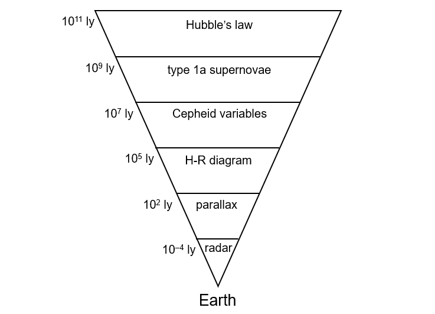

# Exam Questions — Standard Candles
**25. Astronomy & Cosmology** · Cambridge (CIE) A-LEVEL physics (9702)
> Source: [https://www.savemyexams.com/a-level/physics/cie/25/topic-questions/](https://www.savemyexams.com/a-level/physics/cie/25/topic-questions/) · 7 questions across 1 sets

## Structured Questions (7 questions)

### Q1 — medium — 11 marks

**Q1** [4 marks]

Vega is the brightest star in the Lyra constellation with a luminosity 40 times that of the Sun and a radiant flux intensity at Earth of 21.3 nW m−2.

Calculate the distance of Vega from the Earth in m.

Luminosity of the Sun = 3.85 × 1026 W

**Q1** [3 marks]

**Extract:**

Vega is the brightest star in the Lyra constellation with a luminosity 40 times that of the Sun and a radiant flux intensity at Earth of 21.3 nW m^−2^. Calculate the distance of Vega from the Earth in m. Distance to Vega: d = 2.40 × 10^17 m

Fig. 1.1 shows a chart known as the cosmic distance ladder. It details different methods of measuring astronomical distances according to the distance they can measure from Earth.

**Fig. 1.1**

Using Fig. 1.1, determine the best method to use to measure the distance to Vega.

1 light year = 9.46 × 1015 m

**Q1** [4 marks]

**Extract:**

Fig. 1.1 shows a chart known as the cosmic distance ladder. It details different methods of measuring astronomical distances according to the distance they can measure from Earth.

The Andromeda galaxy is known to be the closest galaxy to our galaxy, the Milky Way.

Suggest which method could be used by an astronomer to prove that Andromeda is a separate galaxy outside of the Milky Way. Explain your choice.

### Q2 — easy — 7 marks

**Q2** [2 marks]

State **two** factors that affect radiant flux intensity from a star.

**Q2** [1 mark]

Cepheids variable stars and type 1a supernovae are types of standard candle.

State the common feature that makes Cepheid variables and type 1a supernovae suitable for measuring distances.

**Q2** [3 marks]

The Cepheid variable star Eta Aquilae is 1.3 × 1019 m away from the Earth. Its radiant flux intensity on Earth is measured to be 4.7 × 10−10 W m−2.

Determine the luminosity of Eta Aquilae.

**Q2** [1 mark]

**Extract:**

The Cepheid variable star Eta Aquilae is 1.3 × 10^19 m away from the Earth. Its radiant flux intensity on Earth is measured to be 4.7 × 10^−10 W m^−2. Determine the luminosity of Eta Aquilae. [Answer: L = 1.0 × 10^30 W]

The luminosity of the Sun is 3.8 × 1026 W.

Determine how much greater the power output of Eta Aquilae is than the power output of the Sun.

### Q3 — easy — 8 marks

**Q3** [1 mark]

State what is meant by a standard candle.

**Q3** [2 marks]

**Extract:**

A standard candle is a (stellar) object of known luminosity.

Explain how a standard candle can be used to measure astronomical distances.

**Q3** [2 marks]

A standard candle in a distant galaxy is found to have a luminosity of 2.0 × 1036 W and a radiant flux intensity on Earth of 2.59 × 10–15 W m–2.

Show that the distance of the galaxy from the Earth is about 8 × 1024 m.

**Q3** [3 marks]

**Extract:**

A standard candle in a distant galaxy is found to have a luminosity of 2.0 × 10^36 W and a radiant flux intensity on Earth of 2.59 × 10^–15 W m^–2. Show that the distance of the galaxy from the Earth is about 8 × 10^24 m. d = 7.84 × 10^24 m

The cosmic distance ladder is a way of categorising the different methods of measuring astronomical distances, as shown in Fig. 1.1.

**Fig. 1.1**

(i) Determine the distance, in light years, to the standard candle.

1 light year = 9.46 × 1015 m

[2]

(ii) Using Fig. 1.1, state the type of standard candle that the object must be.

[1]

### Q4 — easy — 8 marks

**Q4** [1 mark]

State what is meant by the luminosity of a star.

**Q4** [2 marks]

Type 1a supernovae are a type of standard candle. They are all known to explode with a peak luminosity of 1.6 × 1036 W.

Suggest a reason why type 1a supernovae are used to measure distances to the most distant galaxies.

**Q4** [3 marks]

**Extract:**

Type 1a supernovae are a type of standard candle. They are all known to explode with a peak luminosity of 1.6 × 10^36 W.

A type 1a supernova is observed in a distant galaxy with a peak radiant flux intensity of 9.0 × 10−18 W m−2.

Estimate the distance of the galaxy from the Earth.

**Q4** [2 marks]

**Extract:**

A type 1a supernova is observed in a distant galaxy with a peak radiant flux intensity of 9.0 × 10^−18 W m^−2. Estimate the distance of the galaxy from the Earth. Answer: d = 1.19 × 10^26 m

Estimate how long ago, in years, the type 1a supernova exploded.

1 light year = 9.46 × 1015 m

### Q5 — medium — 8 marks

**Q5** [1 mark]

Recently, astronomers have observed a type 1a supernova called Encore in a distant galaxy. Measurements of the light from Encore revealed that the galaxy is 10 billion light-years away.

State the property of a type 1a supernova that makes it suitable for measuring distances.

**Q5** [5 marks]

**Extract:**

Recently, astronomers have observed a type 1a supernova called Encore in a distant galaxy. Measurements of the light from Encore revealed that the galaxy is 10 billion light-years away.

Light from supernova Encore is collected using the James Webb Space Telescope (JWST).

The JWST detects a peak power reading of 5.3 × 10−16 W. Theory predicts that this reading corresponds to Encore's peak luminosity of 2.4 × 1036 W.

1 ly = 9.46 × 1015 m

(i) Calculate the peak radiant flux intensity at the JWST.

[3]

(ii) Show that the collecting area of the JWST is 25 m2.

[2]

**Q5** [2 marks]

After the initial explosion, the light emitted by supernova Encore was collected for around 100 days. The total energy released during this time is estimated to be 1044 J.

Calculate the average power output of supernova Encore.

### Q6 — hard — 13 marks

**Q6** [4 marks]

Solar panels consisting of combinations of photovoltaic cells use energy in the radiation received from the Sun to generate electricity.

An advertisement for solar panels claims that the intensity of radiation from the Sun incident at the top of the Earth’s atmosphere is more than 2 kW m−2.

Assess the validity of this claim.

Use the following data:

- radius of Sun = 6.96 × 108 m
- surface temperature of Sun = 5790 K
- distance from Sun to Earth = 1.50 × 1011 m

**Q6** [4 marks]

**Extract:**

An advertisement for solar panels claims that the intensity of radiation from the Sun incident at the top of the Earth's atmosphere... Use the following data: radius of Sun = 6.96 × 10^8 m; surface temperature of Sun = 5790 K; distance from Sun to Earth = 1.50 × 10^11 m.
Calculate the radiant flux intensity: F = L / (4 π d^2) = 1371.92 W m^-2 = 1.37 kW m^-2

A space probe is sent on a mission from Earth to Mars.

Power for the space probe is provided by solar panels that collect radiant energy from the Sun. The solar panels have a total area of 31 m2 and are directly facing the Sun throughout the journey. The efficiency of the solar panels is 30%.

The mean orbital radius of Mars about the Sun is 2.3 × 1011 m.

Compare the power available to the probe when it leaves Earth's atmosphere to the power available on its arrival at Mars.

**Q6** [5 marks]

**Extract:**

Solar panels consisting of combinations of photovoltaic cells use energy in the radiation received from the Sun to generate electricity. An advertisement for solar panels claims that the intensity of radiation from the Sun incident at the top of the Earth's atmosphere is more than 2 kW m^−2^. [Mark scheme result: Radiant flux intensity at Earth, F = 1370 W m^−2]

A space probe is sent on a mission from Earth to Mars. Power for the space probe is provided by solar panels that collect radiant energy from the Sun. The solar panels have a total area of 31 m^2 and are directly facing the Sun throughout the journey. The efficiency of the solar panels is 30%. The mean orbital radius of Mars about the Sun is 2.3 × 10^11 m. [Mark scheme result: Total power available at Mars, P_M = 5420 W]

Neptune is the farthest known planet from the Sun in the Solar System. Its distance from the Sun is 30 times greater than the distance of the Earth from the Sun.

A similar space probe to the one in **(b)** is sent on a mission to Neptune.

(i) Calculate the area of solar panels that would be required to achieve the same availability of power at Neptune as the space probe in **(b)** when it was at Mars.

[3]

(ii) The International Space Station (ISS) currently holds the record for the largest array of solar panels in space, spanning a total area of 3244 m2 to supply all of its power.

Using this information, and your answer to **(c)(i)**, comment on the current viability of the mission to Neptune.

[2]

### Q7 — medium — 8 marks

**Q7** [3 marks]

Cepheids are a type of standard candle.

Describe how standard candles can be used to determine distances to stars.

**Q7** [1 mark]

Fig. 1.1 shows the light curve of a Cepheid variable star which has a radiant flux intensity on Earth of 500 nW m−2.

**Fig. 1.1**

Use Fig. 1.1 to estimate the period of the Cepheid.

**Q7** [4 marks]

**Extract:**

Fig. 1.1 shows the light curve of a Cepheid variable star which has a radiant flux intensity on Earth of 500 nW m^−2^. Use Fig. 1.1 to estimate the period of the Cepheid.
From Fig. 1.1: period = 5.5 days

Fig. 1.2 shows the relationship between luminosity and period for a group of Cepheid variables.

**Fig. 1.2**

Use Fig. 1.2 and your answer from (b) to calculate the distance of the Cepheid from the Earth.

Luminosity of the Sun = 3.8 × 1026 W
