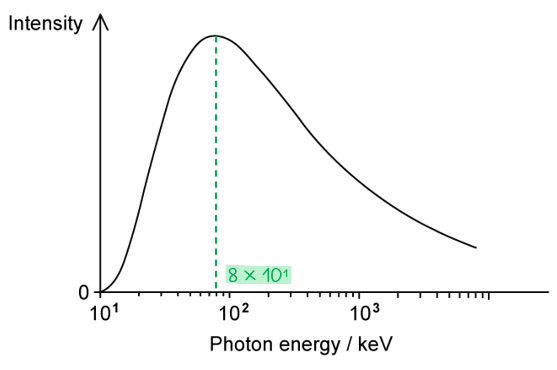
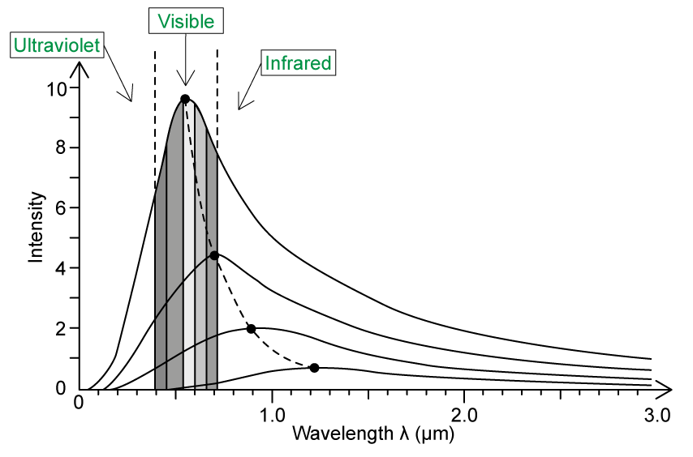
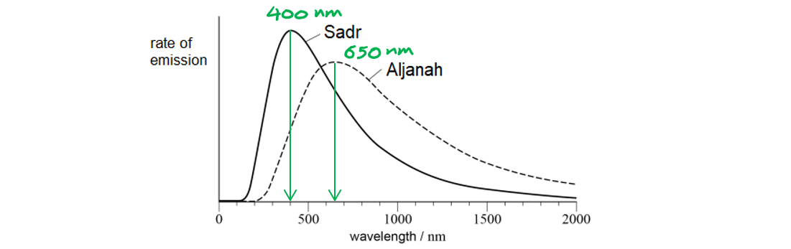
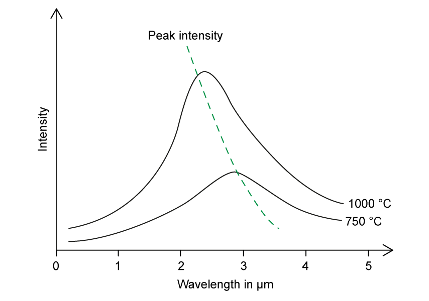
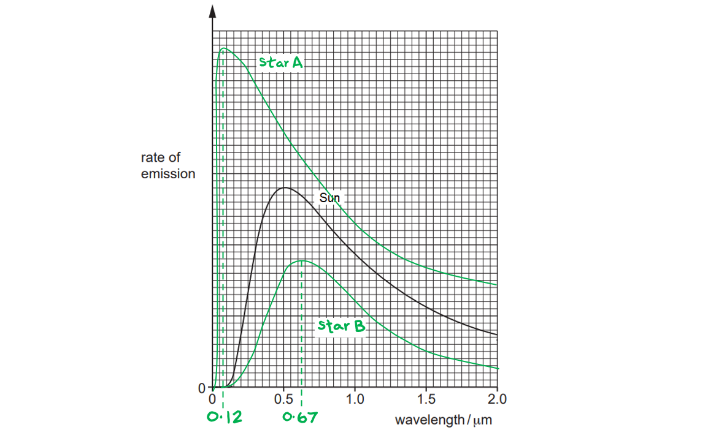

# Mark Schemes — Stellar Radii
**25. Astronomy & Cosmology** · Cambridge (CIE) A-LEVEL physics (9702)

## Structured Questions (8 questions)

### Q1
(i) Show that the luminosity of the source is about 2 × 1035 W:

List the known quantities:

- Distance from Earth, $d$ = 4.60 × 1024 m
- Area of detector, $A$ = 1.00 × 10−4 m2
- Energy of burst, $E$ = 9.40 × 10−23 J
- Time of burst, $t$ = 1.15 ms = 1.15 × 10-3 s

Determine the power of the burst of radio waves:

- Power:  $P=\frac{E}{t}=\frac{9.40\times10^{-23}}{1.15\times10^{-3}}=8.17\times10^{-20}W$ **[1 mark]**

Determine the intensity of the burst:

- Intensity:  $F=\frac{P}{A}=\frac{8.17\times10^{-20}}{1.00\times10^{-4}}=8.17\times10^{-16}Wm^{-2}$ **[1 mark]**

Use the inverse square law of flux equation to find luminosity:

- Inverse square law of flux:  $F=\frac{L}{4πd^{2}}$
- `L space equals space 4 straight pi d squared F space equals space 4 straight pi space cross times space open parentheses 4.60 space cross times space 10 to the power of 24 close parentheses squared space cross times space open parentheses 8.17 space cross times space 10 to the power of negative 16 end exponent close parentheses` **[1 mark]**
- $L=2.17\times10^{35}=2.2\times10^{35}W$ **[1 mark]**

(ii) It is unlikely that FRB sources are extraterrestrial communications because:

- The luminosity of the FRB source is much larger than the luminosity of the Sun; **[1 mark]**
- A power output this large is unlikely to be artificially produced; **[1 mark]**

**[Total: 6 marks]**

> *The marks for part (ii) can only be gained if the answer for part (i) is significantly larger than the value given for the Sun's luminosity*
Determine the surface temperature of the magnetar:

List the known quantities:

- Wien's displacement constant = 2.898 × 10−3 m K
- Planck's constant, *h* = 6.63 × 10−34 J s
- Speed of light, *c* = 3.0 × 108 m s−1
- 1 eV = 1.6 × 10−19 J

Use the graph to obtain a value for the maximum energy:

- (From the graph) maximum energy, $E_{max}$ = 8 × 101 = 80 keV  [1 mark] *Acceptable range for maximum energy = 75 to 80 keV*

Convert the maximum energy into the maximum wavelength:

- Photon energy:  $E=\frac{hc}{λ}\Rightarrowλ_{max}=\frac{hc}{E_{max}}$
- `lambda subscript m a x end subscript space equals space fraction numerator open parentheses 6.63 cross times 10 to the power of negative 34 end exponent close parentheses open parentheses 3.0 cross times 10 to the power of 8 close parentheses over denominator open parentheses 80 cross times 10 cubed close parentheses open parentheses 1.6 cross times 10 to the power of negative 19 end exponent close parentheses end fraction`
- $λ_{max}$ = 1.554 × 10−11 m [1 mark] *Acceptable range for max. wavelength = (1.55 to 1.66) × 10**−11** m*

Use Wien's Law to calculate the temperature of the magnetar:

- Wien's law:  $T\propto\frac{1}{λ_{max}}\Rightarrowλ_{max}T=2.898\times10^{-3}mK$
- $T=\frac{2.898\times10^{-3}}{λ_{max}}=\frac{2.898\times10^{-3}}{1.554\times10^{-11}}$ [1 mark]
- $T$ = 1.865 × 108 = 1.9 × 108 K [1 mark] *Acceptable range for surface temperature = (1.7 to 1.9) × 10**8** K*

**[Total: 4 marks]**
Determine the diameter of the magnetar and compare it to the size of a city:

List the known quantities:

- Luminosity of FRB/magnetar, $L$ = 2.17 × 1035 W (from **(a)**)
- Surface temperature of the magnetar, $T$ = 1.865 × 108 K (from **(b)**)
- Stefan-Boltzmann constant, $σ$ = 5.67 × 10–8 W m–2 K–4

Use the Stefan-Boltzmann Law to calculate the radius of the magnetar:

- Stefan-Boltzmann Law:  $L=4πR^{2}σT^{4}\RightarrowR=\sqrt{\frac{L}{4πσT^{4}}}$
- Radius:  `R space equals space square root of fraction numerator 2.17 cross times 10 to the power of 35 over denominator 4 straight pi cross times open parentheses 5.67 cross times 10 to the power of negative 8 end exponent close parentheses cross times open parentheses 1.865 cross times 10 to the power of 8 close parentheses to the power of 4 end fraction end root` **[1 mark]**
- Radius:  $R=15866=15.9\mathrm{km}$ **[1 mark]**

Estimate the size of a city and compare it to the diameter of the magnetar:

- Diameter of the magnetar = 2 × 15.9 = 31.8 km
- A reasonable estimate for the size of a large city is 101 to 102 km; **[1 mark]**
- Hence the statement from the literature is correct; **[1 mark]**

**[Total: 4 marks]**

### Q2
Deduce the colours of X and Y:

List the known quantities:

- Luminosity of X, *L*X = 104 *L*☉
- Luminosity of Y, *L*Y = 10−3 *L*☉
- Radius of X, *R*X = 10*R*☉
- Radius of Y, *R*Y = 0.1*R*☉

Use the Stefan-Boltzmann law to determine the temperatures of X and Y:

- Stefan-Boltzmann law:  `L space equals space 4 straight pi R squared sigma T to the power of 4 space space space space space rightwards double arrow space space space space space T space proportional to space fourth root of L over R squared end root`
- Temperature of the Sun:  `T subscript ☉ space proportional to space fourth root of L subscript ☉ over open parentheses R subscript ☉ close parentheses squared end root`
- Temperature of star X:  `T subscript straight X space proportional to space space fourth root of fraction numerator 10 to the power of 4 L subscript ☉ over denominator open parentheses 10 R subscript ☉ close parentheses squared end fraction end root`
- Temperature of star X:  `T subscript straight X space proportional to space fourth root of 10 to the power of 4 over 10 squared end root space fourth root of L subscript ☉ over open parentheses R subscript ☉ close parentheses squared end root space equals space 3.16 space T subscript ☉` **[1 mark]**
- Temperature of star Y:  `T subscript straight Y space proportional to space space fourth root of fraction numerator 10 to the power of negative 3 end exponent space L subscript ☉ over denominator open parentheses 0.1 R subscript ☉ close parentheses squared end fraction end root`
- Temperature of star Y:  `T subscript straight Y space proportional to space fourth root of fraction numerator 10 to the power of negative 3 end exponent over denominator 0.1 squared end fraction end root space fourth root of L subscript ☉ over open parentheses R subscript ☉ close parentheses squared end root space equals space 0.56 space T subscript ☉` **[1 mark]**

Identify the colours of X and Y:

- Since `T subscript straight X space equals space 3.16 space T subscript ☉`, star X is blue-white; **[1 mark]**
- Since `T subscript straight Y space equals space 0.56 space T subscript ☉`, star Y is red; **[1 mark]**

**[Total: 4 marks]**
Determine the ratio of densities of X and Y:

List the known quantities:

- Luminosity of X, *L*X = 104 *L*☉
- Luminosity of Y, *L*Y = 10−3 *L*☉
- Radius of X, *R*X = 10*R*☉
- Radius of Y, *R*Y = 0.1*R*☉

Determine the ratio of the masses:

- Mass-luminosity relation:  $L\proptoM^{3.5}$
- Ratio of masses:  `L subscript X over L subscript Y space equals space open parentheses M subscript X over M subscript Y close parentheses to the power of 3.5 end exponent space space space space space rightwards double arrow space space space space space M subscript X over M subscript Y space equals space open parentheses L subscript X over L subscript Y close parentheses to the power of fraction numerator 1 over denominator 3.5 end fraction end exponent`
- Ratio of masses:  `M subscript X over M subscript Y space equals space open parentheses 10 to the power of 4 over 10 to the power of negative 3 end exponent close parentheses to the power of fraction numerator 1 over denominator 3.5 end fraction end exponent space equals space 10 squared` **[1 mark]**

Determine the ratio of the volumes:

- Volume of a sphere:  $V\proptoR^{3}$
- Ratio of volumes:  `V subscript X over V subscript Y space equals space open parentheses R subscript X over R subscript Y close parentheses cubed`
- Ratio of volumes:  `V subscript X over V subscript Y space equals space open parentheses fraction numerator 10 over denominator 0.1 end fraction close parentheses cubed space equals space 10 to the power of 6` **[1 mark]**

Determine the ratio of the densities:

- Density:  $ρ=\frac{M}{V}$
- Ratio of densities:  `rho subscript X over rho subscript Y space equals space open parentheses M subscript X over M subscript Y close parentheses divided by open parentheses V subscript X over V subscript Y close parentheses`
- Ratio of densities:  $\frac{ρ_{X}}{ρ_{Y}}=\frac{10^{2}}{10^{6}}=10^{-4}$ **[1 mark]**

**[Total: 3 marks]**
(i) Show that the radius *R* of T-1 is smaller than the radius of the Sun

List the known quantities:

- Luminosity of T-1, *L* = (5.26 × 10−4)*L*☉
- Surface temperature of T-1, *T* = 0.4*T*☉
- Radius of T-1 = *R*

Use the Stefan-Boltzmann law to determine the radius of T-1:

- Stefan-Boltzmann law:  $L=4πr^{2}σT^{4}\RightarrowR=\sqrt{\frac{L}{4πσT^{4}}}$
- Radius of the Sun:  `R subscript ☉ space equals space square root of fraction numerator L subscript ☉ over denominator 4 straight pi straight sigma open parentheses T subscript ☉ close parentheses to the power of 4 end fraction end root`
- Radius of T-1:  `R space equals space square root of fraction numerator open parentheses 5.26 cross times 10 to the power of negative 4 end exponent close parentheses L subscript ☉ over denominator 4 straight pi straight sigma open parentheses 0.4 T subscript ☉ close parentheses to the power of 4 end fraction end root`
- Radius of T-1:  `R space equals space square root of fraction numerator 5.26 cross times 10 to the power of negative 4 end exponent over denominator 0.4 to the power of 4 end fraction end root cross times R subscript ☉ space space equals space 0.14 space R subscript ☉` **[1 mark]**

Conclusion:

- 0.14 < 1, therefore, the radius of T-1 is smaller than the radius of the Sun; **[1 mark]**

(ii) Consider whether life may be possible on some of the planets orbiting Trappist-1:

List the known quantities:

- Earth-Sun distance = 1.5 × 1011 m
- Minimum T1-planet distance = 1.6 × 109 m
- Maximum T1-planet distance = 9.0 × 109 m
- Temperature of Earth = 290 K

Determine the luminosity of T-1:

- (From question):  $\frac{T^{4}d^{2}}{L}=419\times10^{3}\RightarrowL=\frac{T^{4}d^{2}}{419\times10^{3}}$
- Luminosity of the Sun:  `L subscript ☉ space equals space fraction numerator 290 to the power of 4 cross times open parentheses 1.5 cross times 10 to the power of 11 close parentheses squared over denominator 419 cross times 10 cubed end fraction space equals space 3.8 cross times 10 to the power of 26 space straight W`
- Luminosity of T-1:  *L* = (5.26 × 10−4) × (3.8 × 1026) = 2.0 × 1023 W **[1 mark]**

Determine the range of temperatures of planets around T-1:

- `fraction numerator T to the power of 4 d squared over denominator L end fraction space equals space 419 cross times 10 cubed space space space space space rightwards double arrow space space space space space T space equals space fourth root of fraction numerator L cross times open parentheses 419 cross times 10 cubed close parentheses over denominator d squared end fraction end root`
- Inner-most planet temperature:  `T subscript m i n end subscript space equals space fourth root of fraction numerator open parentheses 419 cross times 10 cubed close parentheses cross times open parentheses 2.0 cross times 10 to the power of 23 close parentheses over denominator open parentheses 9.0 cross times 10 to the power of 9 close parentheses squared end fraction end root equals space 179 space straight K`
- Outer-most planet temperature:  `T subscript m a x end subscript space equals space fourth root of fraction numerator open parentheses 419 cross times 10 cubed close parentheses cross times open parentheses 2.0 cross times 10 to the power of 23 close parentheses over denominator open parentheses 1.6 cross times 10 to the power of 9 close parentheses squared end fraction end root equals space 425 space straight K`
- $T_{min}=180K$  **AND ** $T_{max}=430K$ **[1 mark]**

Write a conclusion:

- With temperatures ranging from 179 to 425 K it is very <u>likely</u> that life could exist on a planet around Trappist-1; **[1 mark]**

**Final answer:** **And max ****one**** from:**

- Trappist-1 is smaller / cooler than the Sun; **[1 mark]**
- The planets orbit closer to Trappist-1; **[1 mark]**
- It is possible for the temperature on the planets to be similar to Earth; **[1 mark]**
- For life to exist, temperature is not the only factor; **[1 mark]**

**[Total: 6 marks]**

### Q3
Wien’s displacement law states:

- The wavelength of maximum intensity (emitted by a star) is inversely proportional to its (thermodynamic) temperature **OR**
- $λ_{max}\propto\frac{1}{T}$, where $λ_{max}$ = wavelength of maximum intensity and $T$ = (thermodynamic) temperature; **[1 mark]**

**[Total: 1 mark]**

> *Make sure not just to state the equation, but **explain** each of the variables for full marks.*
The colours of stars from coolest to hottest are as follows:

|   | **colour** |
|---|---|
| coolest | red |
|   | orange |
|   | yellow |
|   | yellow-white |
|   | white |
|   | blue-white |
| hottest | blue |

- Identifies coolest = red; **[1 mark]**
- Identifies hottest = blue; **[1 mark]**
- The rest in the correct order; **[1 mark]**

**[Total: 3 marks]**
(i) The hottest star is:

- Star A; **[1 mark]**

(ii) The coolest star is:

- Star C; **[1 mark]**

(iii) The brightest star is:

- Star B; **[1 mark]**

**[Total: 3 marks]**

> *Make sure you understand Wien's displacement law and how to apply it*

$λ_{max}\propto\frac{1}{T}$

> *Wien's displacement law tells us:*

- *The **shorter **(smaller) the peak wavelength, the **higher** the surface temperature*
- *The** longer** (bigger) the peak wavelength, the** lower** the surface temperature*

> *Make sure you also understand the significance of the **height** of the peak:*

- *The **higher** the rate of emission, the **brighter** the star*
- *The **lower** the rate of emission, the** dimmer** the star*
The correct regions of the graph are as follows:

- Visible light correctly labelled; **[1 mark]**
- Ultraviolet (on the left) and infrared (on the right) are correctly labelled; **[1 mark]**

**[Total: 2 marks]**

> *It is really important to be familiar with the relative magnitudes of wavelengths of EM radiation. It is essential that you know that ultraviolet has a shorter wavelength than visible light and infrared has a longer wavelength. *

> *Revisit the electromagnetic spectrum topic from GCSE if you are unsure.*

### Q4
The star with the...

(i) highest surface temperature is:

- Fawaris; **[1 mark]**

(ii) lowest surface temperature is:

- Aljanah; **[1 mark]**

(iii) largest radius is:

- Deneb; **[1 mark] ** *Accept Sadr*

**[Total: 3 marks]**

> *Remember that **blue** is the **hottest** colour possible, while **red** is the **coolest**.*

> *White comes **between **yellow and blue, so yellow-white is hotter than yellow, but blue-white is cooler than blue!*

> *The radius of a star can be estimated using the Stefan-Boltzmann Law*

$L=4πr^{2}σT^{4}\Rightarrowr^{2}\propto\frac{L}{T^{4}}$

> *Since Deneb has the largest luminosity by far, you can expect it to have the largest radius, which it does (≈200 R**Sun**).*

> *However, due to the power of 4 on **T**4**, the surface temperature of the star also has a significant impact on a star's radius, so Sadr would also have been an acceptable estimate.*

> *Sadr does not have the largest radius, but it is close to the radius of Deneb since it has a much lower temperature (≈150 R**Sun**).*
The curves can be used to determine the surface temperature of the stars because:

- Wien’s law states that the wavelength of maximum intensity (emitted by a star) is inversely proportional to its (thermodynamic) temperature **OR** $λ_{max}\propto\frac{1}{T}$; **[1 mark]**
- (To determine the surface temperature), read off the peak wavelength $λ_{max}$ from the graph; **[1 mark]**
- Use a reference star or star of known $λ_{max}$ and $T$ to find a constant of proportionality; **[1 mark]**

**[Total: 3 marks]**
Determine the surface temperature of Sadr:

List the known quantities:

- Surface temperature of Aljanah, $T_{A}$ = 4700 K

Use the graph to determine the peak wavelengths:

- Aljanah:  $λ_{A}$ = 650 nm **AND **Sadr:  $λ_{S}$ = 400 nm **[1 mark]**

Use Wien's law to determine the surface temperature of Sadr:

- Wien's law:  $T\propto\frac{1}{λ_{max}}$
- Therefore, $\frac{T_{S}}{T_{A}}=\frac{λ_{A}}{λ_{S}}$
- $T_{S}=T_{A}\times\frac{λ_{A}}{λ_{S}}=4700\times\frac{650}{400}$ **[1 mark]**
- $T_{S}$ = 7600 K **[1 mark]**

**[Total: 3 marks]**

> *You must be confident in turning proportionalities into equations.*

> *Since *$T\propto\frac{1}{λ_{max}}$*, this means *$Tλ_{max}=constant$*. This constant is going to be the same for both stars. *

> *Therefore, *$T_{S}λ_{S}=T_{A}λ_{A}\Rightarrow\frac{T_{S}}{T_{A}}=\frac{λ_{A}}{λ_{S}}$*.*
Calculate the radius of Sadr in units of solar radius:

List the known quantities:

- Luminosity of Sadr, *L* = 33 000 *L*Sun = 33 000 × (3.83 × 1026) W
- Surface temperature of Sadr, *T* = 7600 K (from **(c)**)
- Radius of the sun, *R*Sun = 6.96 × 108 m
- Stefan-Boltzmann constant, $σ$ = 5.67 × 10−8 W m−2 K−4

Use the Stefan-Boltzmann law to calculate radius:

- $L=4πr^{2}σT^{4}\Rightarrowr=\sqrt{\frac{L}{4πσT^{4}}}$
- `r space equals space square root of fraction numerator 33 space 000 cross times open parentheses 3.83 cross times 10 to the power of 26 close parentheses over denominator 4 straight pi cross times open parentheses 5.67 cross times 10 to the power of negative 8 end exponent close parentheses cross times open parentheses 7600 close parentheses to the power of 4 end fraction end root`
- Radius:  $r$ = 7.29 × 1010 m **[1 mark]**

Convert to units of RSun:

- Radius:  $r=\frac{7.29\times10^{10}}{6.96\times10^{8}}=105R_{Sun}$ **[1 mark]**

**[Total: 2 marks]**

> *The luminosity of Sadr is given in Table 1.1. This is a good example of making sure you look at **all** the previous subparts of a question when attempting it, chances are you will be expected to use values from previous subparts.*

### Q5
The correct ticks are as follows:

| the lower the surface temperature of a star, the shorter the wavelength it emits at the peak intensity |   |
|---|---|
| the relationship between the highest intensity wavelength and surface temperature of a star is inversely proportional | **Final answer:** **✓** |
| the higher the surface temperature of a star, the greater the intensity of the radiation emitted at each wavelength |   |
| the relationship between the lowest intensity wavelength and surface temperature of a star is inversely proportional |   |

- **One mark for the correct statement**

**[Total: 1 mark]**

> *Statement 1 is incorrect because the **higher **the temperature of a body, the shorter the wavelength it emits at the peak intensity*

> *Statement 3 is incorrect because it relates to the Stefan-Boltzmann law, not Wien's law*

> *Statement 4 is incorrect because it is the wavelength at the **highest**, or **peak**, intensity** **that is inversely proportional to temperature*
The variation of peak intensity and wavelength is:

- Curve drawn through the top of the first intensity peak; **[1 mark]**
- Curve drawn through the second intensity peak; **[1 mark]**

**[Total: 2 marks]**
Show that the surface temperature of the star is 4500 K:

List the known quantities:

- Peak emission wavelength, $λ_{max}$* *= 644 × 10−9 m
- Wien's displacement constant = 2.898 × 10−3 m K

Write down Wien's displacement law and rearrange:

- Wien's displacement law:  $λ_{max}T=2.898\times10^{-3}mK$ **[1 mark]**
- Rearrange:  $T=\frac{2.898\times10^{-3}}{λ_{max}}$ **[1 mark]**

Calculate the surface temperature* *of the star:

- Surface temperature:  $T=\frac{2.898\times10^{-3}}{644\times10^{-9}}$ = 4500 K **[1 mark]**

**[Total: 3 marks]**

> *Remember, a black body is an object that:*

- *Absorbs all the radiation that falls on it, and is also a good emitter*
- *Does not reflect or transmit any radiation*

> *A black body is a theoretical object, however, stars are the best approximation there is.*
(i) State the meaning of the terms:

- $L$ = luminosity / total power output (of the star); **[1 mark]**
- $A$ = surface area (of the star); **[1 mark]**
- $T$ = surface temperature (of the star); **[1 mark]**

(ii) Calculate the surface area $A$:

List the known quantities:

- Radius, $r$ = 5.6 × 109 m

Recall the formula for surface area:

- Surface area:  $A=4πr^{2}$
- Substitute:  `A space equals space 4 straight pi cross times open parentheses 5.6 cross times 10 to the power of 9 close parentheses squared` **[1 mark]**
- Evaluate:  $A$ = 3.9 × 1020** [1 mark]**
- Unit:  m2 **[1 mark]**

(iii) Calculate the luminosity of the star $L$:

List the known quantities:

- Surface temperature, $T$* *= 4500 K (from part c)
- Stefan-Boltzmann constant,* *$σ$* *= 5.67 × 10−8 W m−2 K−4 (from the data page)

Use the Stefan-Boltzmann law to calculate luminosity:

- Stefan-Boltzmann law:  $L=σAT^{4}$
- Substitute:  $L$ = (5.67 × 10−8) × (3.9 × 1020) × (4500)4 **[1 mark]**
- Evaluate:*  L *= 9.1 × 1027 **[1 mark]**
- Unit:  W **[1 mark]**

**[Total: 9 marks]**

### Q6
(i) An astronomical object with a known luminosity is:

- A standard candle; **[1 mark]**

(ii) Determine the distance of the star from Earth:

List the known quantities:

- Luminosity, $L$ = 4.8 × 1029 W
- Radiant flux intensity, $F$ = 2.6 nW m–2 = 2.6 × 10−9 W m−2

Use the inverse square law of flux relationship to determine the distance of the star from Earth, $d$:

- $F=\frac{L}{4πd^{2}}$ **[1 mark]**
- $d^{2}=\frac{L}{4πF}\Rightarrowd=\sqrt{\frac{L}{4πF}}$
- `d space equals space square root of fraction numerator open parentheses 4.8 space cross times space 10 to the power of 29 close parentheses over denominator 4 pi space cross times space open parentheses 2.6 space cross times space 10 to the power of negative 9 end exponent close parentheses end fraction end root`
- `d space equals space 3.83 space cross times space 10 to the power of 18 space space straight m space equals space 3.8 space cross times space 10 to the power of 18 space space straight m space open parentheses 2 space straight s. straight f. close parentheses` **[1 mark]**

**[Total: 3 marks]**

- *It's easy to miss the **inverse square law of flux** relationship in the revision notes but make sure you learn it along with:*

  - *Wien's Displacement Law*
  - *Stefan-Boltzmann Law*
(i) Show that the surface temperature of the star in **(a)** is approximately 6700 K. Explain your reasoning:

List the known quantities:

- Peak wavelength emitted by the Sun, $λ_{Sun}$ = 500 nm = 500 × 10−9 m
- Surface temperature of Sun, $T_{Sun}$ = 5800 K
- Peak wavelength emitted by the star, $λ_{max}$ = 430 nm = 430 × 10−9 m

Use Wien's displacement law to calculate the temperature $T_{star}$:

- $λ_{max}\propto\frac{1}{T}$ **[1 mark]**
- $\frac{λ_{Sun}}{λ_{star}}=\frac{T_{star}}{T_{Sun}}$
- $T_{star}=5800\times\frac{500}{430}$
- `T subscript s t a r end subscript space equals space 6740 space straight K space equals space 6700 space straight K space open parentheses 2 space s. f. close parentheses` **[1 mark]**

(ii) Use the information in **(a)** and **(b)(i)** to determine the radius of the star:

List the known quantities:

- Luminosity, $L$ = 4.8 × 1029 W
- Temperature, $T$ = 6700 K
- Stefan-Boltzmann Law: $L=4πσr^{2}T^{4}$
- Stefan-Boltzmann Constant, $σ$ = 5.67 × 10−8 W m−2 K−4

Use the Stefan-Boltzmann Law:

- $L=4πσr^{2}T^{4}$
- $r^{2}=\frac{L}{4πσT^{4}}$
- `r space equals space square root of fraction numerator open parentheses 4.8 space cross times space 10 to the power of 29 close parentheses over denominator 4 pi space cross times space open parentheses 5.67 space cross times space 10 to the power of negative 8 end exponent close parentheses space cross times space 6700 to the power of 4 end fraction end root` **[1 mark]**
- `r space equals space 1.83 space cross times space 10 to the power of 10 space straight m space equals space 1.8 space cross times space 10 to the power of 10 space straight m space open parentheses 2 straight s. straight f. close parentheses` **[1 mark]**

**[Total: 4 marks]**

- *You need to use your **GCSE maths** skills to remember how to find the **constant of proportionality** for two quantities that are **directly proportional*

### Q7
Luminosity of a star is defined as:

- The total power of radiation emitted (by the star); **[1 mark]**

**[Total: 1 mark]**
Calculate the ratio of the luminosities of stars A and B:

List the known quantities:

- Surface temperature of star A, $T_{A}$ = 25 000 K
- Surface temperature of star B, $T_{B}$ = 4300 K
- Ratio of radii = $\frac{r_{B}}{r_{A}}=1.1\times10^{5}$

Use the Stefan-Boltzmann law to determine the ratio of the luminosities:

- Stefan-Boltzmann law:  $L=4πr^{2}σT^{4}$
- Ratio:  `L subscript B over L subscript A space equals space fraction numerator r subscript B squared T subscript B to the power of 4 over denominator r subscript A squared T subscript A to the power of 4 end fraction space equals space open parentheses r subscript B over r subscript A close parentheses squared space cross times space fraction numerator T subscript B to the power of 4 space over denominator T subscript A to the power of 4 end fraction` **[1 mark]**
- `L subscript B over L subscript A space equals space fraction numerator open parentheses 1.1 cross times 10 to the power of 5 close parentheses squared cross times open parentheses 4300 close parentheses to the power of 4 over denominator open parentheses 25 space 000 close parentheses to the power of 4 end fraction` **[1 mark]**
- $\frac{L_{B}}{L_{A}}=1.059\times10^{7}=1.1\times10^{7}$ **[1 mark]**

**[Total: 3 marks]**

> *In the equation *$L=4πr^{2}σT^{4}$*, 4πσ is a **constant**. Therefore, *$\frac{L}{r^{2}T^{4}}=4πσ=constant$*.  *

> *This means *$\frac{L_{B}}{r_{B}^{2}T_{B}^{4}}=\frac{L_{A}}{r_{A}^{2}T_{A}^{4}}$* and *$\frac{L_{B}}{L_{A}}=\frac{r_{B}^{2}T_{B}^{4}}{r_{A}^{2}T_{A}^{4}}$* .*
Determine the wavelengths of light for which the maximum rate of emission occurs from stars A and B:

List the known quantities:

- Surface temperature of the Sun, $T_{Sun}$ = 5770 K
- Max wavelength from the Sun, $λ_{Sun}$ = 5.00 × 10–7 m
- Surface temperature of star A, $T_{A}$ = 25 000 K
- Surface temperature of star B, $T_{B}$ = 4300 K

Use Wiens law to determine the constant of proportionality:

- Wien's law:  $λ_{max}\propto\frac{1}{T}$ **[1 mark]**
- $T_{Sun}λ_{Sun}$ = constant
- $T_{Sun}λ_{Sun}$ = 5770 × (5.00 × 10–7) = 2.885 × 10–3 (m K)

Determine the maximum wavelength from star A:

- Star A:  $λ_{A}=\frac{2.885\times10^{-3}}{25000}$
- Star A:  $λ_{A}$ = 1.154 × 10–7 m **[1 mark]**

Determine the maximum wavelength from star B:

- Star B:  $λ_{B}=\frac{2.885\times10^{-3}}{4300}$
- Star B:  $λ_{B}$ = 6.709 × 10–7 m **[1 mark]**

**[Total: 3 marks]**
The variation of rate of emission against wavelength for stars A and B is as follows:

List the known quantities:

- Maximum wavelength of star A:  $λ_{A}$ = 1.154 × 10–7 m = 0.1154 µm (from (**c)**)
- Maximum wavelength of star B:  $λ_{B}$ = 6.709 × 10–7 m = 0.67 µm (from (**c)**)

- Star A peak at 0.12 µm; **[1 mark]**
- Star A curve shifted to the left (of the Sun); **[1 mark]**
- Star B peak at 0.67 µm; **[1 mark]**
- Star B curve shifted to the right (of the Sun); **[1 mark]**

**[Total: 4 marks]**

### Q8
The factors that affect the power output of a star are:

| **Mass** |   |
|---|---|
| **Radius** | **Final answer:** **✓** |
| **Surface temperature** | **Final answer:** **✓** |
| **Core temperature** |   |

- Radius; **[1 mark]**
- Surface temperature; **[1 mark]**

**[Total: 2 marks]**
Show that the Sun has a surface temperature of about 6000 K:

List the known quantities:

- Peak wavelength, $λ_{max}$ = 5.2 × 10−7 m
- Wien's displacement constant = 2.898 × 10−3 m K

Calculate the surface temperature using Wien's displacement law:

- Wien's displacement law:  $λ_{max}T=2.898\times10^{-3}mK$ **[1 mark]**
- $T=\frac{2.898\times10^{-3}}{λ_{max}}$
- $T=\frac{2.898\times10^{-3}}{5.2\times10^{-7}}=5570K$ **[1 mark]**

**[Total: 2 marks]**
Show that the Sun's luminosity is about 4 × 1026 W:

List the known quantities:

- Radiant flux intensity, *F* = 1.37 kW m−2 = 1370 W m−2
- Distance, *d* = 1.49 × 1011 m

Calculate the luminosity using the inverse square law of flux:

- Inverse square law of flux:  $F=\frac{L}{4πd^{2}}$ **[1 mark]**
- $L=F\times4πd^{2}$
- `L space equals space 1370 space cross times space 4 straight pi space cross times space open parentheses 1.49 cross times 10 to the power of 11 close parentheses squared space equals space 3.82 space cross times space 10 to the power of 26 space straight W` **[1 mark]**

**[Total: 2 marks]**
Determine the radius of the Sun:

List the known quantities:

- Luminosity, *L* = 3.82 × 1026 W (from part c)
- Surface temperature, *T* = 5570 K (from part b)
- Stefan-Boltzmann constant, *σ* = 5.67 × 10−8 W m–2 K–4

Calculate the radius using the Stefan-Boltzmann law:

- Stefan-Boltzmann law:  $L=4πr^{2}σT^{4}$
- $r=\sqrt{\frac{L}{4πσT^{4}}}$
- `r space equals space square root of fraction numerator 3.82 cross times 10 to the power of 26 over denominator 4 straight pi cross times open parentheses 5.67 cross times 10 to the power of negative 8 end exponent close parentheses cross times open parentheses 5570 close parentheses to the power of 4 end fraction end root`** [1 mark]**
- $r=7.46\times10^{8}m$ ** [1 mark]**

**[Total: 2 marks]**
