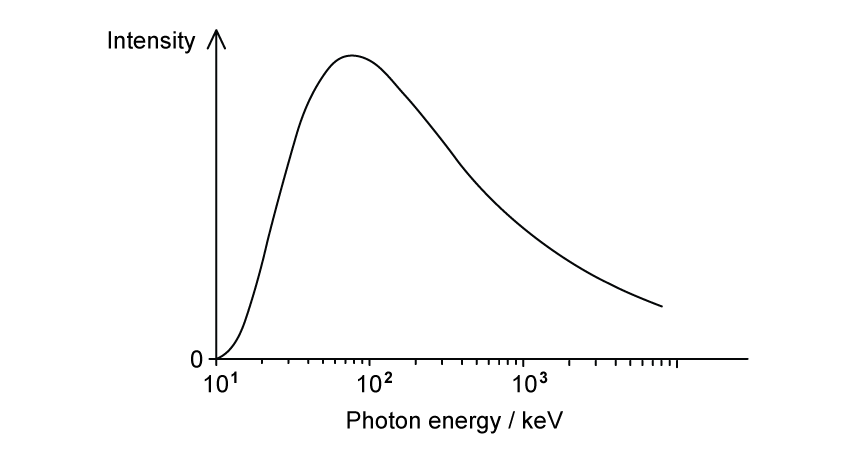
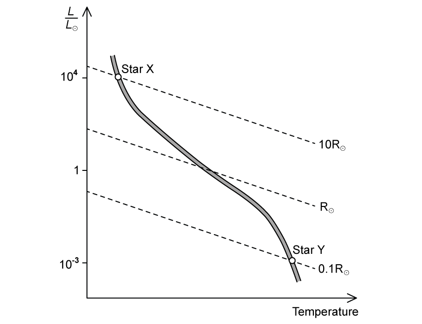
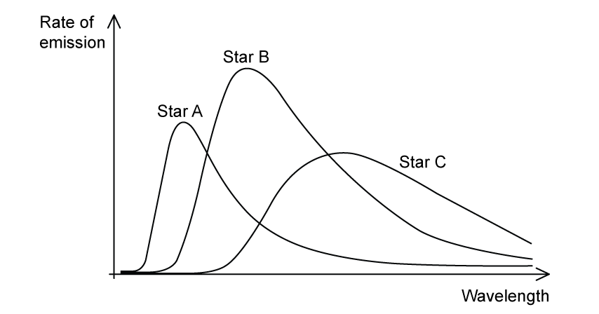
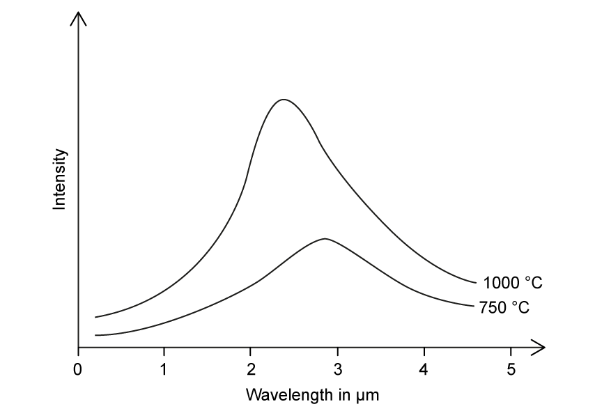
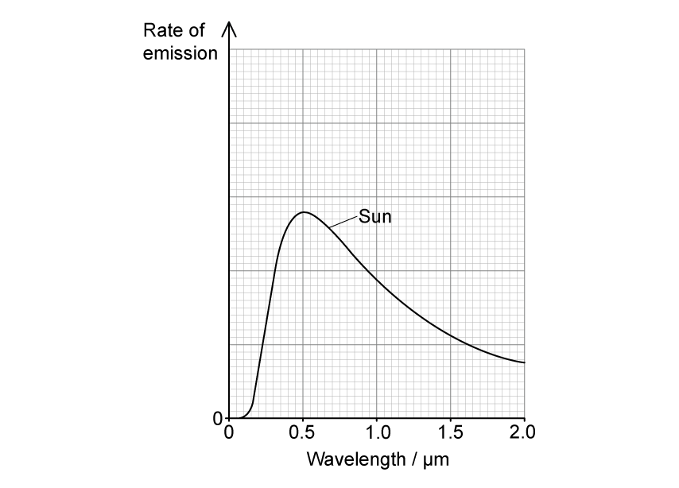

# Exam Questions — Stellar Radii
**25. Astronomy & Cosmology** · Cambridge (CIE) A-LEVEL physics (9702)
> Source: [https://www.savemyexams.com/a-level/physics/cie/25/topic-questions/](https://www.savemyexams.com/a-level/physics/cie/25/topic-questions/) · 8 questions across 1 sets

## Structured Questions (8 questions)

### Q1 — hard — 14 marks

**Q1** [6 marks]

In recent years, astronomers have discovered sources of fast radio bursts (FRBs) in other galaxies. Studies suggest that these sources may be a type of standard candle.

An FRB source emits intense bursts of radio waves, each burst lasting for a fraction of a second. The closest FRB source is in a massive spiral galaxy 4.60 × 1024 m from the Earth. A detector of area 1.00 × 10−4 m2 on the surface of the Earth received bursts of radio waves. In one burst, 9.40 × 10−23 J of energy was received in a time of 1.15 ms.

(i) Show that the luminosity of the source is about 2 × 1035 W.

[4]

(ii) When FRB sources were first discovered, some observers suggested that the bursts might be extraterrestrial communications.

Suggest why this is unlikely.

luminosity of the Sun = 3.8 × 1026 W

[2]

**Q1** [4 marks]

It has been suggested that FRBs are produced by a type of star known as a magnetar.

Magnetars are extremely dense, hot remnants of stars which produce intensely powerful magnetic fields. These magnetic fields power the emission of high-energy radiation, particularly X-rays and gamma rays.

Fig. 1.1 shows how the radiated intensity from a magnetar varies with photon energy.

**Fig. 1.1**

Using Fig. 1.1, determine the surface temperature of the magnetar.

Wien's displacement constant = 2.898 × 10−3 m K

**Q1** [4 marks]

**Extract:**

(a) Show that the luminosity of the source is about 2 × 10^35 W: L = 2.17 × 10^35 W

(b) Magnetars are extremely dense, hot remnants of stars. Determine the surface temperature of the magnetar: T = 1.865 × 10^8 K

Some literature about magnetars states they are similar in size to a large city.

Assess the accuracy of this statement.

### Q2 — hard — 13 marks

**Q2** [4 marks]

Fig. 1.1 shows the logarithmic relationship between luminosity `L over L subscript ☉` and temperature `T over T subscript ☉` for a sample of stars, where *L*☉ and *T*☉ represent the luminosity and temperature of the Sun respectively.

Two stars, X and Y, are shown with their corresponding radii, in terms of the radius of the Sun *R*☉.

**Fig. 1.1**

Deduce the colours of star X and star Y using the information in Fig. 1.1 and Table 1.1.

**Table 1.1**

| **star colour** | **surface temperature / T****☉** |
|---|---|
| blue | > 5.5 |
| blue-white | 1.7 − 5.5 |
| white | 1.3 − 1.7 |
| yellow-white | 1.0 − 1.3 |
| yellow | 0.8 − 1.0 |
| orange | 0.6 − 0.8 |
| red | < 0.6 |

**Q2** [3 marks]

**Extract:**

Fig. 1.1 shows the logarithmic relationship between luminosity L/L☉ and temperature T/T☉ for a sample of stars, where L☉ and T☉ represent the luminosity and temperature of the Sun respectively. Two stars, X and Y, are shown with their corresponding radii, in terms of the radius of the Sun R☉.
Luminosity of X, LX = 10^4 L☉
Luminosity of Y, LY = 10^−3 L☉
Radius of X, RX = 10R☉
Radius of Y, RY = 0.1R☉

The relationship between the mass *M* and luminosity *L* of the stars shown on Fig. 1.1 is given by

$L\proptoM^{3.5}$

Using this mass-luminosity relation and information from Fig. 1.1, determine the ratio

$\frac{densityofstarX}{densityofstarY}$

**Q2** [6 marks]

In 2017, an ultra-cool star in our galaxy Trappist-1 was discovered with at least five of its own orbiting planets.

Astronomers have studied it extensively to determine if there is a possibility of finding life on some of the planets orbiting Trappist-1.

Table 1.1 below shows some data.

**Table 1.1 **

|   | **Trappist-1** | **Sun** |
|---|---|---|
| **Luminosity *****L / L*****☉** | 5.26 × 10−4 | 1 |
| **Surface temperature *****T / T*****☉** | 0.4 | 1 |
| **Radius of star / *****R*****☉** | *R* | 1 |
| **Distance between Earth and Sun / m** | − | 1.5 × 1011 |
| **Distance between planets and Trappist-1 / m** | 1.6 × 109 to 9.0 × 109 | − |

The temperature *T,* in K, of a planet, its distance *d* from the star and the luminosity *L* of the star are related by the expression

$\frac{T^{4}d^{2}}{L}=419\times10^{3}$

(i) Show that the radius *R* of Trappist-1 is smaller than the radius of the Sun.

[2]

(ii) The average temperature of the Earth is about 290 K.

Using data from Table 1.1, comment on the possibility of life existing on some of the planets orbiting Trappist-1.

[4]

### Q3 — easy — 9 marks

**Q3** [1 mark]

State Wien’s displacement law.

**Q3** [3 marks]

The colour of a star indicates its surface temperature. In a sample of stars, the main colours observed are

| **white**  **blue**  **orange**  **yellow**  **red**  **blue-white**  **yellow-white** |
|---|

List the colours from the coolest to the hottest.

**Q3** [3 marks]

Fig. 1.1 shows how the rate of emission for three stars, A, B and C varies with wavelength.

**Fig. 1.1**

Using Fig. 1.1, identify

(i) the hottest star,

[1]

(ii) the coolest star,

[1]

(iii) the brightest star.

[1]

**Q3** [2 marks]

Fig. 1.2 shows the variation of wavelength with intensity for four different stars.

On Fig. 1.2, identify the visible, ultraviolet and infrared regions of the graph.

**Fig. 1.2**

### Q4 — medium — 11 marks

**Q4** [3 marks]

Table 1.1 summarises some information about four stars in the constellation Cygnus.

**Table 1.1**

| **Name** | **Colour** | **Luminosity / L****Sun** |
|---|---|---|
| Aljanah | orange | 62 |
| Deneb | blue-white | 196 000 |
| Fawaris | blue | 155 |
| Sadr | yellow-white | 33 000 |

Identify the star in Table 1.1 with

(i) the highest surface temperature,

[1]

(ii) the lowest surface temperature,

[1]

(iii) the largest radius.

[1]

**Q4** [3 marks]

Fig. 1.2 shows the rate of emission from two of the stars, Sadr and Aljanah, plotted against wavelength.

**Fig. 1.2**

Explain how the curves in Fig. 1.2 can be used to determine the surface temperature of the stars.

**Q4** [3 marks]

**Extract:**

Fig. 1.2 shows the rate of emission from two of the stars, Sadr and Aljanah, plotted against wavelength. From the graph: Sadr peak wavelength = 400 nm AND Aljanah peak wavelength = 650 nm.

The surface temperature of Aljanah is known to be 4700 K.

Determine the surface temperature of Sadr.

**Q4** [2 marks]

**Extract:**

Table 1.1 summarises some information about four stars in the constellation Cygnus. Name | Colour | Luminosity / L~Sun~: Aljanah | orange | 62; Deneb | blue-white | 196 000; Fawaris | blue | 155; Sadr | yellow-white | 33 000

Determine the surface temperature of Sadr: T_S = 7600 K

Calculate the radius of Sadr in units of solar radius RSun.

Radius of the sun, RSun = 6.96 × 108 m

Luminosity of the Sun, LSun = 3.83 × 1026 W

### Q5 — easy — 15 marks

**Q5** [1 mark]

In Table 1.1 below, place a tick (✓) next to the statement(s) that is/are associated with Wien's Law.

| the lower the surface temperature of a star, the shorter the wavelength it emits at the peak intensity |   |
|---|---|
| the relationship between the highest intensity wavelength and surface temperature of a star is inversely proportional |   |
| the higher the surface temperature of a star, the greater the intensity of the radiation emitted at each wavelength |   |
| the relationship between the lowest intensity wavelength and surface temperature of a star is inversely proportional |   |

**Table 1.1**

**Q5** [2 marks]

Fig. 1.1 shows the black body radiation curves of two stars with surface temperatures 750°C and 1000°C respectively.

**Fig. 1.1**

On Fig. 1.1, sketch a curve to show how the peak intensity of radiation varies with wavelength.

**Q5** [3 marks]

An astronomer observes a star which emits radiation with a peak emission wavelength of 644 × 10−9 m.

Show that the surface temperature of the star is 4500 K.

Wien's displacement constant = 2.898 × 10−3 m K

**Q5** [9 marks]

**Extract:**

An astronomer observes a star which emits radiation with a peak emission wavelength of 644 × 10^−9 m. Show that the surface temperature of the star is 4500 K. Wien's displacement constant = 2.898 × 10^−3 m K

The radius of the star is 5.6 × 109 m.

The Stefan-Boltzmann law can be written as:

$L=σAT^{4}$

(i) State the meaning of $L$, $A$ and $T$.

[3]

(ii) Calculate the value of $A$. State the correct unit.

[3]

(iii) Calculate the value of $L$. State the correct unit.

[3]

### Q6 — medium — 7 marks

**Q6** [3 marks]

A star has a luminosity that is known to be 4.8 × 1029 W. A scientist observing this star finds that the radiant flux intensity of light received on Earth from the star is 2.6 nW m–2.

(i) Name the term used to describe an astronomical object that has known luminosity.

[1]

(ii) Determine the distance of the star from Earth.

distance = ....................................... m [2]

*Source: Specimen 2022 Paper 4 Q12A*

**Q6** [4 marks]

**Extract:**

A star has a luminosity that is known to be 4.8 × 10^29 W. A scientist observing this star finds that the radiant flux intensity of light received on Earth from the star is 2.6 nW m^–2.

The Sun has a surface temperature of 5800 K. The wavelength $λ_{max}$ of light for which the maximum rate of emission occurs from the Sun is 500 nm.

The scientist observing the star in **(a)** finds that the wavelength for which the maximum rate of emission occurs from the star is 430 nm.

(i) Show that the surface temperature of the star in **(a)** is approximately 6700 K. Explain your reasoning.

[2]

(ii) Use the information in **(a)** and **(b)(i)** to determine the radius of the star.

radius = .................................... m [2]

*Source: Specimen 2022 Paper 4 Q12B*

### Q7 — medium — 11 marks

**Q7** [1 mark]

State what is meant by the luminosity of a star.

**Q7** [3 marks]

In a comparison of two stars, A and B, the following data was collected

Surface temperature of star A = 25 000 K

Surface temperature of star B = 4300 K

The radius of star B was determined to be 1.1 × 105 times larger than the radius of star A.

Calculate the ratio

$\frac{luminosityofstarB}{luminosityofstarA}$

**Q7** [3 marks]

**Extract:**

In a comparison of two stars, A and B, the following data was collected

Surface temperature of star A = 25 000 K

Surface temperature of star B = 4300 K

The wavelength λmax of light for which the maximum rate of emission occurs from the Sun is 5.00 × 10–7 m.

The surface temperature of the Sun is 5770 K.

Determine the wavelengths of light for which the maximum rate of emission occurs from stars A and B.

**Q7** [4 marks]

**Extract:**

The wavelength λ_max of light for which the maximum rate of emission occurs from the Sun is 5.00 × 10⁻⁷ m. The surface temperature of the Sun is 5770 K.
Maximum wavelength of star A: λ_A = 1.154 × 10⁻⁷ m = 0.1154 µm
Maximum wavelength of star B: λ_B = 6.709 × 10⁻⁷ m = 0.67 µm
Surface temperature of star A = 25 000 K; Surface temperature of star B = 4300 K.

Fig. 1.1 shows the variation of rate of emission against wavelength for the Sun.

**Fig. 1.1**

On Fig. 1.1, sketch the variation of rate of emission against wavelength for stars A and B.

### Q8 — easy — 8 marks

**Q8** [2 marks]

The Stefan-Boltzmann law states that the power output of a star depends on two factors.

Place a tick (✓) next to the **two** correct factors.

| **Mass** |   |
|---|---|
| **Radius** |   |
| **Surface temperature** |   |
| **Core temperature** |   |

**Q8** [2 marks]

The Sun emits radiation with a peak emission occurring at a wavelength of 5.2 × 10−7 m.

Show that the Sun has a surface temperature of about 6000 K.

Wien's displacement constant = 2.898 × 10−3 m K

**Q8** [2 marks]

The radiation received from the Sun at the top of the atmosphere is 1.37 kW m−2.

Show that the Sun's luminosity is about 4 × 1026 W.

Distance from the Sun to the Earth = 1.49 × 1011 m

**Q8** [2 marks]

**Extract:**

The Sun emits radiation with a peak emission occurring at a wavelength of 5.2 × 10^−7^ m. Show that the Sun has a surface temperature of about 6000 K. Wien's displacement constant = 2.898 × 10^−3^ m K. T = 2.898 × 10^−3 / 5.2 × 10^−7 = 5570 K

The radiation received from the Sun at the top of the atmosphere is 1.37 kW m^−2^. Show that the Sun's luminosity is about 4 × 10^26^ W. Distance from the Sun to the Earth = 1.49 × 10^11^ m. L = F × 4πd² = 1370 × 4π × (1.49 × 10^11)² = 3.82 × 10^26 W

Use the Stefan-Boltzmann law to determine the radius of the Sun.
