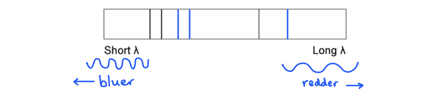
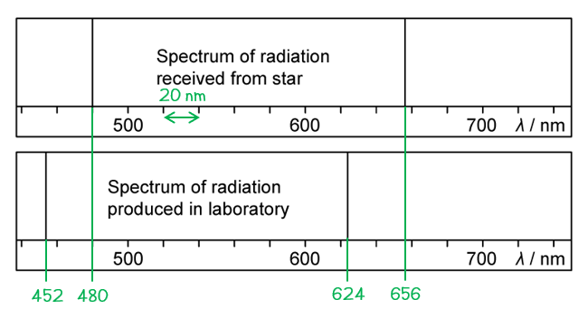
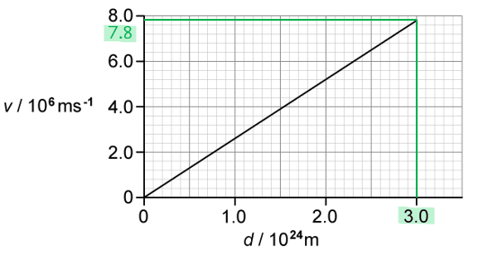
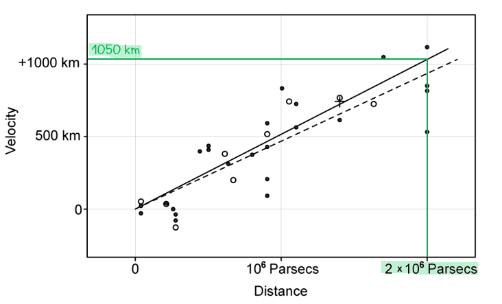
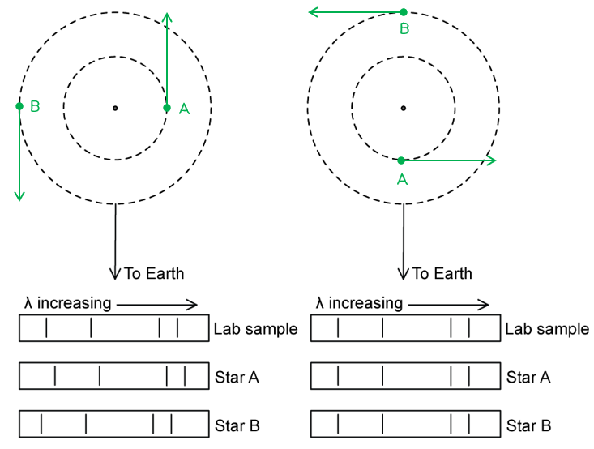

# Mark Schemes — Hubble’s Law & the Big Bang Theory
**25. Astronomy & Cosmology** · Cambridge (CIE) A-LEVEL physics (9702)

## Structured Questions (9 questions)

### Q1
Hubble's law states:

**EITHER**

- The (recessional) speed of a galaxy is (directly) proportional to its distance from the Earth; **[1 mark]**

**OR**

- $H_{0}=\frac{v}{d}$, where *v* = speed of recession of galaxy (from observer), *d *= distance of galaxy (away from observer); **[1 mark]**

**[Total: 1 mark]**
The Hubble constant can be used to determine an age for the universe from:

- $H_{0}=\frac{v}{d}$, the Hubble constant $H_{0}$ has units of s−1
- (Therefore) the age of the universe = $\frac{1}{H_{0}}$ **[1 mark]**

**[Total: 1 mark]**

> *Notice *$\frac{1}{H_{0}}$* will have units of **s** (seconds) which can then be converted into years for the age of the universe.*
Calculate the age of the universe in years.

List the known quantities:

- The Hubble constant, $H_{0}$ = 2.2 × 10–18 s–1
- 1 year = 3.15 × 107 s

Substitute the values into the age of the universe equation:

- Age of the universe = $\frac{1}{H_{0}}$
- Age of the universe = $\frac{1}{2.2\times10^{-18}}=4.54\times10^{17}s$ **[1 mark]**

Convert the age from seconds into years:

- Age of the universe = $\frac{4.54\times10^{17}}{3.15\times10^{7}}$ **[1 mark]**
- Age of the universe = $1.4\times10^{10}\mathrm{years}$ **[1 mark]**

**[Total: 3 marks]**

> *The age of the universe will always come out as around 14 billion years (14 × 10**9** years), so if your answer in the exam is ever wildly off from this you know that something has gone wrong in your calculation (most likely some powers or putting numbers in your calculator incorrectly!). *

> *You can also remember this value from the intro theme tune to 'The Big Bang Theory' American sitcom:*

> *'**Our whole universe was in a hot, dense state** **Then nearly fourteen billion years ago expansion started, wait**'*
The correct ticks (**✓**) are as follows:

| **Statement** | **Correct (✓)** |
|---|---|
| The universe began 14 million years ago |   |
| There was a giant explosion known as the big bang | **Final answer:** **✓** |
| This caused the universe to expand from a single point | **Final answer:** **✓** |
| It heated as it expanded to form the universe today | **Final answer:** ** ** |
| Each point in the universe expands away from the others | **Final answer:** **✓** |
| So, the further away galaxies are the slower they are moving |   |

- **One mark for each correct tick**

**[Total: 3 marks]**

- *The universe began 14 **billion** and not 14 million years ago*
- *The universe has **cooled** and not heated as it has expanded*
- *The further away galaxies are, the **faster** they are moving*

### Q2
Determine the current temperature of the CMB:

List the known quantities:

- Surface temperature of the Sun, $T_{Sun}$ = 5800 K
- Peak wavelength emission of the Sun, $λ_{Sun}$ = 500 nm
- Peak wavelength emission of the CMB, $λ_{CMB}$ = 1 mm

Use Wien's law to determine the temperature of the CMB:

- Wien's law:  $T\propto\frac{1}{λ_{max}}$
- Therefore, $\frac{T_{CMB}}{T_{Sun}}=\frac{λ_{Sun}}{λ_{CMB}}\RightarrowT_{CMB}=T_{Sun}\times\frac{λ_{Sun}}{λ_{CMB}}$
- $T_{CMB}=5800\times\frac{500\times10^{-9}}{1\times10^{-3}}$ **[1 mark]**
- $T_{CMB}=2.9K$ **[1 mark]**

**[Total: 2 marks]**
Determine the factor by which the universe has expanded:

- List the known quantities:

  - Initial temperature, $T_{then}$ = 3000 K
  - Final temperature, $T_{now}$ = 2.9 K (from **(a)**)

Use the relationship between energy and temperature for a photon:

- Energy-temperature relation for photons:  $E\proptoT$
- $\frac{energyofphotonsat3K}{energyofphotonsat3000K}=\frac{kT_{now}}{kT_{then}}=\frac{2.9}{3000}$ **[1 mark]**
- $\frac{energyofphotonsat3K}{energyofphotonsat3000K}=0.00097$ **[1 mark]**

Use the equation for photon energy

- Photon energy:  $E=\frac{hc}{λ}\Rightarrowλ\propto\frac{1}{E}$
- $\frac{λofphotonsat3K}{λofphotonsat3000K}=\frac{1}{0.00097}=1030$ **[1 mark]**

**[Total: 3 marks]**

> *Remember, redshift tells us the **factor of expansion** of the universe at different points in time/space, so in a question like this, you need to think about the relationships you know to try and get a ratio in terms of *$\frac{\Deltaλ}{λ}$

> *Since the difference in wavelengths between these temperatures is so large, *$\Deltaλ\approxλofphotonsat3K$
(i) The CMB provides evidence for the Hot Big Bang model of the universe because:

**EITHER**

- The wavelength of the CMB has been redshifted by an expanding and cooling universe; **[1 mark]**
- The shorter wavelength in the past indicates the temperature must have been very high at the beginning; **[1 mark]**

**OR**

- The temperature of the CMB has cooled considerably from *t* = 300 000 to now and even more since the Big Bang; **[1 mark]**
- This cooling was caused by the expansion of the universe / the stretching of spacetime; **[1 mark]**

(ii) The COBE data suggests that:

- The wavelength / intensity of the CMB is (almost) the same in all directions **OR** there is very little temperature variation in the CMB (on the scale of µK); **[1 mark]**
- This indicates that there was very little temperature variation in the early universe too; **[1 mark]**

**[Total: 4 marks]**

### Q3
Redshift is:

- The apparent wavelength of light is observed to be greater than its known / measured value; **[1 mark]**
- (Due to) an object / star / galaxy moving away (from an observer) **[1 mark]**

**[Total: 2 marks]**
Cosmologists are able to determine that light from a distant star has undergone redshift by:

- Examining the (lines in the) spectrum (of light from the star); **[1 mark]**
- And comparing the lines with its known spectrum (of light measured on Earth); **[1 mark]**

**[Total: 2 marks]**
The main ideas of the Big Bang theory are:

- The Universe started with an explosion / Big Bang; **[1 mark]**
- All matter and energy was concentrated at a (single) point; **[1 mark]**
- The explosion caused the universe to expand** **from this (single) point; **[1 mark]**

**[Total: 3 marks]**
The redshift of galaxies is considered to be evidence for the Big Bang theory because:

- If the Universe is expanding, then it must have been closer together in the past; **[1 mark]**
- The expansion of the Universe can be extrapolated back to its point of origin (known as the Big Bang); **[1 mark]**

**[Total: 2 marks]**

> *If the Universe is expanding at a measurable rate, then it makes sense that if we were able to rewind this expansion we would find a point in time where the Universe existed at a single point in time and space (called a singularity). This is the point at which the Big Bang is thought to have occurred. By doing this, scientists have been able to estimate the age of the Universe to be about 13.7 billion years old.*

### Q4
The Universe has expanded by:

- Factor = $\frac{722}{656}=1.1$ or 10% **[1 mark]**

**[Total: 1 mark]**
Comparing values of cosmological redshift for distant galaxies provides evidence for the Big Bang theory because:

**Final answer:** **Any ****one**** from:**

- The more distant the galaxy, the longer the light travels through space and expands / stretches; **[1 mark]**
- The more distant the galaxy, the greater the redshift / expansion / stretching of wavelength; **[1 mark]**
- The more distant the galaxy, the faster it recedes / moves away (from an observer); **[1 mark]**

This provides evidence for the Big Bang theory because:

- (Increasing redshift suggests that) the universe is expanding; **[1 mark]**
- (Expansion suggests that) at an earlier point in time **OR** at the beginning / origin of time; **[1 mark]**
- The universe was a single point; **[1 mark]**

**[Total: 4 marks]**
The significance of the minus sign is:

- The light from Andromeda is <u>blue</u>shifted **OR** Andromeda is moving towards us / the Milky Way; **[1 mark]**

The implication of this is:

- Andromeda will hit / collide with the Milky Way (in the distant future); **[1 mark]**

**[Total: 2 marks]**
List the known quantities:

- 1 year = 3.15 × 107 s
- Speed of light, *c* = 3.0 × 108 m s−1

(i) Complete Table 1.1:

| **Galaxy** | **Red-shift** | **Recessional velocity / km s****−1** | **Distance / km** |
|---|---|---|---|
| NGC 247 | 8.0 × 10−4 | **Final answer:** **240** | 1.1 × 1020 |
| NGC 1357 | **Final answer:** **4.0 × 10****−3** | 1200 | **Final answer:** **5.5 × 10****20** |

- Redshift:  $z=\frac{v}{c}\Rightarrowv=cz$
- Recessional velocity of NGC 247: * v* = (3.0 × 108) × (8.0 × 10−4) = 240 000 = 240 km s–1 **[1 mark]**
- Redshift of NGC 1357:  $z=\frac{1200\times10^{3}}{3\times10^{8}}$ = 4.0 × 10−3 **[1 mark]**

Use Hubble's law to calculate the distance of NGC 247:

- Hubble's law:  $v=H_{0}d$ **[1 mark]**
- Distance of NGC 247:  $H_{0}=\frac{v_{247}}{d_{247}}=\frac{v_{1357}}{d_{1357}}\Rightarrowd_{1357}=d_{247}\times\frac{v_{1357}}{v_{247}}$
- Distance of NGC 247:  `d subscript 1357 space equals space open parentheses 1.1 cross times 10 to the power of 20 close parentheses cross times 1200 over 240`
- Distance of NGC 247:  $d_{1357}$ = 5.5 × 1020 km **[1 mark]**

(ii) Estimate the age, in years, of the Universe:

- Hubble constant:  $H_{0}=\frac{v}{d}=\frac{240\times10^{3}}{1.1\times10^{20}}$
- Hubble constant: $H_{0}$ = 2.18 × 10−18 s−1 **[1 mark]**
- Age of Universe:  $t=\frac{1}{H_{0}}=\frac{1}{2.18\times10^{-18}}=4.58\times10^{17}s$
- Age of Universe:  $t=\frac{4.58\times10^{17}}{3.15\times10^{7}}=1.46\times10^{10}$ years **[1 mark]**

**[Total: 6 marks]**

### Q5
The redshifted emission spectrum would show:

- All the lines moved / shifted towards the 'long λ' side; **[1 mark]**
- By the same amount; **[1 mark]**

**[Total: 2 marks]**

> *When an object is moving away from an observer the wavelength of the light increases or becomes longer*

> *As the wavelength of light increases, it moves towards the red end of the spectrum, hence the name red shift*

> *Hence, all the lines will be shifted by the same amount *

Blueshift means that:

- The galaxy is moving <u>towards</u> the observer; **[1 mark]**

This is because:

- Blueshift is a decrease in the observed wavelength of light (emitted from incoming stars and galaxies) **OR**
- The light from distant galaxies has a shorter wavelength than the same light observed on Earth; **[1 mark]**

**[Total: 2 marks]**

> *The change in the wavelength of the observed light can tell us about the motion of the galaxy relative to the Earth*

- *If it is moving **away** from the Earth, the wave will spread out, hence the **wavelength will increase** and appear more **red** (hence the term 'red shift')*
- *If it is moving **towards **the Earth, the wave will bunch together, hence the **wavelength will decrease** and appear more** blue** (hence the term 'blue shift')*
Compare the motions of galaxy 1a and galaxy 1b relative to Earth:

Determine the change in wavelength for galaxy 1a:

- $\Deltaλ=λ-λ_{0}$
- $\Deltaλ_{1a}$ = 486.40 − 486.14 = 0.26 nm
- (Therefore,) galaxy 1a is moving <u>away</u> from Earth; **[1 mark]**

Determine the change in wavelength for galaxy 1b:

- $\Deltaλ_{1b}$ = 484.85 − 486.14 = −1.29 nm
- (Therefore,) galaxy 1b is moving <u>towards</u> Earth; **[1 mark]**

State their relative speeds:

- (And) galaxy 1b is moving <u>faster</u> than galaxy 1a; **[1 mark]**

**[Total: 3 marks]**

> *If Δ**λ** is **positive** then the galaxy is **moving away** from the Earth. This is also known as **redshift**.*

> *If Δ**λ **is **negative** then the galaxy is **moving towards** the Earth. This is also known as **blueshift**.*
Calculate the speed of galaxy 1b relative to the Earth:

List the known quantities:

- Wavelength in laboratory, $λ_{0}$ = 486.14 nm
- Wavelength from galaxy 1b, $λ$* *= 484.85 nm
- Speed of light, *c* = 3.0 × 108 m s−1
- Change in wavelength for galaxy 1b, Δ*λ *= (−)1.29 nm (from **(c)**)

Rearrange the equation and substitute values, to calculate *v*:

- $\frac{Δλ}{λ_{0}}=\frac{v}{c}\Rightarrowv=c\times\frac{Δλ}{λ_{0}}$ **[1 mark]**
- `v space equals space open parentheses 3.0 cross times 10 to the power of 8 close parentheses space cross times space fraction numerator 1.29 over denominator 486.14 end fraction` **[1 mark]**
- Speed of galaxy 1b = 796 067 = 7.96 × 105 m s−1 **[1 mark]**

**[Total: 3 marks]**

### Q6
The spectrum 'shifts' of the dark lines tell us that the galaxies are:

- Moving <u>away</u> from us / from Earth; **[1 mark]**
- Because the lines are shifted towards the <u>red</u> end of the spectrum / they have been redshifted; **[1 mark]**

**[Total: 2 marks]**
(i) The galaxy moving faster is:

- Galaxy B; **[1 mark]**

(ii) The galaxy that is closer to the Earth is:

- Galaxy A; **[1 mark]**

**[Total: 2 marks]**

> *The greater the redshift, the faster a galaxy is moving away from us. Hubble's law states that the further away a galaxy is, the faster it is moving away from us.*
Calculate the recession velocity of Galaxy A:

List the known quantities:

- Distance, *d* = 150 × 109 km
- Hubble constant = 2.2 × 10–18 s–1

Use Hubble's law to calculate recession velocity:

- Hubble's law:  $v=H_{0}d$ **[1 mark]**
- `v space equals space open parentheses 2.2 space cross times space 10 to the power of negative 18 end exponent close parentheses space cross times space open parentheses 150 space 000 space cross times space 10 to the power of 9 close parentheses` **[1 mark]**
- $v=3.3\times10^{-4}ms^{-1}$ **[1 mark]**

**[Total: 3 marks]**
Determine the recession velocity of galaxy C:

List the known quantities:

- Recession velocity of Galaxy A = 3.3 × 10–4 m s–1 (from **(c)**)

Calculate the recession velocity of galaxy C:

- Hubble's law:  $v\proptod$
- Galaxy C velocity = 2 × (3.3 × 10–4) **[1 mark]**
- Galaxy C velocity = 6.6 × 10–4 m s–1 **[1 mark]**

**[Total: 2 marks]**

> *Since the Hubble constant is the same, if a galaxy is twice as far, it must be travelling at twice the speed. Speed and distance are directly proportional to each other according to Hubble's law.*

### Q7
Determine the distance of the galaxy from Earth:

Use the line spectra to identify the wavelengths of the emitted radiation:

- (From diagram)  $λ_{star}=480\mathrm{nm}$  **AND ** $λ_{lab}=454\mathrm{nm}$ **[1 mark]**
- Shift in wavelength:  $\Deltaλ=480-454=26\mathrm{nm}$ **[1 mark]** *Acceptable range for λ**star** = 479 to 480 nm * *Acceptable range for λ**lab** = 452 to 456 nm *

Determine the recessional velocity of the galaxy:

- Doppler redshift:  $\frac{\Deltaλ}{λ}\approx\frac{v}{c}\Rightarrowv=c\times\frac{\Deltaλ}{λ}$
- `v space equals space open parentheses 3 cross times 10 to the power of 8 close parentheses cross times 26 over 454 space equals space 1.72 space cross times space 10 to the power of 7 space straight m space straight s to the power of negative 1 end exponent`** [1 mark]**

Determine the gradient (Hubble constant) from the graph

- Hubble's law:  $v=H_{0}d$
- $H_{0}=\frac{\Deltav}{\Deltad}=\frac{7.8\times10^{6}}{3.0\times10^{24}}=2.6\times10^{-18}s^{-1}$ **[1 mark]**

Determine the distance to the galaxy:

- $d=\frac{v}{H_{0}}=\frac{1.72\times10^{7}}{2.6\times10^{-18}}=6.6\times10^{24}m$ **[1 mark]**

**[Total: 5 marks]**

> *Make sure to use a **ruler** to identify the wavelengths between those identified on the axis as **accurately** as possible*

> *You could use the **other wavelengths** in your calculation to get the **same answer**:*

- $λ_{star}=656nm$*:*
- *Acceptable range: 654 to 658 nm*

- $λ_{lab}=624nm$* *
- *Acceptable range: 622 to 626 nm *

> *In the Doppler shift equation *$λ$* = *$λ_{lab}$* because this is the **source radiation**, the radiation from the star is compared with this*
(i) Determine the age of the universe when the light from the distant galaxy was emitted:

List the known quantities from **(a)**:

- Emitted wavelength, *λ* = 454 nm
- Change in wavelength, Δ*λ* = 26 nm
- Hubble constant, *H*0 = 2.6 × 10−18 s−1

Calculate the value of redshift for the galaxy:

- Redshift:  $z\approx\frac{\Deltaλ}{λ}=\frac{26}{454}=0.057$ **[1 mark]**

Use the expression to determine the expansion rate of the universe:

- Expansion rate:  $\frac{R}{R_{0}}=1+z=1+0.057=1.057$
- Expansion rate:  $\frac{R}{R_{0}}=\frac{t}{t_{0}}=1.057$ **[1 mark]**

Determine the age of the universe:

- Age of the universe (now):  $t=\frac{1}{H_{0}}$
- $t=\frac{1}{2.6\times10^{-18}}=3.85\times10^{17}s$
- $t=\frac{3.85\times10^{17}}{60\times60\times24\times365}=12.2\times10^{9}\mathrm{years}$ **[1 mark]**

Determine the age of the universe when the light was emitted:

- Age of the universe (then):  $\frac{t}{t_{0}}=1.057\Rightarrowt_{0}=\frac{t}{1.057}$
- $t_{0}=\frac{12.2\times10^{9}}{1.057}=11.5\times10^{9}\mathrm{years}$ **[1 mark]**
- Therefore, the universe was 11.5 billion years old when the light was emitted

(ii) The assumption made in the calculation is:

- The rate of expansion (of the universe) is uniform / constant / non-accelerated **OR** *H*0 is constant over time; **[1 mark]**

**[Total: 5 marks]**

> *The alternative method you could use is to consider how far the light has travelled in light years and subtract this from the age of the universe, this is because *

- *1 light year = the **distance** travelled by light in one year*
- *1 light year = speed of light (m s**−1**) × time (seconds in 1 year) *
- *1 light year = (3 × 10**8**) × (60 × 60 × 24 × 365)*

> *Although you are not required to know anything about light years for your exam, using your knowledge of light in this way can help to further your understanding of the topic of cosmology and the vast distances involved*

> *Over a distance of 6.6 × 10**24** m (from **(a)**), light has travelled*

- *distance (ly) = *`fraction numerator 6.6 cross times 10 to the power of 24 over denominator open parentheses 3 cross times 10 to the power of 8 close parentheses cross times open parentheses 60 cross times 60 cross times 24 cross times 365 close parentheses end fraction`* = 6.98 × 10**8** ly*

> *This means the light was emitted **0.7 billion years** ago*

> *At this time, the universe was (12.2 − 0.7) = **11.5 billion years old*
(i) Determine Hubble's original estimate for the age of the universe:

List the known quantities:

- Age of the universe, *t* = 12.2 × 109 years (from **(b)**)

Determine the gradient of the graph:

- `H subscript 0 space equals space fraction numerator increment v over denominator increment d end fraction space equals space fraction numerator 1050 cross times 10 cubed over denominator open parentheses 2 cross times 10 to the power of 6 close parentheses cross times open parentheses 3.09 cross times 10 to the power of 16 close parentheses end fraction`
- $H_{0}=1.699\times10^{-17}s^{-1}$ **[1 mark]**

Determine Hubble's estimate for the age:

- $t=\frac{1}{H_{0}}=\frac{1}{1.699\times10^{-17}}=5.89\times10^{16}s$
- $t=\frac{5.89\times10^{16}}{60\times60\times24\times365}=1.9\times10^{9}\mathrm{years}$ **[1 mark]** *Acceptable range for t (if upper line used) = 1.8 to 2.0 billion years* *Acceptable range for t (if lower line used) = 2.1 to 2.3 billion years*

Compare to the modern estimate:

- Hubble's original estimate is about (12.2 − 1.9 =) 10 billion years lower than our modern estimate of the universe's age; **[1 mark]**

(ii) Measurements of the Hubble constant do not agree with each other because:

**Final answer:** **Any ****two**** from:**

- Measurements from distant galaxies have large uncertainties;** [1 mark]**
- Galaxies that are close by (enough to observe finer detail) may have peculiar motion e.g. galaxies moving towards us (blueshifted) / (two or more) galaxies orbiting around a centre of mass etc; **[1 mark]**
- Galaxies were not formed at the beginning of the universe, hence *H*0 is a lower limit; **[1 mark]**
- The rate of expansion may not be constant / may be accelerating; **[1 mark]**

**[Total: 5 marks]**

### Q8
(i) Hubble's Law is:

- Speed is (directly) proportional to distance **OR** $v=H_{0}d$; **[1 mark]**
- Where speed *v* is the speed of recession of the galaxy (from the observer) and distance *d* is the distance of the galaxy away from the observer; **[1 mark]**

(ii) The significance of the term $H_{0}$ is:

- The age of the universe = $\frac{1}{H_{0}}$; **[1 mark]**

**[Total: 3 marks]**
Cosmologists use observations of emission spectra from stars in distant galaxies to determine that the Universe is expanding by:

- If the wavelengths (of spectral lines) are greater (than their measured values on Earth); **[1 mark]**
- This redshift show that the stars (in distant galaxies) are moving away from Earth; **[1 mark]**

**[Total: 2 marks]**
These ideas lead to the Big Bang theory of the origin of the Universe because:

- (All) parts of the Universe are moving away from each other; **[1 mark]**
- More distant objects are moving away faster; **[1 mark]**
- (Therefore) matter must have been close together / very dense in the past; **[1 mark]**

**[Total: 3 marks]**
Distance of type 1a supernovae and other data can be used to find the Hubble constant as:

The other data needed is:

- (Recessional) velocity / redshift; **[1 mark]**
- (Obtained) From measurements of the wavelength of spectral lines (from type 1a supernovae); **[1 mark]**

To determine a value for the Hubble constant:

- Plot a graph of velocity (on the* y*-axis) against distance (on the *x*-axis); **[1 mark]**
- The Hubble constant $H_{0}$ is the <u>gradient</u> of the graph; **[1 mark]**

**[Total: 4 marks]**

### Q9
The position of the stars corresponding to their spectra as observed on Earth is as follows:

On Fig. 1.2a...

- Star A (inner orbit) is marked to the <u>right</u> of the centre of mass with an arrow directed <u>away</u> from the Earth; **[1 mark]**
- Star B (outer orbit) is marked to the <u>left</u> of the centre of mass with an arrow directed <u>towards</u> the Earth; **[1 mark]**

On Fig. 1.2b...

- Both stars are marked directly above/below the centre of mass (in their respective orbits); **[1 mark]**
- Both arrows are <u>perpendicular</u> relative to the Earth in an anti-clockwise direction; **[1 mark]**

**[Total: 4 marks]**
Calculate the velocity of the each star:

List the known quantities:

- Wavelength of spectral line in a lab, $λ$= 4.861 × 10−7 m
- Change in wavelength of slower star, $\Deltaλ$= 0.420 × 10−7 m
- Change in wavelength of faster star, $\Deltaλ$ = 0.865 × 10−7 m
- Speed of light, *c* = 3.0 × 108 m s−1

Calculate the velocity of the slower star:

- Doppler redshift:  $\frac{\Deltaλ}{λ}\approx\frac{v}{c}\Rightarrowv=c\times\frac{\Deltaλ}{λ}$
- Since $\Deltaλ\proptov$, for the slower star:  $\Deltaλ$ = 0.420 × 10−7 m
- `v space equals space open parentheses 3.0 cross times 10 to the power of 8 close parentheses cross times fraction numerator 0.420 over denominator 4.861 end fraction` **[1 mark]**
- $v=2.59\times10^{7}ms^{-1}$ **[1 mark]**

Calculate the velocity of the faster star:

- For the faster star:  $\Deltaλ$ = 0.865 × 10−7 m
- `v space equals space open parentheses 3.0 cross times 10 to the power of 8 close parentheses cross times fraction numerator 0.865 over denominator 4.861 end fraction`
- $v=5.34\times10^{7}ms^{-1}$ **[1 mark]**

Identify the velocities of stars A and B:

- Orbital speed:  $v=\frac{2πr}{T}\Rightarrowv\proptor$
- Star A has the smaller orbital *r*, hence it is the slower star / $v_{A}=2.59\times10^{7}ms^{-1}$ **OR**
- Star B has the larger orbital *r*, hence it is the faster star / $v_{B}=5.34\times10^{7}ms^{-1}$; **[1 mark]**

**[Total: 4 marks]**
Show that the orbital radius of star B is about twice the orbital radius of star A:

List the known values:

- Period of system, *T* = 21 days = 21 × (60 × 60 × 24) = 1.81 × 106 s
- Velocity of star A, *v*A = 2.59 × 107 m s−1 (from **(b)**)
- Velocity of star B, *v*B = 5.34 × 107 m s−1 (from **(b)**)

Determine the orbital radius of star A:

- Orbital speed:  $v=\frac{2πr}{T}\Rightarrowr=\frac{vT}{2π}$
- `r subscript A space equals space fraction numerator open parentheses 2.59 cross times 10 to the power of 7 close parentheses open parentheses 1.81 cross times 10 to the power of 6 close parentheses over denominator 2 straight pi end fraction space equals space 7.46 cross times 10 to the power of 12 space straight m` **[1 mark]**

Determine the orbital radius of star B:

- `r subscript B space equals space fraction numerator open parentheses 5.34 cross times 10 to the power of 7 close parentheses open parentheses 1.81 cross times 10 to the power of 6 close parentheses over denominator 2 straight pi end fraction space equals space 15.4 cross times 10 to the power of 12 space straight m` **[1 mark]**

Determine the ratio of the orbits:

- Ratio:  $\frac{r_{B}}{r_{A}}=\frac{15.4\times10^{12}}{7.46\times10^{12}}=2.064=2.1$ **[1 mark]**

**[Total: 3 marks]**
