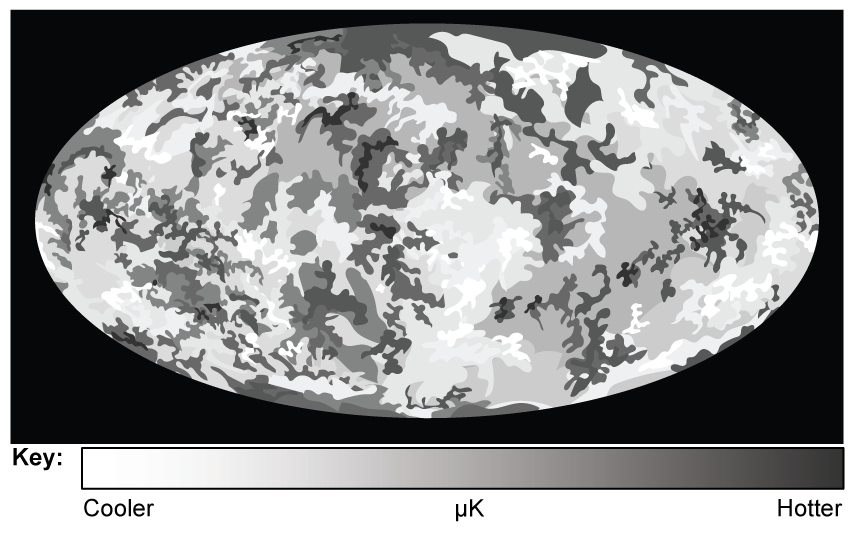
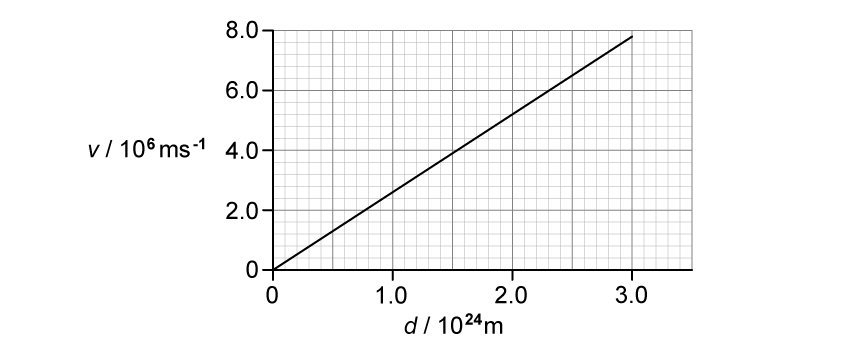
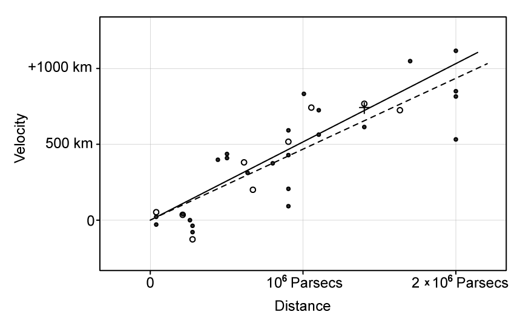
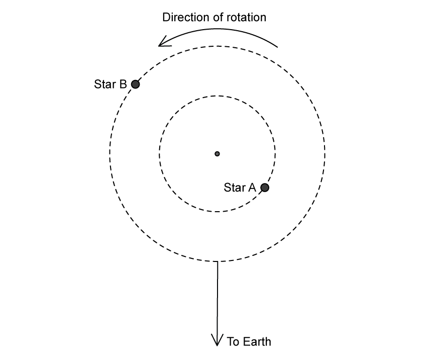

# Exam Questions — Hubble’s Law & the Big Bang Theory
**25. Astronomy & Cosmology** · Cambridge (CIE) A-LEVEL physics (9702)
> Source: [https://www.savemyexams.com/a-level/physics/cie/25/topic-questions/](https://www.savemyexams.com/a-level/physics/cie/25/topic-questions/) · 9 questions across 1 sets

## Structured Questions (9 questions)

### Q1 — easy — 8 marks

**Q1** [1 mark]

State Hubble's law.

**Q1** [1 mark]

**Extract:**

Hubble's law states: The (recessional) speed of a galaxy is (directly) proportional to its distance from the Earth; OR H_0 = v/d, where v = speed of recession of galaxy (from observer), d = distance of galaxy (away from observer).

Explain how the Hubble constant can be used to determine an age for the universe.

**Q1** [3 marks]

**Extract:**

Explain how the Hubble constant can be used to determine an age for the universe.

The Hubble constant can be used to determine an age for the universe from: H_0 = v/d, the Hubble constant H_0 has units of s^−1. (Therefore) the age of the universe = 1/H_0

The Hubble constant is estimated to be 2.2 × 10–18 s–1

Calculate the age of the Universe in years.

1 year = 3.15 × 107 s

**Q1** [3 marks]

Hubble’s law and the idea of the expanding Universe support the Big Bang theory of the origin of the Universe. Table 1.1 contains statements about this theory.

Place ticks (**✓**) next to the statements that are correct.

**Table 1.1**

| **Statement** | **Correct (✓)** |
|---|---|
| The universe began 14 million years ago |   |
| There was a giant explosion known as the big bang |   |
| This caused the universe to expand from a single point |   |
| It heated as it expanded to form the universe today |   |
| Each point in the universe expands away from the others |   |
| So, the further away galaxies are the slower they are moving |   |

### Q2 — hard — 9 marks

**Q2** [2 marks]

Newton assumed that the universe was infinite, uniform and static. The Big Bang model suggests space and time originated at one point around 14 billion years ago. At this time the temperature was very high.

In 1965, Penzias and Wilson discovered cosmic microwave background (CMB) radiation with a wavelength of around 1 mm.

Determine the current temperature of the CMB.

Surface temperature of the Sun = 5800 K

Peak wavelength emission of the Sun = 500 nm

**Q2** [3 marks]

**Extract:**

Determine the current temperature of the CMB: T_CMB = 2.9 K (calculated using Wien's law with Surface temperature of the Sun = 5800 K, Peak wavelength emission of the Sun = 500 nm, and Peak wavelength emission of the CMB = 1 mm)

Fig. 1.1 shows the map of microwave background radiation from the COBE satellite. It shows the variation in the mean temperature of the CMB in different parts of the sky.

**Fig. 1.1**

This radiation was first emitted around 300 000 years after the Big Bang, during a stage of the universe's history called the 'era of recombination'.

At this stage, the radiation was in the visible region of the spectrum and had a temperature of around 3000 K.

Determine the factor by which the universe has expanded since the universe was at a temperature of 3000 K.

**Q2** [4 marks]

**Extract:**

In 1965, Penzias and Wilson discovered cosmic microwave background (CMB) radiation with a wavelength of around 1 mm.
Fig. 1.1 shows the map of microwave background radiation from the COBE satellite. It shows the variation in the mean temperature of the CMB in different parts of the sky. Fig. 1.1. This radiation was first emitted around 300 000 years after the Big Bang, during a stage of the universe's history called the 'era of recombination'. At this stage, the radiation was in the visible region of the spectrum and had a temperature of around 3000 K.

Using Fig. 1.1, your answers to **(a)** and **(b)**, and your knowledge of redshift and cosmology

(i) Describe how the CMB provides evidence for the Hot Big Bang model of the universe.

[2]

(ii) State and explain what the COBE data in Fig. 1.1 suggests about the temperature variation in the early universe.

[2]

### Q3 — easy — 9 marks

**Q3** [2 marks]

State what is meant by redshift.

**Q3** [2 marks]

Explain how cosmologists are able to determine that light from a distant star has undergone redshift.

**Q3** [3 marks]

The Big Bang theory attempts to explain the origin of the Universe.

Describe the main ideas of the Big Bang theory.

**Q3** [2 marks]

Explain why the redshift of galaxies is considered to be evidence for the Big Bang theory.

### Q4 — medium — 13 marks

**Q4** [1 mark]

An astronomer analyses the light from a distant galaxy.

One of the observed spectral lines of hydrogen has a wavelength of 722 nm. The same spectral line has a wavelength of 656 nm when measured in the laboratory.

Calculate the factor by which the Universe has expanded since the light was emitted from the source.

**Q4** [4 marks]

Explain how comparing the values of cosmological redshift for distant galaxies provides evidence for the Big Bang theory.

**Q4** [2 marks]

Cosmologists commonly quote the recessional velocity *v* of astronomical objects in relation to the speed of light *c*. This ratio is known as redshift *z*:

$z=\frac{v}{c}$

The Andromeda galaxy is the closest galaxy to our own Milky Way. Andromeda has a redshift value of z = −0.001.

State the significance of the minus sign and discuss its implication for the Milky Way and Andromeda in the distant future.

**Q4** [6 marks]

**Extract:**

Cosmologists commonly quote the recessional velocity v of astronomical objects in relation to the speed of light c. This ratio is known as redshift z: z = v/c

Table 1.1 contains information about two galaxies.

**Table 1.1**

| **Galaxy** | **Red-shift** | **Recessional velocity / km s****−1** | **Distance / km** |
|---|---|---|---|
| NGC 247 | 8.0 × 10−4 |   | 1.1 × 1020 |
| NGC 1357 |   | 1200 |   |

(i) Complete the missing information in Table 1.1.

[2]

(ii) Use the data to estimate the age, in years, of the Universe.

1 year = 3.15 × 107 s

[4]

### Q5 — medium — 10 marks

**Q5** [2 marks]

Fig. 1.1 shows the emission spectrum of some wavelengths of light that were observed using a source in a laboratory.

**Fig. 1.1**

The same wavelengths of light were observed on an emission spectrum from a distant galaxy but were found to be redshifted.

Describe how you would expect the emission spectrum of the distant galaxy to look compared to the spectrum in Fig. 1.1.

**Q5** [2 marks]

An astronomer observes that light from a galaxy has been shifted towards the blue end of an emission spectrum.

State and explain what can be deduced about the motion of the galaxy from this observation.

**Q5** [3 marks]

Hydrogen is an element of particular interest to cosmologists, as it can emit visible light waves.

A lot of useful information can be obtained by measuring the wavelength of the emitted light from the hydrogen in distant galaxies and comparing them to a laboratory sample. Some sample data is shown in Table 1.2.

**Table 1.2**

|   | **Wavelength in nm** |
|---|---|
| **Laboratory sample** | 486.14 |
| **Galaxy 1a** | 486.40 |
| **Galaxy 1b** | 484.85 |

Galaxy 1a and galaxy 1b are both moving relative to Earth.

Compare the motions of galaxy 1a and galaxy 1b relative to Earth.

**Q5** [3 marks]

**Extract:**

A lot of useful information can be obtained by measuring the wavelength of the emitted light from the hydrogen in distant galaxies and comparing them to a laboratory sample. Some sample data is shown in Table 1.2.

Table 1.2
Wavelength in nm
Laboratory sample: 486.14
Galaxy 1a: 486.40
Galaxy 1b: 484.85

Use data from Table 1.2 to calculate the speed of galaxy 1b relative to Earth.

### Q6 — easy — 9 marks

**Q6** [2 marks]

The visible part of the electromagnetic spectrum from a star includes a dark line. This line is at a specific wavelength.

Fig 1.1 shows the position of the dark line in the spectrum from the Sun and in the spectrum from two different galaxies, galaxy A and galaxy B.

Explain what the spectrum ‘shifts’ of the dark lines tell us about the direction of the galaxies.

**Q6** [2 marks]

**Extract:**

The visible part of the electromagnetic spectrum from a star includes a dark line. This line is at a specific wavelength. Fig 1.1 shows the position of the dark line in the spectrum from the Sun and in the spectrum from two different galaxies, galaxy A and galaxy B.

Using Fig. 1.1, state which galaxy is

(i) moving faster,

[1]

(ii) closest to the Earth.

[1]

**Q6** [3 marks]

Galaxy A is at a distance of 150 × 109 km away from the Earth.

Calculate the recession velocity of galaxy A.

Hubble constant = 2.2 × 10–18 s–1

**Q6** [2 marks]

**Extract:**

Galaxy A is at a distance of 150 × 10^9 km away from the Earth. Calculate the recession velocity of galaxy A. Hubble constant = 2.2 × 10^–18 s^–1. v = H_0 d = (2.2 × 10^-18) × (150000 × 10^9) = 3.3 × 10^-4 m s^-1

A galaxy C is twice as far as galaxy A.

Determine the recession velocity of galaxy C.

### Q7 — hard — 15 marks

**Q7** [5 marks]

Fig. 1.1a shows the variation of recession velocity *v* for a number of galaxies with their approximate distance *d* from Earth.

**Fig. 1.1a**

Radiation from a star in a distant galaxy is analysed.

Fig. 1.1b shows the spectral lines of the radiation from the star at different wavelengths compared to the same spectral lines produced by a source in the laboratory.

**Fig 1.1b**

Using the information in Fig. 1.1a and 1.1b, determine the distance of this galaxy from Earth.

**Q7** [5 marks]

**Extract:**

Fig. 1.1a shows the variation of recession velocity v for a number of galaxies with their approximate distance d from Earth. Radiation from a star in a distant galaxy is analysed. Fig. 1.1b shows the spectral lines of the radiation from the star at different wavelengths compared to the same spectral lines produced by a source in the laboratory. Using the information in Fig. 1.1a and 1.1b, determine the distance of this galaxy from Earth.

From the mark scheme: λ_star = 480 nm AND λ_lab = 454 nm; Shift in wavelength Δλ = 480 − 454 = 26 nm; v = (3 × 10⁸) × (26/454) = 1.72 × 10⁷ m s⁻¹; Hubble constant H₀ = 2.6 × 10⁻¹⁸ s⁻¹; distance d = v/H₀ = 6.6 × 10²⁴ m.

Astronomers use the cosmic scale factor *R* to describe the scaling up of physical distances in the Universe.

As the universe expands, the wavelength of the detected radiation at a time *t* is larger than it was at a time* t*0 in the past by a factor of

$\frac{R}{R_{0}}=1+z$

This expression represents the expansion rate of the universe.

Where* R* represents the separation of two galaxies at time *t*, *R*0 represents the value of *R* at the time *t*0 the radiation was emitted, and *z* represents the redshift, which is given by

$z\approx\frac{\Deltaλ}{λ}\approx\frac{v}{c}$

(i) Using the scale factor, or otherwise, determine, in years, the approximate age of the universe at the instant when the detected light from the distant galaxy in** (a) **was emitted.

[4]

(ii) State the assumption that you made in your answer to **(b)(i)**.

[1]

**Q7** [5 marks]

**Extract:**

Age of the universe (now): t = 1/H₀ = 1/(2.6 × 10⁻¹⁸) = 3.85 × 10¹⁷ s = 12.2 × 10⁹ years

Historically, there has been considerable debate over the true value of the Hubble constant.

Fig. 1.2 shows Hubble's original plot of velocity against distance for 46 galaxies.

**Fig. 1.2**

(i) Using data from Fig. 1.2, calculate and compare Hubble's original estimate for the age of the universe, in years, with our modern estimation.

1 parsec = 3.09 × 1016 m

[3]

(ii) Discuss why, even today, different measurements of the Hubble constant do not agree with each other.

[2]

### Q8 — medium — 12 marks

**Q8** [3 marks]

(i) State and explain Hubble’s law

[2]

(ii) State the significance of the term $H_{0}$.

[1]

**Q8** [2 marks]

Explain how cosmologists use observations of emission spectra from stars in distant galaxies to determine that the Universe is expanding.

**Q8** [3 marks]

Explain how Hubble’s law and the idea of the expanding Universe lead to the Big Bang theory of the origin of the Universe.

**Q8** [4 marks]

Measurements of type 1a supernovae are commonly used to determine a value for the Hubble constant.

The distance from Earth is known for many type 1a supernovae.

Describe how these distances are used, with other data, to determine the Hubble constant.

### Q9 — hard — 11 marks

**Q9** [4 marks]

Two stars, A and B, in a binary system move in an anti-clockwise direction around a common centre of mass, as shown in Fig. 1.1.

**Fig. 1.1**

On Fig. 1.2a and Fig. 1.2b below, mark the positions of stars A and B corresponding to their spectra as observed on Earth.

**Fig. 1.2a                                                      Fig. 1.2b          **

**Q9** [4 marks]

**Extract:**

Two stars, A and B, in a binary system move in an anti-clockwise direction around a common centre of mass, as shown in Fig. 1.1.

Star A (inner orbit) is marked to the right of the centre of mass; Star B (outer orbit) is marked to the left of the centre of mass.

When measured in the laboratory, one of the spectral lines of hydrogen has a wavelength of 4.861 × 10−7 m.

The same hydrogen line in the spectrum of one of the stars fluctuates from its laboratory wavelength by ± 0.420 × 10−7 m and the line in the spectrum of the other star fluctuates by ± 0.865 × 10−7 m.

Calculate the velocity of each star in the binary system and identify the faster star and the slower star.

**Q9** [3 marks]

**Extract:**

Calculate the velocity of the slower star (Star A): v = (3.0 × 10^8) × (0.420/4.861) = 2.59 × 10^7 m s^−1. Calculate the velocity of the faster star (Star B): v = (3.0 × 10^8) × (0.865/4.861) = 5.34 × 10^7 m s^−1. Star A has the smaller orbital r, hence it is the slower star, v_A = 2.59 × 10^7 m s^−1. Star B has the larger orbital r, hence it is the faster star, v_B = 5.34 × 10^7 m s^−1.

The orbital period of the binary system about the common centre of mass is 21 days.

Show that the orbital radius of star B is about twice the orbital radius of star A.
