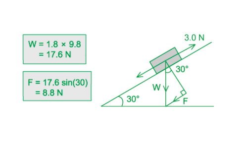
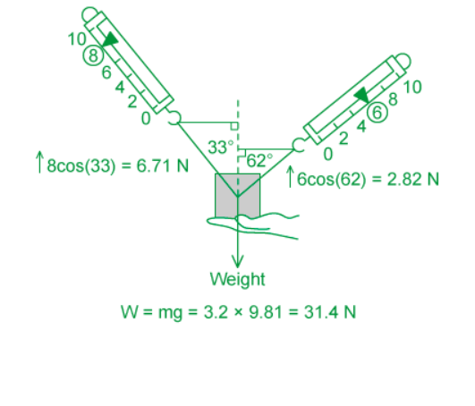

# Mark Schemes — Momentum & Newton’s Laws of Motion
**3. Dynamics** · Cambridge (CIE) A-LEVEL physics (9702)

## Multiple Choice Questions (23 questions)

### Q1
**Final answer:** **The correct answer is D**

- Newton's third law states that whenever two bodies interact, the forces they exert on each other are equal and opposite and of the same type
- In other words, if object A exerts a force on object B, then object B exerts an **equal** but **opposite** force on object A
- Therefore, the forces must:

  - act on **different** objects
  - be the same **type **of force
  - be** opposite** in direction
  - be **equal** in magnitude
- The only force pair that satisfies all these conditions is option **D**

**A** is incorrect, as the driving force from the engine and air resistance are different types of forces (driving force is mechanical and air resistance is a fluid friction force). They also act on the same object (the car), so they cannot be a Newton's third law pair.

**B** is incorrect, as weight and normal reaction are two different types of forces (weight is gravitational and normal reaction is a contact force), and they also act on the same body (the car). Therefore, they cannot be a Newton's third law force pair. This is a common misconception of this law.

**C** is incorrect as these forces act on the same object (the wheels/car system) and are both contact forces in the same direction during acceleration, so they do not form a Newton's third law pair.

### Q2
**Final answer:** **The correct answer is B **

- The gradient of a momentum-velocity graph is equal to

$\frac{Δy}{Δx}=\frac{\text{change in momentum}}{\text{change in velocity}}=\frac{Δp}{Δv}$

- Momentum is equal to  $p = m v$

$\frac{Δp}{Δv}=\frac{Δ(mv)}{Δv}$

- For constant mass:

$\frac{Δ(mv)}{Δv}=m\frac{Δv}{Δv}=m$

- Therefore, the gradient is equal to the mass of the tennis ball

### Q3
**Final answer:** **The correct answer is ****B**** because:**

- The gradient of a momentum-time graph is equal to

  - $\frac{\Deltay}{\Deltax}=\frac{\Deltap}{\Deltat}$
- Momentum is equal to $\Deltap=m\Deltav$

  - $\frac{\Deltap}{\Deltat}=\frac{m\Deltav}{\Deltat}$
- Acceleration is equal to $a=\frac{\Deltav}{\Deltat}$

  - $m\frac{\Deltav}{\Deltat}=ma$
- From Newton's second law, $F=ma$
- Therefore, the gradient is equal to the resultant force on the car

### Q4
**Final answer:** **The correct answer is ****C**** because:**

- Momentum is equal to

  - $\Deltap=m\Deltav$
- Force is related to momentum by

  - $F$=$\frac{\Deltap}{\Deltat}$
- Combining these leads to

  - $F=\frac{m\Deltav}{\Deltat}$
- Rearranging for Δ*t*

  - $\Deltat=\frac{m\Deltav}{F}$
  - $\Delta t = \frac{( 6.7 \times 10^{7} ) ( 18.9 - 0 )}{880000}$
  - $\Deltat=1439s$
- Divide by 60 to convert to minutes

  - $\Deltat=\frac{1439}{60}=24\mathrm{minutes}$

### Q5
**Final answer:** **The correct answer is ****A**** because:**

- The weight of the car and passenger causes the lift to move downwards, while the weight of the balancing weight causes the lift to move upwards

  - Resultant (upward) force on car, *F* = 1320 *g* – 1200 *g* – 80 *g* = 40 *g*
  
    - where *g* = 9.81 N kg−1
  - *F* = 40 × 9.81 = 392 N
- This resultant force is responsible for the acceleration of the passenger car, the balancing weight and the passenger, so we must use the total mass of the system, not just the mass of the lift and passenger

  - Total mass, *m* = 1320 + 1200 + 80 = 2600 kg
- *F = ma* rearranges to

  - $a=\frac{F}{m}=\frac{392}{2600}=0.15ms^{-2}$

### Q6
**Final answer:** **The correct answer is ****B**** because:**

- The weight of the 4.0 kg mass pulls the 10.0 kg box to the right with a force equal to its weight

  - Weight = *mg* = 4.0 × 9.8 = 39.2 N
- The frictional force of 12.0 N opposes the motion of the 10.0 kg box, so it acts to the left

  - The resultant force is thus equal to 39.2 – 12.0 = 27.2 N
- It is important to remember that the mass and the box move as a system, so their masses must be added together
- Total mass of the system = 10.0 + 4.0 = 14.0 kg

  - Resultant force, $F=ma$
  - $a=\frac{F}{m}=\frac{27.2}{14}=1.9ms^{-2}$

### Q7
**Final answer:** **The correct answer is ****A**** because:**

- Momentum is a vector quantity
- Initial momentum = *mv*, final momentum = – *mv*
- Even though the magnitude of the momentum remains the same, the direction of the velocity changes
- The momentum of the object is not conserved but the momentum of the **whole system **should be conserved. The question asks which ‘property of the object’ is not conserved, not the whole system, so this is an important distinction

**B, C & D **are incorrect because these are scalar quantities, and the magnitudes of *m* and *v* stay the same so kinetic energy, speed and mass are all conserved

### Q8
**Final answer:** **The correct answer is ****D**** because:**

- If all the external forces cancel out, that means the resultant force on the body is zero
- If the resultant force is zero then the acceleration is also zero

  - $F=ma$
- Zero acceleration means that the velocity is not changing

  - $a=\frac{v}{t}$
- Hence, the momentum of the body remains unchanged

  - $p=mv$

**A **is incorrect because if a body is not moving then its velocity is zero, however, if acceleration is zero then that does not necessarily mean the velocity is zero. The body may be moving at a constant velocity, but its acceleration would still be zero

**B **is incorrect because force and energy are not equivalent, so if the resultant force is zero this doesn’t mean the energy will be unchanged

**C **is incorrect because, for a stationary body in equilibrium, its velocity must remain constant but its speed can be either zero or a constant non-zero value

### Q9
**Final answer:** **The correct answer is ****C**** because:**

- This is the principle of conservation of momentum which is a direct consequence of Newton’s Third Law, but it does not describe it
- Newton's Third Law states that for every force there is an equal and opposite force, from this we can derive conservation of momentum, which tells us that a change in momentum in one of two objects colliding is equal and opposite to the change in momentum in the other colliding object

**A **is incorrect because this is Newton’s Third Law

**B **is incorrect because this is Newton’s Second Law, $F=ma=\frac{m\Deltav}{t}=\frac{\Deltap}{t}$

**D **is incorrect because this is Newton’s First Law

### Q10
**Final answer:** **The correct answer is ****C**** because:**

- The force *F* is applied to block X, which in turn applies a force to block Y
- As a result, both blocks accelerate
- Total mass being accelerated = *m* + 4 *m* = 5 *m*
- The acceleration of the blocks is therefore equal to

  - $a=\frac{F}{5m}$
- We can use Newton’s Second Law again to calculate the force on block Y only

  - $F_{y} = ( 4 m ) a = ( 4 m ) ( \frac{F}{5 m} ) = \frac{4 F}{5}$

### Q11
**Final answer:** **The correct answer is ****B ****because:**

- The water that emerges from the hose has momentum, so it exerts a force on the person as it shoots out
- From Newton’s Third Law, the person should exert a force of the same magnitude and in the opposite direction to prevent the hose from moving backwards
- Using Newton’s Second Law

  - $F=ma=\frac{m\Deltav}{t}=\frac{\Deltap}{t}$ (force = rate of change of momentum)
  - $\frac{\Deltam}{t}$ = rate of water being pumped = 80 kg / min
- In one second, $\frac{80}{60}=1.33\mathrm{kg}$
- So, 1.3 kg of water is pumped out every second

  - $\frac{\Deltam}{t}$ = rate of water being pumped = $1.33\mathrm{kg}s^{-1}$
  - $F=\frac{\Deltap}{t}=\frac{\Deltam}{t}\timesv=1.33\times30=40N$

### Q12
**Final answer:** **The correct answer is ****C because****:**

- When the ball hits the ground, it rapidly slows down and then speeds up again as it bounces
- This is due to a changing contact force exerted by the ground on the ball
- According to Newton’s third law:

  - When two bodies interact, they exert forces on each other that are equal in magnitude and opposite in direction
- Therefore, the ball must exert a force on the ground which is equal in magnitude and opposite in direction to the force the ground exerts on the ball

**A** is incorrect as the downward force that the ball exerts on the ground is the third law force pair of the upward contact force (i.e. it exists because of it). Since this contact force changes during the collision (as the ball decelerates and then accelerates upwards), the downward force must also change. Therefore, it is not always equal to the ball's weight.

**B** is incorrect because to accelerate the ball upwards, the ground must exert an upward contact force that is greater than the ball’s weight. By Newton’s third law, the downward force the ball exerts on the ground must also be greater than its weight. Therefore, it is not always less than the ball's weight.

**D **is incorrect because the weight of the ball is constant and always acts downwards (towards the ground), but the contact force from the ground (and therefore the force on the ball) changes during the collision.

### Q13
**Final answer:** **The correct answer is ****D**** because:**

- Newton’s Third Law says: when body A exerts a force on body B, body B exerts an equal and opposite force on body A of the **same type**
- For gravity, the Earth attracts the cup and the cup attracts the Earth with the same magnitude but opposite direction. Both forces are of the same type – gravitational attraction
- Consider a falling object – it is not just the object that is falling towards the earth but rather the earth too is falling towards the object. Given the huge difference in mass, the Earth’s movement towards the object is so negligible it can be ignored

**A & B **are incorrect because the push of the table on the cup (and vice versa) is a result of the repulsive forces between the electrons on the surface of the table and the electrons on the surface of the bottom of the cup, both of these are electrostatic forces

**C **is incorrect because the pull of the Earth on the cup is the same as the weight

### Q14
**Final answer:** **The correct answer is ****A**** because:**

- Solving problems on a plane is similar to solving problems vertically and horizontally, but instead, we resolve the forces parallel and perpendicular to the plane
- Since we are trying to find the acceleration of the block, we need to resolve the forces parallel to the plane

  - Weight = *mg* = 1.8 × 9.8 = 17.6 N
  - Resultant force (down the plane) = W sin 30 = 17.6 sin 30 = 8.8 N
- The frictional force opposes the motion of the brick, so it acts up the plane
- So, the resultant force on the brick = 8.8 – 3.0 = 5.8 N

  - Acceleration of the brick, $a=\frac{F}{m}=\frac{5.8}{1.8}=3.2ms^{-2}$

### Q15
**Final answer:** **The correct answer is ****D**** because:**

- The question tells you a key statement about Newton’s Third Law (that the force is equal and opposite)
- But there are two key pieces of information about the forces in Newton's Third Law you will need to answer this question
- Firstly, the force acts between the same two objects. So, if one force is from the back wheel on the road, the other **must** be from the road on the back wheel
- Secondly, the two forces must be the same kind of force.  In this particular case, the force on the wheel on the road is a friction force, so the force of the road on the wheel must be a friction force, too

**A, B & C **are incorrect because the force must act between the same two objects (the back wheel and the road), and be the same force (frictional) whereas these options all reference different bodies and different forces

### Q16
**Final answer:** **The correct answer is ****D**** because:**

- Weight = mass × acceleration due to gravity, or $W=mg$
- So, $g=\frac{W}{m}$

**A & C **are incorrect because gravity/weight is a force, whereas *g *is the acceleration

**B **is incorrect because while air resistance reduces the acceleration of a falling body, it does not change the value of *g* itself.

### Q17
**Final answer:** **The correct answer is ****C**** because:**

- The resultant force is equal to the rate of change of momentum, which is the same as saying the change in momentum of the body per unit time
- This is given by Newton’s second law:

  - $F=ma=\frac{m\Deltav}{t}=\frac{\Deltap}{t}$

**A **is incorrect because 'acceleration per unit mass' is equivalent to $\frac{a}{m}$. According to Newton's second law, force is the product of mass and acceleration $( F = m a )$.

**B **is incorrect because a change in kinetic energy per unit time (rate of change of energy) is equivalent to power $( P = \frac{E}{t} )$.

**D **is incorrect because a 'change in velocity per unit time' (rate of change of velocity) is equivalent to acceleration $( a = \frac{\Delta v}{\Delta t} )$.

### Q18
**Final answer:** **The correct answer is ****C**** because:**

- We are looking for the vertical acceleration, so the horizontal components of force can be ignored
- The resultant upward force is equal to

  - $8\mathrm{cos}33^{\circ}+6\mathrm{cos}62^{\circ}=6.71+2.82=9.53N$

- The resultant downward force is equal to the weight of the block

  - W = mg = 3.2 × 9.81 = 31.4 N

- The overall resultant force is equal to

  - F = 31.4 – 9.53 = 21.9 N
  - Acceleration = $\frac{F}{m}=\frac{21.9}{3.2}=6.8ms^{-2}$

### Q19
**Final answer:** **The correct answer is ****C**** because:**

- The mass of a body is constant and does not change, so it will be 2.5 kg on both planets
- The weight, however, changes depending on the strength of the gravitational field of a planet. This can be found using

  - $W=mg$

- Where *g* on planet S is 8 times greater than on planet R
- So, the weight of the body on planet S is

  - $W=12.5\times8=100N$

**A **is incorrect because the mass is correct but the weight has been calculated using 2.5 × 8 = 20 which is wrong

**B & D **are incorrect because the mass should be unchanged

### Q20
**Final answer:** **The correct answer is ****C**** because:**

- Force is equal to the rate of change of momentum, and therefore, it is directly proportional to the rate of change of velocity F ∝ ∆v/∆t
- Before the ball hits the table:

  - There is no force between the ball and the table, so the force is initially zero
  - Therefore, options **B** & **D** can be eliminated
- When the ball comes into contact with the table:

  - The ball's speed temporarily reduces to zero, this means there is a change in momentum, so F increases, which is shown by the initial positive gradient on the graph
  - When the speed is zero, it is no longer changing, so the change in momentum, and hence force, reaches a maximum, which is represented on the graph by the maximum point on the curve
  - Then, the speed of the ball increases in the opposite direction as it bounces away from the table (but the force acts only while the ball is still in contact with the table)
  - This increase in speed causes a change in momentum, and a force, but in the opposite direction, so as the ball moves away from the table, the force exerted by it gradually decreases, as seen on graph C
- At the moment the ball is about to leave the surface of the table, it has the same maximum speed as before and since the velocity/momentum is no longer changing, the force reduces to zero

**A **is incorrect because this graph implies that the force continues to increase, even after the ball leaves the table, which is not possible

**B & D **are incorrect because there is no force between the ball and the table before the ball comes into contact with it, hence the force is initially zero

### Q21
**Final answer:** **The correct answer is ****C ****because:**

- Mass is a constant quantity which does not change with a change of position or location, so the mass is 60 kg on planet X and on Earth
- The weight, however, changes depending on the strength of the gravitational field of a planet. This can be found using

  - $W=mg$

- Where $g=9.81ms^{-2}$ on Earth and* *$g = \frac{9.81}{6} ( = 1.63 \mathrm{m} \mathrm{s}^{- 2} )$on planet X
- The weight of the body on planet X is

  - $W=\frac{60\times9.81}{6}=98N$

### Q22
**Final answer:** **The correct answer is ****D**** because:**

- According to Newton’s Second Law, a force causes an object to accelerate in the same direction it is applied

**A, B & C **are incorrect because Newton’s First Law states that an object will remain at rest or at the same constant speed unless a resultant force acts upon it. This means a force could be applied in the same direction as an object’s motion, causing it to accelerate, or an opposing force could be applied, to cause it to decelerate. Therefore, the direction of the velocity does not have to be the same direction as the force or acceleration

### Q23
**Final answer:** **The correct answer is ****C**** because:**

- **Mass** is the property of an object that resists a change in motion

  - It is a constant quantity and does not change with location
- **Weight** is the force exerted on an object due to a gravitational field

  - The weight of the object depends on its mass and the strength of the gravitational field at that location

**A **is incorrect because while the work done lifting an object 1.0 m vertically is numerically related to weight $( W = m g h )$, it describes energy, whereas weight is a force.

**B **is incorrect because these definitions are correct, but are the wrong way around.

**D **is incorrect because an object's mass is related to the amount of matter it contains rather than the number of atoms.
