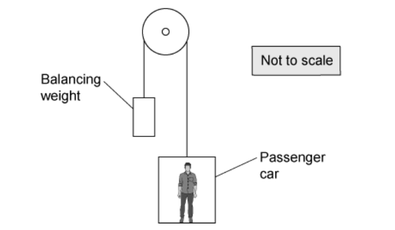
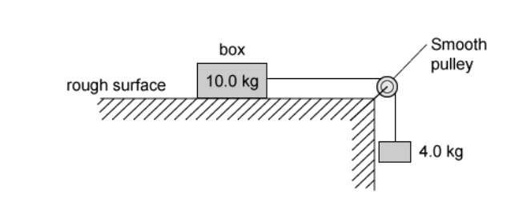
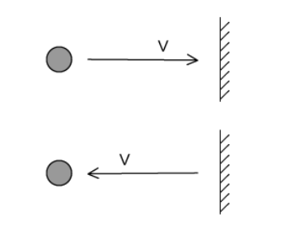
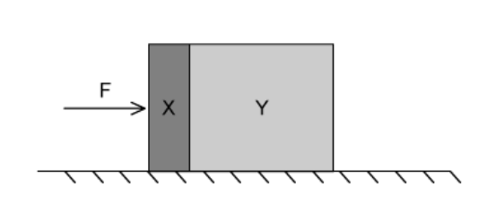
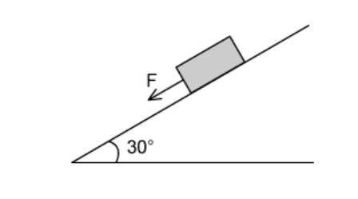

# Exam Questions — Momentum & Newton’s Laws of Motion
**3. Dynamics** · Cambridge (CIE) A-LEVEL physics (9702)
> Source: [https://www.savemyexams.com/a-level/physics/cie/25/topic-questions/](https://www.savemyexams.com/a-level/physics/cie/25/topic-questions/) · 23 questions across 1 sets

## Multiple Choice Questions (23 questions)

### Q1 — medium — 1 marks

**Q1** [1 mark]

A car is travelling at constant velocity on a straight road.

Which row gives the correct Newton's third law force pair?

|   | **Force A** | **Force B** |
|---|---|---|
| **A.** | Driving force from engine | Air resistance on the car |
| **B.** | Weight of the car | Normal reaction from the road |
| **C.** | Driving force from wheels on road | Friction force from air on car |
| **D.** | Weight of the car | Gravitational force of the car on the Earth |

### Q2 — easy — 1 marks

**Q2** [1 mark]

A tennis ball is dropped from different heights and its velocity is measured just before it hits the ground.

A graph is plotted showing the momentum of the tennis ball against its velocity.

What does the gradient of this graph represent?

### Q3 — easy — 1 marks

**Q3** [1 mark]

As a car accelerates uniformly, its momentum is measured at regular intervals, and a graph of the car's momentum is plotted against time.

Which quantity is equal to the gradient of the graph at a particular time?

### Q4 — hard — 1 marks

**Q4** [1 mark]

A ship of mass 6.7 × $10^{7}$ kg is approaching a harbour with speed 18.9 m s−1

By using reverse thrust it can maintain a constant total stopping force of 880,000 N

How long will it take to stop?

### Q5 — hard — 1 marks

**Q5** [1 mark]

A lift consists of a passenger car supported by a cable which runs over a light, frictionless pulley to a balancing weight. The balancing weight falls as the passenger car rises.

Some masses are shown in the table.

|   | **Mass / kg** |
|---|---|
| passenger car  balancing weight  passenger | 1200  1320  80 |

What is the magnitude of the acceleration of the car when carrying just one passenger and when the pulley is free to rotate?

### Q6 — hard — 1 marks

**Q6** [1 mark]

A box of mass 10.0 kg rests on a horizontal rough surface. A string attached to the box passes over a smooth pulley and supports a 4.0 kg mass at its other end.

When the box is released, a frictional force of 12.0 N acts on it.

What is the acceleration of the box?

### Q7 — easy — 1 marks

**Q7** [1 mark]

An object travelling with velocity *v* strikes a wall and rebounds as shown

Which property of the object is **not** conserved?

### Q8 — medium — 1 marks

**Q8** [1 mark]

All external forces on a body cancel out.

Which statement **must** be correct?

### Q9 — easy — 1 marks

**Q9** [1 mark]

Which is **not** one of Newton's laws of motion?

### Q10 — hard — 1 marks

**Q10** [1 mark]

Two blocks X and Y, of masses *m* and 4 *m* respectively, are accelerated along a smooth horizontal surface by a force *F* applied to block X as shown

What is the magnitude of the force exerted on block Y by block X during this acceleration?

### Q11 — medium — 1 marks

**Q11** [1 mark]

Water is pumped through a hose-pipe at a rate of 80 kg per minute. It emerges from the hose-pipe horizontally with a speed of $30ms^{-1}$

Which force is required from a person holding the hose-pipe to prevent it moving backwards?

### Q12 — medium — 1 marks

**Q12** [1 mark]

A ball falls vertically and bounces on the ground.

Which statement about the forces acting while the ball is in contact with the ground is correct?

### Q13 — medium — 1 marks

**Q13** [1 mark]

Newton’s third law of motion is often summarised as

‘Every action has an equal and opposite reaction.’

A cup of tea rests on a table. If the weight of the cup is the ‘action’ force, what is the ‘reaction’ force?

### Q14 — hard — 1 marks

**Q14** [1 mark]

A brick of mass 1.8 kg rests on a plane inclined at an angle of 30°. The weight of the brick has a component of *F* N parallel with the plane. The brick also experiences a frictional force of 3.0 N

What is the acceleration of the brick down the plane?

### Q15 — easy — 1 marks

**Q15** [1 mark]

A cyclist is riding at a steady speed on a level road

According to Newton’s third law of motion, what is equal and opposite to the backward push of the back wheel on the road?

### Q16 — easy — 1 marks

**Q16** [1 mark]

The acceleration of free fall is represented by *g*.

Which statement is correct?

### Q17 — easy — 1 marks

**Q17** [1 mark]

A resultant force causes a body to accelerate.

What is equal to the resultant force?

### Q18 — hard — 1 marks

**Q18** [1 mark]

A 3.2 kg mass is supported by a person’s hand and two newton-meters as shown.

When the person’s hand is removed, what is the initial vertical acceleration of the mass?

### Q19 — medium — 1 marks

**Q19** [1 mark]

The gravitational field strength on the surface of planet R is one eighth of that on the surface of planet S.

On the surface of R, a body has its mass measured to be 2.5 kg and its weight measured to be 12.5 N

What results are obtained for measurements of the mass and weight of the same body on the surface of planet S?

|   | **Mass on S** | **Weight on S** |
|---|---|---|
| **A**  **B**  **C**  **D** | 2.5 kg  20 kg  2.5 kg  20 kg | 20 N  100 N  100 N  160 N |

### Q20 — hard — 1 marks

**Q20** [1 mark]

A tennis ball is dropped onto a table and bounces back up. The table exerts a force *F *on the ball.

Which graph best shows the variation with time *t* of the force *F* while the ball is in contact with the table?

### Q21 — medium — 1 marks

**Q21** [1 mark]

The acceleration of free fall on planet X is  $\frac{1}{6}$  of the acceleration of free fall on Earth.

The mass of a body on planet X is 60 kg.

What is its weight on planet X?

### Q22 — easy — 1 marks

**Q22** [1 mark]

A force *F* is applied to a freely moving object. At one instant of time, the object has velocity *v* and acceleration *a*.

Which quantities must be in the same direction?

### Q23 — easy — 1 marks

**Q23** [1 mark]

What describes the mass and the weight of an object?

|   | **Mass** | **Weight** |
|---|---|---|
| **A** | the ratio of the object's momentum to its velocity | the work done in lifting the object 1.0 m vertically |
| **B** | the force the object experiences due to gravity | the resistance of the object to changes in motion |
| **C** | the resistance of the object to changes in motion | the force the object experiences due to gravity |
| **D** | the total number of atoms in the object | the ratio of the object's mass to the acceleration of free fall |
