# Mark Schemes — Non-Uniform Motion
**3. Dynamics** · Cambridge (CIE) A-LEVEL physics (9702)

## Multiple Choice Questions (15 questions)

### Q1
**Final answer:** **The correct answer is ****A**** because:**

- ** **The acceleration of the car is

  - $v^{2}=u^{2}+2as$, where $u$ = 0, as the car starts from rest
  - $v^{2}=2as$
  - $a=\frac{v^{2}}{2s}$
- The resultant force acting on the car is

  - $F=ma$
  - $F=F_{D}-F_{f}$, where $F_{D}$ is the driving force and $F_{f}$ is the frictional force
  - $ma=F_{D}-F_{f}$
- The driving force of the car is

  - $F_{D}=ma+F_{f}$
- Substituting in the expressions for acceleration and frictional force

  - $F_{D}=\frac{mv^{2}}{2s}+\frac{mg}{2}$
  - $F_{D} = \frac{m}{2} ( \frac{v^{2}}{s} + g )$
- This is option **A**

### Q2
**Final answer:** **The correct answer is ****B**** because:**

- When an object reaches terminal velocity, the drag force and the weight are equal
- The diagram in option **B **has equal force arrows for the weight and drag force

  - So the object is traveling at terminal velocity

Option **A** is incorrect because:

- The weight is greater than the drag force
- The object is accelerating downwards

Option **C ** is incorrect because:

- The only force the object experiences is its weight
- The object is accelerating downwards

Option **D **is incorrect because:

- The drag force is greater than the weight
- The object is decelerating

### Q3
**Final answer:** **The correct answer is ****C**** because:**

- The free-body diagram of the boat is shown below

- The driving force acts in the same direction as the boat is travelling in 
- Water resistance acts in the opposite direction to which the boat is travelling in
- Therefore, if the boat is moving forward but the driving force is less than the water resistance, it must be **decelerating**

Option **A** is incorrect because:

- For the boat to be travelling at constant velocity, the resultant force must be zero

  - As the driving force and resistive force are not equal, the boat is not travelling at constant velocity

Option **B **is incorrect because:

- The resistive force is greater than the driving force
- Water resistance acts in the opposite direction to which the boat is travelling in
- The resultant force is therefore in the same direction as the resistive force

Option **D** is incorrect because:

- The resultant force is equal to the difference between the driving force and the resistive force

### Q4
**Final answer:** **The correct answer is ****C**** because:**

- Let’s call the frictional force $F_{f}$
- Then, we can use *F = ma* to equate the resultant force (= forward force – frictional force) with the mass and acceleration of the block

  - $F = ( 12 - F_{f} ) = 1.2 \times 4 = 4.8$
  - $12-4.8=F_{f}$
  - $F_{f}=7.2N$

### Q5
**Final answer:** **The correct answer is ****A**** because:**

- At terminal velocity, the speed is constant
- So, there is no acceleration meaning the resultant force on the stone is zero
- The weight of the stone (*mg*) remains unchanged throughout the duration of the fall
- So, for the resultant force to be zero, the magnitude of the air resistance should be the same as the weight (*mg*)

### Q6
**Final answer:** **The correct answer is ****C**** because:**

- As the balloon ascends, the forces acting are as follows:

  - The weight $W$ always acts downwards and has a constant value
  - The upthrust $U$ acts upwards and depends on the volume of air displaced by the balloon
  - Air resistance $F$ opposes the direction of motion, so if the balloon is ascending, the air resistance acts downwards and changes depending on the speed
- When the balloon is descending at a constant speed, air resistance = $F$
- Constant speed means the acceleration, and hence, the resultant force = 0
- Therefore, upward forces = downward forces

  - Upward forces = $F+U$
  - Downward forces = $W$
  - $W=F+U$* ***(1)**
- When the balloon is ascending at the same constant speed, a weight $X$ is released, so the new weight is $W-X$

  - Upward forces = $U$
  - Downward forces = $( W - X ) + F$
  - $F+W-X=U$* ***(2)**
- Substituting **(1)** into **(2)**

  - $F + ( F + U ) - X = U$
  - $2F-X=0$
  - $X=2F$

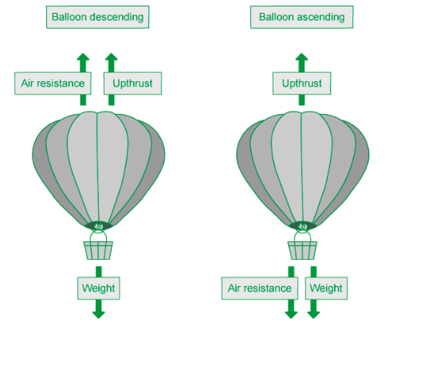

### Q7
**Final answer:** **The correct answer is ****D**** because:**

- The free body diagram will look as follows

- The weight of the skydiver is greater than the drag force

  - Weight always acts downwards
  - The resultant force is therefore also downwards
- The magnitude of the resultant force will be the difference between the weight and the drag force

  - 800-450=350 N
- This is option **D**

### Q8
**Final answer:** **The correct answer is ****B**** because:**

- Weight = mass × acceleration of free fall (*g*)
- Both the mass of the egg and the value of *g* stay constant during the fall

**A **is incorrect because the acceleration decreases as the magnitude of the air resistance increases

**C **is incorrect because the velocity increases until it reaches its terminal velocity

**D **is incorrect because air resistance increases as the velocity of the egg increases

### Q9
**Final answer:** **The correct answer is ****B**** because:**

- Let’s take the positive direction as the direction of the driving force and the negative direction as the direction of the resistive force
- The driving force is given as 2.0 kN = 2000 N
- The resistive force is $\frac{2000}{4}=500N$
- The resultant force is $F$ = 2000 – 500 = 1500 N
- Using Newton’s second law:

  - $F=ma$
  - $m=\frac{F}{a}=\frac{1500}{2}=750\mathrm{kg}$

### Q10
**Final answer:** **The correct answer is ****C**** because: **

- The equation for the resultant force is

  - $F=ma$
- Both boxes can be considered to move as one object with

  - a total mass of $3m+2m=5m$
  - an acceleration of $a$
  - a net resultant force of $F_{net}=5ma$

- As the boxes move together, the forces acting on A and B separately can be considered to act on the object as a whole
- The forces acting are $F$ forward and $\frac{1}{5}F$ backward, so the net resultant force on the object is:

  - $F_{net}=F-\frac{1}{5}F=\frac{4}{5}F$

- The acceleration of A and B can be found by equating the expressions for net resultant force:

  - $5ma=\frac{4}{5}F$
  - $a=\frac{4F}{25m}$

- Therefore the force exerted by Block A on Block B is equal to

  - $F_{AB}=2m\times\frac{4F}{25m}$
  - $F_{AB}=\frac{8}{25}F$
- This is option **C**

### Q11
**Final answer:** **The correct answer is ****B**** because:**

- **(1)** At $t=0$, the skydiver's speed is initially zero, so air resistance is negligible

  - This means the graph must start from zero as $F\approx0$
- **(2) **In the first few seconds, the increase in air resistance is relatively small, as the skydiver's speed is initially low and air resistance increases with speed

  - This means the increase in air resistance $F$ is initially small
- **(3)** The skydiver continues to accelerate due to gravity, so as the speed increases, the air resistance increases too

  - This means air resistance $F$ continues to increase until $t=T$
- **(4)** At $t=T$, the skydiver reaches terminal velocity, so air resistance and weight are equal. This means there is no resultant force, so the skydiver is no longer accelerating, so her speed remains constant (until she opens her parachute)

  - This means the graph plateaus as air resistance $F$ remains constant

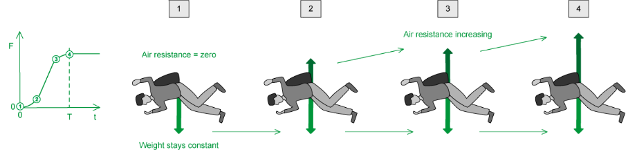

**A **is incorrect because the rate of increase of air resistance is not constant so the gradient of the graph cannot be constant

**C **is incorrect because the air resistance cannot keep increasing after time T as this would imply it becomes larger than weight so the resultant force would increase upwards

**D **is incorrect because at time t = 0, the skydiver is stationary so both the speed and air resistance start from zero

### Q12
**Final answer:** **The correct answer is ****C**** because:**

- The question tells us the block slides down the plane with constant velocity meaning there is no acceleration and hence the resultant force is zero
- Frictional forces oppose motion, and since the block moves down the plane, the friction force must act up the plane

### Q13
**Final answer:** **The correct answer is ****D**** because:**

- The weight of the mass below the pulley creates a tension in the string that pulls the box to the right
- Friction acts to the left, opposing the motion
- The weight of the box acts downwards
- Since the box is on a surface, there is an upward reaction force between the surface and the box

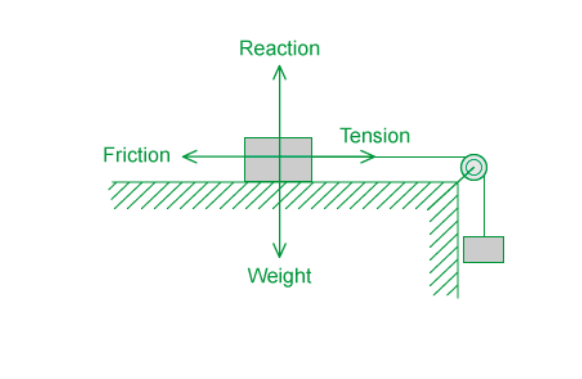

### Q14
**Final answer:** **The correct answer is ****D**** because:**

- At terminal velocity the drag force is equal to the weight

  - $D=mg$ therefore
  - $mg\proptov^{2}$
- The terminal velocity of Skydivers A and B can be written respectively as

  - $mg\proptov_{1}^{2}$
  - $2mg\proptov_{2}^{2}$
- Therefore the ratio of *v*1 to *v**2** *is

  - $\frac{mg}{2mg}=\frac{v_{1}^{2}}{v_{2}^{2}}$
  - $\frac{1}{2}=\frac{v_{1}^{2}}{v_{2}^{2}}$
  - $\frac{1}{\sqrt{2}}=\frac{v_{1}}{v_{2}}$
- This is option **D**

### Q15
**Final answer:** **The correct answer is ****C**** because:**

- The wheels on the lorry are in contact with the road
- A frictional force from the road will oppose the motion of the lorry

**A** is incorrect as upthrust opposes weight for a body in a fluid

**B** is incorrect as weight acts downwards and perpendicular to the lorry's direction of motion, so it will not resist the forward motion of the lorry.

**D** is incorrect as the normal contact force acts upwards and balances the weight, so there is no vertical acceleration.

## Structured Questions (7 questions)

### Q1
Explain why the graph has the shape in Fig 1.1:

i) Explain the shape of region **A**:

- The <u>only</u> force acting on parachutist is weight **OR **forces <u>other than weight</u> are very <u>small;</u> **[1 mark]**
- Acceleration is <u>uniform</u>; **[1 mark]**
- (Therefore) the gradient is (roughly) constant; **[1 mark]**

ii) Explain the shape of region **B**:

- Air resistance increases as speed increases **OR** drag is proportional to speed; **[1 mark]**
- Resultant force / acceleration is decreasing; **[1 mark]**
- (Therefore) gradient is decreasing; **[1 mark]**

iii) Explain the shape of region **C**:

- The parachutist reaches constant speed / terminal velocity; **[1 mark]**
- Because <u>resultant force</u> on parachutist is zero **OR** drag forces are <u>equal</u> to the parachutist's weight; **[1 mark]**
- The gradient decreases <u>to zero</u> / becomes <u>flat</u>; **[1 mark]**

**[Total: 9 marks]**** **

> *Remember to state the **obvious **in your answers as well: when asked "why is the graph curving?", make sure you actually say "because the gradient is decreasing".*
To find the acceleration of free fall on this planet:

Determine acceleration from the graph:

- In the first second, vertical speed increases to 12.5 m s−1
- Acceleration of freefall is 12.5 m s−2  **[1 mark]**

**[Total: 1 mark]**

> *To answer this question, you must use the section of the graph where drag is negligible: region **A**. Then it's a simple case of finding the gradient of the graph here. *

> *This section has a practically straight line, so gradient is simply calculated as a change in y over as change in x.*

> *Answers in the range of 12 to 13 m s**−2** will gain the mark.*
(i) Draw a graph line for zero air resistance:

A graph scoring two marks looks like:

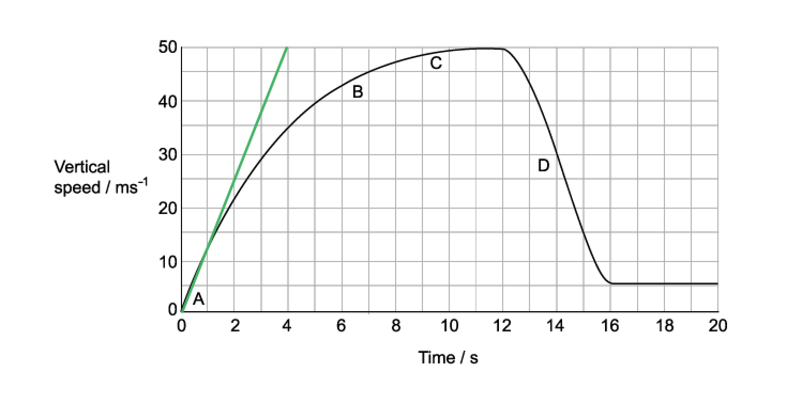

- Straight line through the origin; **[1 mark]**
- Gradient = $\frac{50}{4}$ = 12.5 m s−2  **[1 mark]**

(ii) Draw a graph for a parachute half the size:

A graph scoring two marks looks like:

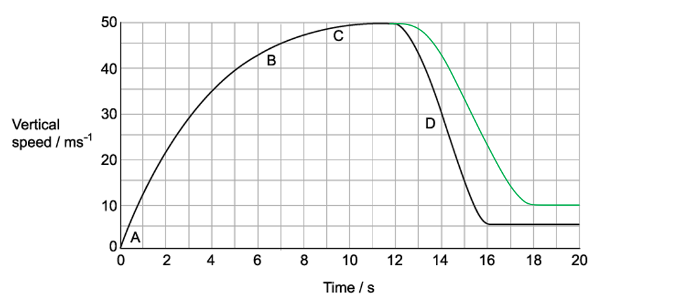

- Gradient of region **D** is less steep; **[1 mark]**
- Terminal velocity (flat region on the right) is at a greater velocity; **[1 mark]**

**[Total: 4 marks]**

> *In part (ii), there are a few steps to understand why the graph takes this new shape. If the new parachute has a smaller area, the resistive force is weaker. This means there is a smaller deceleration on the parachutist. Additionally, the smaller surface area means that the parachutist must reach a greater speed before drag is equal to weight.*
Explain why the horizontal terminal velocity is lower:

Compare the forces in each direction:

- The parachutist's weight is (much) <u>larger than</u> the force from the breeze; **[1 mark]**

Compare the difference in drag forces:

- A smaller drag force is needed to equal / match the breeze's force (than the weight force); **[1 mark]**

Explain the difference in speeds:

- Drag is proportional to speed; **[1 mark]**
- (Therefore) the required horizontal drag is reached at a <u>lower speed</u> (than the required vertical drag); **[1 mark]**

**[Total: 4 marks]**

> *This is a comparison question in disguise. This means you have to say which force you are referring to at all times, and include comparative words and phrases, such as 'this is larger than that' or 'this is small, whereas this is large'.*

### Q2
(i) The acceleration of the ball decreases with time because:

- Air resistance / drag increases with speed; **[1 mark]**
- (Hence) the resultant / accelerating force decreases; **[1 mark]**

(ii) The acceleration of the ball is 9.8 m s–2 initially because:

- Air resistance is (initially) zero **OR** weight / gravitational force is the only force acting; **[1 mark]**

**[Total: 3 marks]**
List the known quantities:

- Mass of the ball, *m* = 1.5 × 10–2 kg = 0.015 kg

(i) Draw a tangent to the curve at *t* = 0.25 s to calculate acceleration:

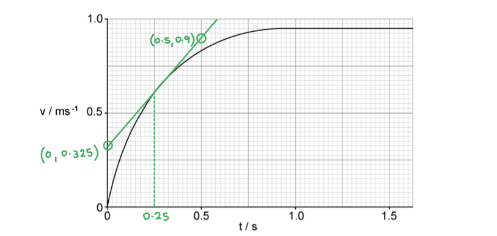

- Tangent correctly drawn (by eye); **[1 mark]**
- Gradient = $\frac{\Deltav}{\Deltat}=\frac{0.9-0.325}{0.5-0}$ **[1 mark]**
- Acceleration = 1.15 m s–2 **[1 mark]**

*Acceptable range for acceleration = 1.1 to 1.4 m s**–2*

(ii) Calculate the force on the ball:

- Newton's Second Law:  $F=ma$
- $F$ = 0.015 × 1.15 **[1 mark]**
- $F$ = 0.017 N **[1 mark]**

*Acceptable range for force = 0.017 to 0.021 N*

**[Total: 5 marks]**

> *You will be awarded one mark here just for showing that you knew how to draw a tangent, and another for having tried to find the gradient, even if you don't get the correct answer, so it's important to show your working*
Calculate the drag force on the falling ball at *t* = 0.25 s:

List the known quantities:

- Acceleration, $a$ = 1.15 m s−2 (from **(b)**)
- Resultant force, $F$ = 0.017 N (from **(b)**)
- Mass, $m$ = 0.015 kg

Calculate the weight of the ball:

- Weight: $W=mg$
- $W$ = 0.015 × 9.81 = 0.147 N **[1 mark]**

Resolve the forces to determine the drag force:

- Resolve:  $F=W-d\Rightarrowd=W-F$
- Drag = 0.147 − 0.017 **[1 mark]**
- Drag = 0.130 N **[1 mark]**

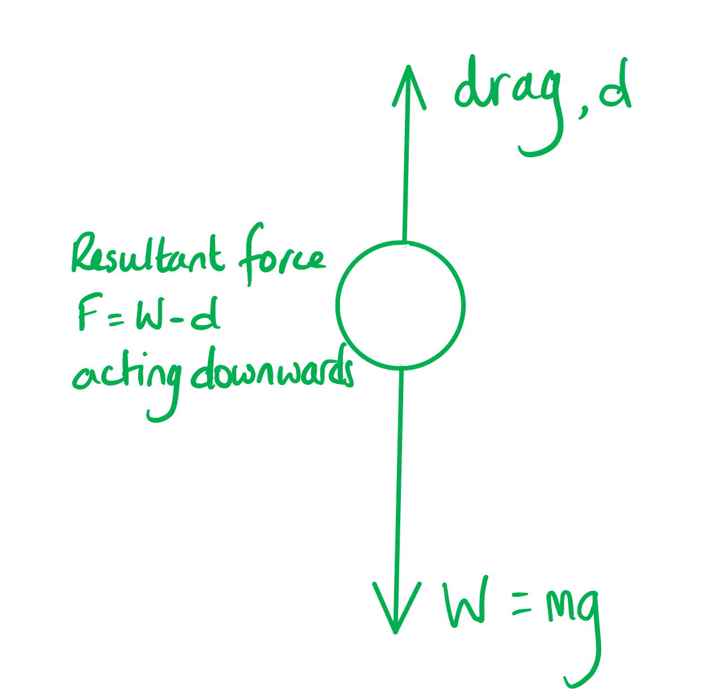

**[Total: 3 marks]**
(i) Compare the forces on the two balls:

- Drag will be the same (at *v* = 0.50 m s–1) since surface area / shape are the same; **[1 mark]**
- Weight is greater **OR**** **resultant force is larger; **[1 mark]**

(ii) The terminal velocity of the ball filled with sand will be:

- Greater / faster (than the hollow ball); **[1 mark]**

Because:

- Terminal velocity is reached when weight = drag **AND** the weight is greater; **[1 mark]**
- As speed increases drag increases (so drag force is higher); **[1 mark]**

**[Total: 5 marks]**

### Q3
(i) The difference between the mass of a body and its weight is:

- Mass is the measure of a body’s resistance / inertia to changes in velocity / motion; **[1 mark]**
- Weight is the effect of a gravitational field on mass **OR** weight is the force on a mass due to gravity; **[1 mark]** *Accept comparisons e.g. mass is constant, weight varies / mass is a scalar, weight is a vector*

(ii) Calculate the weight of the skydiver:

List the known quantities:

- Mass of the skydiver, *m* = 75 kg
- Acceleration of free fall, *g* = 9.81 m s−2

Substitute the values into the equations:

- Weight:  $W=mg$ **[1 mark]**
- *W* = 75 × 9.81
- *W* = 735.75 = 740 N** [1 mark]**

**[Total: 4 marks]**
Explain the shape of the velocity-time graph:

(i) Between 0 and 5 s:

- Weight is much larger than drag / air resistance so the resultant force is downwards; **[1 mark]**
- The skydiver accelerates downwards; **[1 mark]**

(ii) Between 5 and 25 s:

Any **two** from:

- Drag / air resistance increases with speed; **[1 mark]**
- (Hence) as speed increases, the resultant force decreases; **[1 mark]**
- As resultant force decreases, acceleration decreases; **[1 mark]**

(iii) Between 25 and 40 s:

- The forces (of drag and weight) are equal / balanced; **[1 mark]**
- (This is the point at which) the skydiver reaches <u>terminal</u> velocity; **[1 mark]**

**[Total: 6 marks]**
The forces on the skydiver when travelling at constant velocity are:

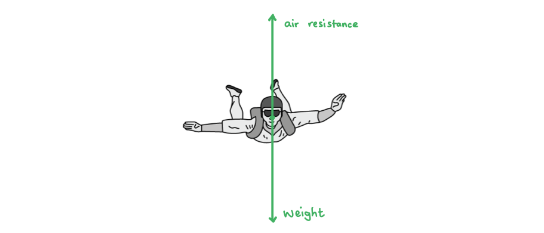

- Arrow up labelled drag / air resistance / air friction; **[1 mark]**
- Arrow down labelled weight; **[1 mark]**
- Arrows drawn approximately equal length, or 740 N seen (value from **(a)**); **[1 mark]**

**[Total: 3 marks]**

> *In this question, you would score all the marks if your arrows were not touching. However, it's more physically correct to draw the arrows from the same point, to indicate they are acting from the centre of gravity, so it's a good habit to get into!*
The variation of vertical velocity after opening the parachute is as follows:

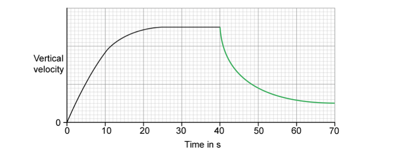

- Smooth curve drawn showing a decreasing gradient; **[1 mark]**
- Horizontal line drawn near end to show a new lower terminal velocity; **[1 mark]**

**[Total: 2 marks]**

### Q4
To compare the forces of air resistance:

Compare the radii, *r* , of the balls:

- $V_{A}=27V_{B}$

  - Volume *V*  is proportional to radius cubed for a sphere
- $r_{A}^{3}=27r_{B}^{3}$
- Cube-root both sides to show $r_{A}=3r_{B}$ **[1 mark]**

Compare surface areas:

- Area *A * is proportional to radius squared for a sphere
- $r_{A}^{2}=9r_{B}^{2}$
- $A_{A}=9A_{B}$ **[1 mark]**

Compare forces:

- The balls are being compared at the same velocity
- The difference in force is entirely dependent on area
- The force of air resistance on ball A is 9 times stronger than the force on ball B; **[1 mark]**

**[Total: 3 marks]**

> *The value of velocity here is unimportant. What matters is that we are comparing the force of air resistance on each ball at the same speed. Intuition tells us that the ball with a larger area will experience a greater resistance - use this to fact-check your answer.*

> *As always, you must show each step of working that got you to that factor of 9, you will not gain all the marks just for that last sentence.*

> *But, of course, you are writing out your answers to these questions to maximise exam-specificity, not just answering them in your head and moving on...*
(i) To explain why time of falling is not independent of mass when air resistance is included:

Determine the resultant force for the falling ball:

- $mg-F_{v}=ma$ **[1 mark]**

  - *m* is the ball's mass
  - *g* is acceleration of free fall
  - *a* is the acceleration of the ball

Write an expression for acceleration at a speed *v* :

- $a=\frac{mg-F_{v}}{m}=g-\frac{F_{v}}{m}$ **[1 mark]**
- As mass increases, acceleration (at a given speed) increases; **[1 mark]** **  **

(ii) To explain why the passer-by is wrong:

- (Therefore) the heavier ball will land <u>before</u> / <u>sooner than</u> the lighter ball; **[1 mark]**

**[Total: 4 marks]**
To find the units of *k *:

Write the units of each term of the equation from part (a):

- $F=kAv^{2}$
- $\mathrm{N} = [ k ] \mathrm{m}^{2} ( \mathrm{m} \mathrm{s}^{- 1} )^{2}$
- $\mathrm{N} = [ k ] \mathrm{m}^{4 \mathrm{s}^{-2} }$ **[1 mark]**

Rearrange this to make the units of *k*  the subject:

- $[ k ] = \frac{ \mathrm{N} }{ \mathrm{m}^{4 \mathrm{s}^{-2} } } = \mathrm{N} \mathrm{m}^{- 4} \mathrm{s}^{2}$ **[1 mark]**

Write the newton in terms of SI units:

- Use Newton's second law
- $N=\mathrm{kg}ms^{-2}$

Write the units of *k* in SI units:

- $[ k ] = ( \text{kg} \mathrm{m} \mathrm{s}^{- 2} ) \mathrm{m}^{- 4} \mathrm{s}^{2} = \text{kg} \mathrm{m}^{- 3}$ **[1 mark]**

**[Total: 3 marks]**

> *If you need to break down one unit into other units, try using a familiar equation, such as Newton's second law.*
To write an expression for terminal velocity:

List the known quantities:

- $a=g-\frac{F_{v}}{m}$ (from part (b))
- $F_{v}=kAv^{2}$ (from part (a))

Recall the condition for terminal velocity:

- At terminal velocity, acceleration is zero
- $g=\frac{F_{v}}{m}$ **OR** $F_{v}=mg$ **[1 mark]**

Substitute the equation for *F**v** * to find an expression for terminal velocity, *v**t* :

- $kAv_{t}^{2}=mg$
- $v_{t}=\sqrt{\frac{mg}{kA}}$ **[1 mark]**

**[Total: 2 marks]**

> *Using part (c), you can verify your answer by ensuring it is dimensionally homogenous (i.e. the units on the left match the units on the right).*

### Q5
The forces acting on the block are:

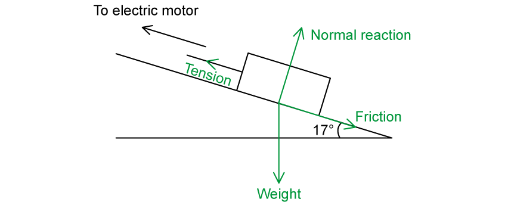

- Weight vertically down; **[1 mark]**
- Normal / reaction / contact (force) perpendicular to the slope; **[1 mark]**
- Tension in cable acting up the slope (away from block); **[1 mark]**
- Friction / resistive (force) acting down the slope (away from block); **[1 mark]**

**[Total: 4 marks]**

> *Don't automatically assume that the slope is frictionless unless the question specifies so!*

> *The direction of the frictional force is important, as it depends on the direction of motion of the mass. Since the block is moving upwards (since it's being pulled by the cable) the frictional force must be directed in the opposite direction, i.e. down the slope*
Consider the motion of the block:

- The block moves with constant speed up the slope, so its acceleration is zero; **[1 mark]**
- Therefore, the resultant force on the block is zero, and (with no resultant torque) the block is in equilibrium; **[1 mark]**

**[Total: 2 marks]**
Calculate the magnitude of the resistive force:

List the known quantities:

- Angle of incline, *θ *= 17°
- Mass of block, *m* = 250 kg
- Tension in cable, *T* = 1.2 kN = 1200 N
- Weight, *W* = *mg* = 250 × 9.81

Determine the component of weight along the slope:

- Resolving the weight along the slope:  $mg\mathrm{sin}θ$ **[1 mark]**

Resolve the forces along the slope:

- The block moves up the slope at a constant speed
- This means forces up the slope = forces down the slope
- $T=mg\mathrm{sin}θ+R$* ***[1 mark]**
- $R=T-mg\mathrm{sin}θ$
- *R* = 1200 – (250 × 9.81 × sin 17°) **[1 mark]**
- *R* = 483 = 480 N (2 s.f.) **[1 mark]**

**[Total: 4 marks]**

> *Make sure to use the correct **component** of the weight, drawing a triangle on the diagram can help you to do this*

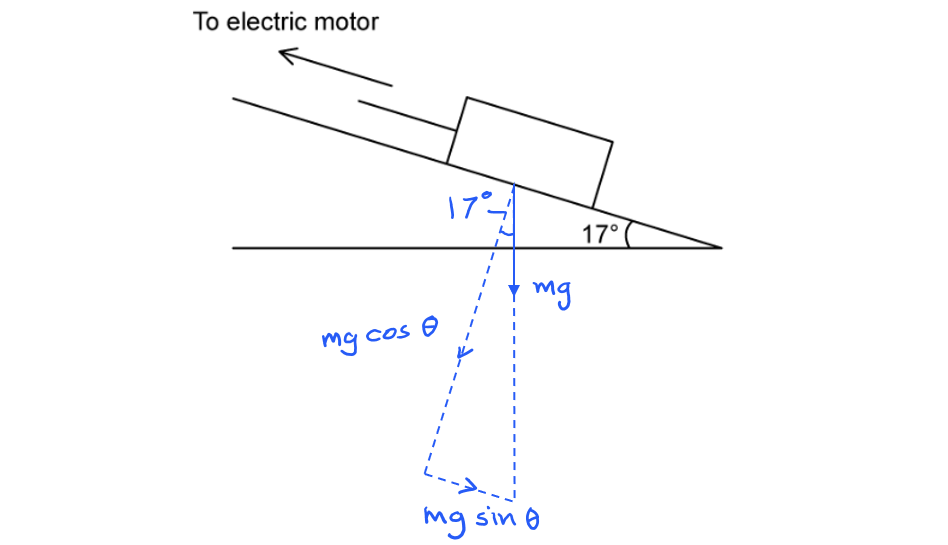
Calculate the acceleration of the block:

List the known quantities:

- Angle of incline, *θ *= 17º
- Mass of block, *m* = 250 kg
- Resistive (frictional) force, *R* = 483 N (from **(b)**)
- Weight, *W* = *mg* = 250 × 9.81

Determine the resultant force on the block:

- Once the cable snaps, the tension *T* no longer acts, so the block accelerates down the slope
- Resultant force:  $F=mg\mathrm{sin}θ-R$

Calculate the acceleration of the block:

- Newton's second law: * *$F=ma$
- $a=\frac{F}{m}$
- $a=\frac{mg\mathrm{sin}θ-R}{m}$ **[1 mark]**
- $a=g\mathrm{sin}θ-\frac{R}{m}$
- $a = ( 9.81 \times \sin 17^{\circ} ) - \frac{483}{250}$ **[1 mark]**
- $a$ = 0.94 m s–2 **[1 mark]**

*Acceptable value for a = 0.95 m s**–2** if 480 N used*

**[Total: 3 marks]**

### Q6
A labelled diagram that would score two marks is shown below:

- Drag **OR **air resistance labelled as shown; **[1 mark]**
- Weight labelled as shown; **[1 mark]**

**[Total: 2 marks]**

> *Note: **no credit** is given if you wrote "gravity" instead of **weight**. Remember, **weight** is the name of the **force** due to gravity, tugging on all objects with mass. Strictly speaking, "gravity" is not the name of a force! *
State the name of the condition that is normally assumed:

- There is <u>no air resistance</u>; **[1 mark]**

**[Total: 1 mark]**

> *Exam questions will often state that 'air resistance is negligible' or 'assume no air resistance' which mean the same thing.*
The magnitude of the resultant force at terminal velocity is:

- Zero; **[1 mark]**

Explain the magnitude of the resultant force:

- The drag force is <u>equal</u> (and opposite) to the weight force; **[1 mark]**

**[Total: 2 marks]**

> *Technically, the drag force is equal **and** opposite to the weight force. However, the question specifically asks about the **magnitude** of the resultant force, so the fact that the drag force and weight force are equal to in magnitude is important for this. *
A sketch that would score three marks is shown below:

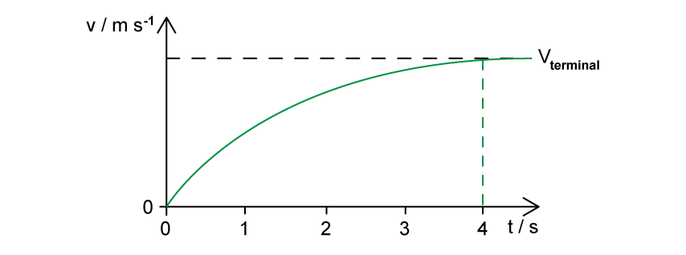

- Correct shape of curve, as shown; **[1 mark]**
- Line starts at *v* = 0 m s–1 and *t* = 0 s; **[1 mark]**
- Line is curved **AND** becomes horizontal after 4 s; **[1 mark]**

**[Total: 3 marks]**

### Q7
To calculate the percentage increase of force between rounds:

List the known quantities:

- Mass of block in round 1, *m**1*  = 200 kg
- Mass of block in round 2, *m**2*  = 280 kg
- Frictional force in round 2, *F**2*  = 1650 N
- Frictional force ∝ normal reaction force
- Acceleration of free fall, *g*  = 9.81 m s−2 (from data page)

Calculate the normal reaction force, *R**1* , *R**2* , of each block:

- The block is not accelerating vertically, so vertical forces are balanced

  - *R  = W = mg*
- $R_{1}=W_{1}=m_{1}g=200\times9.81=1962N$ **AND**
- $R_{2}=W_{2}=m_{2}g=280\times9.81=2747N$ **[1 mark]**

Compare the frictional forces, *F* , of blocks 1 and 2:

- $F\proptoR$
- $\frac{F_{2}}{F_{1}}=\frac{R_{2}}{R_{1}}=\frac{2747}{1962}=1.40$ **[1 mark]**

Determine frictional force from round 1:

- $\frac{F_{2}}{F_{1}}=1.40\rightarrowF_{1}=\frac{F_{2}}{1.40}$
- $F_{1}=\frac{1650}{1.40}=1179N$ **[1 mark]**

Calculate the difference:

- $F_{2}-F_{1}=1650-1179=470N$ (2 s.f.) **[1 mark]**

**[Total: 4 marks]**

> *At A level, the concept of proportionality comes up frequently.*

> *You may quickly realise that the mass being 1.4× larger means that weight, reaction force and therefore friction is also 1.4× greater. But you must make this thought process known to your examiner, so write it all down. *

> *You may also have reached a similar answer by finding a constant of proportionality i.e. **F = kR  **where **k**  is the constant of proportionality and using this to calculate the difference.*
To justify why air resistance is ignored here:

- The block is moving slowly (because of its large weight); **[1 mark]**
- Air resistance is <u>small</u> at low speeds; **[1 mark]**
- <u>Compared</u> to the (large) frictional force; **[1 mark]**

**[Total: 3 marks]**

> *Always state the obvious. You may well have said that air resistance is a small force at low speeds, but this has to be related to the situation. The block is indeed moving slowly, because it's really heavy and it's only one person pulling it!*
List the known quantities:

- Horizontal force, *F**H*  = 1650 N
- Angle to the horizon, *θ  = *15°

Determine the magnitude of force applied by the competitor, *F* :

- $F_{H}=F\mathrm{cos}θ\rightarrowF=\frac{F_{H}}{\mathrm{cos}θ}$
- $F = \frac{1650}{\cos ( 15 )} = 1708 \mathrm{N}$ **[1 mark]**

Determine the vertical component of the force, *F**V* :

- $F_{V}=F\mathrm{sin}θ$
- $F_{V} = 1708 \times \sin ( 15 ) = 440 \mathrm{N}$ (2 s.f.) **[1 mark]**

**[Total: 2 marks]**
