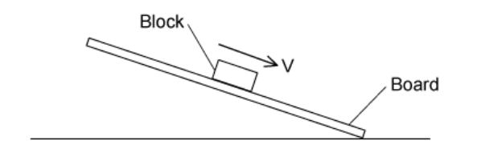

# Exam Questions — Non-Uniform Motion
**3. Dynamics** · Cambridge (CIE) A-LEVEL physics (9702)
> Source: [https://www.savemyexams.com/a-level/physics/cie/25/topic-questions/](https://www.savemyexams.com/a-level/physics/cie/25/topic-questions/) · 15 questions across 1 sets

## Multiple Choice Questions (15 questions)

### Q1 — hard — 1 marks

**Q1** [1 mark]

A car of mass $m$* *starts from rest and accelerates uniformly, reaching a velocity of $v$* *over distance $s$. The car experiences a frictional force of $\frac{mg}{2}$.

What is the driving force of the car?

### Q2 — easy — 1 marks

**Q2** [1 mark]

An object of weight *mg* falls through the air and experiences a drag force *D*.

Which of the following free-body diagrams shows the object when it has reached terminal velocity?

### Q3 — medium — 1 marks

**Q3** [1 mark]

A boat travels forward in a straight line. The driving force of the boat is less than the water resistance acting on the boat.

Which statement is true?

### Q4 — medium — 1 marks

**Q4** [1 mark]

A block of mass 1.20 kg is on a rough horizontal surface. A force of 12 N is applied to the block and it accelerates at 4.0 m s−2

What is the magnitude of the frictional force acting on the block?

### Q5 — medium — 1 marks

**Q5** [1 mark]

A stone of mass *m* is dropped from a tall building. There is significant air resistance. The acceleration of free fall is *g.*

When the stone reaches its terminal velocity, which row is correct?

|   | **Magnitude of the acceleration of the stone** | **Magnitude of the force of gravity on the stone** | **Magnitude of the force of air resistance on the stone** |
|---|---|---|---|
| **A**  **B**  **C**  **D** | zero  *g*  *g*  zero | *mg*  *mg*  zero  zero | *mg*  *mg*  zero  zero |

### Q6 — hard — 1 marks

**Q6** [1 mark]

The three forces acting on a hot air balloon as it moves vertically are its weight, the force due to air resistance and upthrust.

The hot air balloon descends vertically at constant speed. The force of air resistance on the balloon is $F$.

What weight of material must be released from the balloon so that it ascends vertically at the same constant speed?

### Q7 — easy — 1 marks

**Q7** [1 mark]

A skydiver has a weight of 800 N, and experiences a drag force of 450 N.

What is the magnitude and direction of the resultant force of the skydiver?

|   | **Magnitude / N** | **Direction** |
|---|---|---|
| **A** | 1250 | Downwards |
| **B** | 350 | Upwards |
| **C** | 1250 | Upwards |
| **D** | 350 | Downwards |

### Q8 — easy — 1 marks

**Q8** [1 mark]

An egg is dropped from the top of a three-storey building. It falls through air until it reaches the ground

What remains constant throughout the fall?

### Q9 — medium — 1 marks

**Q9** [1 mark]

A car has a horizontal driving force of 2.0 kN acting on it and a resistive force a quarter of this size. It has a forward horizontal acceleration of 2.0 m s–2

What is the mass of the car?

### Q10 — hard — 1 marks

**Q10** [1 mark]

The diagram shows two blocks, A and B, that have masses of $3m$ and $2m$ respectively. A force $F$ is applied to Block A, and both blocks accelerate along a horizontal surface. Block B experiences a drag force of $\frac{F}{5}$.

What is the resultant force of Block A on Block B?

### Q11 — hard — 1 marks

**Q11** [1 mark]

A skydiver falls vertically from a stationary balloon.

She leaves the balloon at time $t=0$. At time $t=T$, she reaches terminal velocity. Beyond the time shown in the graphs, she opens her parachute

Which graph shows the variation with time $t$ of the force $F$ due to air resistance?

### Q12 — medium — 1 marks

**Q12** [1 mark]

A wooden block rests on a rough board. The end of the board is then raised until the block slides down the plane of the board at constant velocity *v*

Which row describes the forces acting on the block when sliding with constant velocity?

|   | **Frictional force on block** | **Resultant force on block** |
|---|---|---|
| **A**  **B**  **C**  **D** | down the plane  down the plane  up the plane  up the plane | zero  down the plane  zero  down the plane |

### Q13 — easy — 1 marks

**Q13** [1 mark]

A box rests on a horizontal, rough surface. A string attached to the box passes over a smooth pulley and supports a mass at its other end.

When the box is released, what forces are acting on it?

### Q14 — hard — 1 marks

**Q14** [1 mark]

Two skydivers, A and B, experience drag forces *D*1 and *D*2 respectively. Skydiver A has mass *m* and reaches terminal velocity *v**1*. Skydiver B has mass 2*m* and reaches terminal velocity *v*2.

Given that $D\proptov^{2}$, what is the value of $\frac{v_{1}}{v_{2}}$?

### Q15 — easy — 1 marks

**Q15** [1 mark]

A lorry is driving along a horizontal road and experiences a resistive force opposing the forward motion.

Assuming that air resistance is negligible, what is the name of the resistive force?
