# Mark Schemes — Linear Momentum & its Conservation
**3. Dynamics** · Cambridge (CIE) A-LEVEL physics (9702)

## Multiple Choice Questions (34 questions)

### Q1
**Final answer:** **The correct answer is ****A**

- If we consider the trolleys and the elastic cord as one system, there are no external forces acting
- Before the trolleys were released, they were at rest

  - Therefore, the total momentum of the system is **zero**
- Momentum is conserved in all collisions

  - Therefore, the total momentum of the system of trolleys and elastic cord after the collision will be **zero**
- As the trolleys stick together, the total momentum of the system after the collision is calculated using:

  - (mass X + mass Y) ×  common velocity of both trolleys
  - Hence, (mass X + mass Y) × common velocity of both trolleys = 0
- Therefore, the common velocity of both trolleys is **zero** ** **

**ALTERNATIVE METHOD**

- The total momentum before the trolleys collide will be zero
- Before the impact, trolley X is travelling at 20 cm s–1

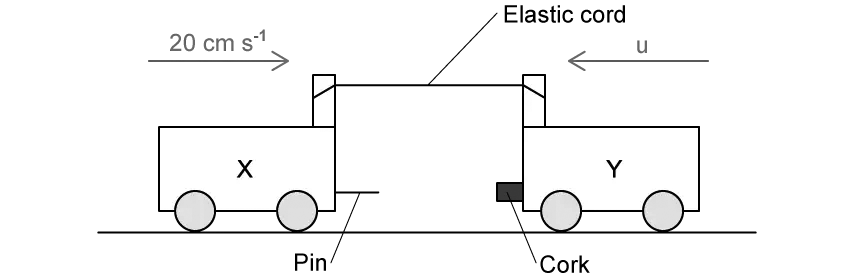

- From the conservation of momentum:

(*mass* × *velocity*)X + (*mass* × *velocity*)Y = 0

(2*m* × 20) – (*m* × *u*) = 0

40*m* = *mu*

*u* = 40 cm s–1

- Hence, trolley Y is travelling at 40 cm s–1 before the collision

- After the trolleys collide, they stick together
- Let the common velocity of the trolleys after the collision be *v*

- From conservation of momentum:

(*mass* X + *mass* Y) × *v* = 0

(2*m* + *m*) × *v* = 0

3*mv* = 0

- Hence, *v* must be **zero**

### Q2
**Final answer:** **The correct answer is ****B**** because:**

- According to conservation of momentum:

  - Sum of momentum before collision = Sum of momentum after collision
- Sum of momentum before collision = $2mu-mu=mu$
- Sum of momentum after collision

  - $\frac{2 m ( - u )}{6} + \frac{2 m u}{3} = \frac{2 m u}{3} - \frac{2 m u}{6} = \frac{2 m u}{3} - \frac{m u}{3} = \frac{m u}{3}$
- The momentum before and after the collision is different so momentum has not been conserved in Option B

**A **is incorrect because momentum has been conserved

sum of momentum after collision : $\frac{5mu}{3}-\frac{2mu}{3}=\frac{3mu}{3}=mu$  ✓

**C **is incorrect because momentum has been conserved

sum of momentum after collision : $\frac{2mu}{3}+\frac{2mu}{6}=\frac{2mu}{3}+\frac{mu}{3}=\frac{3mu}{3}=mu$   ✓

**D **is incorrect because momentum has been conserved

sum of momentum after collision : $\frac{( 2 m + m ) u}{3} = \frac{3 m u}{3} = m u$   ✓

### Q3
**Final answer:** **The correct answer is ****A**** because:**

- The unit of density  $( \\rho = \frac{m}{v} )$  is $\mathrm{kg}m^{-3}$
- The unit of volume is $m^{3}$
- The unit of velocity is $ms^{-1}$
- So, the unit of density × volume × velocity is

  - $[ \text{kg} \mathrm{m}^{- 3} ] [ \mathrm{m}^{3} ] [ \mathrm{m} \mathrm{s}^{- 1} ]$
  - $[ \text{kg} ] [ \mathrm{m} \mathrm{s}^{- 1} ]$

This is the same unit as momentum $( p = m v )$, which is$\mathrm{kg}ms^{-1}$

| **B **is incorrect because | the unit of density $( \\rho = \frac{m}{v} )$  is $\mathrm{kg}m^{-3}$  the unit of energy $( E_{k} = 1 \frac{1}{2} m v^{2} ) i s \mathrm{J} = \text{kg} \mathrm{m}^{2} \mathrm{s}^{- 2}$  so, the unit of density × energy is $[ \text{kg} \mathrm{m}^{- 3} ] [ \text{kg} \mathrm{m}^{2} \mathrm{s}^{- 2} ] = kg^{2 } \mathrm{m}^{- 1} \mathrm{s}^{- 2}$ |
|---|---|
| **C **is incorrect because | the unit of pressure $( P = \frac{F}{A} ) i s \mathrm{N} \mathrm{m}^{- 2} = \text{kg} \mathrm{m}^{- 1} \mathrm{s}^{- 2}$  the unit of area is $m^{2}$  so, the unit of pressure × area is $[ \text{kg} \mathrm{m}^{- 1 } \mathrm{s}^{- 2} ] [ \mathrm{m}^{2} ] = \text{kg} \mathrm{m} \mathrm{s}^{- 2}$ (which is equal to N) |
| **D **is incorrect because | the unit of weight is $N=\mathrm{kg}ms^{-2}$  the unit of area is $m^{2}$  so, the unit of weight ÷ area is $[ \text{kg} \mathrm{m} \mathrm{s}^{- 2} ] \div [ \mathrm{m}^{2} ] = \text{kg} \mathrm{m}^{- 1} \mathrm{s}^{- 2}$ (which is equal to Pa) |

### Q4
**Final answer:** **The correct answer is ****D**** because:**

- For any collision in a closed system, momentum is always conserved
- Before the collision:

  - Momentum of the molecule = $mv$
- After the collision:

  - The molecule will still have the same momentum but it will move in the opposite direction so the momentum of the molecule = $-mv$
- Change in momentum = $m v - ( - m v ) = 2 m v$
- The collision is elastic so the kinetic energy is conserved, therefore, the change in kinetic energy = **0**

**A** is incorrect because the change in momentum cannot be zero because the molecule changes direction

**B** is incorrect because the change in kinetic energy must be zero because the collision is elastic meaning the kinetic energy is conserved and does not change

**C **is incorrect because $mv^{2}$ has the units of energy

### Q5
**Final answer:** **The correct answer is ****D**** because:**

- A collision in which the objects stick together and have the same final velocity is called a perfectly inelastic collision
- This is because it reduces the initial kinetic energy more than any other type of inelastic collision

  - Option D is therefore correct because we are told the trolleys “become attached and move off together” indicating it is an inelastic collision and some kinetic energy is lost as a result
- The principle of conservation of momentum states that (in a closed system) the total momentum of the two trolleys before the collision is equal to their total momentum after the collision

  - Option D is therefore correct because there are no other bodies involved apart from the trolleys, so momentum must be conserved

**A & B **are incorrect because momentum cannot be “changed” into kinetic energy, and vice versa

**C **is incorrect because momentum cannot be “lost” via heat, as heat is a form of energy and momentum is conserved in isolated systems

### Q6
**Final answer:** **The correct answer is ****A**** because:**

- Force is equal to the rate of change of momentum
- This is equal to the gradient of a momentum-time graph

  - Force=$Force=\frac{\Deltay}{\Deltax}=\frac{500}{10}=50N$

### Q7
**Final answer:** **The correct answer is ****C**** because:**

- Force is equal to the rate of change of momentum
- In other words, force is equal to the gradient $( \frac{\Delta y}{\Delta x} )$ of a momentum-time graph

  - $F=\frac{\Deltap}{\Deltat}$
- The gradient of the line should be equal to 5 N
- The gradient of line C is  $\frac{\Deltay}{\Deltax}=\frac{20}{4}=5N$

**A **is incorrect because the gradient of this line is  $\frac{5}{4}=1.25N$

**B **is incorrect because the gradient of this line is  $\frac{10}{4}=2.5N$

**D **is incorrect because the gradient of this line is  $\frac{20-10}{4}=2.5N$

### Q8
**Final answer:** **The correct answer is ****B**** because:**

- Momentum is a vector quantity, so we need to set out a positive and negative direction
- Let’s define the positive direction as the direction towards the right
- Momentum is equal to $p=mv$
- Total momentum = Momentum of lorry + Momentum of car
- Total momentum = (18000 × 25) + (800 × – 40) = 418000 N s = **418 kN s**

### Q9
**Final answer:** **The correct answer is ****B**** because:**

- Calculate the final velocity of the connected trolleys:

  - $E_{k}=\frac{1}{2}mv_{f}^{2}=1250J$
  - $v_{f}=\sqrt{\frac{2\times1250}{m}}$
  - $v_{f}=\sqrt{\frac{2\times1250}{5000+5000}}=0.5ms^{-1}$
- Calculate the total momentum before the collision:

  - $p_{i}=m_{A}u_{A}+m_{B}u_{B}$
  - $p_{i} = 5000 v - ( 2 \times 5000 )$
  - $p_{i}=5000v-10000$
- Calculate the total momentum after the collision:

  - $p_{f} = ( m_{A} + m_{B} ) v_{f}$
  - $p_{f} = ( 5000 + 5000 ) \times 0.5$
  - $p_{f}=5000\mathrm{kg}ms^{-1}$
- Apply the principle of conservation of momentum:

  - $p_{i}=p_{f}$
  - $5000v-10000=5000$
  - $v=\frac{15000}{5000}=3.0ms^{-1}$

**A** is incorrect because this is the velocity if a minus sign is not used to take into account the direction of trolley B.

**C** is incorrect because this is the velocity if the masses of both trolleys are not added together in the calculation of momentum after the collision

**D** is incorrect because this is the answer if multiplication by velocity is omitted from the calculation of momentum after the collision

### Q10
**Final answer:** **The correct answer is ****C**** because:**

- Using the principle of conservation of momentum:

  - Sum of momentum before collision = Sum of momentum after collision
- Let’s set the positive direction to be to the right
- Momentum of trucks before collision

  - $( m \times 3 u ) + ( 5 m \times - u ) = 3 m u - 5 m u = - 2 m u$
- After the collision the trucks join together the total mass becomes 6*m* and the combined trucks move at a final speed *v*
- Momentum of trucks after collision = $( m + 5 m ) v = 6 m v$

  - $-2mu=6mv$
  - $u=-3v$
  - $v=-\frac{1}{3}u$
- Speed does not have a direction so the answer is $\frac{u}{3}$

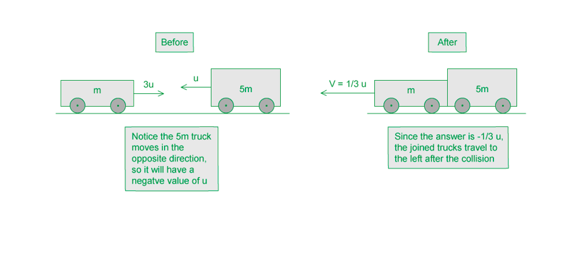

### Q11
**Final answer:** **The correct answer is ****C**** because:**

- After the collision, the trolleys move together as a single trolley of mass 600 g and velocity *v*
- We can find the value of *v* using the principle of conservation of momentum:

  - The sum of momentum before the collision equals the sum of momentum after the collision
- Momentum before: $( 100 \times 4 ) + ( 500 \times 0.5 ) = 400 + 250 = 650$

  - Note: this is the same as writing $( 100 \times 10^{- 3} \times 4 ) + ( 500 \times 10^{- 3} \times 0.5 ) = 650 \times 10^{- 3}$
- Momentum after: $( 100 + 500 ) v = 600 v$
- Therefore, $650=600v$

  - $v=\frac{650}{600}=1.08ms^{-1}$
- Kinetic energy $E_{k}=\frac{1}{2}mv^{2}$

  - $E_{k} = 1 \frac{1}{2} m v^{2} = 1 \frac{1}{2} \times ( 600 \times 10^{- 3} ) \times 1.08^{2} = 0 . 35 J$

### Q12
**Final answer:** **The correct answer is ****A**** because:**

- The principle of conservation of momentum can be written as

  - $M_{1}u_{1}+M_{2}u_{2}=M_{1}v_{1}+M_{2}v_{2}$
- The two masses are both initially at rest so

  - $u_{1}=u_{2}=0$
  - $M_{1}v_{1}+M_{2}v_{2}=0$
- The masses move away from each other in opposite directions, so let’s define *v**1* as the positive direction and *v**2* as the negative direction

  - $M_{1}v_{1}-M_{2}v_{2}=0$
  - $M_{1}v_{1}=M_{2}v_{2}$
  - $M_{2}=\frac{v_{1}}{v_{2}}M_{1}$
  - $\frac{v_{1}}{v_{2}}=\frac{M_{2}}{M_{1}}$

### Q13
**Final answer:** **The correct answer is ****A**** because:**

- Usually when we deal with momentum questions it is the velocity that is changing, but in this case, the velocity is constant and it is the mass of the sand that is changing at a rate of *m* kg s–1 (*m* here means mass, not metres)
- We can define the rate of change of mass as

  - $m=\frac{\DeltaM}{t}$
- So, the momentum is equal to

  - $\Deltap=\DeltaMv$
- Force is equal to the rate of change of momentum

  - $F = \frac{\Delta p}{t} = \frac{\Delta M v}{t} = ( \frac{\Delta M}{t} ) v = m v$
- We can check the units to ensure it is consistent

  - The unit of force is the newton: N = kg m s–2
  - *m* has units of kg s–1, *v* has units of m s–1
  - So, *mv* also has units of [kg s–1] [m s–1] = kg m s–2

**B **is incorrect because the units are consistent but the factor of ½ is incorrect

**C & D **are incorrect because the units are inconsistent with the units of force (kg m s–2) mv2 = [kg s–1] [m s–1]2 = kg m2 s–3

### Q14
**Final answer:** **The correct answer is ****B ****because:**

**Part 1:** use the conservation of momentum to find the speed after collision

- From the conservation of momentum, the sum of the momentum before the collision should equal the sum of momentum after the collision

  - Momentum of wooden before the collision = 0
  - Momentum of pellet before the collision = $20g\times250ms^{-1}$
- After the collision the pellet becomes embedded in the wooden block, so the two travel together with a mass of (20 g + 80 g) = 100 g and a speed of *u*

  - Momentum of block and pellet after the collision = 100 *u*
- Sum of momentum before the collision = Sum of momentum after the collision

  - $20\times250=100u$
  - $u=\frac{5000}{100}=50ms^{-1}$

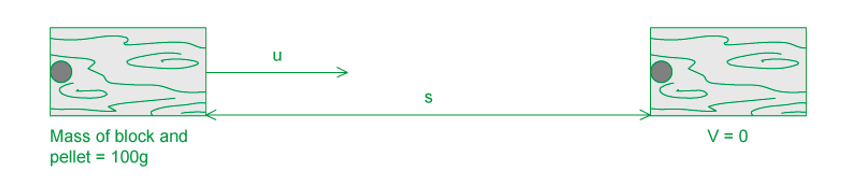

**Part 2:** use a kinematic equation to find the maximum distance

- List the quantities we know:

  - *u* = 50 m s–1
  - *v* = 0
  - *t* = 8.4 s
  - *s* = ?
- The equation that links *u, v, t* and *s* is

  - $s = \frac{( u + v ) t}{2}$
  - $s=\frac{50}{2}\times8.4$
  - $s=210m$
- The block and pellet will travel 210 m before coming to a stop

### Q15
**Final answer:** **The correct answer is ****B**** because:**

- The gradient of a momentum-time graph can be found at a particular time, *t*, by drawing a tangent on the curve at *t* then using

  - $\frac{\Deltay}{\Deltax}=\frac{\Deltap}{\Deltat}$
- Force is equal to the rate of change of momentum so the gradient is equal to the resultant force on the car

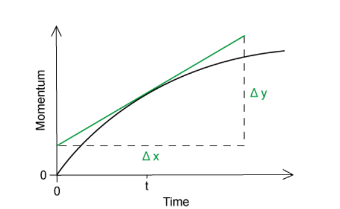

**A **is incorrect because momentum is equal to p  = mv, so velocity would be the gradient of a momentum-mass graph

**C **is incorrect because kinetic energy is equal to  $E_{k}=\frac{1}{2}mv^{2}=\frac{1}{2}pv$, so kinetic energy would be the area under a momentum-velocity graph

**D **is incorrect because the rate of change of kinetic energy is equal to power

### Q16
**Final answer:** **The correct answer is ****A**** because:**

- For any collision in a closed system, momentum is always conserved, so the total momentum before and after the collision should be the same
- The collision is inelastic, meaning that kinetic energy is not conserved, so the kinetic energy after the collision should be less than the energy before

**B **is incorrect because the kinetic energy before the collision cannot be lower than the kinetic energy after the collision

**C **is incorrect because momentum is always conserved, so the momentum should be the same before and after the collision

**D **is incorrect because the collision is inelastic, meaning the energy is not conserved, so the energy should be less than the initial energy

### Q17
**Final answer:** **The correct answer is ****D**** because:**

- The principle of conservation of momentum states that:

  - For a system of interacting bodies, the total momentum remains constant provided there is no resultant force acting on the system
- In other words, in a **closed** or **isolated** system, the total momentum of two bodies before a collision is equal to their total momentum after the collision

**A **is incorrect because this is true, however it needs to clarify that momentum is only constant in a closed or isolated system

**B & C **are incorrect because these are definitions of force and momentum

### Q18
**Final answer:** **The correct answer is ****B**** because:**

- From the conservation of momentum, the sum of the momentum before the explosion should equal the sum of momentum after the explosion

  - Momentum before explosion = 0
  - Momentum after explosion =$p_{3m}-p_{m}$
  - $p_{3m}-p_{m}=0$
  - Therefore, $p_{3m}=p_{m}$
- This means that the magnitudes of the momentum of both components are equal
- Let’s say the velocity of mass 3 *m* is *v* and the velocity of mass *m* is *v’*

  - Momentum of component 3 *m *: $p_{3m}=3mv$
  - Momentum of component *m *: $p_{m}=mv'$
  - $3mv=mv'$
  - $v'=\frac{3mv}{m}=3v$
- Kinetic energy = ½ *m v**2*

  - $X = 1 \frac{1}{2} ( m ) ( 3 v )^{2} = \frac{9}{2} m v^{2}$
  - $Y = 1 \frac{1}{2} ( 3 m ) ( v )^{2} = \frac{3}{2} m v^{2}$
- Ratio $\frac{X}{Y}=\frac{\frac{9}{2}mv^{2}}{\frac{3}{2}mv^{2}}=3$

### Q19
**Final answer:** **The correct answer is ****D ****because:**

- After the collision, the train carriages move together as a single object of mass 15 000 kg and velocity *v*
- We can find the value of *v* using the principle of conservation of momentum:

  - The sum of the momentum before the collision equals the sum of the momentum after the collision
- Let’s define the positive direction to be to the right
- Momentum before: $( 7500 \times 3 ) - ( 7500 \times 1.5 ) = 22 500 - 11 250$ = 11 250
- Momentum after: $( 7500 + 7500 ) v = 15000 v$

  - $11250=15000v$
  - $v=\frac{11250}{15000}=0.75ms^{-1}$
- Kinetic energy $( E_{k} = 1 \frac{1}{2} m v^{2} )$ before collision = sum of kinetic energies of the train carriages
- Kinetic energy before collision = $1 \frac{1}{2} ( 7500 ) ( 3 )^{2} + 1 \frac{1}{2} ( 7500 ) ( 1.5 )^{2} = 42 200 \mathrm{J}$
- Kinetic energy after collision = $1 \frac{1}{2} ( 15 000 ) ( 0.75 )^{2} = 4200 \mathrm{J}$

  - Kinetic energy lost = $42200-4200=38000J$

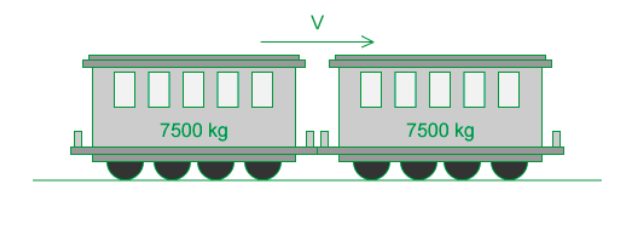

### Q20
**Final answer:** **The correct answer is ****C**** because:**

- Before the cannon ball is fired both the cannon and the ball are stationary so the initial momentum is zero
- The cannon recoils in the opposite direction to the direction of motion of the cannon ball, so we must define one of the directions to be positive and one to be negative
- By the principle of conservation of momentum, the sum of momentum before the collision equals the sum of momentum after the collision

  - $0 = ( 1600 \times 5 ) - 20 v$
  - $20v=8000$
  - $v=400ms^{-1}$

### Q21
**Final answer:** **The correct answer is ****B**** because:**

- After the collision, the balls move together as a single object of mass 5 kg and velocity *v*
- We can find the value of *v* using the principle of conservation of momentum:
- The sum of the momentum before the collision equals the sum of the momentum after the collision

  - $( 2 \times 1 \frac{1}{2} ) + ( 3 \times 1 \frac{1}{3} ) = 5 v$
  - $5v=2$
  - $v=\frac{2}{5}ms^{-1}$

### Q22
**Final answer:** **The correct answer is ****D**** because:**

- The principle of conservation of momentum states that:

  - For a system of interacting bodies, the total momentum remains constant provided there is no resultant force acting on the system
- In other words, in a **closed** system, the total momentum of two bodies before a collision is equal to their total momentum after the collision

**A & B **are incorrect because these are definitions of force and momentum

**C **is incorrect because the statement is true given there are no external forces acting, it needs clarification that this is only true in a closed or isolated system

### Q23
**Final answer:** **The correct answer is ****A**** because:**

- For collisions in two dimensions, momentum is conserved independently along each perpendicular direction
- Since the balls have identical masses and have a perfectly elastic collision, they move at 90° to one another afterwards, which means

  - ball Y moves in the horizontal direction
  - ball X moves in the vertical direction
- In the horizontal direction:

  - Before the collision: $p_{X} = m ( 30 \cos 45^{\circ} )$
  - After the collision: $p_{Y}=mv$
- Apply the principle of conservation of momentum in the horizontal direction:

  - $p_{i}=p_{f}$
  - $p_{X}+0=0+p_{Y}$
  - $m ( 30 \cos 45^{\circ} ) = m v$
  - $v=30\mathrm{cos}45^{\circ}\approx21ms^{-1}$

To determine the horizontal component of ball X’s velocity using trigonometry, remember SOH CAH TOA:

### Q24
**Final answer:** **The correct answer is ****C**** because:**

- An elastic collision is a collision in which kinetic energy is conserved
- So conversely, an inelastic collision is a collision in which kinetic energy is **not **conserved
- Momentum is conserved in both elastic and inelastic collisions
- The principle of conservation of momentum states that:

  - For a system of interacting bodies, the total momentum remains constant provided there is no resultant force acting on the system

**A **is incorrect because the definition of an inelastic collision is that kinetic energy is not conserved as energy may be lost as sound, heat, light etc

**B & D **are incorrect because for any system where there are no external forces acting, momentum is always conserved

### Q25
**Final answer:** **The correct answer is ****A**** because:**

- In a perfectly elastic collision, both momentum and energy are conserved
- According to conservation of momentum:

  - Sum of momentum before collision = Sum of momentum after collision
- In an elastic collision, the total kinetic energy before the collision should be the same as the total kinetic energy after
- Consider option A :
- Before collision :

  - Momentum = $mv+0=mv$
  - Kinetic energy = $\frac{1}{2}mv^{2}+0=\frac{1}{2}mv^{2}$
- After collision:

  - Momentum = $0+mv=mv$
  - Kinetic energy = 0 + $\frac{1}{2}mv^{2}=\frac{1}{2}mv^{2}$
- Momentum and energy are both conserved so option A is correct

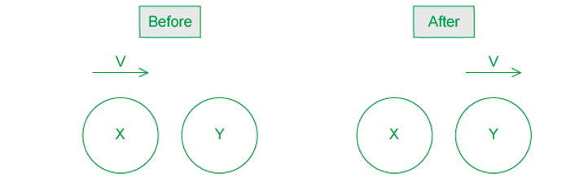

**B **is incorrect because

- Momentum : $m ( 1 \frac{1}{2} v ) + m ( 1 \frac{1}{2} v ) = m v$
- Kinetic energy : $1 \frac{1}{2} m ( 1 \frac{1}{2} v )^{2} + 1 \frac{1}{2} m ( 1 \frac{1}{2} v )^{2} = 1 \frac{1}{4} m v^{2}$

**C **is incorrect because

- Momentum : $m ( 1 \frac{1}{2} v ) - m ( 1 \frac{1}{2} v ) = 0$
- Kinetic energy : $1 \frac{1}{2} m ( 1 \frac{1}{2} v )^{2} + 1 \frac{1}{2} m ( 1 \frac{1}{2} v )^{2} = 1 \frac{1}{4} m v^{2}$

**D **is incorrect because

- Momentum : $0-mv=-mv$
- Kinetic energy : $0+\frac{1}{2}mv^{2}=\frac{1}{2}mv^{2}$

### Q26
**Final answer:** **The correct answer is ****D**** because: **

- The principle of conservation of momentum tells us that the momentum of a closed system is always conserved (provided no external forces act)

**A & B **are incorrect because it isn’t possible to say that kinetic energy will **always** be conserved in a collision because the energy can be transferred to heat, light or sound

**C **is incorrect because when the tennis ball is struck by the racket, the velocity of the ball will increase, so the momentum of the individual ball will increase but the momentum of the racket will decrease to ensure the momentum of the system is conserved

### Q27
**Final answer:** **The correct answer is ****B**** because:**

- Momentum:  $p=mv$
- Before separation:

  - Combined mass = $1000+m$
  - Speed = $13ms^{-1}$
- The initial momentum of the spacecraft and fuel module is:

  - $p_{i} = ( 1000 + m ) \times 13$
  - $p_{i}=13000+13m$
- After separation:

  - Spacecraft momentum = $1000\times17=17000\mathrm{kg}ms^{-1}$
  - Fuel module momentum = $5m$
- All values of momentum are positive as the spacecraft and module continue to travel in the same direction
- The final momentum of the spacecraft and fuel module is:

  - $p_{f} = ( 1000 \times 17 ) + 5 m$
  - $p_{f}=17000+5m$
- Apply the principle of conservation of momentum:

  - $p_{i}=p_{f}$
  - $13000+13m=17000+5m$
  - $8m=4000$
  - $m=\frac{4000}{8}=500\mathrm{kg}$

Even though there is no collision, the principle of conservation of momentum still applies as no external forces act on the system. However, if, for example, the spacecraft were burning fuel, then this would be considered an external force, and momentum would not be conserved.

### Q28
**Final answer:** **The correct answer is ****B**** because:**

- According to conservation of momentum
- Sum of momentum before decay = Sum of momentum after decay
- The nucleus is initially stationary, its speed is zero, therefore, its momentum before the decay is also initially zero
- The quantities we will need to work out the momentum after the decay are:

  - The nucleus contains *A* nucleons
  - The proton has a speed of *v*
  - The new nucleus contains *A* – 1 nucleons
  - The new nucleus has a speed of *u*
  - Each nucleon has a mass of *m*
- After the nucleus decays :
- Momentum of proton =$mv$
- Momentum of new nucleus = $( A - 1 ) m ( - u )$
- Total momentum after decay = $m v - ( A - 1 ) m u$

  - $0 = m v - ( A - 1 ) m u$
  - $v = ( A - 1 ) u$

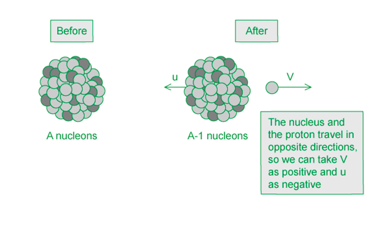

### Q29
**Final answer:** **The correct answer is ****B**** because:**

- The ball changes direction after it is hit by the racket
- Take the positive direction as the direction of the ball after the collision, so:

  - Initial velocity, $v_{i}=-30ms^{-1}$
  - Final velocity, $v_{f}=+50ms^{-1}$
- Change in momentum is equal to

  - $\Deltap=m\Deltav$
  - $\Delta p = m ( v_{f} - v_{i} )$
  - $\Delta p = ( 60 \times 10^{- 3} ) \times ( 50 - ( - 30 ) )$
  - $\Deltap=4.8\mathrm{kg}ms^{-1}$

**A** is incorrect as this is the answer you get if you don’t set a positive and negative direction and add the velocities together.

**C **is incorrect as this is the answer you get if you don’t convert the mass from g to kg, and if you don’t set a positive and negative direction and add the velocities together.

**D **is incorrect as this is the answer you get if you don’t convert the mass from g to kg.

### Q30
**Final answer:** **The correct answer is ****C**** because:**

- In a perfectly elastic collision, **both** momentum and kinetic energy are conserved
- In an elastic collision: the relative speed of approach before the collision must be equal to the relative speed of separation after the collision
- Before the collision: the two spheres are moving towards each other, they are approaching each other

  - The relative speed of approach is $u_{1}+u_{2}$
- After the collision: the spheres move in the same direction, the first sphere is moving towards the second sphere and the second sphere is moving away from the first – this is an important distinction to make as it tells us $v_{2}$ must be greater than $v_{1}$

  - The relative speed of separation is $v_{2}-v_{1}$
- So, the relative speeds before and after the collision are equal to

  - $u_{1}+u_{2}=v_{2}-v_{1}$

### Q31
**Final answer:** **The correct answer is ****C**** because:**

**Part 1:** use the conservation of momentum to find the speed after collision

- Sum of momentum before collision = Sum of momentum after collision

  - Momentum of block before collision  $=0$
  - Momentum of bullet before collision $=10g\times200ms^{-1}$

- The bullet becomes embedded in the block, so the two objects will travel together with the same velocity, *u*

  - The momentum after the collision $= ( 10 g + 150 g ) u = 160 u$
  - $160u=2000$
  - $u=12.5ms^{-1}$

**Part 2:** use a kinematic equation to find the maximum height

- List the quantities we know:

  - *u* = 12.5 m s–1
  - *v* = 0
  - *a* = –9.81 m s–2
  - *s* = ?
- The equation that links *u, v, a* and *s* is

  - $v^{2}=u^{2}+2as$
  - $0 = 12.5^{2} + 2 ( - 9.81 ) s$
  - $( 2 \times 9.81 ) s = 12.5^{2}$
  - $s=\frac{12.5^{2}}{19.6}=8.0m$
- Height of the block above the ground = 4.0 + 8.0 = 12.0 m

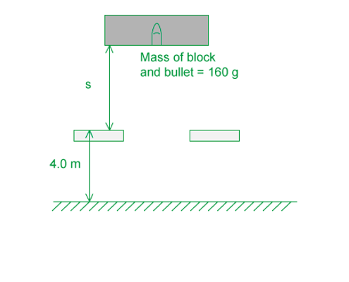

### Q32
**Final answer:** **The correct answer is ****B**** because:**

- A perfectly elastic collision is defined as a collision in which the initial kinetic energy equals the final kinetic energy
- In other words, the relative speed of approach equals the relative speed of separation of the two bodies because kinetic energy and speed is related by

  - $E_{k}=\frac{1}{2}mv^{2}$

**A & D **are incorrect because these are possible elastic collision scenarios, but they do not describe all elastic collisions

**C **is incorrect because this describes an inelastic collision

### Q33
**Final answer:** **The correct answer is ****B**** because:**

- Kinetic energy =$\frac{1}{2}mv^{2}$
- Each sphere moves with speed v before the impact, so the kinetic energy of each sphere =$\frac{1}{2}mv^{2}$
- So, the sum of the kinetic energies is =$\frac{1}{2}mv^{2}+\frac{1}{2}mv^{2}=mv^{2}$
- The spheres collide elastically, meaning no kinetic energy is lost so the kinetic energy before the impact = kinetic energy after the impact = $mv^{2}$

**A **is incorrect because this is the definition of a perfectly inelastic collision

**C **is incorrect because the total kinetic energy before impact would be zero if energy was a vector quantity, but it is a scalar so the total kinetic energy is the sum of the energies

**D **is incorrect because momentum is a vector, because the spheres are moving in opposite directions the total momentum is equal to mv – mv = 0

### Q34
**Final answer:** **The correct answer is ****A**** because:**

- The fact that the ice-rink is frictionless is significant because it means the speed of the ice-hockey puck is not affected by friction and can be assumed to travel with constant speed before the collision
- This is represented on the graph by a straight horizontal line, since momentum is equal to $p=mv$
- After the collision, the puck will rebound along its original path and its momentum will be negative s it travels in the opposite direction
- The collision is inelastic, so the puck loses some energy and will rebound with a lower speed
- On the graph, at a later time the line will be straight and horizontal but below the x-axis and will have a lower value of momentum

**B & C **are incorrect because the speed is constant, so the momentum is constant and this should be represented by straight, horizontal lines on the graph

**D **is incorrect because momentum is a vector, so if the original direction is taken as positive, the direction after the rebound is negative and should be below the x-axis

## Structured Questions (12 questions)

### Q1
> **[mark-scheme]**
> The principle of conservation of momentum states:
> 
> - Total momentum before = total momentum after **OR** the total momentum (of a system) is constant **[1 mark]**
> - Provided no (resultant) external forces act on the system **OR** for a closed system **[1 mark]**
(i) To calculate the velocity $v$ of sphere B after the collision:

- List the known quantities:

  - Mass of A, $m_{A}$ = 0.30 kg
  - Mass of B, $m_{B}$ = 0.20 kg
  - Initial velocity of A, $u_{A}$ = 5.0 m s−1
  - Initial velocity of B, $u_{B}$ = 2.0 m s−1
  - Final velocity of A, $v_{A}$ = 2.6 m s−1
  - Final velocity of B, $v_{B}$ = $v$
- Determine the momentum of the spheres before and after the collision

$p=mv$

Total momentum before = $m_{A}u_{A}+m_{B}u_{B}$

Total momentum before = $( 0.30 \times 5.0 ) + ( 0.20 \times 2.0 )$

Total momentum after = $m_{A}v_{A}+m_{B}v_{B}$

Total momentum after = $( 0.30 \times 2.6 ) + ( 0.20 \times v )$ **[1 mark]**

- Apply conservation of momentum and calculate $v$:

Total momentum before = total momentum after

$( 0.30 \times 5.0 ) + ( 0.20 \times 2.0 ) = ( 0.30 \times 2.6 ) + ( 0.20 \times v )$

$v = \frac{( 0.30 \times 5.0 ) + ( 0.20 \times 2.0 ) - ( 0.30 \times 2.6 )}{0.20}$

$v=$ $5.6ms^{-1}$ **[1 mark]**

(ii) To determine whether the collision of the spheres is inelastic or perfectly elastic:

- Calculate the initial kinetic energy of the spheres

$E_{K}=\frac{1}{2}mv^{2}$

initial $E_{K} = ( 1 \frac{1}{2} \times 0.30 \times 5.0^{2} ) + ( 1 \frac{1}{2} \times 0.20 \times 2.0^{2} )$

initial $E_{K}=4.15J$

- Calculate the final kinetic energy of the spheres

final $E_{K} = ( 1 \frac{1}{2} \times 0.30 \times 2.6^{2} ) + ( 1 \frac{1}{2} \times 0.20 \times 5.6^{2} )$

final $E_{K}=4.15J$ **[1 mark]**

- Write a concluding statement

**Since initial **$E_{K}$** = final **$E_{K}$**, the collision is ****elastic** **[1 mark]**

> **[mark-scheme]**
> 1 mark for either value of initial $E_{K}$**OR** final $E_{K}$ correct
> 
> 1 mark for the values of initial $E_{K}$ and final $E_{K}$ both correct **AND** evidence that the collision is inelastic

### Q2
The difference between an elastic and an inelastic collision is:

- In an elastic collision, the total kinetic energy is conserved **OR** relative speed of approach = relative speed of separation; **[1 mark]**
- In an inelastic collision, kinetic energy is not conserved / is lost **OR** relative speed of approach > relative speed of separation; **[1 mark]**

**[Total: 2 marks]**
Calculate the momentum of the ball at the start, before it hits the wall:

List the known quantities:

- Mass, *m* = 0.025 kg
- Velocity, *v* = 35 m s−1

State the equation for momentum and calculate:

- Momentum: $p=mv$ **[1 mark]**
- Momentum:  *p* = 0.025 × 35
- Momentum:  *p* = 0.875 = 0.88 kg m s−1 **[1 mark]**

**[Total: 2 marks]**
List the known quantities:

- Mass, *m* = 0.025 kg
- Initial momentum = 0.875 kg m s−1
- Initial velocity = 35 m s−1

(i) Determine the rebound velocity of the ball:

- For a perfectly elastic collision:  relative speed of approach = relative speed of separation
- Hence, rebound (final) velocity:  *v* = –35 m s−1 **[1 mark]**

(ii) Determine the change in momentum of the ball:

- Change in momentum:  Momentum after − momentum before
- Change in momentum:  Δ*p* = -mv - mv = -2mv
- Change in momentum:  Δ*p* = (0.025 × –35) − (0.025 × 35) **OR** 2 × 0.875 **[1 mark]**
- Magnitude of the change in momentum:  Δ*p* = 1.75 = 1.8 kg m s−1 **[1 mark]**

**[Total: 3 marks]**

> *The question demonstrates the importance of direction. Since momentum is a vector quantity, the direction influences the sign on the value.*

> *The **magnitude **of the change in momentum means don't worry about the signs, the final answer should just be the **size**. However, the negative or positive signs are important to get to this stage!*

> *If momentum was a scalar, you would say the 'change in momentum' was zero, as the magnitude of the momentum before and after didn't change. However, the fact that the momentum acts in the opposite direction afterwards means the magnitude of the total momentum is **twice** that of the momenta before and after the collision.*

> *This very fact has crucial implications in the real world, such as in gas laws, where it can be used to explain why gas pressure exists*
Calculate the force exerted on the ball by the wall

List the known quantities:

- Change in momentum, Δ*p* = 1.75 kg m s−1
- Change in time, Δ*t *= 0.1 s

Use the equation for force and momentum:

- $F=\frac{\Deltap}{\Deltat}$  **[1 mark]**
- $F=\frac{1.75}{0.1}$
- Force:  *F *= 17.5 = 18 N **[1 mark]**

**[Total: 2 marks]**

### Q3
Determine the speed of fragment B:

Resolve the momenta horizontally:

**Final answer:** **Any ****one**** from:**

- Horizontal momentum of A:  $p_{A}=\frac{3}{2}M\times1.2v\mathrm{sin}θ$ **[1 mark]**
- Horizontal momentum of B:  $p_{B}=\frac{1}{2}M\timesv_{B}\mathrm{sin}θ$ **[1 mark]**
- Horizontal momentum of C:  $p_{C}=0$ **[1 mark]**

Apply conservation of momentum in the horizontal direction:

- Total momentum before = total momentum after

  - Total momentum before = 0
  - Total momentum after = $p_{A}-p_{B}$

- $p_{A}-p_{B}=0$
- $p_{A}=p_{B}$
- $\frac{3}{2}M\times1.2v\mathrm{sin}θ=\frac{1}{2}M\timesv_{B}\mathrm{sin}θ$ **[1 mark]**

Simplify and calculate $v_{B}$:

- $v_{B}=2\times\frac{3}{2}\times1.2v$
- $v_{B}=3.6v$ **[1 mark]**

**[Total: 3 marks]**

> *Remember that the momenta are vectors and as such have a specific sign for their direction. *

> $+p_{A}$* and *$-p_{B}$
Determine the angle *θ*:

Resolve the momenta vertically:

**Final answer:** **Any ****one ****from:**

- Vertical momentum of A:  $p_{A}=\frac{3}{2}M\times1.2v\mathrm{cos}θ$ **[1 mark]**
- Vertical momentum of B:  $p_{B}=\frac{1}{2}M\times3.6v\mathrm{cos}θ$ **[1 mark]**
- Vertical momentum of C:  $p_{C}=\frac{5}{2}M\times0.6v$ **[1 mark]**

Apply conservation of momentum in the vertical direction:

- Conservation of momentum:  total momentum before = total momentum after

  - Total momentum before = 0
  - Total momentum after = $p_{A}+p_{B}-p_{C}$

- $p_{A}+p_{B}-p_{C}=0$
- $p_{A}+p_{B}=p_{C}$
- $\frac{3}{2}M\times1.2v\mathrm{cos}θ+\frac{1}{2}M\times3.6v\mathrm{cos}θ=\frac{5}{2}M\times0.6v$ **[1 mark]**

Simplify and calculate $θ$:

- $( \frac{3}{2} \times 1.2 + 1 \frac{1}{2} \times 3.6 ) \cos \\theta = \frac{5}{2} \times 0.6$
- $\mathrm{cos}θ=\frac{1.5}{3.6}$
- $θ$ = 65.38 = 65° **[1 mark]**

**[Total: 3 marks]**
List the known quantities:

- Fragment (1): mass $m_{1}$ = 20 g, velocity $v_{1}$ = 260 m s−1
- Fragment (2): mass $m_{2}$ = 12 g, velocity = $v_{2}$
- Fragment (3): mass = $m_{3}$, velocity $v_{3}$ = 200 m s−1
- Fragment (4): mass $m_{4}$ = 32 g, velocity $v_{4}$ = 300 m s−1

(i) Determine the velocity of fragment (2):

- Momentum of (4):  $p_{4}=m_{4}v_{4}=32\times300$
- Momentum of (2):  $p_{2}=m_{2}v_{2}=12\timesv_{2}$

Apply conservation of momentum:

- Conservation of momentum (taking $p_{2}$ as the positive direction):  $0=p_{2}-p_{4}\Rightarrowp_{2}=p_{4}$
- $12\timesv_{2}=32\times300$ **[1 mark]**
- $v_{2}=\frac{32\times300}{12}=800ms^{-1}$ **[1 mark]**

(ii) Determine the mass of fragment (3):

- Momentum of (1):  $p_{1}=m_{1}v_{1}=20\times260$
- Momentum of (3):  $p_{3}=m_{3}v_{3}=m_{3}\times200$

Apply conservation of momentum:

- Conservation of momentum (taking $p_{1}$ as the positive direction):  $0=p_{1}-p_{3}\Rightarrowp_{1}=p_{3}$

- $20\times260=m_{3}\times200$ **[1 mark]**
- $m_{3}=\frac{20\times260}{200}=26g$ **[1 mark]**

**[Total: 4 marks]**

> *This kind of explosion question can look daunting at first, but taking some time to understand what is going on reveals the problem can be simplified by isolating the fragments and focusing on each line of action one at a time*

> *Since the fragments all move at 90° to one another, you can consider the directions independently, similar to taking 'horizontal' and 'vertical' components in other vector problems. Once you realise this, then you can see that the fragments on the same line have **equal momenta*

> *If you fancy a real mathsy challenge, have a go at part (e) of this question to see if you can truly get your head around how the momentum conservation laws can be applied to this sort of problem*
List the known quantities:

- Fragment (A):  mass = $\frac{3}{2}M$, velocity = $1.2v$
- Fragment (B):  mass = $\frac{1}{2}M$, velocity = $3.6v$
- Fragment (C):  mass = $\frac{5}{2}M$, velocity = $0.6v$
- Fragment (1):  mass = 20 g, velocity = 260 m s−1
- Fragment (2):  mass = 12 g, velocity = 800 m s−1
- Fragment (3):  mass = 26 g, velocity = 200 m s−1
- Fragment (4):  mass = 32 g, velocity = 300 m s−1

(i) Calculate the value of *M*:

- Sum of the masses (from **(b)**) = $\frac{3}{2}M+\frac{1}{2}M+\frac{5}{2}M=\frac{9}{2}M$
- Sum of the masses (from **(c)**) = 20 + 12 + 26 + 32 = 90 g
- Therefore, $\frac{9}{2}M=90g\RightarrowM=\frac{90}{4.5}=20g$ **[1 mark]**

(ii) Calculate the magnitude of *v*:

Total kinetic energy of fragments A, B and C:

- $E_{k} = 1 \frac{1}{2} M v^{2} [ ( \frac{3}{2} \times 1.2^{2} ) + ( 1 \frac{1}{2} \times 3.6^{2} ) + ( \frac{5}{2} \times 0.6^{2} ) ]$
- $E_{k}=4.77Mv^{2}$ **[1 mark]**

Total kinetic energy of fragments 1, 2, 3 and 4:

- $E_{k} = 1 \frac{1}{2} [ ( 0.020 \times 260^{2} ) + ( 0.012 \times 800^{2} ) + ( 0.026 \times 200^{2} ) + ( 0.032 \times 300^{2} ) ]$
- $E_{k}=6476J$ **[1 mark]**

Determine the value of v:

- Total KE:  $4.77Mv^{2}=6476$
- $v=\sqrt{\frac{6476}{4.77\times0.020}}$
- $v=261=260ms^{-1}$ **[1 mark]**

**[Total: 4 marks]**

> *The key is in the question:*

- *both fireworks have the **same initial mass*

> *This means the total mass of fragments A, B and C is equal to the total mass of fragments 1, 2, 3 and 4*

- *both fireworks release the **same amount of kinetic energy*

> *This means the total KE of fragments A, B and C is equal to the total KE of fragments 1, 2, 3 and 4*

> *To get the total KE of fragments A, B and C, start by writing the kinetic energy of each in terms of M and v and then simplify:*

$E_{k} = 1 \frac{1}{2} ( \frac{3}{2} M \times ( 1.2 v )^{2} ) + 1 \frac{1}{2} ( 1 \frac{1}{2} M \times ( 3.6 v )^{2} ) + 1 \frac{1}{2} ( \frac{5}{2} M \times ( 0.6 v )^{2} )$

$E_{k} = 1 \frac{1}{2} M v^{2} [ ( \frac{3}{2} \times ( 1.2 )^{2} ) + ( 1 \frac{1}{2} \times ( 3.6 )^{2} ) + ( \frac{5}{2} \times ( 0.6 )^{2} ) ]$

$E_{k} = 1 \frac{1}{2} M v^{2} \times ( 9.54 ) = 4.77 M v^{2}$
(i) Apply conservation of momentum to Fig. 1.3:

- Momentum of fragment 1:  $p_{1}=m_{1}v_{1}=0.015\times400=6\mathrm{kg}ms^{-1}$
- Momentum of fragment 4:  $p_{4}=m_{4}v_{4}=0.03\times500=15\mathrm{kg}ms^{-1}$

From conservation of momentum:

- Fragments on the same line have equal momenta, therefore: $p_{1}=p_{3}=6\mathrm{kg}ms^{-1}$ **[1 mark]** $p_{2}=p_{4}=15\mathrm{kg}ms^{-1}$ **[1 mark]**
- Sum of ↑ momenta = sum of ↓ momenta:  $p_{1}+p_{4}=p_{2}+p_{3}$
- Sum of → momenta = sum of ← momenta:  $p_{1}+p_{2}=p_{3}+p_{4}$
- So, $p_{1}+p_{4}=p_{2}+p_{3}=p_{1}+p_{2}=p_{3}+p_{4}$ = constant
- Therefore, $\frac{p_{1}}{p_{4}}=\frac{p_{2}}{p_{3}}=\frac{p_{1}}{p_{2}}=\frac{p_{3}}{p_{4}}$ = constant
- Hence,   $\frac{m_{1}v_{1}}{m_{4}v_{4}}=\frac{m_{3}v_{3}}{m_{2}v_{2}}$ **[Eq. 1]**  **[1 mark]**
- Hence,  $\frac{m_{1}v_{1}}{m_{2}v_{2}}=\frac{m_{3}v_{3}}{m_{4}v_{4}}$ **[Eq. 2]**  **[1 mark]**

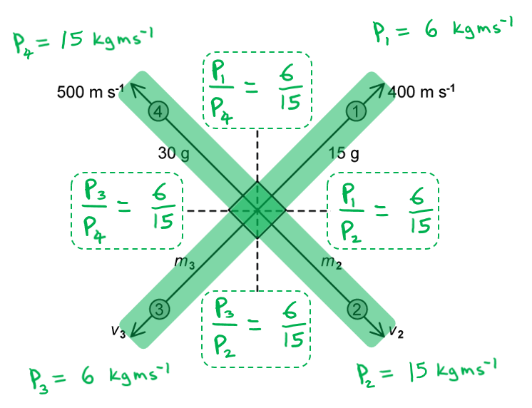

List the known ratios so far:

- From Fig. 1.2:  $\frac{m_{1}}{m_{4}}=\frac{15}{30}=\frac{1}{2}$
- From Fig. 1.2:  $\frac{v_{1}}{v_{4}}=\frac{400}{500}=\frac{4}{5}$

- Since $p_{1}=p_{3}$, then $\frac{m_{1}}{m_{3}}=\frac{v_{3}}{v_{1}}$
- Since $p_{2}=p_{4}$, then $\frac{m_{2}}{m_{4}}=\frac{v_{4}}{v_{2}}$

- From **[Eq. 1] ** $\frac{m_{1}}{m_{4}}\times\frac{v_{1}}{v_{4}}=\frac{m_{3}}{m_{2}}\times\frac{v_{3}}{v_{2}}=\frac{6}{15}=\frac{2}{5}$
- From** [Eq. 2] ** $\frac{m_{1}}{m_{2}}\times\frac{v_{1}}{v_{2}}=\frac{m_{3}}{m_{4}}\times\frac{v_{3}}{v_{4}}=\frac{6}{15}=\frac{2}{5}$

List the known proportional relationships so far:

- $m_{1}\proptov_{3}\propto1.5$ (simplified from 15 g)
- $v_{1}\proptom_{3}\propto4$
- $m_{4}\proptov_{2}\propto3$
- $v_{4}\proptom_{2}\propto5$ (simplified from 500 m s−1)

Use the proportional relationships to find the ratios in **[Eq. 1]**:

- $m_{1}\proptov_{3}$ and $m_{4}\proptov_{2}$ therefore  $\frac{m_{1}}{m_{4}}=\frac{v_{3}}{v_{2}}=\frac{1.5}{3}=\frac{1}{2}$
- $v_{1}\proptom_{3}$ and $m_{2}\proptov_{4}$ therefore  $\frac{m_{3}}{m_{2}}=\frac{v_{1}}{v_{4}}=\frac{4}{5}$

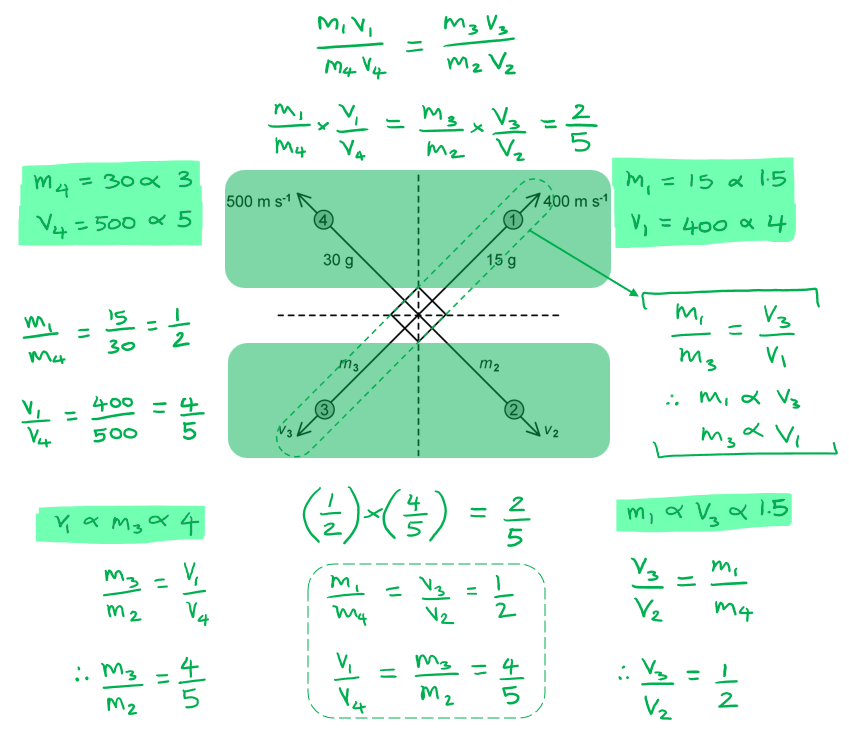

Use the proportional relationships to find the ratios in **[Eq. 2]**:

- $m_{1}\proptov_{3}$ and $m_{2}\proptov_{4}$ and from the question $\frac{m_{1}}{m_{2}}=\frac{v_{3}}{v_{4}}=\frac{3}{5}$: therefore   $\frac{m_{1}}{m_{2}}=\frac{v_{3}}{v_{4}}=\frac{1.5}{5}\times2=\frac{3}{5}$ **[1 mark]**

- $m_{3}\proptov_{1}$ and $m_{4}\proptov_{2}$ and from the question $\frac{m_{3}}{m_{4}}=\frac{v_{1}}{v_{2}}=\frac{2}{3}$ therefore  $\frac{m_{3}}{m_{4}}=\frac{v_{1}}{v_{2}}=\frac{4}{3}\div2=\frac{2}{3}$ **[1 mark]**

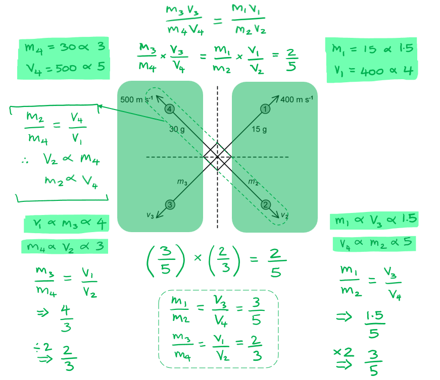

(ii) Hence, the missing values are:

- `m _ 1 / m _ 2 = 3 / 5 <-> m _ 2 = 5 / 3 x 0.015 = 0.025 ( 25 g )` **AND**
- $\frac{v_{3}}{v_{4}}=\frac{3}{5}\Rightarrowv_{3}=\frac{3}{5}\times500=300ms^{-1}$ **[1 mark]**
- `m _ 3 / m _ 4 = 2 / 3 <-> m _ 3 = 2 / 3 x 0.030 = 0.020 ( 20 g )` **AND**
- $\frac{v_{1}}{v_{2}}=\frac{2}{3}\Rightarrowv_{2}=\frac{3}{2}\times400=600ms^{-1}$ **[1 mark]**

**[Total: 8 marks]**

### Q4
Show that $v_{1}=v_{3}$ by considering momentum in the vertical plane:

- Vertical plane:  total momentum before = 0
- Vertical plane:  total momentum after = $( \frac{M}{3} ) v_{1} \sin 60^{\circ} - ( \frac{M}{3} ) v_{3} \sin 60^{\circ}$ **[1 mark]**

Apply conservation of momentum:

- Conservation of momentum:  total momentum before = total momentum after
- $0 = ( \frac{M}{3} ) v_{1} \sin 60^{\circ} - ( \frac{M}{3} ) v_{3} \sin 60^{\circ}$
- Simplify:  $( \frac{M}{3} ) v_{1} \sin 60^{\circ} = ( \frac{M}{3} ) v_{3} \sin 60^{\circ} \Leftrightarrow v_{1} = v_{3}$ **[1 mark]**

**[Total: 2 marks]**
Show that $3 V = ( v_{1} + v_{2} )$ by considering momentum in the horizontal plane:

- Horizontal plane:  total momentum before = $MV$
- Horizontal plane:  total momentum after = $( \frac{M}{3} ) v_{1} \cos 60^{\circ} + ( \frac{M}{3} ) v_{2} + ( \frac{M}{3} ) v_{3} \cos 60^{\circ}$ **[1 mark]**

Apply conservation of momentum:

- Conservation of momentum:  total momentum before = total momentum after
- $M V = ( \frac{M}{3} ) v_{1} \cos 60^{\circ} + ( \frac{M}{3} ) v_{2} + ( \frac{M}{3} ) v_{3} \cos 60^{\circ}$
- Substitute $v_{1}=v_{3}$ in:  $M V = 2 \times ( \frac{M}{3} ) v_{1} \cos 60^{\circ} + ( \frac{M}{3} ) v_{2}$ **[1 mark]**
- Simplify:  $V = 2 \times ( 1 \frac{1}{3} ) v_{1} \cos 60^{\circ} + ( 1 \frac{1}{3} ) v_{2} \Leftrightarrow 3 V = ( v_{1} + v_{2} )$ **[1 mark]**

**[Total: 3 marks]**

> *The full worked solution is shown below:*

$M V = ( \frac{M}{3} ) v_{1} \cos 60^{\circ} + ( \frac{M}{3} ) v_{2} + ( \frac{M}{3} ) v_{3} \cos 60^{\circ}$

$V = 2 \times ( 1 \frac{1}{3} ) v_{1} \cos 60^{\circ} + ( 1 \frac{1}{3} ) v_{2}$

$3V=2v_{1}\mathrm{cos}60^{\circ}+v_{2}$

$\mathrm{cos}60^{\circ}=\frac{1}{2}$

$3V=2\times\frac{1}{2}v_{1}+v_{2}$

$3 V = ( v_{1} + v_{2} )$
Express velocities $v_{1}$ and $v_{2}$ in terms of $V$:

- Kinetic energy of mass *M*:  $KE_{i}=\frac{1}{2}MV^{2}$
- Kinetic energy of fragment 1:  $K E_{1} = 1 \frac{1}{2} ( \frac{M}{3} ) v_{1}^{2}$ **[1 mark]**

Substitute the expressions into the ratio:

- $\frac{KE_{1}}{KE_{i}}=\frac{4}{3}\RightarrowKE_{1}=\frac{4}{3}KE_{i}$
- $1 \frac{1}{2} ( \frac{M}{3} ) v_{1}^{2} = \frac{4}{3} ( 1 \frac{1}{2} M V^{2} )$ **[1 mark]**

Simplify to determine the velocity of fragment 1:

- $\frac{1}{3}v_{1}^{2}=\frac{4}{3}V^{2}\Rightarrowv_{1}^{2}=4V^{2}$
- Velocity of fragment 1:  $v_{1}=2V$ **[1 mark]**

Determine the velocity of fragment 2:

- $3V=v_{1}+v_{2}\Rightarrowv_{2}=3V-2V$
- Velocity of fragment 2:  $v_{2}=V$ **[1 mark]**

**[Total: 4 marks]**
(i) Determine the total kinetic energy transferred to the fragments:

- Kinetic energy of fragment 1:  $KE_{1}=\frac{4}{3}KE_{i}$
- Kinetic energy of fragment 3:  $KE_{3}=\frac{4}{3}KE_{i}$ (since $v_{1}=v_{3}$)
- Where Kinetic energy of mass *M*: $KE_{i}=\frac{1}{2}MV^{2}$ (from part (c))

Determine the proportion of KE transferred to fragment 2:

- $αKE_{i}=KE_{2}$ where $α$ is the proportion of KE transferred to the fragment
- $\\alpha ( 1 \frac{1}{2} M V^{2} ) = 1 \frac{1}{2} ( \frac{M}{3} ) V^{2}$ (since $v_{2}=V$)
- $\\alpha ( 1 \frac{1}{2} M V^{2} ) = 1 \frac{1}{3} ( 1 \frac{1}{2} M V^{2} ) \Leftrightarrow \\alpha = 1 \frac{1}{3}$
- Therefore, $KE_{2}=\frac{1}{3}KE_{i}$ **[1 mark]**

Determine the total kinetic energy:

- Total initial KE = $KE_{1}+KE_{2}+KE_{3}$
- Total initial KE = $\frac{4}{3}KE_{i}+\frac{1}{3}KE_{i}+\frac{4}{3}KE_{i}$ **[1 mark]**
- Total initial KE = $3KE_{i}$ **[1 mark]** ** **

(ii) The kinetic energy of the fragments is greater than the initial kinetic energy because:

- The total energy before the explosion is equal to the kinetic energy of mass *M* plus...

**Final answer:** **Any ****one**** from:**

- Chemical energy (stored in mass *M*); **[1 mark]**
- Thermal energy (from the explosion); **[1 mark]**
- Internal energy (stored in mass *M*); **[1 mark]**
- Work done (from the explosion); **[1 mark]**

**[Total: 4 marks]**

### Q5
(i) The total momentum of the blocks before the collision is:

- Total momentum = *mu* + *mu* = (400 × 0.36) + (400 × −0.36)
- Total momentum = 0 **[1 mark]**

(ii) The collision is:

- Inelastic; **[1 mark]**

Because:

- 33% of the kinetic energy is lost as heat **OR **in elastic collisions, 100% of kinetic energy is conserved; **[1 mark]**

**[Total: 3 marks]**

> *Most scenarios where two objects collide and then move in opposite directions are commonly elastic. However, there is information given in the question that suggests that this isn’t the case for this scenario.*

> *Always read the full question carefully, and don’t just assume one or the other!*
Calculate the final speed of the blocks:

List the known quantities:

- Energy lost = 33% = 0.33  $\Leftrightarrow E_{k ( 2 )} = 0.67 \times E_{k ( 1 )}$
- Initial speed of each block, *u* = 0.36 m s–1
- Final speed of each block = *v*

Write an expression for the ratio of the initial and final kinetic energies:

- Kinetic energy:  $E_{k}=\frac{1}{2}mv^{2}\RightarrowE_{k}\proptov^{2}$
- Initial kinetic energy:  $E_{k ( 1 )} \propto u^{2}$
- Final kinetic energy:  $E_{k ( 2 )} \propto v^{2}$
- `E _ k ( 1 ) end _ / E _ k ( 2 ) end _ = u ^2 / v ^2` **[1 mark]**

Determine the final speed of the blocks, *v*:

- $\frac{E_{k ( 1 )} }{0.67 \times E_{k ( 1 )} } = \frac{0.36^{2}}{v^{2}} \Leftrightarrow v^{2} = 0.36^{2} \times 0.67$
- $v=0.36\times\sqrt{0.67}$ **[1 mark]**
- $v$ = 0.2947 = 0.29 m s–1 **[1 mark]**

**[Total: 3 marks]**
Determine the average force exerted by one block on the other:

List the known quantities:

- Initial speed of both blocks, *u *= 0.36 m s–1
- Final speed of both blocks, *v* = 0.29 m s–1 (from **(b)**)
- Mass of each block, *m* = 400 g = 0.4 kg
- Time during the collision, Δ*t* = 750 ms = 750 × 10–3 s

Calculate the change in velocity, Δ*v*

- Δ*v* = *v* –* u* = 0.36 – (–0.29) = 0.65 m s–1 **[1 mark]**

Calculate the average force, *F*:

- Momentum: $p=mv$* *
- Force:  $F=\frac{\Deltap}{\Deltat}=\frac{m\Deltav}{\Deltat}$
- $F=\frac{0.4\times0.65}{750\times10^{-3}}$ **[1 mark]**
- *F* = 0.35 N **[1 mark]**

**[Total: 3 marks]**

> *A common mistake in this question is calculating the change in velocity Δ**v** as 0.36 – 0.29 = 0.07 m s**–1*

> *This is incorrect as it is not treating velocity as a **vector** which has both magnitude and direction*

> *Make sure to consider just one of the blocks, and be clear on which direction you are taking as the positive direction:*

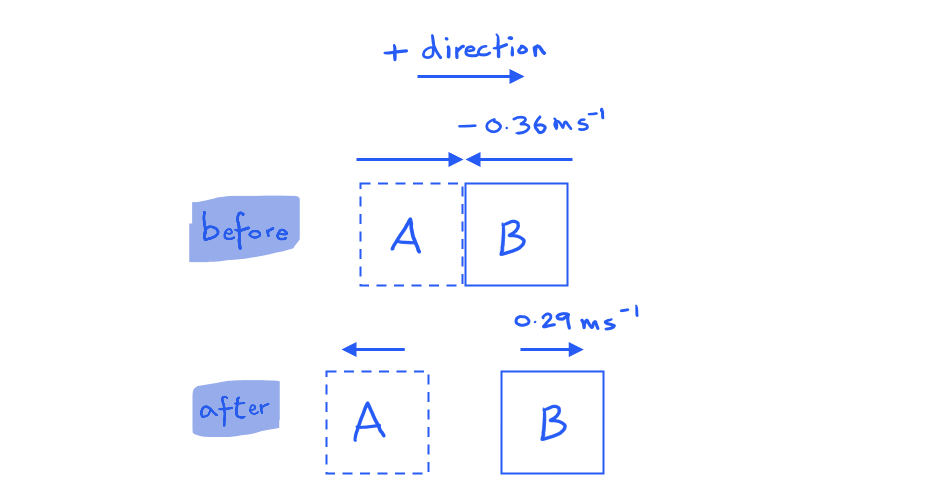

> *The Δ**v** equation is always final velocity **v** – initial velocity** u**. Whether you take the right or left as positive, the magnitude of the force as the final answer will still be the same.*
Determine the speed and direction of the combined blocks after the collision:

List the known quantities:

- Initial velocity of block A, *v**A* = 0.6 m s–1
- Initial velocity of block B, *v**B* = −0.4 m s–1
- Mass of block A, *m**A* = 400 g = 0.4 kg
- Mass of block B, *m**B* = 400 g = 0.4 kg

Use conservation of linear momentum:

- Conservation of momentum:  Total momentum before the collision = Total momentum after the collision
- Conservation of momentum:*  *$m_{A} v_{A} + m_{B} v_{B} = ( m_{A} + m_{B} ) v$* ***[1 mark]**
- Rearrange:*  *$v = \frac{m_{A} v_{A} + m_{B} v_{B} }{m_{A} + m_{B} } \Leftrightarrow v = \frac{m ( v_{A} + v_{B} )}{2 m}$
- $v=\frac{0.4(0.6-0.4)}{2\times0.4}$ **[1 mark]**
- $v$ = 0.1 m s–1 **[1 mark]**

State the final speed and direction:

- Speed after the collision = 0.1 m s–1
- Direction = same as initial direction of A;** [1 mark]**

**[Total: 4 marks]**

### Q6
Determine the velocity *v *of ball X before the collision:

List the known quantities:

- Mass of X = 140 g
- Mass of Y = 620 g
- Velocity of X before the collision = *v*
- Velocity of X after the collision = 0
- Velocity of Y before the collision = 0
- Velocity of Y after the collision = 0.8 m s−1

Use conservation of momentum to write an expression for *v*:

- Momentum before collision:  $m_{X}v_{X}+m_{Y}v_{Y}=140v+0$
- Momentum after collision:  $m_{X} v_{X} + m_{Y} v_{Y} = 0 + ( 620 \times 0.8 )$
- Conservation of momentum:  Momentum before collision = Momentum after collision
- Conservation of momentum:  $140v=620\times0.8$ **[1 mark]**
- Rearrange:  $v=\frac{620\times0.8}{140}$ **[1 mark]**
- $v$ = 3.543 = 3.5 m s−1 **[1 mark]**

**[Total: 3 marks]**
(i) Show that the collision in **(a)** is inelastic:

List the known quantities:

- Mass of X = 140 g = 0.14 kg
- Mass of Y = 620 g = 0.62 kg
- Velocity of X before the collision = 3.5 m s−1
- Velocity of X after the collision = 0
- Velocity of Y before the collision = 0
- Velocity of Y after the collision = 0.8 m s−1

Determine the kinetic energy before and after the collision:

- KE before = $1 \frac{1}{2} m_{X} v_{X}^{2} + 1 \frac{1}{2} m_{Y} v_{Y}^{2} = ( 1 \frac{1}{2} \times 0.14 \times 3.5^{2} ) + 0$
- KE before = 0.8575 = 0.86 J **[1 mark]**
- KE after = $1 \frac{1}{2} m_{X} v_{X}^{2} + 1 \frac{1}{2} m_{Y} v_{Y}^{2} = 0 + ( 1 \frac{1}{2} \times 0.62 \times 0.8^{2} )$
- KE after = 0.1984 = 0.20 J **[1 mark]**

Write a concluding sentence:

- The kinetic energy after the collision is <u>less</u> than the kinetic energy before the collision, hence it is an inelastic collision; **[1 mark]**

(ii) The collision is inelastic because:

- Some of X's (kinetic) energy has been transferred to other forms of energy (such as heat and sound); **[1 mark]**

**[Total: 4 marks]**
Calculate the velocity of the aluminium sphere immediately after the collision:

List the known quantities:

- Mass of aluminium sphere, $m_{Al}$ = 2.7 kg
- Mass of steel sphere, $m_{S}$ = 7.9 kg
- Initial velocity of aluminium sphere, $u_{Al}$ = 10.0 m s–1 
- Initial velocity of steel sphere, $u_{S}$ = 0
- Final velocity of aluminium sphere = $v$
- Final velocity of steel sphere, $v_{S}$ = 5.1 m s–1 

Use conservation of momentum to write an expression for *v*:

- Momentum before collision:  $m_{A l} u_{A l} + m_{S} u_{S} = ( 2.7 \times 10 ) + 0$ **AND**
- Momentum after collision:  $m_{A l} v_{A l} + m_{S} v_{S} = ( 2.7 \times v ) + ( 7.9 \times 5.1 )$**[1 mark]**
- Conservation of momentum:  Momentum before collision = Momentum after collision
- $( 2.7 \times 10 ) = 2.7 v + ( 7.9 \times 5.1 ) \Leftrightarrow v = \frac{27 - ( 7.9 \times 5.1 )}{2.7}$ **[1 mark]**
- $v$ = −4.922 = −4.9 m s−1 **[1 mark]**

**[Total: 3 marks]**

- *The negative sign is necessary for the final answer*

  - *This tells us that the aluminium sphere **changes** direction*
- *Remember to show your working - the first mark is for **substitution**, not just stating the equation!*
Verify that the collision in **(c) **is elastic:

List the known quantities:

- Mass of aluminium sphere, $m_{Al}$ = 2.7 kg
- Mass of steel sphere, $m_{S}$ = 7.9 kg
- Initial velocity of aluminium sphere, $u_{Al}$ = 10.0 m s–1 
- Initial velocity of steel sphere, $u_{S}$ = 0
- Final velocity of aluminium sphere, $v_{Al}$ = 4.9 m s–1
- Final velocity of steel sphere, $v_{S}$ = 5.1 m s–1 

Determine the kinetic energy before and after the collision:

- KE before = $1 \frac{1}{2} m_{A l} u_{A l}^{2} + 1 \frac{1}{2} m_{S} u_{S}^{2} = ( 1 \frac{1}{2} \times 2.7 \times 10^{2} ) + 0$
- KE before = 135 J **[1 mark]**
- KE after = $1 \frac{1}{2} m_{A l} v_{A l}^{2} + 1 \frac{1}{2} m_{S} v_{S}^{2} = ( 1 \frac{1}{2} \times 2.7 \times 4.9^{2} ) + ( 1 \frac{1}{2} \times 7.9 \times 5.1^{2} )$
- KE after = 135.15 = 135 J **[1 mark]**

Write a concluding sentence:

- The kinetic energy after the collision is <u>the same as</u> the kinetic energy before the collision, hence it is an elastic collision; **[1 mark]**

**[Total: 3 marks]**

### Q7
> **[mark-scheme]**
> The principle of conservation of linear momentum states that:
> 
> - The sum / total momentum (of a system) is constant **OR** the sum / total momentum before equals the sum / total momentum after **[1 mark]**
> - If no (resultant) external force acts **OR** for an isolated system **[1 mark]**

> **[exam-tip]**
> Many students write "in a closed system" as the condition. It sounds similar, but it does not say that no external force acts, so it will not earn the second mark. Finish your statement with "provided no resultant external force acts" and you have the condition the mark needs.
To calculate the velocity of the pellet just after the rifle is fired:

- List the known quantities:

  - Mass of the pellet, $m = 20 \text{g} = 0 . 020 \text{kg}$
  - Momentum of the pellet, $p = 1 . 2 \text{kg m s}^{-1}$
- Write down the equation for momentum and rearrange it for *v*:

$p = m v$

$v = \frac{p}{m}$

- Substitute the known values:

$v = \frac{1.2}{0.020}$ **[1 mark]**

- Calculate the answer:

$v =$$60 \text{m s}^{-1}$ **[1 mark]**

> **[exam-tip]**
> Convert the mass to kilograms before you divide. Leaving it in grams gives 0.06 m s-1, which is far too slow for a pellet leaving a rifle, so a quick sense-check of your answer will catch this slip.
> **[mark-scheme]**
> (i) The total momentum of the air rifle and the pellet is:
> 
> - Zero **[1 mark]**
> 
> (ii) The recoil momentum of the air rifle is:
> 
> - $1 . 2 \text{kg m s}^{-1}$ (in the opposite direction to the pellet) **[1 mark]**
> 
> $- 1 . 2 \text{kg m s}^{-1}$ is also accepted. The direction does not have to be stated, because the word "recoil" already gives it

> **[exam-tip]**
> Momentum is a vector, so its direction matters as well as its size. The rifle and the pellet start at rest, so their momenta after firing must cancel out, and that is why the rifle moves backwards. Here the word "recoil" already tells you the direction, but in other questions make the direction clear with a minus sign or by saying which way the object moves.
> **[mark-scheme]**
> (i) The relation between force and momentum is:
> 
> - (Resultant) force equals the rate of change of momentum **OR** $F = \frac{\Deltap}{\Deltat}$ **[1 mark]**
> 
> "Force is proportional to the rate of change of momentum" is also accepted

(ii) To calculate the average force needed to stop the pellet:

- List the known quantities:

  - Momentum of the pellet before hitting the target, $p = 1 . 2 \text{kg m s}^{-1}$
  - Momentum of the pellet when it comes to rest = 0
  - Time taken, $\Delta t = 0 . 0025 \text{s}$
- Calculate the change in momentum:

$\Delta p = 1 . 2 - 0 = 1 . 2 \text{kg m s}^{-1}$ **[1 mark]**

- Write down the equation and substitute the known values:

$F = \frac{\Deltap}{\Deltat} = \frac{1.2}{0.0025}$ **[1 mark]**

- Calculate the answer:

$F =$$480 \text{N}$ **[1 mark]**

> **[mark-scheme]**
> 1 mark for the correct final answer of $480 \text{N}$; $- 480 \text{N}$ is also accepted, where the minus sign shows that the force acts against the pellet's motion

### Q8
Determine the total change in momentum of the ball:

In an elastic collision:

- KE before = KE after
- Therefore, initial velocity = final velocity (= 4.5 m s−1) **[1 mark]**

The change in momentum is:

- Momentum before = $mv$
- Momentum after = $-mv$
- Change in momentum:  $\Delta p = ( - m v ) - m v = - 2 m v$
- Change in momentum:  $\Deltap$ = -2 × (50 × 10−3) × 4.5 = -0.45 kg m s−1 **[1 mark]**

**[Total: 2 marks]**
Use the conservation of linear momentum to determine the rebound velocity of Y.

List the known quantities:

- Mass of X, $m_{X}$ = 50 g
- Mass of Y, $m_{Y}$ = 125 g
- Initial velocity of X, $u_{X}$ = 4.5 m s−1
- Final velocity of X, $v_{X}$ = −2.8 m s−1
- Initial velocity of Y, $u_{Y}$ = −2.2 m s−1
- Final velocity of Y, $v_{Y}=v$

The momenta before and after the collision:

- Momentum before = $m_{X}u_{X}+m_{Y}u_{Y}$
- Momentum before = (50 × 4.5) + (125 × −2.2) **[1 mark]**
- Momentum after = $m_{X}v_{X}+m_{Y}v_{Y}$
- Momentum after = (50 × −2.8) + (125 × $v$) **[1 mark]**

Conservation of linear momentum:

- Momentum before = momentum after:  $m_{X}u_{X}+m_{Y}u_{Y}=m_{X}v_{X}+m_{Y}v_{Y}$
- (50 × 4.5) + (125 × −2.2) = (50 × −2.8) + (125 × $v$)
- 225 − 275 = −140 + 125$v$$\Rightarrow125v=90$
- Rebound velocity of Y:  $v=\frac{90}{125}=0.72=0.7ms^{-1}$ **[1 mark]**

**[Total: 3 marks]**

> *In this question, you do not need to convert the mass of the balls to kg. Both balls have their mass in grams and when divided in g or kg the ratio will be the same. *
Deduce whether the collision is elastic or inelastic

List the known quantities:

- Initial velocity of X, $u_{X}$ = 4.5 m s−1
- Final velocity of X, $v_{X}$ = −2.8 m s−1
- Initial velocity of Y, $u_{Y}$ = −2.2 m s−1
- Final velocity of Y, $v_{Y}$ = 0.7 m s−1 (from (b))

An elastic collision is...

- A collision in which kinetic energy is conserved **or** relative speed of approach = relative speed of separation

Write a conclusion:

- Calculation showing that total initial KE ≠ the total final KE **or** relative speed of approach ≠ relative speed of separation; **[1 mark]** e.g. the relative speeds of approach and separation are:

  - Relative speed of approach: $u_{X}-u_{Y}$ = 4.5 − (−2.2) = 6.7 m s−1
  - Relative speed of separation:  $v_{Y}-v_{X}$ = 0.7 − (−2.8) =  3.5 m s−1
  - The relative speed of approach (6.7 m s−1) ≠ relative speed of separation (3.5 m s−1)

- Therefore, the collision is <u>not elastic</u> **or** the collision is <u>inelastic</u>; **[1 mark]**

**[Total: 2 marks]**
Use Newton’s laws to explain why the magnitude of the change in momentum of each ball is the same

Newton's third law states...

- When two objects interact, they exert equal and opposite forces on each other
- Therefore, the force on X is equal (in magnitude) and opposite (in direction) to the force on Y; **[1 mark]**

Newton's second law states...

- The resultant force on an object is equal to the rate of change of momentum (i.e. Δp/Δt) of the object, and it acts in the same direction, or F = Δp/Δt
- Therefore, the force (on X & Y) is equal to / proportional to the rate of change of momentum; **[1 mark]**

The change in momentum of X & Y is the same because...

- The time of collision is the same for both balls (hence change in momentum is the same); **[1 mark]**

**[Total: 3 marks]**

### Q9
Determine the velocity of the pellet and the block immediately after the pellet is embedded:

List the known quantities:

- Mass of pellet = 2.7 g
- Mass of block = 540 g
- Combined mass, $M$ = 540 + 2.7 = 542.7 g
- Angle between string and vertical, *θ *= 35°
- Length of string, *L *= 1.5 m

Calculate the change in height, *h*:

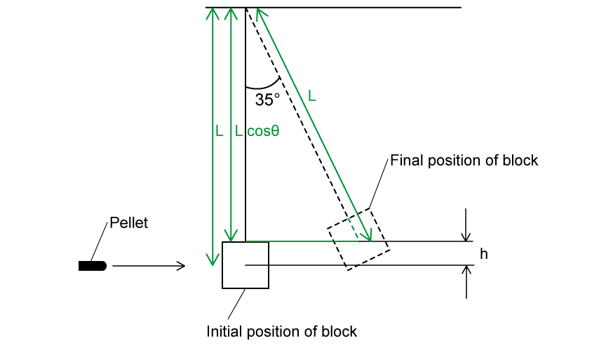

- From the diagram: $L=L\mathrm{cos}θ+h\Rightarrowh=L-L\mathrm{cos}θ$
- $h=1.5-1.5\mathrm{cos}35^{\circ}=0.271m$ **[1 mark]**

Calculate the initial speed of the block and the pellet:

- From conservation of energy:  Initial KE = final GPE
- Initial KE = $\frac{1}{2}Mu^{2}$ **AND** final GPE = $Mgh$ **[1 mark]**
- Equate and rearrange:  $\frac{1}{2}Mu^{2}=Mgh\Rightarrowu=\sqrt{2gh}$
- Substitute:  $u=\sqrt{2\times9.81\times0.271}$ **[1 mark]**
- Initial speed of pellet and block:  $u$ = 2.306 = 2.3 m s−1 **[1 mark]**

**[Total: 4 marks]**

> *This type of question is known as a ‘ballistic pendulum’ and the marks are given for the method, as well as the final answer, so make sure you set out your working clearly!*

> *The ‘initial kinetic energy’ is treated as when the pellet first strikes and completely embeds itself in the block. Therefore, the mass is always the **sum** of the mass of the pellet and block. *

> *You can see that when you equate KE and GPE algebraically, the mass term cancels, so if you're confident doing this, it will definitely save you some time when doing the calculation step!*
Calculate the velocity of the pellet just before it strikes the block:

List the known quantities:

- Mass of the pellet, $m_{p}$ = 2.7 g = 0.0027 kg
- Mass of the block, $m_{b}$ = 540 g = 0.540 kg
- Combined mass, $M$ = 542.7 g = 0.5427 kg
- Initial velocity of pellet and block, $u$ = 2.306 m s−1 (from **(a)**)

Apply the principle of conservation of momentum:

- Total momentum lost by pellet = total momentum gained by pellet and block
- Total momentum lost by pellet = $m_{p}v_{p}$
- Total momentum gained by pellet and block = $( m_{p} + m_{b} ) u = M u$
- $m_{p} v_{p} = ( m_{p} + m_{b} ) u \Leftrightarrow m_{p} v_{p} = M u$ **[1 mark]**
- $v_{p}=\frac{Mu}{m_{p}}=\frac{0.5427\times2.306}{0.0027}$ **[1 mark]**
- $v_{p}$ = 463.506 = 464 m s−1 **[1 mark]**

**[Total: 3 marks]**
For the assumption:

*The angle that the metal block makes with the vertical will be greater than 35° because the block doesn’t have the additional mass of the pellet embedded within it*

State whether the student’s reasoning is correct or incorrect:

- The student is <u>correct</u> that the angle will increase; **[1 mark]**
- (However) the student’s explanation / reasoning is <u>incorrect</u>; **[1 mark]**

Some valid comments about the student's assumption are:

**Final answer:** **Any ****two**** pairs from:**

- The <u>change in momentum</u> of the metal block will be <u>greater</u>; **[1 mark]**
- (Because) a rebounding pellet causes a greater <u>change in momentum</u>; **[1 mark]**
- The speed / kinetic energy of the metal block will be greater (after the pellet has rebounded); **[1 mark]**
- (Because) the momentum / mass / speed of the pellet is still the same; **[1 mark]**
- (From conservation of energy) all the initial KE is transferred to the GPE of the block; **[1 mark]**
- (Hence) the height reached by the metal block will be <u>greater</u> (than the height reached by the original block); **[1 mark]**

**[Total: 6 marks]**
Swinging one ball from the left will not release two balls on the right because:

- This would violate the conservation of energy / energy will not be conserved; **OR**
- It is an inelastic collision but should be elastic (in a vacuum); **[1 mark]**

Apply conservation of momentum:

- Conservation of momentum:  total momentum before = total momentum after
- Total momentum before = *mu*
- Total momentum after = 2*mv*
- Conservation of momentum:  $mu=2mv\Rightarrowv=\frac{u}{2}$* ***[1 mark]**
- Therefore, conservation of momentum is not violated if the final speed of the two balls is <u>halved</u>; **[1 mark]**

Apply conservation of energy:

- In a vacuum, there is no energy lost to the surroundings
- Hence, elastic collision:  total kinetic energy before = total kinetic energy after
- Total kinetic energy before = $\frac{1}{2}mu^{2}$
- Total kinetic energy after = $1 \frac{1}{2} ( 2 m ) ( \frac{u}{2} )^{2} = 1 \frac{1}{4} m u^{2}$ **[1 mark]**
- Therefore, conservation of energy is violated as half the kinetic energy is lost; **[1 mark]**

**[Total: 5 marks]**

### Q10
(i) The principle of conservation of linear momentum states that:

- The momentum <u>of a system</u> remains constant **OR** total momentum before (a collision) = total momentum after (a collision); **[1 mark]**
- Provided that there are no external / resultant forces acting; **[1 mark]** ** **

(ii) Show that the mass of asteroid A was about 5.5 × 1013 kg:

List the known quantities:

- Velocity of A, *m**A* = 3.61 km s−1 = 3.61 × 103 m s−1
- Momentum of A, *p**A* = 2.00 × 1017 kg m s−1

Determine the mass of A:

- $p=mv$ **[1 mark]**
- $m=\frac{p}{v}$
- $m_{A}=\frac{2.00\times10^{17}}{3.61\times10^{3}}$ = 5.54 × 1013 kg **[1 mark]**

**[Total: 4 marks]**

> *It's very common for students to miss the second marking point from their definitions of conservation of momentum - make sure you learn both parts!*

> *Remember to use the unrounded calculated value for the mass of asteroid A*

> *You should always work with more sig figs than you need during your calculation and then round at the end to avoid a cumulative rounding error*
Calculate the combined velocity of the asteroids after the collision:

- Initial velocity of asteroid A, $u_{A}$ = 3.61 × 103 m s−1 
- Momentum of asteroid A,$p_{A}$ = 2.00 × 1017 kg m s−1
- Mass of asteroid B, $m_{B}$ = 6.40 × 1012 kg
- Initial velocity of asteroid B, $u_{B}$ = 14.0 km s−1 = 14.0 × 103 m s−1 

Apply conservation of momentum:

- After the collision, asteroid B is absorbed by asteroid A, so the asteroids have a combined mass of $m_{A}+m_{B}$
- $p_{before}=p_{after}$
- $p_{A + m_{B} u_{B} = ( m_{A} + m_{B} } ) v$ **[1 mark]**

Rearrange and calculate the combined velocity $v$:

- $v=\frac{p_{A}+m_{B}u_{B}}{m_{AB}}$

- $v = \frac{( 2.00 \times 10^{17} ) + [ ( 6.40 \times 10^{12} ) \times ( 14.0 \times 10^{3} ) ] }{( 5.54 \times 10^{13} ) + ( 6.40 \times 10^{12} )}$ **[1 mark]**
- $v$ = 4686 = 4.69 km s−1 (3 s.f.) **[1 mark]**

**[Total: 3 marks]**
Show that the mass of asteroid C is about 2.0 × 1013 kg:

List the known quantities:

- Mass of asteroid AB, *m*AB = (6.4 × 1012) + (5.54 × 1013) = 6.18 × 1013 kg
- Mass of asteroid C = *m*C
- Initial velocity of asteroid AB, *u*AB = 4.69 km s–1 (from (b))
- Final velocity of asteroid AB, *v*AB = 2.6 km s–1
- Final velocity of asteroid C, *v*C = 6.5 km s–1
- Angle between AB and the horizontal, *θ*AB = 8°
- Angle between C and the horizontal, *θ*C = 10°

Calculate the initial momentum of the system:

- $p_{i}=m_{AB}v_{AB}$
- $p_{i} = ( 6.18 \times 10^{13} ) \times ( 4.69 \times 10^{3} )$
- $p_{i}$ = 2.896 × 1017 kg m s–1 **[1 mark]**

Calculate the final momentum of the system:

- $p_{f}=m_{AB}v_{AB}\mathrm{cos}θ_{AB}+m_{C}v_{C}\mathrm{cos}θ_{C}$
- $p_{f} = [ ( 6.18 \times 10^{13} ) \times ( 2.6 \times 10^{3} ) \times \cos 8^{\circ} ] + [ m_{C} \times ( 6.5 \times 10^{3} ) \times \cos 10^{\circ} ]$
- $p_{f} = ( 1.607 \times 10^{17} ) \cos 8^{\circ} + m_{C} ( 6.5 \times 10^{3} ) \cos 10^{\circ}$ **[1 mark]**

Use the conservation of momentum to calculate the mass of asteroid C:

- Total initial momentum = total final momentum, or $p_{i}=p_{f}$
- $2.896 \times 10^{17} = ( 1.607 \times 10^{17} ) \cos 8^{\circ} + m_{C} ( 6.5 \times 10^{3} ) \cos 10^{\circ}$
- $m_{C} = \frac{( 2.896 \times 10^{17} ) - ( 1.607 \times 10^{17} ) \cos 8^{\circ}}{( 6.5 \times 10^{3} ) \cos 10^{\circ}}$ = 2.04 × 1013 kg **[1 mark]**

**[Total: 3 marks]**

> *Make sure you get lots of practice with momentum conservation in 2D scenarios; the extra step of resolving vector components can trip up many students!*

> *We only need to consider the **horizontal components** of the velocities of the asteroids:*

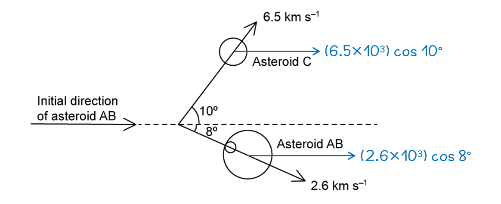
Determine if the collision in **(c)** is elastic or inelastic:

List the known quantities:

- Mass of asteroid AB, *m*AB = (6.4 × 1012) + (5.54 × 1013) = 6.18 × 1013 kg
- Mass of asteroid C, *m*C = 2.04 × 1013 kg (from (c))
- Initial velocity of asteroid AB, *u*AB = 4.69 km s–1 (from (b))
- Final velocity of asteroid AB, *v*AB = 2.6 km s–1
- Final velocity of asteroid C, *v*C = 6.5 km s–1

Calculate the initial kinetic energy of the system:

- $\mathrm{KE}_{i}=\frac{1}{2}m_{AB}u_{AB}^{2}$
- $KE_{i} = 1 \frac{1}{2} \times ( 6.18 \times 10^{13} ) \times ( 4.69 \times 10^{3} )^{2}$
- $\mathrm{KE}_{i}$ = 6.8 × 1020 J **[1 mark]**

Calculate the final kinetic energy of the system:

- $\mathrm{KE}_{f}=\frac{1}{2}m_{AB}v_{AB}^{2}+\frac{1}{2}m_{C}v_{C}^{2}$
- $KE_{f} = [ 1 \frac{1}{2} \times ( 6.18 \times 10^{13} ) \times ( 2.6 \times 10^{3} )^{2} ] + [ 1 \frac{1}{2} \times ( 2.04 \times 10^{13} ) \times ( 6.5 \times 10^{3} )^{2} ]$
- $\mathrm{KE}_{f}$ = 6.4 × 1020 J **[1 mark]**

Conclusion:

- An inelastic collision is one where kinetic energy is not conserved
- Since $\mathrm{KE}_{i}>\mathrm{KE}_{f}$, energy has dissipated, so the collision is inelastic; **[1 mark]**

**[Total: 3 marks]**

### Q11
A table that would score 3 marks looks like this:

| **Quantity** | **Elastic Collision** | **Inelastic Collision** |
|---|---|---|
| Momentum | **Final answer:** **✓** | **Final answer:** **✓** |
| Total Energy | **Final answer:** **✓** | **Final answer:** **✓** |
| Kinetic Energy | **Final answer:** **✓** |   |

- Momentum conserved in **both **elastic and inelastic collisions; **[1 mark]**
- Total energy conserved in **both **elastic and inelastic collisions; **[1 mark]**
- Kinetic energy conserved in elastic collisions **only**; **[1 mark]**

**[Total: 3 marks]**

> *In a closed system (i.e., no matter or mass moves in or out), momentum is **always** conserved during a collision, provided **no external force acts** on the system.  The law of conservation of energy can never be violated, therefore the **total** energy before and after the collision must be conserved.  Kinetic energy is only conserved in elastic collisions. During inelastic collisions some of the kinetic energy gets converted into other forms such as thermal energy. *
List the known quantities:

- Mass of **X** = 400 g = 0.4 kg
- Velocity of **X** = 1.2 m s−1

(i) Calculate the initial momentum of trolley **X**:

- Momentum: $p=mv$ **[1 mark]**
- Momentum before:*  p* = 0.4 × 1.2
- Momentum before:*  p* = 0.48 kg m s−1 **[1 mark]**

(ii) The combined momentum after the collision is:

- Momentum before the collision = momentum after the collision
- Momentum after:  *p* = 0.48 kg m s−1 **[1 mark]**

**[Total: 3 marks]**
(i) Calculate the velocity of the two trucks after the collision:

List the known quantities:

- Mass of X = 0.4 kg
- Mass of Y = 0.8 kg
- Momentum of the combined trucks, *p* = 0.48 kg m s−1

Determine the new mass when the trucks are stuck together:

- Total mass after collision = (0.4 + 0.8) = 1.2 kg **[1 mark]**

Rearrange the momentum equation and substitute in the values:

- $p=mv\Rightarrowv=\frac{p}{m}$
- Velocity after:  $v=\frac{0.48}{1.2}$ **[1 mark]**
- Velocity after:  $v$ = 0.4 m s−1 **[1 mark]**

(ii) The direction of the final velocity will be:

- The same direction / to the right; **[1 mark]**

**[Total: 4 marks]**

> *Since velocity is a vector, and so is momentum, the positive or negative sign tells you its direction. In this scenario, the initial direction of trolley **X** has been taken as positive. Since the final momentum is positive, this implies the trolleys are moving in the same direction as trolley **X** at the beginning. *
The collision is not elastic because:

- The final velocity / kinetic energy is <u>less</u> after the collision **OR**
- The relative speed of separation is <u>less than</u> the relative speed of approach; **[1 mark]**

**[Total: 1 mark]**

> *If you're not sure how to calculate the relative speeds, it is simply:*

- *The relative speed of approach:  *$( u_{X} - u_{Y} ) = ( 1.2 - 0 ) = 1.2 \mathrm{m} \mathrm{s}^{- 1}$
- *The relative speed of separation:  *$v_{XY}=0.4ms^{-1}$

> *It's useful to note that when two objects stick together after a collision, they can **never** be elastic*

> *In fact when two objects stick together, it is said to be “perfectly” inelastic, because, in this scenario, the maximum amount of kinetic energy is dissipated.*

> *You can think of this as the remaining energy wasted as heat or sound. If there was a collision of two cars where one drives into a stationary one, you would hear the sound of the collision.*

### Q12
The total momentum of the rifle and the bullet before being fired is:

- Zero / 0 kg m s−1 **[1 mark]**

Because:

- (Before the rifle is fired both) <u>rifle and bullet</u> are stationary / velocity = 0; **[1 mark]**

**[Total: 2 marks]**
Calculate the velocity of the bullet just after the rifle is fired

List the known quantities:

- Mass of bullet, *m*b = 30 g = 0.03 kg
- Momentum of bullet after being fired, *p* = 36 kg m s−1

Calculate the velocity of the bullet using the momentum equation:

- Momentum:  $p=mv$
- $v=\frac{p}{m}=\frac{36}{0.03}$ **[1 mark]**
- $v=1200ms^{-1}$ **[1 mark]**

**[Total: 2 marks]**

> *For the velocity to be in m s**−1**, the momentum must be in kg m s**−1** and the mass in **kg **- unit conversions are very common, don't let these catch you out!*
(i) The total momentum of the rifle and the bullet after the rifle is fired is:

- Total momentum before the rifle is fired = total momentum after the rifle is fired **OR  **$p_{initial}+p_{final}=0$
- Total momentum = 0 kg m s−1 **[1 mark]**

(ii) Calculate the recoil momentum of the rifle:

List the known quantities:

- Total final momentum of the rifle andbullet, *p*f = 0
- Momentum of the bullet after being fired, *p*s* *= 36 kg ms−1 (from **(b)**)

Decide on the positive direction:

- Since *p*s* *= 36 kg m s−1 then the motion of the bullet gives the positive direction
- Therefore the recoil will have a negative value** OR **$p_{s}=-p_{r}$

Calculate:

- Therefore $p_{s}=-p_{r}=36$ **[1 mark]**
- *p*r* *= −36 kg m s−1 **[1 mark]**

**[Total: 3 marks]**** **

> *You may have chosen the recoil of the rifle to represent the **positive** direction. In this case, your values should be the same as ours, but the negative and positive signs will be reversed.*
Calculate the average force needed to stop the bullet

List the known quantities:

- Momentum of bullet before hitting target, *p**s* = 9.8 kg m s−1
- Time taken for bullet to stop, Δ*t* = 4.5 ms = 4.5 × 10−3 s

Determine the change in momentum Δp as the bullet is stopped by target:

- The bullet comes to rest, therefore final momentum = 0
- Change in momentum:  Δ*p* = 9.8 kg m s−1 **[1 mark]**

Calculate the average force *F* needed to stop the bullet:

- Force & momentum:  $F=\frac{\Deltap}{\Deltat}$
- Average force:  $F=\frac{9.8}{4.5\times10^{-3}}$  **[1 mark]**
- Average force:  $F = 2177.8 = 2200 \mathrm{N} ( 2 \mathrm{s} . \mathrm{f} . )$ **[1 mark]**

**[Total: 3 marks]**** **

> *Calculations like this one are usually given what examiners call 'error carried forward' (you will see it written 'ecf' in mark schemes).*

> *This means that, for example, if you forgot to convert ms to s (using 4.5 s rather than 0.0045) then you could still get the other three marks, as long as your final answer was 2200 N.*

> *However, if you did get this then your 'sanity check' at the end should have seen you looking at this number and realising it must be wrong, since it suggests that being shot by a rifle feels similar to having someone pat you lightly on the back!*
