# Exam Questions — Linear Momentum & its Conservation
**3. Dynamics** · Cambridge (CIE) A-LEVEL physics (9702)
> Source: [https://www.savemyexams.com/a-level/physics/cie/25/topic-questions/](https://www.savemyexams.com/a-level/physics/cie/25/topic-questions/) · 34 questions across 1 sets

## Multiple Choice Questions (34 questions)

### Q1 — hard — 1 marks

**Q1** [1 mark]

Two trolleys, X and Y, are connected by an elastic cord, of negligible mass, as shown below. Trolley X is twice the mass of trolley Y.

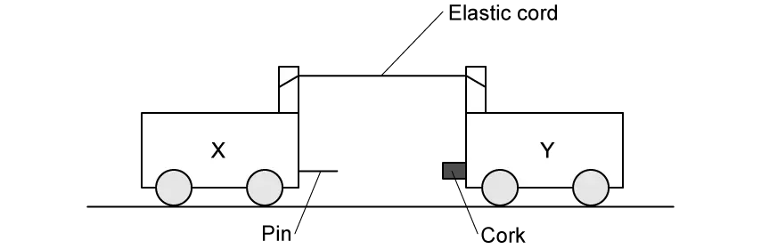

The two trolleys are pulled apart so that the elastic cord is stretched. The trolleys are then released at the same time and move towards each other.  The trolleys stick together on impact.

Just before the trolleys collide, the speed of trolley X is 20 cm s–1.

What is the speed of the trolleys after they collide?

### Q2 — hard — 1 marks

**Q2** [1 mark]

The diagram shows two spherical masses approaching each other head-on at an equal speed *u*. One is of mass *m* and the other of mass 2 *m*.

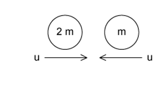

Which diagram, showing the situation after the collision, is not consistent with the principle of conservation of momentum?

### Q3 — easy — 1 marks

**Q3** [1 mark]

Which quantity has the same base units as momentum?

### Q4 — medium — 1 marks

**Q4** [1 mark]

A molecule of mass *m* travelling at speed *v* hits a wall in a direction perpendicular to the wall. The collision is elastic.

What are the changes in the momentum and in the kinetic energy of the molecule caused by the collision?

|   | **Change in momentum** | **Change in kinetic energy** |
|---|---|---|
| **A**  **B**  **C**  **D** | 0  *mv*  *mv**2*  *2mv* | 0  *mv**2*  0  0 |

### Q5 — easy — 1 marks

**Q5** [1 mark]

Trolley X, moving along a horizontal frictionless track, collides with a stationary trolley Y. The two trolleys become attached and move off together.

Which statement about this interaction is correct?

### Q6 — easy — 1 marks

**Q6** [1 mark]

The graph shows how the momentum of a motorcycle changes with time.

What is the resultant force on the motorcycle?

### Q7 — medium — 1 marks

**Q7** [1 mark]

A resultant force of 5 N acts on a body for a time of 4.0 s

Which graph could show the variation with time *t* of the momentum *p* of the body?

### Q8 — medium — 1 marks

**Q8** [1 mark]

A lorry of mass 18 tonnes is travelling at 25.0 $ms^{-1}$

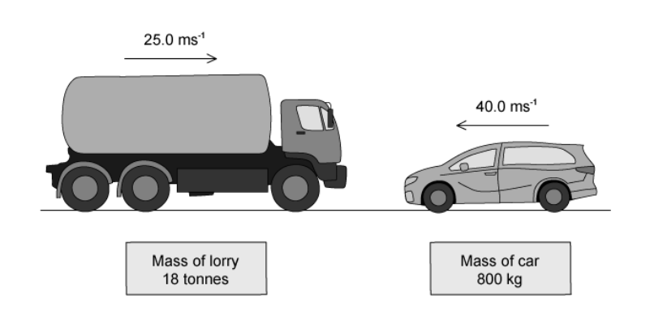

A car of mass 800 kg is travelling at 40.0 $ms^{-1}$ towards the lorry.

What is the magnitude of the total momentum?

### Q9 — medium — 1 marks

**Q9** [1 mark]

Two trolleys, A and B, each have a mass of 5000 kg. Trolley A travels at speed $v$ towards trolley B. Trolley B travels at 2.0 m s−1 in the opposite direction, as shown.

The trolleys collide and join together with a combined kinetic energy of 1250 J.

What is the velocity of trolley A before the collision?

### Q10 — hard — 1 marks

**Q10** [1 mark]

Two railway trucks of masses *m* and 5 *m* move towards each other in opposite directions with speeds 3 *u* and *u* respectively. These trucks collide and stick together.

What is the speed of the trucks after the collision?

### Q11 — medium — 1 marks

**Q11** [1 mark]

The diagram shows the masses and velocities of two trolleys about to collide

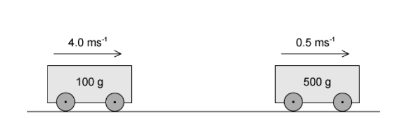

After the impact they move off together

What is the total kinetic energy of the trolleys after the collision?

### Q12 — hard — 1 marks

**Q12** [1 mark]

A body, initially at rest, explodes into two masses *M**1* and *M**2* that move apart with speeds *v**1* and *v**2* respectively.

What is the ratio  $\frac{v_{1}}{v_{2}}$ ?

### Q13 — hard — 1 marks

**Q13** [1 mark]

Sand falls vertically on a conveyor belt at a rate of *m* kg s–1

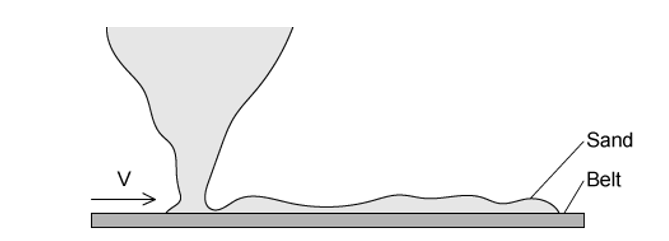

In order to keep the belt moving at constant speed *v*, the horizontal force that must be exerted is equal to

### Q14 — hard — 1 marks

**Q14** [1 mark]

A lead pellet of mass 20.0 g is shot horizontally into a stationary wooden block of mass 80.0 g. The pellet hits the block with an impact velocity of 250 m s–1. It embeds itself in the block and it does not emerge.

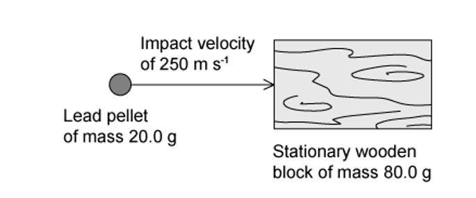

After the impact, the block and the pellet slide along a rough horizontal surface and come to rest in 8.4 s.

How far do the block and the pellet travel before coming to rest?

### Q15 — easy — 1 marks

**Q15** [1 mark]

A car accelerates from rest. The graph shows the momentum of the car plotted against time.

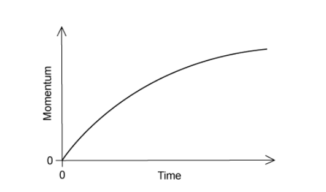

What is the meaning of the gradient of the graph at a particular time?

### Q16 — medium — 1 marks

**Q16** [1 mark]

A moving object strikes a stationary object. The collision is inelastic. The objects move off together.

Which row shows the possible values of total momentum and total kinetic energy for the system before and after the collision?

|   | **Total momentum before collision / kg m s****–1** | **Total momentum after collision / kg m s****–1** | **Total kinetic energy before collision / J** | **Total kinetic energy after collision / J** |
|---|---|---|---|---|
| **A**  **B**  **C**  **D** | 6  6  6  6 | 6  6  2  6 | 90  30  90  90 | 30  90  30  90 |

### Q17 — easy — 1 marks

**Q17** [1 mark]

Which of the following is a statement of the principle of conservation of momentum?

### Q18 — hard — 1 marks

**Q18** [1 mark]

A stationary body explodes into two components of masses *m* and 3 *m*.

The components gain kinetic energies X and Y respectively.

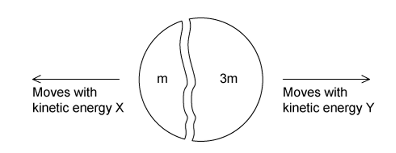

What is the value of the ratio $\frac{x}{y}$ ?

### Q19 — medium — 1 marks

**Q19** [1 mark]

Two train carriages each of mass 7500 kg roll toward one another on a level track. One is travelling at 3.00 m s−1 and the other at 1.50 m s−1 as shown.

They collide and join together.

What is the kinetic energy lost during the collision?

### Q20 — medium — 1 marks

**Q20** [1 mark]

The diagram shows a cannon ball fired from a cannon

The mass of the cannon is 1600 kg and the mass of the cannon ball is 20 kg

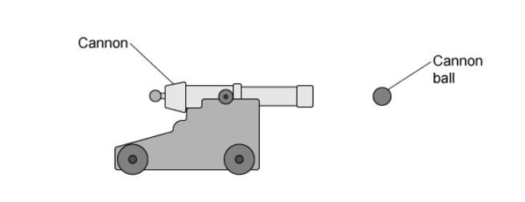

The recoil velocity of the cannon is 5 $ms^{-1}$horizontally

What is the horizontal velocity of the cannon ball?

### Q21 — medium — 1 marks

**Q21** [1 mark]

A ball of mass 2 kg travelling at ½ $ms^{-1}$  strikes a ball of mass 3 kg travelling at ⅓ $ms^{-1}$.  Both balls are moving along the same straight line as shown

After collision, both balls move at the same velocity *v*

What is the magnitude of the velocity *v*?

### Q22 — easy — 1 marks

**Q22** [1 mark]

What is the principle of conservation of momentum?

### Q23 — medium — 1 marks

**Q23** [1 mark]

Two identical billiard balls of mass $m$ are placed on a smooth horizontal surface.

Ball Y is initially at rest. Ball X approaches ball Y with a speed of 30 m s−1 at an angle of 45° to the direction shown.

The balls collide perfectly elastically. After the collision, ball Y moves with speed $v$, and ball X moves at right angles to the direction of motion of ball Y.

What is the speed $v$ of ball Y after the collision?

### Q24 — easy — 1 marks

**Q24** [1 mark]

Which row correctly states whether momentum and kinetic energy are conserved in an inelastic collision in which there are no external forces?

|   | **Momentum** | **Kinetic energy** |
|---|---|---|
| **A**  **B**  **C**  **D** | conserved  not conserved  conserved  not conserved | conserved  conserved  not conserved  not conserved |

### Q25 — hard — 1 marks

**Q25** [1 mark]

A particle X has speed *v* and collides with a stationary identical particle Y. The collision is perfectly elastic.

What are the speed and direction of motion of each of the two particles after the collision?

|   | **X** | **Y** |
|---|---|---|
| **A** | stationary | v to the right |
| **B** | $\frac{v}{2}$  to the right | $\frac{v}{2}$ to the right |
| **C** | $\frac{v}{2}$  to the left | $\frac{v}{2}$  to the right |
| **D** | *v* to the left | stationary |

### Q26 — easy — 1 marks

**Q26** [1 mark]

Which statement about a ball that strikes a tennis racket and rebounds is **always** correct?

### Q27 — medium — 1 marks

**Q27** [1 mark]

A spacecraft of mass 1000 kg and a fuel module of mass $m$ are initially travelling together at 13 m s-1 in a straight line.

The fuel module separates from the rocket and continues to travel along the same line at 5 m s-1 while the spacecraft continues to travel along the same line at 17 m s-1.

What is the mass $m$ of the fuel module?

### Q28 — hard — 1 marks

**Q28** [1 mark]

A stationary nucleus has nucleon number *A*.

The nucleus decays by emitting a proton with speed *v* to form a new nucleus with speed *u*. The new nucleus and the proton move away from one another in opposite directions.

Which equation gives  in terms of *A* and *u*?

### Q29 — medium — 1 marks

**Q29** [1 mark]

A tennis ball of mass 60 g is struck by a tennis racket. The velocity of the ball changes as shown

What is the magnitude of the change in momentum of the ball?

### Q30 — medium — 1 marks

**Q30** [1 mark]

Two spheres approach each other along the same straight line. Their speeds are $u_{1}$ and $u_{2}$before collision, and $v_{1}$and $v_{2}$ after collision, in the directions shown below

Which equation is correct if the collision is perfectly elastic?

### Q31 — hard — 1 marks

**Q31** [1 mark]

A wooden block is freely supported on brackets at a height of 4.0 m above the ground, as shown

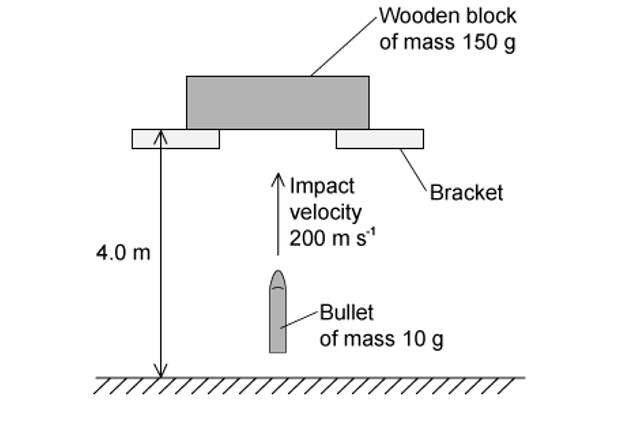

A bullet of mass 10.0 g is shot vertically upwards into the wooden block of mass 150 g. It embeds itself in the block. The impact causes the block to rise above its supporting brackets.

The bullet hits the block with a velocity of 200 m s–1. How far above the ground will the block be at the maximum height of its path?

### Q32 — easy — 1 marks

**Q32** [1 mark]

Two bodies travelling in a straight line collide in a perfectly elastic collision. Which of the following statements must be correct?

### Q33 — easy — 1 marks

**Q33** [1 mark]

Two similar spheres, each of mass *m* and travelling with speed *v*, are moving towards each other

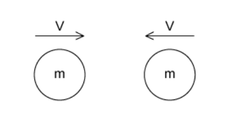

The spheres have a head-on elastic collision

Which statement is correct?

### Q34 — hard — 1 marks

**Q34** [1 mark]

An ice-hockey puck slides along a horizontal, frictionless ice-rink surface. It collides inelastically with a wall at right angles to its path, and then rebounds along its original path.

Which graph shows the variation with time *t* of the momentum *p* of the puck?

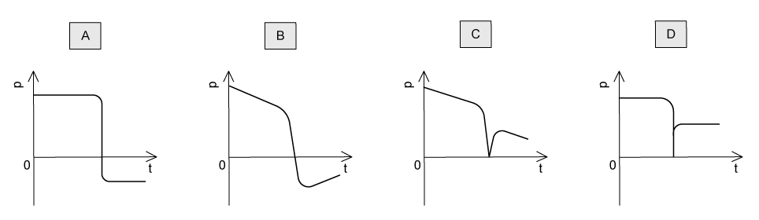
