# Mark Schemes — Turning Effects of Forces
**4. Forces, Density & Pressure** · Cambridge (CIE) A-LEVEL physics (9702)

## Multiple Choice Questions (15 questions)

### Q1
**Final answer:** **The correct answer is ****C**** because:**

- The centre of gravity of an object is defined as the point where all the weight of the object may be considered to act
- Here are some examples of the centre of gravity of some regular and irregular shapes:

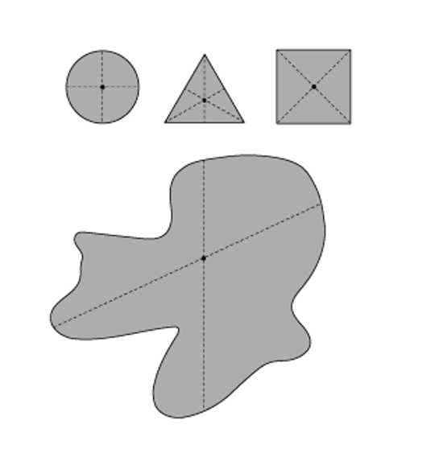

**A **is incorrect because this is true for regular shapes but not for irregular shapes

**B **is incorrect because the point about which the total torque is zero is the point the object is in rotational equilibrium

**D **is incorrect because the centre of gravity is where the **force of gravity** (weight) acts throughout the object

### Q2
**Final answer:** **The correct answer is ****D**** because:**

- Calculate the horizontal component of the tension of each side of the string.

  - $T\mathrm{cos}θ$
  - Where *T* is the tension in the string, and *θ* is the angle between XY and XA.

- The bowstring is in equilibrium so the force, *F*, on the arrow from both halves of the string together will be:

  - $F=T\mathrm{cos}θ+T\mathrm{cos}θ=2T\mathrm{cos}θ$
- To find *θ,* we can use tan with adjacent side XA = 30 cm, and opposite side ZA = YA = 50 cm:

  - $\mathrm{tan}θ=\frac{\mathrm{opposite}}{\mathrm{adjacent}}=\frac{50}{30}$
  - $θ=\mathrm{tan}^{-1}\frac{50}{30}=59^{\circ}$
- $F=2T\mathrm{cos}θ$
- $F=2\times10\times\mathrm{cos}59^{\circ}=10.3N$

**A** is incorrect because this is the answer if only one half of the bowstring is included in the calculation

**B** is incorrect because this is the answer if opposite and adjacent lengths are accidentally swapped

**C** is incorrect because this is the answer the distance YZ is not halved when calculating the length of the opposite side of the triangle XYA

### Q3
**Final answer:** **The correct answer is ****B**** because:**

- If the tensions in each rope are equal, and the beam is in equilibrium:

  - Upwards forces = downward forces
  - $T+T=W+\frac{W}{2}$
  - $2T=\frac{3W}{2}$
  - $T=\frac{3W}{4}$
- Taking the left end of the beam as the pivot, the clockwise moment due to the load of weight $W$ is:

  - $\mathrm{moment}=W\timesd$
- The beam is uniform, so its centre of gravity is halfway along the beam
- The clockwise moment due to the weight $\frac{W}{2}$ of the beam is:

  - $\mathrm{moment}=\frac{W}{2}\times\frac{L}{2}$
  - $\mathrm{moment}=\frac{WL}{4}$
- The tension $T$ of the rope at a distance of $\frac{2L}{3}$ from the pivot produces an anticlockwise moment of:

  - $\mathrm{moment}=T\times\frac{2L}{3}$
- For the beam to be in equilibrium, the anticlockwise and clockwise moments must be the same:

  - $T\times\frac{2L}{3}=Wd+\frac{WL}{4}$
- Substitute the expression for tension $T$ and simplify:

  - $W d = ( \frac{3 W}{4} ) \frac{2 L}{3} - \frac{W L}{4}$
  - $d=\frac{6L}{12}-\frac{L}{4}$
  - $d=\frac{L}{4}$

### Q4
**Final answer:** **The correct answer is ****B**** because:**

- A couple refers to two parallel forces that are equal in magnitude, parallel but opposite in direction and are at a **perpendicular **distance from each other
- The torque of a couple is found by calculating

  - $\mathrm{torque}=\mathrm{force}\times\mathrm{perpendicular} \mathrm{distance} \mathrm{between} \mathrm{forces}$
- Perpendicular distance between forces = $0.2\mathrm{sin}60^{\circ}$
- Torque: $τ=5.0\times0.2\mathrm{sin}60^{\circ}=0.866\approx0.9Nm$

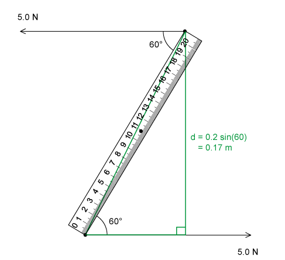

### Q5
**Final answer:** **The correct answer is ****A**** because:**

- Vertical resultant force = 45 – 45 = 0
- Horizontal resultant force = 30 + 30 = 60 N to the right
- Therefore, the resultant force is non-zero
- The two 45 N forces along with the upper 30 N force all cause a clockwise moment, although the lower 30 N causes an anticlockwise moment, overall, the resultant torque is non-zero

### Q6
**Final answer:** **The correct answer is ****D**** because:**

- The system of forces must provide a resultant torque, but we just need a couple so the resultant force should be zero as the forces should cancel out
- To form a couple, two forces must be equal in magnitude, parallel, but opposite in direction, and separated by a perpendicular distance
- Option D is the only one to satisfy this definition

**A, B & C **are incorrect because the directions of each of these force pairs do not oppose each other

### Q7
**Final answer:** **The correct answer is ****B**** because:**

- A couple refers to two parallel forces that are equal in magnitude, parallel but opposite in direction and are at a **perpendicular **distance from each other
- The perpendicular distance is *s*
- So, the torque exerted by the couple is *Fs*

**A **is incorrect because the distance *d* is the distance between the forces, not the perpendicular distance

**C & D **are incorrect because the moment of a couple is calculated by multiplying the size of **one** of the forces by the perpendicular distance

### Q8
**Final answer:** **The correct answer is ****C**** because:**

- We will take moments about the pivot, i.e. where the rope is tied to the beam
- The anticlockwise moment of the 20 g mass, which is 30 cm from the pivot, is:

  - *moment = force × distance*
  - *moment = *20 *× g ×* 30* = *600*g*
  - Where *g *is the acceleration due to gravity

- To calculate the clockwise moment we need to know the distance of the centre of mass of the ruler from the pivot point
- As the ruler is uniform this will be at the halfway point of 50 cm

  - Therefore, the distance from the pivot point is 60 − 50 = 10 cm

- The clockwise moment due to the mass *M *of the beam is:

  - *moment = *10* × M × g = *10*Mg*

- Using the principle of conservation of moments:

  - 10*Mg = *600*g*
  - *M = *$\frac{600}{10}$* =  *60 g
- This is option** C**

**A** is incorrect because the final answer has been converted into kg and not been converted back into grams

**B** is incorrect because a 30 cm from the pivot point distance has been used for the centre of mass of the beam

**D** is incorrect because the end of the beam has been used as its centre of mass

### Q9
**Final answer:** **The correct answer is ****D ****because:**

- The moment of a force is defined as:

  - Moment = Force × Perpendicular distance from the pivot
- The moment required when the handle is intact is:

  - Moment = 20 × 0.1 = 2 N m

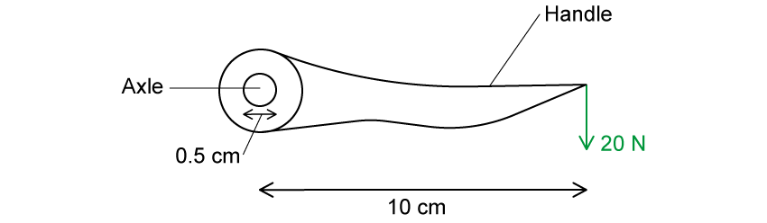

- This is the same moment that’s required by the axle in order to open the door
- Since the axle is circular, the turning force would produce a **couple**

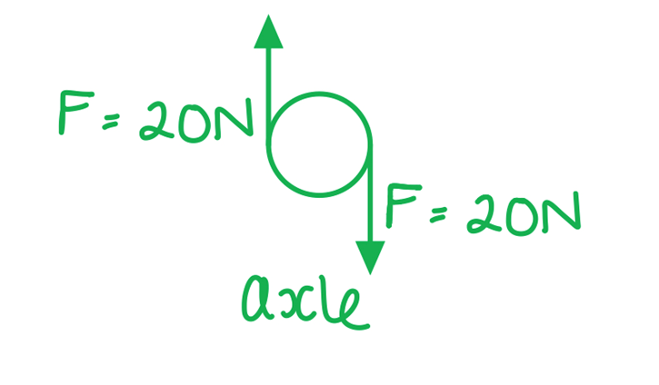

- The torque of a couple is:

  - Torque = Force × Perpendicular distance between the line of action of the forces
- This means the force is equal to:

  - Force = $\frac{\mathrm{torque}}{\mathrm{perpendicular} \mathrm{distance} \mathrm{between} \mathrm{forces}}$
  - Force = $\frac{2}{0.005}$ = 400 N

**A** is incorrect as the distance from the centre of the axle to the force causing the couple has not been converted from cm to m

**B **is incorrect as the distance from the centre of the axle to the force causing the couple has not been converted from cm to m and 2* × *20 N is used instead of just 20 N

**C** is incorrect as 2* × *20 N is used instead of just 20 N (or 0.025 cm has been used as the distance instead of 0.05 cm)

Remember that the equation for the torque of a couple is the magnitude of only **one** of the forces multiplied by the distance between them, it’s a common mistake to multiply both forces.

### Q10
**Final answer:** **The correct answer is ****D**** because:**

- We need to find the torque required to maintain equilibrium

  - This is not the torque produced by the centre of mass of the cube
- The weight acts downwards and is to the left of the pivot, therefore, this causes an anticlockwise moment at a perpendicular distance of $\frac{L}{4}$ from the spindle

  - Anticlockwise moment due to weight = $W\times\frac{L}{4}=\frac{WL}{4}$
- For equilibrium:

  - Sum of clockwise moments = Sum of anticlockwise moments
- In a couple, the perpendicular distance between the forces and the pivot (the spindle) should be equal
- So, to maintain equilibrium, a force equal to W should act along the vertical edge of the shaded face, which is a distance of $\frac{L}{4}$ to the right of the pivot

  - Clockwise moment to be applied = $W\times\frac{L}{4}=\frac{WL}{4}$
- Therefore, the torque of the couple that is required to prevent toppling is $\frac{WL}{4}$ clockwise

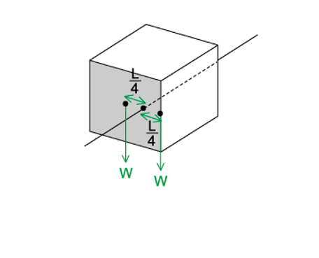

### Q11
**Final answer:** **The correct answer is ****B**** because:**

- The moment of a force is defined by:

  - Moment = Force × Perpendicular distance from the pivot
- The moment in **X** is therefore:

  - moment = $310\times0.7=217Nm$
- This is the same moment that has to be applied in **Y**
- The torque of a couple is defined by:

  - Torque = Force × Perpendicular distance between the forces
- The torque of the couple is:

  - Torque = $650l=217Nm$
- Rearranging for length gives:

  - $l=\frac{217}{650}=0.33m$* *
- Therefore, $l = \frac{moment \mathrm{X} }{torque} = \frac{( 310 \times 0.7 )}{650} = 0.33 \mathrm{m}$

  - This is answer **B**

**A** is incorrect as the ratio has been calculated as $\frac{650}{217}$ which is the wrong way around

**C **is incorrect as 2 *× *650 N has been used instead of just 650 N

**D** is incorrect as the ratio has been calculated as  $\frac{650}{217}$  which is the wrong way around and 2 *× *650 N has been used instead of just 650 N

### Q12
**Final answer:** **The correct answer is ****B**** because:**

- To calculate the torque of a couple:

  - $\text{torque} ( \text{tau} ) = \text{force} ( F ) \times \text{distance} \text{between} \text{forces} ( d )$
- The distance between forces is calculated using trigonometry:

- $\mathrm{sin}θ=\frac{\mathrm{opposite}}{\mathrm{hypotenuse}}$
- $\mathrm{sin}30^{\circ}=\frac{d}{0.1}$
- $d=0.1\mathrm{sin}30^{\circ}=0.05m$
- Using this value for *d* in the torque equation:

  - $τ=F\timesd$
  - $τ=10\times0.05=0.5Nm$

**A** is incorrect because this only takes into account the force on one side of the pivot.

**C** is incorrect because this is the answer if cosine is used instead of sine when calculating the perpendicular distance between the lines of action of the forces.

**D** is incorrect because the full length of the beam has been used instead of the perpendicular distance between the lines of action of the forces.

### Q13
**Final answer:** **The correct answer is ****A**** because:**

- The position of the trailer's centre of gravity G is a third of the length from the hinge at O

  - Therefore, the weight acts at a distance of $\frac{2.7}{3}=0.9m$ from O
- Consider the moments around pivot O

  - The vertical force *F* provides a clockwise moment of $F\times2.7\mathrm{cos}50^{\circ}$
  - The weight of the trailer provides an anticlockwise moment of $30000\times0.9\mathrm{cos}50^{\circ}$
- For equilibrium, the clockwise moment should equal the anticlockwise moment

  - $F\times2.7\mathrm{cos}50^{\circ}=30000\times0.9\mathrm{cos}50^{\circ}$
  - $F=\frac{30000\times0.9\mathrm{cos}50^{\circ}}{2.7\mathrm{cos}50^{\circ}}=10000N$
- The vertical force is therefore equal to 10 000 N or 10 kN

### Q14
**Final answer:** **The correct answer is ****C**** because:**

- The equation for the torque of a couple is given by:

  - Torque = Force × perpendicular distance between the lines of action of the forces
- Substituting in the numbers gives:

  - $τ$ = 2 × 0.38 = 0.76 N m

Remember that the distance in the torque of a couple equation is the distance between both forces, **not** half of the distance!

### Q15
**Final answer:** **The correct answer is ****D**** because:**

- As the beam is uniform, its weight $( m g = 2 \times 9.8 )$ acts at its centre of gravity at the midpoint, which is 0.5 m from the pivot
- The clockwise moment due to the beam's weight is:

  - $\mathrm{moment}=\mathrm{weight}\times\mathrm{perpendicular} \mathrm{distance} \mathrm{from} \mathrm{pivot}$
  - $\mathrm{moment}=2\times9.8\times0.5=9.8Nm$
- The 5 kg mass is 1 m away from the pivot
- The clockwise moment due to the 5 kg mass is:

  - $\mathrm{moment}=\mathrm{mass}\timesg\times\mathrm{distance}$
  - $\mathrm{moment}=5\times9.8\times1=49Nm$
- The upward component of tension $( T \sin 30^{\circ} )$ in the wire acts at a distance of 0.7 m from the pivot
- The anticlockwise moment due to the wire is:

  - $\mathrm{moment}=0.7\timesT\mathrm{sin}30^{\circ}$
- As the system is in equilibrium, the clockwise and anticlockwise moments must be equal:

  - $0.7T\mathrm{sin}30^{\circ}=9.8+49$
  - $T=\frac{58.8}{0.7\mathrm{sin}30^{\circ}}=168N$
- The tension in the wire is $T\approx170N$ (to 2 s.f.)

**A** is incorrect because this is the answer if mass is used instead of weight in the calculation.

**B** is incorrect because this is the answer if the tension in the wire is not calculated from its vertical component.

**C** is incorrect because this is the answer if the mass of the beam is neglected from the calculations.

## Structured Questions (7 questions)

### Q1
A couple is defined as:

- A <u>pair of forces</u> with <u>equal magnitude</u> **AND** <u>opposite direction</u>; **[1 mark]**
- They do not pass through the same point **OR** they are separated by a distance; **[1 mark]**

A diagram illustrating *F*  and *s*  may look like:

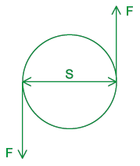

- Two forces with equal magnitude (both labelled *F*) and opposite direction; **[1 mark]**
- *s *labelled as the perpendicular distance between the forces; **[1 mark]**

**[Total: 4 marks]**

> *The circle in the diagram is not necessary for the marks, but couples tend to act on objects and this circle represents the object.*
The see-saw is in equilibrium because:

- In equilibrium,<u> anticlockwise</u> moments = <u>clockwise</u> moments; **[1 mark]**
- Moment due to <u>weight</u> of child <u>on the left</u> = moments due to <u>weight</u> of child <u>on the right;</u> **[1 mark]*** *

**[Total: 2 marks]**
The beam's weight does not affect equilibrium because:

- The weight of beam acts at the centre;** [1 mark]**
- This is the location of the pivot; **[1 mark]**

**OR**

- Centre of mass (point where weight of the beam acts) is at the pivot; **[1 mark]**
- Moment = Force × Distance; at the pivot distance = 0, so moment = 0 (N m) ; **[1 mark]**** **

**[Total: 2 marks]**
The beam is less stable because:

- The base is narrow; **[1 mark]**
- The line of action of the beam's centre of gravity can easily move out of the base; **[1 mark]**

**[Total: 2 marks]**

### Q2
To compare the centre of gravity and centre of mass:

- The centre of mass (of Sirius B) is located in the <u>centre</u> of the sphere / circle;
- The centre of gravity is located <u>closer to Sirius A</u>;

**[Total: 2 marks]**

> *The centre of mass is the point which behaves the same as the object, if the object's mass were concentrated to that single point.*

> *The centre of gravity is the point towards which the weight of a small object appears to act. As Sirius A is so large, this point is somewhere between Sirius A's and Sirius B's centre of mass. *
The block's motion is:

- The block will slide; **[1 mark]**

This is because:

- The block's centre of gravity is at the geometric centre / midway along the base and midway up the block's height; **[1 mark]**
- This lies above the block's base; **[1 mark]**
- (However,) the block will slide as there is no / negligible friction; **[1 mark]**

**[Total: 4 marks]**

> *If, by eye, you are unsure if the centre of gravity lies above the base, annotate the diagram to confirm. We know the centre of gravity will be at the shape's geometric centre, as it is **uniform**. Drawing a line straight down from this will then confirm whether the shape will topple or not. Here, the diagram clearly shows the block will not topple, but slide.*

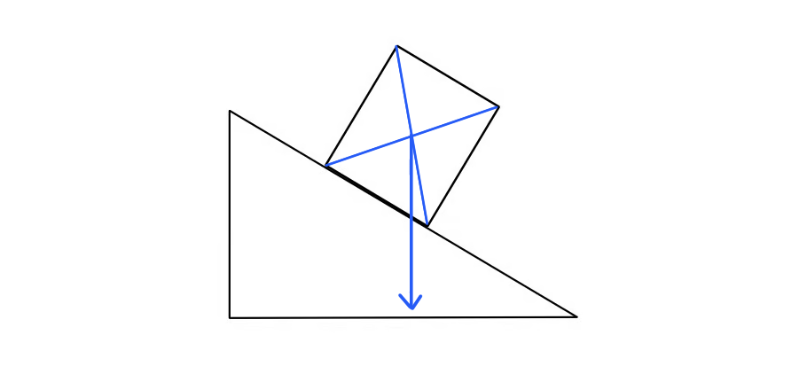
The cylinder topples easily because:

- A small region of the circle is in contact with the slope; **[1 mark]**
- Therefore, the base is very narrow; **[1 mark]**
- The line of action does not need to move far to fall outside of the base; **[1 mark]**

**[Total: 3 marks]**
To calculate tap radius:

List the known quantities:

- Torque, *T* = 420 mN m = 0.42 N m **[1 mark]**
- Force per finger, *F* = 12 N

Recall the equation for torque:

- $T=Fd$

  - where *d* is the distance between the coupled forces

Write this in terms of radius and rearrange:

- Distance between the coupled force is the tap's diameter

  - $d=2r$
- $T=F\times2r$ **[1 mark]**
- $r=\frac{T}{2F}=\frac{0.42}{2\times12}$ **[1 mark]**
- $r=0.0175m$
- $r=1.75\mathrm{cm}$ **[1 mark]**

**[Total: 4 marks]**

### Q3
Explain why the vessel rotates around its axis:

i) by referring to energy stores and transfers:

**Final answer:** **Any ****three ****from:**

- Chemical energy store converted to thermal energy store as the fire burns; **[1 mark]**
- The water boils (undergoing) vaporisation / turns to steam; **[1 mark]**
- <u>Nozzles</u> create jets of <u>steam</u> which are <u>perpendicular</u> to the line between them; **[1 mark]**
- Thermal energy store transfers to kinetic energy; **[1 mark]**

ii) by referring to forces, naming any relevant laws:

**Final answer:** **Any ****three ****from:**

- The vessel exerts a force on the steam to eject it; **[1 mark]**
- According to Newton's third law, the steam exerts an equal and opposite reaction force on the nozzle / vessel; **[1 mark]**
- There is an unbalanced force on the vessel; **[1 mark]**
- According to Newton's second law / F = ma, the vessel accelerates; **[1 mark]**
- A force applied at a distance from the pivot produces torque; **[1 mark]**
- Two forces applied at equal distances from the pivot produce a <u>couple</u>; **[1 mark]**
- Torque (of a couple) = <u>one</u> of the forces × distance between the nozzles / force; **[1 mark]**

**[Total: 6 marks]**
Explain why simply puncturing holes in the can will not produce the rotation seen in the original Hero's engine:

- The turning force is caused by a couple;** [1 mark]**
- Must be a pair of forces;** [1 mark]**
- Forces must be perpendicular to the distance between them;** [1 mark]**
- If the steam comes straight out / radially / not at an angle the <u>component</u> of the perpendicular force will be zero;** [1 mark]**

**[Total: 4 marks]**
Calculate the torque experienced by the can:

Make a simplified sketch of the situation:

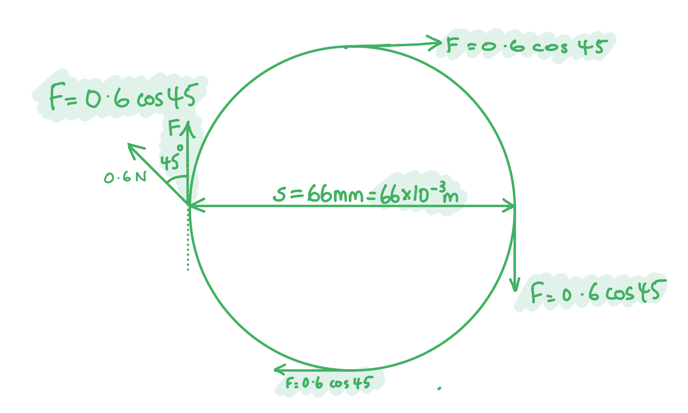

Calculate the component of the force which acts perpendicular to the line connecting the couples:

- $F=0.6\mathrm{cos}45=0.424N$ **[1 mark]**

Calculate the torque produced by each couple:

- $\tau_{c} = F \times s = 0.424 \times ( 66 \times 10^{- 3} )$ **[1 mark]**
- $τ_{c}=2.80\times10^{-2}\mathrm{Nm}$ **[1 mark]**

Double the answer to get total torque, since there are two pairs of forces:

- $\tau_{t} = 2 \times ( 2.80 \times 10^{- 2} ) = 5.6 \times 10^{- 2} \text{Nm}$ **[1 mark]**

**[Total: 4 marks]**
Discuss an adjustment that could be made to the can to make it spin more quickly:

- Change the angle of the holes / jets; **[1 mark]**
- So the angle between the jet and can is smaller / less than 45°; **[1 mark]**
- To increase the <u>component</u> of the force that acts in the perpendicular direction; **[1 mark]**

**[Total: 3 marks]**

### Q4
For the arrangement shown, express the force *F*2 in terms of the forces *F*1:

Write expressions for the torque of the couple and the torque of the single force:

- Torque of the couple, $τ_{1}=2F_{1}r$**[1 mark]**
- Torque of the single force, $\tau_{2} = ( F_{2} \times \sin 30 ) \times \frac{r}{2} = 0.25 F_{2} r$ **[1 mark]**

The disc is in equilibrium, so apply the principle of moments:

- $τ_{1}=τ_{2}$ **[1 mark]**
- $2F_{1}r=0.25F_{2}r$
- $F_{2}=8F_{1}$ **[1 mark]**

**[Total: 4 marks]**
Hence state the value of *F*2 if the couple produced by the pair of forces with magnitude *F*1 is 0.26 Nm:

Calculate the value of *F*1:

- $τ_{1}=2F_{1}\timesr$
- $F_{1} = tau_\frac{{1}}{r} = \frac{0.26}{2 ( 42 \times 10^{ - } 3 ) }$ **[1 mark]**
- $F_{1}=3.10N$ **[1 mark]**

Calculate the value of *F*2:

- $F_{2} = 8 F_{1} = 25 \mathrm{N} ( 2 \mathrm{s} . \mathrm{f} . )$ **[1 mark]**

**[Total: 3 marks]**

You have been asked to find the torque of a couple which requires the use of the perpendicular distance between the two forces in the couple.
Determine the magnitude of the force of the pin on the disc:

Since the disc is in equilibrium and the forces from the couple cancel out:

- Force = 25 N **[1 mark]**

**[Total: 1 mark]**

### Q5
List the known quantities:

- Force, *F *= 50 N
- Angle, *θ*  = 43°
- Distance, *r *= 25 cm = 0.25 m

Calculate the perpendicular component of the force, *F**2*:

- Sketch a triangle on the diagram to determine the correct trigonometric function to use

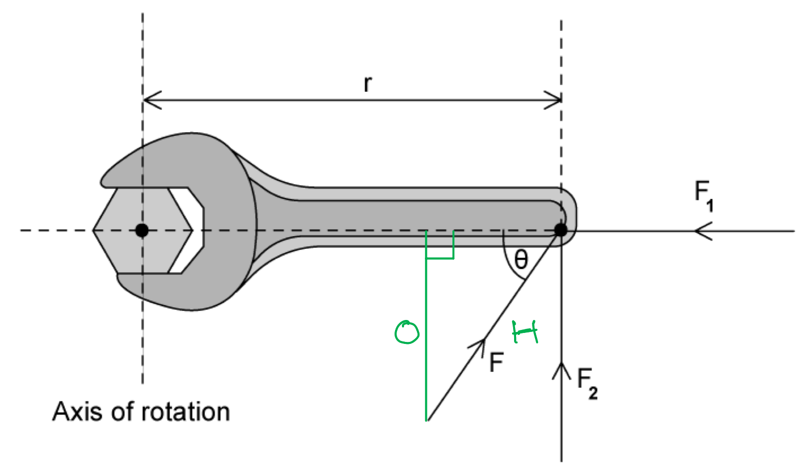

- Consider SOH CAH TOA
- Opposite component = sin*θ *× hypotenuse
- *F**2* = sin(43) × 50 **[1 mark]**
- *F**2* = 34.1 N **[1 mark]**

Calculate the torque on the spanner, *T*:

- Torque: *T *= *F**2**d*
- *T *= 34.1 × 0.25
- *T *= 8.53 = 8.5 N m (2 s.f.) **[1 mark]**

**[Total: 3 marks]**
The angle the force should be applied to the spanner is:

- At right angles / perpendicular / 90°; **[1 mark]**

This is because:

- The torque is calculated using the perpendicular component of the force applied; **[1 mark]**
- So when a force is not applied at a right angle the perpendicular component will be a fraction of the force / less than the magnitude of the force; **[1 mark]**

**[Total: 3 marks]**

> *In this type of question, one mark is always given for the "state" and the remaining marks for the explanation. Here this requires 2 marks. *
Examples of couples are:

**Final answer:** **Any ****two ****from the following:**

- Two hands turning a steering wheel; **[1 mark]**
- Forces acting on a rotating coil; **[1 mark]**
- Forces acting on a bar magnet; **[1 mark]**
- Turning a tap; **[1 mark]**
- Winding up an alarm clock / toy; **[1 mark]**
- Turning a spanner / screwdriver; **[1 mark]**
- Turning a key in a lock; **[1 mark]**

**[Total: 2 marks]**

> *You need to be able to give, explain and make calculations relating to different examples of couples. Use the revision notes to remind yourself of this. *
List the known quantities:

- Length of bar, *d* = 23.5 cm = 0.235 m
- Magnitude of force, *F *= 175 N
- Angle forces applied to the bar, *θ *= 75.0°

Obtain an equation to calculate the torque provided by the couple:

- *T *= 2*Fr *sin*θ*
- *T *= *Fd *sin*θ ***[1 mark]**

Calculate the magnitude of the torque provided by the couple:

- *T *= 175 × 0.235 × sin(75)
- *T* = 39.7 N m** [1 mark]**

**[Total: 2 marks]**

> *Remember that the equation required to calculate torque from a couple is different to the equation required to calculate torque from one resultant force. Use the revision notes to revise this concept. *

### Q6
**Three** conditions which must apply to a pair of coplanar forces to make them a couple:

- Equal in magnitude; **[1 mark]**
- Opposite in direction; **[1 mark]**
- Perpendicular to the distance between them **OR** parallel and in opposite directions; **[1 mark]**** **

**[Total: 3 marks]**** **

> *It is useful to remember the diagram below to help you explain what is meant by a couple.*

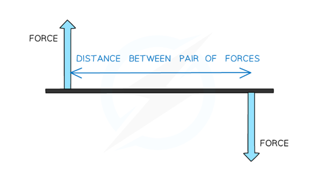
Diagram to include:

- Two equally sized forces at opposite sides of the steering wheel, both perpendicular to the diameter of the steering wheel; **[1 mark]**
- Both forces acting in an opposite direction so as to produce an anticlockwise turning effect on the steering wheel; **[1 mark] **

*Example diagram shown below:*

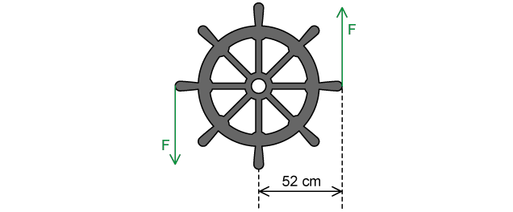

**[Total: 2 marks]**
List the known quantities:

- Moment of the couple needed to turn the wheel, *M* = 38 N m
- Radius of the wheel, *r* = 52 cm = 0.52 m

Calculate the perpendicular distance between the lines of action of the forces acting on the wheel, *d*:

- *d *= diameter of the wheel = 2 × *r*
- *d* = 2 × 0.52 = 1.04 m **[1 mark] **

Use the equation for moment of a couple to calculate the magnitude of the force, *F*, exerted by each hand:

- *M* = *F *× *d*
- *F = *$\frac{M}{d}$*= *$\frac{38}{1.04}$* =* 36.5 N** [1 mark]**** **

**[Total: 2 marks]**
List the known quantities:

- Force applied to the steering wheel by one hand, *F* = 36.5 N (from part (c))
- Distance between hand and pivot, *r* = 52 cm = 0.52 m

Calculate the moment produced by the hand which remains on steering wheel, *M*:

- *M* = 36.5 × 0.52 **[1 mark]**
- *M* = 19.0 N m **[1 mark]**** **

**[Total: 2 marks]**

> *Don't forget to use the **radius** for a single moment. Diameter is only used for a couple.*

### Q7
(i) A couple is:

- A <u>pair</u> of forces that act to produce rotation <u>only</u>; **[1 mark]**

(ii) The forces in a couple must be:

- Equal in magnitude; **[1 mark]**
- Opposite in direction; **[1 mark]**
- Perpendicular to the distance between them; **[1 mark]**

**[Total: 4 marks]**
(i) State the definition and units of torque:

- The moment of a couple **AND **N m; **[1 mark]**

(ii) For the couple in Fig. 1.1 state the equation which can be used to determine the torque:

- Torque / *T */* τ = Fs* ; **[1 mark]**

**[Total: 2 marks]**
Calculate the torque of this couple:

List the known quantities:

- Force, *F* = 15 N
- Perpendicular distance between forces, *s* = 0.5 m

Write the equation and calculate:

- $τ=F\timess=15\times0.5$ **[1 mark]**
- $τ=7.5Nm$ **[1 mark]**

**[Total: 2 marks]**
Calculate the new torque on the wheel.

Determine the component of the force, *F* which is perpendicular to the horizontal line between the forces:

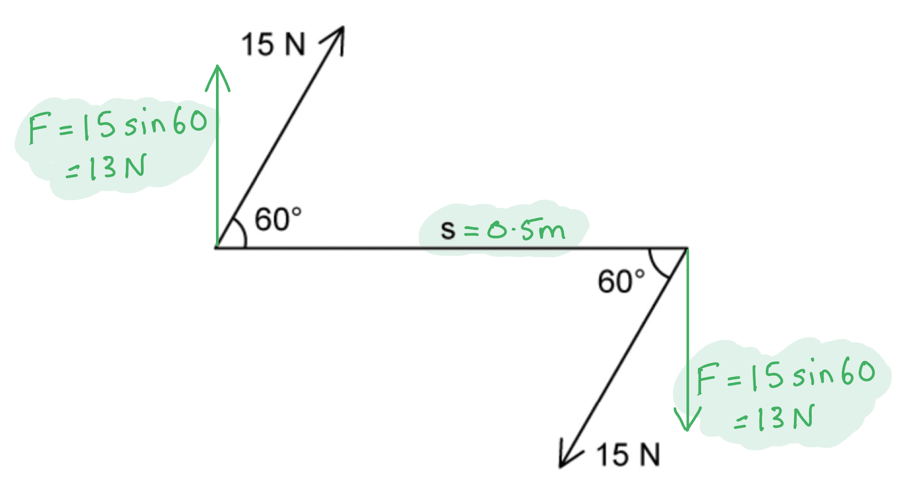

- $F=15\times\mathrm{sin}60=12.99\mathrm{or}13N$ **[1 mark]**

Calculate the torque:

- $τ=F\timess=12.99\times0.5\mathrm{or}13\times0.5$ **[1 mark]**
- $τ=6.5Nm$ **[1 mark]**

**[Total: 3 marks]**
