# Exam Questions — Turning Effects of Forces
**4. Forces, Density & Pressure** · Cambridge (CIE) A-LEVEL physics (9702)
> Source: [https://www.savemyexams.com/a-level/physics/cie/25/topic-questions/](https://www.savemyexams.com/a-level/physics/cie/25/topic-questions/) · 22 questions across 2 sets

## Multiple Choice Questions (15 questions)

### Q1 — easy — 1 marks

**Q1** [1 mark]

What is the centre of gravity of an object?

### Q2 — hard — 1 marks

**Q2** [1 mark]

The diagram shows a bow and arrow. The arrow is positioned at the centre X of the string of the bow stretched between points Y and Z. When the string is pulled back, the tension in the bowstring is 10 N.

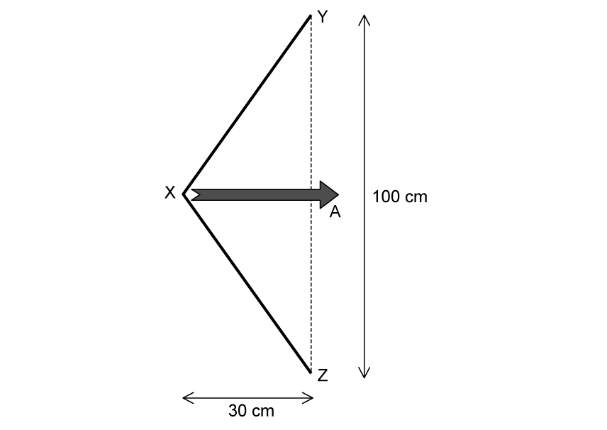

What force will accelerate the arrow in the direction of point A when the string is released?

### Q3 — hard — 1 marks

**Q3** [1 mark]

A horizontal beam of length $L$ and weight $\frac{W}{2}$ is suspended from the ceiling by two ropes.

One rope is attached at the left end of the beam, and the other is attached at a distance $\frac{2L}{3}$ from the left end. A load of weight $W$* *is suspended from the beam at a distance $d$ from the left end, as shown. The beam is in equilibrium.

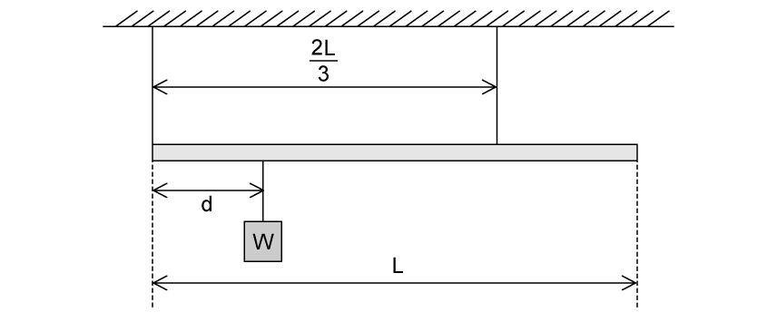

What value of $d$ ensures that the tension is equal in both ropes?

### Q4 — medium — 1 marks

**Q4** [1 mark]

A 20 cm ruler is pivoted at its centre. Equal and opposite forces of magnitude 5.0 N are applied to the ends of the ruler, creating a couple as shown

What is the magnitude of the torque of the couple on the ruler when it is in the position shown?

### Q5 — easy — 1 marks

**Q5** [1 mark]

The diagram shows four forces applied to a circular object.

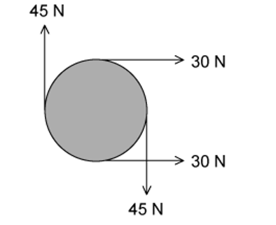

Which of the following describes the resultant force and resultant torque on the object?

|   | **Resultant force** | **Resultant torque** |
|---|---|---|
| **A**  **B**  **C**  **D** | non-zero  non-zero  zero  zero | non-zero  zero  non-zero  zero |

### Q6 — easy — 1 marks

**Q6** [1 mark]

Two co-planar forces act on the rim of a wheel. The forces are equal in magnitude.

Which arrangement of forces provides only a couple?

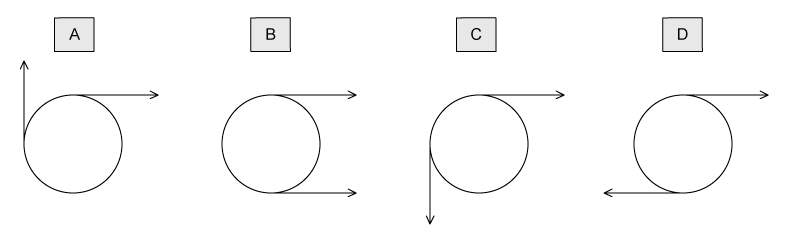

### Q7 — easy — 1 marks

**Q7** [1 mark]

Two parallel forces, each of magnitude *F*, act on a body as shown

What is the magnitude of the torque on the body produced by this couple?

### Q8 — medium — 1 marks

**Q8** [1 mark]

A 1 m long uniform beam is hung from the ceiling by a rope positioned 60 cm from the end. The beam is balanced when a 20 g mass is positioned 30 cm from the rope as shown.

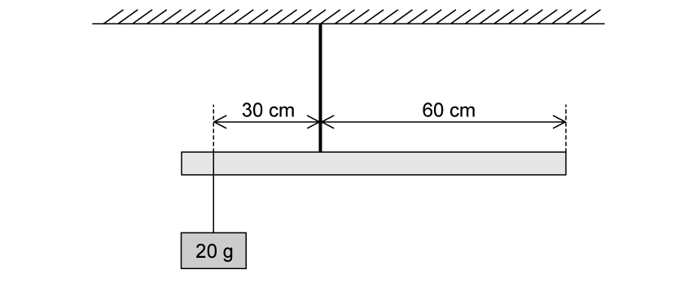

What is the mass of the metre rule?

### Q9 — medium — 1 marks

**Q9** [1 mark]

A door handle in the diagram below has a length 10 cm requires a force of 20 N to turn it.

If the handle breaks and the door must be opened using the axle of the handle, with a diameter of 0.5 cm, how much force is needed?

### Q10 — hard — 1 marks

**Q10** [1 mark]

The diagram shows a solid cube with weight *W* and sides of length *L*. It is supported by a frictionless spindle that passes through the centres of two opposite vertical faces. One of these faces is shaded.

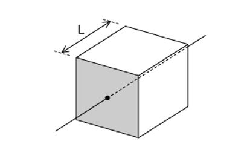

The spindle is now removed and replaced at a distance $\frac{L}{4}$ to the right of its original position.

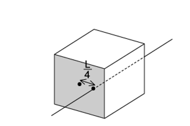

When viewing the shaded face, what is the magnitude of the torque required to stop the cube from toppling?

### Q11 — medium — 1 marks

**Q11** [1 mark]

A car wheel nut can be loosened by applying a force of 310 N to the end of a bar of length 0.7 m, as in **X**. A car mechanic is capable of applying forces of 650 N simultaneously in opposite directions on the ends of a wheel wrench, as in **Y**.

What is the minimum length $l$ of the wrench needed for the mechanic to loosen the nut?

### Q12 — medium — 1 marks

**Q12** [1 mark]

A 10 cm beam is pivoted at its centre. Equal and opposite forces of 10 N pull the ends of the beam, creating a couple as shown.

What magnitude is the torque of the couple?

### Q13 — hard — 1 marks

**Q13** [1 mark]

A trailer of weight 30 kN is attached to a truck. The trailer is raised until it is held at 50˚ to the horizontal by a vertical force *F* as shown in the diagram.

The trailer is 2.7 m in length, and the position of its centre of gravity G is a third of the length from the hinge at O.

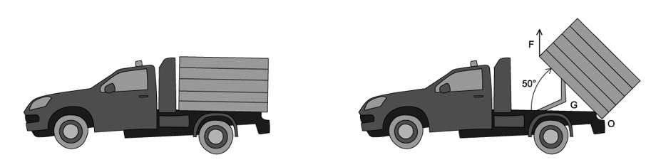

What is the vertical force *F *applied to the end of the trailer?

### Q14 — easy — 1 marks

**Q14** [1 mark]

A steering wheel of diameter 0.38 m is rotated to the left by two forces of 2 N, as shown in the diagram.

What is the torque of the couple produced by the rotation of the steering wheel?

### Q15 — hard — 1 marks

**Q15** [1 mark]

A mass of 5 kg is attached to the end of a 1 m long uniform beam of mass 2 kg. The beam is fixed to a wall at one end and supported by a wire at an angle of 30° to the beam, 0.7 m from the wall. The beam is in equilibrium.

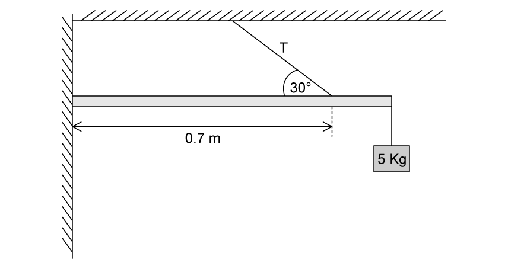

What is the tension *T* in the wire?

## Structured Questions (7 questions)

### Q1 — medium — 10 marks

**Q1** [4 marks]

The torque of a couple is given by:

torque = *F × s*

With the aid of a diagram explain what is meant by a couple. Label *F  *and *s * on your diagram. State the appropriate unit for the torque of a couple.

**Q1** [2 marks]

The see-saw shown in Fig 1.1 consists of a uniform beam freely pivoted at the centre of the beam. Two children sit opposite each other so that the see-saw is in equilibrium.

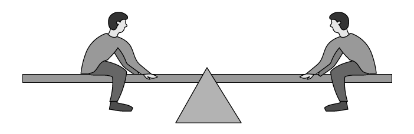

**Fig 1.1**

Explain why the see-saw is in equilibrium.

**Q1** [2 marks]

**Extract:**

The see-saw shown in Fig 1.1 consists of a uniform beam freely pivoted at the centre of the beam. Two children sit opposite each other so that the see-saw is in equilibrium.

Explain why the weight of the beam does not affect equilibrium.

**Q1** [2 marks]

**Extract:**

The see-saw shown in Fig 1.1 consists of a uniform beam freely pivoted at the centre of the beam.

The beam is removed from the see-saw and placed on its end, as in Fig 1.2.

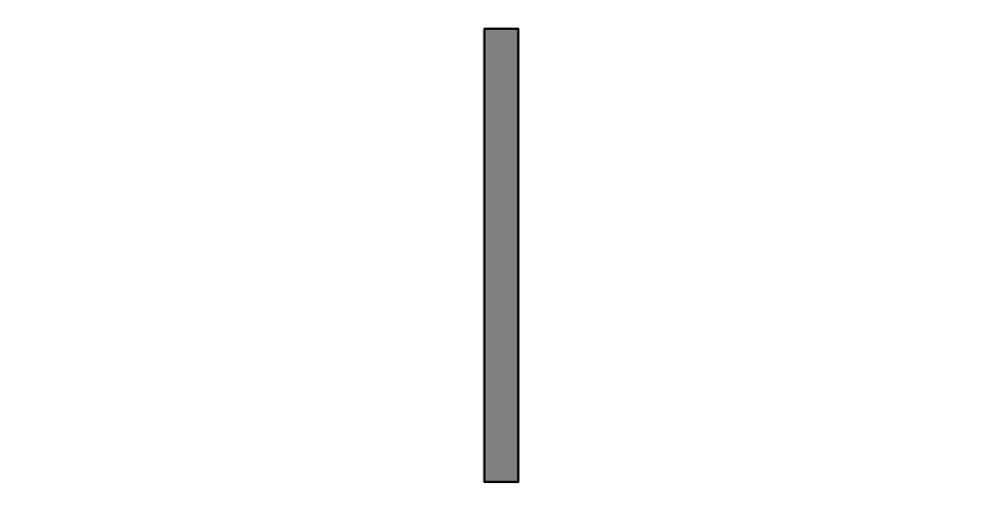

**Fig 1.2**

Explain why the beam is much more able to topple in this position, compared to when it is laying flat on the ground.

### Q2 — medium — 13 marks

**Q2** [2 marks]

In our galaxy, some star systems are binary. This means the system has two stars.

One example is the binary system with stars Sirius A and Sirius B. This is shown in Fig 1.1.

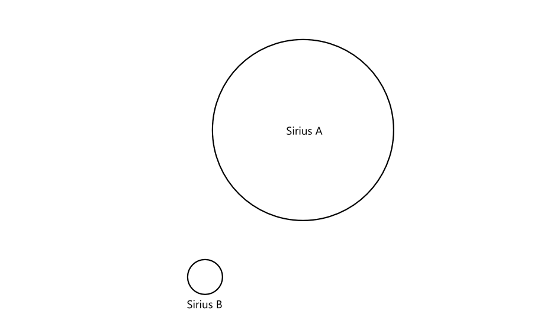

**Fig 1.1**

Compare the different positions of Sirius B's centre of gravity and its centre of mass.

Explain your answer.

**Q2** [4 marks]

On a planet in this system, a young alien is playing with some uniform blocks on a sloped surface, shown in Fig 1.2.

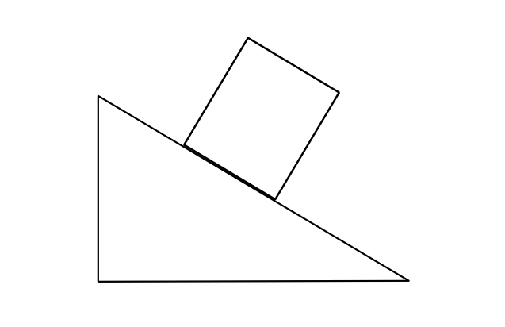

**Fig 1.2**

Assuming friction is negligible, determine whether the block will slide or topple.

Explain your answer.

**Q2** [3 marks]

**Extract:**

On a planet in this system, a young alien is playing with some uniform blocks on a sloped surface, shown in Fig 1.2. Assuming friction is negligible, determine whether the block will slide or topple.

The young alien wonders why their cylindrical block topples, or rolls, on a much shallower slope than the rectangular block.

Explain why.

**Q2** [4 marks]

After they are done playing, the young alien goes inside to wash their hands.

When turning the tap, as shown in Fig 1.3, each finger exerts a force of 12 N.

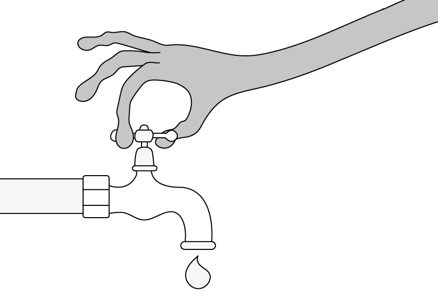

**Fig 1.3**

The alien exerts a torque of 420 mN m.

Calculate the radius of the tap in centimetres.

### Q3 — hard — 17 marks

**Q3** [6 marks]

In the 1st century CE Greek-Egyptian engineer Hero of Alexandria described a simple steam engine, which was at least 100 years old when he wrote about it.

Now commonly called a Hero's engine, the machine is a steam turbine which can be made to rotate by boiling water in a sealed vessel beneath it. Two pipes channel the steam produced through nozzles which project outwards.

Fig. 1.1. shows Hero's engine in operation.

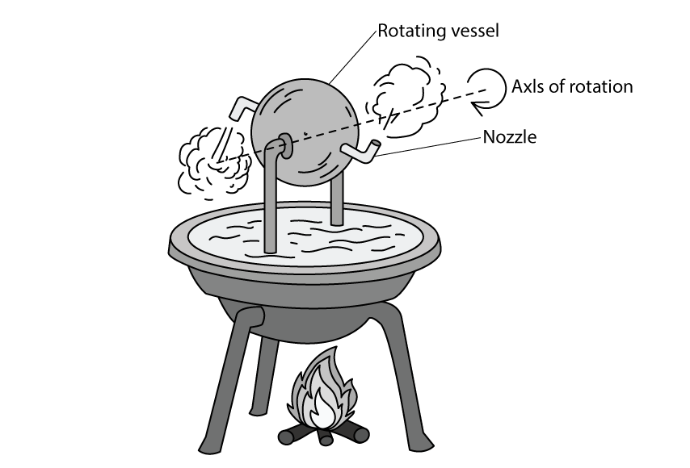

**Fig. 1.1.**

Explain why the vessel rotates around its axis

i) by referring to energy stores and transfers.

[3]

ii) by referring to forces, naming any relevant laws.

[3]

**Q3** [4 marks]

**Extract:**

In the 1st century CE Greek-Egyptian engineer Hero of Alexandria described a simple steam engine, which was at least 100 years old when he wrote about it. Now commonly called a Hero's engine, the machine is a steam turbine which can be made to rotate by boiling water in a sealed vessel beneath it. Two pipes channel the steam produced through nozzles which project outwards.

A version of Hero's engine can be made for demonstration purposes by puncturing the sides of an empty soda can, adding water then suspending it over a Bunsen burner, as shown in Fig. 1.2.

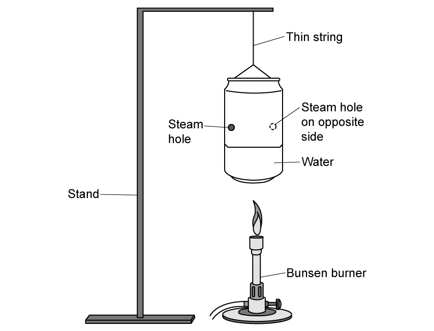

**Fig. 1.2.**

The holes are made by sticking a pin directly into the metal, then pulling the pin sideways to create an angled vent. This causes the jet of steam to leave the can tangentially. as shown in Fig. 1.3.

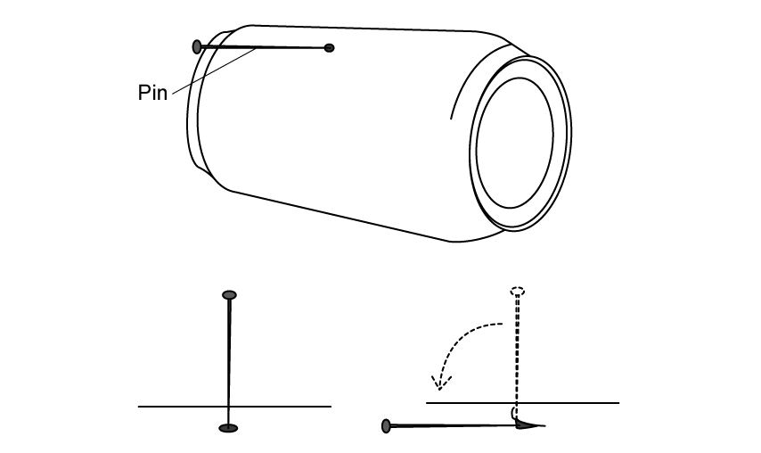

**Fig. 1.3.**

Explain why simply puncturing holes straight into the can will not produce the rotation seen in the original Hero's engine.

**Q3** [4 marks]

A student tries to make a Soda Can Hero's Engine with two pairs of steam holes rather than one.

The dimensions of the can are

height = 115 mm

diameter = 66 mm

Each of the four jets exerts a force of 0.60 N and the holes create jets of steam which are at 45° to the surface of the can.

Calculate the torque experienced by the can.

**Q3** [3 marks]

**Extract:**

A version of Hero's engine can be made for demonstration purposes by puncturing the sides of an empty soda can, adding water then suspending it over a Bunsen burner. The holes are made by sticking a pin directly into the metal, then pulling the pin sideways to create an angled vent. This causes the jet of steam to leave the can tangentially.
Each of the four jets exerts a force of 0.60 N and the holes create jets of steam which are at 45° to the surface of the can.

Without adding any further holes, discuss an adjustment that could be made to the can to make it spin more quickly.

### Q4 — hard — 8 marks

**Q4** [4 marks]

A disc made from thin card has radius 42 mm and is pinned to a board so that it hangs vertically in equilibrium.

Three forces act in the plane of the disc. Two forces act tangentially on the circumference with magnitude *F*1. Another acts at a point half way between the pin and edge, at an angle of 30° from the radial line with magnitude *F*2.

The arrangement is shown in Fig. 1.1.

**Fig. 1.1**

The disc has negligible weight and all frictional forces can be ignored.

For the arrangement shown, express the force *F*2 in terms of the forces *F*1

**Q4** [3 marks]

**Extract:**

A disc made from thin card has radius 42 mm and is pinned to a board so that it hangs vertically in equilibrium. Three forces act in the plane of the disc. Two forces act tangentially on the circumference with magnitude F1. Another acts at a point half way between the pin and edge, at an angle of 30° from the radial line with magnitude F2. The disc has negligible weight and all frictional forces can be ignored. For the arrangement shown, express the force F2 in terms of the forces F1: F2 = 8F1

Hence state the value of *F*2 if the couple produced by the pair of forces with magnitude *F*1 is 0.26 Nm.

**Q4** [1 mark]

**Extract:**

A disc made from thin card has radius 42 mm and is pinned to a board so that it hangs vertically in equilibrium. Three forces act in the plane of the disc. Two forces act tangentially on the circumference with magnitude F1. Another acts at a point half way between the pin and edge, at an angle of 30° from the radial line with magnitude F2. The disc has negligible weight and all frictional forces can be ignored.
Hence state the value of F2 if the couple produced by the pair of forces with magnitude F1 is 0.26 Nm: F2 = 8 F1 = 25 N (2 s.f.)

Determine the magnitude of the force of the pin on the disc.

### Q5 — medium — 10 marks

**Q5** [3 marks]

A force of 50.0 N is applied at an angle of 43° to a spanner of length 25 cm, shown in Fig 1.1.

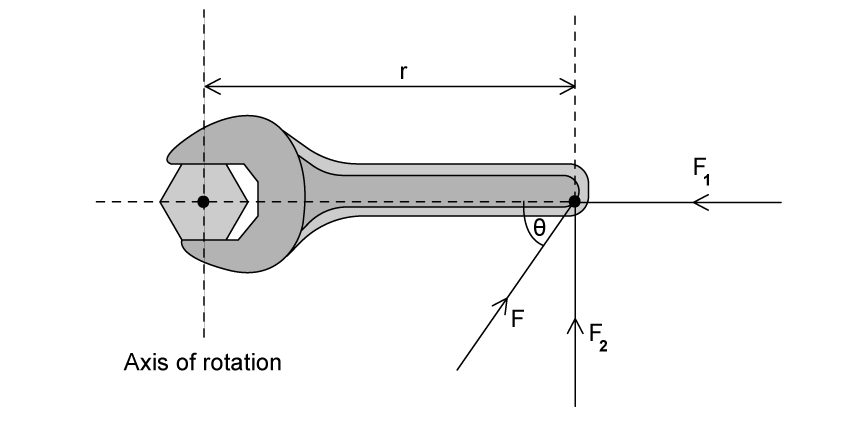

**Fig 1.1**

Calculate the torque provided by this force on the spanner.

**Q5** [3 marks]

**Extract:**

A force of 50.0 N is applied at an angle of 43° to a spanner of length 25 cm, shown in Fig 1.1. Calculate the torque provided by this force on the spanner.

The person applying the force to the spanner changes their grip to obtain a bigger torque. The magnitude of the force applied remains the same.

State and give a reason for the angle the force should be applied to the spanner to obtain its maximum possible value.

**Q5** [2 marks]

Give two examples of couples.

**Q5** [2 marks]

Turning a uniform metal bar of length 23.5 cm rotates the mechanism that opens and closes a mains water tap in Fig 1.2. A couple of forces of magnitude 175 N each are applied at an angle of 75.0° to the bar.

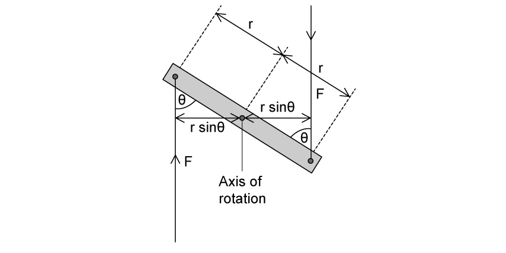

**Fig 1.2**

Calculate the torque provided by the couple.

### Q6 — easy — 9 marks

**Q6** [3 marks]

State **three** conditions which must apply to a pair of coplanar forces to make them a couple.

**Q6** [2 marks]

A ship has a steering wheel of radius 52 cm, as shown in Fig. 1.1.  Under rough sea conditions the moment of the couple needed to turn the wheel is 38 N m.

**Fig. 1.1**

Assuming that the crewman steering the ship places both hands on the steering wheel in order to produce a couple, mark on Fig. 1.1 the positions and directions of the forces needed to turn the wheel anticlockwise.

**Q6** [2 marks]

**Extract:**

A ship has a steering wheel of radius 52 cm, as shown in Fig. 1.1. Under rough sea conditions the moment of the couple needed to turn the wheel is 38 N m.

Calculate the magnitude of the force exerted by each hand of the crewman in order to turn the ship’s wheel under rough sea conditions.

**Q6** [2 marks]

**Extract:**

A ship has a steering wheel of radius 52 cm, as shown in Fig. 1.1. Under rough sea conditions the moment of the couple needed to turn the wheel is 38 N m.
Calculate the magnitude of the force exerted by each hand of the crewman in order to turn the ship's wheel under rough sea conditions. F = M/d = 38/1.04 = 36.5 N

The crewman takes one hand off the steering wheel and continues to apply the same force with the other.

Use your answer to part (c) to calculate the moment produced by the hand which remains on the steering wheel.

### Q7 — easy — 11 marks

**Q7** [4 marks]

(i) Define couple.

[1]

(ii) State the conditions which have to be true for the forces in a couple.

[3]

**Q7** [2 marks]

Fig. 1.1 shows a pair of forces acting on a rotating wheel.

**Fig. 1.1**

(i) State the definition and units of torque

[1]

(ii) For the couple in Fig. 1.1 state the equation which can be used to determine the torque.

[1]

**Q7** [2 marks]

**Extract:**

Fig. 1.1 shows a pair of forces acting on a rotating wheel. Fig. 1.1

For the couple in Fig. 1.1 state the equation which can be used to determine the torque: Torque / T / τ = Fs

For the couple in Fig. 1.1. the two forces, *F* are both 15 N and the perpendicular distance, *s*, between them is 0.5 m.

Calculate the torque of this couple.

**Q7** [3 marks]

**Extract:**

For the couple in Fig. 1.1. the two forces, F are both 15 N and the perpendicular distance, s, between them is 0.5 m.

The forces in Fig. 1.1 are changed so that they act at an angle of 60° to the horizontal distance between them, as shown in Fig. 1.2.

**Fig. 1.2**

Calculate the new magnitude of the torque on the wheel.
