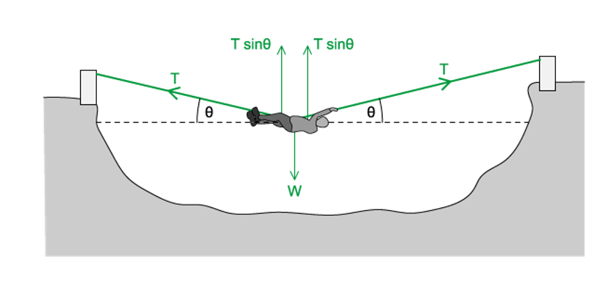
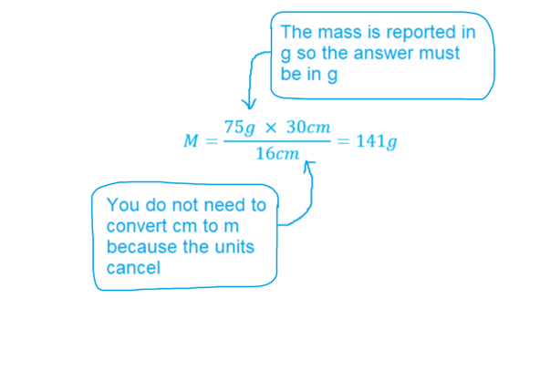
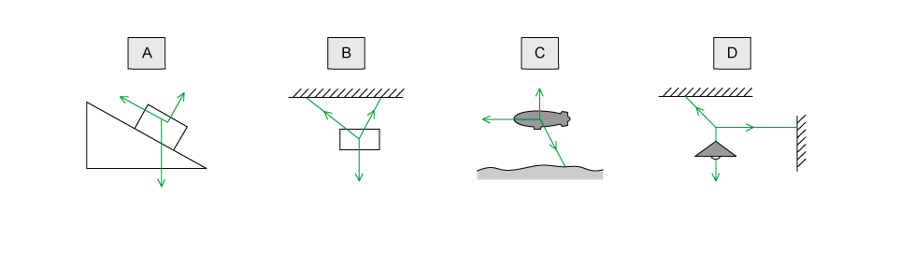
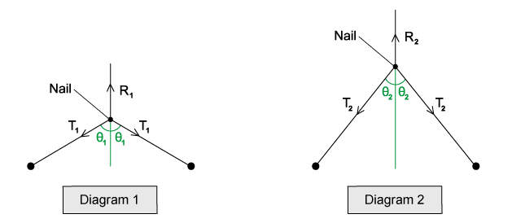
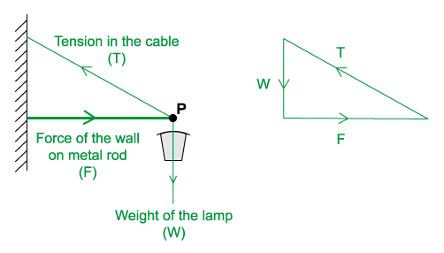
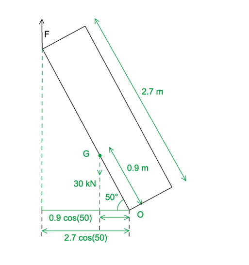
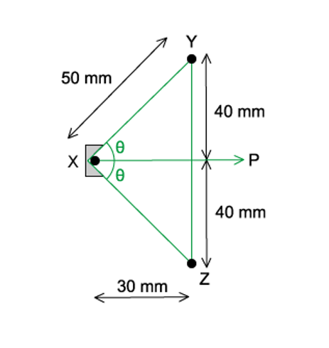
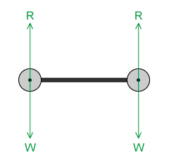

# Mark Schemes — Equilibrium of Forces
**4. Forces, Density & Pressure** · Cambridge (CIE) A-LEVEL physics (9702)

## Multiple Choice Questions (23 questions)

### Q1
**Final answer:** **The correct answer is ****B**** because:**

- There is a tension *T* in the rope on each side of the student
- The sum of vertical components of tension should be equal to the weight *W*
- The vertical component of tension is equal to

  - $T\mathrm{sin}θ$
- The student is in equilibrium and the vertical forces are shown as in the diagram below, so:

  - $T\mathrm{sin}θ+T\mathrm{sin}θ=W$
  - $2T\mathrm{sin}θ=W$
  - $T=\frac{W}{2\mathrm{sin}θ}$

### Q2
**Final answer:** **The correct answer is ****C**** because:**

- To calculate moments, we will need to use

  - $\mathrm{moment}=\mathrm{force}\times\mathrm{perpendicular} \mathrm{distance} \mathrm{from} \mathrm{pivot}$
- The metre rule is uniform, meaning its weight acts at the centre mark, 50 cm
- The 75g mass acts downwards at the 4 cm marker
- The pivot is positioned at 34 cm, so

  - distance to the centre of gravity = 50 – 34 = 16 cm
  - distance to the 75 g mass = 34 – 4 = 30 cm
- Clockwise moment due to the ruler's weight:

  - $Mg\times16$
- Anticlockwise moment due to the 75 g mass:

  - $75g\times30$
- For the system to be in equilibrium, clockwise moment = anticlockwise moment

  - $Mg\times16=75g\times30$
  - $M=\frac{75\times30}{16}=141g$
- Therefore, the metre rule has a mass of 141 g

When dealing with systems in equilibrium (e.g. moments, conservation of momentum) you don’t need to convert units into SI units, you just need to make sure the units are the same on both sides and you need to check your final answer is reported in the correct units, take this question as an example:

### Q3
**Final answer:** **The correct answer is ****C**** because:**

- Hopefully you will have quickly guessed that this problem will require trigonometry to solve
- In both cases, the bowstring is in equilibrium, so we can work out the resultant force in each bow using:

  - $F=T\mathrm{cos}\frac{θ}{2}+T\mathrm{cos}\frac{θ}{2}=2T\mathrm{cos}\frac{θ}{2}$
- Where *T* is the tension in the string and *θ* is the angle between the strings
- The 2 *T* is because there is tension on both halves of the string and the ½ *θ* is because you resolve in line with the direction that the archer is pulling, which is half the angle between the halves of the bow

  - Resultant force in X = $2T\mathrm{cos}\frac{θ}{2}=2\times110\mathrm{cos}\frac{120}{2}=220\mathrm{cos}60$
  - Resultant force in Y = $2T\mathrm{cos}\frac{θ}{2}=2\times150\mathrm{cos}\frac{90}{2}=300\mathrm{cos}45$
  - Increase in force = $300\mathrm{cos}45-220\mathrm{cos}60=102N$

**Exam Tip: **if there is more than one force triangle in a question, always consider each one separately, many students consider the two strings as one and end up with the wrong answer, so be careful!

### Q4
**Final answer:** **The correct answer is ****B**** because:**

- The weight *W* always acts downwards
- The reaction force *R *acts in the opposite direction to the weight, upwards
- The ground is said to be icy which means it is** frictionless**, so there are no additional forces acting or opposing the motion
- Before the ladder begins to slide, there is a horizontal force *P* acting to the right where the ladder comes into contact with the rough wall because the ladder exerts a force to the left on the wall
- As the ladder begins to slide, the point of contact of the ladder with the wall begins to move down the wall
- We are told the wall is rough, meaning friction will oppose the motion of the ladder as it begins to move
- So, at the point of contact, *P* is now acting to the right along with the upwards frictional force, which leads to a resultant force as shown in diagram B

**A & C **are incorrect because these diagrams show the force *P* as horizontal on the ladder as before it begins to slide there is initially no friction force acting, however the question asks about the forces on the ladder **as** it begins to slide

**C & D **are incorrect because these diagrams show that there is a frictional force acting on the ground causing the resultant force of *R* to change direction, but this is incorrect since the ground is icy, meaning it is frictionless

### Q5
**Final answer:** **The correct answer is ****D**** because:**

- The moment of a force is given by:

  - $\mathrm{moment}=\mathrm{force}\times\mathrm{perpendicular} \mathrm{distance} \mathrm{from} \mathrm{pivot}$
- The midpoint of the door is at 0.35 m
- So minimum force = moment / distance from hinge to midpoint

  - $\frac{14}{0.35}=40N$

### Q6
**Final answer:** **The correct answer is ****A**** because:**

- The minimum resultant force is found by finding the combination of forces which produces the smallest value
- Consider the resultant magnitude of 3 N and 4 N when they are perpendicular to each other:

  - Resultant = $\sqrt{3^{2}+4^{2}}=5N$
- So, if the 5 N force is then placed in the opposite direction to the resultant force of the perpendicular 3 N and 4 N forces, the overall resultant force is zero

### Q7
**Final answer:** **The correct answer is ****A**** because:**

- If the vector arrows form a closed triangle, the resultant force is zero
- However, for a body to be in equilibrium, the resultant moment must also be zero
- Another way to look at it is that three forces can only be in equilibrium if they all pass through the same point

  - If not, then there will be a turning force (resultant moment) on the object
- So, if we join the vector arrows to see where they meet, we can see that the only option where the three forces do not meet at a singular point is option A

### Q8
**Final answer:** **The correct answer is ****D**** because:**

- The weight of one ring is equal to *mg*
- In order for the rod to be in equilibrium :
- Clockwise moments = Anticlockwise moments

  - Clockwise moment = `2 cross times open parentheses 14 minus 9 close parentheses m g equals 10 space m g`
- Let *x* be the position of the hook where the fourth ring will be hung

  - Anticlockwise moment = `open parentheses 9 minus 2 close parentheses m g plus open parentheses 9 minus x close parentheses m g`
- For equilibrium:

  - `7 space m g plus open parentheses 9 minus x close parentheses m g equals 10 space m g`
  - `open parentheses 9 minus x close parentheses m g equals 3 m g`
  - `open parentheses 9 minus x close parentheses equals 3`
  - $x=9-3=6$

### Q9
**Final answer:** **The correct answer is ****B**** because:**

- Distance of force *F* from the centre of the spindle $=\frac{1.60}{2}=0.80m$
- Both forces produce clockwise moments about the spindle

  - Clockwise moment `equals open parentheses F cross times 0.80 close parentheses plus open parentheses F cross times 0.80 close parentheses equals 1.60 space F`
- The 800 N weight acts at a distance 0.25 m from the spindle which causes an anticlockwise moment

  - Anticlockwise moment $=800\times0.25$
- The minimum force that can be applied when the clockwise moments are equal to the anticlockwise moments

  - `open parentheses F cross times 0.80 close parentheses plus open parentheses F cross times 0.80 close parentheses equals 800 cross times 0.25`
  - $1.60F=200$
  - $F=\frac{200}{1.6}=125N$

### Q10
**Final answer:** **The correct answer is ****B**** because:**

- In each case, the sum of the vertical components of the two tensions equals the same weight *W*
- So, the reaction at the nail has the same magnitude in both cases:

  - *R**1** = R**2*
- To determine which is the larger of *T**1** *or *T**2*, we must consider the angles between the strings and the vertical, let’s call these *θ**1* and *θ**2*
- For each diagram, the sum of the vertical downward components of the tensions should be equal to the weight which is also equal to *R*

  - $W=2T_{1}\mathrm{cos}θ_{1}$
  - $W=2T_{2}\mathrm{cos}θ_{2}$
  - $2T_{1}\mathrm{cos}θ_{1}=2T_{2}\mathrm{cos}θ_{2}$
- It is clear from the diagrams that the angle *θ**1* is larger than *θ**2*
- From the graph of cosine, we know that as the angle *θ* increases, the value of cos *θ* decreases
- Since *θ**1* > *θ**2*, cos *θ**1* is smaller than cos *θ**2*, so for the statement to hold true, we can conclude:

  - *T**1** *>* T**2*

**A** is incorrect because this implies that $θ_{1}<θ_{2}$, which is incorrect

**C** & **D** are incorrect because R is equal to the weight of the picture so both of these are incorrect

### Q11
**Final answer:** **The correct answer is ****C**** because:**

- To find the net force for two forces which are perpendicular to each other we can use

  - $F^{2}=F_{N}^{2}+F_{E}^{2}$
  - $F=\sqrt{5^{2}+12^{2}}=13N$

### Q12
**Final answer:** **The correct answer is ****A**** because:**

- The force which will cause the lever to rotate clockwise is the 20 N force
- The forces which will cause the lever to rotate anticlockwise are the 10 N and 15 N forces
- Perpendicular distance of 10 N force : (4 + 2) – 3 = 3 m
- Perpendicular distance of 15 N force : 3 m
- Perpendicular distance of 20 N force : 4 m
- Magnitude of resultant moment = Clockwise moment – Anticlockwise moment
- Magnitude of resultant moment `equals open parentheses 20 cross times 4 close parentheses minus open parentheses 10 cross times 3 close parentheses minus open parentheses 15 cross times 3 close parentheses equals 5 space straight N space straight m`

### Q13
**Final answer:** **The correct answer is ****D**** because:**

- Weight always acts downwards
- Tension is the pull of the cable on the object so it always acts away from the mass
- Since the lamp is at rest, the three forces on point P must be in equilibrium
- That means they form a closed triangle when drawn tip-to-tail:

**A & C **are incorrect because weight always acts downwards but these triangles show the weight acting upwards

**B **is incorrect because the tension in a wire always acts away from the mass whereas this triangle shows it acting towards the mass

### Q14
**Final answer:** **The correct answer is ****D**** because:**

- Since the beam is uniform, its weight acts at the centre which is a distance *x* to the left of the pivot
- For equilibrium : Sum of clockwise moments = Sum of anticlockwise moments
- Clockwise moments $=2W\times4x=8Wx$
- Anticlockwise moments `equals open parentheses W cross times 6 x close parentheses plus open parentheses 10 W cross times x close parentheses equals 6 W x plus 10 W x equals 16 W x`
- Since the anticlockwise moment is greater, the 2*W* weight should contribute to the sum of the clockwise moments, i.e. to the right of the pivot
- The 2 *W* weight acts at a distance *d* from the pivot
- Sum of clockwise moments = Sum of anticlockwise moments

  - $8Wx+2Wd=16Wx$
  - $2Wd=8Wx$
  - $d=4x$
- A distance of 4*x* to the right corresponds to option D

### Q15
**Final answer:** **The correct answer is ****A**** because:**

- So far, we have just looked at situations where the object is uniform so the centre of mass acts through the centre of the object
- We are told the position of its centre of gravity G is a third of the length from the hinge at O so the weight acts at a distance of  $\frac{2.7}{3}=0.9m$ from O
- For equilibrium, the clockwise moment should equal the anticlockwise moment
- Let’s consider moments around the pivot O
- The vertical force *F* acts at a perpendicular distance of 2.7 cos 50
- The weight of the trailer acts at a perpendicular distance of 0.9 cos 50
- The vertical force *F* provides a clockwise moment and the weight of the trailer provides an anticlockwise moment

  - Clockwise moment due to force *F = *$F\times2.7\mathrm{cos}50$
  - Anticlockwise moment due to the weight = $30000\times0.9\mathrm{cos}50$
- Sum of clockwise moments = Sum of anticlockwise moments

  - $F\times2.7\mathrm{cos}50=30000\times0.9\mathrm{cos}50$
  - $F=\frac{30000\times0.9\mathrm{cos}50}{2.7\mathrm{cos}50}=10000N$
- The vertical force is therefore equal to 10 000 N or 10 kN

### Q16
**Final answer:** **The correct answer is ****C**** because:**

- The component of the tension in each string along the direction XP is $T\mathrm{cos}θ$

  - Where *T* is the tension in the string and *θ* is the angle between segment XY and axis XP
- The elastic string is in equilibrium, so we can work out the resultant force using:

  - $F=T\mathrm{cos}θ+T\mathrm{cos}θ$
  - $F=2T\mathrm{cos}θ$
- The 2*T* arises because there is tension on both halves of the string
- The quantity cos θ can be found using

  - $\mathrm{cos}θ=\frac{\mathrm{adjacent}}{\mathrm{hypotenuse}}=\frac{30}{50}=\frac{3}{5}$
- Since *T* = 4 N, the resultant force is equal to

  - $F=2\times4\times\frac{3}{5}$
  - $F=4.8N$

### Q17
**Final answer:** **The correct answer is ****D**** because:**

- For an object to be in equilibrium, it must be experiencing no acceleration. This means that both the net force and the net torque on the object must be zero
- Since the masses are both equal, their weight will be the same and pointing downwards, so the clockwise and anticlockwise moments will be the same, therefore their resultant torque must be zero
- We are told the object moves with uniform speed, or terminal velocity, this means the air resistance on the object will be same as the weight and hence there is no acceleration or resultant force
- Therefore, the object satisfies both conditions for equilibrium

**A & B **are incorrect because both these statements argue that the object cannot be in equilibrium if the object is moving, however, this is not true, as long as an object is not accelerating then it can be in equilibrium

**C **is incorrect because a resultant torque could only occur if the forces were unbalanced, however, the object moves with constant speed so the forces must all be balanced

### Q18
**Final answer:** **The correct answer is ****D**** because:**

- To calculate moments, we will need to use

  - $\mathrm{moment}=\mathrm{force}\times\mathrm{perpendicular} \mathrm{distance} \mathrm{from} \mathrm{pivot}$
- Let the torque be equal to *T*, and assume it acts in a clockwise direction unless it is calculated to have a negative sign (which would tell us it acts in an anticlockwise direction)
- Clockwise moments:

  - `open parentheses 0.35 cross times 5.0 cross times g close parentheses plus T`
- The beam is uniform, meaning its weight acts at the centre
- The length of the beam is 1.10 m, so the centre mark is at 0.55 m, which is 0.15 m from the pivot
- Anticlockwise moments:

  - `open parentheses 0.15 cross times 1.2 cross times g close parentheses plus open parentheses 0.65 cross times 5.0 cross times g close parentheses`
- For the system to be in equilibrium, clockwise moment = anticlockwise moment

  - `open parentheses 0.15 cross times 1.2 cross times g close parentheses plus open parentheses 0.65 cross times 5.0 cross times g close parentheses equals open parentheses 0.35 cross times 7.0 cross times g close parentheses plus T`
  - $0.18g+3.25g=2.45g+T$
  - $T=0.98g=9.6Nm$
- Therefore, the torque required to keep the beam in equilibrium is 9.6 N m clockwise

### Q19
**Final answer:** **The correct answer is ****A**** because:**

- The moment of a force is equal to

  - $\mathrm{moment}=\mathrm{force}\times\mathrm{perpendicular} \mathrm{distance} \mathrm{from} \mathrm{pivot}$
- Taking moments about the top of the ladder
- **Clockwise moments:**

  - The horizontal frictional force $F$ acting at a perpendicular distance $h$ produces a clockwise moment = $F\timesh$
  - The weight $W$ of the ladder acting at a perpendicular distance $a$ produces a clockwise moment = $W\timesa$
- **Anticlockwise moments:**

  - The vertical reaction force $R=W$ acting at a perpendicular distance $2a$ produces an anticlockwise moment = $W\times2a$
- For equilibrium: Sum of clockwise moments = Sum of anticlockwise moments

  - $Wa+Fh=2Wa$

### Q20
**Final answer:** **The correct answer is ****A**** because:**

- To calculate moments, we will need to use

  - $\mathrm{moment}=\mathrm{force}\times\mathrm{perpendicular} \mathrm{distance} \mathrm{from} \mathrm{pivot}$
- We will look at the clockwise and anticlockwise moments separately
- The metre rule is uniform, meaning its weight acts at the centre mark, 50 cm
- Therefore, the distance between the pivot and the centre of gravity is 10 cm
- The weight of the ruler produces an anticlockwise moment of

  - 4.0 × 0.1 = 0.4 N m
- The 6.0 N weight acts downwards at a distance of 40 cm from the pivot, producing a clockwise moment of

  - 6.0 × 0.4 = 2.4 N m
- Resultant moment = sum of clockwise and anticlockwise moments

  - 2.4 – 0.4 = 2.0 N m
- Therefore, the resultant turning moment is 2.0 N m clockwise

**B & D **are incorrect because a positive value is generally taken as a clockwise moment

**C **is incorrect because this is the answer you get if you add the moments together instead of taking away the anticlockwise moment

### Q21
**Final answer:** **The correct answer is ****C**** because:**

- Since the metre rule is uniform, its weight acts at its centre, which is 5*x*
- The weight of the ruler causes a clockwise moment at a distance 5*x* – 4*x* = *x* from the pivot

  - Clockwise moment due to the weight of the ruler = 100 *gx*
- Where *g* is the acceleration due to gravity
- The weight of the 20 g mass causes an anticlockwise moment at a distance of 10*x* – 4*x* = 6*x* from the pivot

  - Anticlockwise moment due to 20 g mass = $20g\times6x=120gx$
- For equilibrium, the clockwise moment should equal the anticlockwise moment
- Since the anticlockwise moment is greater, the 50 g mass should contribute to the sum of the clockwise moments, i.e. to the right of the pivot
- Let’s say the 50 g mass acts at a distance *d* from the pivot
- Sum of clockwise moments = Sum of anticlockwise moments

  - $100gx+50gd=120gx$
  - $50gd=20gx$
  - $d=\frac{20x}{50}=0.4x$
- Therefore, the 50g mass should be hung at

  - $4x+0.4x=4.4x$

### Q22
**Final answer:** **The correct answer is ****D**** because:**

- Torque is the moment of a force, it causes a turning effect
- Consider option** D**
- Upward force = 42 + 70 = 112 N
- Downward force = 112 N

  - Resultant force = 112 – 112 = 0
- Clockwise moment = 42 × 50 = 2100 N cm
- Anticlockwise moment = 70 × 30 = 2100 N cm

  - Resultant moment = 2100 – 2100 = 0
- Both the resultant force and moments are zero, so **D** is correct

| **A **is incorrect because | Upward force = 30 + 50 = 80 N  Downward force = 90 N  - Resultant force = 90 – 80 = 10 N downward  Clockwise moment = 30 × 50 = 1500 N cm  Anticlockwise moment = 50 × 30 = 1500 N cm  - Resultant moment = 1500 – 1500 = **0 N cm** |
|---|---|
| **B **is incorrect because | Upward force = 36 + 70 = 106 N  Downward force = 106 N  - Resultant force = 106 – 106 = 0  Clockwise moment = 36 × 50 = 1800 N cm  Anticlockwise moment = 70 × 30 = 2100 N cm  - Resultant moment = 2100 – 1800 = **300 N cm** |
| **C **is incorrect because | Upward force = 28 + 35 = 63 N  Downward force = 63 N  - Resultant force = 63 – 63 = 0  Clockwise moment = 28 × 50 = 1400 N cm  Anticlockwise moment = 35 × 30 = 1050 N cm  - Resultant moment = 1400 – 1050 = **350 N cm** |

### Q23
**Final answer:** **The correct answer is ****C**** because:**

- We are told the mass is stationary in this person’s hand, therefore, the system is in equilibrium
- For a system in equilibrium :

  - Sum of clockwise moments = Sum of anticlockwise moments
- Clockwise moments = `open parentheses 25 cross times 12 close parentheses plus open parentheses 200 cross times 35 close parentheses equals 7300 space straight N space cm`
- Anticlockwise moments = $5F$

  - $5F=7300$
  - $F=\frac{7300}{5}=1460N$
