# Exam Questions — Equilibrium of Forces
**4. Forces, Density & Pressure** · Cambridge (CIE) A-LEVEL physics (9702)
> Source: [https://www.savemyexams.com/a-level/physics/cie/25/topic-questions/](https://www.savemyexams.com/a-level/physics/cie/25/topic-questions/) · 33 questions across 2 sets

## Multiple Choice Questions (23 questions)

### Q1 — hard — 1 marks

**Q1** [1 mark]

The diagram shows a rope bridge that a student makes on an adventure training course. The student has a weight *W*.

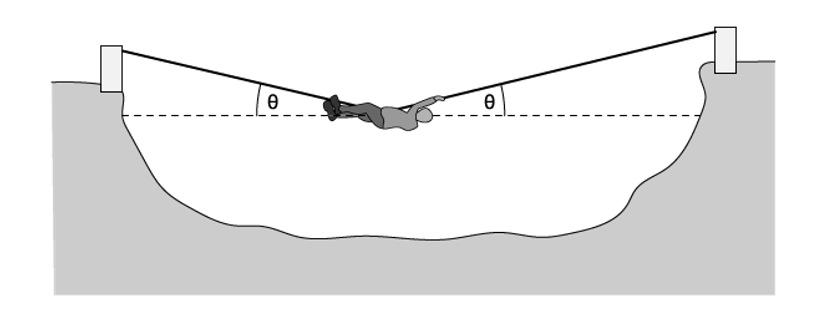

Which formula gives the tension *T* in the rope?

### Q2 — medium — 1 marks

**Q2** [1 mark]

A uniform metre rule is hung from the ceiling as shown

The rule balances when a 75 g mass is hung from one end of the ruler

What is the mass of the metre rule?

### Q3 — hard — 1 marks

**Q3** [1 mark]

An archer draws his bowstring back to position X. The bowstring and arrow are shown. The tension *T* in the string is also shown. Then he draws the bowstring back further to position Y.

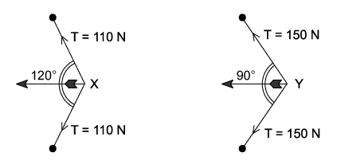

The archer finds the resultant force on the arrow is greater when the arrow is released from position Y.

What is the increase in force?

### Q4 — medium — 1 marks

**Q4** [1 mark]

A ladder is positioned on icy ground and is leant against a rough wall. At the instant of release, it begins to slide.

Which diagram correctly shows the directions of the forces *P*, *W* and *R* acting on the ladder as it slides?

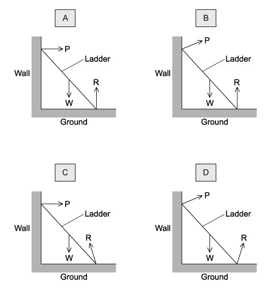

### Q5 — easy — 1 marks

**Q5** [1 mark]

The diagram shows a plan view of a door which requires a moment of 14 N m to open it.

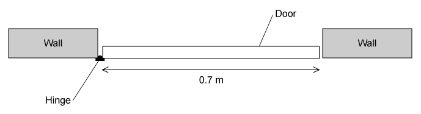

What is the minimum force that must be applied at the door’s midpoint to ensure it opens?

### Q6 — easy — 1 marks

**Q6** [1 mark]

Forces of 3 N, 4 N and 5 N act at one point on an object. The angles at which the forces act can vary.

What is the value of the minimum resultant force of these forces?

### Q7 — easy — 1 marks

**Q7** [1 mark]

The diagrams show the forces acting on different bodies.

Which body **cannot** be in equilibrium?

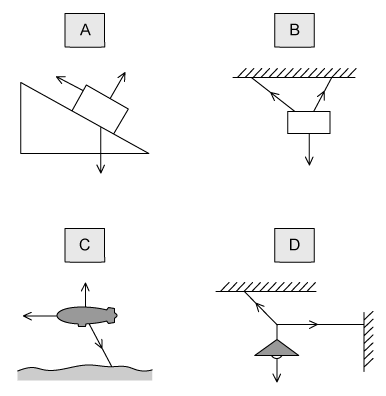

### Q8 — medium — 1 marks

**Q8** [1 mark]

The diagram shows a child’s balancing game.

The wooden rod is uniform and all the rings are of equal mass. Two rings are hung on peg 14 and one on peg 2. The rod is pivoted at peg 9.

On which hook must a fourth ring be hung in order to balance the rod?

### Q9 — medium — 1 marks

**Q9** [1 mark]

A spindle is attached at one end to the centre of a lever of length 1.60 m and at its other end to the centre of a disc of radius 0.25 m. A string is wrapped round the disc, passes over a pulley and is attached to an 800 N weight.

What is the minimum force *F*, applied to each end of the lever, that could lift the weight?

### Q10 — hard — 1 marks

**Q10** [1 mark]

The diagrams show two ways of hanging the same picture.

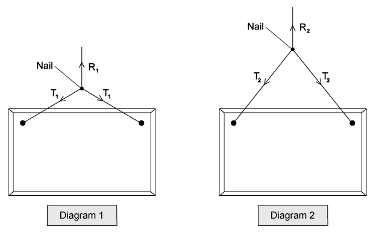

In both cases, a string is attached to the same points on the picture and looped symmetrically over a nail in a wall. The forces shown are those that act on the nail.

In diagram 1, the string loop is shorter than in diagram 2.

Which row about the magnitude of the forces is correct?

| **A** | *R**1** = R**2* | *T**1** < T**2* |
|---|---|---|
| **B** | *R**1** = R**2* | *T**1** > T**2* |
| **C** | *R**1** > R**2* | *T**1** < T**2* |
| **D** | *R**1** < R**2* | *T**1** = T**2* |

### Q11 — easy — 1 marks

**Q11** [1 mark]

A force of 5 N pushes a ball due north, and another force of 12 N pushes it due east.

What is the magnitude of the net force acting on the ball?

### Q12 — medium — 1 marks

**Q12** [1 mark]

A rigid L-shaped lever arm is pivoted at point P.

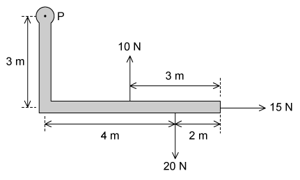

Three forces act on the lever arm, as shown in the diagram.

What is the magnitude of the resultant moment of these forces about point P?

### Q13 — easy — 1 marks

**Q13** [1 mark]

A street lamp is fixed to a wall by a metal rod and a cable.

Which vector triangle represents the forces acting at point P?

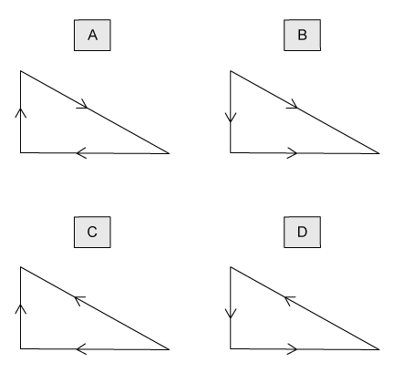

### Q14 — hard — 1 marks

**Q14** [1 mark]

A uniform beam is pivoted at P as shown. Weights of *W* and 2 *W* are attached to its ends. The beam is marked at *x* intervals. The weight of the beam is 10 *W*

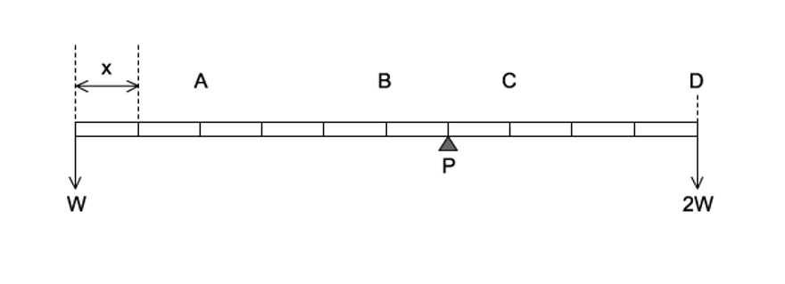

At which point should a 2 *W* weight be attached to achieve equilibrium?

### Q15 — hard — 1 marks

**Q15** [1 mark]

A trailer of weight 30 kN is attached to a truck. The trailer is raised until it is held at 50˚ to the horizontal by a vertical force *F* as shown in the diagram.

The trailer is 2.7 m in length and the position of its centre of gravity G is a third of the length from the hinge at O.

What is the vertical force *F *applied to the end of the trailer?

### Q16 — hard — 1 marks

**Q16** [1 mark]

The diagram shows two fixed pins, Y and Z. A length of elastic is stretched between Y and Z and around pin X, which is attached to a trolley.

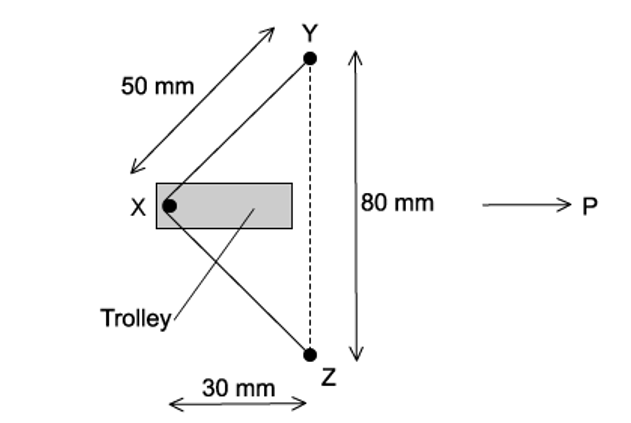

X is at the centre of the elastic and the trolley is to be propelled in the direction P at right angles to YZ. The tension in the elastic is 4 N.

What is the force accelerating the trolley in the direction P when the trolley is released?

### Q17 — medium — 1 marks

**Q17** [1 mark]

An object, made from two equal masses joined by a light rod, falls with uniform speed through air. The rod remains horizontal.

Which statement about this system is correct?

### Q18 — medium — 1 marks

**Q18** [1 mark]

A uniform beam of length 1.10 m and mass 1.2 kg is pivoted at P as shown. The pivot P is 0.40 m from one end. Loads of masses 5.0 kg and 7.0 kg are suspended 0.65 m and 0.35 m from the pivot, respectively, as shown.

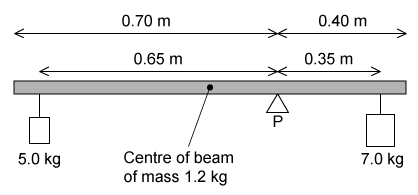

What torque must be applied to the beam in order to maintain it in equilibrium?

### Q19 — hard — 1 marks

**Q19** [1 mark]

A uniform ladder rests against a smooth vertical wall, as shown in the diagram. The bottom of the ladder rests on rough ground where friction is not negligible. The top of the ladder is a vertical height $h$ up the wall, and the foot of the ladder is a horizontal distance $2a$ from the wall.

The weight $W$ of the ladder acts at its centre. At the foot of the ladder, the ground exerts a vertical reaction $R$ and a horizontal frictional force $F$.

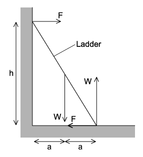

Which equation represents the moments when the ladder is in equilibrium?

### Q20 — easy — 1 marks

**Q20** [1 mark]

A uniform metre rule of weight 4.0 N is pivoted at the 60 cm mark. A 6.0 N weight is suspended from one end, causing the rule to rotate about the pivot.

At the instant when the rule is horizontal, what is the resultant turning moment about the pivot?

|   | **Resultant moment** | **Direction** |
|---|---|---|
| **A**  **B**  **C**  **D** | 2.0 N m  2.0 N m  2.8 N m  2.8 N m | clockwise  anticlockwise  clockwise  anticlockwise |

### Q21 — hard — 1 marks

**Q21** [1 mark]

A uniform metre rule of mass 100 g is supported by a pivot and a string as shown in the diagram. The beam is marked at intervals of $2x$. The string passes round a frictionless pulley and carries a mass of 20 g.

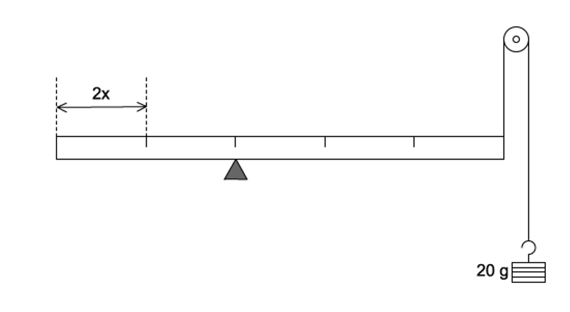

At which mark on the rule must a 50 g mass be suspended so that the rule balances?

### Q22 — medium — 1 marks

**Q22** [1 mark]

Four beams of the same length each have three forces acting on them.

Which beam has both zero resultant force and zero resultant torque acting?

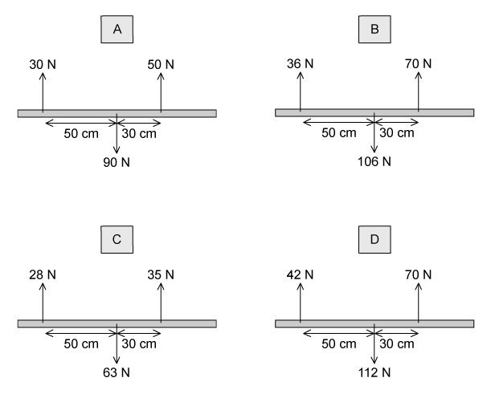

### Q23 — medium — 1 marks

**Q23** [1 mark]

A man holds a 200 N load stationary in his hand. The combined weight of the forearm and hand is 25 N. The forearm is held horizontal, as shown

What is the vertical force *F* needed in the biceps?

## Structured Questions (10 questions)

### Q1 — medium — 10 marks

**Q1** [1 mark]

State what is meant by the *centre of gravity* of an object.

**Q1** [2 marks]

State the **two **conditions required for an object to be in equilibrium.

**Q1** [5 marks]

A uniform beam AB of length 2.40 m and weight 50 N is hinged at end A. The beam is held in a horizontal position by a vertical wire attached to end B, as shown in Fig. 2.1.

**Fig. 2.1** (not to scale)

A cube of side length 0.075 m is suspended from the beam at a distance of 0.80 m from A. The cube is made from a material of density 2800 kg m−3.

The beam is in equilibrium. Assume that the hinge is frictionless.

(i) Show that the weight of the cube is about 12 N.

[2]

(ii) By taking moments about A, calculate the tension $T$ in the wire.

[2]

**Q1** [2 marks]

**Extract:**

A uniform beam AB of length 2.40 m and weight 50 N is hinged at end A. The beam is held in a horizontal position by a vertical wire attached to end B, as shown in Fig. 2.1.

A cube of side length 0.075 m is suspended from the beam at a distance of 0.80 m from A. The cube is made from a material of density 2800 kg m^−3^.

The beam is in equilibrium. Assume that the hinge is frictionless.

The cube in **(c)** is now completely submerged in a beaker of water, as shown in Fig. 2.2.

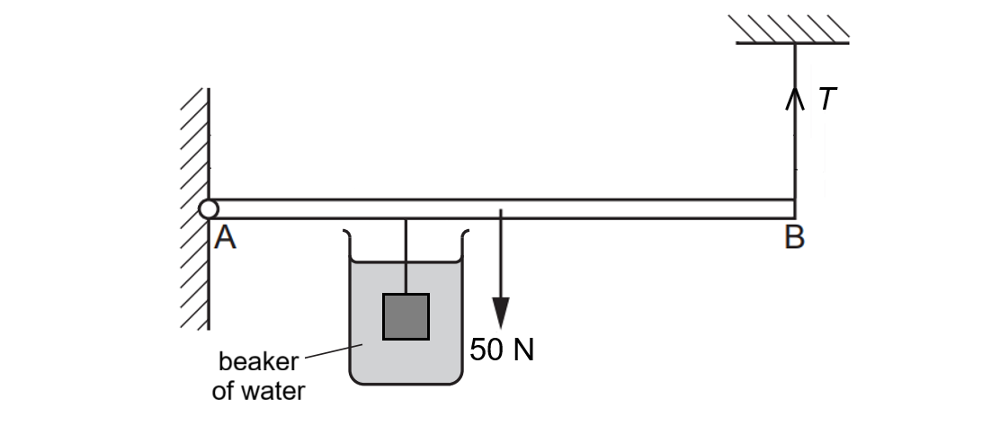

**Fig. 2.2**

The magnitude of $T$ is unchanged.

State and explain the effect of this change on the magnitude and direction of the resultant moment of the forces on the beam about A.

### Q2 — medium — 14 marks

**Q2** [2 marks]

A student investigates the principle of moments using the apparatus shown in Fig. 1.1.

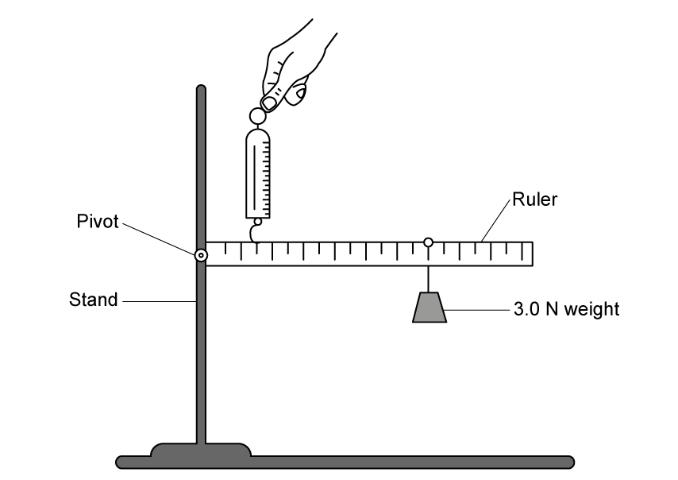

**Fig. 1.1**

The scale on the forcemeter reads from 0 N to 10 N.

A 3.0 N weight is positioned so that it hangs straight downwards from the 70 cm mark on the ruler.

Describe what the student could do to ensure that the ruler is horizontal.

**Q2** [4 marks]

**Extract:**

A 3.0 N weight is positioned so that it hangs straight downwards from the 70 cm mark on the ruler.

The student intends to investigate moments around the pivot.

(i) State the equation linking moment, force and distance from the pivot.

[2]

(ii) Calculate the moment of the 3.0 N weight.

[2]

**Q2** [5 marks]

**Extract:**

The scale on the forcemeter reads from 0 N to 10 N. A 3.0 N weight is positioned so that it hangs straight downwards from the 70 cm mark on the ruler.
Calculate the moment of the 3.0 N weight: F = 3.0 N, d = 70 cm = 0.7 m, M = 3.0 × 0.7 = 2.1 Nm

The student positions the forcemeter at the 15 cm mark and uses it to hold the ruler horizontal.

He expects the reading on the forcemeter to be 14 N.

The actual reading is 10 N.

(i) Infer, showing your calculation, why the student made this assumption.

[2]

(ii) Explain why the correct reading should be **larger **than 14 N.

[2]

(iii) Explain why the actual reading is only 10 N.

[1]

**Q2** [3 marks]

The teacher asks the student and his friend to move a table with some books on it. They carry the table as shown in Fig. 1.2.

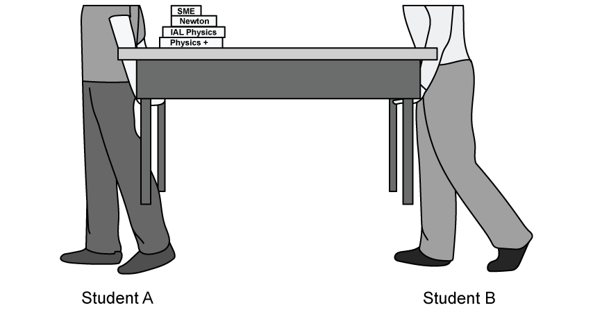

**Fig. 1.2**

Use ideas about moments to explain why student **A** feels more force on their hands than student **B**.

### Q3 — medium — 8 marks

**Q3** [5 marks]

A pole **PR **has a length 6.0 m and a weight *W* N. The pole is held in a horizontal position in equilibrium by two vertical ropes attached to the pole as shown in Fig. 1.1.

**Fig. 1.1.**

A load of weight 10 N is attached to the rod at **R**.

The tension in the rope attached at **Q** is six times as large as the tension in the rope attached at **P**.

The pole is uniform and the ropes are light inextensible strings.

Calculate the value of *W*.

**Q3** [3 marks]

**Extract:**

A pole PR has a length 6.0 m and a weight W N. The pole is held in a horizontal position in equilibrium by two vertical ropes attached to the pole. A load of weight 10 N is attached to the rod at R. The tension in the rope attached at Q is six times as large as the tension in the rope attached at P. The pole is uniform and the ropes are light inextensible strings. Calculate the value of W. ... W = 48 N (2 s.f.)

**Q** is now moved to a point further along the pole until the length **QR** is 0.8 m , as shown in Fig. 1.2.

**Fig. 1.2**

The pole remains in equilibrium. The load of 10 N is now moved to a point *x* metres from **P**.

The beam remains in equilibrium in a horizontal position.

The rope at **Q** will break if its tension exceeds 32 N. The rope at **P** cannot break.

Find the range of possible positions on the beam where the load can be attached without the rope at **Q** breaking.

### Q4 — medium — 9 marks

**Q4** [1 mark]

State what is meant by the centre of gravity of an object.

**Q4** [3 marks]

A uniform plank of wood of mass 40 kg and length 5.0 m is used by a boy to help him cross a ditch.

In the ditch is a rock, which is used to support the plank horizontally 1.1 m from one end, as shown in Fig. 1.1. The other end of the plank is supported by the bank.** **

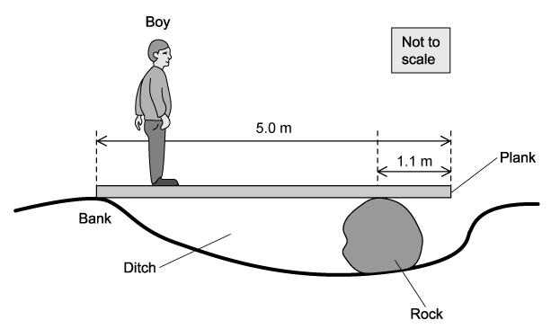

**Fig. 1.1**

Calculate the vertical supporting force from the rock when the plank is placed in position as shown in Fig 1.1.

**Q4** [2 marks]

**Extract:**

A uniform plank of wood of mass 40 kg and length 5.0 m is used by a boy to help him cross a ditch. In the ditch is a rock, which is used to support the plank horizontally 1.1 m from one end, as shown in Fig. 1.1. The other end of the plank is supported by the bank.

The boy begins to walk across the plank. The position of the boy is shown in Fig. 1.2.

**Fig. 1.2**

On Fig. 1.2, draw arrows to show the forces acting on the plank when the boy has crossed some of the plank.

**Q4** [3 marks]

**Extract:**

A uniform plank of wood of mass 40 kg and length 5.0 m is used by a boy to help him cross a ditch. In the ditch is a rock, which is used to support the plank horizontally 1.1 m from one end, as shown in Fig. 1.1. The other end of the plank is supported by the bank.

The boy has a mass of 50 kg.

Determine whether the boy can walk to the far end of the plank without it tipping. Support your answer with a calculation.

### Q5 — medium — 10 marks

**Q5** [6 marks]

A team of decorators set up a raised bench to allow them to reach the ceiling.

The bench consists of a plank which is resting in a horizontal position on two supports **B** and **C**. The plank is modelled as a uniform rod **AD** of length 2.7 m and mass 15 kg. The supports at **B** and **C** are 0.4 m from each end of the plank, as shown in Fig 1.1.

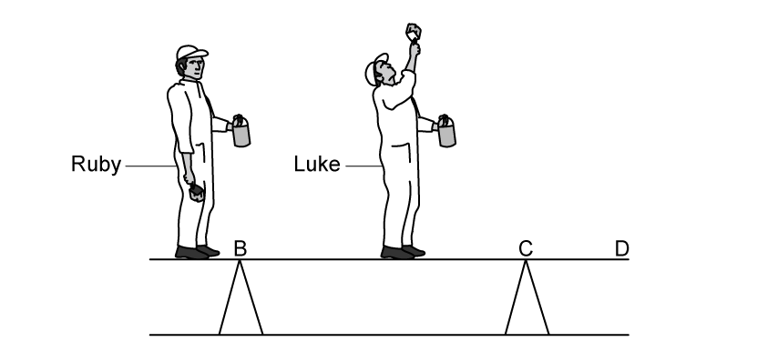

**Fig 1.1**

Two decorators, Ruby and Luke, stand on the plank. Luke has a mass of 85 kg and stands in the middle of the plank.

Ruby has a mass of 72 kg and stands at end **A**.

The plank remains horizontal and in equilibrium. The decorators can be modelled as point masses.

Calculate:

(i) The magnitude of the normal reaction force at **B**.

[3]

(ii) The magnitude of the normal reaction force at **C**.

[3]

**Q5** [4 marks]

**Extract:**

A team of decorators set up a raised bench to allow them to reach the ceiling. The bench consists of a plank which is resting in a horizontal position on two supports B and C. The plank is modelled as a uniform rod AD of length 2.7 m and mass 15 kg. The supports at B and C are 0.4 m from each end of the plank. Two decorators, Ruby and Luke, stand on the plank. Luke has a mass of 85 kg and stands in the middle of the plank. Ruby has a mass of 72 kg and stands at end A. The plank remains horizontal and in equilibrium. The decorators can be modelled as point masses.

Whilst Ruby stays at point **A**, Luke now moves along the plank to a point **X**.

The plank remains horizontal and in equilibrium, and the magnitude of the normal reaction force at **B** is now twice the magnitude of the normal reaction force at **C**.

Calculate the distance **BX**.

### Q6 — easy — 10 marks

**Q6** [3 marks]

Define the following

(i) moment of a force

[2]

(ii) centre of gravity.

[1]

**Q6** [3 marks]

A teacher sets some Physics students the task of finding the weight of a broom using only a ruler, some thin, light string, and a set of laboratory masses. The equipment is initially arranged as shown in Fig. 1.1.

**Fig. 1.1.**

The students are not allowed to use scales.

For the arrangement in Fig. 1.1.

(i) State why the broom is hanging horizontally.

[2]

(ii) State what measurement the students should make to start their investigation to find the weight of the broom.

[1]

**Q6** [2 marks]

**Extract:**

A teacher sets some Physics students the task of finding the weight of a broom using only a ruler, some thin, light string, and a set of laboratory masses. The equipment is initially arranged as shown in Fig. 1.1. The students are not allowed to use scales.

The measurement to the position of the string found in part (b) is shown in Fig. 1.2.

**Fig. 1.2.**

Distance from string to the end of the handle = 0.75 m

The string is moved towards the end of the handle, so that the broom is in equilibrium when a 0.5 kg mass is hung a distance of 0.45 m from the string as shown in Fig. 1.3.

**Fig. 1.3**

Determine

(i) the distance between the centre of mass of the broom and the point where the string is attached.

[1]

(ii) the force exerted by the 0.5 kg mass.

[1]

**Q6** [2 marks]

**Extract:**

The string is moved towards the end of the handle, so that the broom is in equilibrium when a 0.5 kg mass is hung a distance of 0.45 m from the string.
(i) Determine the distance between the centre of mass of the broom and the point where the string is attached: Distance to centre of mass, d = 0.75 - (0.45 + 0.12) = 0.18 m
(ii) Determine the force exerted by the 0.5 kg mass: W = mg = 0.5 × 9.81 = 4.9 N

Calculate the weight of the broom.

### Q7 — hard — 15 marks

**Q7** [4 marks]

A bench consists of a plank which is resting in a horizontal position on two supports B and C. The plank is modelled as a uniform rod AD of length 2.7 m and mass 20 kg. The supports at B and C are 0.5 m from each end of the plank, as shown in Fig. 1.1.

**Fig. 1.1**

Two animals sit on the plank. The rabbit has a mass of 2.5 kg and sits in the middle of the plank and the quail has a mass of 4.3 kg and sits at the end A. The plank remains horizontal and in equilibrium. The animals can be modelled as point masses.

Calculate:

(i) The magnitude of the normal reaction force at B

[2]

(ii) The magnitude of the normal reaction force at C

[2]

**Q7** [4 marks]

**Extract:**

A bench consists of a plank which is resting in a horizontal position on two supports B and C. The plank is modelled as a uniform rod AD of length 2.7 m and mass 20 kg. The supports at B and C are 0.5 m from each end of the plank, as shown in Fig. 1.1. Two animals sit on the plank. The rabbit has a mass of 2.5 kg and sits in the middle of the plank and the quail has a mass of 4.3 kg and sits at the end A. The plank remains horizontal and in equilibrium. The animals can be modelled as point masses.

Whilst the quail stays at point A the rabbit now moves along the plank to point X.

Given that the plank remains horizontal and in equilibrium, and that the magnitude of the normal reaction force at B is now twice the magnitude of the normal reaction force at C, calculate the distance BX.

**Q7** [4 marks]

A pole PR has a length 4 m and a weight *W* newton. The pole is held in a horizontal position in equilibrium by two vertical ropes attached to the pole at the points P and R where PR = 4 m, as shown in Fig. 1.2.

**Fig. 1.2**

A load of weight 17 N is attached to the rod at R. The pole is uniform and the ropes are light inextensible strings.

Given that the tension in the rope attached to the pole at Q is seven times the tension in the rope attached to the pole at P, calculate the value of *W*.

**Q7** [3 marks]

**Extract:**

A pole PR has a length 4 m and a weight *W* newton. The pole is held in a horizontal position in equilibrium by two vertical ropes attached to the pole at the points P and R where PR = 4 m, as shown in Fig. 1.2. A load of weight 17 N is attached to the rod at R. The pole is uniform and the ropes are light inextensible strings. Given that the tension in the rope attached to the pole at Q is seven times the tension in the rope attached to the pole at P, calculate the value of *W*. [W = 323 N]

Q is now moved to a point further along the pole until the length QR is 0.8 m, as shown in Fig. 1.3. The pole still remains in equilibrium. The load of 17 N is now moved to a point *x*  metres from P. The beam remains in equilibrium in a horizontal position.

Fig. 1.3

The rope at Q will break if its tension exceeds 212 N. The rope at P cannot break.

Find the range of possible positions on the beam where the load can be attached without the rope at Q breaking.

### Q8 — easy — 9 marks

**Q8** [3 marks]

A metre rule is balanced on a pivot at its mid-point.

A force of 10.0 N acts at a distance of 8.0 cm from one end of the rule as shown in Fig. 1.1.

**Fig. 1.1**

Calculate the moment of the 10.0 N force about the pivot.

moment = .................................................... N m

**Q8** [2 marks]

**Extract:**

A metre rule is balanced on a pivot at its mid-point. A force of 10.0 N acts at a distance of 8.0 cm from one end of the rule as shown in Fig. 1.1. Fig. 1.1

A mass is placed at a point 35 cm from the pivot, which makes the metre rule balance.

On Fig. 1.1, draw an arrow to show the position of the mass and the direction of the force it exerts.

**Q8** [4 marks]

**Extract:**

A metre rule is balanced on a pivot at its mid-point. A force of 10.0 N acts at a distance of 8.0 cm from one end of the rule as shown in Fig. 1.1. Distance of force from pivot, d = 50 - 8 = 42 cm or 0.42 m.
A mass is placed at a point 35 cm from the pivot, which makes the metre rule balance.

Calculate the **mass **which has been placed to balance the ruler in part (a).

### Q9 — medium — 9 marks

**Q9** [2 marks]

It is said that Archimedes used huge levers to sink Roman ships invading the city of Syracuse.

A possible system is shown in  Fig. 1.1 where a rope is hooked onto the front of the ship and the lever is pulled by several men.

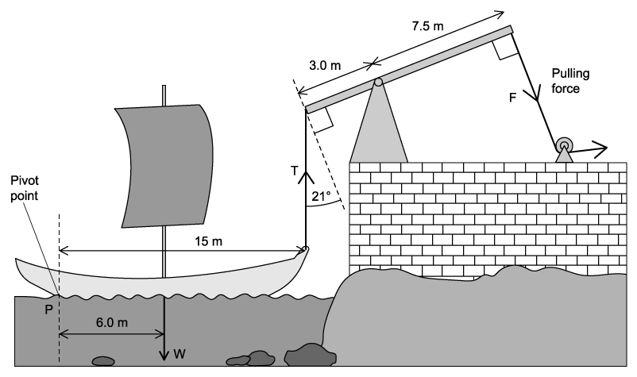

**Fig. 1.1**

Calculate the mass of the ship if its weight is 4.6 × 104 N. Give your answer to an appropriate number of significant figures.

**Q9** [2 marks]

**Extract:**

It is said that Archimedes used huge levers to sink Roman ships invading the city of Syracuse. A possible system is shown in Fig. 1.1 where a rope is hooked onto the front of the ship and the lever is pulled by several men. Fig. 1.1 Calculate the mass of the ship if its weight is 4.6 × 10^4 N.

Calculate the moment of the ship’s weight about point **P**. State an appropriate unit for your answer.

**Q9** [2 marks]

**Extract:**

It is said that Archimedes used huge levers to sink Roman ships invading the city of Syracuse. A possible system is shown in Fig. 1.1 where a rope is hooked onto the front of the ship and the lever is pulled by several men. Calculate the mass of the ship if its weight is 4.6 × 10^4 N.

Calculate the minimum vertical force *T* required to start raising the front of the ship. Assume the ship pivots about point **P**.

**Q9** [3 marks]

**Extract:**

Calculate the minimum vertical force *T* required to start raising the front of the ship. Assume the ship pivots about point **P**.
T = 1.8 × 10^4 N

Calculate the minimum force *F* that must be exerted to start to raise the front of the ship.

### Q10 — hard — 12 marks

**Q10** [4 marks]

In a double-decker bus there are two passenger decks, stacked one above the other.

The dimensions of an older, 'Routemaster' bus are:

Height = 4.38 m

Width = 2.44 m

Mass = 7.47 tons

To ensure safety, buses are tested for stability using a tilting platform as shown in Fig. 1.1.

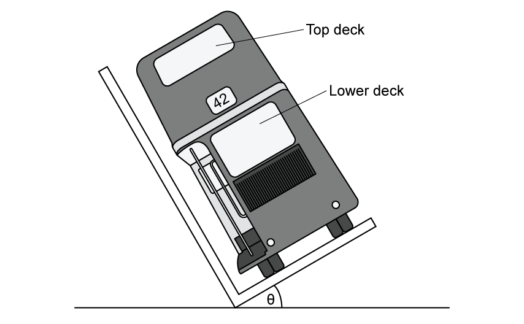

**Fig. 1.1**

Weights are attached to the underside of the bus, then the angle the bus makes with the horizontal is gradually increased until the bus begins to topple to the left.

(i) State the reason that the bus would topple to the left.

[1]

(ii) Explain the effect of adding weights to the underside of the bus.

[3]

**Q10** [2 marks]

**Extract:**

The dimensions of an older, 'Routemaster' bus are:

Height = 4.38 m

Width = 2.44 m

Mass = 7.47 tons

The bus is first tested completely empty, and is found to tilt to an angle of 40° from the horizontal before it starts to tip.

Determine the height above the ground of the centre of mass of the bus when it is empty and normally parked.

**Q10** [3 marks]

**Extract:**

The dimensions of an older, 'Routemaster' bus are: Height = 4.38 m; Width = 2.44 m; Mass = 7.47 tons
Determine the height above the ground of the centre of mass of the bus when it is empty and normally parked: h = 1.22 × tan(50) = 1.5 m

To be considered safe to use on the road the bus must be safe when carrying passengers.

To test this the top deck is weighted with iron blocks or sandbags to the equivalent of 60 passengers, while the lower deck is left empty.

The average passenger is assumed to have a mass of 65 kg and their centres of mass can be considered to act at a height of 3.28 m above the road.

1 ton = 1000 kg

For this safety test

(i) Calculate the new height of the centre of mass of the bus above the road.

[2]

(ii) Suggest why the test is done with the top deck weighted to capacity and the bottom deck left empty.

[1]

**Q10** [3 marks]

**Extract:**

The dimensions of an older, 'Routemaster' bus are: Height = 4.38 m; Width = 2.44 m; Mass = 7.47 tons. Buses are tested for stability using a tilting platform; the angle the bus makes with the horizontal is gradually increased until the bus begins to topple.

To be considered safe the bus must be safe when carrying passengers. To test this the top deck is weighted to the equivalent of 60 passengers, while the lower deck is left empty. The average passenger is assumed to have a mass of 65 kg and their centres of mass act at a height of 3.28 m above the road. The new height of the centre of mass of the bus above the road = 2.11 m.

To pass the safety test the bus must be able to tilt to 28° when loaded as in part (c).

(i) Deduce whether the bus has passed the safety test.

[2]

(ii) The safety testers imagine that the bus had 60 passengers upstairs, no passengers downstairs and that **all **the passengers on the top deck stood up simultaneously. This would shift their centres of mass by a mean distance of 40 cm higher.

Explain whether this will make the bus fail its safety test.

[1]
