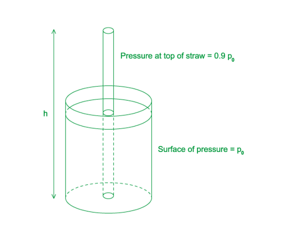
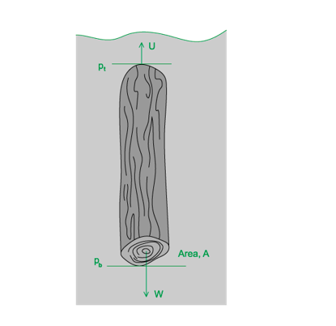
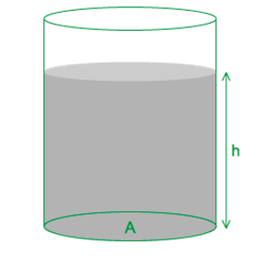
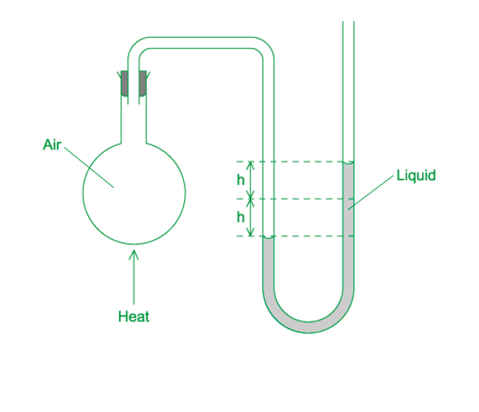
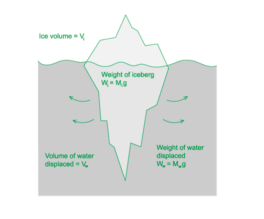

# Mark Schemes — Density & Pressure
**4. Forces, Density & Pressure** · Cambridge (CIE) A-LEVEL physics (9702)

## Multiple Choice Questions (32 questions)

### Q1
**Final answer:** **The correct answer is C **

- According to Archimedes’ principle, the buoyant force (upthrust) on an object equals the weight of the fluid it displaces

$F_{upthrust}=W_{oil}$

- The block floats, so the buoyant force equals the weight of the block

$F_{upthrust}=W_{block}$

- Therefore

$W_{oil}=W_{block}$

$m_{oil}g=m_{block}g$

- Density is equal to $\frac{\mathrm{mass}}{\mathrm{volume}}$  so mass = density × volume

$V_{oil}ρ_{oil}g=V_{block}ρ_{block}g$

$V_{oil}ρ_{oil}=V_{block}ρ_{block}$

$V_{oil}=\frac{ρ_{block}}{ρ_{oil}}V_{block}$

- Therefore, the fraction of the block submerged $\frac{V_{oil}}{V_{block}}$ is given by the ratio of densities

$\frac{V_{oil}}{V_{block}}=\frac{ρ_{block}}{ρ_{oil}}=\frac{650}{900}=0.72$

$V_{\text{oil}}=0.72V_{\text{block}}$

### Q2
**Final answer:** **The correct answer is A**

- The absolute pressure at depth consists of atmospheric pressure plus hydrostatic pressure
- Using the hydrostatic pressure equation:

$P_{total} = P_{atmospheric} + ρ g h$

- Substituting known values

$202  000 = 101  000 + ( 1025 ) ( 9 . 81 ) h$

- Rearranging

$101  000 = ( 1025 ) ( 9 . 81 ) h$

- Solving for depth

$h = \frac{101000}{1025\times9.81} = \frac{101000}{10055} = 10 . 0  \text{m}$

**B** is incorrect as 20 m would give a total pressure of approximately 303 kPa

**C** is incorrect as 30 m would give a total pressure of approximately 404 kPa

**D** is incorrect as 40 m would give a total pressure of approximately 505 kPa

### Q3
**Final answer:** **The correct answer is ****C**** because:**

- Pressure is equal to $P=\frac{F}{A}$

  - Number of particles per second $=\frac{N}{t}=5.0\times10^{4}$
  - Area $=1.0\mathrm{cm}^{2}=1\times10^{-4}m^{2}$
  - Mass of one particle $=6.6\times10^{-27}\mathrm{kg}$
  - Velocity $=1.5\times10^{7}ms^{-1}$
- Force is defined as the rate of change of momentum $F=\frac{\Deltap}{\Deltat}$
- Force exerted due to one particle $=\frac{mv}{t}$
- Total force due to N particles $= N ( \frac{m v}{t} ) = \frac{N}{t} \times m v$
- Therefore, the average pressure exerted on the lead by the α-particles is:

  - $P=\frac{F}{A}=\frac{N}{t}\times\frac{mv}{A}$
  - $P = \frac{( 5.0 \times 10^{4 ) \times ( 6.6 \times 10^{-27} } ) \times ( 1.5 \times 10^{7 )}{1 \times 10^{-4} } }$
  - $P=4.95\times10^{-11}\approx5.0\times10^{-11}\mathrm{Pa}$

### Q4
**Final answer:** **The correct answer is ****D**** because:**

- The pressure at the bottom of the bore-hole is the sum of the pressures exerted by water and oil on the bottom which is equal to 17.5 MPa
- The equation of hydrostatic pressure is $P=ρgh$
- For the column of water:

  - Depth of water, $h=2000-x$
  - Density of water, $ρ=1000\mathrm{kg}m^{-3}$
  - Acceleration due to gravity, $g=9.81ms^{-2}$
- Pressure exerted by water $= ( 2000 - x ) ( 1000 ) ( 9.81 )$
- For the column of oil:

  - Depth of oil, $h=x$
  - Density of oil, $ρ=830\mathrm{kg}m^{-3}$
  - Pressure exerted by oil $= ( 830 ) ( 9.81 ) x$
- The sum of the pressures is 17.5 MPa

  - $( 2000 - x ) ( 1000 ) ( 9.81 ) + ( 830 ) ( 9.81 ) x = 17.5 \times 10^{6}$
  - $( 2000 \times 1000 \times 9.81 ) - 17.5 \times 10^{6} = 1000 g x - 830 g x$
  - $2.12\times10^{6}=170gx$
  - $x=\frac{2.12\times10^{6}}{170\times9.81}=1271m$
- The depth of oil in the bore-hole is about 1270 m

### Q5
**Final answer:** **The correct answer is ****A**** because:**

- The equation of hydrostatic pressure is $P=ρgh$
- The pressure *P* depends only on the depth h, the density ρ of the liquid and the acceleration of free fall *g*. The volume of the container does not affect the pressure at any point
- Let the density of the liquid in vessel Q = *ρ *and the density of the liquid in vessel P = 2*ρ*
- The depth *h* of the liquids is the same
- For vessel P:

  - $P = h ( 2 \\rho ) g = 2 \\rho g h$
- For vessel Q:

  - $P=ρgh$
- Ratio: $\frac{pressureduetotheliquidonthebaseofP}{pressureduetotheliquidonthebaseofQ}=\frac{2ρgh}{ρgh}=\frac{2}{1}$

### Q6
**Final answer:** **The correct answer is ****B**** because:**

- The pressure difference can be established from the equation of hydrostatic pressure

  - $\Delta P = p g ( \Delta h )$
- Density of sea water, *ρ* = 1100 kg m–3
- Acceleration due to gravity, *g* = 9.81 m s–2
- Difference in depth, Δ*h* = 2.2 – 2.0 = 0.2 m

  - $\Delta P = p g ( \Delta h ) = 1100 \times 9.81 \times 0.2 = 2158 \text{Pa}$
- The pressure difference between the top and bottom = 2.2 × 103 Pa (2 s. f.)

### Q7
**Final answer:** **The correct answer is ****C**** because:**

- The mass of one atom of P and Q are *M**P* and *M**Q* respectively
- The number of atoms per unit volume of P and Q are *n **P* and *n **Q* respectively
- Total mass per unit volume $=Mn$
- Density $=\frac{totalmass}{volume}$

  - Density of P $=M_{P}n_{P}$
  - Density of Q $=M_{Q}n_{Q}$
- The density of P is greater than the density of Q so

  - $M_{P}n_{P}>M_{Q}n_{Q}$

**A & B **are incorrect because it cannot be said conclusively whether or not $M_{P}>M_{Q}$  or  $n_{P}>n_{Q}$  is true because all we know is that the density of P is greater than the density of Q so we cannot conclude the individual values of *M* and *n* from this information alone

**D **is incorrect because n represents the number of atoms per unit volume so  $\frac{M}{n}$   is equivalent to $mass\timesvolume$ , which is an incorrect expression for density

### Q8
**Final answer:** **The correct answer is ****A**** because:**

- The pressure difference can be established from the equation of hydrostatic pressure

  - $\Delta P = p g ( \Delta h )$
- Density of mercury, *ρ* = 13 600 kg m–3
- Acceleration due to gravity, *g* = 9.81 m s–2
- Change in pressure, Δ*P* = 100 000 Pa

  - $\Deltah=\frac{\DeltaP}{pg}=\frac{100000}{13600\times9.81}=0.75m$
- The height of the column is 0.75 m

### Q9
**Final answer:** **The correct answer is ****D**** because:**

- The equation of hydrostatic pressure is $P=ρgh$
- At the same level in the liquid mercury, the pressure on both sides of the U-tube should be the same
- Consider the pressure at the lower level indicated - where the piston is in contact with the liquid mercury
- Pressure at the left end = Pressure at the right end
- The pressure on the left is due to the weight of the piston and due to atmospheric pressure above the piston
- The pressure on the right is due to the height *h* of the column of mercury and due to the trapped air above the mercury
- The pressure of the trapped air plus the pressure of the mercury column of height *h* must equal total pressure supplied by the piston and the atmosphere
- Pressure due to piston $=\frac{\mathrm{force}}{\mathrm{area}}=\frac{\mathrm{weight}}{\mathrm{area}}=\frac{mg}{A}$
- Pressure at left end = Pressure at right end
- Pressure due to piston and atmosphere = Pressure due to mercury column and trapped air

  - $\frac{mg}{A}+P_{atm}=ρgh+P_{air}$
  - $\frac{5.0 \times 9.81}{5.0 \times 10^{- 4} } + 1.01 \times 10^{5} = ( h \times 13 600 \times 9.81 ) + 5.0 \times 10^{4}$
  - $9.81\times10^{4}+1.01\times10^{5}-5.0\times10^{4}=133416h$
  - $149100=133416h$
  - $h=\frac{149100}{133416}=1.1m$
- Therefore, the height of the mercury column is 110 cm

### Q10
**Final answer:** **The correct answer is ****D**** because:**

- The upthrust of the block is the net vertical force acting on the block
- Pressure is equal to $p=\frac{F}{A}$
- Therefore, force is equal to $F=p\timesA$  (where A is the cross-sectional area)
- Now, because the bottom of the block is deeper into the water than the top of the block, $p_{2}>p_{1}$
- So, the force due to the pressure at the bottom of the block $=p_{2}\timesA$
- And the force due to the pressure at the top of the block $=p_{1}\timesA$
- Upthrust on block $=p_{2}A-p_{1}A$

**A & B **are incorrect because  the term $Ahρg$   describes the force on the cube at a certain depth under the water, the value of this changes depending on the depth of the cube but upthrust stays the same, no matter the depth

**C **is incorrect because the term $p_{2}A$  describes the force on the bottom surface of the cube, not the upthrust as, again, the value of this changes depending on the depth due to the pressure change

### Q11
**Final answer:** **The correct answer is ****D**** because:**

- Upthrust occurs because the pressure in a fluid increases with increasing depth
- The pressure acting at the bottom of the submarine is greater than the pressure acting at the top
- Pressure is directly proportional to force, so the force on the bottom of the submarine will be greater than the force at the top of the submarine
- The resultant pressure causes a resultant upward force on the submarine; this is the upthrust

**A** is incorrect because, although the air inside the submarine is less dense than seawater, the upthrust is produced by the surrounding water, not by the air.

**B **is incorrect because the submarine is in equilibrium, so the upthrust should be equal to the weight.

**C **is incorrect because according to Archimedes’ principle, the upthrust equals the weight of water displaced and therefore depends on the volume displaced. However, this is a consequence of the pressure difference between top and bottom, not the underlying cause.

### Q12
**Final answer:** **The correct answer is ****A**** because:**

- Let the depth in the sea at which pressure is 150 kPa be height *h*
- The pressure at *h* is due to the amount of water above this point and due to the atmospheric pressure at sea level
- The equation of hydrostatic pressure is $P=ρgh$
- Pressure at depth *h* = pressure due to height *h* of water + atmospheric pressure

  - $150000=ρgh+100000$
  - $ρgh=50000$
  - $h=\frac{50000}{ρg}=\frac{50000}{1020\times9.81}=4.996=5.0m$
- The pressure is 150 kPa at 5 m below sea level

### Q13
**Final answer:** **The correct answer is ****A**** because:**

- The equation of hydrostatic pressure is $P=hρg$
- Imagine a beaker containing the liquid and a vertical straw (not inclined)
- Atmospheric pressure *p**0* acts on the surface of the liquid
- The child is capable of lowering the pressure at the top of the straw by 10%
- So, the child is drinking from the top of the straw with a pressure of $( 1 - 0.1 ) p_{0} = 0.9 p_{0}$
- As the child drinks, the liquid rises up the straw of length *h*
- The difference in pressure at the surface if the liquid in the beaker *p**0* and the pressure at the top of the straw 0.9*p**0* is equal to the pressure due to the column of liquid in the straw (from the equation of hydrostatic pressure)

  - $p_{0}-0.9p_{0}=hρg$
  - $hρg=0.1p_{0}=\frac{p_{0}}{10}$
  - $h=\frac{p_{0}}{10ρg}$
- The length of the straw is equal to $h=\frac{p_{0}}{10ρg}$

### Q14
**Final answer:** **The correct answer is ****D**** because:**

- The pressure difference can be established from the equation of hydrostatic pressure

  - $\Delta P = p g ( \Delta h )$
- Density of sea water, *ρ* = 1020 kg m–3
- Acceleration due to gravity, *g* = 9.81 m s–2
- Depth, Δ*h* = 10 000 m

  - $\Delta P = p g ( \Delta h ) = 1020 \times 9.81 \times 10 000 = 1.0 \times 10^{8} \text{Pa}$
- The approximate pressure at a depth of 10 km is ~108 Pa

### Q15
**Final answer:** **The correct answer is ****C**** because:**

- The density of an object in a liquid can be determined from the equation of hydrostatic pressure

  - $P=ρgh$
- Pressure, *P* = 15 200 Pa
- Acceleration due to gravity, *g* = 9.81 m s–2
- Height of object, *h* = 80 cm = 0.8 m

  - $ρ=\frac{P}{gh}=\frac{15200}{9.81\times0.8}=1937\mathrm{kg}m^{-3}$
- The density of the metal is 1900 kg m–3 (2 s. f.)

### Q16
**Final answer:** **The correct answer is ****D**** because:**

- When the water and the glycerin are added together, the density of the mixture is obtained using $\frac{\mathrm{total} \mathrm{mass}}{\mathrm{total} \mathrm{volume}}$
- For water:

  - Density of water, $ρ_{w}=1.0g\mathrm{cm}^{-3}$
  - Mass of water $=m_{w}$
  - Volume of water $=V_{w}$
- For glycerine:

  - Density of glycerine, $ρ_{g}=1.3g\mathrm{cm}^{-3}$
  - Mass of glycerine $=m_{g}$
  - Volume of glycerine, $V_{g}=40\mathrm{cm}^{3}$
- The mass of the glycerine can be found using

  - Mass, $m_{g}=ρ_{g}\timesV_{g}=1.3\times40=52g$
- Consider the mixture:

  - Density of mixture, $ρ=1.1g\mathrm{cm}^{-3}$
  - Total mass of mixture $=m_{w}+m_{g}=m_{w}+52$
- The mixing process does not change the total volume of the liquid

  - Total volume of mixture$=V_{w}+40$
- Density of mixture $=\frac{\mathrm{total} \mathrm{mass}}{\mathrm{total} \mathrm{volume}}$

  - $1.1 = \frac{( m_{w} + 52 )}{( V_{w} + 40 )}$
  - $V_{w} + 40 = \frac{( m_{w} + 52 )}{1.1}$                                  **(1)**
- Consider the density of water

  - $m_{w}=ρ_{w}\timesV_{w}=1.0V_{w}=V_{w}$                    **(2)**
- Replace *m**w* by *V **w* in equation **(1)**

  - $V_{w} + 40 = \frac{( V_{w} + 52 )}{1.1}$
  - $V_{w}=\frac{V_{w}}{1.1}+\frac{52}{1.1}-40$
  - $V_{w}-\frac{V_{w}}{1.1}=\frac{52}{1.1}-40$
  - $V_{w} ( 1 - \frac{1}{1.1} ) = \frac{80}{11}$
  - $V_{w}=80\mathrm{cm}^{3}$

### Q17
**Final answer:** **The correct answer is ****B**** because:**

- Density of full-fat milk $=\frac{\mathrm{total} \mathrm{mass}}{\mathrm{total} \mathrm{volume}}$
- Total mass = mass of fat + mass of fat-free milk
- Total volume = volume of fat + volume of fat-free milk
- Consider the full-fat milk

  - Mass of full-fat milk $=1.035\mathrm{kg}$
  - Volume of full-fat milk $=1.000\times10^{-3}m^{3}$
  - Density of full-fat milk $=\frac{\mathrm{mass}}{\mathrm{volume}}=\frac{1.035}{1.000\times10^{-3}}=1035\mathrm{kg}m^{-3}$
- The full-fat milk contains 4.00% fat by volume

  - Volume of fat $=0.04\times1.000\times10^{-3}=4.0\times10^{-5}m^{3}$
- Therefore, the fat-free milk makes up the remaining 96% of the volume

  - Volume of fat-free milk $=0.96\times1.000\times10^{-3}=9.6\times10^{-4}m^{3}$
- Given that the density of fat-free milk $=1.040\times10^{3}\mathrm{kg}m^{-3}$

  - Mass of fat-free milk $=\mathrm{density}\times\mathrm{volume}$
  - Mass of fat-free milk $= ( 1.040 \times 10^{3} ) \times ( 9.6 \times 10^{- 4} ) = 0.9984 \text{kg}$
- Total mass = mass of fat + mass of fat-free milk
- Mass of fat $=1.035-0.9984=0.0366\mathrm{kg}$

  - Density of fat $=\frac{\mathrm{mass}}{\mathrm{volume}}=\frac{0.0366}{4.0\times10^{-5}}=915\mathrm{kg}m^{-3}$
- The density of fat is therefore equal to 9.15 × 102 kg m–3

The question indicates that up to four significant figures should be considered as quantities such as volume are given as 1.000 × 10–3 rather than 1.0 × 10–3, not doing so could affect the final answer you obtain.

### Q18
**Final answer:** **The correct answer is ****D**** because:**

- The equation of hydrostatic pressure is $P=ρgh$
- Let the pressure at P = *p*
- Let’s consider the two sides separately
- On the left section:

  - $16000-p=h_{1}ρg$            **(1)**
- On the right section:

  - $8000-p=h_{2}ρg$              **(2)**
- If we take equation **(2)** from equation **(1)**

  - $16 000 - 8000 = ( h_{1} - h_{2} ) \\rho g$
  - $h_{1}-h_{2}=\frac{8000}{ρg}=\frac{8000}{13600\times9.81}=0.06m$
- The difference between heights and  is 0.06 m or 6 cm. The only set of values which matches this difference is choice D where $h_{1}=18.0\mathrm{cm}$  and $h_{2}=12.0\mathrm{cm}$

### Q19
**Final answer:** **The correct answer is ****C**** because:**

- The upthrust of the block is the net vertical force acting on the block
- Pressure is equal to $p=\frac{F}{A}$
- Therefore, force is equal to $F=p\timesA$ (where A is the cross-sectional area)
- Now, because the bottom of the block is deeper into the water than the top of the block, $p_{b}>p_{t}$
- So, the force due to the pressure at the bottom of the block $=p_{b}\timesA$
- And the force due to the pressure at the top of the block$=p_{t}\timesA$
- Upthrust on block $= p_{b} A - p_{t} A = ( p_{b} - p_{t} ) A$

**A & D **are incorrect because these expressions correctly (D) and incorrectly (A) describe the resultant force on the wooden cylinder

**B **is incorrect because this expression describes the difference in pressure between the top and the bottom of the wooden cylinder

### Q20
**Final answer:** **The correct answer is ****A**** because:**

- If you run through the beginning steps of the derivation, you will remember the two equations you start with are

  - $W=mg$
  - $ρ=\frac{m}{V}$
- In an MCQ you would not be required to carry out a derivation, but you will need to know it for the written paper. The full derivation is as follows:

Consider a column of water which occupies a total volume *V*, has a height *h*, and a base surface area of *A*. The weight of all the water is :

$W=mg$

The water has a density which is equal to $ρ=\frac{m}{V}$   and therefore $m=ρV$  , hence combining these two equations gives:

$W=ρVg$

For a cylinder, the volume is a product of its base surface area and height:

$W=ρAhg$

The water has a pressure which is equal to $P=\frac{F}{A}$   and therefore $F=W=PA$ , hence combining these two equations gives:

$P=\frac{ρAhg}{A}=pgh$

### Q21
**Final answer:** **The correct answer is ****A**** because:**

- The depth of an object in a liquid can be established from the equation of hydrostatic pressure

  - $P=pgh$
- Pressure is related to force by the equation $P=\frac{F}{A}$

  - $P=pgh=\frac{F}{A}$
  - $h=\frac{F}{pgA}$
- Density of liquid, *ρ* = 930 kg m–3
- Acceleration due to gravity, *g* = 9.81 m s–2
- Force on plate, *F* = 290 N
- Area of plate, *A* = 0.036 m2

  - $h=\frac{F}{pgA}=\frac{290}{930\times9.81\times0.036}=0.88m$
- The depth of the plate beneath the surface of the liquid is 0.88 m

### Q22
**Final answer:** **The correct answer is ****B**** because:**

- The equation of hydrostatic pressure is $P=hρg$
- For liquid R:

  - Pressure, $P_{R}=hρ_{R}g=xρ_{R}g=4$
  - Density, $ρ_{R}=\frac{4}{xg}$                    **(1)**
- For liquid Q:

  - Density, $ρ_{Q}=2ρ_{R}$
  - Pressure, $P_{Q} = h \rho_{Q} g = h ( 2 \rho_{R} ) g = 7$
- So, depth in liquid Q:

  - $h=\frac{7}{2ρ_{R}g}$                                **(2)**
- Substituting equation **(1)** into **(2)**:

  - $h = \frac{7}{2 g ( \frac{4}{x g} )} = \frac{7}{2} ( \frac{4}{x} )^{- 1} = \frac{7 x}{8}$

**Exam Tip:** in questions such as these, identify the link between the two quantities in order to equate them. For example, in this question, *ρ* is the quantity that links R and Q, so identifying *ρ* in terms of the other known variables is a crucial step

### Q23
**Final answer:** **The correct answer is ****A**** because:**

- Even though the cuboids have different densities, the question states that they are all **held** at the same depth
- Upthrust depends on fluid density and the displaced volume of fluid, not on the object’s density
- Since the water density and the cuboid volume are the same for W, X, Y and Z, the upthrust on each is identical, regardless of density

**B** & **C** are incorrect as upthrust is the same for a given depth and object volume. The difference in density of each cuboid means they have different weights, so if the rods were removed, differences in their motion would be due to differences in weight, not upthrust.

**D **is incorrect because upthrust will always act on a body submerged in a liquid, this is due to the pressure exerted by the water molecules, so the upthrust on the cuboid cannot be zero while it is submerged.

### Q24
**Final answer:** **The correct answer is ****B**** because:**

- Atmospheric pressure *P**A* = column of mercury of height 760mm
- Compare the left part with the middle (left) part
- Since the position of the mercury column is lower in the middle, the pressure P is greater than the atmospheric pressure acting at the left ‘open’ tube

  - $P-P_{A}=x$
  - $P-760=x$             **(1)**
- Now, compare the right part of the diagram with the middle (right) part

  - $P-P_{A}=50-y$
  - $P-760=50-y$
  - $P+y=810$          **(2)**
- The values from the table should satisfy both equation **(1)** and **(2)**
- Consider option B:

  - *x* = 20, *P* = 780
- Equation **(1)**: $780-760=20$

  - *y* = 30, *P* = 780
- Equation **(2)**: $780+30=810$
- These values satisfy equations **(1)** and **(2)** so option B is correct** **

| **A **is incorrect because | *x* = 20, *P* = 780 Equation **(1)**:  $780-760=20$ ✓  *y* = 20, *P* = 780 Equation **(2)**: $780+20=810$  ⨉ |
|---|---|
| **C **is incorrect because | *x* = 30, *P* = 810 Equation **(1)**: $810-760=30$ ⨉  *y* = 20, *P* = 810 Equation **(2)**: $810+20=810$ ⨉ |
| **D **is incorrect because | *x* = 30, *P* = 790 Equation **(1)**: $790-760=30$ ✓  *y* = 30, *P* = 790 Equation **(2)**: $790+30=810$ ⨉ |

### Q25
**Final answer:** **The correct answer is ****A**** because:**

- Let’s consider the horizontal forces *Q* and *S* initially
- These forces act at the same depth
- Pressure stays the same at the same depth so the magnitude of *Q *and *S* will be the same i.e.

  - *S = Q*
- To determine the relationship between forces *P* and *R* we must look at the equation

  - $P=pgh$
- We can deduce as the depth *h* increases, the pressure *P* increases too
- Therefore, the pressure at the bottom of the sphere is greater than the pressure at the top of the sphere
- Pressure is directly proportional to force so the force on the bottom of the sphere (*R*) will be greater than the force at the top of the sphere (*P*) i.e.

  - *P < R*

**B **is incorrect because this implies the pressure is greater nearer the surface of the water which is not correct

**C & D **are incorrect because these imply there is no difference in pressure at different depth in the water which is also not correct

### Q26
**Final answer:** **The correct answer is ****C**** because:**

- The pressure on the plug can be established from the equation of hydrostatic pressure

  - $\Delta P = p g ( \Delta h )$
- Density of water, *ρ* = 1000 kg m–3
- Acceleration due to gravity, *g* = 9.81 m s–2
- Depth of plug, Δ*h* = 30 cm = 0.3 m

  - $\Delta P = p g ( \Delta h ) = 1000 \times 9.81 \times 0.3 = 2943 \text{Pa}$
- The pressure acting on the plug = 2.9 kPa (2 s. f.)

### Q27
**Final answer:** **The correct answer is ****D**** because:**

- The equation of hydrostatic pressure is $\Delta P = ( \Delta h ) \\rho g$
- The heating causes the liquid in the right-hand side to rise a distance *h* from its original position
- But this also causes the liquid in the left-hand side to sink by a distance *h* from its original position
- So, the difference in height of the liquid is $\Deltah=h+h=2h$
- Therefore, the increase in pressure is

  - $\Delta P = ( \Delta h ) \\rho g = 2 h \\rho g$

### Q28
**Final answer:** **The correct answer is ****C**** because:**

- The physical reason for this upthrust is due to the difference in pressures at the top and the bottom of the object
- If we look at the equation

  - $P=ρgh$
- We can deduce if the depth *h* increases, the pressure *P* increases too
- Therefore, the pressure at the bottom of the object is greater than the pressure at the top of the object
- The pressure acts on the surface area on the bottom of the object is the upthrust
- Upthrust is a force and this is directly related to pressure by the equation

  - $P=\frac{F}{A}$
- Therefore, the larger the pressure, the larger the force (upthrust) that is exerted on the object

**A **is incorrect because while this could be true, this is not the physical reason for the upthrust

**B & D **are incorrect because the density *ρ* of a liquid remains constant, as does the value of *g* on the Earth’s surface** **

### Q29
**Final answer:** **The correct answer is ****A**** because:**

- At terminal speed, the resultant force on the ball is zero. As weight is the only downward force, it must be the largest of the three
- The upthrust is a result of the force due to the difference in pressure at the top and bottom of the ball

  - Pressure, $P=ρgh$
  - Force, $F=PA$
- Air is not very dense (low *ρ*) and the difference in height *h* from the top of the ball to its bottom is also very small. Thus, the upthrust force is small
- Viscous drag (or air resistance), on the other hand, will almost be as large as the weight when a body is travelling at terminal velocity
- So, from smallest to largest force: upthrust → viscous drag → weight

It is a common misconception that the Archimedean upthrust on a body in air is quite large, however, this is incorrect, and it is the opposite which is true. The upthrust will only be about a thousandth or less than the weight of the solid

### Q30
**Final answer:** **The correct answer is ****D**** because:**

- Density of mixture $=\frac{totalmass}{totalvolume}$
- Total volume = 2.0 m3
- For water:

  - Density, $ρ=1000\mathrm{kg}m^{-3}$
  - Volume, $V=1.5m^{3}$
  - Mass, $m=ρV=1000\times1.5=1500\mathrm{kg}$
- For alcohol:

  - Density, $ρ=800\mathrm{kg}m^{-3}$
  - Volume, $V=0.5m^{3}$
  - Mass, $m=ρV=800\times0.5=400\mathrm{kg}$
- Total mass $=1500+400=1900\mathrm{kg}$
- Density of mixture $=\frac{totalmass}{totalvolume}=\frac{1900}{2}=950\mathrm{kg}m^{-3}$
- The density of the mixture is 950 kg m–3

### Q31
**Final answer:** **The correct answer is ****C**** because:**

- According to Archimedes’ principle, the buoyant force on an object equals the weight of the fluid it displaces
- The iceberg has weight $W_{i}=M_{i}g$  and the buoyant force is equal to the weight of the displaced water, $W_{w}=M_{w}g$
- Furthermore, since the iceberg is floating, its weight exactly balances the buoyant force:

  - $W_{w}=W_{i}$
  - $M_{w}g=M_{i}g$
- Density is equal to $\frac{mass}{volume}$  so mass = density × volume

  - $V_{w}ρ_{w}g=V_{i}ρ_{i}g$
  - $V_{w}=\frac{ρ_{i}}{ρ_{w}}V_{i}$
- So, the fraction of ice underwater $\frac{V_{w}}{v_{i}}$   is given by the ratio of densities

  - $\frac{V_{w}}{V_{i}}=\frac{ρ_{i}}{ρ_{w}}=\frac{917}{1020}=0.899$
  - $V_{w}=0.90V_{i}$

Therefore, 90% of an iceberg's volume (and mass) is submerged underwater

### Q32
**Final answer:** **The correct answer is ****C**** because:**

- The equation of hydrostatic pressure is $P=ρgh$
- Pressure of liquid 1, *P**1*:

  - Pressure, $P_{1}=p$
  - Depth of water, $h=20\mathrm{cm}=0.2m$
  - Density of water, $ρ=1800\mathrm{kg}m^{-3}$
  - Acceleration due to gravity, $g=9.81ms^{-2}$
- $P_{1}=ρgh_{1}=1800\times9.81\times0.2$
- Pressure of liquid 2, *P**2*:

  - Depth of water, $h=60\mathrm{cm}=0.6m$
  - Density of water, $ρ=1200\mathrm{kg}m^{-3}$
- $P_{2}=ρ_{2}gh_{2}=1200\times9.81\times0.6$
- $\frac{P_{1}}{P_{2}}=\frac{ρ_{1}gh_{1}}{ρ_{2}gh_{2}}=\frac{1800\times9.81\times0.2}{1200\times9.81\times0.6}=\frac{360}{720}=\frac{1}{2}$
- $\frac{p}{P_{2}}=\frac{1}{2}$
- $P_{2}=2p$
- The pressure of liquid 2 at 60 cm is two times larger than the pressure of liquid 1 at 20 cm
