# Exam Questions — Density & Pressure
**4. Forces, Density & Pressure** · Cambridge (CIE) A-LEVEL physics (9702)
> Source: [https://www.savemyexams.com/a-level/physics/cie/25/topic-questions/](https://www.savemyexams.com/a-level/physics/cie/25/topic-questions/) · 32 questions across 1 sets

## Multiple Choice Questions (32 questions)

### Q1 — hard — 1 marks

**Q1** [1 mark]

A wooden block is floating in a tank of oil. The density of the wood is $650  \text{kg}  \text{m}^{-3}$ and the density of the oil is $900  \text{kg}  \text{m}^{-3}$.

What volume of the wooden block is submerged in the oil?

### Q2 — medium — 1 marks

**Q2** [1 mark]

A submarine is designed to operate at various depths in the ocean.

The atmospheric pressure at the ocean surface is 101 kPa.

The density of ocean water is 1025 kg m-3.

At what depth would the absolute pressure on the submarine's hull be 202 kPa?

### Q3 — medium — 1 marks

**Q3** [1 mark]

A beam of α-particles collides with a lead sheet. Each α-particle in the beam has a mass of 6.6 × 10–27 kg and a speed of 1.5 × 107 m s–1

5.0 × 104 α-particles per second collide with an area of 1.0 cm2 of lead. Almost all of the α-particles are absorbed by the lead so that they have zero speed after collision.

What is an estimate of the average pressure exerted on the lead by the α-particles?

### Q4 — medium — 1 marks

**Q4** [1 mark]

A bore-hole of depth 2000 m contains both oil and water as shown. The pressure due to the liquids at the bottom of the bore-hole is 17.5 MPa. The density of the oil is 830 kg m–3 and the density of the water is 1000 kg m–3

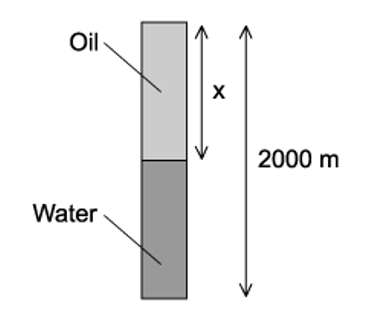

What is the depth *x* of the oil ?

### Q5 — medium — 1 marks

**Q5** [1 mark]

The diagram shows two vessels, P and Q, both with sides inclined at 45°

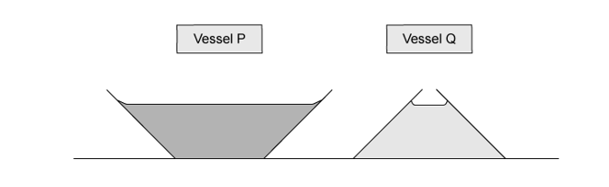

Vessel P tapers outwards and vessel Q tapers inwards, as shown.

Both vessels contain a liquid. The depth of the liquid in the vessels is the same. The liquid in vessel P is twice as dense as the liquid in vessel Q.

What is the ratio $\frac{pressureduetotheliquidonthebaseofP}{pressureduetotheliquidonthebaseofQ}$  ?

### Q6 — easy — 1 marks

**Q6** [1 mark]

The diagram shows a rectangular block of mass 8.2 kg immersed in sea water of density 1.10 × 103 kg m–3

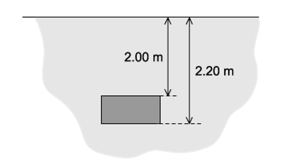

What is the difference in pressure between the top and bottom surfaces of the block?

### Q7 — hard — 1 marks

**Q7** [1 mark]

Two solid substances P and Q have atoms of mass *M**P* and *M**Q* respectively. They have *n **P* and *n **Q* atoms per unit volume.

The density of P is greater than the density of Q.

Which expression **must** be correct ?

### Q8 — easy — 1 marks

**Q8** [1 mark]

The density of mercury is 13.6 × 103 kg m–3

The pressure difference between the bottom and the top of a column of mercury is 100 kPa.

What is the height of the column?

### Q9 — medium — 1 marks

**Q9** [1 mark]

A U-tube closed at one end contains mercury. Air at a pressure of 5.0 × 104 Pa is trapped at the closed end. The other end is open to the atmosphere and is fitted with a piston of mass 5.0 kg and cross-sectional area 5.0 × 10–4 m2

The density of mercury is 13 600 kg m–3 and atmospheric pressure is 1.01 × 105 Pa

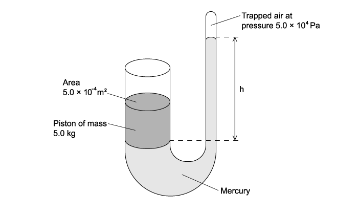

What is the height of the mercury column?

### Q10 — hard — 1 marks

**Q10** [1 mark]

The diagram shows a metal cube of density *ρ* suspended from a spring balance before and during immersion in water. Each face of the cube has a surface area *A* and each edge has length *h*.

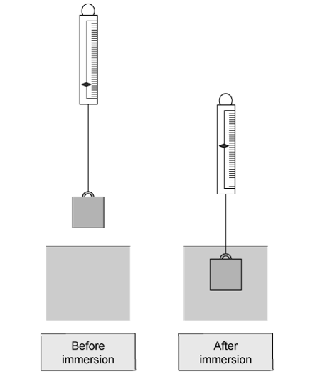

A reduction in the balance reading occurs as a consequence of the immersion. The cube experiences pressures *p**1* and *p**2* at its top and bottom surfaces respectively.

What is the value of the upthrust on the metal cube during immersion ?

### Q11 — easy — 1 marks

**Q11** [1 mark]

A submarine is in equilibrium in a fully submerged position.

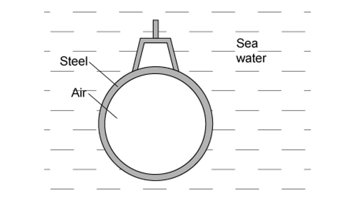

What causes the upthrust on the submarine?

### Q12 — medium — 1 marks

**Q12** [1 mark]

Atmospheric pressure at sea level has a value of 100 kPa.

The density of sea water is 1020 kg m–3

At which depth in the sea would the total pressure be 150 kPa ?

### Q13 — hard — 1 marks

**Q13** [1 mark]

A child drinks a liquid of density *ρ* through a vertical straw.

Atmospheric pressure is *p**0* and the child is capable of lowering the pressure at the top of the straw by 10%. The acceleration of free fall is *g*.

What is the maximum length of straw that would enable the child to drink the liquid?

### Q14 — easy — 1 marks

**Q14** [1 mark]

The Mariana Trench in the Pacific Ocean has a depth of about 10 km.

Assuming that sea water is incompressible and has a density of about 1020 kg m–3, what would be the approximate pressure at that depth ?

### Q15 — easy — 1 marks

**Q15** [1 mark]

A rectangular metal bar exerts a pressure of 15 200 Pa on the horizontal surface on which it rests.

If the height of the metal bar is 80 cm, what is the density of the metal ?

### Q16 — hard — 1 marks

**Q16** [1 mark]

The density of water is 1.0 g cm–3 and the density of glycerine is 1.3 g cm–3

Water is added to a measuring cylinder containing 40 cm3 of glycerine so that the density of the mixture is 1.1 g cm–3. Assume that the mixing process does not change the total volume of the liquid

What is the volume of water added ?

### Q17 — hard — 1 marks

**Q17** [1 mark]

Full-fat milk is made up of fat-free milk mixed with fat.

A volume of 1.000 × 10–3 m3 of full-fat milk has a mass of 1.035 kg. It contains 4.00% fat by volume.

The density of fat-free milk is 1.040 × 103 kg m–3

What is the density of fat ?

### Q18 — medium — 1 marks

**Q18** [1 mark]

Two bulbs X and Y containing air at different pressures are connected by a tube P which contains two mercury threads.

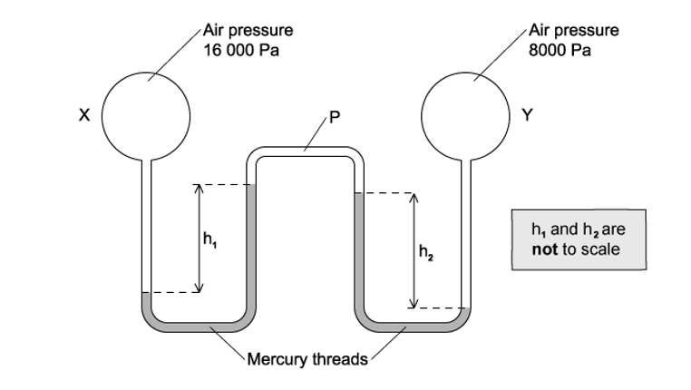

The density of mercury is 13 600 kg m–3

Which pair of values of *h**1* and *h**2* is possible?

|   | ***h******1****** *****/ cm** | ***h******2****** *****/ cm** |
|---|---|---|
| **A**  **B**  **C**  **D** | 4.0  6.0  12.0  18.0 | 2.0  6.0  18.0  12.0 |

### Q19 — hard — 1 marks

**Q19** [1 mark]

A cylindrical block of wood has cross-sectional area *A* and weight *W*. It is totally immersed in water with its axis vertical. The block experiences pressures *p**t* and *p**b* at its top and bottom surfaces respectively.

Which expression is equal to the upthrust on the block ?

### Q20 — easy — 1 marks

**Q20** [1 mark]

The formula for hydrostatic pressure is $P=pgh$

Which equation, or principle of physics, is used in the derivation of this formula?

### Q21 — easy — 1 marks

**Q21** [1 mark]

A horizontal plate of area 0.036 m2 is beneath the surface of a liquid of density

930 kg m–3. The force on the plate due to the pressure of the liquid is 290 N.

What is the depth of the plate beneath the surface of the liquid?

### Q22 — hard — 1 marks

**Q22** [1 mark]

Liquid Q has twice the density of liquid R.

At depth *x* in liquid R, the pressure due to the liquid is 4 kPa.

At what depth in liquid Q is the pressure due to the liquid 7 kPa ?

### Q23 — medium — 1 marks

**Q23** [1 mark]

Four cuboids with identical length, breadth and height are immersed in water. The cuboids are held at the same depth and in identical orientations by vertical rods, as shown.

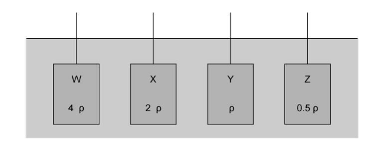

Water has density *ρ*

Cuboid W is made of material of density 4*ρ*

Cuboid X is made of material of density 2*ρ*

Cuboid Y is made of material of density *ρ*

Cuboid Z is made of material of density ½ *ρ*

Which statement is correct?

### Q24 — hard — 1 marks

**Q24** [1 mark]

A W-shaped tube contains two amounts of mercury, each open to the atmosphere. Air at pressure *P* is trapped in between them. The diagram shows two vertical distances *x* and *y*.

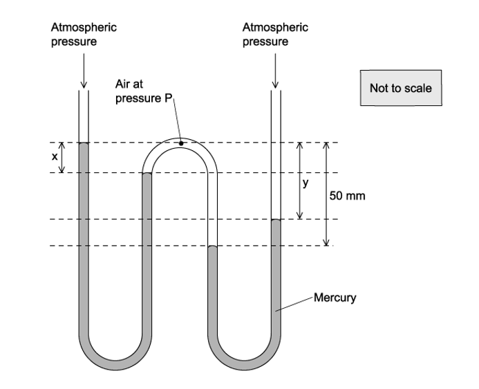

Atmospheric pressure is equal to the pressure that would be exerted by a column of mercury of height 760 mm. The pressure *P* is expressed in this way.

Which values of *x*, *y* and *P* are possible  ?

|   | ***x***** / mm** | ***y***** / mm** | ***P***** / mm of**  **Mercury** |
|---|---|---|---|
| **A**  **B**  **C**  **D** | 20  20  30  30 | 20  30  20  30 | 780  780  810  790 |

### Q25 — easy — 1 marks

**Q25** [1 mark]

The diagram represents a sphere under water. *P*, *Q*, *R* and *S* are forces acting on the sphere, due to the pressure of the water.

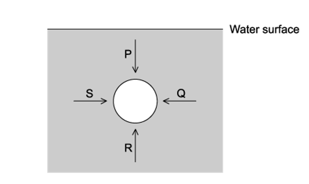

Each force acts perpendicularly to the sphere’s surface. *P* and *R* act in opposite directions vertically. *Q* and *S* act in opposite directions horizontally.

Which information about the magnitudes of the forces is correct ?

### Q26 — easy — 1 marks

**Q26** [1 mark]

Water in a bath varies in depth from 20.0 cm at the shallow end to 30.0 cm at the end with the plug.

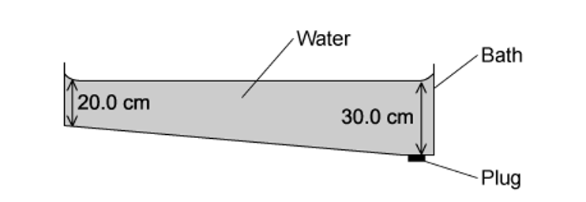

The density of the water is 1000 kg m–3

What is the pressure of the water acting on the plug ?

### Q27 — hard — 1 marks

**Q27** [1 mark]

The diagram shows a flask connected to a U-tube containing liquid. The flask contains air at atmospheric pressure.

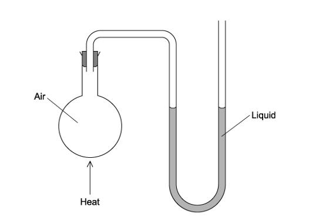

The flask is now gently heated and the liquid level in the right-hand side of the U-tube rises through a distance *h*. The density of the liquid is *ρ*.

What is the increase in pressure of the heated air in the flask ?

### Q28 — easy — 1 marks

**Q28** [1 mark]

An object, immersed in a liquid in a tank, experiences an upthrust.

What is the physical reason for this upthrust?

### Q29 — medium — 1 marks

**Q29** [1 mark]

A ball is falling at terminal speed in still air. The forces acting on the ball are upthrust, viscous drag and weight.

What is the order of increasing magnitude of these three forces?

### Q30 — medium — 1 marks

**Q30** [1 mark]

1.5 m3 of water is mixed with 0.50 m3 of alcohol. The density of water is 1000 kg m–3 and the density of alcohol is 800 kg m–3

What is the density of the mixture with volume 2.0 m3 ?

### Q31 — hard — 1 marks

**Q31** [1 mark]

Icebergs typically float with a large volume of ice beneath the water. Ice has a density of 917 kg m–3 and a volume

The density of seawater is 1020 kg m−3

What fraction of the ice is submerged underwater ?

### Q32 — medium — 1 marks

**Q32** [1 mark]

At a depth of 20 cm in a liquid of density 1800 kg m–3, the pressure due to the liquid is *p*.

Another liquid has a density of 1200 kg m–3

What is the pressure due to this liquid at a depth of 60 cm ?
