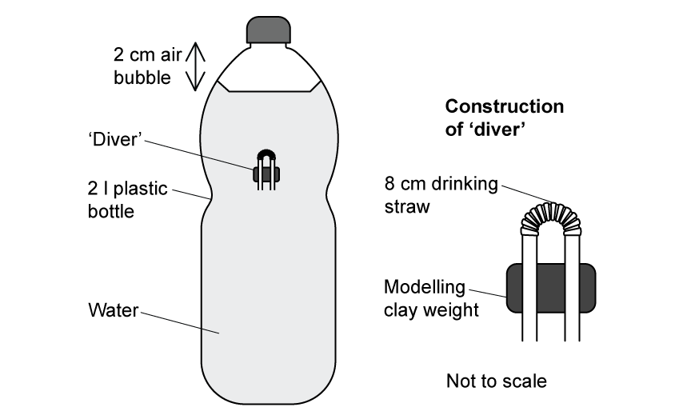
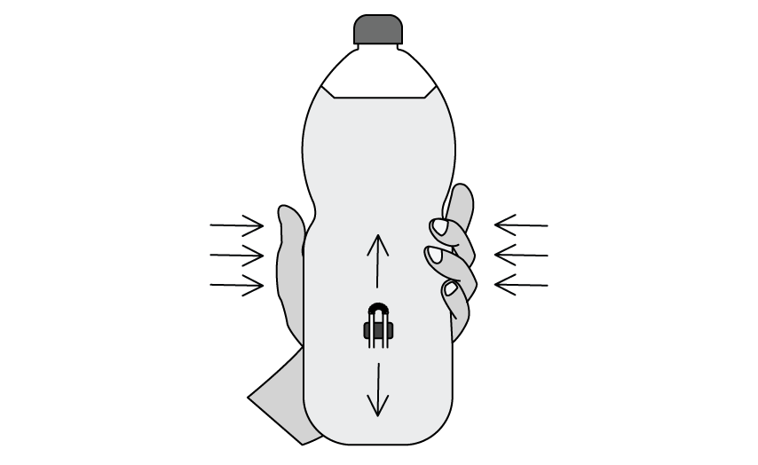
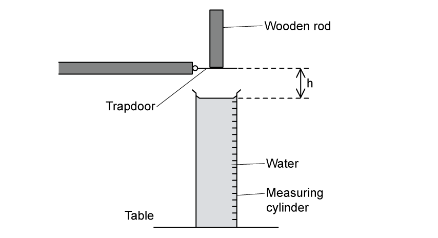
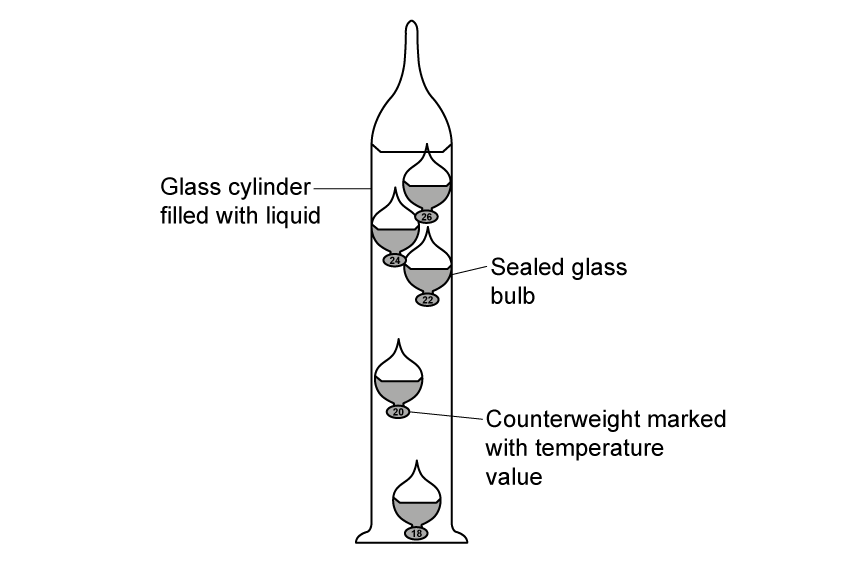
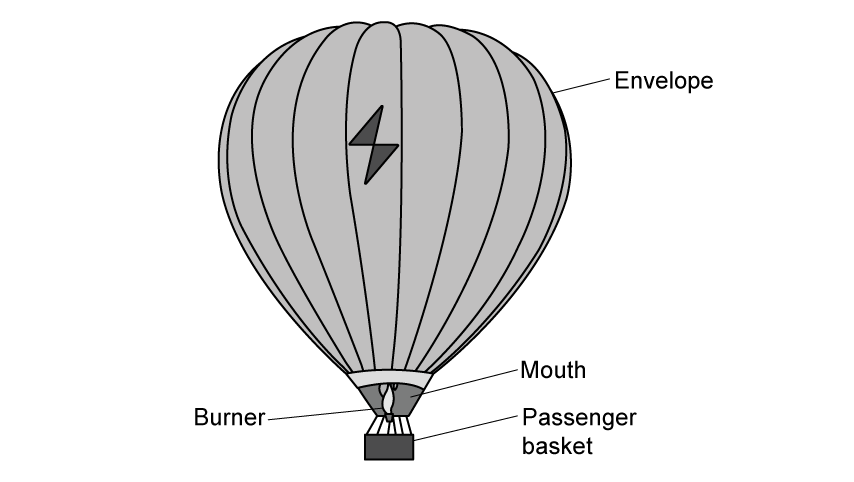
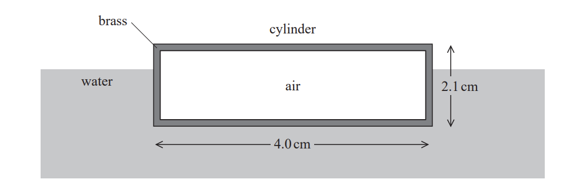

# Exam Questions — Density & Pressure
**4. Forces, Density & Pressure** · Cambridge (CIE) A-LEVEL physics (9702)
> Source: [https://www.savemyexams.com/a-level/physics/cie/25/topic-questions/](https://www.savemyexams.com/a-level/physics/cie/25/topic-questions/) · 43 questions across 2 sets

## Multiple Choice Questions (32 questions)

### Q1 — hard — 1 marks

**Q1** [1 mark]

A wooden block is floating in a tank of oil. The density of the wood is $650  \text{kg}  \text{m}^{-3}$ and the density of the oil is $900  \text{kg}  \text{m}^{-3}$.

What volume of the wooden block is submerged in the oil?

### Q2 — medium — 1 marks

**Q2** [1 mark]

A submarine is designed to operate at various depths in the ocean.

The atmospheric pressure at the ocean surface is 101 kPa.

The density of ocean water is 1025 kg m-3.

At what depth would the absolute pressure on the submarine's hull be 202 kPa?

### Q3 — medium — 1 marks

**Q3** [1 mark]

A beam of α-particles collides with a lead sheet. Each α-particle in the beam has a mass of 6.6 × 10–27 kg and a speed of 1.5 × 107 m s–1

5.0 × 104 α-particles per second collide with an area of 1.0 cm2 of lead. Almost all of the α-particles are absorbed by the lead so that they have zero speed after collision.

What is an estimate of the average pressure exerted on the lead by the α-particles?

### Q4 — medium — 1 marks

**Q4** [1 mark]

A bore-hole of depth 2000 m contains both oil and water as shown. The pressure due to the liquids at the bottom of the bore-hole is 17.5 MPa. The density of the oil is 830 kg m–3 and the density of the water is 1000 kg m–3

What is the depth *x* of the oil ?

### Q5 — medium — 1 marks

**Q5** [1 mark]

The diagram shows two vessels, P and Q, both with sides inclined at 45°

Vessel P tapers outwards and vessel Q tapers inwards, as shown.

Both vessels contain a liquid. The depth of the liquid in the vessels is the same. The liquid in vessel P is twice as dense as the liquid in vessel Q.

What is the ratio $\frac{pressureduetotheliquidonthebaseofP}{pressureduetotheliquidonthebaseofQ}$  ?

### Q6 — easy — 1 marks

**Q6** [1 mark]

The diagram shows a rectangular block of mass 8.2 kg immersed in sea water of density 1.10 × 103 kg m–3

What is the difference in pressure between the top and bottom surfaces of the block?

### Q7 — hard — 1 marks

**Q7** [1 mark]

Two solid substances P and Q have atoms of mass *M**P* and *M**Q* respectively. They have *n **P* and *n **Q* atoms per unit volume.

The density of P is greater than the density of Q.

Which expression **must** be correct ?

### Q8 — easy — 1 marks

**Q8** [1 mark]

The density of mercury is 13.6 × 103 kg m–3

The pressure difference between the bottom and the top of a column of mercury is 100 kPa.

What is the height of the column?

### Q9 — medium — 1 marks

**Q9** [1 mark]

A U-tube closed at one end contains mercury. Air at a pressure of 5.0 × 104 Pa is trapped at the closed end. The other end is open to the atmosphere and is fitted with a piston of mass 5.0 kg and cross-sectional area 5.0 × 10–4 m2

The density of mercury is 13 600 kg m–3 and atmospheric pressure is 1.01 × 105 Pa

What is the height of the mercury column?

### Q10 — hard — 1 marks

**Q10** [1 mark]

The diagram shows a metal cube of density *ρ* suspended from a spring balance before and during immersion in water. Each face of the cube has a surface area *A* and each edge has length *h*.

A reduction in the balance reading occurs as a consequence of the immersion. The cube experiences pressures *p**1* and *p**2* at its top and bottom surfaces respectively.

What is the value of the upthrust on the metal cube during immersion ?

### Q11 — easy — 1 marks

**Q11** [1 mark]

A submarine is in equilibrium in a fully submerged position.

What causes the upthrust on the submarine?

### Q12 — medium — 1 marks

**Q12** [1 mark]

Atmospheric pressure at sea level has a value of 100 kPa.

The density of sea water is 1020 kg m–3

At which depth in the sea would the total pressure be 150 kPa ?

### Q13 — hard — 1 marks

**Q13** [1 mark]

A child drinks a liquid of density *ρ* through a vertical straw.

Atmospheric pressure is *p**0* and the child is capable of lowering the pressure at the top of the straw by 10%. The acceleration of free fall is *g*.

What is the maximum length of straw that would enable the child to drink the liquid?

### Q14 — easy — 1 marks

**Q14** [1 mark]

The Mariana Trench in the Pacific Ocean has a depth of about 10 km.

Assuming that sea water is incompressible and has a density of about 1020 kg m–3, what would be the approximate pressure at that depth ?

### Q15 — easy — 1 marks

**Q15** [1 mark]

A rectangular metal bar exerts a pressure of 15 200 Pa on the horizontal surface on which it rests.

If the height of the metal bar is 80 cm, what is the density of the metal ?

### Q16 — hard — 1 marks

**Q16** [1 mark]

The density of water is 1.0 g cm–3 and the density of glycerine is 1.3 g cm–3

Water is added to a measuring cylinder containing 40 cm3 of glycerine so that the density of the mixture is 1.1 g cm–3. Assume that the mixing process does not change the total volume of the liquid

What is the volume of water added ?

### Q17 — hard — 1 marks

**Q17** [1 mark]

Full-fat milk is made up of fat-free milk mixed with fat.

A volume of 1.000 × 10–3 m3 of full-fat milk has a mass of 1.035 kg. It contains 4.00% fat by volume.

The density of fat-free milk is 1.040 × 103 kg m–3

What is the density of fat ?

### Q18 — medium — 1 marks

**Q18** [1 mark]

Two bulbs X and Y containing air at different pressures are connected by a tube P which contains two mercury threads.

The density of mercury is 13 600 kg m–3

Which pair of values of *h**1* and *h**2* is possible?

|   | ***h******1****** *****/ cm** | ***h******2****** *****/ cm** |
|---|---|---|
| **A**  **B**  **C**  **D** | 4.0  6.0  12.0  18.0 | 2.0  6.0  18.0  12.0 |

### Q19 — hard — 1 marks

**Q19** [1 mark]

A cylindrical block of wood has cross-sectional area *A* and weight *W*. It is totally immersed in water with its axis vertical. The block experiences pressures *p**t* and *p**b* at its top and bottom surfaces respectively.

Which expression is equal to the upthrust on the block ?

### Q20 — easy — 1 marks

**Q20** [1 mark]

The formula for hydrostatic pressure is $P=pgh$

Which equation, or principle of physics, is used in the derivation of this formula?

### Q21 — easy — 1 marks

**Q21** [1 mark]

A horizontal plate of area 0.036 m2 is beneath the surface of a liquid of density

930 kg m–3. The force on the plate due to the pressure of the liquid is 290 N.

What is the depth of the plate beneath the surface of the liquid?

### Q22 — hard — 1 marks

**Q22** [1 mark]

Liquid Q has twice the density of liquid R.

At depth *x* in liquid R, the pressure due to the liquid is 4 kPa.

At what depth in liquid Q is the pressure due to the liquid 7 kPa ?

### Q23 — medium — 1 marks

**Q23** [1 mark]

Four cuboids with identical length, breadth and height are immersed in water. The cuboids are held at the same depth and in identical orientations by vertical rods, as shown.

Water has density *ρ*

Cuboid W is made of material of density 4*ρ*

Cuboid X is made of material of density 2*ρ*

Cuboid Y is made of material of density *ρ*

Cuboid Z is made of material of density ½ *ρ*

Which statement is correct?

### Q24 — hard — 1 marks

**Q24** [1 mark]

A W-shaped tube contains two amounts of mercury, each open to the atmosphere. Air at pressure *P* is trapped in between them. The diagram shows two vertical distances *x* and *y*.

Atmospheric pressure is equal to the pressure that would be exerted by a column of mercury of height 760 mm. The pressure *P* is expressed in this way.

Which values of *x*, *y* and *P* are possible  ?

|   | ***x***** / mm** | ***y***** / mm** | ***P***** / mm of**  **Mercury** |
|---|---|---|---|
| **A**  **B**  **C**  **D** | 20  20  30  30 | 20  30  20  30 | 780  780  810  790 |

### Q25 — easy — 1 marks

**Q25** [1 mark]

The diagram represents a sphere under water. *P*, *Q*, *R* and *S* are forces acting on the sphere, due to the pressure of the water.

Each force acts perpendicularly to the sphere’s surface. *P* and *R* act in opposite directions vertically. *Q* and *S* act in opposite directions horizontally.

Which information about the magnitudes of the forces is correct ?

### Q26 — easy — 1 marks

**Q26** [1 mark]

Water in a bath varies in depth from 20.0 cm at the shallow end to 30.0 cm at the end with the plug.

The density of the water is 1000 kg m–3

What is the pressure of the water acting on the plug ?

### Q27 — hard — 1 marks

**Q27** [1 mark]

The diagram shows a flask connected to a U-tube containing liquid. The flask contains air at atmospheric pressure.

The flask is now gently heated and the liquid level in the right-hand side of the U-tube rises through a distance *h*. The density of the liquid is *ρ*.

What is the increase in pressure of the heated air in the flask ?

### Q28 — easy — 1 marks

**Q28** [1 mark]

An object, immersed in a liquid in a tank, experiences an upthrust.

What is the physical reason for this upthrust?

### Q29 — medium — 1 marks

**Q29** [1 mark]

A ball is falling at terminal speed in still air. The forces acting on the ball are upthrust, viscous drag and weight.

What is the order of increasing magnitude of these three forces?

### Q30 — medium — 1 marks

**Q30** [1 mark]

1.5 m3 of water is mixed with 0.50 m3 of alcohol. The density of water is 1000 kg m–3 and the density of alcohol is 800 kg m–3

What is the density of the mixture with volume 2.0 m3 ?

### Q31 — hard — 1 marks

**Q31** [1 mark]

Icebergs typically float with a large volume of ice beneath the water. Ice has a density of 917 kg m–3 and a volume

The density of seawater is 1020 kg m−3

What fraction of the ice is submerged underwater ?

### Q32 — medium — 1 marks

**Q32** [1 mark]

At a depth of 20 cm in a liquid of density 1800 kg m–3, the pressure due to the liquid is *p*.

Another liquid has a density of 1200 kg m–3

What is the pressure due to this liquid at a depth of 60 cm ?

## Structured Questions (11 questions)

### Q1 — easy — 12 marks

**Q1** [3 marks]

Complete the definition of hydrostatic pressure.

Hydrostatic pressure is the pressure that is exerted by a __________ at __________ at a given point within the fluid, due to the force of  __________.

**Q1** [2 marks]

A cylinder of length 1.8 m is submerged vertically in a tank of seawater so that the top of the cylinder is 0.2 m below the surface of the water, as shown in Fig. 1.1.

The density of the seawater is 1020 kg m−3.

**Fig. 1.1.**

Calculate the difference in hydrostatic pressure between the top and bottom surfaces of the cylinder.

**Q1** [4 marks]

**Extract:**

A cylinder of length 1.8 m is submerged vertically in a tank of seawater so that the top of the cylinder is 0.2 m below the surface of the water, as shown in Fig. 1.1. The density of the seawater is 1020 kg m^−3^.

The cylinder has a diameter of 75 cm.

Calculate the upthrust on the cylinder.

**Q1** [3 marks]

**Extract:**

A cylinder of length 1.8 m is submerged vertically in a tank of seawater so that the top of the cylinder is 0.2 m below the surface of the water, as shown in Fig. 1.1. The density of the seawater is 1020 kg m^−3^.

The seawater in Fig. 1.1. is replaced with pure water which has a lower density than seawater.

Without further calculation

(i) State and explain the effect this would have on the upthrust on the cylinder

[2]

(ii) Hence, state whether the cylinder would sink, float or stay at the same position in the tank.

[1]

### Q2 — medium — 9 marks

**Q2** [2 marks]

Party shops sell helium-filled balloons for various events. One such balloon is shown in Fig. 1.1.

**Fig. 1.1**

The ribbon is tied to a chair to stop the balloon floating away.

By modelling the balloon as a point mass, sketch a free body force diagram for the balloon and ribbon.

**Q2** [3 marks]

At its widest point, the balloon has a diameter 40 cm. The density of the surrounding air is 1.30 kg m–3.

Calculate the upthrust on the balloon.

**Q2** [4 marks]

Balloons filled with air do not float.

Explain why a balloon filled with helium floats.

### Q3 — easy — 13 marks

**Q3** [5 marks]

The water in the measuring cylinder shown in Fig 1.1. has a depth *h* of 10 cm and a cross-sectional area *A* of 10 cm2.

**Fig 1.1.**

(i) State the measurements of *h* and *A* in S.I. units.

[2]

(ii) Calculate the pressure at the base of the measuring cylinder due to the water. The density of water = 1000 kg m−3.

[2]

(iii) Calculate the total pressure at the base of the measuring cylinder. Atmospheric pressure = 1.01 × 105 Pa.

[1]

**Q3** [2 marks]

**Extract:**

The water in the measuring cylinder shown in Fig 1.1. has a depth *h* of 10 cm and a cross-sectional area *A* of 10 cm^2^.

The water pressure is measured at the base of two other measuring cylinders of different sizes.

One of the cylinders contains water with a depth five times larger than the cylinder in (a).

The other cylinder contains the same depth of water as the cylinder in (a), but the cross-sectional area of the base is nine times larger.

Without further calculation, state the effect on the water pressure at the base of the cylinder where

(i) the water is five times deeper

[1]

(ii) the surface area of the base is nine times larger.

[1]

**Q3** [3 marks]

A spherical ball is placed in the measuring cylinder so that it is submerged but floats in the water, as shown in Fig. 1.2.

**Fig. 1.2**.

The ball has a diameter of 3.0 cm.

Calculate the volume of the ball in S.I. units.

**Q3** [3 marks]

**Extract:**

A spherical ball is placed in the measuring cylinder so that it is submerged but floats in the water. The ball has a diameter of 3.0 cm. Volume of the ball: V = 1.41 × 10^−5 m^3.
The density of water = 1000 kg m^−3.

Calculate the upthrust on the submerged ball in part **(c)**.

### Q4 — medium — 9 marks

**Q4** [2 marks]

A submarine below the surface of the sea is stationary in a region where the density of the seawater is 1.03 × 103 kg m−3.

The submarine has a volume of 5.83 × 103 m3.

Calculate the upthrust exerted on the submarine by the seawater.

**Q4** [2 marks]

**Extract:**

A submarine below the surface of the sea is stationary in a region where the density of the seawater is 1.03 × 10^3 kg m^−3. The submarine has a volume of 5.83 × 10^3 m^3. Calculate the upthrust exerted on the submarine by the seawater. Upthrust: U = ρgV = (1.03 × 10^3) × 9.81 × (5.83 × 10^3) = 5.89 × 10^7 N

Explain why the mass of the submarine must be 6.0 × 106 kg.

**Q4** [3 marks]

**Extract:**

A submarine below the surface of the sea is stationary in a region where the density of the seawater is 1.03 × 10^3 kg m^−3. The submarine has a volume of 5.83 × 10^3 m^3.
Explain why the mass of the submarine must be 6.0 × 10^6 kg. (Weight of the submarine is equal to the upthrust.)

The submarine moves into a region of the sea where the water is less salty, and the density of the water reduces to 1.01 × 103 kg m−3 .

Explain what would happen to the submarine as it moves into this region of lower density seawater.

**Q4** [2 marks]

**Extract:**

A submarine below the surface of the sea is stationary in a region where the density of the seawater is 1.03 × 10^3 kg m^−3. The submarine has a volume of 5.83 × 10^3 m^3. [Upthrust = 5.89 × 10^7 N]
The submarine moves into a region of the sea where the water is less salty, and the density of the water reduces to 1.01 × 10^3 kg m^−3.

The submarine alters its weight by pumping water in or out of its internal tanks.

Determine the mass of water that the submarine should pump, in or out of its tanks, to maintain its depth below the surface of the sea.

### Q5 — hard — 10 marks

**Q5** [6 marks]

The Cartesian Diver is a popular science project which can be used to demonstrate physical concepts.

A 'diver' is made by bending a loop of drinking straw into a U-shape and then weighting it with modelling clay.

A large plastic bottle is filled with water, leaving a small volume of air at the top.

The diver is carefully added, so that some water enters it but the straw remains floating upright due to trapped air.

Finally the lid is tightly screwed back onto the bottle, making a sealed container.

The completed Cartesian Diver and the construction of the diver are shown in Fig. 1.1.

**Fig. 1.1.**

When the sides of the bottle are squeezed and released in response the 'diver' moves up and down rapidly as illustrated by Fig. 1.2.

**Fig. 1.2.**

Discuss the physics of the Cartesian Diver when the sides of the bottle are squeezed.

(i) Explain the observed motion of the 'diver'.

[5]

(ii) Predict which direction the diver moves in when the sides of the bottle are squeezed.

[1]

**Q5** [4 marks]

**Extract:**

The Cartesian Diver is a popular science project which can be used to demonstrate physical concepts. A 'diver' is made by bending a loop of drinking straw into a U-shape and then weighting it with modelling clay. A large plastic bottle is filled with water, leaving a small volume of air at the top. The diver is carefully added, so that some water enters it but the straw remains floating upright due to trapped air. Finally the lid is tightly screwed back onto the bottle, making a sealed container. When the sides of the bottle are squeezed and released in response the 'diver' moves up and down rapidly.

When the sides of the bottle are released the diver reverses direction.

Explain why the diver returns to its original position in the bottle.

### Q6 — medium — 18 marks

**Q6** [6 marks]

A holiday company marketing 'unforgettable experiences' needs to know the maximum safe heights from which guests can jump into the sea from the end of a pier. Guests must be guaranteed they will not sink deep enough into the water to hit the bottom.

To investigate this, the designer tests how far into a measuring cylinder of water a wooden rod will sink when dropped from various heights.

The designer sets up their equipment as shown in Fig. 1.1.

**Fig. 1.1**

The wooden rod has mass 1.30 × 10−2 kg, diameter 1.5 × 10−2 m and length 7.5 × 10−2 m.

(i) Calculate the density of the wood.

[2]

(ii) State and explain why the designer chose this type of wood to use in their investigation.

[2]

(iii) Suggest one change to the experimental set-up which the designer needs to make to model the situation they are investigating.

[2]

**Q6** [2 marks]

The wooden rod is held in a clamp so that it can be quickly released from rest.

Initially, it is clamped so that the base is at a height *h* = 0.20 m above the water surface.

Calculate the speed of the rod as its base reaches the water.

Ignore air resistance.

**Q6** [6 marks]

Fig. 1.2 shows the wooden rod fully submerged under the water surface.

The rod is moving vertically downwards and has not yet come to rest.

**Fig. 1.2**

(i) Sketch on Fig. 1.2 the forces acting on the wooden rod.

[3]

(ii) Describe and explain how the resultant force on the wooden cylinder varies from the moment the cylinder is fully submerged until it reaches its deepest point.

[3]

**Q6** [4 marks]

The investigation concludes that an exciting but safe experience can be had by jumping into the water which is at least six metres deep. The designer suggests a minimum age of 15 years for guests taking part in the experience.

The density of the seawater is 1030 kg m−3.

Assuming that guests will sink to no more than 4 metres, jumping feet first, estimate the range of pressure they will feel in their ears.

### Q7 — medium — 12 marks

**Q7** [4 marks]

The Galileo thermometer was invented in the 17th century and it is still popular today. The thermometer consists of a column of liquid containing roughly spherical, weighted, glass bulbs, as shown in Fig. 1.1.

**Fig. 1.1**

The spheres move up or down in the column as the temperature changes.

At a certain temperature, one of the spheres begins to fall through the liquid at an increasing** **speed.

(i) State the property of the liquid that causes the spheres to move up or down as the temperature changes.

[1]

(ii) The sphere has a radius of 1.2 cm and once settled, it displaces a total mass of 7.3 g of the liquid.

Calculate the value of the property of the liquid named in **(a)(i)**.

[3]

**Q7** [4 marks]

**Extract:**

The Galileo thermometer consists of a column of liquid containing roughly spherical, weighted, glass bulbs. The spheres move up or down in the column as the temperature changes. At a certain temperature, one of the spheres begins to fall through the liquid at an increasing speed.

Sketch arrows on Fig. 1.2 to show the relative sizes of the forces acting on the sphere as it falls.

**Fig. 1.2**

**Q7** [2 marks]

**Extract:**

The sphere has a radius of 1.2 cm and once settled, it displaces a total mass of 7.3 g of the liquid.

Show that the upthrust on the sphere is about 0.07 N.

**Q7** [2 marks]

**Extract:**

The Galileo thermometer... consists of a column of liquid containing roughly spherical, weighted, glass bulbs... The spheres move up or down in the column as the temperature changes.
Show that the upthrust on the sphere is about 0.07 N. Upthrust = Weight of liquid displaced; Upthrust = mg = (7.3 × 10^–3) × 9.81; Upthrust = 7.16 × 10^–2 = 0.072 = 0.07 N

The spheres in the column are identical but have different masses due to the counterweight attached to them.

State and explain where you would expect to find a sphere of weight 0.069 N.

### Q8 — easy — 8 marks

**Q8** [1 mark]

State the word definition of density.

**Q8** [3 marks]

When calculating density both the equation and units are required.

(i) State the equation for density, defining all the terms used.

[1]

(ii) State the SI units for density and a non-SI unit which is commonly used.

[2]

**Q8** [2 marks]

For pressure caused by a solid, state

(i) the definition of pressure

[1]

(ii) the equation for pressure, defining the terms used.

[1]

**Q8** [2 marks]

**Extract:**

(i) The equation for density is: ρ = m/V where ρ = density, m = mass and V = volume.

(ii) The equation for pressure is: P = F/A where P = pressure, F = force and A = area.

Fig. 1.1 shows a measuring cylinder containing a liquid with depth *h* and cross-sectional area *A.*

Using the equations you stated in (b) and (c), show that pressure at a point in the liquid is $\DeltaP=ρg\Deltah$

**Fig. 1.1.**

### Q9 — hard — 12 marks

**Q9** [4 marks]

Hot air balloons consist of an envelope with an open mouth through which air can be heated using a burner. The air inside becomes much hotter than its surroundings. Lifted by this method, the balloon can carry a large amount of weight across very long distances.

A very large capacity balloon, as shown in Fig. 1.1. can carry 25-30 people.

**Fig. 1.1.**

The envelope has a diameter at its widest point of of 32 m when it is filled with air. The total mass of the balloon, air, equipment and passengers is 20 900 kg. When the air temperature is 15 °C the density of the air outside the balloon is 1.225 kg m−3.

When the air inside the envelope is hot enough, the balloon is released.

(i) Calculate the resultant upwards force on the balloon.

[3]

(ii) Calculate the initial upwards acceleration of the balloon.

[1]

**Q9** [4 marks]

**Extract:**

Hot air balloons consist of an envelope with an open mouth through which air can be heated using a burner. The air inside becomes much hotter than its surroundings. Lifted by this method, the balloon can carry a large amount of weight across very long distances. The total mass of the balloon, air, equipment and passengers is 20 900 kg. When the air temperature is 15 °C the density of the air outside the balloon is 1.225 kg m^−3^.

The balloon is taken to the Middle East, where the temperature is 45 °C.

Discuss how this would affect the ability of the balloon to fly and any changes the pilot could make to fly in these temperatures.

**Q9** [4 marks]

**Extract:**

The envelope has a diameter at its widest point of 32 m when it is filled with air. The total mass of the balloon, air, equipment and passengers is 20 900 kg. When the air temperature is 15 °C the density of the air outside the balloon is 1.225 kg m⁻³.

Volume of the envelope, V = 17 157 m³. Initial upwards acceleration of the balloon (part a(ii)): a = R/m = 1148/20900 = 0.055 m s⁻².

The air density at 45 °C is 4 % less than the air density at 15 °C.

For the hotter conditions

(i) Calculate the mass that must be removed in order to achieve the same initial acceleration as in part (a)(ii)

[3]

(ii) Suggest how this might be achieved

[1]

### Q10 — hard — 13 marks

**Q10** [4 marks]

To prevent the overloading and sinking of ships markings, known as load lines, are required on ships hulls since the Middle Ages.

As the ship is loaded it sinks lower in the water. Once the load line meets the waterline, the ship is deemed to be fully loaded.

In 1876 Samuel Plimsoll refined the load line to reflect the needs of increasingly international trading routes. Today the 'Plimsoll line' has markings to show safe loading levels in fresh, saltwater, and warm and cold temperatures.

The Plimsoll line markings on ships today are shown in Fig. 1.1. The expected labels, their meanings and indications of temperature are written below.

**Fig. 1.1.**

Explain why the ships sit lower in the water when they are fully loaded.

**Q10** [7 marks]

**Extract:**

To prevent the overloading and sinking of ships markings, known as load lines, are required on ships hulls since the Middle Ages. As the ship is loaded it sinks lower in the water. Once the load line meets the waterline, the ship is deemed to be fully loaded. In 1876 Samuel Plimsoll refined the load line to reflect the needs of increasingly international trading routes. Today the 'Plimsoll line' has markings to show safe loading levels in fresh, saltwater, and warm and cold temperatures. The Plimsoll line markings on ships today are shown in Fig. 1.1. The expected labels, their meanings and indications of temperature are written below. Fig. 1.1.

With reference to upthrust

(i) Explain why different load lines for types of water and times of year are useful.

[5]

(ii) Hence complete the diagram in Fig. 1.1. by adding the missing labels S, TF, W and WNA.

[2]

**Q10** [2 marks]

In a simple classroom demonstration of the principle behind the Plimsoll Line, a teacher places an egg in a beaker of distilled water at close to 0°C.

The egg sinks to the bottom of the beaker as shown in Fig. 1.2.

**Fig. 1.2.**

Suggest and comment on the likely next steps in this demonstration.

### Q11 — medium — 9 marks

**Q11** [2 marks]

A hollow brass cylinder with closed ends is floating on the surface of the water.

The cylinder has a length of 4.0 cm and an external diameter of 2.1 cm as shown in Fig. 1.1.

**Fig. 1.1**

63% of the volume of the cylinder is submerged. The cylinder contains negligible weight of air.

Explain why the brass cylinder floats.

**Q11** [3 marks]

**Extract:**

A hollow brass cylinder with closed ends is floating on the surface of the water. The cylinder has a length of 4.0 cm and an external diameter of 2.1 cm as shown in Fig. 1.1. 63% of the volume of the cylinder is submerged. The cylinder contains negligible weight of air.

The density of water is 1.0 × 103 kg m−3.

Show that the mass of the cylinder is about 9 × 10−3 kg.

**Q11** [4 marks]

**Extract:**

A hollow brass cylinder with closed ends is floating on the surface of the water. The cylinder has a length of 4.0 cm and an external diameter of 2.1 cm. 63% of the volume of the cylinder is submerged. The cylinder contains negligible weight of air.

The density of water is 1.0 × 10^3 kg m^−3. The mass of the cylinder is about 9 × 10^−3 kg (8.76 × 10^−3 kg). Volume of brass cylinder V = π r^2 l = π × (2.1 × 10^−2 / 2)^2 × (4.0 × 10^−2) = 1.39 × 10^−5 m^3. Volume submerged = 0.63 × 1.39 × 10^−5 = 8.76 × 10^−6 m^3.

Deduce whether an identical hollow cylinder made of gold would also float.

Assume that the volume of gold is the same as the volume of brass.

- Density of gold = 19.3 × 103 kg m−3
- Density of brass = 8.7 × 103 kg m−3
