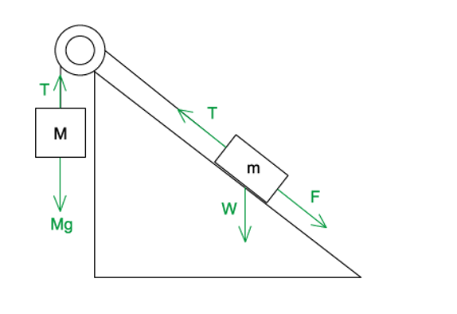
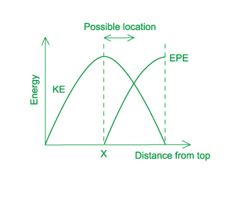

# Mark Schemes — Energy Conservation
**5. Work, Energy & Power** · Cambridge (CIE) A-LEVEL physics (9702)

## Multiple Choice Questions (34 questions)

### Q1
**Final answer:** **The correct answer is B **

- The kinetic energy of the flowing water causes the turbine to rotate, which is then converted to electrical power
- Kinetic energy is given by

$E_{k}=\frac{1}{2}mv^{2}$

- The speed is known, so to find the mass flow rate:

Mass flow rate = density × volume flow rate

- Where

  - density of water = 1000 kg m-3
  - volume flow rate = 15 m3 s-1

Mass flow rate = 1000 × 15 = 15 000 kg s-1

- Power from flowing water is

`P space equals fraction numerator text energy end text over denominator text time end text end fraction equals fraction numerator m v squared over denominator 2 t end fraction equals 1 half open parentheses m over t close parentheses v squared`

- Efficiency = 40%, so only 40% of the power of the flowing water is converted to electrical power
- Electrical power is

`P space equals space 0.40 cross times open parentheses 0.5 cross times 15000 cross times 8.0 squared close parentheses equals 192 space 000 text  W end text equals 192 text  kW end text`

`P space almost equal to space 190 text  kW end text space open parentheses 2 space straight s. straight f. close parentheses`

### Q2
**Final answer:** **The correct answer is ****A**** because:**

- Power is the rate of transfer of energy

  - $Power=\frac{energy}{time}$
- Water in the lake possesses gravitational potential energy

  - `P o w e r equals fraction numerator increment E subscript p over denominator t end fraction equals fraction numerator m g increment h over denominator t end fraction equals open parentheses m over t close parentheses g increment h`
- The mass flow rate of the water `open parentheses m over t close parentheses` is 2400 kg min–1
- This means that every minute, 2400 kg of water flows through the turbine

  - In 60 s, 2400 kg of water flows
  - Therefore, in 1 s, $\frac{2400}{60}=40\mathrm{kg}$ of water flows
- The mass flow rate is equal to $\frac{m}{t}$ = 40 kg s-1

  - Power of water = `open parentheses m over t close parentheses g increment h equals 40 cross times 9.81 cross times 90 equals 35 space 316` W
- This is the maximum power available from the turbine, however, the turbine has an efficiency of 75%

  - Power output of the turbine = $0.75\times35316=26487=26\mathrm{kW}$

### Q3
**Final answer:** **The correct answer is ****B**** because:**

- Efficiency = $\frac{usefuloutputpower}{totalpowerinput}$
- We know the power output is = 150 kW = 150 × 103 W
- Power input = $20\times40MJ=20\times40\times10^{6}$
- We must convert the fuel consumption into litres per second

  - In one hour, the fuel consumed is 20 litres
  - In one minute, the fuel consumed is  $\frac{20}{60}$ litres
  - In one second, the fuel consumed is  $\frac{20}{60\times60}$ litres
- So, power input = $\frac{20\times40\times10^{6}}{60\times60}$
- Efficiency = $\frac{outputpower}{powerinput}=\frac{150\times10^{3}}{\frac{20\times40\times10^{6}}{60\times60}}=\frac{150\times10^{3}\times60\times60}{20\times40\times10^{6}}$

### Q4
**Final answer:** **The correct answer is ****B**** because:**

- The force due to the 100 N load causes the right end of the rope to accelerate downwards and simultaneously causes the left end to move upwards
- The force due to the 20 N on the force meter causes the left end to accelerate downwards and simultaneously causes the right end to move upwards
- Even if both the 100 N and the 20 N act downwards, they have opposite effects on the rope and the direction of turning of the wheel
- Since the 100 N load is greater than the 20 N force from the force meter, there is a resultant force acting downwards on the load. This force would cause the wheel to turn in a clockwise direction if not balanced by the motor
- To keep the load from moving, the wheel should also exert a force equal in magnitude and in opposite direction to the rope

  - From Newton's 3rd law since the resultant force of the rope is 100 – 20 = 80 N downwards
- So, the force exerted by the wheel on the rope is 80 N upwards
- The wheel turns in an anticlockwise direction at a rate of 50 revolutions per second
- This means the speed of the motor is 50 revolutions per second, and one revolution is equal to the circumference of the wheel, which is 0.3 m
- So, the distance moved against the force in one second, or its speed is $=50\times0.30=15ms^{-1}$

  - Power provided by motor $=Fv=80\times15=1200W=1.2\mathrm{kW}$
- Therefore, the power provided by the motor is 1.2 kW

### Q5
**Final answer:** **The correct answer is ****B**** because:**

- In this question we need to consider conservation of energy since energy is being transformed form one form into another
- The kinetic energy of the water is being converted into gravitational potential energy of the water
- However, since the efficiency of the pump is only 10%, only 10% of the kinetic energy is converted into GPE
- 10% of KE of the water = GPE of water lifted

  - $0.1\times\frac{1}{2}mv^{2}=m_{w}g\Deltah$
- Where *m**w* is the mass of the water lifted

  - $0.1\times\frac{1}{2}\times500\times2^{2}=m_{w}\times9.81\times15$
  - $m_{w}=\frac{0.1\times500\times4}{2\times9.81\times15}=0.68\mathrm{kg}$
- Therefore, 0.68 kg of water could be lifted by 15 m

### Q6
**Final answer:** **The correct answer is ****B**** because:**

- Total weight of passengers = W = 20 mg
- Each passenger is moved a distance of 60 m as the escalator goes up
- The weight of the passengers acts vertically downwards
- There will be a component of weight acting down the slope of the escalator
- Component of weight acting parallel to the slope of the escalator

  - Where θ is the angle the escalator makes with the horizontal
  - $\mathrm{sin}θ=\frac{O}{H}=\frac{30}{60}=0.5$
  - The component of the weight force acting parallel to the slope is mg sin*θ *or* *0.5*mg*
- Work needs to be done against forces. Additionally, work should be done against the component of weight acting down the slope
- `P space equals E over t space equals fraction numerator space W over denominator t end fraction space equals fraction numerator space F d over denominator t end fraction space equals F open parentheses d over t close parentheses space equals space F v`
- $P=2000+Fv$
- $P=2000+20mgv\mathrm{sin}θ$
- `P equals 2000 plus open parentheses 20 cross times 60 cross times 9.81 cross times 0.5 close parentheses open parentheses 0.75 close parentheses` $=6414.5W=6.4\mathrm{kW}$

Therefore, the power required by the escalator is 6.4 kW

**Exam tip:** many calculation questions you will come across have multiple ways in which you can solve them. Another way you could solve this question would be to consider the gain in potential energy of the 20 passengers, try it out! Which method do you find easier ?

### Q7
**Final answer:** **The correct answer is ****D**** because:**

- Let’s consider the motion of the ball from the point of impact with the spring to the maximum compression of the spring
- From the conservation of energy :
- Loss in kinetic energy (KE) + gravitational potential energy (GPE) = work done to compress ball = gain in elastic potential energy in spring
- Loss in ball’s KE $=\frac{1}{2}mv^{2}$
- Gain in GPE = $mgy$
- Work done by ball = $Averageforce\timesdisplacement=F_{av}y$

  - `open parentheses 1 half m v squared minus 0 close parentheses plus m g y equals F subscript a v end subscript y`
  - $F_{av}=\frac{\frac{1}{2}mv^{2}+mgy}{y}$
  - `F subscript a v end subscript equals fraction numerator m over denominator 2 y end fraction open parentheses v squared plus 2 g y close parentheses`

### Q8
**Final answer:** **The correct answer is ****B**** because:**

- The kinetic energy of the air causes the wind turbine to rotate which is then converted to electrical power

  - Kinetic energy of air = $\frac{1}{2}mv^{2}$
- The speed is known so we need to find the mass using:

  - Density = $\frac{mass}{volume}$, so, mass = density × volume
  - Density of air = 1.3 kg m–3
- The wind speed is 10 m s–1 and this wind blows on an area of 2000 m2
- This means in one second, a column of air of 10 m in length and with an area of 2000 m2 moves past the blades of the wind turbine

  - This is equivalent to a volume of 10 × 2000 = 20 000 m3 s–1
- The mass of air passing the blades per second = density × volume of air per second
- Mass of air passing the blades per second : $\frac{m}{t}=1.3\times20000=26000\mathrm{kg}s^{-1}$

  - Power from wind = `fraction numerator e n e r g y over denominator w i n d end fraction equals fraction numerator m v squared over denominator 2 t end fraction equals 1 half open parentheses m over t close parentheses v squared`
- Efficiency = 50%, so, only 50% of the power of the wind is converted to electrical power

  - Electrical Power = `0.50 cross times open parentheses 0.5 cross times 26 space 000 cross times 10 squared close parentheses equals 650 space 000 equals 650 space kW`

Therefore, the electrical power output of the turbine is 650 kW

### Q9
**Final answer:** **The correct answer is ****B**** because:**

- At the top of the lake, the water has gravitational potential energy as it is above the ground
- As it passes through the turbine, the energy is converted to electrical energy, however, the system is only 90% efficient, so, not all of the gravitational potential energy becomes electrical energy

  - GPE of water $\DeltaE_{p}=mg\Deltah$
  - Input Power = $\frac{E}{t}=\frac{\DeltaE_{p}}{t}=\frac{mg\Deltah}{t}$
- The water passes through the turbine at a rate of 340 m3 per minute. This quantity represents the volume flow rate and has unit m3 per unit or  $\frac{\DeltaV}{t}$
- Volume flow rate = $\frac{\DeltaV}{t}=340m^{3}\mathrm{min}^{-1}$
- We need to convert this into SI unit

  - In 1 minute, a volume of 340 m3 passes through the turbine
  - In 1 second, a volume of $\frac{340}{60}=5.67m^{3}$ passes through the turbine
- So, the volume flow rate is $\frac{\DeltaV}{t}=5.67m^{3}s^{-1}$
- The formula for the input power above requires the mass, not the volume. We need to convert the volume flow rate into mass flow water or $\frac{\Deltam}{t}$
- Density is equal to $ρ=\frac{mass}{volume}=\frac{m}{v}$ , so , $\Deltam=ρV$
- We must divide by time to get the equivalent mass flow rate :

  - $\frac{\Deltam}{t}=\frac{ρV}{t}=1000\times5.67=5670\mathrm{kg}s^{-1}$
  - Input Power = `fraction numerator m g increment h over denominator t end fraction equals open parentheses fraction numerator increment m over denominator t end fraction close parentheses space g increment h`
  - Input Power $5670\times9.81\times30=1.67\times10^{6}W=1.67\mathrm{MW}$
- The overall efficiency of the system is 90%
- Therefore, output power = 0.90 × 1.67 = 1.5 MW

### Q10
**Final answer:** **The correct answer is ****B**** because:**

- The principle of conservation of energy states:

  - Energy cannot be created or destroyed, only transferred
- Initially, when Q is at position A:

  - The system (P and Q) starts at rest with an initial gravitational potential energy (GPE) and zero kinetic energy (KE)
- As Q moves from A to B:

  - Q loses GPE, and P gains GPE, but the net effect is a loss in GPE as the heavier block Q falls toward the ground
  - The system gains KE as the blocks accelerate
  - P moves against a rough surface, so work is done against friction, causing energy to dissipate as heat
- Applying energy conservation:

  - Total loss in potential energy = Total gain in kinetic energy + Work done against friction
- This matches option **B**

**A** is incorrect because it considers Q only. The energy changes of P (gain in GPE and KE) must also be included in the system.

**C** is incorrect because the surface is rough. Energy is dissipated as heat due to friction, so the loss in GPE must account for this work done, not just the gain in KE.

**D** is incorrect because it doesn't consider the work done against friction. While it correctly identifies that Q loses GPE and P gains GPE, the conservation equation is incomplete without the resistive term.

### Q11
**Final answer:** **The correct answer is ****B**** because:**

- To stack the blocks on top of each other, we only need to lift three of them, as the bottom block is already on the table
- When on the ground, a block has zero gravitational potential energy
- When at a height *x* above the ground, the gravitational potential energy of a block is *mgx*
- So, the work that needs to be done to lift a block from the ground to a height *x* is *mgx*, where *x *will equal *h*, 2*h*, 3*h*

  - The first block is lifted by a height *h*, so, work done = *mgh*
  - The second block is lifted by a height 2 *h*, so, work done = 2 *mgh*
  - The third block is lifted by a height 3 *h*, so, work done = 3 *mgh*
- Total work done = *mgh *+ 2 *mgh* + 3 *mgh* = 6 *mgh*

### Q12
**Final answer:** **The correct answer is ****C**** because:**

- Work done = Force applied × displacement in the direction of force
- The question asks how much energy is converted to heat energy; this energy comes from the friction experienced by mass *m* moving up the rough plane
- In this case the forces acting on the mass are its weight W, the frictional force F and the tension T in the string holding the mass which is equal to the weight of mass *M*, so we can write

  - Vertical force on mass *M *: $T=Mg$
  - Weight of mass *m *: $W=mg$
  - Vertical forces on mass *m *: $F+W=T$
  - Therefore, the frictional force is : $F=T-W=Mg-mg$
- Vertical displacement by mass *M = *$x$
- Work done by mass *M = *$Mgx$
- Vertical displacement by mass * *$m=y$
- Work done by mass *m *$m=mgy$
- Amount of energy converted to heat : $Mgx-mgy$

### Q13
**Final answer:** **The correct answer is ****B**** because:**

- From conservation of energy:
- The potential energy (PE) lost in falling from P to T = Kinetic energy (KE) of mass at T

  - `E equals 1 fourth m open parentheses 4 close parentheses squared equals 8 space m`
- Since the mass is at rest at P, its KE is zero and its PE is at a maximum
- Since T is the lowest point, PE is zero here
- So, the total energy of the mass in the system is *E*
- In general, PE lost at a point = KE at that point
- From above, *E* = 8*m*, so, a PE loss of $\frac{E}{4}=2m$

  - At R : `E subscript k equals 1 half m open parentheses 2 close parentheses squared equals 2 space m equals E subscript p space l o s t`
- Therefore, when the mass is at R, it has half the final speed and so has gained a kinetic energy of $\frac{E}{4}$, this is when it has lost a potential energy of  $\frac{E}{4}$

**A **is incorrect because  At Q : `E subscript k equals 1 half m open parentheses 1 close parentheses squared equals 0.5 m equals E subscript p space l o s t` , this is a loss of $\frac{E}{16}$

**C **is incorrect because At S :`E subscript k equals 1 half m open parentheses 3 close parentheses squared equals 9 over 2 equals E subscript p space l o s t`, this is a loss of $\frac{16E}{9}$

**D **is incorrect because At R : `K E equals 1 half m open parentheses 2 close parentheses squared equals 2 m equals P E space l o s t`, this is a loss of  $\frac{E}{4}$

### Q14
**Final answer:** **The correct answer is ****A**** because:**

- Efficiency is a quantity that describes a ratio of two similar appropriate quantities, so, the numerator and the denominator must have the same units
- In this scenario, we can give the efficiency in terms of input and output energy per day, we will need to use the following equations:
- $Efficiency=\frac{outputenergyperday}{totalenergyavailableperday}$
- $Power=\frac{energy}{time}$
- $Energy=Power\timesTime$

  - Output energy = Power station output × Number of seconds in one day
  - Output energy = *PS*
  - Total energy available per day = Number of trains per day × Mass of coal on a train × Energy from 1 kg of coal
  - Total energy available per day = *NMJ*
- Efficiency $\frac{outputenergyperday}{totalenergyavailableperday}=\frac{PS}{NMJ}$

### Q15
**Final answer:** **The correct answer is ****C**** because:**

- From the conservation of energy, the sum of energies at position 2 or 3 should be equal to the initial amount of gravitational potential energy the student possesses at position 1
- At position 2, the rope fully unwinds but it does not stretch. So, it does not have elastic potential energy. The kinetic energy is maximum at position 2
- At position 3, the rope is stretched. So, the elastic potential energy will reach a maximum
- At this position, the lowest point of the jump is reached, so, the student will not move any further, thus, the kinetic energy will be at a minimum

### Q16
**Final answer:** **The correct answer is ****C**** because:**

- Efficiency`equals fraction numerator u s e f u l space m e c h a n i c a l space o u t p u t space p o w e r over denominator t o t a l space e l e c t r i c a l space p o w e r end fraction equals 80 percent sign`
- Useful mechanical output power = 120 W
- Input power $=\frac{usefulmechanicaloutputpower}{efficiency}=\frac{120}{0.8}=150W$
- Waste heat power = input – output = 150 – 120 = 30 W

### Q17
**Final answer:** **The correct answer is ****C**** because:**

- The efficiency of a system is the ratio of the energy used in the process to the total energy input in the system
- Efficiency $=\frac{usefulenergyoutput}{totalenergyinput}$
- Useful energy output = *U*
- Total energy input = *E**in*

  - % Efficiency `equals U over E subscript i n end subscript cross times 100 percent sign`

### Q18
**Final answer:** **The correct answer is ****B**** because:**

- Power is defined as the rate of transfer of energy or work done
- In equation form this can be written as

  - Power, $P=\frac{energy}{time}$  or $P=\frac{workdone}{time}$
- Work done = Force × displacement =$F\timess$

  - $P=\frac{workdone}{time}=\frac{Fs}{t}=Fv$
  - Where speed, $v=\frac{s}{t}$
- Therefore, $P=Fv$

### Q19
**Final answer:** **The correct answer is ****B ****because:**

- Work done to stop vehicle = kinetic energy = 4.5 × 105 J
- Work done = Force × Distance
- Distance $=\frac{workdone}{force}=\frac{4.5\times10^{5}}{6000}=75m$

### Q20
**Final answer:** **The correct answer is ****C**** because:**

- Power is defined as the rate of transfer of energy or work done
- In equation form this can be written as

  - Power, $P=\frac{energy}{time}$ or $P=\frac{workdone}{time}$

**A **is incorrect because this equation describes how to calculate work done

**B **is incorrect because this is a correct formula for power but it derived from $Power=\frac{workdone}{time}$

**D **is incorrect because this is not a correct formula, it doesn’t have a physical equivalent

### Q21
**Final answer:** **The correct answer is ****C**** because:**

- The Principle of Conservation of Energy states that energy cannot be created or destroyed, it can only be transferred from one form to another
- In other words, the total energy of an **isolated** system remains constant
- An isolated system is defined as a system that is closed off from its surroundings and this means that a system always has the same amount of energy, unless it's added from an external source
- Identifying the system is the most difficult part of conservation questions. Let’s take a look at an example of a ball tossed up in the air:
- *During the throw:*

  - Chemical energy from your muscles → kinetic energy of the ball
- *As the ball reaches its maximum height:*

  - Kinetic energy of the ball → gravitational potential energy of the ball
- *As the ball falls down:*

  - Gravitational potential energy of the ball → kinetic energy of the ball
- The isolated system in this scenario is simply the ball, the muscles in the person’s arm, and the Earth’s gravitational field. It’s not necessary to consider the chemical energy from the food the person ate or the gravitational fields of other bodies such as the sun or moon, for example

**A & D **are incorrect because these describe equations to work out work done and power, but they don’t describe conservation of energy

**B **is incorrect because this is close to the classic definition ‘energy cannot be created or destroyed; it can only be transferred from one form to another’ but if you look closely you will see this definition states that energy cannot be transformed which is incorrect

### Q22
**Final answer:** **The correct answer is ****D**** because :**

- From the question we are told :

  - Increase in gravitational potential energy =$E_{p}$
  - Increase in kinetic energy $=E_{k}$
  - Time taken $=t$
- Let the total gravitational energy be equal to E
- We know that gravitational energy is the sum of potential energy and kinetic energy so

  - $E=E_{p}+E_{k}$
- Let P be the power input of the mass
- Power is equal to $P=\frac{E}{t}$

  - Therefore : $P=\frac{E}{t}=\frac{E_{p}+E_{k}}{t}$

### Q23
**Final answer:** **The correct answer is ****D**** because:**

- Average, or mean, power is defined as the rate of transfer of energy or work done
- In equation form, this can be written as

  - Power, $P=\frac{\mathrm{energy}}{\mathrm{time}}$  or  $P=\frac{\mathrm{work} \mathrm{done}}{\mathrm{time}}$
- Work done = Force × displacement = $Fs$

  - $P=\frac{\mathrm{work} \mathrm{done}}{\mathrm{time}}=\frac{Fs}{t}=Fv$
- In scenario D :

  - Force, *F* = 1.5 kN
  - Speed, *v* = 6 m s–1
- $P=Fv=1.5\times6=9\mathrm{kW}$
- This operation gives the largest mean power, see the incorrect table for the other calculations

**A **is incorrect because $P=Fv=0.4\times20=8\mathrm{kW}$

**B **is incorrect because $P=Fv=3\times2=6\mathrm{kW}$

**C **is incorrect because $P=Fv=5\times1=5\mathrm{kW}$

### Q24
**Final answer:** **The correct answer is D because:**

- Power is equal to = $P=\frac{E}{t}=\frac{Fs}{t}=Fv$
- Force is defined as the rate of change of momentum, so, we first need to find an expression for force in order to find the power
- sand drops vertically on to the belt at a rate of $m\mathrm{kg}s^{-1}$

  - Therefore, the rate at which the sand falls is = `fraction numerator increment m a s s over denominator t i m e end fraction equals open parentheses fraction numerator increment m over denominator t end fraction close parentheses equals straight m space kg space straight s to the power of negative 1 end exponent`
- Next, consider the momentum : $p=Mv$
- Rate of change of momentum = `fraction numerator increment p over denominator t end fraction equals fraction numerator M v over denominator t end fraction equals open parentheses fraction numerator increment M over denominator t end fraction close parentheses v equals m v`

  - Therefore, in one second, the momentum of mass m of sand increases from Zero to mv
- Recall the force is defined as the rate of change of momentum, so the force involved is mv
- Force = rate of change of momentum = $mv$

  - so, Power = $Fv=mv\timesv=mv^{2}$

### Q25
**Final answer:** **The correct answer is ****C**** because:**

- Power $\frac{workdone}{timetaken}=\frac{force\timesdistance}{timetaken}=force\timesvelocity$
- The track is frictionless, so, no frictional force acts on the mass
- If the track was horizontal the power required to give the mass *m* a forward acceleration *a* when it is moving with velocity *v* is given by

  - Power `P equals F v equals open parentheses m a close parentheses cross times v equals m a v`              **(1)**
- But in this case, the track is inclined at an angle *θ* to the horizontal
- The component of the weight of the mass (against motion) along the track is equal to $=mg\mathrm{sin}θ$
- Therefore, a force is required to keep the mass stationary and prevent it from moving down along the inclined track
- This force should be equal in magnitude to the component of the weight so that the resultant acceleration (when considering only the component of the weight and this force) is zero
- This force would result in a power equal to

  - Power $P=mg\mathrm{sin}θ\timesv=mgv\mathrm{sin}θ$     **(2)**
- Total power required is given by adding Equation **(1)** and Equation **(2)**:

  - Total power = $mav+mgv\mathrm{sin}θ$

### Q26
**Final answer:** **The correct answer is ****D**** because:**

- Efficiency $=\frac{poweroutput}{powerinput}$
- Power output =$IV$
- Power output = $32\times230=7360$
- Water in the top section possesses gravitational potential energy

  - `P o w e r equals fraction numerator increment E subscript p over denominator t end fraction equals fraction numerator m g increment h over denominator t end fraction equals open parentheses m over t close parentheses g increment h`
- The mass flow rate is equal to $\frac{m}{t}=200\mathrm{kg}s^{-1}$

  - Power input of water = `open parentheses m over t close parentheses g increment h equals 200 cross times 9.81 cross times 8 equals 15 space 696 space straight W`
- % Efficiency = `fraction numerator p o w e r space o u t p u t over denominator p o w e r space i n p u t end fraction cross times 100 percent sign equals fraction numerator 7360 over denominator 15 space 696 end fraction cross times 100 equals 46.9 percent sign`
- Therefore, the efficiency of the system is 47%

### Q27
**Final answer:** **The correct answer is ****C**** because:**

- Work done = Force applied × displacement moved in the direction of force
- In this case the force acting on the mass is the tension in the string holding the mass which is equal to the weight *W* in this case
- The distance moved by the weight in direction of this force is *q*

  - So, work done $=W_{q}$

**A & D **are incorrect because if the force had also been given along the track then the work done could be represented as $F_{p}orF_{r}$  or , but since we do know the force in the vertical direction is weight *W*, then we can only specify the work done by the weight

**B **is incorrect because these displacements are in different directions, whereas work done requires the displacement to be in the same direction as the force

### Q28
**Final answer:** **The correct answer is ****D**** because:**

- Power is defined as the rate of transfer of energy or work done
- This can be written as $P=\frac{energy}{time}$
- Time = 10 ns = 10 × 10–9 s

  - $P=\frac{0.20}{10\times10^{-9}}=2\times10^{7}W$
- 1 MW = 1 × 106 W

  - $P=2\times10^{7}W=20\mathrm{MW}$
- Therefore, the average power output of the laser 20 MW

### Q29
**Final answer:** **The correct answer is ****D**** because:**

- The efficiency of a transformer is the ratio of the power output of the process to the total power input to the system
- Efficiency$=\frac{usefulpoweroutput}{totalpowerinput}$
- Power can be calculated using : $P=VI$
- Useful power output $=240\times1200=288000$
- Total power input = $11000\times28=308000$

  - % Efficiency = `fraction numerator u s e f u l space p o w e r space o u t p u t over denominator t o t a l space p o w e r space i n p u t end fraction cross times 100 percent sign`
  - % Efficiency = `288000 over 308000 cross times 100 percent sign equals 93.5 percent sign`
- Therefore, the efficiency of the transformer is 94%

### Q30
**Final answer:** **The correct answer is ****C**** because:**

- Power $=\frac{workdone}{timetaken}=\frac{force\timesdisplacement}{timetaken}$
- Since the anchor is fixed to the pier, the boy will not be able to move it, regardless of how much force he applies, he can only move the boat towards the pier
- Hence, the work done and power will be close to zero in Diagram (a)
- For the freely floating boat Q, there is a higher chance that the boy will be able to move himself and boat Q for a distance
- A higher force will be required by the boy to travel the same distance as in Diagram (a)
- Hence, more work is done and a power output substantially larger than zero will be required in Diagram (b)
- Therefore, both work done *W**b* and power output *P**b* will be higher than work done *W**a* and power output *P**a*

  - $W_{a}<W_{b}andP_{a}<P_{b}$

**A **is incorrect because this is statement is telling us that it requires less energy and power output to pull the boat towards the pier than boat Q

**B & D **are incorrect because since the mass of the pier and boat Q vary greatly, the work done and power outputs to pull boat P towards them cannot be the same

### Q31
**Final answer:** **The correct answer is C because:**

- We are told the resistive force F is proportional to $v^{2}$

  - $Fαv^{2}$
  - $F=kv^{2}$     where k is constant
- When F=800 N, V = 20 m s−1

  - `k equals F over v squared equals 800 over open parentheses 20 close parentheses squared equals 2`
- so, $F=2v^{2}$
- Power output is equal to $P=Fv$
- Since $F=2v^{2}$ we have :

  - Output power `P equals F v equals open parentheses 2 v squared close parentheses cross times v equals 2 v cubed`
- So, when $V=40ms^{-1}$

  - Output power `P equals 2 v cubed equals 2 cross times open parentheses 40 close parentheses cubed equals 128 space 000 straight W`
- Therefore, the effective power output is 128 kW

### Q32
**Final answer:** **The correct answer is ****D**** because:**

- Efficiency is given by

  - efficiency = $\frac{\mathrm{useful} \mathrm{energy} \mathrm{output}}{\mathrm{total} \mathrm{energy} \mathrm{input}}$
- The total energy input is equal to the work done by the car, which is given by

  - $W=Fs$
- For constant velocity, the resultant force is zero
- So, the force required to move the car up the slope is equal to the component of weight which acts along the slope

  - Component of weight against $F=mg\mathrm{sin}α$
  - Work done to move car a distance `s space equals space open parentheses m g space sin space alpha close parentheses s`
- Efficiency `equals fraction numerator useful space energy space output over denominator total space energy space input end fraction equals fraction numerator open parentheses m g space sin space alpha close parentheses s over denominator F s end fraction equals fraction numerator m g space sin space alpha over denominator F end fraction`

### Q33
**Final answer:** **The correct answer is ****D**** because:**

- From the conservation of energy, the sum of energies halfway and at the bottom of the jump should be equal to the initial amount of gravitational potential energy the student possesses at the beginning of the jump
- When the jumper is halfway down, the rope will unwind fully but it will not have stretched yet. So, it will have a small elastic potential energy
- The kinetic energy will reach a maximum halfway down
- The graph below might give you a clearer image
- Point X shows the point where the jumper starts to be restricted by the pull of the rope
- Before X, the jumper undergoes free fall and hence the speed and kinetic energy increases
- After X, the elastic potential energy of the elastic rope starts increasing – this corresponds to a drop in the kinetic energy of the jumper, according to the principle of conservation of energy
- When the jumper is halfway down, their possible location is shown on the graph, it can clearly be seen that the kinetic energy is greater than the elastic potential energy at this point, making D the correct answer

### Q34
**Final answer:** **The correct answer is ****A**** because:**

- Work done = Force × displacement in direction of the force
- In situation A, a girl dives from a diving board into a swimming pool
- The direction of the gravitational force is downwards
- The gravitational force acts downward on the girl and the girl moves downward during the fall
- So work is done by the gravitational force, not against it

**B **is correct because a man pushes a car along a level road:

- direction of (electric) force = horizontal ✓
- direction of motion = horizontal ✓

**C **is correct because an electron is accelerated towards a positively-charged plate:

- direction of (electric) force = towards positively charged plate ✓
- direction of motion = electron moves towards the positively charged plate ✓

**D **is correct because a piston is pushed outwards as a gas expands:

- direction of force = on piston (the gas in the atmosphere exerts force on the surface of the piston) ✓
- direction of motion = piston moves outwards ✓
