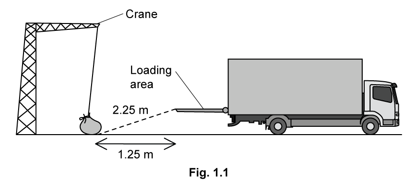
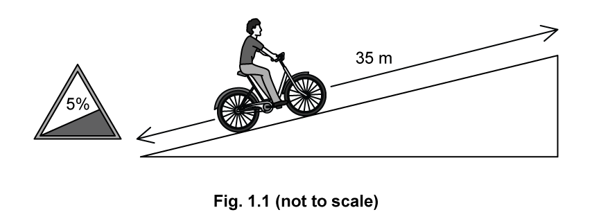
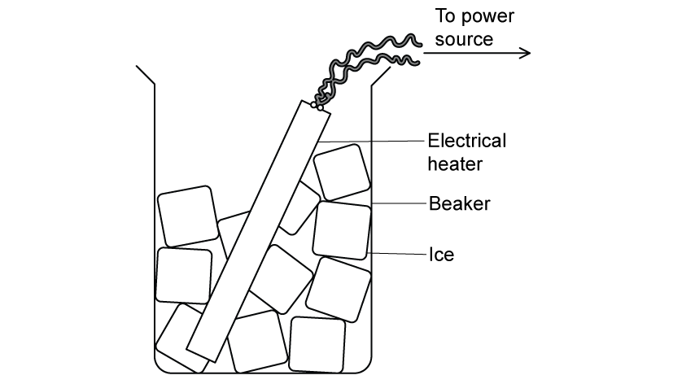
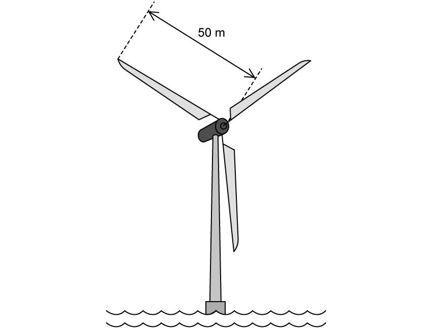
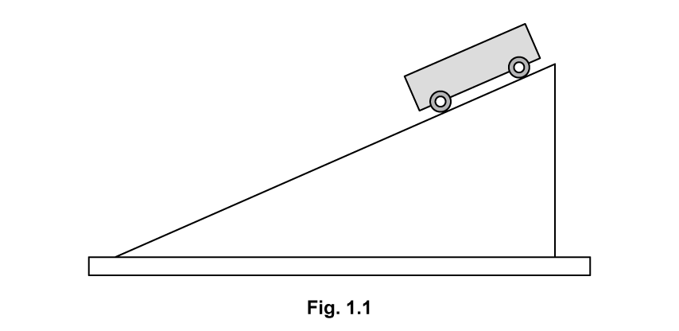
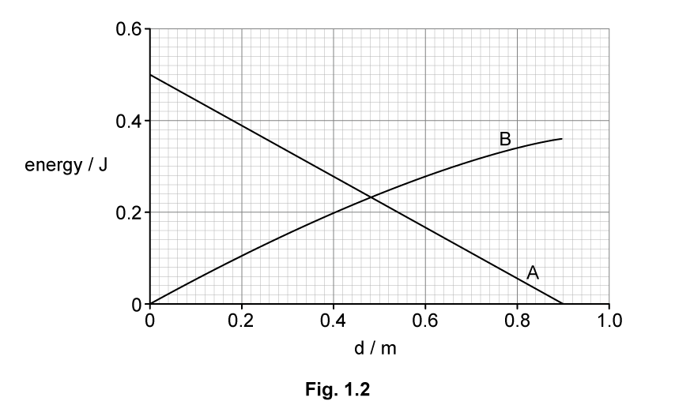
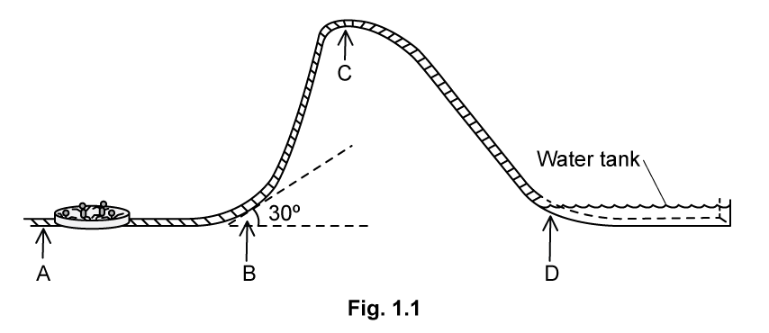
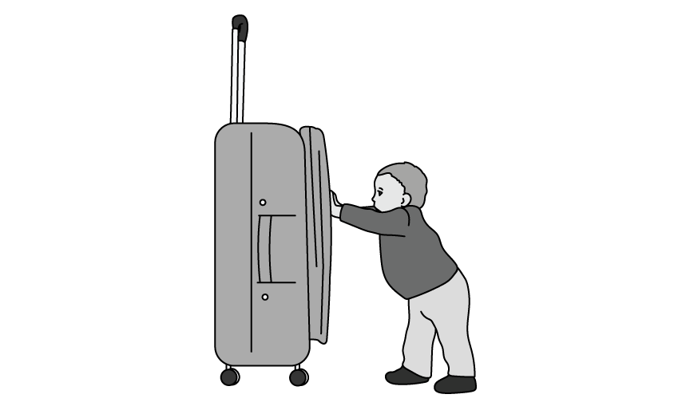
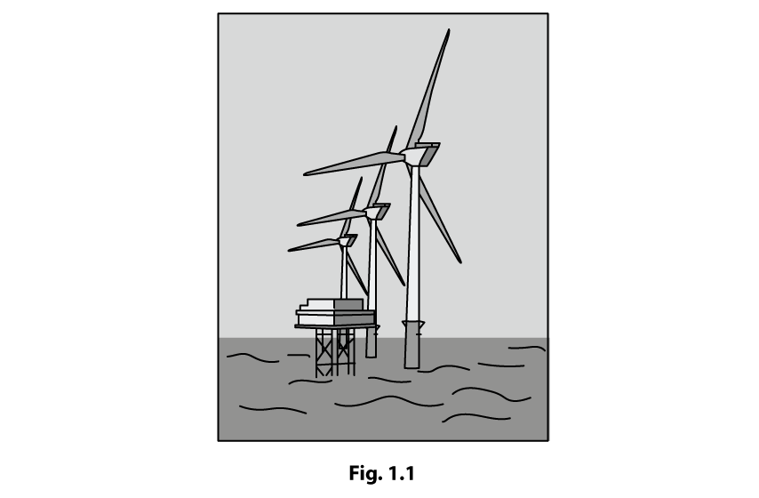

# Exam Questions — Energy Conservation
**5. Work, Energy & Power** · Cambridge (CIE) A-LEVEL physics (9702)
> Source: [https://www.savemyexams.com/a-level/physics/cie/25/topic-questions/](https://www.savemyexams.com/a-level/physics/cie/25/topic-questions/) · 45 questions across 2 sets

## Multiple Choice Questions (34 questions)

### Q1 — hard — 1 marks

**Q1** [1 mark]

A hydroelectric power station has a turbine with blades that sweep through water flowing at a rate of 15 m3 s-1. The water has a density of 1000 kg m-3 and flows at a speed of 8.0 m s-1. The turbine converts the kinetic energy of the flowing water to electrical energy with an efficiency of 40%.

What is the electrical power output of the turbine?

### Q2 — medium — 1 marks

**Q2** [1 mark]

Water flows from a lake into a turbine that is a vertical distance of 90 m below the lake, as shown

The mass flow rate of the water is 2400 kg min–1. The turbine has an efficiency of 75 %.

What is the output power of the turbine?

### Q3 — medium — 1 marks

**Q3** [1 mark]

The data below are taken from a test of a petrol engine for a motor car.

| power output | 150 kW |
|---|---|
| fuel consumption | 20 litres per hour |
| energy content of fuel | 40 MJ per litre |

Which expression will evaluate the efficiency of the engine?

### Q4 — hard — 1 marks

**Q4** [1 mark]

The diagram shows a wheel of circumference 0.30 m. A rope is fastened at one end to a force meter. The rope passes over the wheel and supports a freely hanging load of 100 N. The wheel is driven by an electric motor at a constant rate of 50 revolutions per second.

When the wheel is turning at this rate, the force meter reads 20 N.

What is the output power of the motor?

### Q5 — medium — 1 marks

**Q5** [1 mark]

The diagram shows a pump called a hydraulic ram

In one such pump the long approach pipe holds 500 kg of water. A valve shuts when the speed of this water reaches 2.0 m s–1 and the kinetic energy of this water is used to lift a small quantity of water by a height of 15 m.

The efficiency of the pump is 10 %.

Which mass of water could be lifted 15 m?

### Q6 — hard — 1 marks

**Q6** [1 mark]

An escalator is 60 m long and lifts passengers through a vertical height of 30 m, as shown.

To drive the escalator against the forces of friction when there are no passengers requires a power of 2.0 kW.

The escalator is used by passengers of average mass 60 kg and the power to overcome friction remains constant.

How much power is required to drive the escalator when it is carrying 20 passengers and is travelling at 0.75 m s–1?

### Q7 — hard — 1 marks

**Q7** [1 mark]

A ball of mass *m* falls freely from rest. When it has reached a speed *v*, it strikes a vertical spring.

The spring is compressed by a distance *y* before the ball moves upwards again.

Assume that all energy the ball loses becomes elastic potential energy in the spring.

What is the average force exerted by the spring during its compression?

### Q8 — hard — 1 marks

**Q8** [1 mark]

A wind turbine has blades that sweep an area of 2000 m2. It converts the power available in the wind to electrical power with an efficiency of 50 %.

What is the electrical power generated if the wind speed is 10 m s–1? (The density of air is 1.3 kg m–3)

### Q9 — hard — 1 marks

**Q9** [1 mark]

A turbine at a hydroelectric power station is situated 30 m below the level of the surface of a large lake. The water passes through the turbine at a rate of 340 m3 per minute.

The overall efficiency of the turbine and generator system is 90 %.

What is the output power of the power station? (The density of water is 1000 kg m–3)

### Q10 — hard — 1 marks

**Q10** [1 mark]

Two blocks, P and Q, are initially stationary and connected by a taut string passing over a smooth pulley, as shown. The system is released from rest. Block Q moves vertically downwards from position A to B. Block P moves up the rough surface of the slope, as shown.

Which equation correctly describes the energy changes for the system?

### Q11 — medium — 1 marks

**Q11** [1 mark]

Initially, four identical uniform blocks, each of mass *m* and thickness *h*, are spread on a table.

How much work is done on the blocks in stacking them on top of one another?

### Q12 — hard — 1 marks

**Q12** [1 mark]

The figure shows a mass m on an inclined plane connected by an inextensible string over a smooth pulley to a larger mass *M*. When the mass *M* falls through a distance *x*, the mass *m* moves up a vertical distance *y* at a constant speed.

The friction between *m* and the inclined plane is *F*.

What amount of energy is converted to heat?

### Q13 — hard — 1 marks

**Q13** [1 mark]

A small mass is placed at point P on the inside surface of a smooth hemisphere. It is then released from rest. When it reaches the lowest point T, its speed is 4.0 m s–1.

The diagram (not to scale) shows the speed of the mass at other points Q, R and S as it slides down. Air resistance is negligible.

The mass loses potential energy *E* in falling from P to T.

At which point has the mass lost potential energy  $\frac{E}{4}$ ?

### Q14 — medium — 1 marks

**Q14** [1 mark]

Trains supply coal to a power station. The table below gives quantities describing the operation of the power station.

|   | **Symbol** | **Unit** |
|---|---|---|
| power station output | *P* | W |
| number of trains per day | *N* |   |
| mass of coal on a train | *M* | kg |
| energy from 1 kg of coal | *J* | J |
| number of seconds in one day | *S* | s |

Which expression gives efficiency of the power station?

### Q15 — easy — 1 marks

**Q15** [1 mark]

When bungee jumping, a student starts with maximum gravitational potential energy (position 1), then falls freely until the rope fully unwinds (position 2), after which the rope starts to stretch until the lowest point of the jump is reached (position 3)

What are the kinetic and elastic potential energies at position 3?

|   | **Kinetic energy** | **Elastic potential energy** |
|---|---|---|
| **A** | maximum | maximum |
| **B** | maximum | minimum |
| **C** | minimum | maximum |
| **D** | minimum | minimum |

### Q16 — easy — 1 marks

**Q16** [1 mark]

An electric motor is required to produce 120 W of mechanical output power. The efficiency of the motor is 80%

Which row is correct?

|   | **Electrical power input to motor / W** | **Waste heat output from motor / W** |
|---|---|---|
| **A** | 120 | 24 |
| **B** | 120 | 96 |
| **C** | 150 | 30 |
| **D** | 150 | 120 |

### Q17 — easy — 1 marks

**Q17** [1 mark]

The total energy input *E**in* in a process is partly transferred to useful energy output *U*, and partly to energy that is wasted *W*

What is the efficiency of the process?

### Q18 — easy — 1 marks

**Q18** [1 mark]

A boat moving at constant speed *v* through still water experiences a total frictional drag *F*

What is the power developed by the boat?

### Q19 — easy — 1 marks

**Q19** [1 mark]

The kinetic energy of a moving vehicle with mass 1000 kg is 4.5 × 105 J. It brakes with a total constant braking force of 6000 N

What will be its stopping distance?

### Q20 — easy — 1 marks

**Q20** [1 mark]

Which expression **defines** power?

### Q21 — easy — 1 marks

**Q21** [1 mark]

Which of the following is a statement of the principle of conservation of energy?

### Q22 — medium — 1 marks

**Q22** [1 mark]

A mass is raised vertically. In a time t, the increase in its gravitational potential energy is $E_{p}$ and the increase in its kinetic energy is $E_{k}$.

what is the average power input to the mass?

### Q23 — easy — 1 marks

**Q23** [1 mark]

Which operation involves the greatest mean power?

### Q24 — medium — 1 marks

**Q24** [1 mark]

A conveyor belt is driven at velocity V by a motor. Sand drops vertically on to the belt at a rate of $m\mathrm{kg}s^{-1}$.

What is the additional power needed to keep the conveyor belt moving at a steady speed when the sand starts to fall on it ?

### Q25 — hard — 1 marks

**Q25** [1 mark]

What is the power required to give a body of mass *m* a forward acceleration *a* when it is moving with velocity *v* up a frictionless track inclined at an angle *θ* to the horizontal?

### Q26 — medium — 1 marks

**Q26** [1 mark]

The diagram shows the design of a water wheel which drives a generator to produce electrical energy. The flow rate of the water is 200 kg s–1. The generator supplies a current of 32 A at a voltage of 230 V.

Ignoring any changes in kinetic energy of the water, what is the efficiency of the system?

### Q27 — medium — 1 marks

**Q27** [1 mark]

A weight *W* hangs from a trolley that runs along a rail. The trolley moves horizontally through a distance *p* and simultaneously raises the weight through a height *q*.

As a result, the weight moves through a distance *r* from X to Y. It starts and finishes at rest.

How much work is done on the weight during this process?

### Q28 — easy — 1 marks

**Q28** [1 mark]

What is the average power output of a laser that can deliver 0.20 J of energy in 10 ns?

### Q29 — easy — 1 marks

**Q29** [1 mark]

A transformer has the following input and output

|   | **Potential difference / V** | **Current / A** |
|---|---|---|
| **Input**  **Output** | 11 000  240 | 28  1200 |

What is the efficiency of the transformer?

### Q30 — hard — 1 marks

**Q30** [1 mark]

A boy on a boat P pulls on a rope with a constant force *F* over a duration of time *t*. The other end of the rope is either tied to an anchor on the pier (Diagram a) or a freely floating boat Q (Diagram b) of equal mass as shown in the figures shown.

*W**a* and *W**b* represent the total work done by the boy during the time *t* and *P**a* and *P**b* represent the average power output of the boy in diagrams (a) and (b) respectively.

Which of the following statements is correct?

### Q31 — medium — 1 marks

**Q31** [1 mark]

The force resisting the motion of a car is taken as being proportional to the square of the car's speed. The magnitude of the force at a speed of $20ms^{-1}$ is 800 N.

What effective power is required from the car's engine to maintain a steady speed of $40ms^{-1}$?

### Q32 — medium — 1 marks

**Q32** [1 mark]

A constant force $F$ acting on a car of mass $m$ moves it up a slope through a distance $s$ at constant velocity $v$. The angle of the slope to the horizontal is $α$.

Which expression gives the efficiency of the process?

### Q33 — medium — 1 marks

**Q33** [1 mark]

A bungee jumper has 24 kJ of gravitational potential energy at the top of his jump. He is attached to an elastic rope which starts to stretch after a short time of free fall. Assume that energy loss through air resistance is negligible.

|   | **GPE / kJ** | **EPE / kJ** | **KE / kJ** |
|---|---|---|---|
| Top | 24 | 0 | 0 |
| Bottom | 0 | 24 | 0 |

What are the possible values when the jumper is half-way down?

|   | **GPE / kJ** | **EPE / kJ** | **KE / kJ** |
|---|---|---|---|
| **A** | 12 | 10 | 2 |
| **B** | 12 | 8 | 4 |
| **C** | 8 | 8 | 8 |
| **D** | 12 | 2 | 10 |

### Q34 — medium — 1 marks

**Q34** [1 mark]

The first column in the table gives four examples of work being done. The second column gives more detail of the action.

Which row is **not** correct?

|   | **Example** | **Detail** |
|---|---|---|
| **A** | a girl dives from a diving board into a swimming pool | work is done by the girl against gravity as she falls |
| **B** | a man pushes a car along a level road | work is done by the man against friction |
| **C** | an electron is accelerated towards a positively-charged plate | work is done on the electron by the electric field of the plate |
| **D** | a piston is pushed outwards as a gas expands | work is done on the atmosphere by the gas |

## Structured Questions (11 questions)

### Q1 — medium — 12 marks

**Q1** [1 mark]

Define work done by a force.

**Q1** [2 marks]

A heavy bag is pulled across a rough surface at a constant speed.

Describe and explain how work is done in this situation.

**Q1** [3 marks]

A crane is used to lift the bag from the ground onto the loading area of a truck.

Fig. 1.1 shows the crane moving the bag from the ground to the truck.

The mass of the bag is 64 kg. The crane takes 0.1 minutes to lift the bag from the ground to the loading area of the truck.

Calculate the rate of work done by the crane when moving the bag.

**Q1** [6 marks]

**Extract:**

A crane is used to lift the bag from the ground onto the loading area of a truck. The mass of the bag is 64 kg. The crane takes 0.1 minutes to lift the bag from the ground to the loading area of the truck. Calculate the rate of work done by the crane when moving the bag.
Mark scheme: Vertical height lifted: Δh = √((2.25)² − (1.25)²) = 1.871 m. Work done against gravity (GPE): W = mgΔh = 64 × 9.81 × 1.871 = 1175 J. Rate of work done (power): P = E/t = 1175/6 = 196 = 200 W (2 s.f.).

The crane is powered using an electric motor. The efficiency of the crane is 74 %.

The crane is used to load approximately 400 bags with an average mass of 60 kg each day.

(i) Calculate the power used by the crane's motor to lift the bag in part (c).

[1]

(ii) The typical working efficiency of a crane is 80%.

Explain how the difference in efficiency may affect the number of bags the crane can lift in a day.

[3]

(iii) Suggest **one** change which could increase the efficiency of the motor and explain how it would achieve this.

[2]

### Q2 — medium — 17 marks

**Q2** [5 marks]

A hybrid electric bike is fitted with both pedals and a battery. The cyclist can use pedals only, pedals and battery, or battery only as they ride. Fig 1.1 shows a cyclist riding a hybrid electric bike up an inclined road.

At one hill the cyclist switches to battery only. A road sign at the base of the hill states that it has an incline of 5%, meaning that for every 100 m travelled horizontally, the height increases by 5 m.

The bike travels at a steady speed of 6.0 m s−1.

The mass of the rider and bike combined is 72.8 kg. The distance from the base to the top of the hill is 35 m.

Calculate the minimum power required from the battery. Assume that there is no energy loss due to friction.

**Q2** [5 marks]

**Extract:**

The bike travels at a steady speed of 6.0 m s^−1^. The mass of the rider and bike combined is 72.8 kg. A road sign at the base of the hill states that it has an incline of 5%, meaning that for every 100 m travelled horizontally, the height increases by 5 m.

From part (a): Force parallel to the slope: F = W sinθ = (72.8 × 9.81) × sin(2.86°) = 35.6 N (component of weight down slope).

Near the top of the hill, the cyclist stops pedalling and the bicycle freewheels for 1.6 s until coming to a stop.

The frictional forces which slow down the motion are constant.

(i) Show that the bicycle travels about 5 m before coming to a stop.

[2]

(ii) Calculate the magnitude of the frictional force which slows the bicycle down.

[3]

**Q2** [7 marks]

**Extract:**

A hybrid electric bike is fitted with both pedals and a battery. At one hill the cyclist switches to battery only. A road sign at the base of the hill states that it has an incline of 5%, meaning that for every 100 m travelled horizontally, the height increases by 5 m. The mass of the rider and bike combined is 72.8 kg. The distance from the base to the top of the hill is 35 m. Angle of incline: θ = tan⁻¹(5/100) = 2.86°

Once the cyclist reaches the top, they turn off the motor and head back down to the bottom. At the bottom of the hill, they reach a velocity of 8.8 m s−1.

(i) Calculate the energy the cyclist has at the top of the hill.

[2]

(ii) Calculate the energy the cyclist has at the bottom of the hill.

[2]

(iii) Compare the two values you have calculated and suggest a reason for the difference.

[3]

### Q3 — easy — 6 marks

**Q3** [2 marks]

A block of weight 4.25 N is placed on a frictionless slope inclined at 30° to the horizontal as shown in Fig. 1.1.

**Fig. 1.1.**

The block is moved up the slope at constant speed by applying a force parallel to the slope.

Calculate the component of the weight of the block which acts parallel to the slope.

**Q3** [2 marks]

**Extract:**

A block of weight 4.25 N is placed on a frictionless slope inclined at 30° to the horizontal as shown in Fig. 1.1. The block is moved up the slope at constant speed by applying a force parallel to the slope. Calculate the component of the weight of the block which acts parallel to the slope. W_slope = W sin 30 = 4.25 × sin 30 = 2.1 N (2 s.f.)

Calculate the work done in moving the block a distance of 6.0 m up the slope.

**Q3** [2 marks]

**Extract:**

Calculate the work done in moving the block a distance of 6.0 m up the slope. W = F s where F = force in the direction of the displacement; W = 2.1 × 6.0; W = 13 J or 12.6 J

The block in part (a) is pushed 6.0 m up the slope in 18 s.

Calculate the power needed to move the block in this amount of time.

### Q4 — easy — 5 marks

**Q4** [2 marks]

A beaker is filled with ice and then an electric heater placed into it, as shown in Fig. 1.1. The heater is turned on and heats up until it glows red.

**Fig. 1.1.**

A student states that when the ice is being heated up the total amount of energy in the ice remains the same.

State the principle of conservation of energy.

**Q4** [3 marks]

**Extract:**

A beaker is filled with ice and then an electric heater placed into it, as shown in Fig. 1.1. The heater is turned on and heats up until it glows red. A student states that when the ice is being heated up the total amount of energy in the ice remains the same.

Explain whether the student is correct, giving your reason.

### Q5 — hard — 11 marks

**Q5** [5 marks]

It has been predicted that in the future, large offshore wind turbines may have a power output ten times that of the largest ones currently in use. These turbines could have a blade length of 50 m or more. A turbine such as this is shown in Fig. 1.1 below.

**Fig. 1.1**

Calculate the power this turbine can produce, at a wind speed of 15 m s–1 assuming that it is 100% efficient.

Give your answer in MW.

The density of air is 1.2 kg m–3.

**Q5** [4 marks]

**Extract:**

It has been predicted that in the future, large offshore wind turbines may have a power output ten times that of the largest ones currently in use. These turbines could have a blade length of 50 m or more. Calculate the power this turbine can produce, at a wind speed of 15 m s^–1^ assuming that it is 100% efficient. The density of air is 1.2 kg m^–3^. Answer: P = 15.904 × 10^6 W = 16 MW.

A factory uses 14 100 kWh of electricity per year.

Determine the number of factories that the wind turbine from part (a) can power for 1 year.

Assume that the wind is blowing onto the wind turbine at 15 m s−1 on average, for 24 hours every day, 365 days a year.

**Q5** [2 marks]

**Extract:**

Calculate the power this turbine can produce, at a wind speed of 15 m s^–1^ assuming that it is 100% efficient. Give your answer in MW. The density of air is 1.2 kg m^–3^. [Answer: P = 15.904 × 10^6 W = 16 MW]

A German physicist Albert Betz concluded in 1919 that no wind turbine can convert more than 59.3 % of the kinetic energy of the wind into mechanical energy turning the rotor, which then becomes electrical energy. This is known as the Betz limit.

The coefficient of power, $C_{p}$ of a wind turbine is a measure of how efficiently the wind turbine converts the energy in the wind into electricity. A good wind turbine has a $C_{p}$ that reaches 70 % of the Betz limit.

Assuming the wind turbine in part (a) is considered a good turbine, calculate its revised power output.

### Q6 — medium — 16 marks

**Q6** [7 marks]

Fig. 1.1 shows a simple arrangement which can be used to investigate how the kinetic energy of a trolley varies with its distance from the top of the ramp.

In order to plan an investigation to determine the kinetic energy of the car at a particular point on the ramp:

(i) Describe briefly any additional equipment and the method to be used.

[3]

(ii) State the measurements to be taken and the measuring tool in each case.

[2]

(iii) Explain how the data will be analysed.

[2]

**Q6** [4 marks]

The graph in Fig 1.2 shows the variation of the gravitational potential energy and kinetic energy of the trolley with distance *d* from the top of the ramp.

(i) On Fig. 1.2, identify the line representing gravitational potential energy with **GPE** and the line representing kinetic energy with **KE**.

[2]

(ii) Line **A** is linear and line **B **is not linear. Use your answer to part **(i)** to explain why.

[2]

**Q6** [2 marks]

**Extract:**

The graph in Fig 1.2 shows the variation of the gravitational potential energy and kinetic energy of the trolley with distance *d* from the top of the ramp.

(i) On Fig. 1.2, identify the line representing gravitational potential energy with **GPE** and the line representing kinetic energy with **KE**.

Use the graph in Fig. 1.2. to estimate the energy transferred to thermal energy.

**Q6** [3 marks]

**Extract:**

Use the graph in Fig. 1.2. to estimate the energy transferred to thermal energy: (From the graph): max GPE = 0.50 J AND max KE = 0.36 J. Energy transferred = 0.50 − 0.36 = 0.14 J
The graph in Fig 1.2 shows the variation of the gravitational potential energy and kinetic energy of the trolley with distance d from the top of the ramp.

Determine the average resistive force acting on the toy car.

### Q7 — medium — 13 marks

**Q7** [4 marks]

A cyclist of mass 80 kg riding a bicycle of mass 12 kg freewheels from rest 650 m down a hill.

The foot of the hill is 20 m lower than the cyclist's starting point and the cyclist reaches a top speed of 12 m s−1 before they start to brake at the foot of the hill.

For this situation, calculate

(i) the change in gravitational potential energy

[2]

(ii) the kinetic energy gained by the cyclist.

[2]

**Q7** [2 marks]

**Extract:**

A cyclist of mass 80 kg riding a bicycle of mass 12 kg freewheels from rest 650 m down a hill. The foot of the hill is 20 m lower than the cyclist's starting point and the cyclist reaches a top speed of 12 m s^−1^ before they start to brake at the foot of the hill.

(i) Change in gravitational potential energy = 18 000 J
(ii) Kinetic energy gained by the cyclist = 6600 J

For the cyclist and bicycle

(i) State the main resistive forces to the motion.

[1]

(ii) Calculate the work done against these forces during the descent.

[1]

**Q7** [2 marks]

**Extract:**

A cyclist of mass 80 kg riding a bicycle of mass 12 kg freewheels from rest 650 m down a hill. The foot of the hill is 20 m lower than the cyclist's starting point and the cyclist reaches a top speed of 12 m s^−1^ before they start to brake at the foot of the hill.

Work done against resistive forces during the descent = Initial GPE − final KE = 18 000 − 6600 = 11 400 J

Calculate the average resistive force acting on the cyclist during the descent.

**Q7** [5 marks]

**Extract:**

A cyclist of mass 80 kg riding a bicycle of mass 12 kg freewheels from rest 650 m down a hill. The foot of the hill is 20 m lower than the cyclist's starting point and the cyclist reaches a top speed of 12 m s^−1^ before they start to brake at the foot of the hill. (i) change in gravitational potential energy = 18 000 J; (ii) kinetic energy gained by the cyclist = 6600 J. Total mass of cyclist and bicycle m = 92 kg.

The cyclist buys a set of tyres which claim to 'increase efficiency by 30% compared to your old tyres'.

The cyclist tests out the new tyres by riding down the same hill. With the new tyres, the cyclist achieves a top speed of 14 m s−1 at the bottom of the hill.

Deduce whether the claim is correct or incorrect.

### Q8 — medium — 13 marks

**Q8** [3 marks]

Fig. 1.1 shows a ride at a water park. Customers are seated in a circular glider which is subject to an accelerating force at point **A**.

The first part of the ride is horizontal. In this section, the glider is accelerated from rest at point **A** to 30 m s−1 at point **B**.

At point **B**, the track is angled at 30° to the horizontal for 2.5 m.

The total mass of the glider and passengers is 350 kg.

Calculate the work done by the glider against gravity when it travels through point **B**.

**Q8** [4 marks]

**Extract:**

Fig. 1.1 shows a ride at a water park. Customers are seated in a circular glider which is subject to an accelerating force at point A. The first part of the ride is horizontal. In this section, the glider is accelerated from rest at point A to 30 m s^−1^ at point B. At point B, the track is angled at 30° to the horizontal for 2.5 m. The total mass of the glider and passengers is 350 kg.

(i) Calculate the maximum height above **A** that the passengers and glider could reach.

[3]

(ii) Point **C** is 28 m above **A**.

Suggest why the ride is built to this height instead of the maximum height calculated in **(i)**.

[1]

**Q8** [3 marks]

**Extract:**

The total mass of the glider and passengers is 350 kg.

Point **C** is 28 m above **A**.

At point **C**, the glider stops momentarily before sliding down the incline until it lands in the water pool at point **D** with a speed of 22 m s−1.

Determine the efficiency of the energy transfer between points **C** and **D**.

**Q8** [3 marks]

**Extract:**

The total mass of the glider and passengers is 350 kg.
At point **C**, the glider stops momentarily before sliding down the incline until it lands in the water pool at point **D** with a speed of 22 m s^−1^.

Once the glider reaches point **D**, the water applies a decelerating force until it comes to a stop after 8.5 m.

Calculate the decelerating force exerted on the glider by the water.

State any assumptions you made in your calculation.

### Q9 — hard — 10 marks

**Q9** [3 marks]

A cyclist rides along a road up an incline at a steady speed of 5.0 m s–1. The mass of the rider and bicycle is 70 kg and the bicycle travels 27 m along the road for every 2.0 m gained in height. Neglect energy loss due to frictional forces.

Calculate the power developed by the cyclist in riding up the slope.

**Q9** [4 marks]

**Extract:**

A cyclist rides along a road up an incline at a steady speed of 5.0 m s^–1^. The mass of the rider and bicycle is 70 kg and the bicycle travels 27 m along the road for every 2.0 m gained in height. Neglect energy loss due to frictional forces. Calculate the power developed by the cyclist in riding up the slope. P = Fv = 50.87 × 5.0 = 254.35 = 250 W (2 s. f.)

The cyclist now travels along a steeper incline at an angle of 6.5º to the horizontal.

Calculate the power output required from the cyclist on this new plane and discuss

how this value differs from that in part (a).

Assume the cyclist maintains the same speed along the road.

**Q9** [3 marks]

**Extract:**

A cyclist rides along a road up an incline at a steady speed of 5.0 m s^–1^. The mass of the rider and bicycle is 70 kg and the bicycle travels 27 m along the road for every 2.0 m gained in height. Neglect energy loss due to frictional forces.
The cyclist now travels along a steeper incline at an angle of 6.5º to the horizontal. Assume the cyclist maintains the same speed along the road.

The cyclist stops pedalling and the bicycle freewheels up the incline for a short time.

Considering the energy transfers, calculate the distance travelled along the slope from when the cyclist stops pedalling to where the bicycle comes to rest.

### Q10 — easy — 11 marks

**Q10** [2 marks]

A small child does work on a large suitcase by pushing it along a smooth floor, as shown in Fig. 1.1.

**Fig. 1.1. **

State the definition of work done and write the equation.

**Q10** [2 marks]

The suitcase is moved back to its original position by an adult who pulls it at an angle of 70° to the floor, as shown in Fig. 1.2.

**Fig. 1.2.**

Write an expression for the work done on the suitcase by the adult in terms of force $F$, distance $s$ and the angle 70°.

**Q10** [4 marks]

**Extract:**

State the definition of work done and write the equation: The energy needed to displace an object by an external force applied in the direction of its displacement; W = F s

The suitcase is moved back to its original position by an adult who pulls it at an angle of 70° to the floor. Write an expression for the work done on the suitcase by the adult in terms of force F, distance s and the angle 70°. Work done on an incline: W = F s cos θ. W = F s cos 70

In moving the suitcase the child and adult both exerted equal forces of 20 N. They each move the suitcase a distance of 2.5 m.

Calculate the work done by

(i) the child

[2]

(ii) the adult.

[2]

**Q10** [3 marks]

**Extract:**

A small child does work on a large suitcase by pushing it along a smooth floor, as shown in Fig. 1.1.
The suitcase is moved back to its original position by an adult who pulls it at an angle of 70° to the floor, as shown in Fig. 1.2.
In moving the suitcase the child and adult both exerted equal forces of 20 N. They each move the suitcase a distance of 2.5 m.
Work done by the child: W = 20 × 2.5 = 50 J
Work done by the adult: W = (20 × cos 70) × 2.5 = 17 J

State whether the child or the adult is more efficient at moving the suitcase, explaining your reasoning.

### Q11 — medium — 9 marks

**Q11** [1 mark]

Engineers around the world are working on ways to provide enough energy to sustain human activity.

Off-shore wind farms use the kinetic energy of strong offshore winds to generate electricity.

Fig. 1.1 shows an offshore wind power installation.

State the definition of power and give the units used to measure power output.

**Q11** [3 marks]

The UK is a world leader in the installation of offshore wind power.

Located in the North Sea off the east coast of England, the Hornsea Phase 2 (Hornsea Two) offshore wind farm was the largest wind farm in the world when it opened in 2022.

It uses 165 turbines rated at 8 MW each, to generate 1.4 GW of energy, enough to supply more than 1.3 million homes. Each turbine has blades of length 81 m.

The power output of a single turbine can be calculated using

$P=\frac{1}{2}ρAv^{3}$

where *ρ* is the density of the air, *A* is the area swept out by the blades and *v* is the wind speed.

Calculate the average wind speed at Hornsea Two.

The density of air is 1.225 kg m−3.

**Q11** [5 marks]

**Extract:**

Located in the North Sea off the east coast of England, the Hornsea Phase 2 (Hornsea Two) offshore wind farm was the largest wind farm in the world when it opened in 2022. It uses 165 turbines rated at 8 MW each, to generate 1.4 GW of energy, enough to supply more than 1.3 million homes.

The Hornsea wind turbines are found to have an efficiency of 40%.

(i) Calculate the energy required from the wind every second to achieve the desired power output.

[2]

(ii) Explain why it is impossible to transfer all the energy available from the wind.

[3]
