# Exam Questions — Energy Conservation
**5. Work, Energy & Power** · Cambridge (CIE) A-LEVEL physics (9702)
> Source: [https://www.savemyexams.com/a-level/physics/cie/25/topic-questions/](https://www.savemyexams.com/a-level/physics/cie/25/topic-questions/) · 34 questions across 1 sets

## Multiple Choice Questions (34 questions)

### Q1 — hard — 1 marks

**Q1** [1 mark]

A hydroelectric power station has a turbine with blades that sweep through water flowing at a rate of 15 m3 s-1. The water has a density of 1000 kg m-3 and flows at a speed of 8.0 m s-1. The turbine converts the kinetic energy of the flowing water to electrical energy with an efficiency of 40%.

What is the electrical power output of the turbine?

### Q2 — medium — 1 marks

**Q2** [1 mark]

Water flows from a lake into a turbine that is a vertical distance of 90 m below the lake, as shown

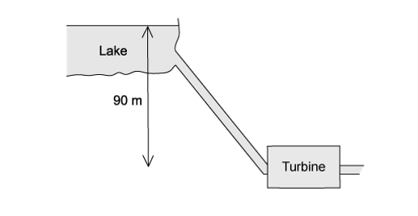

The mass flow rate of the water is 2400 kg min–1. The turbine has an efficiency of 75 %.

What is the output power of the turbine?

### Q3 — medium — 1 marks

**Q3** [1 mark]

The data below are taken from a test of a petrol engine for a motor car.

| power output | 150 kW |
|---|---|
| fuel consumption | 20 litres per hour |
| energy content of fuel | 40 MJ per litre |

Which expression will evaluate the efficiency of the engine?

### Q4 — hard — 1 marks

**Q4** [1 mark]

The diagram shows a wheel of circumference 0.30 m. A rope is fastened at one end to a force meter. The rope passes over the wheel and supports a freely hanging load of 100 N. The wheel is driven by an electric motor at a constant rate of 50 revolutions per second.

When the wheel is turning at this rate, the force meter reads 20 N.

What is the output power of the motor?

### Q5 — medium — 1 marks

**Q5** [1 mark]

The diagram shows a pump called a hydraulic ram

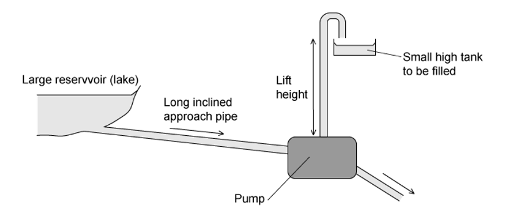

In one such pump the long approach pipe holds 500 kg of water. A valve shuts when the speed of this water reaches 2.0 m s–1 and the kinetic energy of this water is used to lift a small quantity of water by a height of 15 m.

The efficiency of the pump is 10 %.

Which mass of water could be lifted 15 m?

### Q6 — hard — 1 marks

**Q6** [1 mark]

An escalator is 60 m long and lifts passengers through a vertical height of 30 m, as shown.

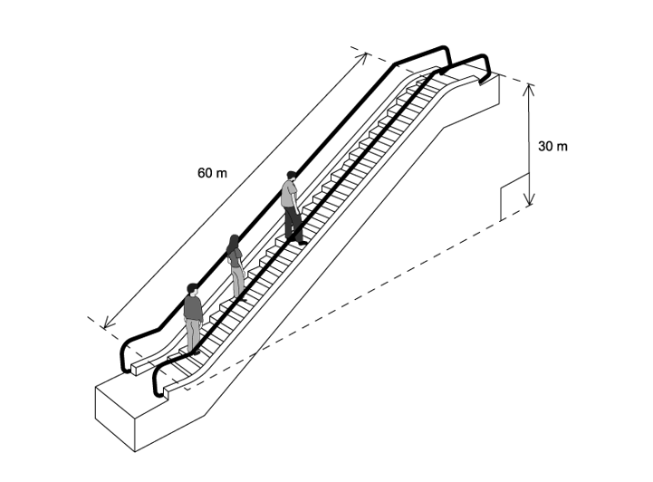

To drive the escalator against the forces of friction when there are no passengers requires a power of 2.0 kW.

The escalator is used by passengers of average mass 60 kg and the power to overcome friction remains constant.

How much power is required to drive the escalator when it is carrying 20 passengers and is travelling at 0.75 m s–1?

### Q7 — hard — 1 marks

**Q7** [1 mark]

A ball of mass *m* falls freely from rest. When it has reached a speed *v*, it strikes a vertical spring.

The spring is compressed by a distance *y* before the ball moves upwards again.

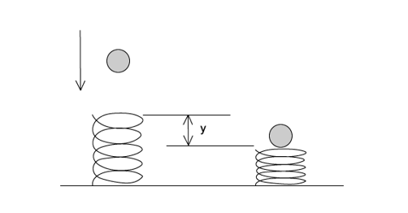

Assume that all energy the ball loses becomes elastic potential energy in the spring.

What is the average force exerted by the spring during its compression?

### Q8 — hard — 1 marks

**Q8** [1 mark]

A wind turbine has blades that sweep an area of 2000 m2. It converts the power available in the wind to electrical power with an efficiency of 50 %.

What is the electrical power generated if the wind speed is 10 m s–1? (The density of air is 1.3 kg m–3)

### Q9 — hard — 1 marks

**Q9** [1 mark]

A turbine at a hydroelectric power station is situated 30 m below the level of the surface of a large lake. The water passes through the turbine at a rate of 340 m3 per minute.

The overall efficiency of the turbine and generator system is 90 %.

What is the output power of the power station? (The density of water is 1000 kg m–3)

### Q10 — hard — 1 marks

**Q10** [1 mark]

Two blocks, P and Q, are initially stationary and connected by a taut string passing over a smooth pulley, as shown. The system is released from rest. Block Q moves vertically downwards from position A to B. Block P moves up the rough surface of the slope, as shown.

Which equation correctly describes the energy changes for the system?

### Q11 — medium — 1 marks

**Q11** [1 mark]

Initially, four identical uniform blocks, each of mass *m* and thickness *h*, are spread on a table.

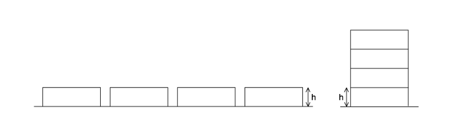

How much work is done on the blocks in stacking them on top of one another?

### Q12 — hard — 1 marks

**Q12** [1 mark]

The figure shows a mass m on an inclined plane connected by an inextensible string over a smooth pulley to a larger mass *M*. When the mass *M* falls through a distance *x*, the mass *m* moves up a vertical distance *y* at a constant speed.

The friction between *m* and the inclined plane is *F*.

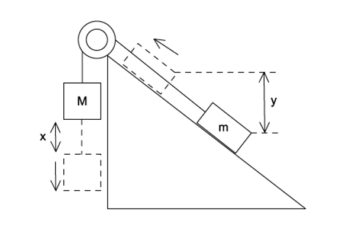

What amount of energy is converted to heat?

### Q13 — hard — 1 marks

**Q13** [1 mark]

A small mass is placed at point P on the inside surface of a smooth hemisphere. It is then released from rest. When it reaches the lowest point T, its speed is 4.0 m s–1.

The diagram (not to scale) shows the speed of the mass at other points Q, R and S as it slides down. Air resistance is negligible.

The mass loses potential energy *E* in falling from P to T.

At which point has the mass lost potential energy  $\frac{E}{4}$ ?

### Q14 — medium — 1 marks

**Q14** [1 mark]

Trains supply coal to a power station. The table below gives quantities describing the operation of the power station.

|   | **Symbol** | **Unit** |
|---|---|---|
| power station output | *P* | W |
| number of trains per day | *N* |   |
| mass of coal on a train | *M* | kg |
| energy from 1 kg of coal | *J* | J |
| number of seconds in one day | *S* | s |

Which expression gives efficiency of the power station?

### Q15 — easy — 1 marks

**Q15** [1 mark]

When bungee jumping, a student starts with maximum gravitational potential energy (position 1), then falls freely until the rope fully unwinds (position 2), after which the rope starts to stretch until the lowest point of the jump is reached (position 3)

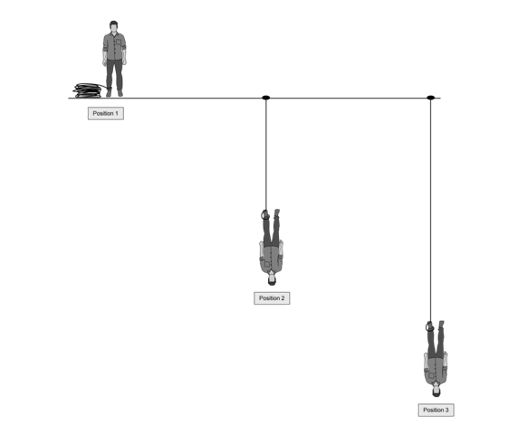

What are the kinetic and elastic potential energies at position 3?

|   | **Kinetic energy** | **Elastic potential energy** |
|---|---|---|
| **A** | maximum | maximum |
| **B** | maximum | minimum |
| **C** | minimum | maximum |
| **D** | minimum | minimum |

### Q16 — easy — 1 marks

**Q16** [1 mark]

An electric motor is required to produce 120 W of mechanical output power. The efficiency of the motor is 80%

Which row is correct?

|   | **Electrical power input to motor / W** | **Waste heat output from motor / W** |
|---|---|---|
| **A** | 120 | 24 |
| **B** | 120 | 96 |
| **C** | 150 | 30 |
| **D** | 150 | 120 |

### Q17 — easy — 1 marks

**Q17** [1 mark]

The total energy input *E**in* in a process is partly transferred to useful energy output *U*, and partly to energy that is wasted *W*

What is the efficiency of the process?

### Q18 — easy — 1 marks

**Q18** [1 mark]

A boat moving at constant speed *v* through still water experiences a total frictional drag *F*

What is the power developed by the boat?

### Q19 — easy — 1 marks

**Q19** [1 mark]

The kinetic energy of a moving vehicle with mass 1000 kg is 4.5 × 105 J. It brakes with a total constant braking force of 6000 N

What will be its stopping distance?

### Q20 — easy — 1 marks

**Q20** [1 mark]

Which expression **defines** power?

### Q21 — easy — 1 marks

**Q21** [1 mark]

Which of the following is a statement of the principle of conservation of energy?

### Q22 — medium — 1 marks

**Q22** [1 mark]

A mass is raised vertically. In a time t, the increase in its gravitational potential energy is $E_{p}$ and the increase in its kinetic energy is $E_{k}$.

what is the average power input to the mass?

### Q23 — easy — 1 marks

**Q23** [1 mark]

Which operation involves the greatest mean power?

### Q24 — medium — 1 marks

**Q24** [1 mark]

A conveyor belt is driven at velocity V by a motor. Sand drops vertically on to the belt at a rate of $m\mathrm{kg}s^{-1}$.

What is the additional power needed to keep the conveyor belt moving at a steady speed when the sand starts to fall on it ?

### Q25 — hard — 1 marks

**Q25** [1 mark]

What is the power required to give a body of mass *m* a forward acceleration *a* when it is moving with velocity *v* up a frictionless track inclined at an angle *θ* to the horizontal?

### Q26 — medium — 1 marks

**Q26** [1 mark]

The diagram shows the design of a water wheel which drives a generator to produce electrical energy. The flow rate of the water is 200 kg s–1. The generator supplies a current of 32 A at a voltage of 230 V.

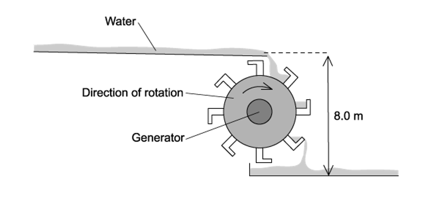

Ignoring any changes in kinetic energy of the water, what is the efficiency of the system?

### Q27 — medium — 1 marks

**Q27** [1 mark]

A weight *W* hangs from a trolley that runs along a rail. The trolley moves horizontally through a distance *p* and simultaneously raises the weight through a height *q*.

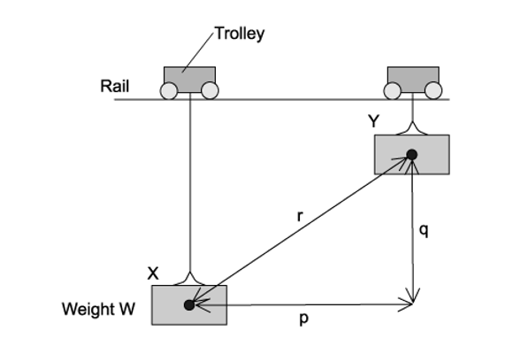

As a result, the weight moves through a distance *r* from X to Y. It starts and finishes at rest.

How much work is done on the weight during this process?

### Q28 — easy — 1 marks

**Q28** [1 mark]

What is the average power output of a laser that can deliver 0.20 J of energy in 10 ns?

### Q29 — easy — 1 marks

**Q29** [1 mark]

A transformer has the following input and output

|   | **Potential difference / V** | **Current / A** |
|---|---|---|
| **Input**  **Output** | 11 000  240 | 28  1200 |

What is the efficiency of the transformer?

### Q30 — hard — 1 marks

**Q30** [1 mark]

A boy on a boat P pulls on a rope with a constant force *F* over a duration of time *t*. The other end of the rope is either tied to an anchor on the pier (Diagram a) or a freely floating boat Q (Diagram b) of equal mass as shown in the figures shown.

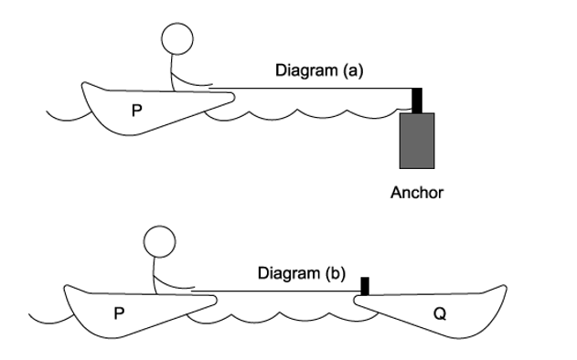

*W**a* and *W**b* represent the total work done by the boy during the time *t* and *P**a* and *P**b* represent the average power output of the boy in diagrams (a) and (b) respectively.

Which of the following statements is correct?

### Q31 — medium — 1 marks

**Q31** [1 mark]

The force resisting the motion of a car is taken as being proportional to the square of the car's speed. The magnitude of the force at a speed of $20ms^{-1}$ is 800 N.

What effective power is required from the car's engine to maintain a steady speed of $40ms^{-1}$?

### Q32 — medium — 1 marks

**Q32** [1 mark]

A constant force $F$ acting on a car of mass $m$ moves it up a slope through a distance $s$ at constant velocity $v$. The angle of the slope to the horizontal is $α$.

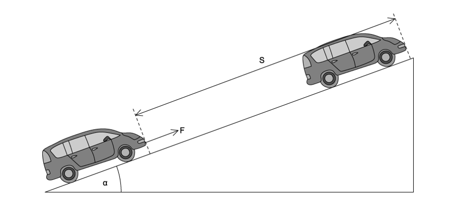

Which expression gives the efficiency of the process?

### Q33 — medium — 1 marks

**Q33** [1 mark]

A bungee jumper has 24 kJ of gravitational potential energy at the top of his jump. He is attached to an elastic rope which starts to stretch after a short time of free fall. Assume that energy loss through air resistance is negligible.

|   | **GPE / kJ** | **EPE / kJ** | **KE / kJ** |
|---|---|---|---|
| Top | 24 | 0 | 0 |
| Bottom | 0 | 24 | 0 |

What are the possible values when the jumper is half-way down?

|   | **GPE / kJ** | **EPE / kJ** | **KE / kJ** |
|---|---|---|---|
| **A** | 12 | 10 | 2 |
| **B** | 12 | 8 | 4 |
| **C** | 8 | 8 | 8 |
| **D** | 12 | 2 | 10 |

### Q34 — medium — 1 marks

**Q34** [1 mark]

The first column in the table gives four examples of work being done. The second column gives more detail of the action.

Which row is **not** correct?

|   | **Example** | **Detail** |
|---|---|---|
| **A** | a girl dives from a diving board into a swimming pool | work is done by the girl against gravity as she falls |
| **B** | a man pushes a car along a level road | work is done by the man against friction |
| **C** | an electron is accelerated towards a positively-charged plate | work is done on the electron by the electric field of the plate |
| **D** | a piston is pushed outwards as a gas expands | work is done on the atmosphere by the gas |
