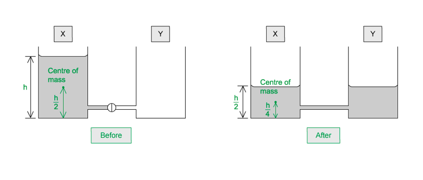
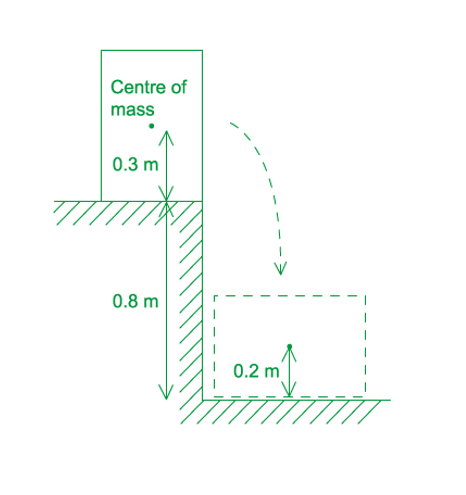
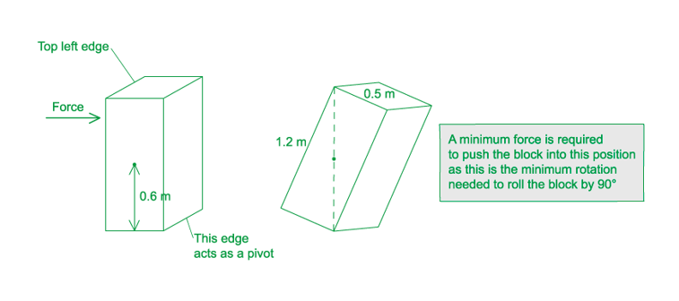
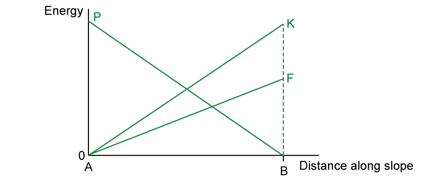
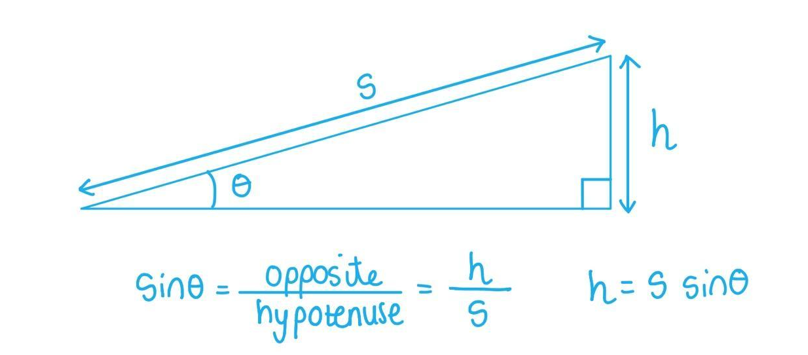
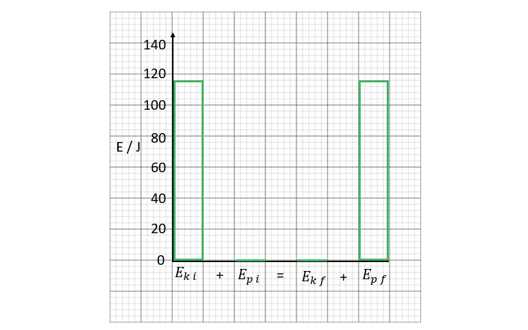
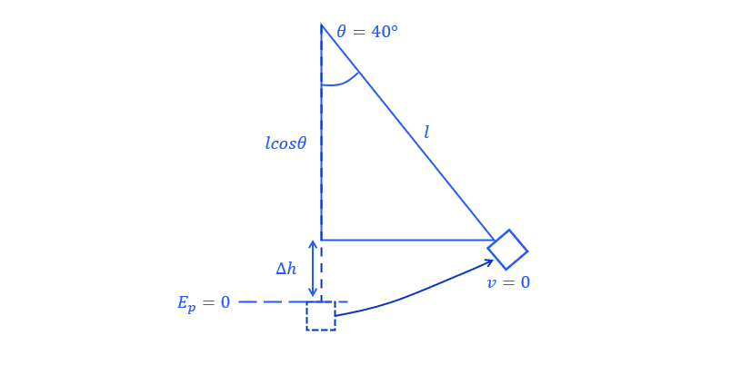
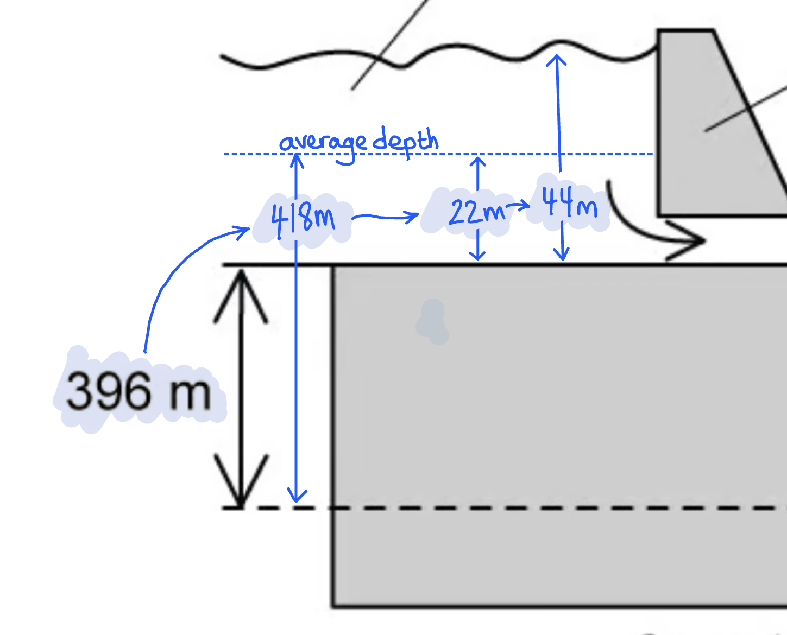

# Mark Schemes — Gravitational Potential Energy & Kinetic Energy
**5. Work, Energy & Power** · Cambridge (CIE) A-LEVEL physics (9702)

## Multiple Choice Questions (31 questions)

### Q1
**Final answer:** **The correct answer is C**

- The density of the beam is given as $ρ = 7 . 8 \times 10^{3} \text{kg m}^{-3}$
- The volume of the beam is

$V = 0 . 40 \times 0 . 30 \times 8 . 0 = 0 . 96 \text{m}^{3}$

- Mass is calculated using

$m = ρ \times V$

- Therefore

$m = 7 . 8 \times 10^{3} \times 0 . 96 = 7488 \text{kg}$

- Change in gravitational potential energy is

$\DeltaE_{p}=mg\Deltah$

- Where:

$m=ρV$

$\DeltaE_{p}=ρVg\Deltah$

$\Delta E_{p} = ( 7.8 \times 10^{3} ) ( 0.40 \times 0.30 \times 8.0 ) \times 9.81 \times 12$

$\DeltaE_{p}=881\text{kJ}$

**A** is incorrect as this underestimates the change in height.

**B** is incorrect as this underestimates the mass of the steel beam.

**D** is incorrect as this overestimates the change in height or uses incorrect density.

### Q2
**Final answer:** **The correct answer is ****B**** because:**

- Let’s first consider the bottom of the ball at 72 cm at the start and 37 cm at the end
- From the conservation of energy, as the ball falls, all the potential energy (PE) is being converted to kinetic energy
- Just before it strikes the surface, the kinetic energy is 0.75 J as all PE has been converted to KE
- At this point, the bottom of the ball has zero PE and a KE of 0.75 J

  - This value of KE is the value at the bottom of the ball, so, throughout our calculation we need to consider the bottom of the ball instead of the top
- PE of bottom of the ball at the point of release = KE of bottom of ball just before striking the surface

  - $\DeltaE_{p}=mg\Deltah=\DeltaE_{k}$
  - $m\times9.81\times0.72=0.75$
  - Mass of the ball, $m=\frac{0.75}{9.81\times0.72}=0.1062\mathrm{kg}$
- Now, for the rebound, all of the kinetic energy just after the ball leaves the surface is converted to potential energy at the maximum height reached
- The maximum of height of the bottom of the ball after rebound is 45 – 8 = 37 cm

- KE just after leaving the surface = PE of bottom of ball at a height of 37 cm

  - $mg\Deltah=\DeltaE_{k}$
  - $E_{k}=0.1062\times9.81\times0.37=0.3855J$
- Therefore, the kinetic energy just after the ball leaves the surface is 0.39 J

  - Note that 0.75 J is the KE of the ball just before hitting the surface while 0.39 J is the KE of the ball just after leaving the surface. This indicates that some energy (0.75 – 0.39) J has been lost

### Q3
**Final answer:** **The correct answer is ****A**** because:**

- Gravitational potential energy$\DeltaE_{p}=mg\Deltah$
- *h* refers to the vertical distance travelled by the stone, which is 30 m and *mg* refers to the weight of the stone, which is 4 N

  - Therefore, ΔEp = 4 × 30 = 120 J

### Q4
**Final answer:** **The correct answer is ****B**** because:**

- Since the cyclist is moving at a constant speed, he is not gaining any kinetic energy
- Work done against friction $W=Fs=8\times20=160J$
- From the conservation of energy :
- Work done by cyclist = Gain in GPE + Work done against friction

  - 450 = ΔEp + 160
- So, the ΔEp gained by the cyclist is

  - ΔEp = 450 – 160 = 290 J

### Q5
**Final answer:** **The correct answer is ****A**** because:**

- Let the speed of car X$=v$
- Let the mass of car X$=2m$
- Let the speed of car Y $=2v$
- Let the mass of car Y $=m$

  - Kinetic energy (KE) is equal to $E_{k}=\frac{1}{2}mv^{2}$
- KE of car X $= 1 \frac{1}{2} ( 2 m ) v^{2} = m v^{2}$
- KE of car Y$= 1 \frac{1}{2} m ( 2 v )^{2} = 2 m v^{2}$

  - Ratio $\frac{KEofcarX}{KEofcarY}=\frac{mv^{2}}{2mv^{2}}=\frac{1}{2}$
- Therefore, car X has half the kinetic energy of car Y

### Q6
**Final answer:** **The correct answer is ****B**** because:**

- The change in kinetic energy is equal to

  - $\DeltaE_{k}=\frac{1}{2}mu^{2}-\frac{1}{2}mv^{2}$
- Where *u* = 25 m s–1 and *v* = 5 m s–1

  - $\Delta E_{k} = 1 \frac{1}{2} \times 1000 ( 25^{2} - 5^{2} ) = 300 000 \mathrm{J}$
- The change in kinetic energy is 300 kJ

### Q7
**Final answer:** **The correct answer is ****C**** because:**

- The density of the cube is given as ρ = 2.0 × 103 kg m–3
- The volume of the cube is given as $V = a^{3} = ( 0.6 )^{3}$
- Density is equal to $ρ=\frac{m}{v}$

  - So, mass is equal to $m = \\rho \times V = 2.0 \times 10^{3} \times ( 0.6 )^{3} = 432 \text{kg}$
- Now, we have to find the change in potential energy of the cube. At ground level, the potential energy is equal to zero and the potential energy at height *h* is given by

  - $\DeltaE_{p}=mg\Deltah=432\times9.81\times5.0=21190J$
- Therefore, the change in GPE is 21 kJ

### Q8
**Final answer:** **The correct answer is ****A**** because:**

- The height above the ground is Δ*h*
- So, as *h* increases, the position of the object above the ground gets higher
- Potential energy is equal to $\DeltaE_{p}=mg\Deltah$
- Therefore, as *h* increases, potential energy *E**p* increases linearly since the relationship between Δ*E**p* and Δ*h* is directly proportional $\DeltaE_{p}α\Deltah$

**B **is incorrect because this graph shows the object would have more GPE on the ground than when it is a height *h* above the ground

**C & D **are incorrect because these graphs show a non-linear increase/decrease in GPE as* h* increases

### Q9
**Final answer:** **The correct answer is ****D**** because:**

- At the bottom, the trolley needs to have a minimum amount of kinetic energy (KE) as a result of its initial velocity
- As the trolleys moves up the slope, it gains gravitational potential energy (GPE)
- From the conservation of energy:

  - KE at bottom = GPE at top + Work done against friction
- But since the question tells us that frictional forces are negligible, the work done against resistive forces is zero
- So, KE at bottom = GPE at top

  - $\frac{1}{2}mv^{2}=mg\Deltah$
- The mass *m* can be eliminated on both sides leaving us with

  - $V^{2}=2g\Deltah$
- Therefore, we can see from this equation, to obtain the speed *v* we only need the values of *g* and *h*
- Since *g* is already known, so we only need to know the value of *h*

### Q10
**Final answer:** **The correct answer is ****B**** because:**

- Consider the water in both vessels as one body with one mass
- Since the mass of the water is spread all over the volume it occupies, the centre of mass should be considered when calculating the gravitational potential energy (GPE)
- Before the tap is opened, the centre of mass of the water in vessel X may be considered to be at its centre which is at half the water level $\frac{h}{2}$

  - Potential energy of water before tap is opened = $m g ( \frac{h}{2} ) = \frac{m g h}{2}$
- When the tap is opened the total mass of water in the whole body is the same, but the water level is now at a height of $\frac{h}{2}$   in both vessels
- The centre of mass may be considered to be at the centre of the volume of water, which is, again, at a height of half the water level so the centre of gravity is now at a height of $\frac{h}{4}$

  - Potential energy of water after tap has been opened = $m g ( \frac{h}{4} ) = \frac{m g h}{4}$
- Loss in potential energy$( \frac{m g h}{2} ) - ( \frac{m g h}{4} ) = \frac{m g h}{4}$

### Q11
**Final answer:** **The correct answer is ****A**** because:**

- For the object of mass *m* and velocity *v*:

  - At point X, Kinetic energy$=\frac{1}{2}mv^{2}$
- From conservation of energy :
- Potential energy at point Y = Kinetic energy at point X

  - $mgh=\frac{1}{2}mv^{2}$
  - Height, $h=\frac{v^{2}}{2g}$
- For the object of mass $\frac{m}{2}$  and velocity $\frac{v}{2}$  :

  - At point X, Kinetic energy $= 1 \frac{1}{2} ( \frac{m}{2} ) ( \frac{v}{2} )^{2} = \frac{m v^{2}}{16}$
- Potential energy at point Y = Kinetic energy at point X
- Let the height at point Y$=x$

  - $( \frac{m}{2} ) g x = \frac{m v^{2}}{16}$
  - Height, $x = \frac{v^{2}}{8 g} = 1 \frac{1}{4} ( \frac{v^{2}}{2 g} ) = \frac{h}{4}$

### Q12
**Final answer:** **The correct answer is ****B**** because:**

- From the conservation of energy:

  - Change in GPE = Change in KE + Work done against friction
- In equation form we can write this such that:

  - $\DeltaE_{p}=\DeltaE_{k}+Fs$
- The change in GPE comes from the loss in GPE from the 4 kg mass and the gain in GPE from the 3 kg mass:

  - $\Delta E_{p} = m g \Delta h = ( 4 \times 9.8 \times 5 ) - ( 3 \times 9.8 \times 3 ) = 107.8 \mathrm{J}$
- The change in KE comes from the gain in GPE from the 4 kg mass and the 3 kg mass, the masses are connected so both travel with speed *v*:

  - $\Delta E_{k} = 1 \frac{1}{2} m v^{2} = 1 \frac{1}{2} ( 3 ) v^{2} + 1 \frac{1}{2} ( 4 ) v^{2} = \frac{7 v^{2}}{2}$
- The work done against friction is given by $Fs=2\times5=10J$

  - $107.8=\frac{7v^{2}}{2}+10$
  - $v^{2} = \frac{2}{7} ( 107.8 - 10 ) = 27.9$
  - $v=\sqrt{27.9}=5.29ms^{-1}$
- Therefore, the final speed of the mass is 5.3 m s–1

### Q13
**Final answer:** **The correct answer is ****A**** because:**

- From the conservation of energy:

  - GPE of truck at top = KE of truck at bottom + Work done against friction
- GPE of truck at top  $\DeltaE_{p}=mg\Deltah=500\times9.81\times30=147150J$
- Work done against friction $W=Fs=250\times400=100000J$
- KE of truck at bottom = GPE of truck at top – Work done against friction

  - $\frac{1}{2}mv^{2}=147150-100000=47150$
  - $v=\sqrt{\frac{2\times47150}{500}}=13.7$
- Therefore, the final speed is 14 m s–1

### Q14
**Final answer:** **The correct answer is ****C**** because:**

- The speed is in km h–1 so we must first convert it to m s–1

  - $108\mathrm{km}h^{-1}=\frac{108\times1000}{60\times60}=30ms^{-1}$
- The kinetic energy is therefore equal to

  - $E_{k}=\frac{1}{2}mv^{2}=\frac{1}{2}\times1400\times30^{2}=630000J$
- The kinetic energy of the car is 630 kJ

### Q15
**Final answer:** **The correct answer is ****D**** because:**

- In the derivation of kinetic energy (KE), we start by equating KE with the work done by the moving body, then add in Newton's second law of motion $F=ma$

  - $\DeltaE_{k}=W=F\Deltas=ma\Deltas$
- Then we want to use a kinematic equation which contains the term $a\Deltas$`blank`

  - $v^{2}=u^{2}+2a\Deltas$
  - $a\Deltas=\frac{v^{2}-u^{2}}{2}$
  - $\Delta E_{k} = m a \Delta s = m ( \frac{v^{2} - u^{2}}{2} )$
- Now if we expand this equation, we get

  - $\DeltaE_{k}=\frac{mv^{2}}{2}-\frac{mu^{2}}{2}$
- We assume that the object started at rest and accelerated with a uniform rate of *a* up to speed *v, *therefore *u* = 0 and this leaves us with

  - $E_{k}=\frac{1}{2}mv^{2}$

### Q16
**Final answer:** **The correct answer is ****C**** because:**

- Rate of gaining potential energy $=\frac{\DeltaE_{p}}{\Deltat}$
- $\DeltaE_{p}=mg\Deltah$

  - Where Δ*h* is the vertical height
- So, to consider the gain in GPE, we need to consider the vertical component of speed
- The aeroplane climbs at a speed of 50 m s-1 at an angle of 23° to the horizontal

  - Vertical component of speed$=50\mathrm{sin}23^{^{\circ}}$
- Rate of gaining potential energy$=\frac{\DeltaE_{p}}{\Deltat}$
- Rate of gaining potential energy$= \frac{m g \Delta h}{\Delta t} = m g ( \frac{\Delta h}{\Delta t} )$

  - Where $\frac{\Deltah}{\Deltat}$  is the vertical speed at which the aeroplane climbs
- Rate of gaining potential energy$= ( 1.2 \times 10^{5} ) \times 9.81 \times 50 \text{sin} 23^{ ^{\circ} }$
- Rate of gaining potential energy = 2.3 × 107 J s–1

### Q17
**Final answer:** **The correct answer is ****C**** because:**

- In this question we need to take the change in height Δ*h* from the centre of mass of the block
- The centre of mass is the point where the force of gravity is taken to act. We need to consider the centre of mass, else each point on the box would have its own GPE as they have different heights
- We are told the block is uniform, so the centre of mass can be considered to be at its centre
- At the top of the step:

  - Height of position of centre of mass above ground $h_{i} = 0.8 + ( \frac{0.6}{2} ) = 0.8 + 0.3 = 1.1 \mathrm{m}$
- At the bottom of the step:

  - Height of position of centre of mass above ground $h_{f}=\frac{0.4}{2}=0.2m$
- Change in GPE = final GPE – initial GPE

  - $\Delta E_{p} = m g \Delta h = 500 \times ( 1.1 - 0.2 ) = 450 \mathrm{J}$
- Therefore, the loss in GPE is 450 J

### Q18
**Final answer:** **The correct answer is ****D**** because:**

- The rate at which the motor provides energy is the power of the motor
- In the lift system, the mass m2 works downwards under gravity, causing the elevator of mass m1 to move up. However, the motor also provides some energy in moving the elevator up
- The gravitational potential energy of the masses is changing continuously and at a steady rate, since they are moving at a steady speed
- GPE of elevator = $m_{1}gh_{1}$

  - Where *h**1* is its height above the ground
- Rate of change of GPE of elevator = $\frac{m_{1}gh_{1}}{t}=m_{1}gv$
- GPE of heavy weight = $m_{2}gh_{2}$

  - Where *h**2* is its height above the ground
- Rate of change of GPE of heavy weight = $\frac{m_{2}gh_{2}}{t}=m_{2}gv$
- Let the power of the motor be *P*

  - $m_{1}gv=m_{2}gv+P$
  - $P = ( m_{1} - m_{2} ) g v$
- Therefore, the power of the motor is equal to $( m_{1} - m_{2} ) g v$

**A & B **are incorrect because these choices have units of energy, not power. If **B** was correct, then there would have no need for the heavy weight

**C **is incorrect because this option ignores the influence of the other mass *m**2*

### Q19
**Final answer:** **The correct answer is ****A**** because:**

- At the top of the slope, the block has gravitational potential energy (GPE). As the block falls, some GPE is converted into kinetic energy of the block and work done due the frictional force
- ΔGPE = KE + Work done against friction
- The loss in height Δ*h* of the block is 3.0 m

  - $\DeltaE_{p}=mg\Deltah=2.0\times9.81\times3.0=58.86N$
- Frictional force = 5.0 N
- Distance moved against friction = 7.0 m

  - Work done against friction $Fs=5.0\times7.0=35.0J$
- ΔGPE = KE + Work done against friction

  - $58.86=E_{k}+35.0$
- KE of block at bottom = $58.86-35.0=23.86J$

  - $\frac{1}{2}mv^{2}=23.86$
  - $v=\sqrt{\frac{23.86\times2}{2.0}}=4.88ms^{-1}$
- Therefore, the speed of the block after falling is 4.9 m s–1

### Q20
**Final answer:** **The correct answer is ****A**** because:**

- Initially, the potential energy of ball$=mgh$

  - h0 is the height before release and h1 is the height after one bounce
- Since the graph is a straight line, the ratio of h1 / h0 (gradient) is constant

  - Gradient$= \frac{\Delta h_{1} }{\Delta h_{0} } = ( \frac{80 - 0}{100 - 0} ) = 0.8$
- So, after one bounce the potential energy becomes 0.8 of the initial potential energy
- The kinetic energy of the ball immediately after an impact with the surface is the same as the potential energy at maximum height as all kinetic energy is converted into potential energy

  - After 1st bounce, kinetic energy$=0.8mgh$
  - After 2nd bounce, kinetic energy$= 0.8 \times ( 0.8 m g h ) = ( 0.8 )^{2} m g h$
  - After 3rd bounce, kinetic energy$= ( 0.8 )^{3} m g h$

### Q21
**Final answer:** **The correct answer is ****A**

- From the conservation of energy:

  - Loss in PE of the falling mass = Gain in KE of the whole system + Work done against friction

$\DeltaE_{p}=\DeltaE_{k}+W$

- Total loss of *E*p is

$\DeltaE_{p}=m_{m}g\Deltah=0.5\times9.8\times1=4.9J$

- Total gain in Ek is

$\Delta E_{k} = \frac{1}{ 2} ( m_{t} + m_{m} ) v^{2} = \frac{1}{2 } ( 1.5 + 0.5 ) v^{2} = v^{2}$

- Where *m**t* and *m**m* are the masses of the trolley and falling mass respectively

- Work done against friction

$W=Fs=0.8\times1.0=0.80J$

- The final speed of the trolley and mass is

$\DeltaE_{p}=\DeltaE_{k}+W$

$4.9=v^{2}+0.80$

$v=\sqrt{4.9-0.80}=2.02ms^{-1}$

- So, the maximum kinetic energy of the trolley is equal to

$E_{k m a x} = 1 \frac{1}{2} m_{t} v^{2} = 1 \frac{1}{2} ( 1.5 ) ( 2.02 )^{2} = 3.075 \mathrm{J}$

- Therefore, the maximum kinetic energy of the trolley is 3.1 J

### Q22
**Final answer:** **The correct answer is ****C**** because:**

- The kinetic energy of an object is equal to

  - $E_{k}=\frac{1}{2}mv^{2}$
- The mass of the object is constant, but we must know its value to find the new kinetic energy. Therefore:
- $1500=\frac{1}{2}m\times10^{2}$
- $m=\frac{2\times1500}{100}=30\mathrm{kg}$
- Now we have our m and v values, so we can work out the new kinetic energy :

  - $E_{k}=\frac{1}{2}\times30\times40^{2}=24000J$
- The new kinetic energy is 24 kJ

### Q23
**Final answer:** **The correct answer is ****A**** because:**

- In the derivation of gravitational potential energy (GPE), we start with the definition of work done

  - $Workdone=force\timesdisplacement=F\Deltas$
- Next, we consider the case of an object being raised by a height Δ*h*
- The only force acting on this object will be its weight

  - $F=W=mg$
- To move an object against gravity, the force applied upwards must equal the downwards force gravity exerts on the object, *mg*. So, if the object is moved against gravity by a distance Δ*h* the work done is given by :

  - $\DeltaE_{p}=mg\Deltah$

### Q24
**Final answer:** **The correct answer is ****D**** because:**

- Initial kinetic energy $E_{k} = 1 \frac{1}{2} m v^{2} = 1 \frac{1}{2} m ( 20 )^{2}$
- Final kinetic energy $= 1 \frac{1}{2} m v^{2} = 1 \frac{1}{2} m ( 80 )^{2}$
- We need to write the final kinetic energy in terms of $E_{k}$
- The ratio of final KE to initial KE is $= \frac{1 \frac{1}{2} m ( 80 )^{2}}{1 \frac{1}{2} m ( 20 )^{2}} = 16$

  - Therefore, final KE $=16E_{k}$

### Q25
**Final answer:** **The correct answer is ****D**** because:**

- Gravitational potential energy (GPE)  $\DeltaE_{p}=mg\Deltah$
- The GPE gained by walking up one flight of stairs is $\DeltaE_{p}=80\times9.8\times2.5=1960J$
- The GPE gained by walking up six flights of stairs is $\DeltaE_{p}=6\times1960=11760J$

  - Therefore, the man gains 12 000 J in climbing six flights of stairs

### Q26
**Final answer:** **The correct answer is ****A**** because:**

- Since the solid cuboid is uniform, its centre of mass may be considered to be at the centre of the cuboid, that is, initially at a height of 0.6 m

  - Weight $=mg=4000N$
- Therefore, before the force is applied, the GPE of the cuboid is equal to

  - $mgh=4000\times0.6$
- As illustrated by the diagram, as the cuboid rolls about the bottom right edge, the centre of mass of the cuboid rises to a greater height, so, its potential energy increases and reaches a maximum and afterwards, the cuboid will fall under gravity
- So, the minimum energy is equal to the change in energy from these two positions
- Consider the position for maximum potential energy:

  - The centre of mass will be at the middle of the dotted line and this forms a right-angle triangle as shown in the diagram
- Using Pythagoras' theorem:

  - Vertical dotted line $=\sqrt{0.5^{2}+1.2^{2}}=1.3m$
- Height of centre of mass in new position $=\frac{1.3}{2}=0.65m$
- GPE of cuboid in new position :

  - $mgh=4000\times0.65$
- Minimum energy required to roll cuboid = Rise in potential energy
- Minimum energy$= ( 4000 \times 0.65 ) - ( 4000 \times 0.6 ) = 200 \mathrm{J}$

### Q27
**Final answer:** **The correct answer is ****C**** because:**

- Let the height from which the sphere is dropped$=\Deltah$
- As the sphere falls, its gravitational potential energy gets converted into kinetic energy.
- Its speed when it hits the plate is *u*, so:

  - $mg\Deltah=\frac{1}{2}mu^{2}$
  - Speed $u=\sqrt{2g\Deltah}$
- As the sphere rebounds and move vertically up, its kinetic energy gets converted into gravitational potential energy
- The height is now half the height where it has dropped initially, so:

  - $1 \frac{1}{2} m v^{2} = m g ( \frac{\Delta h}{2} )$
  - Speed $v=\sqrt{g\Deltah}$
- So, the ratio of $\frac{v}{u}$  is:

  - Ratio$=\frac{v}{u}=\frac{\sqrt{g\Deltah}}{\sqrt{2g\Deltah}}$
  - Ratio$= \frac{v}{u} = \frac{1}{ \sqrt{2} \times \frac{ \sqrt{g} \Delta h} }{ \sqrt{g \Delta h} }$
  - Ratio$=\frac{v}{u}=\frac{1}{\sqrt{2}}$

### Q28
**Final answer:** **The correct answer is ****C**** because:**

- From the conservation of energy:

  - Change in GPE = Change in elastic potential energy + Work done against friction
- We are told the slope is frictionless, so we can disregard the work done against friction as it is negligible
- Change in GPE as the block slides down the slope and compresses the spring is

  - $\Delta E_{p} = m g \Delta h = ( 12 ) ( 9.8 ) ( 3 + 1.3 ) \sin 30 = 252.84 \mathrm{J}$
- The loss in GPE is equal to the elastic energy stored by the spring when it is compressed, so:

  - $\Delta E_{p} = 1 \frac{1}{2} k x^{2} = 1 \frac{1}{2} k ( 1.3 )^{2}$
- Where *k* is the spring constant and *x* is the compression of the spring

  - $252.84 = 1 \frac{1}{2} k ( 1.3 )^{2}$
  - $k = \frac{2 \times 252.84}{( 1.3 )^{2}} = 299.2 \mathrm{N} \mathrm{m}^{- 1}$

- Therefore, the spring constant is 300 N m–1

### Q29
**Final answer:** **The correct answer is ****B**** because:**

- The acceleration due to gravity of 9.8 m s–2 acts downwards on Y since it is hanging freely

  - Weight of Y$=mg=5.0\times9.8=49N$
- As X is attached to Y, it will move up the slope as Y falls
- So, the acceleration in the whole system is therefore **not **9.8 m s–2
- We need to find the resultant acceleration which acts on the total mass in the system. The component of the weight of X will act on the system:

  - $mg\mathrm{sin}30=4.0\times9.8\times\mathrm{sin}30=19.6N$
- The weight of Y contributes a force up the slope while the component of weight of X contributes a force down the slope
- Resultant force in system $=ma=49-19.6=29.4N$

  - $( 4.0 + 5.0 ) a = 29.4 \mathrm{N}$
  - Acceleration, $a=\frac{29.4}{9}=3.27ms^{-2}$
- This is the resultant acceleration on each X and Y.
- Initially both X and Y are at rest. Consider the equation for uniformly accelerated motion:

  - $v^{2}=u^{2}+2as$         where *u* = 0, *v* = ?, *s* = 2.0 m and *a* = 3.27 m s–2
  - $v^{2} = 0 + 2 ( 3.27 ) ( 2 )$
  - $v=\sqrt{2\times3.27\times2}=3.62ms^{-1}$
- Kinetic energy of X$= 1 \frac{1}{2} ( 4.0 ) ( 3.62 )^{2}$
- Kinetic energy of Y$= 1 \frac{1}{2} ( 5.0 ) ( 3.62 )^{2}$
- Total kinetic energy of system$= 1 \frac{1}{2} ( 4.0 ) ( 3.62 )^{2} + 1 \frac{1}{2} ( 5.0 ) ( 3.62 )^{2} = 58.96 \mathrm{J}$

  - Therefore, the total kinetic energy is 59 J

### Q30
**Final answer:** **The correct answer is ****B**** because:**

- In the first topic we looked at how we can estimate different quantities
- Here we need to estimate the maximum speed and mass of an Olympic athlete
- A reasonable estimate for the time taken to complete a 100 m race in an Olympic competition is about 10 s
- Let the maximum speed of the Olympic athlete be $v=\frac{100}{10}=10ms^{-1}$
- Let the mass of the Olympic athlete be about 80 kg

  - Kinetic energy $\frac{1}{2}mv^{2}=\frac{1}{2}\times80\times10^{2}=4000J$

### Q31
**Final answer:** **The correct answer is ****B**** because:**

- Kinetic energy (KE) is equal to $E_{k}=\frac{1}{2}mv^{2}$
- As the speed it constant, KE also remains constant

  - On the graph, this will be shown as a straight, horizontal line
- Gravitational potential energy (GPE) is equal to $\DeltaE_{p}=mg\Deltah$
- As the speed is constant, the rate at which the distance *h* decreases is also constant, so the decrease in GPE is also constant

  - On the graph, this will be shown as a straight, diagonal line starting from a maximum value with a negative gradient

**A & C **are incorrect because the speed, and hence the change in distance, of the steel ball is constant, meaning the relationship between these quantities and *E**k* and Δ*E**p* will be linear which would not result in curved lines on the graph

**D **is incorrect because this graph would be accurate for an object accelerating towards the ground, however the ball is travelling at a constant speed so the KE must be constant

## Structured Questions (8 questions)

### Q1
A graph that would score 3 marks should look like:

- Graph P drawn from top of energy axis to point B; **[1 mark]**
- Graph K drawn from 0 to point B and same height as P and above F; **[1 mark]**
- Graph F draw from 0 to point below K; **[1 mark]**

Explanation of the important features:

- P + K = constant; **[1 mark]**
- The loss in gravitational potential energy = gain in kinetic energy <u>for P and K</u> **OR** potential energy at A = kinetic energy at Q for <u>P and K</u>;** [1 mark]**
- F is <u>below</u> K because friction causes energy to be transferred from the system (as heat); **[1 mark]**** **

**[Total: 6 marks]**** **

> *Don’t be put off by the number of marks for this question! There are multiple parts to it, so make sure to check whether you have gained all the marks accordingly before moving on. *

> *Since there are 3 graphs to draw, this would be 3 marks. Therefore, your explanation should be another 3 marks worth, explaining as much as you can about the important features of each graph to complete the full 6 marks.*
To calculate height $x$.

List the known quantities:

- Mass of passenger, *m* = 70 kg
- Height dropped by passenger = $x$
- Radius of circular motion, *r* = 25 m
- Force required for circular motion, *F* = 5.4 kN = 5.4 × 103 N

Calculate the velocity at **C**, *v*:

- Recall the equation for centripetal force, $F=\frac{mv^{2}}{r}$
- *v* =$\sqrt{\frac{Fr}{m}}$
- *v* = $\sqrt{ \frac{( 5.4 \times 10^{3} ) \times 25}{70} }$= 43.92 m s–1 **[1 mark]**

Consider energy changes between point **A** and **C**:

- The gravitational potential energy at **A** is converted to kinetic energy at point **C**

  - Vertical distance from **A **to **C **is *h*
- $\frac{1}{2}$*mv**2* = *mgh ***[1 mark]**

Rearrange for *h* and substitute in values:

- Mass cancels out, leaving $\frac{1}{2}v^{2}=gh$
- Rearranging for h gives $h=\frac{v^{2}}{2g}$
- $h=x+25m$  therefore  $x+25=\frac{v^{2}}{2g}$
- $x$ = $\frac{v^{2}}{2g}$– 25
- $x$ = $\frac{( 43.92 )^{2}}{2 \times 9.81}$– 25 = 73 m **[1 mark]**** **

**[Total: 3 marks]**** *** *
To calculate the value of *θ:*

List the known quantities:

- Mass of cage and passengers, *m* = 720 kg
- Resistive force by brakes, *F* = 4.8 kN = 4.8 × 103 N
- Horizontal distance between **C** and **D**, *s* = 70 m
- Height from **A** to **C **= *h*
- Height from **A** to **B**, $x$ = 73 m (from part b)

Calculate height *h*:

- *h* = $x$ + 25 = 73 + 25 = 98 m

Consider energy changes between **A** and **D**:

- Gravitational potential energy lost from **A** to **C** = Work done against resistive force from **C** to **D** + gravitational potential energy gained from **C** to **D**
- $\Delta E_{p ( A t o C )}$= *Fs* + $\Delta E_{p ( C t o D )}$ **[1 mark]**

Rearrange equation for sin *θ*:

- $\DeltaE_{p(CtoD)}$= $\DeltaE_{p(AtoC)}$– *Fs*
- $\DeltaE_{p(CtoD)}$*= mgs* sin*θ*
- *mgs* sin*θ *= *mgh* – *Fs*
- sin*θ = *$\frac{mgh-Fs}{mgs}$**[1 mark]**

Substitute in values and calculate *θ:*

- *θ *= $\sin ^{- 1} ( \frac{( 720 \times 9.81 \times 98 ) - ( 4.8 \times 10^{3} ) \times 70}{720 \times 9.81 \times 70} )$**[1 mark]**
- *θ *= 46º **[1 mark]**

**[Total: 4 marks]**** **

> *This question can be done by substituting values and calculating *$\Delta E_{p ( A t o C )}$*, **Fs **and separately *$\Delta E_{p ( C t o D )}$*and then rearranging for **θ, **both methods will still achieve full marks. *

> *Remember that **h** in the gravitational potential energy **mgh** is always the **vertical **height that the object falls from / gains. In this case, it is **s** sin**θ**. This is seen using trigonometry: *

> *Note that although this question could be done using SUVAT equations and Newton’s second law, the question specifically asks to consider **energy **changes, so this method will not achieve full marks.*

### Q2
Calculate the jumper's change in gravitational potential energy:

List the known quantities:

- Mass, *m* = 70 kg
- Height, *h* = 150 m
- Gravitational field strength, *g* = 9.81 ms−2

Use the equation for gravitational potential energy:

- Gravitational potential energy:  $\DeltaE_{p}=mg\Deltah$
- $\DeltaE_{p}$ = 70 × 9.81 × 150 **[1 mark]**
- $\DeltaE_{p}$ = 103 005 = 103 kJ (3 s.f.) **[1 mark]**

**[Total: 2 marks]**
Calculate the jumper's gain in kinetic energy:

List the known quantities:

- Mass, *m* = 70 kg
- Initial velocity, *u* = 0 m s−1
- Final velocity, *v* = 45 m s−1

Use the equation for kinetic energy:

- Kinetic energy:  $E_{k}=\frac{1}{2}mv^{2}$
- $E_{k}=\frac{1}{2}\times70\times45^{2}$ **[1 mark]**
- $E_{k}$ = 70 875 = 70.9 kJ (3 s.f) **[1 mark]**

**[Total: 2 marks]**
Explain why the values in part (a) and part (b) are not equal:

- More gravitational potential energy is lost than kinetic energy gained;** [1 mark]**
- (This is because) work is done against air resistance;** [1 mark]**

**[Total: 2 marks]**
Calculate the average resistive force:

List the known quantities:

- GPE lost = 103 kJ
- KE gained = 70.9 kJ
- Distance fallen, *s* = 150 m

Determine the work done against air resistance:

- Work done = total GPE lost − max KE gained
- Work done = 103 kJ − 70.9 kJ = 32.1 kJ **[1 mark]**

Use the equation relating work done, force and speed:

- Work done:  $W=F\timess$ **[1 mark]**
- $F=\frac{W}{s}=\frac{32100}{150}$ **[1 mark]**
- $F$ = 214 = 210 N (2 s.f.) **[1 mark]**

**[Total: 4 marks]**

### Q3
State the reason for the energy stored in moving objects:

- <u>Kinetic energy</u> is stored when; **[1 mark]**
- A <u>force</u> is applied (and makes an object accelerate); **[1 mark]**
- Work is done by the force (and energy is transferred to the object); **[1 mark]**

**[Total: 3 marks]**
State the equation for kinetic energy, defining all the units mentioned:

- $E_{k}=\frac{1}{2}mv^{2}$ **[1 mark]**
- Where *E*k = kinetic energy, *m* = mass, *v* = velocity; **[1 mark]**

**[Total: 2 marks]**
Referring to your answer to part (a), derive the expression for kinetic energy stated in part (b):

- Energy transferred = work done **OR** $W_{d}=F\timess$ (by definition) **[1 mark]**
- Newton's Second Law:  $F=ma$ **[1 mark]**
- Using the SUVAT equation:  $v^{2}=u^{2}+2as$, if *u* = 0 then $a=\frac{v^{2}}{2s}$** [1 mark]**
- Substitute into $F=ma\RightarrowF=m\times\frac{v^{2}}{2s}=\frac{1}{2}\frac{mv^{2}}{s}$** [1 mark]**
- Substitute into $W_{d}=F\timess\RightarrowW_{d}=\frac{1}{2}\frac{mv^{2}}{s}\timess=\frac{1}{2}mv^{2}$ ** [1 mark]**

**[Total: 5 marks]**

> *This derivation is longer than the one for gravitational potential energy and must be learned more carefully. Since these are the Easy questions we have been quite generous with our marks. In the exam this would be worth two or three marks.*
Calculate the change in kinetic energy between the two positions shown:

Use the equation and calculate:

- $E_{k}=\frac{1}{2}mv^{2}=0.5\times2.8\times3.5^{2}$ **[1 mark] **
- $E_{k} = 17 \mathrm{J} ( 2 \mathrm{s} . \mathrm{f} . )$ **[1 mark] **

**[Total: 2 marks]**

### Q4
To calculate the height that the pebble reaches:

List the known quantities:

- Initial speed, *v**i* = 28 m s−1
- Gravitational field strength, *g* = 9.81 N kg−1

Combine the equations for kinetic energy and gravitational potential energy:

- Recall the equations

  - $E_{k}=\frac{1}{2}mv^{2}$ and $\DeltaE_{p}=mg\Deltah$
- The energy in the system is conserved, therefore:

  - $E_{ki}+E_{pi}=E_{kf}+E_{pf}$
  - $\frac{1}{2}mv_{i}^{2}+mgh_{i}=\frac{1}{2}mv_{f}^{2}+mgh_{f}$

- Define initial height of pebble, *h**i* = 0 and final velocity of pebble, *v**f* = 0 at the top of its trajectory
- Therefore, $\frac{1}{2}mv_{i}^{2}=mgh_{f}$  and mass cancels out leaving $\frac{1}{2}v_{i}^{2}=gh_{f}$
- Hence, $h_{f}=\frac{v_{i}^{2}}{2g}$ **[1 mark]**

Substitute the known values to calculate the final height:

- $h_{f} = \frac{ 28^{2}}{2 \times 9.81} = 40 \mathrm{m} ( 2 \mathrm{s} . \mathrm{f} . )$ **[1 mark]**

**[Total: 2 marks]**

> *An approach equating loss of energy from the kinetic store with gain in energy in the gravitational potential store produces the exact same result as the method above. It is just a rearrangement of the second line of maths.*

> *We can define the initial height of the pebble as 0 m, as we only care about the **change** in height. Realising that a projectile has a vertical speed of zero (at the turning point) is crucial for questions like this.*
To complete the energy bar chart:

List the known quantities:

- Mass, *m* = 300 g = 0.30 kg
- Initial speed, *v**i* = 28 m s−1
- Final height, *h**f* = 40 m (from part (a))
- Gravitational field strength, *g* = 9.81 N kg−1

Calculate the total energy in the system:

**EITHER**

- $E_{k}=\frac{1}{2}mv^{2}$
- $E_{k}=\frac{1}{2}\times0.30\times28^{2}=118J$

**OR**

- $\DeltaE_{p}=mg\Deltah$
- $\DeltaE_{p}=0.30\times9.81\times40=118J$ **[1 mark]**

Plot the values on the graph:

- As the pebble leaves the sling shot:

  - $E_{k}=118J$  **AND**  $E_{p}=0J$

**AND**

- As the pebble reaches its maximum height:

  - $E_{k}=0J$  **AND**  $E_{p}=118J$ **[1 mark]**

**[Total: 2 marks]**
To calculate the speed of the pebble:

List the known quantities:

- Mass of basket, *m*b = 280 g = 0.28 kg
- Mass of pebble, *m*p = 300 g = 0.30 kg
- Length of string, $l$ = 85 cm = 0.85 m
- Angle of swing, *θ* =  45°

Determine an expression for the initial velocity of the pebble:

- The collision is inelastic, therefore momentum is conserved

  - $p_{before}=p_{after}$
  - $m_{p}v_{pi}+m_{b}v_{bi}=m_{p}v_{pf}+m_{b}v_{bf}$
- Since there is no breeze we can assume that the initial velocity of the basket is zero

  - $m_{p}v_{pi}=m_{p}v_{pf}+m_{b}v_{bf}$
- Rearranging for the initial velocity of the pebble

  - $v_{p i} = v_{b + p} ( \frac{m_{b} + m_{p} }{m_{p} } )$ **[1 mark]**
  - Where $v_{b+p}$ is the velocity of the pebble in the basket as it begins to swing

Determine $v_{b+p}$, labelled as $v_{b+pi}$ below, from an analysis starting when the pebble enters the basket:

- During the swing, the energy of the pebble-basket system is constant

  - $E_{ki}+E_{pi}=E_{kf}+E_{pf}$
  - $1 \frac{1}{2} ( m_{p + m_{b} ) v_{b} + p i}^{2} + ( m_{p + m_{b} ) g h_{i} = 1 \frac{1}{2} ( m_{p} + m_{b} ) v_{b} + p f}^{2} + ( m_{p} + m_{b} ) g h_{f}$
  - Rearrange,  rewriting *h**f** * − *h**i*  as Δ*h*  and $v_{b+pf}$ is zero at the top of the swing
  - Hence, $1 \frac{1}{2} ( m_{p + m_{b} ) v_{p} + b i}^{2} = ( m_{p} + m_{b} ) g \Delta h$
- The total masses cancel out

  - $\frac{1}{2}v_{p+bi}^{2}=gΔh$
  - $v_{p+bi}=\sqrt{2gΔh}$ **[1 mark]**
- The height of the swing is

  - `capital delta h = l - l cos theta = l ( 1 - cos theta )`
  - `capital delta h = 0.85 ( 1 - cos ( 45 ) ) = 0.249 m` **[1 mark]**
- Therefore, $v_{p+bi}=\sqrt{2\times9.81\times0.249}=2.21ms^{-1}$ **[1 mark]**

Calculate the initial speed of the pebble:

- $v_{p i} = v_{b + p i} ( \frac{m_{b} + m_{p} }{m_{p} } ) = 2.21 ( \frac{0.28 + 0.30}{0.30} ) = 4.3 \mathrm{m} \mathrm{s}^{- 1} ( 2 \mathrm{s} . \mathrm{f} . )$ **[1 mark]**

**[Total: 5 marks]**

> *This is complex multi-step problem that takes some thinking about. It can be helpful to sketch out a diagram so that you can see visually what is going on in the scenario, and which variables you can infer from the situation. This will help you to navigate your way to the answer.*

> *To calculate the answer is it crucial to recognise that we can set the gravitational potential energy to zero when the basket is hanging vertically so that the change in height is equal to the height of the swing.*

### Q5
Calculate the gravitational potential energy stored by the ball before it is pushed Use the equation and calculate:

- $\DeltaE_{p}=mg\Deltah=4.2\times9.81\times2.1$ **[1 mark]**
- $\Delta E_{p} = 87 \mathrm{J} ( 2 \mathrm{s} . \mathrm{f} . )$ **[1 mark]**

**[Total: 2 marks]**
Hence the total kinetic energy of the ball just before it hits the floor is:

- From the principle of conservation of energy:  $E_{p}=E_{k}$
- Kinetic energy = 87 J** [1 mark]**

**[Total: 1 mark]**
Calculate the velocity of the ball just before it hits the ground:

Rearrange the equation for kinetic energy to make velocity the subject:

- $E_{k}=\frac{1}{2}mv^{2}$
- $v=\sqrt{\frac{2\timesE_{k}}{m}}=\sqrt{\frac{2\times87}{4.2}}$ **[1 mark]**
- $v=6.4\mathrm{ms}^{-1}$ **[1 mark]**

**[Total: 2 marks]**
Show that the mass of the ball does not affect the speed it reaches before hitting the ground;

Apply conservation of energy to the equations:

- Initial gravitational potential energy = final kinetic energy
- $mg\Deltah=\frac{1}{2}mv^{2}$ **[1 mark]**

Cancel out mass and draw a conclusion:

- $\cancel{m} g \Delta h = 1 \frac{1}{2} \cancel{m} v^{2}$ **[1 mark]**
- Therefore *v*2 (is proportional to *g* and *h*, but) is <u>not proportional to mass</u>; **[1 mark]**

**[Total: 3 marks]**

### Q6
Determine the energy transferred by the water falling through the turbines:

List the known quantities:

- Useful output power = 0.62 GW
- Efficiency = 76% = 0.76

Determine the power input, or energy transferred every second:

- Efficiency = $\frac{usefulpoweroutput}{totalpowerinput}$
- Total power input = $\frac{0.62}{0.76}=0.82\mathrm{GW}$ **[1 mark]**
- Energy transferred each second = 0.82 GJ or 8.2 × 108 J **[1 mark]**

**[Total: 2 marks]**
List the known quantities:

- Volume of water flowing per second, $\frac{\DeltaV}{\Deltat}$ = 200 m3 s−1
- Density of water, *ρ* = 1.0 × 103 kg m−3
- Vertical height fallen, Δ*h* = 396 m
- Power input = 0.82 GW

(i) Calculate the energy transferred by the mass flow rate of water:

- Density:  $ρ=\frac{m}{V}\Rightarrowm=ρ\timesV$
- Mass flow rate:  $m=ρ\timesV\Rightarrow\frac{\Deltam}{\Deltat}=ρ\times\frac{\DeltaV}{\Deltat}$* *
- $\frac{\Deltam}{\Deltat}$ = (1.0 × 103) × 200 **[1 mark]**
- $\frac{\Deltam}{\Deltat}$ = 2.0 × 105 kg s−1 **[1 mark]**

Calculate the rate of transfer of gravitational potential energy:

- $\DeltaE_{p}=mg\Deltah\Rightarrow\frac{E}{t}=\frac{\Deltam}{\Deltat}\timesg\Deltah$ **[1 mark]**
- $\frac{E}{t}$ = (2.0 × 105) × 9.81 × 396 = 7.8 × 108 J s−1 **[1 mark]**

(ii) This is not consistent with the power input of 0.82 GW because:

- The depth of the water in the dam is not included in the height; **[1 mark]**

** ****[Total: 5 marks]**
Estimate the depth of the water held in the upper reservoir:

List the known quantities:

- Total rate of energy transfer = 8.2 × 108 J s−1
- Vertical height fallen from base of the reservoir = 396 m
- Mass flow rate, $\frac{\Deltam}{\Deltat}$ = 2.0 × 105 kg s−1

Use the GPE equation to find the total vertical height fallen:

- $\DeltaE_{p}=mg\Deltah\Rightarrow\Deltah=\frac{\DeltaE_{p}}{mg}$
- $\Delta h = \frac{8.2 \times 10^{8} }{( 2.0 \times 10^{5} ) \times 9.81} = 418 \mathrm{m}$ **[1 mark]**
- Therefore the water falls from (418 − 396) = 22 m above the base of the reservoir

Make an assumption to determine the depth:

- The height identified is the centre of mass / average depth; **[1 mark]**
- Therefore, the depth of the upper reservoir = (22 × 2) = 44 m **[1 mark]**

**[Total: 3 marks]**** **

> *To complete this calculation you have to be able to make the assumption that you have found the centre of mass, or average depth, rather than the actual depth. *

> *One part of the answer then leads to the next one:*

> *As the water drains out of the upper reservoir through the turbine its depth is constantly changing. This means that the power generated must change too. The power information given is therefore the best estimate, or average, of the changing value.*

### Q7
State the reason that work is done by lifting objects:

- <u>Force</u> is used to move the object (against the downward force of gravity); **[1 mark]**
- The object is displaced; **[1 mark]**
- Therefore work is done on the object **OR ***W* = *F* × *s; ***[1 mark]**

**[Total: 3 marks]**
State the equation for gravitational potential energy, defining all the units mentioned:

- $\DeltaE_{P}=mg\Deltah$ **[1 mark]**
- Where Δ*E*p  = change in gravitational potential energy, *m* = mass, *g* = gravity / gravitational field strength, Δ*h* = change in height; **[1 mark]**

**[Total: 2 marks]**
Referring to your answer to part (a), derive the expression for gravitational potential energy stated in part (b):

- Energy transferred = work done, $W_{d}=Fs$  **[1 mark]**
- When lifting an object, the force is weight, therefore $F=W=mg$ **[1 mark]**
- Combining these equations shows that $W_{d}=mgs$ **[1 mark]**
- The displacement *s* is the height, Δ*h*, hence $\DeltaE_{p}=mg\Deltah$

**[Total: 3 marks]**
Calculate the change in gravitational potential energy of the ball:

List the known quantities:

- Mass of the ball, *m* = 1.2 kg
- Acceleration due to gravity, *g* = 9.81 m s−2
- Change in height, Δ*h* = 2.0 m

Use the equation and calculate:

- $\DeltaE_{p}=mg\Deltah=1.2\times9.81\times2.0$ **[1 mark] **
- $\Delta E_{p} = 24 \mathrm{J} ( 2 \mathrm{s} . \mathrm{f} . )$ **[1 mark] **

**[Total: 2 marks]**

### Q8
List the known quantities:

- Mass of the car = 4200 kg
- Mass of a passenger = 65 kg
- Change in height, Δ*h* = 50 m
- Velocity, *v* = 2.0 m s−1
- Gravitational field strength, *g* = 9.81 m s−2

(i) Calculate the loss of potential energy:

- Total mass of the car and passengers = 4200 + (10 × 65) = 4850 kg

Determine the change in GPE:

- Gravitational potential energy:  $\DeltaE_{p}=mg\Deltah$
- $\DeltaE_{p}$ = 4850 × 9.81 × 50 **[1 mark]**
- $\DeltaE_{p}$ = 2.379 × 106 J = 2.4 MJ (2 s.f.)** [1 mark]**

(ii) Calculate the initial kinetic energy:

- Kinetic energy:  $E_{k}=\frac{1}{2}mv^{2}$
- $E_{k}=\frac{1}{2}\times4850\times2^{2}$ **[1 mark]**
- $E_{k}$ = 9700 J (2 s.f.) **[1 mark]**

**[Total: 4 marks]**
Calculate the kinetic energy after the descent:

List the known quantities:

- Total mass of the car and passengers, *m* = 4850 kg
- Final velocity, *v* = 24.0 m s−1

Use the equation for kinetic energy and calculate:

- $E_{k}=\frac{1}{2}mv^{2}=\frac{1}{2}\times4850\times24^{2}$ **[1 mark]**
- $E_{k}$ = 1.397 × 106 J = 1.4 MJ (2 s.f.) **[1 mark]**

**[Total: 2 marks]**
(i) State the main resistive forces to the motion:

**Final answer:** **Any ****two ****from:**

- Air resistance; **[1 mark]**** **
- Friction in the <u>moving parts</u> (or examples of moving parts, e.g. axles and wheels) of the car;** [1 mark]**
- Friction between the <u>car / wheels </u>and the <u>rollercoaster / track</u>; **[1 mark]**

(ii) Calculate the work done against these forces during the descent:

List the known quantities:

- Change in GPE = 2.4 MJ
- Initial KE = 9700 J
- Final KE = 1.4 MJ

Determine the total initial energy and subtract the total final energy:

- Work done = change in GPE − change in KE **[1 mark]**
- Work done = (2.4 × 106) − (1.4 × 106 − 9700) **[1 mark]**
- Work done = 1 009 700 J = 1.0 MJ (2 s.f.) **[1 mark]**

**[Total: 5 marks]**
Calculate the average resistive force during the descent:

List the known quantities:

- Work done, *W* = 1.0 MJ = 1.0 × 106 J (from **(c)**)
- Distance travelled, *s* = 75 m

Use the equation relating work done to force and displacement:

- Average resistive force:  $W=F\timess\RightarrowF=\frac{W}{s}$
- $F=\frac{1.0\times10^{6}}{75}$ **[1 mark]**
- $F$ = 13 333 N = 13 kN (2 s.f.) **[1 mark]**

**[Total: 2 marks]**

> *Recurring numbers learned in maths often fascinate students, who carry their use over into physics solutions. *

> *Remember that physics depends on experiments, which means measurement.*

> *You couldn't measure a piece of string to be *$13. \dot{3} \text{cm}$* long, or weigh *$13. \dot{3} \mathrm{g}$* of a substance. For this reason, you can't use recurring numbers in your answer so you must always round up.*
