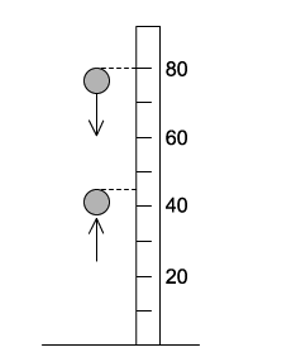
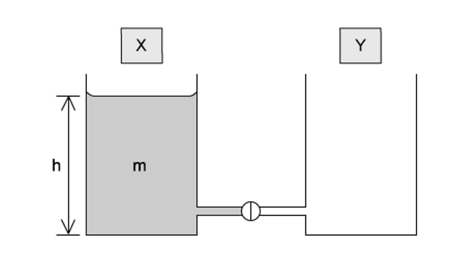
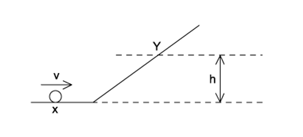
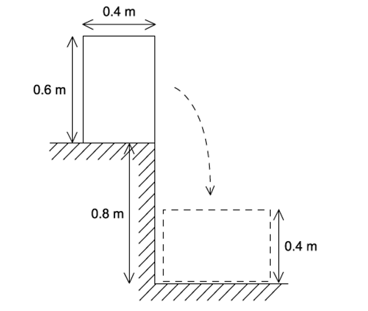
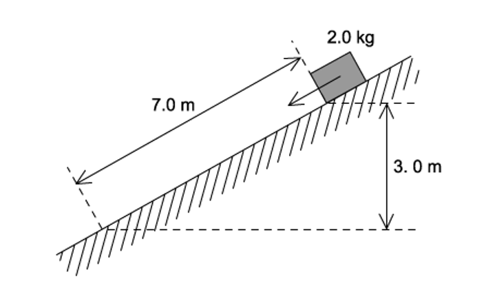
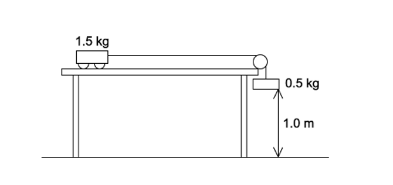
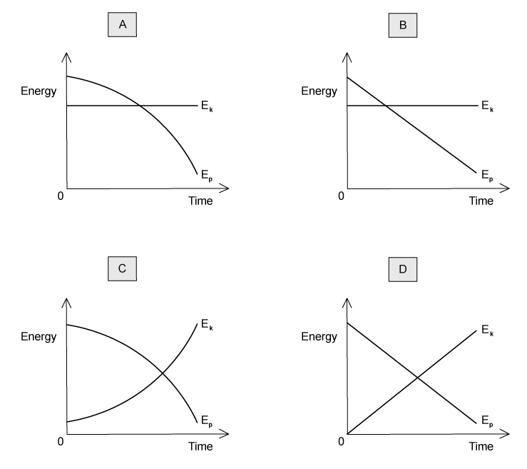

# Exam Questions — Gravitational Potential Energy & Kinetic Energy
**5. Work, Energy & Power** · Cambridge (CIE) A-LEVEL physics (9702)
> Source: [https://www.savemyexams.com/a-level/physics/cie/25/topic-questions/](https://www.savemyexams.com/a-level/physics/cie/25/topic-questions/) · 31 questions across 1 sets

## Multiple Choice Questions (31 questions)

### Q1 — medium — 1 marks

**Q1** [1 mark]

A steel beam with a rectangular cross-section has dimensions 0.40 m × 0.30 m × 8.0 m and a uniform density of 7.8 × 103 kg m-3. The beam is raised from ground level to a height of 12 m during construction.

What is the change in gravitational potential energy of the beam?

### Q2 — hard — 1 marks

**Q2** [1 mark]

A solid rubber ball has a diameter of 8.0 cm. It is released from rest with the top of the ball 80 cm above a horizontal surface. It falls vertically and then bounces back up so that the maximum height reached by the top of the ball is 45 cm, as shown.

If the kinetic energy of the ball is 0.75 J just before it strikes the surface, what is its kinetic energy just after it leaves the surface?

### Q3 — easy — 1 marks

**Q3** [1 mark]

A stone of weight 4.0 N in the Earth’s gravitational field is moved from P to Q and then to R along the path shown.

How much potential energy does the stone gain?

### Q4 — easy — 1 marks

**Q4** [1 mark]

A cyclist is travelling at a constant speed up a hill. The frictional force resisting the cyclist’s motion is 8.0 N.

The cyclist uses 450 J of energy to travel 20 m.

What is the increase in gravitational potential energy of the cyclist?

### Q5 — medium — 1 marks

**Q5** [1 mark]

Car X is travelling at half the speed of car Y. Car X has twice the mass of car Y.

Which statement is correct?

### Q6 — easy — 1 marks

**Q6** [1 mark]

A car of mass 1000 kg travels forward at 25 m s–1 and then backwards at 5 m s–1

What is the magnitude of the change in the kinetic energy of the car?

### Q7 — medium — 1 marks

**Q7** [1 mark]

A concrete cube of side 0.60 m and uniform density 2.0 × 103 kg m–3 is lifted 5.0 m vertically by a crane.

What is the change in potential energy of the cube?

### Q8 — easy — 1 marks

**Q8** [1 mark]

An object is thrown into the air.

Which graph shows how the potential energy *E**p* of the object varies with height *h* above the ground?

### Q9 — medium — 1 marks

**Q9** [1 mark]

A trolley rolls along a horizontal surface and then travels up a slope before reaching a second horizontal surface. The slope is of length *L*. The trolley has mass *M*. The slope is at an angle *α* to the horizontal surface.

The second horizontal surface is at height *h* above the first surface.

Assume negligible frictional forces. The acceleration of free fall is known.

In order to determine the minimum initial velocity of the trolley for it to reach the top of the slope, which additional values are needed?

### Q10 — medium — 1 marks

**Q10** [1 mark]

The diagram shows two identical vessels X and Y connected by a short pipe with a tap.

Initially, X is filled with water of mass *m* to a depth *h*, and Y is empty.

When the tap is opened, water flows from X to Y until the depths of water in both vessels are equal.

How much potential energy is lost by the water during this process? (*g* = acceleration of free fall)

### Q11 — hard — 1 marks

**Q11** [1 mark]

An object of mass $m$ passes a point X with a velocity $v$ and slides up a frictionless incline to stop at point Y, which is at a height $h$ above X.

A second object of mass $\frac{m}{2}$ passes X with a velocity of $\frac{v}{2}$.

What height will the second object reach?

### Q12 — hard — 1 marks

**Q12** [1 mark]

A 4 kg ball and a 3 kg block of wood were placed in an arrangement as shown below. When the ball was released, it fell through a distance of 5 m, pulling the block of wood up the ramp.

If the pulleys were well oiled and the surface of the ramp exerts a frictional force of 2 N, what is the final speed of the sphere after falling through the 5 m?

### Q13 — medium — 1 marks

**Q13** [1 mark]

A truck of mass 500 kg moves from rest at the top of a section of track 400 m long and 30 m high, as shown.

The frictional force acting on the truck is 250 N throughout its journey

What is the final speed of the truck?

### Q14 — easy — 1 marks

**Q14** [1 mark]

A car with a total mass of 1400 kg is travelling at 108 km h–1

What is the kinetic energy of the car?

### Q15 — easy — 1 marks

**Q15** [1 mark]

The formula for kinetic energy is $E_{k}=\frac{1}{2}mv^{2}$

Which kinematic equation is used in the derivation of this formula?

### Q16 — hard — 1 marks

**Q16** [1 mark]

A loaded aeroplane has a total mass of 1.2 × 105 kg while climbing after take-off. It climbs at an angle of 23° to the horizontal with a speed of 50 m s–1.

What is the rate at which it is gaining potential energy at this time?

### Q17 — medium — 1 marks

**Q17** [1 mark]

A uniform solid block has weight 500 N, width 0.4 m and height 0.6 m. The block rests on the edge of a step of depth 0.8 m, as shown.

The block is knocked over the edge of the step and rotates through 90° before coming to rest with the 0.6 m edge horizontal.

What is the change in gravitational potential energy of the block?

### Q18 — medium — 1 marks

**Q18** [1 mark]

The diagram shows a lift system in which the elevator (mass *m**1*) is partly counterbalanced by a heavy weight (mass *m**2*)

At what rate does the motor provide energy to the system when the elevator is rising at a steady speed *v *? (*g* = acceleration of free fall)

### Q19 — medium — 1 marks

**Q19** [1 mark]

A block of mass 2.0 kg is released from rest on a slope. It travels 7.0 m down the slope and falls a vertical distance of 3.0 m

The block experiences a frictional force parallel to the slope of 5.0 N.

What is the speed of the block after falling this distance?

### Q20 — hard — 1 marks

**Q20** [1 mark]

A ball released from a height *h**0* above a horizontal surface rebounds to a height *h**1* after one bounce. The graph that relates *h**0* to *h**1* is shown below.

If the ball (of mass *m*) was dropped from an initial height *h* and made three bounces, the kinetic energy of the ball immediately after the third impact with the surface was

### Q21 — hard — 1 marks

**Q21** [1 mark]

A falling mass pulls a trolley from rest on a horizontal table. Given that:

The mass of the trolley = 1.5 kg

The mass of the falling mass = 0.5 kg

The distance the mass falls through = 1.0 m

Frictional force from the table = 0.8 N

The distance the trolley moves = 1.0 m

What is the maximum kinetic energy of the trolley?

### Q22 — easy — 1 marks

**Q22** [1 mark]

A body travelling with a speed of 10 m s–1 has kinetic energy 1500 J.

If the speed of the body is increased to 40 m s–1, what is its new kinetic energy?

### Q23 — easy — 1 marks

**Q23** [1 mark]

The formula for gravitational potential energy is $\DeltaE_{p}=mg\Deltah$

From which concept is this equation derived?

### Q24 — medium — 1 marks

**Q24** [1 mark]

A body travelling with a speed of 20 $ms^{-1}$ has kinetic energy Ek 

If the speed of the body is increased to 80 $ms^{-1}$, what is its kinetic energy?

### Q25 — easy — 1 marks

**Q25** [1 mark]

To get to his office from the entrance of the building, a man has to walk up six flights of stairs.

The height of each flight is 2.5 m and the man has a mass of 80 kg.

What is the approximate gain in the man’s gravitational potential energy during the climb?

### Q26 — hard — 1 marks

**Q26** [1 mark]

A uniform solid cuboid of concrete of dimensions 0.50m × 1.20m × 0.40m and weight 4000 N rests on a flat surface with the 1.20 m edge vertical as shown in diagram 1.

What is the minimum energy required to roll the cuboid through 90° to the position shown in diagram 2 with the 0.50 m edge vertical?

### Q27 — hard — 1 marks

**Q27** [1 mark]

A steel sphere is dropped vertically onto a horizontal metal plate. The sphere hits the plate with a speed *u*, leaves it at a speed *v*, and rebounds vertically to half of its original height.

Which expression gives the value of  $\frac{v}{u}$ ?

### Q28 — hard — 1 marks

**Q28** [1 mark]

A block of mass 12 kg is released from rest and it slides down a 30° frictionless incline plane. It is stopped by a spring with a spring constant *k* as shown below.

The initial distance between the point of release and the uncompressed spring is 3.0 m. After the block comes to rest momentarily, the spring is compressed by 1.3 m.

What is the value of *k*?

### Q29 — hard — 1 marks

**Q29** [1 mark]

The diagram shows two bodies X and Y connected by a light cord passing over a light, free-running pulley. X starts from rest and moves on a smooth plane inclined at 30° to the horizontal.

What will be the total kinetic energy of the system when X has travelled 2.0 m along the plane?

### Q30 — easy — 1 marks

**Q30** [1 mark]

What is the approximate kinetic energy of an Olympic athlete when running at maximum speed during a 100m race?

### Q31 — medium — 1 marks

**Q31** [1 mark]

A steel ball is falling at constant speed in oil.

Which graph shows the variation with time of the gravitational potential energy *E**p* and the kinetic energy *E**k* of the ball ?

