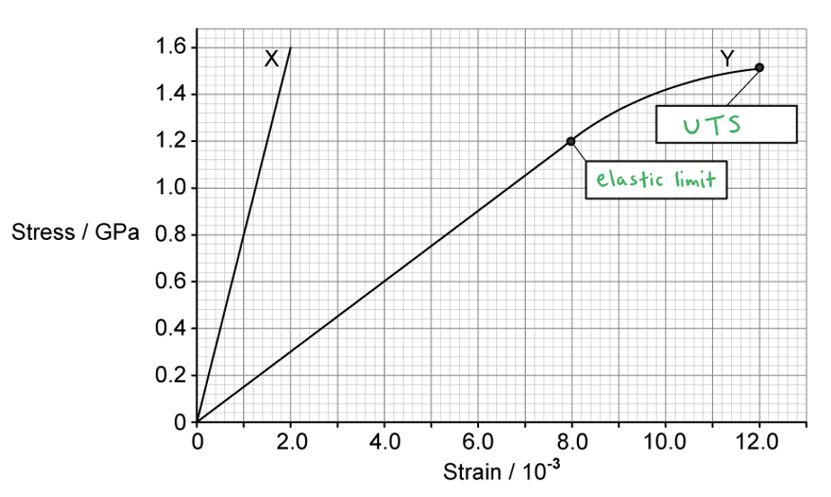
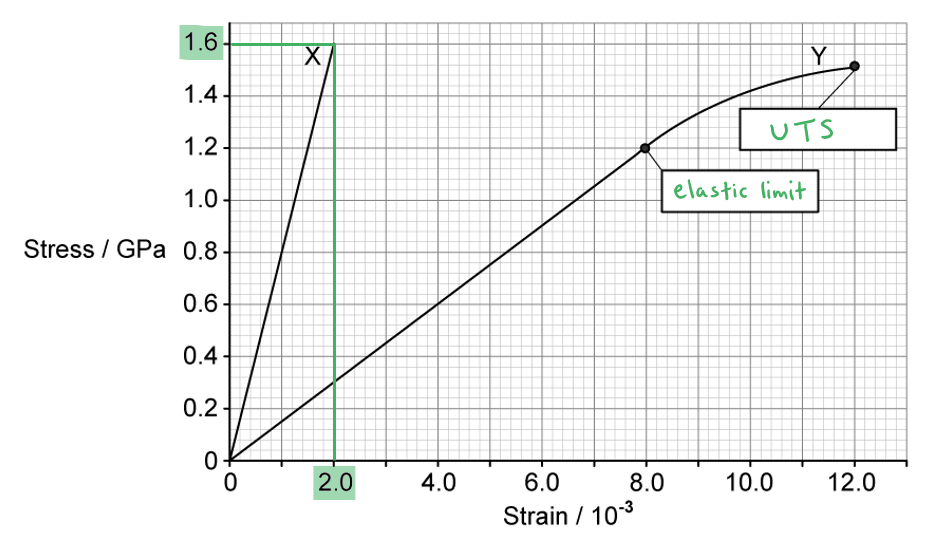
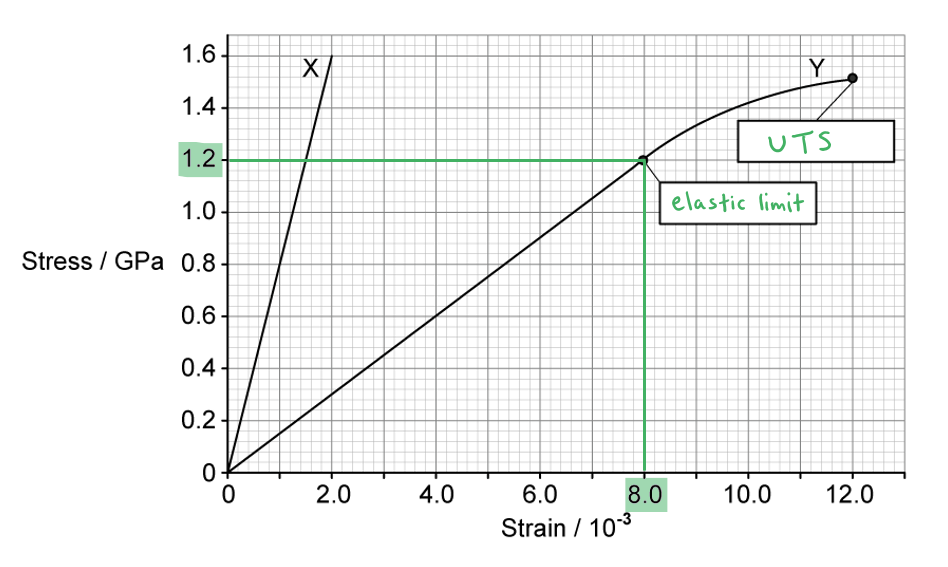
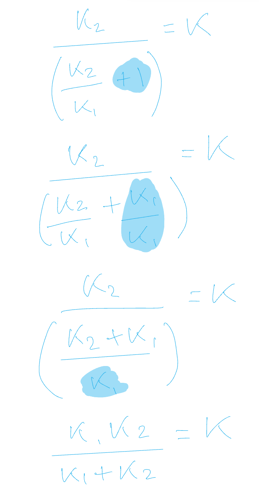
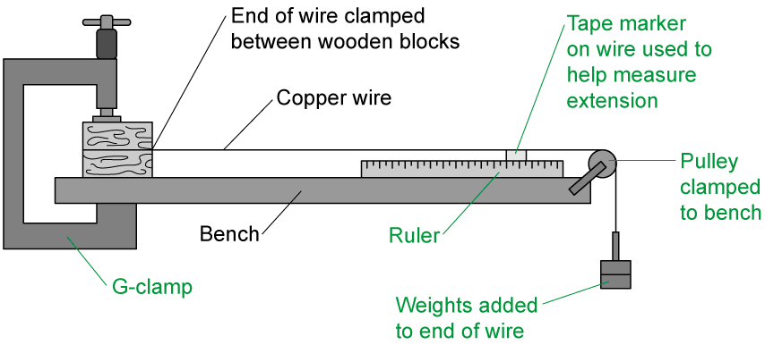
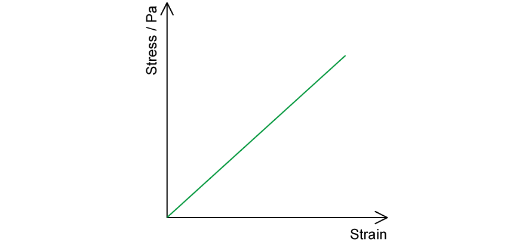
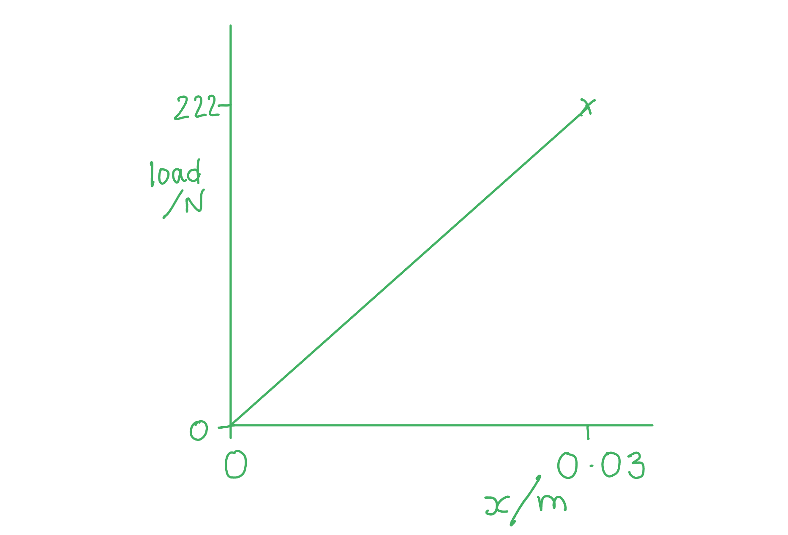
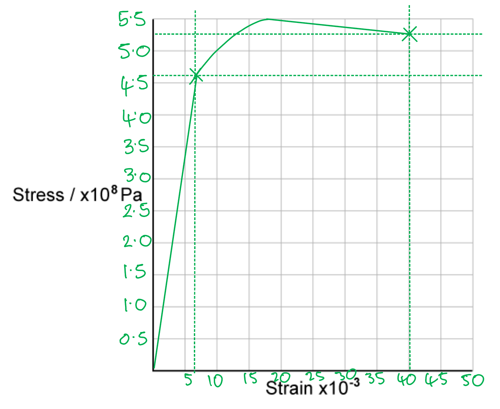
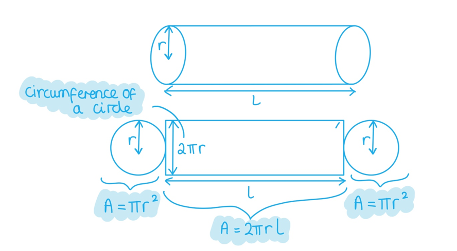

# Mark Schemes — Stress & Strain
**6. Deformation of Solids** · Cambridge (CIE) A-LEVEL physics (9702)

## Multiple Choice Questions (24 questions)

### Q1
**Final answer:** **The correct answer is C **

- The stress is given by

$σ = \frac{\text{force}}{\text{area}} = \frac{F}{A}$

- Where:

  - Force,  $F = 210  \text{N}$
  - Area,  $A = 0 . 05  \text{mm}^{2} = 0 . 05 \times 10^{-6}  \text{m}^{2}$

$σ = \frac{210}{0.05\times10^{-6}} = 4 . 2 \times 10^{9}  \text{Pa}$

- Therefore, the stress in the steel cable is $4 . 2 \times 10^{9}  \text{Pa}$

### Q2
**Final answer:** **The correct answer is ****B ****because:**

- The Young modulus is given by $E=\frac{stress}{strain}=\frac{σ}{ε}$

  - Stress is equal to $σ=\frac{force}{area}=\frac{F}{A}$
  - Strain is equal to $ε=\frac{extension}{originallength}=\frac{\DeltaL}{L}$
- From the graph:

  - Stress = 2 × 106 N m−2
  - Strain$= 1 \% = \frac{1}{100} = 0.01$
- Young modulus $=\frac{2\times10^{6}}{0.01}=2\times10^{8}Nm^{-2}$ ** **

**Exam Tip: **a common error students make is that they tend to forget to check the units on the graph’s axes. It would be an easy mistake to make to take the percentage strain from the graph and not convert it back to the ratio extension/original length.

### Q3
**Final answer:** **The correct answer is ****D**** because:**

- The Young modulus is given by $E=\frac{stress}{strain}=\frac{σ}{ε}$

  - Stress is equal to $σ=\frac{force}{area}=\frac{F}{A}$
  - Strain is equal to $ε=\frac{extension}{originallength}=\frac{\DeltaL}{L}$
- Where:

  - Force *F* = 84 N
  - Area $A=0.02\mathrm{mm}^{2}=0.02\times10^{-6}m^{2}$
- The wire increases in length by 0.3 %, this is equal to the strain, so:

  - $S t r a i n = 0.3 \% = \frac{0.3}{100} = 0.0030$
- Young modulus = stress / strain

  - $E = \frac{84}{( 0.02 \times 10^{- 6} ) \times 0.003} = 1.4 \times 10^{12} \text{Pa}$
- Therefore, the Young modulus of the metal wire is 1.4 × 1012 Pa

### Q4
**Final answer:** **The correct answer is ****B**** because:**

- Hooke’s law states that the strain in a solid is proportional to the applied stress within the elastic limit
- Hooke’s law states that $F=kx$ , where *k* is the spring constant, *F* is the force and *e* is the extension

  - So, to calculate the spring constant $k=\frac{F}{x}$
- To do this, the force (load) and the extension of the spring are required

**A & D **are incorrect because the elastic limit is the point that the material will no longer obey Hooke’s law, it is calculated using the extension not the length of the material

**C **is incorrect because the elastic limit is the point that the material will no longer obey Hooke’s law

### Q5
**Final answer:** **The correct answer is ****B**** because:**

- The area of the cross-section of the wire$=\mathrm{πr}^{2}$
- A micrometer can measure the diameter of the wire with a resolution of 0.001 mm
- Therefore, a micrometer cannot directly measure the cross-sectional area of the wire

**A **is incorrect because the vernier scale will measure the extension of the wire

**C **is incorrect because the length of wire could be measured directly by a metre rule

**D **is incorrect because an electronic balance will measure the mass of the load directly

### Q6
**Final answer:** **The correct answer is ****D ****because:**

- The strain of the metal wire is equal to $ε=\frac{extension}{originallength}=\frac{\DeltaL}{L}$
- The percentage of the length that contracts = strain × 100%

  - So, the percentage of the length that contracts$= \frac{\Delta L}{L} \times 100 \%$
- The Young modulus is given by $E=\frac{stress}{strain}=\frac{σ}{ε}$

  - Stress is equal to $σ=\frac{force}{area}=\frac{F}{A}$
- The cross-sectional area of the wire $A=\frac{\mathrm{πd}^{2}}{4}$
- So, strain is equal to

  - `epsilon = sigma / E = 1 / E ( F / A ) = F / E ( 4 / πd ^2 )`
  - $\\epsilon = \frac{20}{2.0 \times 10^{11} \times \frac{4}{ \mathrm{\pi } ( 5.0 \times 10^{-4} } )^{2}} = 5.09 \times 10^{- 4}$
- So, as a percentage this is:

  - Strain × 100% = 5.09 × 10–4 × 100% = 5.09 × 10–2 %
- Therefore, the percentage of the length that contracts is equal to 5.1 × 10–2 %

### Q7
**Final answer:** **The correct answer is ****A ****because:**

- The Young modulus is given by $E=\frac{stress}{strain}=\frac{σ}{ε}$

  - Stress is equal to $\\sigma = \frac{f o r c e}{a r e a} = \frac{F}{A} = [ \mathrm{N} ] [ \mathrm{m}^{2} ]^{- 1} = \mathrm{N} \mathrm{m}^{- 2}$
  - Strain is equal to $\\epsilon = \frac{e x t e n s i o n}{o r i g i n a l l e n g t h} = \frac{\Delta L}{L} = [ \mathrm{m} ] [ \mathrm{m} ]^{- 1} = 1$
- Strain is dimensionless, so, the units for the Young modulus are N m−2

### Q8
**Final answer:** **The correct answer is ****A**** because:**

- The Young modulus is given by$=E=\frac{stress}{strain}=\frac{σ}{ε}$

  - Stress is equal to $σ=\frac{force}{area}=\frac{F}{A}$
  - Strain is equal to $ε=\frac{extension}{originallength}=\frac{\DeltaL}{L}$
- The Young modulus is equal to the gradient of the stress-strain graph

**B **is incorrect because the area under a force-extension graph is the energy stored in the spring

**C **is incorrect because the area under a stress-strain graph is the toughness

**D **is incorrect because the gradient of a force-extension graph is the spring constant, *k*

### Q9
**Final answer:** **The correct answer is ****B**** because:**

- The metal tube is hollow with the width of the wall *w*
- It is the area of the tube, not the hollow space that is taken into account

  - Stress$=\frac{force}{area}=\frac{F}{A}$
- Area of the wall = circumference × width$=\mathrm{πdw}$
- As and *d *are constant, the area of the wall is proportional to the width, *w*
- The tension force is kept constant, so the stress is inversely proportional to the area

  - Stress $α\frac{1}{\mathrm{πdw}}$
- So, to half the stress, the thickness of the wall *w* would need to be doubled

  - Therefore, the new wall thickness would be 2*w*

### Q10
**Final answer:** **The correct answer is ****B ****because:**

- When a material behaves elastically, the work done is stored as energy per unit volume – **strain energy**
- The strain energy is derived from the area under the stress-strain graph

  - Area under the graph $=\frac{1}{2}\timesbase\timesheight$
  - Strain energy $=\frac{1}{2}\times0.010\times2\times10^{9}=1\times10^{7}Jm^{-3}=10MJm^{-3}$
- Therefore, the strain energy is equal to 10 MJ m−3

### Q11
**Final answer:** **The correct answer is ****C**** because:**

- Hooke’s law states that the strain in a solid is proportional to the applied stress within the elastic limit
- The graph is a straight line going through the origin, showing proportionality
- Therefore, Hooke’s law is obeyed for all values of stress up to the breaking point

**A **is incorrect because plastic deformation occurs after the limit of proportionality and is after the elastic limit, glass is brittle and does not show plastic deformation

**B **is incorrect because ultimate tensile stress is a material property independent of cross-sectional area — it is the stress at fracture, so it remains constant regardless of geometry. Doubling the area would double the breaking force, not the ultimate tensile stress

**D **is incorrect because glass is brittle and does not show plastic deformation as a ductile material would

### Q12
**Final answer:** **The correct answer is ****D**** because:**

- Hooke’s law states $F=kx$  , where *k* is the spring constant
- The gradient of a force-extension graph is the spring constant

  - Load = 0.4 N
- Extension of the spring *x* = 15 – 10 = 5 cm = 0.05 m

  - $k=\frac{F}{x}$
  - $k=\frac{0.4}{0.05}=8.0Nm^{-1}$
- Therefore, the spring constant is equal to 8.0 N m–1

Your answer will be more accurate if you use the entire line to calculate the gradient.

### Q13
**Final answer:** **The correct answer is ****B**** because:**

- Hooke’s law states $F=kx$  , where *k* is the spring constant
- The child and the spring will cause a moment at a distance from the hinge
- At equilibrium, the torque of the child (anticlockwise) should be equal to the torque of the spring (clockwise)
- Let the force of the spring = *F*

  - Clockwise moments $=mgx=40\times9.81\times5.0$
  - Anticlockwise moments $=Fd=F\times2.0$
  - $40\times9.81\times5.0=F\times2.0$
  - $F=\frac{40\times9.81\times5}{2}=981N$
- So, the spring force is equal to *F* = 981 N
- Spring constant, *k* = 10 kN m−1 = 10000 N m−1

  - Extension $=\frac{F}{k}=\frac{981}{10000}=0.0981m$
- Therefore, the compression of the spring caused by the child is 9.8 cm

### Q14
**Final answer:** **The correct answer is ****C**** because:**

- The Young modulus is given by $E=\frac{stress}{strain}=\frac{σ}{ε}$

  - Stress is equal to $σ=\frac{force}{area}=\frac{F}{A}$
  - Strain is equal to $ε=\frac{extension}{originallength}=\frac{\DeltaL}{L}$
- The strain is determined by the extension of the material
- Material T has a larger strain for the same stress

**A **is incorrect because the ultimate tensile strength is the maximum stress a material can withstand before breaking; this is higher for S than T

**B **is incorrect because material S shows proportionality and extends elastically

**D **is incorrect because material S shows no plastic deformation and is brittle

### Q15
**Final answer:** **The correct answer is D because:**

- The equation for Young's modulus $E$ is:

  - $E=\frac{F}{A}\times\frac{L}{x}$
  - where $F$ = force (load), $A$ = area, $L$ = length, and $x$ = extension
- For a wire, the cross-sectional area $A$ is:

  - `A = pi r ^2 = pi ( d / 2 ) ^2 = ( pi d ^ 2)/(4)`
  - where $d$ = diameter
- To find the percentage uncertainty in $E$, we add the percentage uncertainties in the measurements

  - % uncertainty in $F$ = 2%
  - % uncertainty in $L$ = 0.2%
  - % uncertainty in $d$ = 1.5%
  - % uncertainty in $x$ = 1%
- We can ignore any constants, such as $\frac{π}{4}$
- The uncertainty in the diameter must be multiplied by 2 since it is squared

  - % uncertainty in $E$ = 2% + 0.2% + (2 × 1.5%) + 1%
  - % uncertainty in $E$ = 6.2%

### Q16
**Final answer:** **The correct answer is ****B**** because:**

- Material 1 shows an unusual shape stress-strain graph associated with a polymer, such as rubber

  - Rubber deforms elastically up to a certain point as the polymers chains, which were previously curled up, uncurl
  - After its yield point is reached it will no longer return to its original shape as it undergoes hysteresis
- Material 2 shows a brittle material that shows no plastic deformation, such as glass

  - Glass is described as brittle as it does not extend very much and when subjected to stress, it breaks with little elastic deformation
- Material 3 shows a ductile material that shows plastic deformation, such as a metal wire

  - A metal wire tends to be described as ductile as it will experience a large amount of extension when subjected to stress, especially beyond the elastic limit

### Q17
**Final answer:** **The correct answer is ****D**** because:**

- Stress is equal to $=\frac{force}{area}=\frac{F}{A}$
- The steel tube is thicker at one end by double that of the thinner end
- The tension force is kept constant, so the stress is inversely proportional to the area
- The ratio of the stress in the two sections would be 0.25

Example of working:

| narrow portion | wide portion |
|---|---|
| Diameter = 0.2 m, force = 10 N  Area $=πr^{2}=π\times0.1^{2}=0.0314m^{2}$  Stress $=\frac{force}{area}=\frac{F}{A}$  Stress $=\frac{10}{0.0314}=318.5Nm^{-2}$ | Diameter 0.4 m, force 10 N  Area$=\mathrm{πr}^{2}=π\times0.2^{2}=0.1256m^{2}$  Stress $=\frac{force}{area}=\frac{F}{A}$  Stress $=\frac{10}{0.1256}=79.6Nm^{-2}$ |

- So, the value of $\frac{stressonthewideportion}{stressonthenarrowportion}=\frac{79.6}{318.5}=0.25$

### Q18
**Final answer:** **The correct answer is ****C**** because:**

- The Young modulus is given by $E=\frac{stress}{strain}=\frac{σ}{ε}$

  - Stress is equal to $σ=\frac{force}{area}=\frac{F}{A}$
  - Strain is equal to $ε=\frac{extension}{originallength}=\frac{\DeltaL}{L}$
- Therefore, Young modulus $E = \frac{ ( \text{begin} \text{display} \text{style} \text{bevelled} \frac{F}{A} ) }{ ( \text{begin} \text{display} \text{style} \text{bevelled} \frac{x}{L} ) } = \frac{F L}{A x}$
- Hooke’s law states that $F=kx$  , so $k=\frac{F}{x}$
- Therefore, Young modulus is equal to

  - $E = \frac{F L}{A e} = \frac{L}{A} ( \frac{F}{e} ) = \frac{k L}{A}$

### Q19
**Final answer:** **The correct answer is ****A**** because:**

- The Young modulus is given by $E=\frac{stress}{strain}=\frac{σ}{ε}$

  - Stress is equal to $σ=\frac{force}{area}=\frac{F}{A}$
  - Strain is equal to $ε=\frac{extension}{originallength}=\frac{\DeltaL}{L}$
- Therefore, Young modulus $E = \frac{ ( \text{begin} \text{display} \text{style} \text{bevelled} \frac{F}{A} ) }{ ( \text{begin} \text{display} \text{style} \text{bevelled} \frac{x}{L} ) } = \frac{F L}{A x}$
- Hooke’s law states *F* = *ke*, where *k* is the spring constant
- A metal wire will obey Hooke’s law up to a point, the spring constant depends on the force, and this can be found in the equation for the Young modulus:

  - $E = \frac{( k e ) L}{A x} = \frac{k L}{A}$
- So, the **spring constant** depends on the Young modulus

**B **is incorrect because not all materials are ductile, but all materials can have a Young modulus

**C **is incorrect because the ultimate tensile strength is the maximum stress a material can withstand before breaking; the Young modulus does not depend on this

**D **is incorrect because the elastic limit is beyond the limit of proportionality; the Young modulus does not depend on this

The Young modulus, E, is determined by the atomic bonding in the material. A wire's measured spring constant depends on the Young modulus.

### Q20
**Final answer:** **The correct answer is ****C**** because:**

- Hooke’s law states that $F=kx$ , where *k* is the spring constant
- Let the original length = *l*
- When the force *F* = 25 N, the extension $x=55cm-l=0.55m-l$

  - $F = k \times ( 0.55 - l )$
  - $\frac{F}{k}=0.55-l$
  - $l = 0.55 - ( \frac{F}{k} ) = 0.55 - ( \frac{25}{150} ) = 0.383 \mathrm{m}$
- Therefore, the original length of the spring is 0.38 m

### Q21
**Final answer:** **The correct answer is ****A**** because:**

- The Young modulus is given by $E=\frac{stress}{strain}=\frac{σ}{ε}$

  - Stress is equal to $σ=\frac{force}{area}=\frac{F}{A}$
  - Strain is equal to $ε=\frac{extension}{originallength}=\frac{\DeltaL}{L}$
- In a material the Young modulus remains constant
- As the load and cross-sectional area are the same, the stress $( \frac{f o r c e}{a r e a} )$  is going to be the same
- Metal S

  - 1st experiment, $E=\frac{3}{1.5}$
  - 2nd experiment $E=\frac{1}{x}$
  - Therefore, $\frac{3}{1.5}=\frac{stress}{x}$
  - Extension, $x=\frac{1.5}{3}=0.5\mathrm{mm}$
- Metal T

  - 1st experiment, $E=\frac{1}{1}$
  - 2nd experiment $E=\frac{3}{x}$
  - Therefore, stress is equal to $=\frac{3}{x}$
  - So, extension $x=3.0\mathrm{mm}$
- Total extension $0.5+3.0=3.5\mathrm{mm}$

### Q22
**Final answer:** **The correct answer is ****D**** because:**

- The Young modulus is given by $E=\frac{stress}{strain}=\frac{σ}{ε}$

  - Stress is equal to $σ=\frac{force}{area}=\frac{F}{A}$
  - Strain is equal to $ε=\frac{extension}{originallength}=\frac{\Deltal}{l}$
- The cross-sectional area of the wire $A=\frac{πd^{2}}{4}$
- So, the Young Modulus for a wire is given by

  - $E=\frac{4Fl}{πd^{2}x}$
- The percentage uncertainty in the diameter needs to be doubled as it is squared in the equation

  - $\frac{\Delta E}{E} = ( \frac{\Delta F}{F} ) + ( \frac{\Delta l}{l} ) + 2 ( \frac{\Delta d}{d} ) + ( \frac{\Delta x}{x} )$
  
    - $( \frac{\Delta F}{F} ) = \frac{0.01}{19.62} = 0.00051$
    - $( \frac{\Delta l}{l} ) = \frac{0.002}{2.043} = 0.00098$
    - $2 ( \frac{\Delta d}{d} ) = 2 ( \frac{0.02}{0.54} ) = 0.07407$
    - $( \frac{\Delta x}{x} ) = \frac{0.2}{5.2} = 0.03846$
  - Therefore, the diameter has the largest effect on the uncertainty of the Young modulus

### Q23
**Final answer:** **The correct answer is ****D**** because:**

- The Young modulus is given by $E=\frac{stress}{strain}=\frac{σ}{ε}$

  - Stress is equal to $σ=\frac{force}{area}=\frac{F}{A}$
  - Strain is equal to $ε=\frac{extension}{originallength}=\frac{\DeltaL}{L}$
- Therefore, Young modulus $E = \frac{ ( \text{begin} \text{display} \text{style} \text{bevelled} \frac{F}{A} ) }{ ( \text{begin} \text{display} \text{style} \text{bevelled} \frac{e}{L} ) } = \frac{F L}{A e}$
- Where:

  - Area $A=l^{2}$
  - Compression $e=\Deltal$
- So, Young modulus is proportional to:

  - $Eα\frac{l}{l^{2}\times\Deltal}$
  - $Eα\frac{1}{l\times\Deltal}$
  - So $\Deltalα\frac{1}{El}$,  giving $\Deltalα\frac{1}{l}$ * *as the Young modulus is constant

### Q24
**Final answer:** **The correct answer is ****B**** because:**

- The Young modulus is given by $E=\frac{stress}{strain}=\frac{σ}{ε}$

  - Stress is equal to $σ=\frac{force}{area}=\frac{F}{A}$
  - Strain is equal to $ε=\frac{extension}{originallength}=\frac{x}{L}$
- As both wires are made of steel they have the same Young modulus, *E*
- Young modulus $E = \frac{ ( \text{bevelled} \frac{F}{A} ) }{ ( \text{bevelled} \frac{x}{L} ) } = \frac{F L}{A x}$
- So, tension is equal to $F=\frac{EAx}{l}$

  - For wire X : $F_{X}=\frac{EAx}{l}$
  - For wire Y : $F_{Y} = \frac{E ( \text{bevelled} \frac{A}{2} ) x}{2 l} = \frac{E A x}{4 l} = F_\frac{{X}}{4}$
- So, the ratio `= F _ X / F _ Y = (F _ X)/(( begin display style bevelled F _ X / 4 )) = 4 / 1`

## Structured Questions (8 questions)

### Q1
(i) Deformation is defined as:

- Changing the <u>size / shape</u> (of an object); **[1 mark]**

(ii) The force which stretches an object is called:

- Tensile (stress / force); **[1 mark]**

(iii) The force which squashes an object is called:

- Compressive (stress / force); **[1 mark]**

**[Total: 3 marks]**
Hooke's Law can be written as:

- $F=kx$ **[1 mark]**
- Where *F* = force, *k* = spring constant and *x* is the extension; **[1 mark]**

**[Total: 2 marks]**
Calculate the spring constant, expressing your answer in S.I. units:

List the known quantities:

- Load, *F* = 5.0 N
- Extension, *x* = 4.2 cm = 0.042 m** [1 mark]**

Use the equation for the spring constant and calculate:

- Hooke's law:  $F=kx\Rightarrowk=\frac{F}{x}$
- Spring constant:  $k=\frac{5.0}{0.042}$** [1 mark]**
- Spring constant:  $k = 120 \mathrm{N} \mathrm{m}^{- 1} ( 2 \mathrm{s} . \mathrm{f} . )$ **[1 mark]**

**[Total: 3 marks]**
Calculate the spring constant, expressing your answer in S.I. units:

List the known quantities:

- Compressive force, *F* = 6.3 N
- Compression, *x* = 2.4 cm = 0.024 m** [1 mark]**

Use the equation for the spring constant and calculate:

- Spring constant:  $k=\frac{F}{x}=\frac{6.3}{0.024}$ ** [1 mark]**
- Spring constant:  $k = 260 Nm^{- 1} ( 2 \mathrm{s} . \mathrm{f} . )$ **[1 mark]**

**[Total: 3 marks]**

> *Hooke's Law questions are nearly always asked about springs under tension, being stretched. However, be aware that exactly the same equation also applies to compressive forces and that it's used in the same way.*

### Q2
(i) Tensile stress is defined as:

- The ratio of the force to the cross-sectional area **OR**
- Stress = $\frac{F}{A}$, where *F* = force and *A* = cross-sectional area; **[1 mark]**

(ii) Tensile strain is defined as:

- The ratio of extension to initial length; **OR**
- Strain = $\frac{x}{L}$, where x = extension and L = original length; **[1 mark]**

(iii) The Young modulus is defined as:

- The ratio of stress to strain; **OR**
- Young modulus = $\frac{s t r e s s}{s t r a i n} ( = \frac{F L}{A x} )$ **[1 mark]**

**[Total: 3 marks]**
The correct labels are:

- Elastic limit (as shown); **[1 mark]**
- Ultimate tensile strength / UTS / breaking stress (as shown); **[1 mark]**

Elastic limit is defined as:

- The point beyond which the wire will not return to its original length / shape / size when the load / force is removed; **[1 mark]**

Ultimate tensile strength / breaking stress is defined as:

- The maximum stress the wire is able to support / before it breaks; **[1 mark]**

**[Total: 4 marks]**
The wire with the greater Young modulus is

- Wire X; **[1 mark]**

Because:

- X has the steeper gradient / larger value of stress/strain (before breaking); **[1 mark]**

**[Total: 2 marks]**
(i) Determine the Young modulus of wire X:

- (From graph) when stress = 1.6 GPa, strain = 2.0 × 10−3 **[1 mark]**
- Young modulus = gradient of the stress-strain graph
- Young modulus = $\frac{stress}{strain}=\frac{1.6\times10^{9}}{2.0\times10^{-3}}$ **[1 mark]**
- Young modulus = 8.0 × 1011 Pa **OR** 800 GPa **[1 mark]**

(ii) Determine the extension of wire Y when the stress is 1.2 GPa:

- (From graph) when stress = 1.2 GPa, strain = 8.0 × 10−3 **[1 mark]**
- Original length, L = 2.0 m
- Extension:  $ε=\frac{x}{L}\Rightarrowx=εL$
- Extension:  $x = ( 8.0 \times 10^{- 3} ) \times 2.0$ **[1 mark]**
- Extension:  $x$ = 0.016 m **OR** 1.6 cm **OR** 16 mm **[1 mark]**

**[Total: 6 marks]**

### Q3
Measurements the student needs to make:

- Young Modulus = $\frac{tensilestress}{tensilestrain}$ = $\frac{F\timesL}{A\times\DeltaL}$
- Therefore, the student needs to measure the original length **AND **the diameter of the wire; **[1 mark]**

Measurements from the graph:

- The gradient is equal to $( \frac{F}{\Delta L} )$ and then substitute that into the equation below; **[1 mark] **
- Calculate the Young Modulus using the equation `(F x L)/( pi ( d / 2 ) ^2 x \Delta L)` **[1 mark]**

**[Total: 3 marks]**

> *In your answer, you are allowed to say convert the results into a stress-strain graph and determine the gradient.*
List the known quantities:

- The Young Modulus = 154 GPa = 154 × 109 Pa
- Diameter of the cable, *d* = 4.9 mm = 4.9 × 10–3 m
- Percentage strain = 0.40%

Calculate the stress on the wire:

- Young Modulus = $\frac{stress}{strain}$ therefore, Stress = Young Modulus* ×* Strain
- 0.40% is equal to a strain of 0.004
- Stress* *= (154 × 109) × 0.004 = 6.16 × 108 Pa **[1 mark]**

Calculate the radius of the cable, *r *:

- *r * = $\frac{d}{2}$ = $\frac{4.9\times10^{-3}}{2}$
- *r*  = 2.45 × 10−3 m

Calculate the force, *F *:

- Stress = $\frac{F}{A}$ therefore, *F* = stress × *A *= stress × π*r *2
- *F* = (6.16 × 108) × π × (2.45 × 10−3)2 = 11 616.16 N **[1 mark]**
- *F* = 12 000 N **OR **12 kN (2 s.f.) **[1 mark]**** **

**[Total: 3 marks]**** **

> *Remember to check you enter the correct value of the diameter or radius in your calculation for the cross-sectional area i.e. **A **=*$\mathrm{πr}^{2}$* or **A** =*`pi ( d / 2 ) ^2`
Consider the situation and obtain equations in terms of the force applied, *F*:

- Two springs connected in series provide a longer, flimsier spring
- When a force is applied to the combined spring the same force is applied evenly to each individual spring
- The springs have different spring constants so the extension they undergo is different
- Hence when *x*1 is the extension for spring *k*1 and *x*2 is the extension of spring *k*2:

  - *F *= *K*(*x**1* + *x**2*) (Equation 1) **AND**
  - *F *= *k*1*x*1 (Equation 2) **AND**
  - *F *= *k*2*x**2 *(Equation 3) **[1 mark]**

Combine equations 2 and 3 to make *x**1* the subject:

- *k*1*x*1 = *k*2*x**2*
- $x_{1}=\frac{k_{2}x_{2}}{k_{1}}$ **[1 mark]**

Substitute for *x**1* in equation 1:

- $F = K ( ( \frac{k_{2} x_{2} }{k_{1} } ) + x_{2} )$
- $F = K ( \frac{k_{2}}{k_{1}} + 1 ) x_{2}$ **[1 mark]**

Combine this equation with equation 3 and rearrange to make *K *the subject:

- $k_{2} x_{2} = K ( \frac{k_{2}}{k_{1}} + 1 ) x_{2}$
- $k_{2} = K ( \frac{k_{2}}{k_{1}} + 1 )$
- $\frac{k_{2}}{ ( \frac{k_{2}}{k_{1}} + 1 ) } = K$ **[1 mark]**

**[Total: 4 marks]**

> *Take your time and work through this type of question slowly thinking about the force applied when two wires are in series. You won't get marks for it because the question asks you **to show **but you will need to check you have completed the question correctly by rearranging this final equation for **K **as follows:*

### Q4
The correct labels are as follows:

- Tape marker / marker; **[1 mark]**
- Pulley; **[1 mark]**
- G–clamp; **[1 mark]**
- Ruler; **[1 mark]**
- Weights / masses; **[1 mark]** **One mark for each correct label**

**[Total: 5 marks]**
A safety consideration for this experiment is:

**EITHER**

- Wearing safety goggles at all times; **[1 mark]**
- Explanation: in case the wire snaps; **[1 mark]**

**OR**

- Placing a cushion / mat directly below the mass hanger; **[1 mark]**
- Explanation: in case the masses fall onto the ground / student's foot; **[1 mark]**

**[Total: 2 marks]**
The expected variation of strain with stress for this experiment is as follows:

- Straight line drawn; **[1 mark]**
- Through the origin; **[1 mark]**

**[Total: 2 marks]**

> *The question states that the wire is not stretched beyond the limit of proportionality. This means that **Hooke’s law** is **obeyed**, therefore the stress will be **directly proportiona**l to the strain. This means the graph will be a **straight line** through the **origin**. *

> *Remember to use a ruler or straight edge for any lines, messy graphs will often not get full marks!*
The student could use the graph in Fig. 1.2 to determine the Young modulus because:

- Young modulus = $\frac{stress}{strain}$ **[1 mark]**
- Therefore, the gradient of the stress-strain graph = Young modulus; **[1 mark]**

**[Total: 2 marks]**

### Q5
The definition of work done:

- Force × <u>displacement</u> in the direction of the force; **[1 mark]**

**[Total: 1 mark]**

> *You will see mark schemes allowing 'distance travelled' or 'distance moved' instead of displacement in this defintion.*

> *However, the definition above is the one given in your specification, and you should learn it this way.*
How work is done when a heavy suitcase is placed on a spring:

- The weight (of the case) acts downwards and provides the force on the spring; **[1 mark]**
- The weight of the case compresses the spring by a distance; **[1 mark]**
- Work is done to compress the spring; this energy is stored as elastic potential energy in the spring; **[1 mark]**

**[Total: 3 marks]**
Calculate the spring constant of the spring:

List the known quantities:

- Mass of the suitcase, *m* = 22.6 kg
- Compression of the spring,* x* = 3 cm = 0.03 m

Calculate applied force by finding the weight of the suitcase:

- $W=mg=22.6\times9.81=222N$ **[1 mark]**

Use the equation for Hooke's Law to find the spring constant:

- $F=kx$
- $k=\frac{F}{x}=\frac{222}{0.03}=7400\mathrm{Nm}^{-1}$ **[1 mark]**

**[Total: 2 marks]**
For the weighing platform described in part (c) sketch a graph to show the known properties of the spring:

Review the description of the weighing platform:

- When load = 222 N, extension = 0.03 m
- Platform returns to original position when applied load of 222 N is removed
- No data for heavier loads

Therefore the graph looks like:

- Both axes labelled with variable and unit; **[1 mark]**
- Line from (0, 0) to (0.03, 222); **[1 mark]**
- Line is straight (obeys Hooke's Law); **[1 mark]**
- Line does not extend beyond (0.03, 222); **[1 mark]**

**[Total: 4 marks]**

> *If you are asked to sketch the shape of a graph in a question that includes data, make sure to include that data on your sketch. Do not make up any data or assume any knowledge of what might happen if the investigation was continued.*

### Q6
Determine the mass of nickel and the mass of chromium required to make a wire of nichrome of volume 0.50 × 10−3 m3

Determine how much of the total volume will consist of each metal:

- Volume of nickel = 80% × total volume
- Volume of nickel = $0.8\times(0.50\times10^{-3})=4.0\times10^{--4}m^{3}$
- Volume of chromium = 20% × total volume
- Volume of chromium = $0.2\times(0.50\times10^{-3})=1.0\times10^{--4}m^{3}$

Use the equation for density to find the mass required:

- $m=ρ\timesv$
- Mass of nickel, $m_{n} = \rho_{n} \times v_{n} = ( 8.9 \times 10^{3} ) \times ( 4.0 \times 10^{- 4} ) = 3.56$
- Mass of nickel, $m_{n} = 3.6 \text{kg} ( 2 \mathrm{s} . \mathrm{f} . )$ **[1 mark]**
- Mass of chromium, $m_{c} = \rho_{c} \times v_{c} = ( 7.1 \times 10^{3} ) \times ( 1.0 \times 10^{- 4} ) = 0.71$
- Mass of chromium, $m_{c} = 0.71 \text{kg} ( 2 \mathrm{s} . \mathrm{f} . )$ **[1 mark]**

**[Total: 2 marks]**
An experimental method and equipment:

(i) The cross-sectional area of the wire:

- Use (Vernier) caliper / micrometer to find <u>diameter</u>; **[1 mark]**
- Measure in (at least) three places and take the average / mean; **[1 mark]**

(ii) The applied load:

- Use digital scales / balance to find <u>mass</u>; **[1 mark]**
- Multiply by *g* / 9.81 to find weight **OR **W = mg **OR **F = mg; **[1 mark]** **OR**
- Use force / Newton-meter; **[1 mark]**
- to find <u>weight</u>; **[1 marks]**

**[Total: 4 marks]**
Calculate the breaking stress of nichrome

List the known quantities:

- Force, *F* = 72 kN = 72 000 N
- Diameter of the wire, *d *= 5.7 mm = 5.7 × 10−3 m

Determine the cross-sectional area of the wire:

- Area of a circle, $A = \mathrm{\pi } r^{2} = \mathrm{\pi } ( \frac{d}{2} )^{2} = \mathrm{\pi } \times ( \frac{5.7 \times 10^{- 3} }{2} )^{2}$ **[1 mark]**
- $A=2.55\times10^{-5}m^{2}$

Use the equation for stress:

- $σ=\frac{F}{A}=\frac{72000}{2.55\times10^{-5}}=2.82\times10^{9}$ Pa **[1 mark]**

Write answer to two sig figs and include the unit:

- $σ=2.8\times10^{9}$ Pa **[1 mark]**

**[Total: 3 marks]**

### Q7
(i) Force is defined as:

- The rate of change of momentum **OR **change in momentum ÷ time taken; **[1 mark]**

(ii) Work done is defined as:

- Force × Displacement in the direction of the force; **[1 mark]**

**[Total: 2 marks]**
List the known quantities:

- Mass of block, $m$ = 0.40 kg
- Velocity of block, $v$ = 0.30 m s−1

(i) Calculate the initial kinetic energy of the block:

- $E_{k}=\frac{1}{2}mv^{2}$ **[1 mark]**
- $E_{k}=\frac{1}{2}\times0.4\times0.3^{2}$
- $E_{k}=0.018J$ **[1 mark]**

(ii) Calculate the maximum force *F*max exerted on the spring by the block:

From the graph when $F=F_{max}$:

- Compression, $x$ = 8.0 cm = 8 × 10−2 m

Equate the elastic potential $E_{p}$ and  $E_{k}$ of the block and rearrange for $F_{max}$:

- $E_{k = E_{p} = 1 \frac{1}{2} ( F_{m} a x} ) x$
- $0.018 = 1 \frac{1}{2} \times F_{m a x} \times ( 8 \times 10^{- 2} )$ ** [1 mark]**
- $F_{m a x} = \frac{0.018 \times 2}{( 8 \times 10^{- 2} )}$
- $F_{max}=0.45N$** [1 mark]**

(iii) Calculate the maximum deceleration of the block:

- $F=ma$ **[1 mark]**
- $a=\frac{F_{max}}{m}$
- $a=\frac{0.45}{0.40}$
- $a = 1.125 \mathrm{m} \mathrm{s}^{- 2} = 1.1 \mathrm{m} \mathrm{s}^{- 2} ( 2 \mathrm{s} . \mathrm{f} . )$ **[1 mark]**

(iv) Consider whether the block is in equilibrium during the following:

Before it hits the spring:

- The velocity is constant / the resultant force is zero, so the block is in equilibrium; **[1 mark]**

When its speed becomes zero:

- There is deceleration / the resultant force is not zero, so the block is <u>not</u> in equilibrium; **[1 mark]**

(v) Calculate the magnitude of the change in momentum of the block:

List the known quantities:

- Initial velocity of block, $u$ = 0.25 m s−1
- Final velocity of block, $v$ = −0.15 m s−1

Calculate the change in momentum:

- $p=mv$ **or** $mu=0.40\times0.25$ **or** $mv=0.40\times0.15$ **[1 mark]**
- $\Deltaρ$ = momentum before − momentum after
- $\Delta \\rho = m u - m v = m ( u - v )$
- $\Delta \\rho = 0.4 \times ( 0.25 - ( - 0.15 ) )$
- $\Deltaρ=0.16Ns$ **[1 mark]**

**[Total: 10 marks]**

- *In part (v) "moves back along its original path" tells you that the block's **direction** is **opposite*

  - *So, the **velocity** is **negative*

### Q8
List the known quantities:

- Original length, *L* = 3.0 m
- Diameter, *d* = 0.92 mm = 0.92 × 10–3 m
- Tensile stress = 4.6 × 108 Pa
- Extension for Hooke’s law limit = 20 mm = 0.02 m
- Breaking force, *F* = 350 N
- Breaking extension = 12 cm = 0.12 m

Calculate cross-sectional area, *A:*

- *A* = π*r**2* = $\frac{\mathrm{πd}^{2}}{4}$ = $\frac{ \mathrm{\pi } \times ( 0.92 \times 10^{- 3} )^{2}}{4}$
- *A* = 6.65 × 10–7 m2

Calculate the breaking stress:

- Breaking stress = $\frac{breakingforce}{area}$ = $\frac{350}{6.65\times10^{-7}}$
- Breaking stress = 5.26 × 108 Pa **[1 mark]**

Calculate the breaking strain:

- Breaking strain = $\frac{Breakingextension}{L}$ = $\frac{0.12}{3}$ = 0.040 = 40 × 10−3 **[1 mark] **

Calculate the tensile strain:

- Tensile strain = $\frac{ExtensionforHooke'slawlimit}{L}$ = $\frac{0.02}{3}$ = 0.0067 = 6.7 × 10−3 **[1 mark] **

A graph that would score 3 marks should look like:

- The graph line is a straight section up to the Hooke’s law limit and is curved in the tensile section of the graph; **[1 mark]**
- Point at tensile stress and tensile strain (6.7 × 10−3, 4.6 × 108); **[1 mark]**
- Point at breaking stress and breaking strain (40, 5.26 × 108); **[1 mark]**** **

**[Total: 6 marks]**** **

> *There are a few clues in the question as to the shape of this graph. ‘Hooke’s law is obeyed up to the point’ means that the stress–strain curve will only be a straight diagonal line up to a point. Beyond this point, if it doesn’t obey Hooke’s Law this means the line starts to curve (i.e., The material starts to plastically deform). The 'maximum load before breaking' implies that at this stress–strain point, this graph will end. Therefore, the two points to calculate on the graph are the stress­–strain at the end of the Hooke’s law section, and the final stress–strain before the wire breaks. *

> *Remember to label your axes appropriately, including all the units and any powers of 10 (e.g., × 10**8**).*
Advantages:

- The second dog lead has a <u>larger</u> cross–sectional area, *A ***AND **since stress =$\frac{Force}{Area}$ , it has a <u>smaller</u> tensile stress; **[1 mark]**
- It has the same Young Modulus, therefore, there is a smaller extension for the same force; **[1 mark]**
- For a given force, there is a smaller extension therefore the lead can experience a greater force before breaking; **[1 mark]**

Disadvantages:

**Final answer:** **Any ****one**** from:**

- The dog lead will be heavier / harder to hold over long periods of time); **[1 mark]**
- The dog would be restricted by the lead; **[1 mark]**
- It is more difficult to make a knot in / wind up / change its shape; **[1 mark]**

**[Total: 4 marks]**** **

> *It may not be enough to get the mark by just writing ‘stress and area are inversely proportional’ although it is encouraged to state this. Remember to go on further and explain ‘and therefore if the area increases, the stress decreases (for the same applied force), since stress = F/A’.*
List the known quantities:

- Original length, *L* = 3.0 m
- Change in surface area = 4.1 × 10–3 m2
- Radius, *r*  = 2.3 mm = 2.3 × 10–3 m
- Young Modulus of leather = 0.05 GPa = 0.05 × 109 Pa

Determine the equation for extension Δ*L* from the change in surface area, ΔSA:

- Surface area of a cylinder = 2π*r L* + 2π*r**2*
- ΔSA = (2π*r*$L_{2}$*­*+ 2π*r**2*) – (2π*r­*$L_{1}$+ 2π*r**2*)
- ΔSA = 2π*r *(­$L_{2}-L_{1}$) = 2π*r*Δ*L*
- Δ*L*  = $\frac{\Delta\mathrm{SA}}{2\mathrm{πr}}$ **[1 mark]**

Substitute into Young Modulus equation:

- Young Modulus = $\frac{FL}{A\DeltaL}$ = $\frac{FL}{A\times\frac{\Delta\mathrm{SA}}{2πr}}$
- Cross-sectional area, *A* = π*r**2*
- Young Modulus =$\frac{FL}{\mathrm{πr}^{2}\times\frac{\Delta\mathrm{SA}}{2\mathrm{πr}}}$ = $\frac{FL}{r\times\frac{\Delta\mathrm{SA}}{2}}$ = $\frac{2FL}{r\times\DeltaSA}$  **[1 mark]**

Calculate force, *F*:

- *F* = $\frac{Youngmodulus\timesr\times\DeltaSA}{2L}$
- *F* = $\frac{( 0.05 \times 10^{9 ) \times ( 2.3 \times 10^{-3} } ) \times ( 4.1 \times 10^{- 3} )}{2 \times 3.0}$ **[1 mark]**
- *F *= 78.58 = 79 N **[1 mark]**** **

**[Total: 4 marks]**

> *If you forget the formula for areas and volumes for 3D shapes, don’t panic! Just take time to figure them out from your GCSE Maths knowledge. For example: the curved surface area of the cylinder = 2π**rh **where **r** is the radius and **h** is the height of the cylinder. *

> *The total surface area of a cylinder includes the areas of the two circular cross–sectionals on either side. To determine the surface area of any 3D shape, add up the area of all its faces. This is shown for the cylinder below:*

> *Notice that the length of the shorter side of the rectangle that makes up the curved part of the cylinder is the circumference of a circle. The total surface area is therefore:*

> *2π**r L** + π**r**2** + π**r**2** = 2π**r L** + 2π**r**2*
List the known quantities:

- Diameter, *d* = 15 mm = 15 × 10–3 m
- Young Modulus of steel = 2.5 × 1011Pa
- Extension of rod = 6 %

Calculate the strain:

- Strain = $\frac{\DeltaL}{L}$ = 6 % = 0.06 **[1 mark]**

Calculate the cross-sectional area, *A*:

- *A* = π*r**2* = $\frac{\mathrm{πd}^{2}}{4}$
- *A* = $\frac{ \mathrm{\pi } \times ( 15 \times 10^{- 3} )^{2}}{4}$ = 1.77 × 10–4 m2 **[1 mark]**

Calculate the stress:

- Young Modulus = $\frac{stress}{strain}$ therefore, Stress = Strain × Young Modulus
- Stress = 0.06 × (2.5 × 1011) = 1.50 × 1010 Pa **[1 mark]**

Calculate force, *F*:

- Stress = $\frac{F}{A}$ therefore, *F* = Stress × *A*
- *F* = (1.50 × 1010) × (1.77 × 10–4)
- *F* = 2.66 × 106 N = 2.66 MN **[1 mark]**** **

**[Total: 4 marks]**** **

> *If the rod extends by 6 % that means the **ratio** of it extension to the original length is equal to 6 % or 0.06. You can check this by putting in some numbers:*

> *For example:*

- *If **L** = 5 m, therefore **L** + Δ**L** = 5 × 1.06 = 5.3 (increased by 6 %)*
- *Strain = *$\frac{\DeltaL}{L}$* = *$\frac{5.3-5}{5}$* = 0.06*

> *This force is the force exerted **on** the rod **by** the walls, but according to Newton's third law, this is equal in size to the force exerted **by** the rod **on** the walls.*
