# Exam Questions — Stress & Strain
**6. Deformation of Solids** · Cambridge (CIE) A-LEVEL physics (9702)
> Source: [https://www.savemyexams.com/a-level/physics/cie/25/topic-questions/](https://www.savemyexams.com/a-level/physics/cie/25/topic-questions/) · 32 questions across 2 sets

## Multiple Choice Questions (24 questions)

### Q1 — medium — 1 marks

**Q1** [1 mark]

A steel cable used in a construction crane has a Young's modulus of $2.1\times10^{11}\text{Pa}$. The cable has a cross-sectional area of $0 . 05  \text{mm}^{2}$ and is subjected to a tensile force of $210  \text{N}$. The cable obeys Hooke's law.

What is the stress in the steel cable?

### Q2 — easy — 1 marks

**Q2** [1 mark]

The stress-strain graph for bone is shown below.

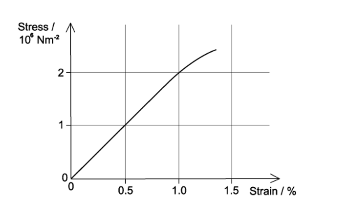

What is the Young modulus of bone?

### Q3 — hard — 1 marks

**Q3** [1 mark]

A metal wire that is supported vertically from a fixed point has a load of 84 N applied to the lower end. The wire has a cross-sectional area of 0.02 mm2 and obeys Hooke’s law. The length of the wire increases by 0.30 %.

What is the Young modulus of the metal wire?

### Q4 — easy — 1 marks

**Q4** [1 mark]

A student wanted to determine the spring constant of a spring. They did this by using different loads to extend the spring by varying amounts.

To find the spring constant, which quantities are required?

### Q5 — easy — 1 marks

**Q5** [1 mark]

A student wanted to measure the Young modulus of a wire, to do this they needed to take a number of measurements.

In which row could the measurement **not** be made **directly** with the listed apparatus?

|   | **Measurement** | **Apparatus** |
|---|---|---|
| **A** | extension of wire | vernier scale |
| **B** | area of cross-section of wire | micrometer screw gauge |
| **C** | original length of wire | metre rule |
| **D** | mass of load applied to a wire | electronic balance |

### Q6 — medium — 1 marks

**Q6** [1 mark]

A steel metal wire has the following properties:

diameter = 5.0 × 10–4 m

Young modulus = 2.0 × 1011 Pa

tension = 20 N

The string snaps and contracts elastically.

By what percentage does a length *l* of a piece of the string contract?

### Q7 — easy — 1 marks

**Q7** [1 mark]

What is the unit of the Young modulus?

### Q8 — easy — 1 marks

**Q8** [1 mark]

A material is extended elastically within the limit of proportionality. What is equal to the Young modulus of the material?

### Q9 — medium — 1 marks

**Q9** [1 mark]

A metal tube with a thin wall thickness *w* is shown in the diagram. The thickness of the wall is small when compared to the diameter of the tube.

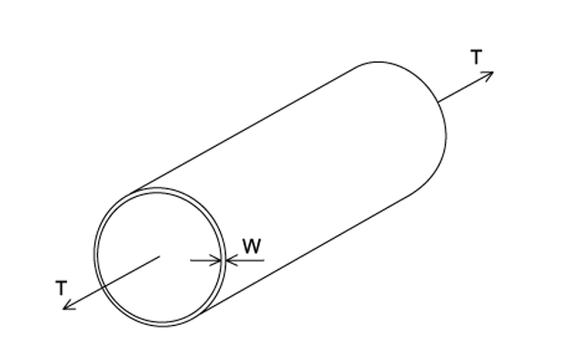

A force T applied parallel to the axis of the tube puts the tube under tension. It is proposed that making the wall thicker would reduce the stress on the tube.

If the tube diameter and the tension remain the same, which wall thickness would half the stress?

### Q10 — medium — 1 marks

**Q10** [1 mark]

The graph below shows the stress-strain for a metal.

When the strain on the rod is 0.010, what is the strain energy per unit volume of a rod made from this metal?

### Q11 — easy — 1 marks

**Q11** [1 mark]

A glass rod was put under stress and strain until it broke. The graph of this is shown below.

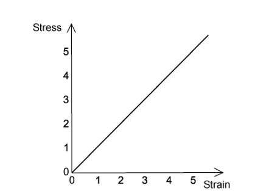

Which of the following statements is correct about the glass rod?

### Q12 — medium — 1 marks

**Q12** [1 mark]

A spring was stretched with increasing load. The graph of the results is shown below.

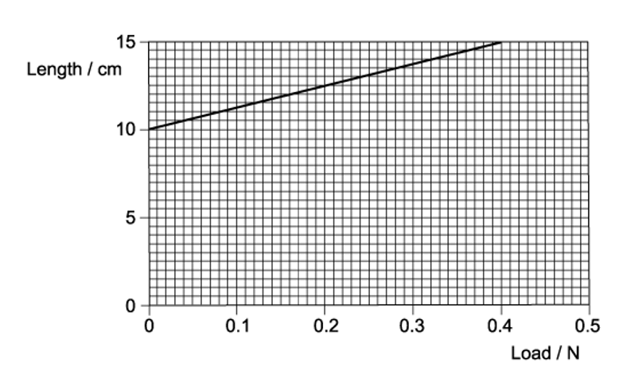

What is the spring constant?

### Q13 — hard — 1 marks

**Q13** [1 mark]

A child with a mass of 40 kg was standing on a diving board. The diving board has a length of 5.0 m and is hinged at one end then supported by a spring 2.0 m from the hinged end. The spring has a spring constant of 10 kN m–1

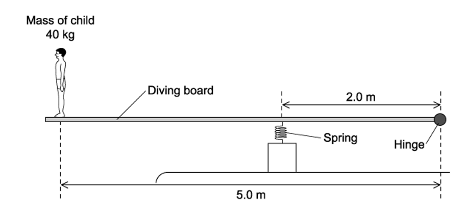

What is the extra compression of the spring caused by the child standing on the end of the board?

### Q14 — easy — 1 marks

**Q14** [1 mark]

Two wires S and T, with the same initial dimensions, were put under stress and strain, the graph shows the results up to their breaking points.

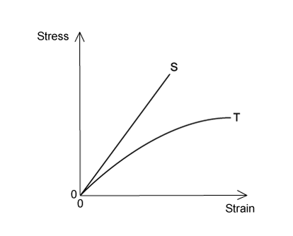

Which statement is **not** correct?

### Q15 — easy — 1 marks

**Q15** [1 mark]

An experiment was carried out to determine the Young modulus of steel using a steel wire.

The uncertainties in the measurements are given below.

| **Measurement** | **Uncertainty** |
|---|---|
| load on wire  length of wire  diameter of wire  extension | ±2%  ±0.2%  ±1.5%  ±1% |

What is the percentage uncertainty in the Young modulus?

### Q16 — easy — 1 marks

**Q16** [1 mark]

The graphs below show the stress-strain graphs of three materials. The graphs do not have the same scales.

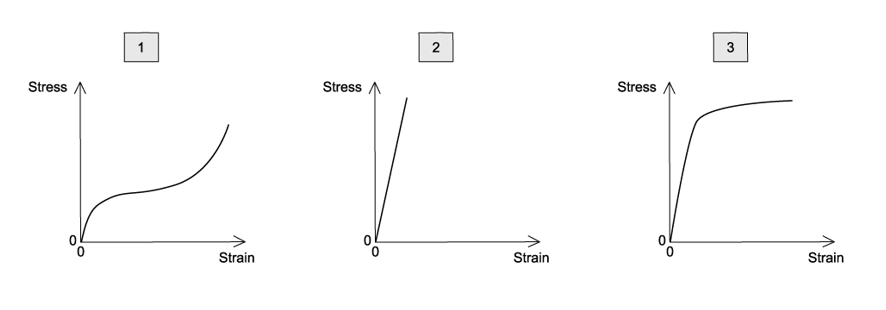

The three materials are copper, rubber and glass.

Which materials are represented by the graphs?

| ** ** | **1** | **2** | **3** |
|---|---|---|---|
| **A**  **B**  **C**  **D** | rubber  rubber  glass  copper | copper  glass  copper  glass | glass  copper  rubber  rubber |

### Q17 — medium — 1 marks

**Q17** [1 mark]

A steel bar, shown in the diagram, has a circular cross-section that is under tension *T*.

The diameter of the thinner portion is half the wider portion.

What is the value of $\frac{stressonthewideportion}{stressonthenarrowportion}$ ?

### Q18 — medium — 1 marks

**Q18** [1 mark]

The Young modulus *E* and the force per unit extension *k* describes the behaviour of a wire under tensile stress.

For a wire of length *L* and cross-sectional area *A*, what is the relationship between *E* and *k *?

### Q19 — medium — 1 marks

**Q19** [1 mark]

The Young modulus of a metal wire determines which property?

### Q20 — medium — 1 marks

**Q20** [1 mark]

A steel spring was stretched to a length of 55 cm when a 25 N weight was hung from it. The spring has a spring constant of 150 N m–1.

What was the original length of the spring?

### Q21 — hard — 1 marks

**Q21** [1 mark]

Two wires S and T is joined, S has a length of 3.0 m and T a length of 1.0 m, both wires have a uniform cross-sectional area.

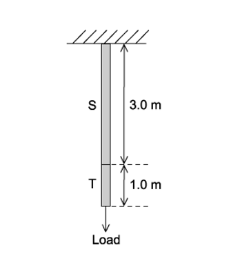

When a load was hung from the wires S stretched by 1.5 mm and T by 1.0 mm.

The same load is then hung from a second wire of the same cross-section and same Young modulus, consisting of 1.0 m of metal S and 3.0 m of metal T.

What is the total extension of this second wire?

### Q22 — medium — 1 marks

**Q22** [1 mark]

A student wanted to find the young modulus of a wire. The equation for the young modulus *E* is:

$E=\frac{4Fl}{πd^{2}x}$

The student extended the wire with a known force and made a series of measurements.

Which measurement has the largest effect on the uncertainty in the value of the calculated Young modulus?

|   | **Measurement** | **Symbol** | **Value** |
|---|---|---|---|
| **A** | length of wire before force applied | *l* | 2.043 ± 0.002 m |
| **B** | force applied | *F* | 19.62 ± 0.01 N |
| **C** | extension of wire with force applied | *x* | 5.2 ± 0.2 mm |
| **D** | diameter of wire | *d* | 0.54 ± 0.02 mm |

### Q23 — hard — 1 marks

**Q23** [1 mark]

The diagram shows a metal cube is placed between two board and compressed elastically by two opposing forces *F*. The cube has a length of each side of $l$

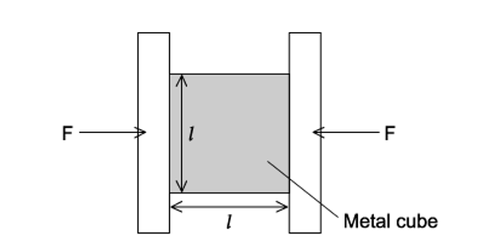

How will ∆*l*, the amount of compression, relate to *l* ?

### Q24 — hard — 1 marks

**Q24** [1 mark]

Two steel wires X and Y that both obey Hooke’s law were used in an experiment. Wire X has a length $l$ and a cross-sectional area A. Wire Y has a length of $2l$ and cross-sectional area of  $\frac{A}{2}$.

What is the ratio $\frac{tensioninX}{tensioninY}$  when both wires are stretched to the same extension?

## Structured Questions (8 questions)

### Q1 — easy — 11 marks

**Q1** [3 marks]

Forces can change the motion of a body, or cause deformation.

State

(i) the definition of *deformation*.

[1]

(ii) the name of the force which stretches an object.

[1]

(iii) the name of the force which squashes an object.

[1]

**Q1** [2 marks]

Hooke's Law can be applied to objects which are stretched or compressed.

State the equation for Hooke's Law, defining any terms used.

**Q1** [3 marks]

A spring is suspended from a stand as shown in Fig. 1.1 and has a load of 5.0 N applied to it. The spring extends by 4.2 cm.

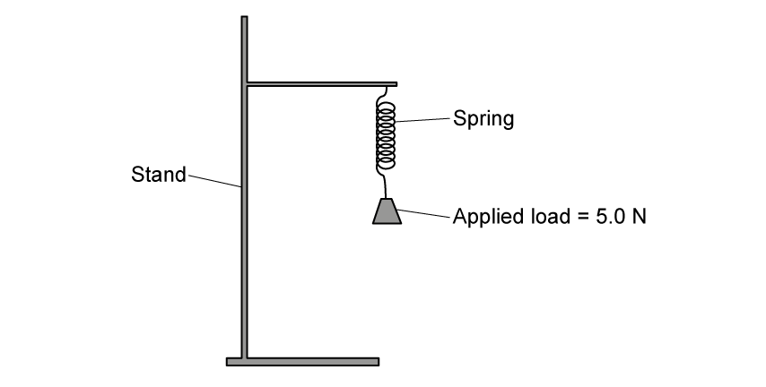

**Fig. 1.1**

Calculate the spring constant, expressing your answer in S.I. units.

**Q1** [3 marks]

Another, thicker spring is attached to a base so that it stands upright, as shown in Fig. 1.2.

A force of 6.3 N pushes down on the spring which compresses it by 2.4 cm.

**Fig. 1.2.**

Calculate the spring constant, expressing your answer in S.I. units.

### Q2 — easy — 15 marks

**Q2** [3 marks]

Define

(i) tensile stress

[1]

(ii) tensile strain

[1]

(iii) the Young modulus.

[1]

**Q2** [4 marks]

Fig. 1.1 shows stress-strain graphs for two different metal wires X and Y.

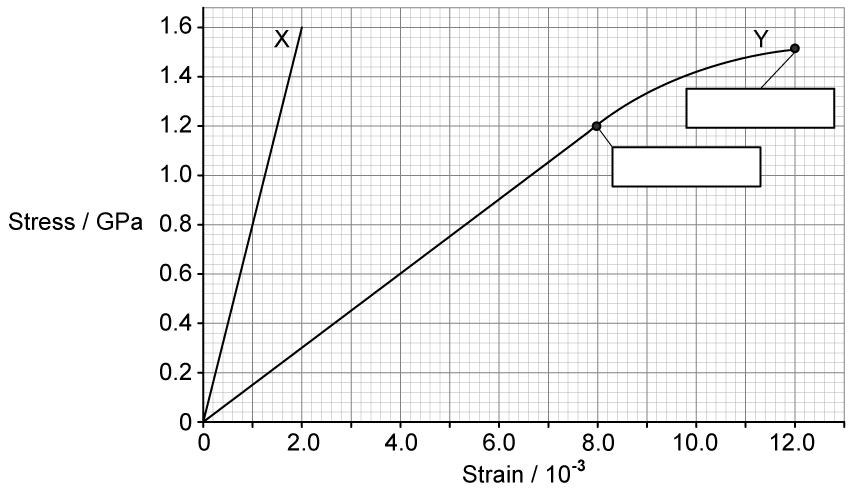

**Fig. 1.1**

Label the points highlighted on Fig. 1.1 and state the definitions of these terms.

**Q2** [2 marks]

**Extract:**

Fig. 1.1 shows stress-strain graphs for two different metal wires X and Y.

State and explain which wire, X or Y, has the greater Young modulus.

**Q2** [6 marks]

**Extract:**

Fig. 1.1 shows stress-strain graphs for two different metal wires X and Y.

Use the graph in Fig. 1.1 to determine

(i) the Young modulus of wire X and state the unit.

[3]

(ii) the extension of wire Y when the stress is 1.2 GPa, and state the unit.

original length of wire Y = 2.0 m

[3]

### Q3 — hard — 10 marks

**Q3** [3 marks]

A student adds a series of masses to a vertical metal wire with a circular cross–section and measures the extension of the wire produced. This is shown in Fig. 1.1.

**Fig. 1.1**

Suggest how the student can determine the Young Modulus of the wire using the graph in** **Fig. 1.1.

**Q3** [3 marks]

**Extract:**

A student adds a series of masses to a vertical metal wire with a circular cross–section and measures the extension of the wire produced.

The metal wire is used to make a cable of diameter 4.9 mm. The Young Modulus of the metal in the cable is 154 GPa.

Calculate the force necessary to produce a strain of 0.40 % in the cable.

**Q3** [4 marks]

Two different cables with spring constants *k*1 and *k**2* are connected in series.

Starting from Hooke's law, show that the combined spring constant, *K* of the two springs is given by the equation $K=\frac{k_{1}k_{2}}{k_{1}+k_{2}}$.

### Q4 — easy — 11 marks

**Q4** [5 marks]

A student is carrying out an experiment to determine the Young modulus of a wire. The student sets up the apparatus as shown in Fig. 1.1.

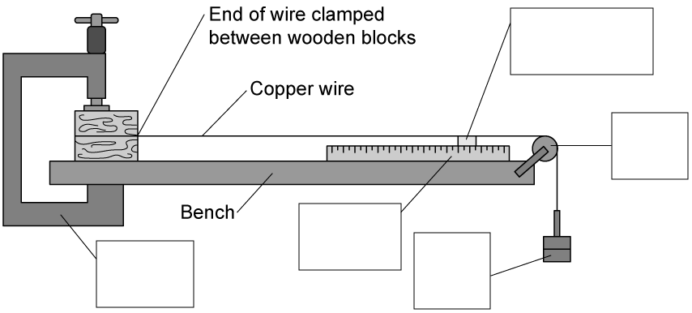

**Fig. 1.1**

Complete the missing labels for the apparatus in Fig. 1.1.

**Q4** [2 marks]

**Extract:**

A student is carrying out an experiment to determine the Young modulus of a wire. The student sets up the apparatus as shown in Fig. 1.1.

State and explain a safety consideration for this experiment.

**Q4** [2 marks]

**Extract:**

A student is carrying out an experiment to determine the Young modulus of a wire. The student sets up the apparatus as shown in Fig. 1.1.

On the axis of Fig. 1.2 below, draw a graph to show the expected variation of strain with stress for this experiment.

Assume that the wire does not stretch beyond the limit of proportionality.

**Fig. 1.2**

**Q4** [2 marks]

**Extract:**

A student is carrying out an experiment to determine the Young modulus of a wire.
On the axis of Fig. 1.2 below, draw a graph to show the expected variation of strain with stress for this experiment. Assume that the wire does not stretch beyond the limit of proportionality. Fig. 1.2

Explain how the student could use the graph in Fig. 1.2 to determine the Young modulus of the wire.

### Q5 — medium — 10 marks

**Q5** [1 mark]

Define work done by a force.

**Q5** [3 marks]

A heavy suitcase is placed on a weighing machine consisting of a platform mounted on a spring as shown in Fig. 1.1.

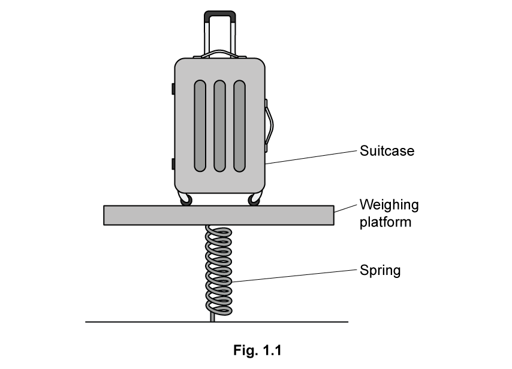

Describe and explain how work is done in this situation.

**Q5** [2 marks]

The diagram in Fig.1.2 shows a suitcase of mass 22.6 kg positioned on the weighing platform.

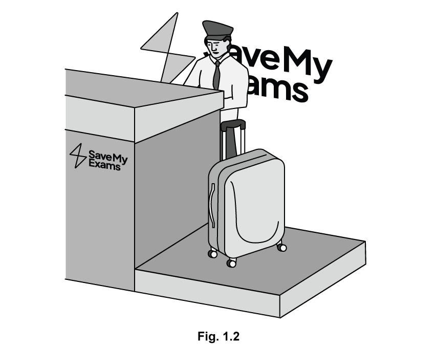

The platform sinks down 3 cm when the suitcase is placed on it, and then returns to its original position when the suitcase is removed.

Calculate the spring constant of the spring.

**Q5** [4 marks]

**Extract:**

The diagram in Fig.1.2 shows a suitcase of mass 22.6 kg positioned on the weighing platform. The platform sinks down 3 cm when the suitcase is placed on it, and then returns to its original position when the suitcase is removed. Calculate the spring constant of the spring. Mass of the suitcase, m = 22.6 kg; Compression of the spring, x = 3 cm = 0.03 m; W = mg = 22.6 × 9.81 = 222 N; k = F/x = 222/0.03 = 7400 Nm^-1

For the weighing platform described in part (c) sketch a graph to show the known properties of the spring.

### Q6 — medium — 9 marks

**Q6** [2 marks]

Nichrome is a common alloy used to make coins and heating elements in electrical appliances. It consists of 80% by volume of nickel and 20% by volume of chromium.

Determine the mass of nickel and the mass of chromium required to make a wire of nichrome of volume 0.50 × 10−3 m3.

Density of nickel = 8.9 × 103 kg m−3

Density of chromium = 7.1 × 103 kg m−3

**Q6** [4 marks]

To calculate the breaking stress of the nichrome wire both the cross-sectional area of the wire and the applied load must be known.

For each value, briefly describe an experimental method to determine the value, mentioning any equipment required.

(i) The cross-sectional area of the wire.

[2]

(ii) The applied load.

[2]

**Q6** [3 marks]

The diameter of the nichrome wire is 5.7 mm. The wire breaks under an applied force of 72 kN.

Calculate the breaking stress of nichrome.

### Q7 — medium — 12 marks

**Q7** [2 marks]

(i) Define force.

[1]

(ii) State what is meant by work done.

[1]

*Source: Specimen 2022 Paper 2 Q3A*

**Q7** [10 marks]

A block of mass 0.40 kg slides in a straight line with a constant speed of 0.30 m s–1 along a horizontal surface, as shown in Fig. 3.1.

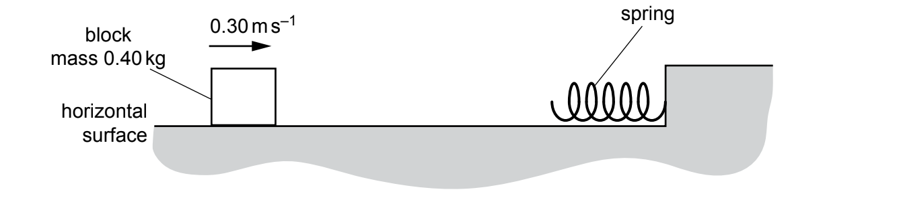

**Fig. 3.1**

Assume that there are no resistive forces opposing the motion of the block.

The block hits a spring and decelerates. The speed of the block becomes zero when the compression of the spring is 8.0 cm.

(i) Calculate the initial kinetic energy of the block.

kinetic energy = ....................................................... J [2]

(ii) The variation of the compression x of the spring with the force F applied to the spring is shown in Fig. 3.2.

**Fig. 3.2**

Assume that the elastic potential energy of the spring when its compression is 8.0 cm is equal to the initial kinetic energy of the block.

Use your answer in **(b)(i)** to calculate the maximum force *F*max exerted on the spring by the block.

*F*max = ...................................................... N [2]

(iii) Calculate the maximum deceleration of the block.

deceleration = ................................................. m s–2 [2]

(iv) State and explain whether the block is in equilibrium:

- before it hits the spring

........................................................................................................

- when its speed becomes zero.

........................................................................................................

[2]

(v) The block is now replaced by another block of the same mass. Frictional forces affect the motion of this block so that it has a speed of 0.25 m s–1 when it makes contact with the spring.

A short time later, the block has a speed of 0.15 m s–1 as it loses contact with the spring and moves back along its original path.

Calculate the magnitude of the change in momentum of the block.

change in momentum = .................................................... N s [2]

*Source: Specimen 2022 Paper 2 Q3B*

### Q8 — hard — 18 marks

**Q8** [6 marks]

As part of a quality check, a manufacturer of dog leads selects a sample of the wires used for the leads to a tensile test.

The sample of wires used is 3.0 m long and is of constant circular cross–section of diameter 0.92 mm. Hooke’s law is obeyed up to the point when the wire has been extended by 20 mm at a tensile stress of 4.6 × 108 Pa.

The maximum load the wire can support before breaking is 350 N at an extension of 12 cm.

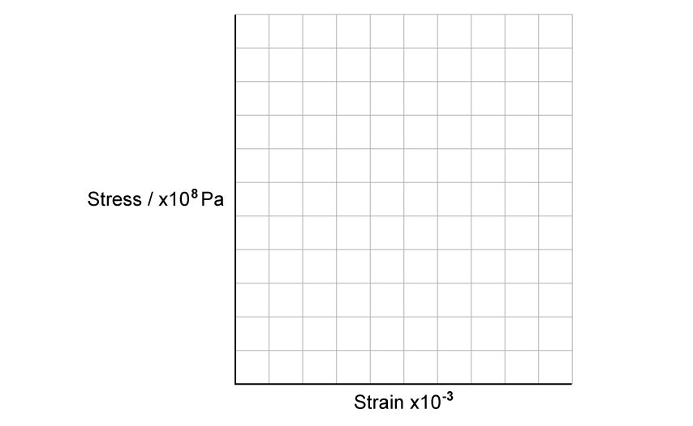

**Fig. 1.1**

Sketch a graph on Fig. 1.1** **to show how you expect the tensile stress to vary with strain and mark the values of stress with corresponding strain at the limit of Hooke's law and the breaking point.

**Q8** [4 marks]

**Extract:**

As part of a quality check, a manufacturer of dog leads selects a sample of the wires used for the leads to a tensile test. The sample of wires used is 3.0 m long and is of constant circular cross–section of diameter 0.92 mm. Hooke’s law is obeyed up to the point when the wire has been extended by 20 mm at a tensile stress of 4.6 × 10^8 Pa. The maximum load the wire can support before breaking is 350 N at an extension of 12 cm.

A different 3.0 m dog lead sample has a larger diameter. It is made of the same material and is subject to the same force.

Compare the advantages and disadvantages of this dog lead compared to the first.

**Q8** [4 marks]

Calculate the force needed to extend a piece of 3.0 m leather dog leash with a radius of 2.3 mm to change its surface area by 4.1 × 10–3 m2. Assume that the cross–sectional area is kept constant throughout the extension.

Young Modulus of leather = 0.05 GPa.

**Q8** [4 marks]

To prevent the walls of old buildings collapsing a metal rod is often used to tie opposite walls together, as shown in Fig. 1.2 below.

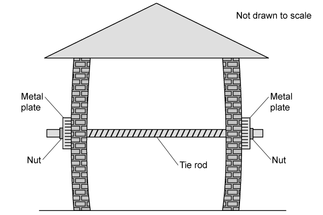

**Fig. 1.2**

In one case a steel tie rod of diameter 15 mm is used. When the nuts are tightened, the rod extends by 6 %. The Young Modulus of steel is 2.5 × 1011 Pa.

Calculate the force exerted on the walls by the rod.
